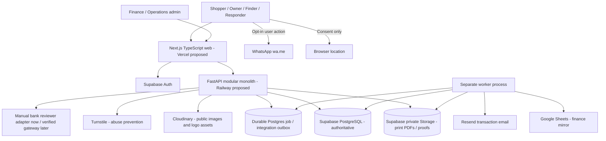
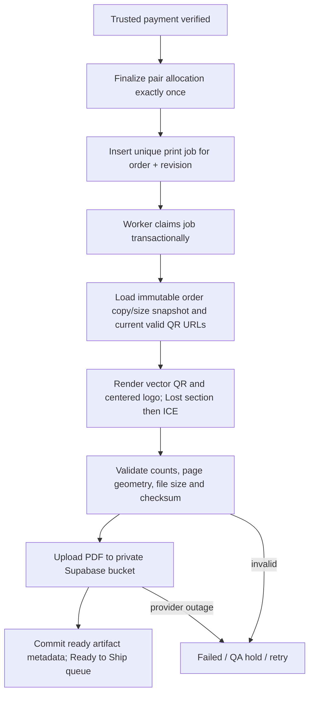
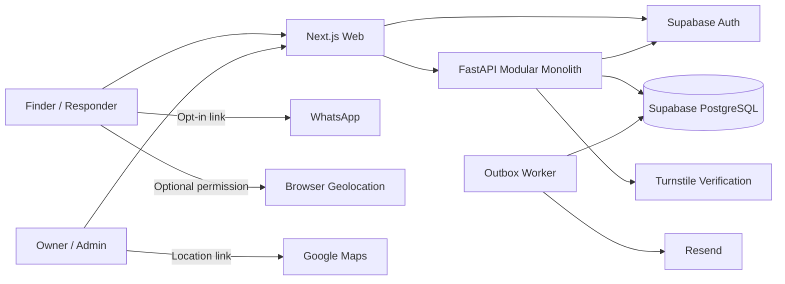
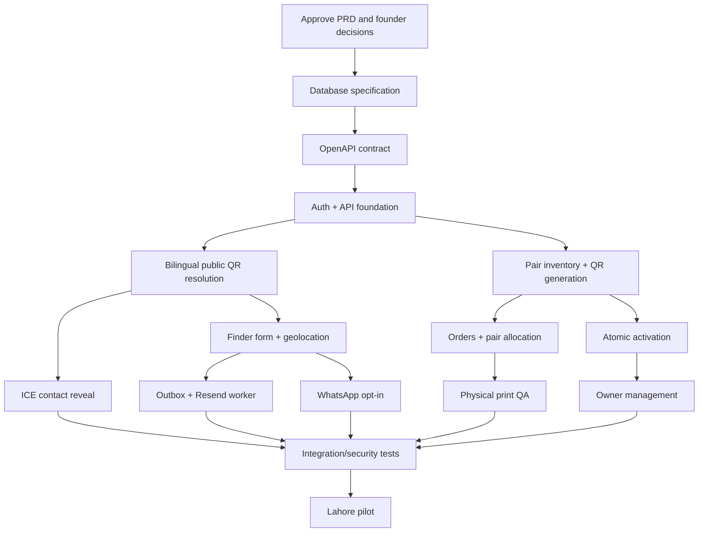

# SafeReturn — Technical Design Document (TDD) v1.2

**Document ID:** SR-TDD-001  
**Version:** 1.2 — implementation design draft  
**Date:** 12 October 2026  
**Product:** SafeReturn, Lahore pilot  
**Authoritative product source:** `SafeReturn_01_Product_Requirements_Document_v1.2.md`, **Part A**; unaffected v1.1 requirements continue.  
**Revises:** `SafeReturn_02_Technical_Design_v1.1(1).md`  
**Status:** Design for founder, engineering and security review; not deployed/verified.

> **How to use this document.** Part I is the **current v1.2 technical contract**. Part II reproduces the original v1.1 TDD as *archived supporting detail*, not a second competing specification. For any conflict, v1.2 Part I and PRD v1.2 Part A prevail. No AI coding agent may silently choose the obsolete v1.1 interpretation. Definitive DDL and exact REST endpoint names are reserved for Documents 03 and 04 v1.2; names in this TDD marked *proposed* must be reconciled there. Existing v1.1 protections not explicitly superseded remain mandatory.

---

# PART I — CURRENT v1.2 TECHNICAL DESIGN

## 1. Design goals, scope, and invariants

Build a low-maintenance, bilingual, secure modular-monolith platform enabling one purchased **QR identity pair** to be printed in independent quantities and size variants, paid for using replaceable verification adapters, delivered physically, and activated through a saved scan context.

### 1.1 Unbreakable invariants

1. **One pair identity = one `tag_pairs` record, exactly one current Lost QR and one current ICE QR, with two distinct high-entropy public tokens; one pair-level activation entitlement/credential.** Each printed copy is a repetition of one of the existing URLs, **not** a new token, child QR record, customer account item or activation.
2. For example, three Lost labels plus two ICE labels—of any allowed mixture of sizes—**allocate exactly one pair, use exactly two public destinations and produce exactly five printed labels**.
3. A public QR token locates a page; it is neither an activation secret nor proof that its scanner is the purchaser. Pair ownership is verified against authenticated order entitlement or a separate concealed code/approved transfer mechanism.
4. Reservation is exclusive and temporary; final allocation happens once trusted payment verification has succeeded. Never deliver a paid pair twice or release a reservation while a plausibly settled payment awaits reconciliation.
5. Customer-submitted transfer details or screenshot **never themselves verify payment**. A trusted human reviewer or a verified future gateway adapter is required.
6. Order identity, normalized payment outcome, allocation and fulfillment do not depend on the choice of payment provider or existence of Google Sheets.
7. Private production PDFs and payment evidence live in **separate private Supabase Storage buckets**; Cloudinary holds **public product/marketing assets** in P0. No duplicate sensitive PDFs in public Cloudinary media.
8. Printed tags contain canonical public URLs and logo, never purchaser private data, emergency full phone, medical information or unmasked activation credential. QR is scan-tested at its printed size.
9. Public finder and emergency responder flows need no login. The current protections for emergency phone reveal, optional geolocation, opt-in WhatsApp, and durable email outbox remain mandatory.
10. Sensitive transitions are audited, idempotent, least-privilege and recoverable; stale retries and concurrent workers must not create duplicate resources.

### 1.2 P0 scope and exclusions

Includes admin pair batches; QR artwork and print QA; versioned variants and quotes; one-pair configurable checkout; prepayment pair reservation; manual Raast/bank-transfer submission/verification; private screenshot storage; finance Sheets mirror; verified-payment allocation; vector-oriented order PDFs; Ready to Ship and cleanup; scan-led entitlement-bound activation; existing finder/ICE and notifications. Excludes automatic bank scraping, automatic screenshot approval, native mobile apps, separately owned printed copies, microservices, Kafka/Redis/Celery by default and public accessible production PDFs. Future trusted payment gateway support is an **adapter boundary**, not a claim of existing integration.

### 1.3 Approval-dependent settings (do not invent values)

Actual QR sizes, substrates and tiered prices; permitted quantity limits and shipping; reservation hold and delayed-transfer review windows; gateway/vendor and signature rules; sender identifier handling; optional screenshot policy; evidence retention; document reprint/retention policy (candidate delivery + 7 days); Google Sheet identifier and column permissions; final canonical domain; centered-logo size/ECC QA; admin operational roles; gift transfer policy; printer DPI/media; retention exceptions and legal/privacy notices. Use feature-flagged settings and controlled configuration, not undocumented hard-coded decisions.

## 2. High-level architecture



**Trust boundary:** browsers interact with Supabase Auth and FastAPI; do not expose database credentials, service-role keys, storage secrets, payment adapter secrets, Google service account keys or private artifact URLs in public HTML. PostgreSQL is the sole authoritative transactional ledger. Worker tasks run after durable database commits; never put Google Sheets, Resend, or a PDF provider call inside the payment DB transaction.

### 2.1 Retained technology choices

- Next.js App Router, TypeScript, Tailwind; EN/UR dictionaries, responsive/RTL; verified authentication/session model.
- FastAPI/Pydantic; PostgreSQL; **v1.1 baseline SQLAlchemy 2.x + Alembic**; explicit services/transactions and reviewed migrations (any replacement with raw SQL requires a separate architecture decision, not an implicit change).
- Supabase Auth, PostgreSQL, private Storage; Resend with separate durable notification outbox; Cloudflare Turnstile with previously approved risk-adaptive ICE emergency fallback.
- Segno or equivalent standards-correct QR generation, deterministic/vector PDF composition with approved print fonts; Pillow/SVG helpers if needed. Pin versions only after compatibility verification.
- Vercel/Railway proposed deployment, not a guarantee of plan/quota suitability; pytest, Playwright, CI checks and real PostgreSQL integration tests.
- Cloudinary for approved public imagery (e.g. source logo/optimized product photos), not payment evidence or private printable production assets.

### 2.2 Proposed maintainable repository structure

```text
safereturn/
  AGENTS.md
  .gitignore
  .env.example                       # names only, never real credentials
  README.md
  docs/01-PRD.md ... 11-ui-ux-spec.md
  frontend/
    app/                             # public, auth, owner, admin routes
    components/
    features/{scan,activation,shop,checkout,orders,payments,admin}/
    lib/{api,auth,i18n}/
    messages/{en,ur}.json
    tests/
  backend/
    app/
      main.py
      core/{config,logging,errors}.py
      api/v1/                       # thin FastAPI routers
      domains/
        identity/ activation/ inventory/ qr_artwork/
        catalog/ checkout/ orders/ payments/
        printing/ fulfillment/ storage/ sheets_sync/
        profiles/ finder/ contact_reveal/ notifications/ admin/
      db/                           # sessions, models/repositories
      integrations/{supabase_storage,cloudinary,google_sheets,payment}/
      worker/{jobs,outbox,cleanup}.py
      security/
    alembic/                         # reviewed explicit migrations
    tests/{unit,integration,contract,security}/
    pyproject.toml
  scripts/                            # bounded ops tools, no unchecked production commands
  .github/workflows/
```

Keep API handlers thin; move transactions, authorization and state transitions to services; isolate provider SDKs behind interfaces; no direct frontend writes to business tables. Do not instantiate heavyweight worker loops in API startup.

## 3. Core domain boundaries

| Module | Owns | Calls / emitted events |
|---|---|---|
| Pair and inventory | Batch generation, public tokens, current-tag history, eligible stock and reservation | `PairReserved`, `ReservationReleased`, `PairAllocated` |
| Catalog and pricing | Configured allowed variants, type, physical dimensions, min size, server prices | Immutable checkout quote and order snapshots |
| Orders/checkout | Order identity, address/contact snapshot, quantities per type×size, quote validity | Reservation request, payment attempt initiation |
| Payments | Provider-neutral attempts, manual evidence, trusted settlement verification, dispute/refund | Exactly-once business `PaymentVerified` transition (delivery at least once) |
| Printing | Versioned render spec, QR art, PDF job, QA and secure delivery | `PrintJobQueued/Ready/Failed`, retention due |
| Fulfillment | Packing, activation insert custody, shipping/delivery and exception states | `ShipmentDelivered` and retention eligibility |
| Activation | Scan return-intent, entitlement check, atomic owner claim | `PairActivated` and safe owner dashboard redirect |
| Notifications | Message + outbox atomic persistence and delivery retry | Email send attempts, failure signals |
| Sheets mirror | Redacted projection and upsert mapping | Retry after commit; never authoritative |
| Privacy/storage | Protected evidence and artifacts, time-limited download, cleanup holds | Audit deletion result without retained raw file |

**Canonical database membership:** `qr_codes.pair_id` and current per-type partial uniqueness (retaining replacement history); `tag_pairs.owner_user_id` is authoritative. Exactly two eligible current children must be checked at generation completion, QA and activation; simple uniqueness alone is insufficient. The v1.1 TDD's older unconditional `(pair_id,tag_type)` wording must **not** override the v1.1 DB migration spec's final partial current-tag uniqueness design.

## 4. QR token, branding, and batch-generation pipeline

### 4.1 Generation, accounting and QA

1. Admin with verified ops permissions selects **Create New QRs** and enters positive count N within policy-configured limits. Show projected inventory change: N pairs and 2N distinct current URLs.
2. Backend validates operator and CSRF/session requirements, takes idempotency key, securely generates N Pair IDs, each with separate CSPRNG high-entropy public tokens for `lost` and `ice`, and pair credential verifier. Do not persist raw activation secret; retain it only through a protected one-time production process if required for gift/manual fulfillment.
3. Commit batch + paired children atomically per bounded batch/chunk, or mark entire batch failed and ineligible pending repair; no publicly allocatable half-pair.
4. Batch quality check ensures exactly two current tags, no duplicates, canonical URL encoding and safe credential custody; only approved/eligible batches may enter reservable stock.
5. Inventory screen derives **available pair count**, reserved pairs, allocated pairs and exceptions; never count printed copies as inventory assets. Admin low-stock warning derives from available eligible pair count; auto-generate is **not** authorized for P0.

### 4.2 Public QR and brand mark engineering

- URLs: `https://<verified-controlled-domain>/q/{opaque_token}`. A full HTTPS canonical public URL is the *only* QR payload; avoid embedded activation/account/medical data and redirect services that may expire.
- Keep at least 128 bits of token entropy; no sequential public references, predictable token construction or raw public tokens in request logs and third-party analytics.
- Logo is a centered graphic over a carefully bounded solid backing shape. Keep four-module clear quiet zone intact and verify that finder/emergency scanners decode on real printed media. A logo does **not** certify authenticity; canonical domain and server-side current-tag record do.
- v1.1 print baseline: total printed code including quiet zone **at least 30×30 mm indoor, 35×35 mm outdoor**; ECC M/Q was baseline but a logo requires design-specific measured robustness, potentially ECC H or logo reduction after review. Do not advertise an unsupported small size. Printing must preserve physical scale and minimum effective module dimension.
- Prefer vector QR paths and vector logo; no raster upscaling. Keep contrast, cut marks, English/Urdu purpose label and Tag A/B differentiation. Printer/substrate/lamination tests are release blockers.
- Generated batch image is a **source QR artwork**, not necessarily a completed physical sticker. Customer-selected print variants determine the final placement, never token regeneration.

### 4.3 Resolution of a valid scan

`GET /q/{token}` frontend consults the public FastAPI scan projection. For current eligible **unactivated** tag, render localized neutral “This QR is not activated yet” + **Activate QR**, without displaying owner/purchaser, activation code, bank or order status. Active Lost and ICE pages keep independent anonymous profiles and all v1.1 ICE-privacy requirements. Suspended/revoked/unknown token routes give safe controlled responses without account enumeration. Do not cache private projections or leak full phone through SSR/RSC/hydration.

## 5. Scan-led activation without repeat scan

### 5.1 Flow

```mermaid
sequenceDiagram
  participant S as Scanner
  participant W as Next.js
  participant A as Supabase Auth
  participant API as FastAPI
  participant DB as PostgreSQL
  S->>W: GET /q/{token}
  W->>API: Resolve current token (public projection)
  API-->>W: unactivated / tag purpose
  S->>W: Click Activate QR
  W->>API: Create short-lived pending scan intent
  API->>DB: Store opaque intent bound to token identity, expiry
  API-->>W: Opaque pending_intent_id
  W->>A: Login/register + bounded return state
  A-->>W: Verified authenticated session
  W->>API: Read pending intent with authenticated session
  API-->>W: Safe pair summary + eligibility or concealed-code step
  S->>W: Confirm Activate Pair
  W->>API: POST activation with idempotency key + intent
  API->>DB: Lock pair; check order entitlement and two current tags; assign owner atomically
  API-->>W: Both active / already mine / denied
  W-->>S: Setup dashboard; no second scan
```

### 5.2 Important security details

- Public scan identifier by itself **never** authorizes ownership. An eligible online purchaser must be authenticated, verified, the customer of the allocated order and not prohibited by dispute/suspension policy. An off-platform gift uses separate concealed single-use credential and approved transfer policy.
- Store only a random opaque scan-intent ID in browser return state; recommended server-side TTL, one-time consumption, origin/redirect allowlist, CSRF and replay protection. Don't put activation credential or payment/owner IDs into open redirect parameters or long-lived localStorage; no forced browser geolocation.
- Auth callback resumes and server resolves same intended pair. If intent expired, show a safe retry from the known page (may require re-opening link), not arbitrary pair activation or cross-user context confusion.
- Lock the pair and current children during a single DB transaction, validate status/entitlement, set `owner_user_id` and both tag activation states, consume applicable credential/entitlement exactly once, record audit/outbox. If either child fails, **rollback everything**.
- Idempotent repeat by same authorized owner returns safe success; different user sees generic claim denial with recovery guidance. Cross-account requests return no private purchaser details.
- Post-activation owner may configure each tag independently, preserving Lost vs ICE purpose constraints, opt-in WhatsApp, and ICE publication consent; first scan before activation never exposes these profiles.

## 6. Catalog, configurable physical copies, quote, and checkout

### 6.1 Data model and pricing invariants

An order for a newly purchased kit contains one **pair unit** plus immutable order lines such as:

| Line | Tag identity | Physical variant | Copies | New QR identities |
|---|---|---|---:|---:|
| 1 | Lost | Approved small label | 3 | 0 beyond pair's existing Lost tag |
| 2 | ICE | Approved medium label | 2 | 0 beyond pair's existing ICE tag |
| **Total** | **One Pair ID** | Mixed variants | **5** | **Exactly 2 QR destinations** |

A later expansion to **multiple distinct kits** must use explicit `pair_units` and a per-unit configuration model; never silently interpret five stickers as five pairs. For P0, **one kit per configured order** is the safest coherent contract unless the future API/DB specifications explicitly model multiple independent pair units.

- Server catalog defines product/size/substrate/tag applicability, active state, minimum physical QR dimensions, copy maximum, print template, unit prices, optional base-pair charge and shipping/tax policy. Do not hardcode demo sizes or prices.
- Require integer non-negative counts per allowed type×variant; per newly purchased pair, total Lost >= 1 and ICE >= 1; enforce aggregate caps. Reject inactive variant or values beyond physical QA limits.
- A quote is server-computed in PKR using decimal arithmetic (`numeric`/`Decimal`) and returns itemized lines, delivery/tax/discount, total, version/expiry. On order placement revalidate quote and catalog version; if stale, show repricing confirmation.
- Save an immutable shipping/contact snapshot for order; allow contact/address edit before confirmation, and explicit post-order change workflow thereafter. Never trust client-supplied prices or pair/token IDs.
- Frontend customer flow: choose sizes and copy counts → reviewed price/address/contact → login if needed → create order/reservation → payment instructions → submit transfer details/evidence → customer order status.

### 6.2 Atomic reservation and reconciliation

```text
begin transaction
  check actor, order and quote version
  lock one eligible QA-approved unallocated tag_pairs row (SKIP LOCKED when appropriate)
  create exclusive reservation(pair_id, order_id, expires_at, state='held')
  persist immutable order and item copy snapshots
  persist audit and any post-commit job event
commit
```

A partial unique/constraint strategy must prevent two *live* reservations or allocations on the same pair. TTL is a policy value, not an ad hoc background sleep. A cleanup job must **not** release an expired reservation if the order has a submitted payment that could still settle; route to review/grace/reconciliation with operator-visible exceptions. For abandoned unpaid quotes, release safely and audit; if late legitimate settlement follows released reservation, do **not** reallocate the original pair blindly—stop fulfillment, reconcile or allocate a different eligible pair transactionally with recorded change.

Reservation **does not mean sale**. Pair allocation is finalized only on a trusted verified-payment transition. If provider or worker race occurs, enforce uniqueness at DB level and retry after reconciliation. Rejection/return/chargeback/shipped/activated pairs require explicit exceptional handling; do not recycle automatically.

## 7. Provider-independent payments

### 7.1 Stable boundaries

Define service/adapters (names illustrative):

```python
class PaymentProviderAdapter(Protocol):
    def begin_attempt(self, order, *, idempotency_key): ...
    def validate_submission(self, payment_input): ...
    def verify_trusted_settlement(self, evidence_or_provider_event): ...
    def get_reconciliation_status(self, provider_reference): ...
```

No payment adapter directly controls QR URLs, allocation, order lines, storage file lifetime or print renderer. The internal `PaymentService.confirm_verified_payment()` validates amount, currency, order, trusted verification source, duplicate transaction references, authorization, and valid state transition inside one PostgreSQL transaction. Emit a durable outbox/job record for **finalize allocation + print request**, and a finance-sheet projection event only after commit. The business transition is at-most-once; events/jobs can be delivered at least once and must deduplicate.

### 7.2 Manual transfer adapter for Lahore pilot

1. Show *SafeReturn receiving* Raast/bank details, customer order ID and exact price. After transferring separately, customer enters **sender** account/Raast identifier, holder name, transfer reference (if known), transfer time (optional), and optional screenshot subject to current evidence policy.
2. Backend validates lengths/types and evidence MIME, magic bytes and file limits; normalize/encrypt restricted sender data; save masked presentation. Create/append a payment attempt and mark `submitted`/`under_review`; never mark verified on customer evidence.
3. Authorized finance reviewer with MFA opens protected admin queue, independently checks trusted bank/Raast settlement and exact order amount/currency/reference, then records verified/rejected/needs-information, reviewer identity, verified source and audit event. Competing reviewers require expected-version check and locking.
4. Verified transition commits once; subsequent retries return existing outcome. Rejected submission stays in attempt history; customer may resubmit without changing order ID or automatically allocating a second pair.

### 7.3 Future gateway adapter seam

Later integration adds provider checkout session/redirect and server-side signed webhook processing. Never trust a client “payment success” redirect. Verify signature, timestamp/replay policy, provider transaction uniqueness, allowed environment, correct order/amount/currency and actual settled status; then call the **same** internal payment confirmation operation. Persist event receipt/dedup, webhook retries, timeout and reconciliation. Refund/chargeback have separate controlled reversals—never unship or revoke an active public emergency tag automatically. Rollout behind versioned configuration, shadow/test events and manual fallback; legacy orders remain readable.

### 7.4 Example state separation (final vocabulary in Doc 03/04)

- **Order:** draft/placed/confirmed/cancelled/closed; independent of provider.
- **Payment attempt:** awaiting/submitted/under_review/verified/rejected/expired/refund-related statuses.
- **Reservation:** held/review_hold/released/finalized/exception.
- **Production:** queued/rendering/ready/QA_hold/failed/packed/dispatched/delivered.
- **Activation:** unclaimed/active/disputed/revoked independently of shipping.

Render statuses truthfully in My Orders; never label submission as paid. Separate raw provider statuses from normalized internal status and audit source.

## 8. Private evidence, PDFs, and storage services

### 8.1 Storage responsibilities

| Component | Contents | Exposure | Lifecycle |
|---|---|---|---|
| Supabase PostgreSQL | Orders, copy lines, payments, pair IDs/tokens, refs, print jobs, audit and deletion status | Server-enforced, authoritative | Policy-governed long-lived |
| Supabase private `payment-evidence` bucket (proposed) | Optional screenshots/payment documents | Finance-authorized restricted access | Finance/dispute deadline and holds |
| Supabase private `production-artifacts` bucket (proposed) | Versioned printable PDF, protected activation insert/manifest as needed | Fulfillment-only on-demand short-lived URLs/stream | Delivery + approved grace and holds |
| Cloudinary | Brand/logo source and public product photos only | Public media with appropriate transformations | Marketing retention policy |
| Google Sheets | Masked derived finance reporting rows | Restricted finance spreadsheet | Sync/report retention policy |

Use server-created randomized object keys by environment/order/revision, no guessable exposed public bucket paths, no direct client permissions to browse sensitive objects. Record content type, byte size, checksum, revision, creation/deletion metadata and object visibility; never store permanent signed URLs in DB or spreadsheets. If an upload path must be client-assisted, use time-bounded authenticated one-object permissions, server finalize/scan and ownership checks.

### 8.2 Render-once PDF pipeline



- Preserve exact per-type × variant copy counts. Same QR URL and graphic reused for all copies of a given tag; do not regenerate QR identities; ensure cut lines outside quiet zones. Arrange **Lost first**, then **ICE**, with sizes grouped inside each section.
- Use deterministic page layout from explicit mm dimensions, approved stock size, margins, cut gutters and bleed where printer-supported. Generate scalable vector QR modules, reusable vector brand art, necessary subsets of bilingual fonts, bounded raster content and compression; no page-sized repeated bitmap for each copy.
- Restrict file pages/bytes by configurable production QA maxima based on printer tests; report oversized job error rather than silently shrinking required physical QR dimensions. Render in a controlled worker with time, CPU/memory, output and temporary-file limits.
- Activation credential must be physically concealed and **not on public stickers**. If a private insert is needed, generate/handle it as a separately access-controlled print component, consumed through authorized fulfillment; prevent raw secret persistence in normal tables/logs and avoid ordinary reusable PDFs exposing a secret indefinitely. For online purchaser entitlement, do not fabricate a new code when not required; reconcile with gift/support policies.
- Enqueue at most one **active** render per `(order_id, render_revision)`; worker retries must not produce multiple ready objects. Upload via temporary key and verify checksum/bytes, then commit final artifact state. Recover orphaned objects after DB failure and missing-object references after storage failure.
- Print queue is available only when **paid + allocated + artifact ready**. PDF-ready does not equal physically QA-passed; fulfillment operator downloads, prints, checks representative samples/required labels, packs, dispatches and updates audited shipment state.

### 8.3 Lifecycle and deletion

Keep metadata and order itemization when deleting object bytes. Candidate PDF deletion policy: confirmed delivery + **at least proposed 7-day grace**, only with no active dispute, legal hold, approved reprint or open operational exception; value not yet final. Evidence deletion follows **separate finance/legal-approved dispute policy**, never immediate approval unless explicitly authorized. Cleanup worker selects eligible objects under locks, records an idempotent deletion intent, calls storage, verifies absence where possible, and commits tombstone/audit. Provider errors retry; DB/object divergence is monitored. Protect backups and caches with documented expiry caveat: deleting primary object is not guaranteed erasure from retained backups.

An authorized reprint after expiration must regenerate from immutable saved order type/size quantities, verified current QR tokens and controlled activation insert policy—**never generate new public tokens as a side effect**. Replacement/revoked tokens trigger hold/escalation, not printing a dead URL.

## 9. Google Sheets synchronization (finance mirror)

**Source:** database row/event, never client form or Sheets cell. Proposed outbox `finance_sheet_upsert` contains stable order/payment identity, projection version and not raw evidence. Worker uses an approved service account restricted to the founder-provided spreadsheet; use a stable row-key mapping in the database and a read-before-create/upsert strategy safe across retries. Use masked sender account and only authorized holder information, order total, reference, status, reviewer ID/time and an access-controlled evidence *reference* (no public raw screenshot link). Do not embed screenshot data/images in cells.

DB payment state commits before Sheets update. If Sheets API is unavailable, retain pending job with bounded exponential retry/jitter, telemetry and operator replay; a Sheets edit never marks a payment verified. Handle manual row edits/duplicate IDs with reconciliation rather than overwriting unrelated cells. The actual spreadsheet has **not** been supplied; headings, sharing, range and approval are prerequisites, not invented facts.

## 10. Durable jobs, reliability and recovery

Use one independently deployed Postgres-backed worker process initially, with separate typed job handlers for notifications, pair allocation/print enqueue, render, Sheets sync and lifecycle cleanup. Keep the existing finder-message + email-notification outbox atomic write guarantee. Long external calls happen **outside DB locks**; DB claim uses `FOR UPDATE SKIP LOCKED`, lease/attempt/version, backoff and dead-letter/exception visibility. Unique operation keys prevent duplicates. On restart, reclaim expired leases. Implement independent periodic reconciliation for stale payments/reservations, paid-but-unallocated orders, ready-file missing objects, uploaded orphan objects, stuck Sheets rows, delivery-triggered cleanup and unexpected stock counts.

**Business transaction sketch:**

```text
confirm_payment(trusted_verification, idem_key):
  begin
    lock payment/order and related reservation
    validate trusted evidence, amount, PKR, currency, ownership, state/version
    if verified earlier: return existing result
    record verified attempt/event and full audit record
    mark order payment verified, preserve reservation/reconciliation lock
    insert unique internal 'finalize_allocation' job/outbox event
    insert unique finance sheet upsert event
  commit

finalize_allocation(payment_event):
  begin
    lock order/reservation/pair
    if already allocated correctly: finish idempotently
    require payment verified, valid full pair, proper eligibility, no other allocation
    finalize reservation into allocation, update inventory
    insert unique print job event for order/revision
    audit
  commit
```

There can be a short **paid-but-allocation-pending** state. It must be visible as processing, not shown in Ready to Ship until allocation and PDF succeed. If reservation is no longer valid at verification, raise audited reconciliation exception; never silently allocate a conflicting pair.

## 11. API contract seam — proposed families, not final route contract

Preserve `/api/v1`, RFC3339 UTC, string decimal money, bearer JWT validation, idempotency keys, paginated owner/admin lists, `Cache-Control: no-store` on private flows, standard safe error format and bilingual public errors. **Document 04 v1.2 must select exact routes, request/response models and error codes** (do not silently deploy examples below).

| Family | Proposed operations | Authorization |
|---|---|---|
| Public scan | Resolve `{token}`, publish neutral preactivation state, active Lost/ICE projection | Anonymous; abuse controls |
| Activation intent | Create safe opaque intent; resume post-auth; activate pair from verified entitlement or concealed code | Public limited intent + authenticated final step |
| Catalog/quote | List sellable variants; calculate server-side quote | Public browse; trusted server pricing |
| Checkout/orders | Create immutable copy lines, address snapshot, exclusive pair reservation, order status | Authenticated customer |
| Payment submission | Create provider-neutral attempt; submit sender details/evidence; view masked state | Order owner |
| Admin finance | Review settlement; record reasoned verified/rejected decision; reconcile duplicate/late payments | Finance role + MFA |
| Admin QR batches | Generate N complete pairs; inspect eligible inventory/low-stock | Operations role |
| Admin print/fulfillment | Print queue, artifact generation/retry, short-lived authorized download, QA, delivery, versioned reprint | Fulfillment role |
| Sheets operations | Monitor/retry mirror sync without changing bank truth | Authorized admin/worker only |
| Cleanup operations | Inspect retention due/held/deleted; approved exceptional early delete | Restricted retention role |
| Existing profiles | Public finder submission, protected ICE phone reveal, owner tag profiles, inbox, WhatsApp preference | Existing v1.1 role and consent rules |

Explicit responses needed: `QUOTE_STALE`, `INVALID_COPY_QUANTITY`, `VARIANT_NOT_ELIGIBLE`, `OUT_OF_STOCK`, `RESERVATION_REVIEW_HOLD`, `PAYMENT_NOT_VERIFIED`, `PAYMENT_RECONCILIATION_REQUIRED`, `ACTIVATION_ENTITLEMENT_REQUIRED`, `SCAN_INTENT_EXPIRED`, `PAIR_ALREADY_CLAIMED`, `PRINT_QA_HOLD`, `ARTIFACT_EXPIRED`, `STORAGE_TEMPORARILY_UNAVAILABLE` (proposed code identifiers; final names in Doc 04). Every write uses request version/concurrency or idempotency as relevant.

## 12. Authentication, authorization, security and privacy

- Validate Supabase JWTs with configured issuer, audience, expiry and signature; trust roles from server-managed grants, not JWT custom client claims alone. MFA on finance and high-risk ops.
- Deny cross-order screenshot downloads, cross-owner scan-intent redemption, inventory/print IDOR, public path access to private storage and unauthenticated finance Sheet access. Restrict auth callback targets to verified origins.
- Payment uploads: size/mime/magic validation, image decoding/processing in isolated safe pipeline as required, random object key, rate caps and malware policy; do not pass raw screenshots to AI/payment verification as a settlement oracle.
- Encrypt sensitive sender account information and existing finder precise location/private emergency data under reviewed key management; redact logs and masking; use minimal data in Sheets. Retain audit who/when/why, not bank account plaintext.
- Anonymous Lost/ICE pages support English/Urdu RTL, accessible interactions, non-tracking behavior, and data-minimized public projections. ICE number **must not** be present in initial HTML, Next.js streamed/RSC/hydration, API response, metadata, analytics or indexed caches. Reveal only via protected user action and approved Turnstile adaptive fallback. WhatsApp opt-in exposes number and requires explicit consent; finder geolocation is one-time opt-in, denial nonblocking.
- Persist finder message and notification outbox in **one** transaction; separate Resend worker retries. Do not guarantee inbox receipt or claim WhatsApp chat is captured.
- Admin download events, payment approval, pair reservation conflicts, QR generation, activation, PDF deletion/reprint and provider settlement all produce actor-scoped audit.
- Use approved data-subject deletion, backup expiration, holds and legal/privacy reviews; no unconditional delete solely because delivery status is a timestamp.

## 13. Frontend state/UX architecture

Customer route journey (illustrative UI; canonical screen IDs remain in Doc 11 v1.2):

`/shop` → choose independently per-type×size counts → `/checkout/review` (server quote/address/contact) → authorized order/reservation → `/checkout/payment` (manual now, provider step later) → `/orders/{id}` (awaiting/under review/verified + fulfillment) → scan `/q/{token}` → Activate → `/auth/login` → resume bounded intent → final Activate Pair → `/dashboard`.

Admin journey: inventory/low-stock/create batch → finance review → paid & allocated print jobs → **Ready to Ship** PDF download/print QA → packed/shipped/delivered → lifecycle cleanup/reprint. States must display **payment** and **fulfillment** independently. When PDF generation fails, show an actionable retry/hold rather than exposing an incomplete download. Frontend never calculates definitive order price or grants status by its own state.

All public QR content and physical-purpose labels bilingual EN/UR (including preactivation); keep WCAG-minded focus, keyboard interactions, appropriate mobile density and Urdu bidi-safe numerals/URLs. Error pages must not ask finders/emergency responders to log in. Activation login is for claiming ownership only.

## 14. Physical print and fulfillment control points

1. Approve QR size/substrate and centered mark through real camera scan tests, print QA and verified canonical domain prior to selling size variant.
2. After trusted payment and allocation, generate vector-oriented production PDF: all Lost stickers then all ICE stickers, exact copies, sizes, labels/crop margins, protected insert kept separate.
3. Verify QR pair and labels per order, quantities and purpose; print staff access minimized. Print QA is an **operator gate** between file ready and shipping (not assumed passed by renderer).
4. Pack the two QR identity types, even when copy counts differ. Never substitute another tag token for extra copies, or expose activation credential on outside label.
5. Capture shipment/tracking updates, credible delivery confirmation, exceptions and carrier privacy; release temporary objects only after retention criteria.

Existing v1.1 two-person review for sensitive exception handling, QA, batch custody, packaging and replacement remains in force.

## 15. Observability and operational controls

**Metrics:** eligible pair inventory, below-threshold alert, reservation collisions/expiry/review holds, verified-payment-to-allocation delay, duplicate-event dedup count, print job latency/failure/page count/file bytes, unavailable artifact, stock-join mismatch, storage usage by bucket/age, cleanup eligible/deleted/held/failures, Sheets sync lag/error, finder outbox lag, ICE reveal abuse indicators, scan decode QA sample failures.

**Alerts:** paid and unallocated beyond SLO, print jobs retry-exhausted, no eligible stock, two orders targeting same pair (constraint violation), stuck review holds, object visible publicly or bad signed-URL lifecycle, overdue deletion, Google sync backlog, high provider callback failures, emergency public-route outage, suspected token enumeration and phone harvesting.

**Logs:** structured request/job IDs, non-sensitive order/pair identifiers as policy permits, actor/operation/state change. **Never** log full public token in access logs, private contacts, secrets, raw accounts, payment screenshots, precise finder coordinates, medical notes or signed private storage URLs. Test log-scrubbing before release.

## 16. Deploy/configuration, CI and rollback

Environments: local with fake mail/gateway/Sheets; staging with isolated test Supabase/Storage and test project accounts; production with explicit human approval. Keep per-environment configuration: frontend/API origins and canonical QR host, database/managed Auth, restricted storage buckets, Cloudinary public asset credentials, Resend domain, Turnstile keys, encryption/KMS versions, finance Sheets service account and spreadsheet ID, manual receiver account instructions, payment provider mode, quotas/limits, worker lease/retention/hold values. No secrets in `.env.example` or client bundles. Disable live finance operations in CI.

**Deployment order:** approve product and security ADRs → migrate DB additively (review rollback/backfill) → deploy payment/print/Sheets adapters and worker with features disabled → validate storage policies → deploy backend endpoints → frontend behind flags → staging end-to-end and actual QR printed scan test → phased pilot → monitor, reconcile and enable. Preserve ability to revert frontend/gateway flags while retaining paid order and audit records; never rollback a migration in a way that deletes historical allocation/payment data.

## 17. Required verification and acceptance matrix

| ID | Must pass before P0 launch | Method |
|---|---|---|
| TDD12-01 | Generate N pairs ⇒ N parent rows and 2N distinct current tags, batch failures recoverable | DB integration/concurrency |
| TDD12-02 | 3 Lost + 2 ICE copies ⇒ one pair, exactly 2 unique URLs, five physical labels | Quote + DB + PDF parser/physical QA |
| TDD12-03 | Two concurrent purchases never reserve/allocate same pair | Real Postgres parallel test |
| TDD12-04 | Expired reservation with submitted/settling payment not silently recycled | Clock/race simulations |
| TDD12-05 | Scanner logs in and activates same pair without second scan; unrelated scanner denied | Playwright/authz/DB rollback |
| TDD12-06 | Public QR initial SSR/JSON reveals no owner/private ICE phone/activation code | HTML/RSC/API and caches test |
| TDD12-07 | Screenshot alone cannot verify payment; finance bank verification can | Role/transaction test |
| TDD12-08 | Future mock signed gateway verification calls same internal confirmation without altering order or pair APIs | Adapter/contract test |
| TDD12-09 | Repeated callback/admin confirm leads to one paid transition, allocation, render request | Idempotent integration |
| TDD12-10 | Google Sheets outage does not block payment; recovery upserts once, masks evidence | Fault injection |
| TDD12-11 | Only eligible paid allocated order gets PDF; private download rejects outsider | Auth/storage tests |
| TDD12-12 | PDF has ordered sections, correct physical sizes/logo/quiet zones and compact vector reuse | Render inspection and real camera scan |
| TDD12-13 | Ready to Ship gates on rendered file and print QA before dispatch | E2E/states |
| TDD12-14 | Delivery + approved grace and no holds deletes object, not order/copies/tokens/payment audit | Cleanup + restore/reprint |
| TDD12-15 | Screenshot cleanup uses independent approved policy; disputes hold deletion | Retention worker test |
| TDD12-16 | Lost/ICE anonymous bilingual, WhatsApp consent, optional location, protected reveal and finder outbox unchanged | Existing v1.1 regression suite |
| TDD12-17 | QR copy cannot be activated by public token alone; gifted/offline route uses secret | Threat testing |
| TDD12-18 | Revoked tag is not printed on authorized reprint and older token remains revocable | Replacement/history test |

No tests here are claimed executed. Doc 08 v1.2 must turn this matrix into reproducible cases and attach CI/staging/physical evidence separately.

## 18. Implementation order, responsibilities and Definition of Done

1. Resolve ADRs, commercial sizes/prices/holds/retention and payment source of truth.
2. Extend DB with catalog variants, immutable copy lines, exclusive reservations, normalized payment attempts, sensitive evidence, print jobs/artifacts, Sheets mapping/outbox and audit without breaking current pairs and finder/ICE tables.
3. Implement batch generation/QA, QR logo generation and active stock eligibility; separately implement secure scan-intent + atomic activation.
4. Build quote/checkout, reservation and manual provider adapter; implement trusted payment verification and idempotent allocation.
5. Build PDF renderer, protected storage and Ready to Ship; physical QA, shipment and delivery.
6. Add Google Sheets async mirror, cleanup/reconciliation, alarms and gateway adapter seam.
7. Finalize UX routes, admin MFA, bilingual public screens, security, real print and payment review pilot.

**Feature Done** requires implementation + reviewed DB changes + exact API contract updates + authorization checks + observability + migration/rollback plan + failure/race tests + staging evidence + tested privacy and accessible UX; physical printing additionally requires approved sample scan QA. AI agents may edit/test in scoped branches, not approve real money, change live secrets, deploy or erase production data without explicit permission.

## 19. ADR register and unresolved questions

| ADR | Proposed decision | Status/owner |
|---|---|---|
| ADR12-01 | Pair identity independent of printed copy quantities; one new pair per configured P0 order | Product direction set; approve DB/API details |
| ADR12-02 | One pair, two current QR tags; historical replacement with current-only partial uniqueness | Carry forward DB v1.1 final rule; migration review |
| ADR12-03 | Trusted verified order entitlement allows scan-led activation; gift needs concealed secret | Security sign-off needed |
| ADR12-04 | Time-limited reservation with payment-review hold and delayed-settlement reconciliation | Hold policy pending |
| ADR12-05 | Provider-neutral PaymentService; manual current, trusted gateway future | Future provider not selected |
| ADR12-06 | Supabase private buckets for evidence/PDF; Cloudinary public media only | Approved product direction; storage permissions need verification |
| ADR12-07 | Finance Google Sheets mirror via durable outbox, masked identifiers | Actual sheet schema/permissions pending |
| ADR12-08 | Center logo printed scan QA, size/ECC decisions per validated variants | Physical artwork/printer review pending |
| ADR12-09 | PDF cleanup after proven delivery + separately approved grace; proof after dispute window | Retention/legal review pending |
| ADR12-10 | Post-payment asynchronous final allocation + print; paid-but-processing explicit | DB/API idempotency review pending |
| ADR12-11 | Reprint uses unchanged token, current validity check, approved render revision | Security/fulfillment review pending |
| ADR12-12 | Keep modular monolith, SQLAlchemy/Alembic, Postgres worker, no new queue infra without evidence | Existing v1.1 architectural baseline |

**Unresolved dependency:** Earlier PRD v1.0 is referenced but was not independently provided in this revision request. The v1.2 PRD includes a faithful archived v1.1 amendment; this TDD preserves the uploaded v1.1 TDD in Part II. Unseen original v1.0 statements cannot be asserted reconstructed. Doc 03/04 v1.2 must reconcile against their uploaded versions and approved ADRs rather than guessing exact DDL/endpoint commitments.

## 20. Traceability and downstream changes

| Product source | Technical design | Follow-up document |
|---|---|---|
| PRD FR-118–127 + AC-071–075 | §4 admin batches, current QR identities, logo and stock QA | DB 03, API 04, Physical 10, Tests 08 |
| FR-128–137 | §5 scan intent, verified owner entitlement, atomic activation | Security 07, API 04, UX 11 |
| FR-138–148 | §6 variant quote, copy lines, one-pair reservation | DB 03, API 04, UX 11 |
| FR-149–162 | §7 provider-neutral payments, verified settlement, concurrency | API 04, DB 03, Security 07 |
| FR-163–170 | §7.2 manual proof, account detail review and My Orders | UX 11, Security 07 |
| FR-171–175 | §9 idempotent redacted Sheets outbox | Deployment 09, API 04 |
| FR-176–192 | §8 print files, storage, Ready to Ship and retention | Physical 10, Tests 08, Operations 09 |
| Existing v1.1 paired owner, contact reveal, finder, outbox, WhatsApp, Urdu and print baseline | §§1–5, 10, 12, 14 and archived Part II | All following documents |

### 20.1 Sign-off gate

Founder: commercial and purchase model; finance: trusted settlement/payment retention; security/privacy: scan intent, evidence access and deletion, emergency reveal; print/QA operator: center mark, final sizes and insert custody; technical owner: schema/API/worker races. Approvals must be recorded; these sections are **design intent**, not completion claims.

---

## 14. Founder-approved cross-product and multi-pair architecture amendment

This section **overrides §1.2/§6 statements that imply a customer account may hold only one pair or the permanent data model may only contain one product/one order line**. The P0 checkout user journey may still sell one newly created QR sticker pair per order; the data model must not enforce that as a permanent cardinality.

- `user_profiles` 1→many `tag_pairs` through `owner_user_id`. Pair-level ownership and paired atomic activation remain unchanged; one pair has exactly two current tag identities, Lost and ICE.
- `qr_codes` has two different editable per-tag profile projections (`lost_profiles`, `emergency_profiles` and any related existing ICE/WhatsApp consent tables). Profiles attach to QR identity, **not** shared customer account or physical `product` row. Restrict profile modifications by joining the QR to its owned `tag_pairs` record.
- A product/variant is a physical merchandising and fulfillment definition, **not** the QR owner/URL. Products contain publish/feature flags and optional Cloudinary public image IDs. Sale state, product variant, price, and print template are configurable and versioned.
- `orders` contains multiple `order_items` (even if P0 API enforces one line). Store product and variant IDs **and immutable name, SKU, size/material, currency, unit price and line-total snapshots**. Preserve old records when catalog entries are archived.
- `order_pair_units` links newly purchased pair allocation to an order. `order_item_qr_uses` / `order_item_print_specs` explicitly bind ordered physical prints to QR identities and count by tag×size. For existing-QR merchandise, verify same-owner access before order submission and again before production. Existing pair reuse creates **no fresh pair inventory reservation**.
- For a new independent QR for a keychain/badge, provision a **new paired kit** under the same account, then attach the applicable tag print to the ordered item; define packaging and availability for its other tag. New physical product ≠ automatically new single QR identity.
- Admin product publishing and homepage featured collection can be enabled in P1 using the P0 catalog schema; public catalog only exposes `published` products/active variants, with Cloudinary-hosted marketing media.
- Product-specific manufacturing: PDF label artwork for stickers, product-specific production templates/exports for keychains and badges. Never silently format all physical products as A4 sticker sheets. Store production template version on the order/print job.
- Multi-QR dashboard lists **all owned pairs**, with independent Lost/ICE management pages. Shared printed copies resolve to the same profile. Prevent cross-user QR association and cross-tag profile edits through API, data, and E2E tests.
- Minors' badges must not publicly expose a child's home address, sensitive details, or personal identity without separate policy, guardian consent, and security approval. ICE publication remains separately consented.

**Migration interface to Document 03:** additive catalog and order-item tables, pair-scoped profile relations, variant snapshots, QR-use mappings, and featured sorting; retain v1.1 tables/constraints and upgrade safely. P0 feature flags disable unlaunched physical products while retaining forward-compatible schema. The DB specification governs exact names and foreign keys.


# PART II — ARCHIVED v1.1 TECHNICAL DESIGN (REFERENCE ONLY)

**Supersession note:** The original v1.1 technical design appears below in full for traceability, including older commerce, activation, and QR rendering assumptions. Any conflict with v1.2 Part I or PRD v1.2 Part A is superseded. In particular, an archived “quantity 3 allocates three pairs” assertion refers to *three separately ordered pair units*, **not three physical copies**. Archived legacy endpoint examples are not new v1.2 contracts. Use the current documents rather than this archive for implementation changes.

# SafeReturn — Technical Design Document (TDD)

**Document:** SR-TDD-001 | **Version:** 1.1 Draft | **Date:** 2026-10-11  
**Product:** SafeReturn, Lahore pilot | **Status:** Proposed architecture, subject to founder approval  
**References:** SafeReturn PRD v1.0 and v1.1 amendment  
**Purpose:** Define how the platform will be built. The separate UI/UX document, written last in this document series, will enumerate every screen, route, navigation transition, and visual state.

> **Document hierarchy:** PRD defines requirements; TDD defines architecture; Database Design and OpenAPI define implementation contracts; Security and Test Plans define controls and verification. On conflict, stop, document the discrepancy, and obtain a decision. Never silently weaken a privacy or security requirement.

---

## 1. Goals, boundaries, and non-goals

### 1.1 Technical goals

1. Deliver a mobile-first bilingual (English/Urdu) public QR experience without requiring finder accounts.
2. Support **one paired kit = one Pair ID + two distinct QR tags + one private activation credential**.
3. Activate both tags atomically under one owner, with no split ownership.
4. Keep owner account details private except explicitly published emergency information and opt-in WhatsApp contact.
5. Store finder messages durably before sending email; recover from Resend failures.
6. Support manual Raast/bank-transfer verification and physical kit fulfillment for the Lahore pilot.
7. Use maintainable modules, automated tests, migrations, logging, and documented deployments.

### 1.2 Non-goals for P0

- Automatic WhatsApp messaging via Meta Cloud API; `wa.me` is a user-initiated external link only.
- Continuous finder tracking or geofencing.
- Automated bank transaction verification based on uploaded screenshots.
- Microservices, event buses, complex queues, or a mobile app.
- Full multilingual admin panel (public interfaces and physical labeling are bilingual P0).
- Independent sale or ownership transfer of Tag A and Tag B.
- Medical verification or guaranteed emergency response.

### 1.3 Assumptions to verify

The production domain, hosting prices, Supabase project settings, Resend sender-domain approval, Pakistani legal requirements, final retail price, shipping arrangements, and printer capabilities are **not confirmed by this document**. Verify before launch. Never use placeholder values as production secrets.

---

## 2. System context

### 2.1 Actors

| Actor | Primary actions | Authentication |
|---|---|---|
| Anonymous finder | Scan lost-item QR; submit message; optionally share location or open WhatsApp | None; abuse protection |
| Anonymous emergency responder | Scan ICE QR; read published emergency information; reveal phone | None; protected reveal |
| Customer/owner | Purchase, activate paired kit, manage profiles, view finder inbox | Supabase Auth; verified email for sensitive actions |
| Operations administrator | Verify payments, allocate pairs, print/pack, manage exceptions | Server-side admin role and MFA |
| Superadministrator | High-risk security and recovery operations | Restricted role, MFA, full audit |
| Notification worker | Send queued transactional email | Service credentials; no public endpoint |

### 2.2 External services

| Component | Role | Trust boundary / failure behavior |
|---|---|---|
| Next.js on Vercel (proposed) | Web application | Public browser traffic; no service secrets in bundle |
| FastAPI on Railway (proposed) | Business API | Auth, validation, authorization, transactions |
| Supabase PostgreSQL | System of record | Private DB access; backups, constraints |
| Supabase Auth | User identity | Verify JWT issuer, audience, signature, expiry |
| Resend | Transactional email | Retry via durable outbox; no guaranteed inbox delivery |
| Cloudflare Turnstile | Bot mitigation | Server verification; emergency fallback policy |
| WhatsApp `wa.me` | External finder-owner chat | Public phone disclosure; not audited by SafeReturn |
| Browser Geolocation | One-time optional coordinates | Finder permission required; denial nonblocking |
| Google Maps | Optional coordinate link | Coordinates shared with Google when link opened |
| Raast / bank transfer | Manual payments | Screenshot is not proof of receipt |

### 2.3 Architecture diagram



**Rule:** Anonymous browsers never directly write business tables. Public submissions are handled by FastAPI, with server-side validation, throttling, and DB transactions.

---

## 3. Technology choices

| Layer | Choice | Design constraint |
|---|---|---|
| Frontend | Next.js, TypeScript, Tailwind CSS | App Router; deliberate server/client split; responsive and RTL |
| Internationalization | Versioned `en` / `ur` dictionaries | All public content, errors, consent, and packaging bilingual |
| Backend | FastAPI, Pydantic | Versioned typed JSON API |
| Persistence | PostgreSQL via SQLAlchemy 2.x | DB constraints, explicit transactions |
| Migrations | Alembic | Reviewed, tested, no destructive startup migrations |
| Identity | Supabase Auth | JWT verified on API; roles not trusted from client input |
| QR generation | Segno | ECC M/Q, four-module quiet zone, controlled density |
| Email | Resend | Verified sending domain; durable worker |
| Tests | pytest, Playwright, TypeScript checks | CI must block critical regressions |
| Hosting | Vercel, Railway, Supabase | Separate staging and production environments |

**Versioning:** Pin supported dependency versions after a compatibility spike. Commit lockfiles. Do not invent exact version numbers or APIs without verification.

### 3.1 Architectural style

A **modular monolith**: one FastAPI app, domain modules, one Postgres database, and one independently running outbox worker. Avoid Redis/Celery/Kafka until real load or operational requirements justify them. A database-backed worker can claim jobs using `FOR UPDATE SKIP LOCKED`.

### 3.2 Proposed repository structure

```text
safereturn/
├── AGENTS.md
├── README.md
├── .env.example
├── docs/
│   ├── 01-PRD.md
│   ├── 02-technical-design.md
│   ├── 03-database-design.md
│   ├── 04-api-contract.yaml
│   ├── 05-agent-instructions.md
│   ├── 06-implementation-plan.md
│   ├── 07-security-privacy.md
│   ├── 08-testing-plan.md
│   ├── 09-deployment-runbook.md
│   ├── 10-physical-product-sop.md
│   └── 11-ui-ux-spec.md          # CREATED LAST
├── frontend/
│   ├── app/
│   ├── components/
│   ├── features/
│   ├── lib/
│   ├── messages/en.json
│   ├── messages/ur.json
│   └── tests/
├── backend/
│   ├── app/
│   │   ├── main.py
│   │   ├── core/
│   │   ├── api/v1/
│   │   ├── domains/{identity,catalog,orders,inventory,activation,profiles,finder,contact_reveal,notifications,fulfillment,admin}/
│   │   ├── db/
│   │   ├── security/
│   │   └── worker/
│   ├── alembic/
│   ├── tests/
│   └── pyproject.toml
├── scripts/
└── .github/workflows/
```

Each domain should have API router, schemas, service, repository/query layer, and tests where appropriate. Keep business logic out of route handlers.

---

## 4. Domain architecture and invariants

### 4.1 Aggregates

| Aggregate | Core entities | Non-negotiable invariant |
|---|---|---|
| Paired kit | `tag_pairs`, `qr_codes` | One lost and one ICE tag per activatable pair |
| Activation | `qr_activation_credentials` | One secret per pair; consumed once |
| Ownership | Pair owner and transfer history | Both tags always share one owner |
| Public profiles | Lost-item and ICE published fields | Only explicitly authorized fields exposed |
| Finder inbox | `finder_messages` | Accepted message persists before email |
| Notifications | `notification_outbox` | Retryable and deduplicated as far as provider permits |
| Commerce | Orders, payments, allocations | Verified funds before fulfillment |
| Production | Batches, print manifests, QA | Both QR codes and concealed secret match one pair |
| Auditing | Audit events | High-risk changes attributable to actor and reason |

### 4.2 Canonical pair model

**Recommended normalized representation:**

- `tag_pairs(id, pair_reference, batch_id, owner_user_id, ...)`.
- `qr_codes(id, pair_id, tag_type, public_token, serial_number, ...)`.
- Unique `(pair_id, tag_type)`; `tag_type` restricted to `lost` or `ice`.
- Each QR tag has one immutable public token and serial.
- Exactly **two** children at activation/QA transition. A uniqueness constraint alone enforces *at most one per type*, so add transition checks and appropriate DB trigger/deferred integrity enforcement.
- A reporting view can expose `tag_id_lost` and `tag_id_ice` without redundant circular foreign keys.
- Pair-level `owner_user_id` is authoritative; derive tag ownership via join, never duplicate independently.

This normalized model is the recommended implementation of PRD v1.1's `tag_pairs` requirement. The Database Design document will specify final constraints and triggers.

### 4.3 Independent lifecycle dimensions

Keep inventory, ownership, child-tag public availability, and credential state separate. Suggested values:

- Inventory: `generated`, `printed`, `qa_passed`, `reserved`, `shipped`, `delivered`, `rejected`.
- Ownership: `unclaimed`, `active`, `transfer_pending`, `disputed`, `revoked`.
- Child public: `unactivated`, `active`, `owner_disabled`, `admin_suspended`, `revoked`.
- Credential: `unused`, `locked`, `consumed`, `revoked`.

Every state transition needs actor authorization, preconditions, transaction, audit event, idempotency handling, and a stable error code.

### 4.4 Immutable and replaceable fields

Never change a printed tag's public token, serial, or original tag type. A damaged tag replacement creates a new QR record and revokes the old URL. The pair remains the ownership unit. Independent transfer of the two tags is outside P0.

---

## 5. Identity and authorization

### 5.1 Authentication

- Supabase Auth handles customer login and verified email.
- FastAPI validates access-token signature via the configured signing/JWKS mechanism, issuer, audience, expiry, and token type.
- Never trust `owner_user_id`, `role`, or `is_admin` from the request body.
- Require verified email for pair activation and sensitive ownership changes.
- Admin roles are assigned server-side and protected by MFA. Do not permit self-promotion.

### 5.2 Object authorization

- Customer pair access: `tag_pairs.owner_user_id == authenticated_user.id`.
- Child-tag access: join child QR to pair owner.
- Finder inbox: owner-scoped; handle ownership transfers without leaking old messages.
- Admin: check granular permission per action, not a single broad boolean.
- Public: only an explicit public projection; never serialize ORM rows directly.

### 5.3 Supabase access boundary

Prefer frontend access to Supabase **Auth**, not direct browser access to business tables. All business reads/writes pass through FastAPI. If direct client database access is introduced later, design and test RLS first. The Supabase service-role key must never be included in browser code.

---

## 6. QR token generation and public scan resolution

### 6.1 Token requirements

- Generate using a cryptographically secure source with **at least 128 bits of entropy**.
- Use URL-safe encoding and unique database constraint.
- Public token must not derive from Pair ID, owner ID, serial, phone, or activation secret.
- Keep URL short enough for physical print density without reducing entropy.
- Stable URL format: `https://<verified-domain>/q/{token}`.
- Never embed medical details, account information, or activation credentials in QR payloads.

### 6.2 Public resolution flow

1. Browser requests `/q/{token}`.
2. Next.js obtains an allowlisted public profile representation from FastAPI.
3. API validates token and public status, resolves tag type, and applies publication rules.
4. Return bilingual-friendly public data and safe feature flags.
5. Render Tag A lost-item experience or Tag B ICE experience.
6. For invalid/revoked/suspended/unactivated tags, show a safe bilingual status without owner identifiers.

**Caching:** Public profiles should be dynamic or explicitly invalidated after edits. Use `no-store` for sensitive responses. Never put emergency phone numbers in initial HTML, metadata, structured data, or hydration payloads.

### 6.3 Enumeration resistance

Random tokens, per-IP and per-token rate limits, request anomaly detection, and minimal error information. No API should reveal the owner or sale status of guessed tokens.

---

## 7. Production batches and atomic pair activation

### 7.1 Batch generation

1. Create one Pair ID, two distinct QR public tokens, and one independent high-entropy activation secret.
2. Store only a strong verifier of the activation secret, not its plaintext.
3. Create Tag A `lost` and Tag B `ice`, both linked to the same pair and batch.
4. Generate two Segno QR images and one restricted activation insert.
5. Export a controlled print manifest; audit who accessed it.
6. Verify both public URLs, print quality, and credential-to-pair mapping.
7. Mark the pair QA passed only if both tags and packaging pass.

**Print-manifest security:** Restrict, encrypt, and promptly remove exports containing activation secrets. The secret must never appear on the public stickers.

### 7.2 Activation prerequisites

- Authenticated customer with verified email.
- Pair ID plus concealed activation secret.
- Valid order entitlement or approved operations reassignment.
- Pair and both child tags in eligible states.
- Credential not consumed/revoked/locked.
- Abuse controls and attempt limits satisfied.

### 7.3 Atomic activation algorithm

Within one PostgreSQL transaction:

1. Lock pair row with `SELECT ... FOR UPDATE`.
2. Lock credential and both child QR rows in deterministic order.
3. Verify credential and entitlement.
4. Verify exactly one `lost` and one `ice` tag, both unclaimed and eligible.
5. Assign owner to pair; update pair activation state.
6. Activate both child public states.
7. Mark credential consumed.
8. Insert audit event and optional notification outbox event.
9. Commit. Any failure rolls back **all** changes.

### 7.4 Race conditions and idempotency

- Two customers activating one pair: exactly one can succeed.
- Repeated request from successful owner: return stable idempotent result.
- Same idempotency key with different payload: reject.
- Missing child, revoked tag, mismatched batch, or dispute: no activation; operations review.
- Failed secret guesses: generic errors, escalating lockout, audit and rate limiting.

### 7.5 Replacement and transfer

Replacement creates a new public token and revokes the damaged one, with audit. Ownership transfer applies to the **whole pair**. Remove/unpublish previous owner's data and revoke their private inbox access before new ownership becomes effective. Exact transfer eligibility is a founder decision.

---

## 8. ICE emergency profile and protected contact reveal

### 8.1 Published data

Allow owner-configured emergency contacts and limited optional medical notes with explicit consent. Do not publish account phone, address, email, or medical fields by default. Display that information is owner-provided and not medically verified.

### 8.2 Reveal architecture

**Initial page:** Contact name/relationship and opaque contact identifier only; **no phone number or `tel:` URL** in HTML, JSON, metadata, analytics, or scripts.

**On explicit tap:**

1. Client requests `POST /api/v1/public/qr/{token}/contact-reveals` with contact identifier.
2. API confirms QR active, ICE mode, and contact belongs to this QR and is published.
3. Apply rate limits and abuse scoring.
4. For elevated risk, validate Cloudflare Turnstile server-side.
5. Return only the requested number and `tel:` URI over HTTPS with `Cache-Control: no-store`.
6. Display a clear Call action; preserve user control over launching the dialer.

**Availability exception requiring approval:** If Turnstile fails, low-risk emergency requests may use tightly rate-limited fallback. Mandatory Turnstile on every reveal can block legitimate emergencies during provider outages. Document this as ADR-005 and obtain founder approval.

**Limit:** Revealed public contact numbers can still be copied. This prevents easy passive scraping, not determined harvesting.

### 8.3 Security details

Do not expose contact identifiers across QR ownership boundaries. Do not log phone values. Avoid persistent browser storage. Add contact reveal abuse alerts and tests for initial DOM leakage.

---

## 9. Lost-item finder workflow

### 9.1 Durable message path

1. Finder scans Tag A and sees bilingual instructions and form.
2. Finder supplies message plus at least one permitted contact method.
3. Optional location and WhatsApp actions are separate.
4. Backend validates token, message length, contact, consent, spam controls, and rate limits.
5. In one transaction, insert `finder_messages` and a notification outbox event.
6. Commit before responding with accepted confirmation.
7. Worker attempts Resend delivery; owner can view the saved message even if email fails.

**Guarantee:** Accepted messages persist. **Not guaranteed:** successful email inbox delivery or actual item return.

### 9.2 Optional browser geolocation

- Show explicit “Share Location / اپنا مقام شیئر کریں”.
- Invoke browser geolocation only after click, over HTTPS.
- On denial, timeout, or unsupported device, continue form normally.
- Collect one-time latitude, longitude, optional accuracy, and consent timestamp.
- Validate finite lat [-90,90], lon [-180,180], accuracy >= 0.
- Do not infer exact found-item location or continuously track.
- Allow finder to clear location before submission.
- Protect precise coordinates at rest, restrict owner/support access, exclude from logs and analytics.
- If consented, owner email may include `https://www.google.com/maps?q=<validated-lat>,<validated-lon>`.
- Explain that email provider processes location and Google receives coordinates when link is opened.
- Proposed retention: delete with message, maximum 180 days, pending privacy/legal approval.

### 9.3 Opt-in WhatsApp click-to-chat

- Per-tag `Allow direct WhatsApp contact` toggle, **off by default**.
- Owner confirms a WhatsApp number and explicit public-disclosure consent.
- When enabled, display a green bilingual Chat with Owner on WhatsApp action.
- Construct `https://wa.me/<E164digits>?text=<URL-encoded-safe-message>`.
- Never include medical information, activation secret, or precise location in prefilled text.
- A click opens an external conversation; no Meta Cloud API integration and no automated WhatsApp sending.
- **Crucial audit distinction:** Resend is the durable notification record **only for SafeReturn form submissions**. WhatsApp-only messages are not stored, delivered, or audited by SafeReturn.
- Phone number is disclosed to anyone who obtains the click-to-chat link. A reveal endpoint can reduce passive scraping but cannot hide it from legitimate visitors.

### 9.4 Abuse prevention

Rate limits per token/IP, Turnstile when needed, server-side validation, plain-text storage, message length cap, contact normalization, admin abuse review. No file attachments in P0. Do not reveal owner read status to finder.

---

## 10. Transactional email and durable outbox

### 10.1 Why an outbox is mandatory

A request that commits a finder message but fails before an email call must not lose the notification. Write the message and outbox row in the **same database transaction**. Do not rely on FastAPI `BackgroundTasks` as the sole durable delivery mechanism.

### 10.2 Proposed outbox fields

`id`, `event_type`, `aggregate_id`, `recipient_user_id`, `recipient_email_snapshot`, `payload_version`, minimal/encrypted `payload`, `status`, `attempt_count`, `next_attempt_at`, `lease_until`, `provider_message_id`, `idempotency_key`, `last_error_code`, `created_at`, `sent_at`.

Avoid storing unnecessary sensitive payloads; do not log email bodies or finder coordinates.

### 10.3 Worker process

1. Poll due jobs.
2. Claim bounded batch using `FOR UPDATE SKIP LOCKED` and a lease.
3. Render versioned email template.
4. Send through Resend using provider-supported idempotency if available.
5. Mark sent with provider ID on success.
6. On transient failure, schedule exponential backoff and jitter.
7. On permanent failure or exhaustion, dead-letter and alert.
8. Reclaim expired leases after worker crash.

**Delivery semantics:** At least once. Duplicate email is possible if provider accepts and worker crashes before acknowledgment. Use stable event IDs and provider idempotency where supported.

**Illustrative retry delays:** 1 min, 5 min, 15 min, 1 hour, 4 hours, then manual review. Verify limits and final policy before production.

### 10.4 Sender verification

Verify a SafeReturn-controlled sender domain in Resend before mailing arbitrary customers. A test-only sender address is insufficient for production recipient delivery.

---

## 11. Commerce, payments, and fulfillment

### 11.1 Order quantities

One sellable unit = **one paired kit**. Quantity 3 allocates three Pair IDs and six tags. Price and unit economics must be recalculated for two-tag printing and secure packaging.

### 11.2 Separate state machines

- Order: `draft`, `placed`, `processing`, `fulfilled`, `cancelled`.
- Payment: `awaiting_transfer`, `proof_submitted`, `under_review`, `verified`, `rejected`, `refunded`.
- Fulfillment: `unallocated`, `allocated`, `packed`, `dispatched`, `delivered`, `exception`.

A payment screenshot does **not** verify funds. An authorized admin must independently check the bank/Raast receipt and record decision, actor, timestamp, and reason.

### 11.3 Pair allocation

- Allocate only QA-passed complete pairs to verified orders.
- Use DB row locks to prevent double reservation.
- Enforce **at most one active allocation per pair** via partial unique index.
- Do not ship missing tags or exposed credentials.
- Cancellation after shipping/activation needs explicit exception handling; do not blindly recycle inventory.

### 11.4 Audited admin actions

Payment approval, batch generation, print export, inventory allocation/release, QA override, dispatch, suspension, replacement, ownership disputes, refunds, and deletion exceptions must produce audit events.

---

## 12. API conventions and contracts

### 12.1 General conventions

- Prefix `/api/v1`.
- JSON UTF-8, ISO-8601 UTC timestamps, UUID internal IDs.
- Pydantic request/response schemas; no raw ORM serialization.
- Explicit pagination and page-size caps.
- Standard request ID and safe error envelope.
- Public QR token only in public routes; internal IDs for authenticated resources.
- Authoritative endpoint definitions will live in `04-api-contract.yaml`.

### 12.2 Proposed endpoint families

| Family | Example route | Auth |
|---|---|---|
| Public scan | `GET /public/qr/{token}` | Anonymous |
| Finder message | `POST /public/qr/{token}/messages` | Anonymous + abuse controls |
| ICE contact reveal | `POST /public/qr/{token}/contact-reveals` | Anonymous + abuse controls |
| Customer pairs | `GET /me/tag-pairs` | Owner |
| Pair activation | `POST /me/tag-pairs/activations` | Verified owner + entitlement |
| Owner QR profile | `/me/qr/{id}/profile` | Owner |
| WhatsApp settings | `/me/qr/{id}/contact-preferences` | Owner |
| Finder inbox | `/me/finder-messages` | Owner |
| Orders | `/me/orders` | Customer |
| Admin inventory | `/admin/tag-pairs` | Authorized admin |
| Admin payments | `/admin/payments` | Authorized finance/ops |
| Admin batches | `/admin/qr-batches` | Authorized ops |

### 12.3 Error response

```json
{
  "error": {
    "code": "PAIR_ALREADY_ACTIVATED",
    "message": "This kit is already activated.",
    "request_id": "req_example",
    "details": {}
  }
}
```

No stack traces, SQL details, secrets, or account-existence hints in public errors.

### 12.4 Idempotency

Required for activation, order/payment proof actions prone to retries, allocation, replacement, transfer, and notification dispatch. Scope key to actor + operation and hash request payload. Reusing key with changed payload is a conflict.

---

## 13. Frontend architecture (screen inventory deferred)

### 13.1 Data and rendering boundaries

- Dynamic QR pages; do not statically bake owner contact data into HTML.
- Render only allowlisted public fields on server.
- Fetch ICE phone only after explicit user interaction.
- Browser-only geolocation and WhatsApp navigation belong in client components.
- Typed API client with consistent error handling.
- No secrets in `NEXT_PUBLIC_*`; only intentionally public configuration.
- Form validation mirrored server-side; browser checks are UX, not security.

### 13.2 Urdu/English P0

- Translation dictionaries under version control.
- `lang="ur"`, `dir="rtl"` for Urdu; numbers/phone/URLs remain LTR as appropriate.
- Translate labels, privacy consent, errors, status pages, and success messages.
- Language switching must not erase form input.
- Human-review Urdu wording, especially emergency and consent text.
- Physical stickers and packaging must have both languages simultaneously.

### 13.3 Accessibility and performance

Target WCAG 2.2 AA for public flows where feasible. Provide semantic labels, keyboard support, visible focus, adequate contrast, generous mobile touch targets, and understandable failure messages. Test low-end Android devices and slow connections. The separate UI/UX document (created last) will define **all pages, routes, navigation graphs, components, and responsive states**.

---

## 14. Security and privacy architecture

### 14.1 Threat/control matrix

| Threat | Controls |
|---|---|
| Guessable QR URL | 128+ bit tokens, rate limits, anomaly detection |
| Activation guessing | Independent secret verifier, attempt limits, lockout |
| Partial pair activation | Single DB transaction, locks, constraints |
| Broken object authorization | Pair ownership checks, permission tests |
| Emergency phone scraping | No initial DOM number, reveal endpoint, throttles, Turnstile |
| Emergency reveal outage | Approved low-risk fallback policy |
| WhatsApp number exposure | Explicit consent, off by default, separate contact number option |
| Finder location leakage | Explicit consent, encryption, limited retention and access |
| Spam submissions | Throttling, challenge, validation, moderation |
| Fake bank proof | Independent manual receipt verification |
| Activation print theft | Restricted encrypted manifest, tamper-evident concealment |
| Admin abuse | MFA, least privilege, immutable-style audit |
| XSS/SQL injection | Output encoding, CSP, ORM parameterization |
| Session theft/CSRF | Safe cookie/session design, SameSite and CSRF controls as applicable |
| Secret leakage | Secret manager, redacted logs, rotation |

### 14.2 Public endpoints

Set body limits, request timeouts, per-route rate limits, and risk-based Turnstile checks. Validate Turnstile server-side and check hostname/action where supported. Never use CAPTCHA as a replacement for authorization. Shared rate-limit state is required if multiple API instances are deployed.

### 14.3 Security headers and caching

HTTPS everywhere; HSTS after domain readiness; appropriate CSP, referrer policy, `X-Content-Type-Options`. Use `Cache-Control: no-store` on contact reveal and sensitive responses. Redact tokens, secrets, phone numbers, messages, and coordinates from logs and analytics.

### 14.4 Encryption and retention

Provider encryption at rest plus application-level encryption for sensitive phone/location data where practical; keys outside source control. Record consent purpose/version/time. Proposed location retention <=180 days; confirm policy and Pakistan legal requirements before launch. Owner transfer must not expose old owner private data.

---

## 15. Physical QR and packaging engineering

### 15.1 Mandatory print constraints

- Indoor QR artwork **>=30 × 30 mm**, including quiet zone.
- Outdoor/helmet QR artwork **>=35 × 35 mm**, including quiet zone.
- ECC **Q** preferred (about 25% recovery), **M** permitted (about 15%) after scan QA.
- **Four white modules** quiet zone on all four sides.
- High contrast and adequate module size; no logos/text overlapping QR or quiet zone.
- Bilingual English/Urdu on both physical tags and retail packaging.
- Tag A and Tag B clearly differentiated.

For QR version with `N` data modules per side:

`module_size_mm = qr_artwork_width_mm / (N + 8)`

The `+8` is the total quiet-zone width (4 modules each side). Check actual Segno output and scan performance; a minimum sticker size alone does not guarantee readability.

### 15.2 QA sequence

1. Generate pair and two QR files.
2. Print on actual substrate, not only paper proof.
3. Scan each with representative Android/iPhone devices.
4. Test indoor/outdoor wear, abrasion, moisture, sunlight/heat, curvature, and adhesion.
5. Confirm printed URLs and internal pair mapping.
6. Confirm concealed activation insert matches Pair ID.
7. Use scratch-off only if local durability QA passes; otherwise opaque tamper-evident sealed sleeve or peel-and-seal pouch.
8. Reject damaged, mispaired, unreadable, or compromised kits.
9. Record batch QA results and operator.

Detailed sample sizes, failure thresholds, vendor checklist, and label artwork belong in the Physical Product SOP.

---

## 16. Observability and reliability

### 16.1 Logging

Use structured logs with timestamp, request ID, route template, status, latency, safe actor identifier, deployment version, and safe error code. **Never log** raw QR activation secrets, JWTs, full emergency phones, finder messages, precise coordinates, Resend keys, or payment evidence.

### 16.2 Metrics

Track scan errors by tag type, activation successes/failures, outbox age/retries/dead letters, finder submission success, contact reveal latency/denials, API 5xx and p95, payment review backlog, and physical QA rejection. Aggregate without exposing sensitive content.

### 16.3 Alerts

Minimum alerts for DB connectivity, public QR 5xx, outbox backlog, repeated Resend failure, activation attack spikes, contact scraping attempts, and failed deployments.

### 16.4 Proposed pilot objectives (not contractual)

- Public scan availability target: 99.5% monthly.
- Public scan API p95 under 1 second, excluding client network.
- Finder message committed before 202 acknowledgment.
- Outbox incident reviewed within 30 minutes of alert.
- Backup restore rehearsed before pilot.

Approve actual SLO/RPO/RTO based on hosting budget and operator availability.

---

## 17. Environments, deployment, and CI/CD

### 17.1 Environments

- **Local:** seeded synthetic data, developer secrets.
- **Staging:** production-like integration tests; never live QR credentials.
- **Production:** real customers, real kits, real payments.

Prefer separate Supabase projects and service credentials for staging/production.

### 17.2 Configuration categories

**Frontend:** public API URL, Supabase URL/public key, locales, Turnstile site key.  
**API:** DB URL, JWT verification settings, encryption keys, CORS origins, Turnstile secret, rate limits.  
**Worker:** DB URL, Resend key, verified sender, retry settings, encryption keys where required.

Keep real secrets out of `.env.example`, source control, browser bundles, and AI prompts. Rotate any exposed credentials.

### 17.3 CI gates

1. Formatting and linting.
2. TypeScript and Python type/static checks.
3. Unit tests.
4. Postgres integration tests.
5. Alembic migration upgrade tests and downgrade where safe.
6. OpenAPI contract drift detection.
7. Dependency/security scans.
8. Playwright critical-flow smoke tests.

### 17.4 Production release order

Review migration and backup; apply backward-compatible DB changes; deploy API; deploy worker; deploy frontend; verify health; smoke-test public QR and controlled activation; monitor errors. Maintain rollback plan. Do not run destructive migrations automatically at app startup.

---

## 18. Testing strategy and release gates

| Category | Required tests |
|---|---|
| Unit | Token entropy, URL encoding, state transitions, validation |
| DB | Unique pair membership, exact two tags at activation, migration correctness |
| Concurrency | Two owners activating same pair; two orders allocating same pair |
| API | Auth, IDOR, validation, rate limits, idempotency |
| E2E | Pair activation, finder form, ICE reveal, manual payment, fulfillment |
| Localization | Urdu RTL, translations, input preserved on language switch |
| Privacy | No phone in initial HTML/hydration; no location without consent |
| Notifications | Worker crash, retry, dead letter, duplicate delivery |
| Accessibility | Keyboard, labels, contrast, touch targets |
| Physical | 30/35 mm scan, ECC, quiet zone, wear, package concealment |

**Hard launch blockers:** partial pair activation; cross-owner data access; emergency phone in initial DOM; location collected without consent; lost accepted finder messages; shipping a mismatched pair or exposed activation secret.

---

## 19. Implementation dependency order



**AI agent task size:** one bounded, reviewable vertical slice per change. Example: “Implement pair membership migration with integrity tests,” not “Build the whole backend.”

### 19.1 Definition of done for every feature

- Requirement IDs and approved API/schema references listed.
- No unrelated modifications without justification.
- Authorization, validation, and error behavior implemented.
- Tests added and run; failures disclosed.
- Migrations reviewed and tested.
- Documentation updated if behavior changes.
- No secrets or real personal data in fixtures/logs.
- Manual acceptance criteria checked and commit scoped.

---

## 20. Architecture Decision Records (ADRs)

Maintain `docs/adr/ADR-###-title.md` with context, alternatives, decision, consequences, date, and approval.

| ADR | Proposed decision | Status |
|---|---|---|
| ADR-001 | Modular FastAPI monolith + separate DB-backed worker | Recommended |
| ADR-002 | `qr_codes.pair_id` and `(pair_id,tag_type)` uniqueness; view for tag IDs | Recommended |
| ADR-003 | Pair-level ownership, no independent child owners | Recommended |
| ADR-004 | Transactional outbox for Resend | Required |
| ADR-005 | Risk-adaptive Turnstile and constrained emergency fallback | **Founder approval required** |
| ADR-006 | WhatsApp click-to-chat external, off by default | Required for P0 feature |
| ADR-007 | One-time opt-in finder geolocation | Required for P0 feature |
| ADR-008 | Urdu/English public experience and physical labeling | Required |
| ADR-009 | Manual bank payment verification | Required for pilot |
| ADR-010 | QR ECC Q preferred, M permitted after QA | Proposed |

---

## 21. Open decisions and blockers

| ID | Question | Recommended default | Deadline |
|---|---|---|---|
| D-01 | Verified production domain? | SafeReturn-controlled domain | Before printing |
| D-02 | Paired kit only for P0? | Yes | Before schema freeze |
| D-03 | Tag mode flexibility? | Tag A lost, Tag B ICE fixed in P0 | Before API contract |
| D-04 | Activation entitlement? | Verified order allocation | Before activation |
| D-05 | Admin MFA provider? | Required | Before admin release |
| D-06 | Turnstile outage policy? | Adaptive fallback | Before ICE release |
| D-07 | WhatsApp public-number disclosure? | Explicit consent, default off | Before finder release |
| D-08 | Location retention? | Max 180 days pending review | Before storing real location |
| D-09 | QR ECC? | Q default; M if validated | Before printing |
| D-10 | Packaging concealment? | Scratch-off only if QA passes | Before manufacturing |
| D-11 | Two-tag retail price and shipping? | Recalculate unit economics | Before checkout |
| D-12 | Resend sender domain? | Verified custom domain | Before customer email |
| D-13 | Legal and privacy policy? | Local counsel review | Before pilot |
| D-14 | SLO and incident response? | Pilot-appropriate thresholds | Before production |

---

## 22. Requirements traceability

| PRD v1.1 references | TDD sections |
|---|---|
| FR-065–071, FR-081, FR-084–088 | 4, 7 |
| FR-072–074, FR-083 | 13, 15 |
| FR-075–076, FR-089–098 | 9.3, 14 |
| FR-077–078, FR-099–108 | 9.2, 14 |
| FR-079–080, SEC-041–047 | 8, 14 |
| FR-109–112 | 10 |
| FR-113–117 | 11, 15 |
| PHY-005/006 and PHY-016–026 | 15 |
| AC-025–070 | 18 and future Test Plan |

---

## 23. TDD approval checklist

- [ ] Founder decisions and ADRs reviewed.
- [ ] Normalized pair model approved and consistent with PRD.
- [ ] Exact two-tag activation invariant designed and tested.
- [ ] Public QR tokens separate from activation secrets.
- [ ] Atomic activation and concurrency behavior specified.
- [ ] Pair-level ownership and transfer rules accepted.
- [ ] Public profile allowlist prevents private data leakage.
- [ ] ICE contact reveal excludes initial DOM and has outage policy.
- [ ] WhatsApp consent and audit limitation documented.
- [ ] Geolocation opt-in and retention documented.
- [ ] Finder message + outbox transaction defined.
- [ ] Manual payment and pair allocation rules agreed.
- [ ] Urdu/English public and print scope accepted.
- [ ] Physical dimensions, ECC, quiet zone, concealment approved.
- [ ] Production secrets, CI, backups, and rollback accounted for.
- [ ] Database and OpenAPI companion specifications scheduled.

---

## 24. Instructions for Antigravity and Codex

For each task, provide the AI agent: (1) exact PRD requirement IDs, (2) relevant TDD section, (3) database and OpenAPI contract, (4) current repository rules and files, (5) one scoped deliverable, and (6) tests and acceptance conditions. Ask it to **inspect first, plan, implement minimally, test, and report**. Do not let agents invent product rules, weaken privacy, bypass authorization, or silently modify database contracts.

**Next document in this series:** `03-database-design.md` — complete PostgreSQL schema, keys, constraints, indexes, RLS/authorization boundary, Alembic migration plan, and transactional SQL design.

