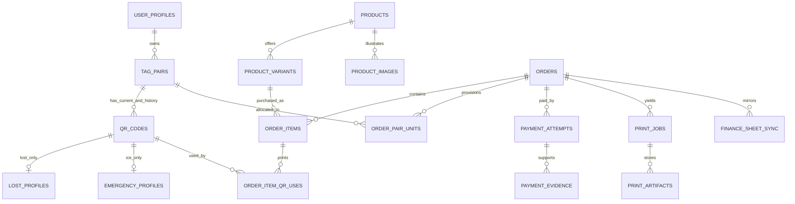
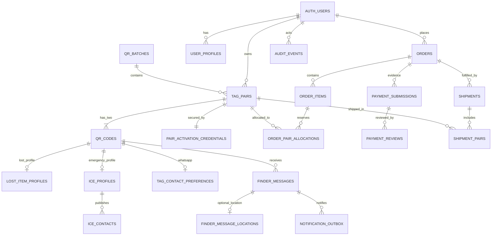

# SafeReturn — Database Design & Migration Specification v1.2

**Document ID:** SR-DB-002 | **Status:** implementation-design proposal, requires migration review | **Date:** 2026-10-12  
**Primary references:** PRD v1.2 (including FR-201–FR-211 amendment); Technical Design v1.2 (cross-product amendment); original Database Design v1.1 retained in Part B.  
**Database:** Supabase PostgreSQL, Supabase Auth, private Supabase Storage. **Product photographs:** Cloudinary, public only.

> **Precedence:** Part A below is the v1.2 authoritative schema extension and reconciliation. Part B preserves the complete v1.1 database specification as traceable reference. Where Part B describes an older one-line order, one-print-size QR, fixed product SKU, or allocation time, Part A supersedes it. All *unaffected* v1.1 security, encryption, RLS, operational, and relational constraints remain mandatory. No migration here is claimed executed. SQL is proposed PostgreSQL DDL; review existing table types/names before applying.

# PART A — AUTHORITATIVE v1.2 DESIGN

## 1. Immutable business invariants

1. A customer (`auth.users.id`) may own **many** independent pairs. Every pair has one `tag_pairs.id`, exactly one **current** `lost` QR and one **current** `ice` QR, distinct high-entropy public tokens, and one pair-level activation credential. Replacement QR history is retained.
2. **Each current QR identity has a separately editable purpose-specific profile**. No profile is shared across QR identities by default. Three printed copies of one Lost QR use the *same token and profile*; two ICE copies use their *same different token and profile*. One such purchase can produce five printed labels but only **one pair**.
3. Physical product catalog entities and printed merchandise do not own QR identifiers. Product, variant, physical print occurrence and QR identity are distinct. A future keychain can reuse an owned tag or request an independent **new full pair**.
4. Physical sticker copies do not create extra `qr_codes` rows. Pair inventory is counted in **pairs**, merchandise stock (future) in units, and printed labels in **copies**. These measures must not be conflated.
5. Every order item preserves product/variant names, SKU, unit price, tax, currency, quantities and configured print requirements at purchase time. Changing an admin catalog listing never rewrites history.
6. Invoice/settlement/payment provider state is separate from fulfillment and pair ownership. Verified payment, never uploaded screenshot or Google Sheet contents, authorizes final allocation and production.
7. Prepayment reservation is exclusive/expiring, but never auto-released while a plausible submitted transfer awaits reconciliation; expiry requires a reviewed transition and never changes verified settlement.
8. Private PDFs and screenshots use private **Supabase Storage** buckets with database metadata/retention. Cloudinary stores only non-sensitive public product photos and artwork. Google Sheets is an eventually consistent finance read mirror.
9. `qr_codes.public_token` is public routing data, **not** proof of entitlement. Scan context only identifies pending tag/pair; activation checks authenticated ownership or separately verified concealed credential.
10. No public client writes business tables. API services enforce server authorization and DB transactions; RLS/grants are defense in depth. Every privileged transition is auditable and idempotent.

## 2. Existing v1.1 tables: preserve and revise carefully

Preserve the original schema and semantics of `user_profiles`, `staff_roles`, `qr_batches`, `tag_pairs`, `qr_codes`, `pair_activation_credentials`, `pair_print_qa`, Lost/ICE owner publication tables, notification/outbox tables, customer orders/payments/shipments, security audit tables and consent/retention models, unless a named migration below explicitly replaces a conflicting constraint. **Do not recreate, drop, or rename an existing table merely because its exact original definition is not repeated here.**

- `tag_pairs.owner_user_id` (nullable until authorized claim) supports many records with the same owner; **do not** add `UNIQUE(owner_user_id)`.
- Retain partial unique current QR index `(pair_id, tag_type) WHERE is_current = true` from the finalized v1.1 design, allowing historical replacements. If `is_current` is absent in the deployed schema, reconcile its definition before migration. Required relational assertion: only `lost`/`ice`; one current child each, validated before allocation/activation. A unique index enforces *at most* one; application transaction and deferred checks enforce *exactly* two at release.
- `qr_codes.printed_size_mm` from v1.1 cannot be the authoritative size of a QR that is physically printed in several sizes. Retain it for backward compatibility or treat as default/legacy, **move actual ordered size onto order-item print specifications**. `qr_codes.qr_version`, ECC and public token may remain identity-level.
- Existing product and order tables in v1.1 may already cover a subset of catalog/order functionality. Migration authors must compare exact fields/constraints first, then **ALTER/extend or migrate data**, not create duplicate competing `orders` or `products` tables. The DDL below defines *target tables or additive patches*, not unconditional production scripts.
- Existing owned Lost and ICE profiles in v1.1 must be 1:1 with their QR identity. Ensure a profile foreign key to a matching `qr_codes.id`, not merely to `owner_user_id` or the product. If current design names differ, create approved mapping/views/migrations.

## 3. Entity relationships (target logical model)



*The ER model omits some v1.1 details such as auth.users, consent, shipment, stock events, outbox and audit for clarity; retain them.*

## 4. Catalog, products, variants and marketing images

A **product** is a purchasable physical product family (`QR stickers`, `QR keychain`, `bag tag`, `children's badge`, `elderly emergency badge`). A **variant** defines a sellable combination of material, size/color, SKU and pricing. A **QR identity** does not depend on any product ID. Product launch flags are data, not hard-coded frontend conditions.

```sql
-- Target ADDITIVE schema, to be reconciled against existing v1.1 tables first.
CREATE TABLE IF NOT EXISTS product_categories (
 id uuid PRIMARY KEY DEFAULT gen_random_uuid(),
 slug text NOT NULL UNIQUE,
 name text NOT NULL,
 is_active boolean NOT NULL DEFAULT true,
 sort_order integer NOT NULL DEFAULT 0
);
CREATE TABLE IF NOT EXISTS products (
 id uuid PRIMARY KEY DEFAULT gen_random_uuid(),
 category_id uuid REFERENCES product_categories(id) ON DELETE RESTRICT,
 slug text NOT NULL UNIQUE,
 name text NOT NULL,
 description text,
 lifecycle_status text NOT NULL DEFAULT 'draft'
  CHECK (lifecycle_status IN ('draft','published','archived')),
 is_featured boolean NOT NULL DEFAULT false,
 featured_sort_order integer NOT NULL DEFAULT 0,
 allows_new_pair boolean NOT NULL DEFAULT true,
 allows_existing_qr boolean NOT NULL DEFAULT false,
 created_at timestamptz NOT NULL DEFAULT now(),
 updated_at timestamptz NOT NULL DEFAULT now()
);
CREATE TABLE IF NOT EXISTS product_variants (
 id uuid PRIMARY KEY DEFAULT gen_random_uuid(),
 product_id uuid NOT NULL REFERENCES products(id) ON DELETE RESTRICT,
 sku text NOT NULL UNIQUE,
 name text NOT NULL,
 size_mm numeric(7,2) CHECK (size_mm IS NULL OR size_mm > 0),
 material text,
 color text,
 currency_code char(3) NOT NULL DEFAULT 'PKR',
 unit_price numeric(12,2) NOT NULL CHECK (unit_price >= 0),
 fulfillment_method text NOT NULL
  CHECK (fulfillment_method IN ('pdf_label','manufacturer_artwork','manual')),
 template_key text,
 template_version integer NOT NULL DEFAULT 1 CHECK(template_version > 0),
 is_active boolean NOT NULL DEFAULT true,
 sort_order integer NOT NULL DEFAULT 0,
 created_at timestamptz NOT NULL DEFAULT now(),
 updated_at timestamptz NOT NULL DEFAULT now()
);
CREATE TABLE IF NOT EXISTS product_images (
 id uuid PRIMARY KEY DEFAULT gen_random_uuid(),
 product_id uuid NOT NULL REFERENCES products(id) ON DELETE RESTRICT,
 cloudinary_public_id text NOT NULL,
 alt_text text NOT NULL,
 sort_order integer NOT NULL DEFAULT 0,
 is_primary boolean NOT NULL DEFAULT false,
 created_at timestamptz NOT NULL DEFAULT now(),
 UNIQUE(product_id,cloudinary_public_id)
);
CREATE INDEX IF NOT EXISTS idx_products_featured
 ON products(featured_sort_order,id)
 WHERE lifecycle_status='published' AND is_featured=true;
CREATE INDEX IF NOT EXISTS idx_product_variants_live
 ON product_variants(product_id,sort_order) WHERE is_active=true;
```

Public catalog projection returns only published products and active variants. Archived items cannot be newly purchased; historical `order_items` keep snapshots. Admin publish/modify/feature/archive writes require role checks, validation, audit, and public-cache invalidation. Variant sizes must meet QR and product-specific physical QA constraints; DDL positivity alone is **not** sufficient physical validation. Do not rely on `IF NOT EXISTS` to prove schema compatibility.

## 5. Orders, snapshot lines and print selection

Keep the v1.1 authoritative `orders` identity, customer/shipping records, status transitions, totals, and `order_items` where present. Evolve `order_items` to support many lines **without changing old order IDs**. Below is an explicit new-installation **target layout for the order-item extension**; implement as `ALTER TABLE` plus backfill if orders/order_items exist. Avoid float money.

```sql
-- Logical TARGET definition, not a blind CREATE on databases containing order_items.
CREATE TABLE IF NOT EXISTS order_items (
 id uuid PRIMARY KEY DEFAULT gen_random_uuid(),
 order_id uuid NOT NULL REFERENCES orders(id) ON DELETE RESTRICT,
 product_id uuid NOT NULL REFERENCES products(id) ON DELETE RESTRICT,
 variant_id uuid NOT NULL REFERENCES product_variants(id) ON DELETE RESTRICT,
 product_name_snapshot text NOT NULL,
 variant_name_snapshot text NOT NULL,
 sku_snapshot text NOT NULL,
 size_mm_snapshot numeric(7,2),
 material_snapshot text,
 fulfillment_method_snapshot text NOT NULL,
 template_key_snapshot text,
 template_version_snapshot integer NOT NULL CHECK(template_version_snapshot>0),
 quantity integer NOT NULL CHECK(quantity>0),
 unit_price_snapshot numeric(12,2) NOT NULL CHECK(unit_price_snapshot>=0),
 line_total numeric(12,2) NOT NULL CHECK(line_total>=0),
 currency_code char(3) NOT NULL DEFAULT 'PKR',
 created_at timestamptz NOT NULL DEFAULT now()
);
CREATE INDEX IF NOT EXISTS idx_order_items_order ON order_items(order_id,id);
```

For sticker variants, `quantity` is the number of physical print copies for the selected variant **when the line is associated with a single tag and QR usage**. The authoritative breakdown is `order_item_qr_uses` below; sum linked usage quantities = line quantity, enforced by transactional validation (cross-row aggregate cannot be captured by a simple CHECK). An order with 3 Lost copies and 2 ICE copies may have 2 or more `order_items`, depending on their sizes. Never count `order_items` as number of pairs. Quoted totals are server-calculated with frozen price snapshots, delivery/tax/discount from approved rules; totals validated before acceptance.

```sql
CREATE TABLE IF NOT EXISTS order_pair_units (
 id uuid PRIMARY KEY DEFAULT gen_random_uuid(),
 order_id uuid NOT NULL REFERENCES orders(id) ON DELETE RESTRICT,
 pair_id uuid NOT NULL REFERENCES tag_pairs(id) ON DELETE RESTRICT,
 kind text NOT NULL CHECK(kind IN ('new_pair')),
 status text NOT NULL CHECK(status IN ('reserved','allocated','released','cancelled')),
 reserved_until timestamptz,
 allocated_at timestamptz,
 created_at timestamptz NOT NULL DEFAULT now(),
 CHECK(status <> 'reserved' OR reserved_until IS NOT NULL),
 CHECK(status <> 'allocated' OR allocated_at IS NOT NULL)
);
CREATE UNIQUE INDEX IF NOT EXISTS uq_pair_one_live_claim
 ON order_pair_units(pair_id)
 WHERE status IN ('reserved','allocated');
CREATE INDEX IF NOT EXISTS idx_pair_units_order ON order_pair_units(order_id);
CREATE INDEX IF NOT EXISTS idx_pair_units_expiry
 ON order_pair_units(reserved_until) WHERE status='reserved';

CREATE TABLE IF NOT EXISTS order_item_qr_uses (
 id uuid PRIMARY KEY DEFAULT gen_random_uuid(),
 order_item_id uuid NOT NULL REFERENCES order_items(id) ON DELETE RESTRICT,
 qr_code_id uuid NOT NULL REFERENCES qr_codes(id) ON DELETE RESTRICT,
 pair_unit_id uuid REFERENCES order_pair_units(id) ON DELETE RESTRICT,
 use_kind text NOT NULL CHECK(use_kind IN ('new_pair','existing_owned')),
 tag_type_snapshot text NOT NULL CHECK(tag_type_snapshot IN ('lost','ice')),
 copies integer NOT NULL CHECK(copies>0),
 created_at timestamptz NOT NULL DEFAULT now(),
 CHECK ((use_kind='new_pair' AND pair_unit_id IS NOT NULL)
     OR (use_kind='existing_owned' AND pair_unit_id IS NULL)),
 UNIQUE(order_item_id,qr_code_id,use_kind)
);
CREATE INDEX IF NOT EXISTS idx_order_qr_uses_qr ON order_item_qr_uses(qr_code_id);
```

Cross-table validations required inside the service transaction (with appropriate locks): `qr_codes.tag_type=tag_type_snapshot`, `order_item_qr_uses` tag belongs to its `order_pair_units.pair_id` for new pairs, the referenced pair unit belongs to the same order, and for `existing_owned` the pair belongs to the authenticated shopper **and remains eligible for reprint**. Recheck before rendering; do not trust client `qr_code_id`. P0 disables `existing_owned` ordering behind a feature flag; the schema supports P1. One new pair may have multiple tag×size lines, and physical copies never create an extra QR record. If multiple new pairs are sold in a future order, each QR-use row must point to its appropriate pair unit.

## 6. QR identities and independent editable profiles

The original v1.1 Lost/ICE profile and disclosure tables remain the canonical functional contracts (including encrypted emergency contacts, opt-in WhatsApp, optional finder location and consent). For clarity, the minimum structural target is one profile per corresponding **QR ID**, never one per account, order, product or sticker copy.

```sql
-- Run only if no equivalent v1.1 profile tables already exist; otherwise migrate/extend them.
CREATE TABLE IF NOT EXISTS lost_profiles (
 qr_code_id uuid PRIMARY KEY REFERENCES qr_codes(id) ON DELETE RESTRICT,
 display_title text,
 item_description text,
 return_instructions text,
 profile_version integer NOT NULL DEFAULT 1 CHECK(profile_version>0),
 updated_at timestamptz NOT NULL DEFAULT now()
);
CREATE TABLE IF NOT EXISTS emergency_profiles (
 qr_code_id uuid PRIMARY KEY REFERENCES qr_codes(id) ON DELETE RESTRICT,
 public_display_label text,
 emergency_instructions text,
 profile_version integer NOT NULL DEFAULT 1 CHECK(profile_version>0),
 updated_at timestamptz NOT NULL DEFAULT now()
);
```

These are **partial placeholders for non-sensitive fields**, not replacements for the complete v1.1 ICE/medical/contacts/consent schema. Restrict creation/update to matching QR `tag_type` and authorized pair owner, using API checks and DB constraint trigger (or approved role-restricted service procedures); simple foreign keys alone do not enforce tag match. Never put full ICE phone, medical notes, guardian information or activation secrets in these example plaintext columns. On tag replacement preserve old historical tag/profile data per approved retention and decide whether profile migrates to new QR only with owner-authorized procedure. All reads of ICE are projected by explicit public allowlists; never return protected phone in initial public response.

## 7. Inventory generation, stock and exclusive reservations

Batch creation of N pairs generates N parent pair records plus **2N** current QR identities, distinct random tokens and secure separate activation verifiers. Admin may generate low-stock replenishment batches, but availability means *eligible generated/QA-approved unassigned pair*, not physically printed stock. Original v1.1 printing/QA lifecycle requires reconciliation: for on-demand printing, a pair may be digitally token-QA-approved **before** order printing, while final physical print QA is required before shipment. Rename/split QA state only through an explicit migration/ADR, not by silently setting `printed` before printing.

Allocation algorithm (transaction): select eligible pairs using `FOR UPDATE SKIP LOCKED`, verify pair integrity and no live `order_pair_units` claim, insert reservation with expiry, insert order/item QR uses, then commit. Competing checkouts cannot reserve one pair. For payment under review, extend/freeze hold with a documented maximum review policy rather than blindly auto-releasing it. If reservation must be released after reconciliation, invalidate associated unfulfilled QR uses/pair links only under a safe, audited replacement process; never reuse an activated, paid or printed token. Paid order converts reservation to allocated exactly once, using idempotent payment confirmation and lock. If no eligible inventory exists, checkout must fail gracefully, not oversell. Stock threshold alerts query available eligible pairs and deduplicate notifications.

## 8. Provider-independent payments and optional proof

Existing v1.1 payment tables and `payment_proofs` / equivalent should be migrated to the following **logical contract**, preserving their original audited records and `orders.id`. Proposed fields:

```sql
-- Name/DDL must be reconciled with v1.1 payment tables before applying.
CREATE TABLE IF NOT EXISTS payment_attempts (
 id uuid PRIMARY KEY DEFAULT gen_random_uuid(),
 order_id uuid NOT NULL REFERENCES orders(id) ON DELETE RESTRICT,
 provider_key text NOT NULL, -- manual_bank at pilot; gateway-specific later
 provider_external_id text,
 idempotency_key text NOT NULL,
 amount numeric(12,2) NOT NULL CHECK(amount>=0),
 currency_code char(3) NOT NULL DEFAULT 'PKR',
 state text NOT NULL CHECK(state IN
  ('initiated','submitted','under_review','verified','rejected','expired','refunded','disputed')),
 sender_reference_masked text,
 sender_holder_ciphertext bytea,
 sender_account_ciphertext bytea,
 provider_payload_ref text,
 reviewed_by uuid REFERENCES auth.users(id),
 verified_at timestamptz,
 created_at timestamptz NOT NULL DEFAULT now(),
 updated_at timestamptz NOT NULL DEFAULT now(),
 UNIQUE(provider_key,idempotency_key)
);
CREATE UNIQUE INDEX IF NOT EXISTS uq_payment_provider_external
 ON payment_attempts(provider_key,provider_external_id)
 WHERE provider_external_id IS NOT NULL;
CREATE INDEX IF NOT EXISTS idx_payments_order ON payment_attempts(order_id,created_at);

CREATE TABLE IF NOT EXISTS payment_evidence (
 id uuid PRIMARY KEY DEFAULT gen_random_uuid(),
 attempt_id uuid NOT NULL REFERENCES payment_attempts(id) ON DELETE RESTRICT,
 bucket text NOT NULL DEFAULT 'private-payment-evidence',
 object_key text NOT NULL UNIQUE,
 sha256_hex char(64) NOT NULL,
 content_type text NOT NULL,
 bytes_size bigint NOT NULL CHECK(bytes_size>0),
 retention_until timestamptz,
 deletion_hold_reason text,
 deleted_at timestamptz,
 created_at timestamptz NOT NULL DEFAULT now()
);
```

Never store raw full account numbers in Sheets or normal logs. Encrypt sensitive sender fields with application-held, versioned keys; consider key-version columns in actual migration. Validate file type by content, size, anti-malware policy, private access and signed short-lived upload/download permissions. A manual payment screenshot does **not** set `verified`; independent finance review does. Later gateway webhooks validate signature, provider event id, amount/currency/order relation and idempotency before normalized state transition. **Do not combine payment attempt status with order status.** Disputed or refunded orders hold shipment/fulfillment according to policy. Persist raw provider event metadata only in a minimal restricted event ledger with retention.

## 9. Print jobs, vector PDFs and artifact retention

```sql
CREATE TABLE IF NOT EXISTS print_jobs (
 id uuid PRIMARY KEY DEFAULT gen_random_uuid(),
 order_id uuid NOT NULL REFERENCES orders(id) ON DELETE RESTRICT,
 job_revision integer NOT NULL CHECK(job_revision>0),
 status text NOT NULL CHECK(status IN
  ('queued','rendering','ready','downloaded','qa_passed','failed','superseded','deleted')),
 template_fingerprint text NOT NULL,
 render_config jsonb NOT NULL,
 attempt_count integer NOT NULL DEFAULT 0 CHECK(attempt_count>=0),
 failure_code text,
 created_at timestamptz NOT NULL DEFAULT now(),
 updated_at timestamptz NOT NULL DEFAULT now(),
 UNIQUE(order_id,job_revision)
);
CREATE TABLE IF NOT EXISTS print_artifacts (
 id uuid PRIMARY KEY DEFAULT gen_random_uuid(),
 print_job_id uuid NOT NULL REFERENCES print_jobs(id) ON DELETE RESTRICT,
 bucket text NOT NULL DEFAULT 'private-order-print',
 object_key text NOT NULL UNIQUE,
 format text NOT NULL CHECK(format IN ('pdf','svg','other_approved')),
 sha256_hex char(64) NOT NULL,
 size_bytes bigint NOT NULL CHECK(size_bytes>0),
 retention_until timestamptz,
 deletion_hold_reason text,
 deleted_at timestamptz,
 created_at timestamptz NOT NULL DEFAULT now()
);
CREATE INDEX IF NOT EXISTS idx_print_jobs_order ON print_jobs(order_id,created_at);
CREATE INDEX IF NOT EXISTS idx_artifacts_cleanup ON print_artifacts(retention_until)
 WHERE deleted_at IS NULL;
```

One PDF render includes **Lost occurrences first, then ICE**, repeated by the purchased `order_item_qr_uses.copies`, with exact size/margins/quiet zone, central SafeReturn logo, bilingual captions, cutting guidelines, validated printer units and appropriate production template. Prefer reusable SVG/vector QR assets and PDF symbol reuse, bounded metadata, compression and no oversized embedded raster logos; track produced byte size and optional soft-limit warnings rather than asserting an untested universal byte limit. Do not include plaintext activation secret in customer-visible sticker artwork; any packaging insert is separately access-controlled. A failed PDF stays failed/retryable, never shipped. Admin Ready to Ship displays verified+allocated+print-ready orders and permits audited signed download; downloading does not mean shipped. Print QA and shipment remain separate milestones.

After confirmed delivery plus **approved** grace (7-day candidate, not final), deletion worker removes objects in private Supabase Storage, updates metadata and audit, and preserves per-order print spec, pair IDs, QR uses, order histories and job/hash records. If held for dispute/reprint, postpone deletion. Lost file -> idempotent authorized regeneration from immutable snapshots and pair URLs; never mint a new QR token for a reprint. Evidence has a separately approved finance/dispute retention window. Cloudinary only stores non-sensitive product/catalog images.

## 10. Durable jobs, Google Sheets sync and audit

```sql
CREATE TABLE IF NOT EXISTS finance_sheet_sync (
 id uuid PRIMARY KEY DEFAULT gen_random_uuid(),
 order_id uuid NOT NULL UNIQUE REFERENCES orders(id) ON DELETE RESTRICT,
 sheet_row_key text,
 last_export_version integer NOT NULL DEFAULT 0,
 status text NOT NULL CHECK(status IN ('pending','synced','retry','failed')),
 attempt_count integer NOT NULL DEFAULT 0,
 last_error_code text,
 last_synced_at timestamptz,
 updated_at timestamptz NOT NULL DEFAULT now()
);
```

Use/extend existing v1.1 **durable outbox** rather than creating an unrelated unreliable task queue. A payment decision writes finance state + audit + sync-outbox event in one DB transaction; worker writes an idempotent restricted Google Sheets **reporting mirror** with order reference, masked payment indicator, method, status, amounts, reviewed timestamp. Sheets must not become source of truth or include raw bank identifiers or public URLs to private proofs. Failed Sheets writes retry without reverting valid payments. Each external write uses deterministic event IDs, worker locks/leases, attempts and escalation; provider/network calls outside DB locks. Log masked IDs; no secrets or full ICE phones.

## 11. Isolation, authorization and Supabase Storage

- Enable restrictive RLS on all new public schema business tables and remove direct `anon`/`authenticated` mutations. App service uses least-privilege DB credentials. API checks JWT/server roles, then authorizes order, pair, QR profile and storage artifact by join. A public QR token does **not** authorize any profile write or private download.
- Finance/admin MFA and separation of duties: finance can verify settlement, operations can create batches/print/dispatch, catalog admin can publish; do not grant all permissions by default. Audit each stock override, pair claim, payment approval, upload, artifact delete and profile publication action.
- Two private buckets, `private-payment-evidence` and `private-order-print` (names proposed), with signed short-lived authorized access and no public ACL. Cloudinary public IDs only for marketing media; store provider ID rather than treating a URL as trusted upload proof. Bucket purge remains independent of DB row retention.
- ICE sensitive fields stay encrypted and initial public SSR/JSON/hydration must not contain full contact numbers. Children's badges require guardian/consent review and conservative public display rules before release.
- Payment sender account, names, personal addresses and evidence are not returned in public catalog, finder pages, logs, normal Google Sheets, or QR URLs. Approved deletes respect legal holds, audit and backups expiration policies.

## 12. Migration strategy and release gates

**This is a design/migration specification, not a ready-to-run unified SQL script against an unknown existing DB.** Determine whether P0 is a new database or a v1.1 migration and inspect exact constraints/columns before implementation. Migrations should use reviewed Alembic (per v1.1 architecture), with raw SQL for PostgreSQL constraints/indexes where needed; application queries may use raw SQL only after an explicit project architecture decision.

| Step | Migration / rollout | Rollback principle |
|---|---|---|
| M01 | Snapshot schema, backups and row counts; verify v1.1 canonical partial current-tag uniqueness and existing profile tables | No mutation |
| M02 | Add categories/products/variants/images; seed **only QR Stickers** as published, others absent/draft | Feature disabled; leave catalog rows |
| M03 | Extend orders and items with nullable snapshot fields; backfill v1.1 purchases; validate sums and foreign keys; only then make NOT NULL | Roll back app read path; preserve snapshot data |
| M04 | Introduce multi-pair order units, QR-use mappings and exclusive partial indexes; backfill existing allocations | Disable new checkout; preserve old allocation records |
| M05 | Verify per-QR Lost/ICE profiles; migrate user-wide profiles into independently authorized QR records if necessary without losing consent/privacy | Dual-read compatibility then verified switch |
| M06 | Introduce payment adapter/attempt/evidence metadata and gateway idempotency keys; migrate historical statuses | Keep historical payment decisions; never reset paid status |
| M07 | Add print job/artifact records, private Supabase buckets, worker and cleanup policies | Pause workers and revert to previous fulfillment mode |
| M08 | Add Google Sheets durable sync view, restricted staff interfaces and audit | Disable integration, preserve DB state |
| M09 | Enable one-pair sticker P0 flow after full validation; leave extra physical products/new-pair selection feature gated | Disable features without deleting records |
| M10 | After separate security/UX approvals enable additional products, reuse-owned-QR, new-pair item and featured homepage carousel | Unpublish future products; historical orders unaffected |

**Safe deployments:** additive/expand-backfill-validate-contract phases; run migrations once, out of application startup; separate staging rehearsal on a recent sanitized backup; verify index/foreign key lock impact; no destructive cascade on business history; explicit downgrade/forward recovery planning. If old `order_items` conflicts with the sample schema, write a differential migration mapped to original names—not parallel duplicative tables. Backups and PITR/recovery limitations must be tested before launch.

## 13. Required database acceptance tests

| ID | Scenario | Must hold |
|---|---|---|
| DB12-001 | Account purchases pairs A and B | Same owner; two separate pairs; four unique current tag URLs |
| DB12-002 | Edit Lost A, ICE A, Lost B independently | Only selected QR profile changes; no cross-profile leakage |
| DB12-003 | Buy 3 Lost + 2 ICE copies in one sticker order | Exactly one pair claimed, 2 QR tokens, 5 print occurrences |
| DB12-004 | Buy one future keychain reusing Lost A | Existing tag URL/profile shared; no additional pair reserved |
| DB12-005 | Buy future keychain requesting new identity | New complete pair and independent profiles under same account |
| DB12-006 | Rename/archive product after purchase | Order name/variant/SKU/price snapshots unchanged |
| DB12-007 | Race two orders against last eligible pair | One succeeds; no double live reservation |
| DB12-008 | Submit screenshot but no settlement verification | Payment not verified; no ready PDF or shipment |
| DB12-009 | Replay verified gateway webhook | Exactly one normalized paid transition/allocation/print trigger |
| DB12-010 | Sheets unavailable | Payment remains verified; durable retry scheduled |
| DB12-011 | PDF generated repeated labels | QR URLs identical per tag, printed count/size correct, scan QA passes |
| DB12-012 | Confirm delivery+grace and no hold | Private PDF deleted; order/QR/spec records remain |
| DB12-013 | Evidence reaches retention cutoff but dispute exists | Evidence retained under hold; no premature deletion |
| DB12-014 | User attempts other owner's QR reuse/profile edit | Denied by API and grants/RLS; no data change |
| DB12-015 | Unactivated QR scanned/login flow | Token alone cannot claim pair; authorized activation updates both tags atomically |
| DB12-016 | Future product in `draft` / archived state | Excluded from public catalog and featured query |
| DB12-017 | Children badge attempted without guardian policy | Publication blocked by product policy gate |
| DB12-018 | Duplicate provider order/evidence/object retry | No duplicate charge decision, print job or artifact record |

## 14. Explicit decisions still required before production

Final retail SKUs and QR sizes/prices; external payment provider and signature scheme; payment proof optionality and retention duration; allowed pair claims/gifts; multiple **new** pairs per order rollout; print template and substrate catalog; catalog/admin permissions; guardian rules for minors; storage quotas and signed-download retention; reservation timeout and dispute hold; refund/reprint policies; Google Sheet access and columns; shipment delivery proof; scan reliability tests after central logo added. Until approved, use safe feature flags and conservative privacy behavior.

---

# PART B — ORIGINAL DATABASE DESIGN v1.1 (ARCHIVED REFERENCE)

> This is the uploaded v1.1 specification retained verbatim below for traceability and unchanged security/operational details. If it conflicts with Part A above, Part A prevails. It is **not** a second schema to install verbatim.

# SafeReturn — Database Design & Migration Specification

**Document ID:** SR-DB-002  
**Version:** 1.1-draft  
**Date:** 11 October 2026  
**Product:** SafeReturn, Lahore pilot  
**Database:** Supabase-hosted PostgreSQL  
**ORM / migrations:** SQLAlchemy 2.x + Alembic  
**Related documents:** SafeReturn PRD v1.0 + v1.1 amendment; `SafeReturn_02_Technical_Design_v1.1.md`  
**Status:** Implementation-ready design proposal, pending decisions listed in §25  
**Scope:** Relational model, columns, constraints, indexing, transactions, access, retention, migrations, and verification. The UI/UX screen specification is intentionally deferred until the last document.

> **Authority:** This document is the proposed database contract. Where the PRD's illustrative schema differs from this normalized model, this document adopts the PRD-permitted canonical design of `qr_codes.pair_id` plus `(pair_id, tag_type)` uniqueness. Record approval as ADR-002 before implementation. No production schema changes should be applied merely because an AI agent generated them.

---

## 1. Design goals and non-negotiable invariants

1. One sellable kit has **one Pair ID**, **one activation credential**, and **exactly two child QR tags**: `lost` and `ice`.
2. Each child has a unique, permanent, high-entropy public token. Public tokens are **not** activation secrets.
3. Ownership is authoritative at the **pair** level; child tags never have independent owners.
4. Both tags activate **in one PostgreSQL transaction**; there is no committed partially activated pair.
5. Pair membership and tag type cannot silently change after printing.
6. Customer order quantity is counted in **pairs**, not stickers.
7. One pair can have **at most one active order allocation**.
8. A finder submission and its notification-outbox event are committed together.
9. Finder location is optional, consented, access-controlled, and subject to deletion.
10. Emergency contact numbers are not present in initial public scan payloads.
11. WhatsApp numbers are opt-in, separately stored, and disclosed only when enabled.
12. Every sensitive admin mutation is auditable; ordinary customer data is never exposed by permissive table access.
13. Physical print credentials are not stored as plaintext in normal database tables.
14. Payment screenshots are evidence, not proof of payment.
15. Migrations must be reproducible, reviewed, tested against realistic data, and recoverable.

### 1.1 Naming and type conventions

- Tables/columns: `snake_case`, plural table names.
- Primary keys: `uuid`, generated in database (`gen_random_uuid()`).
- Time: `timestamptz`, UTC, `created_at`/`updated_at`; never naive timestamps.
- Monetary amounts: `numeric(12,2)` in PKR, **never float**; include `currency_code` (`PKR` in P0).
- Public QR token: case-sensitive text, unique; store random token or preferably keyed digest with a lookup design. **Selected P0:** store token as text with restricted access, since public routing needs deterministic lookup; no token in logs.
- Secret verifier: `bytea` for HMAC/slow-hash verifier; raw activation secret never stored.
- Email: `citext` where appropriate after extension availability check, or normalized lowercase text with unique index.
- Phone: normalized E.164 format inside encrypted payload; do not assume all Pakistani phone formats are equivalent.
- Status fields: `text` plus named `CHECK` constraints, rather than PostgreSQL enums for easier Alembic evolution.
- Foreign keys: explicitly named; use `ON DELETE` intentionally.
- `NOT NULL` on fields essential for consistency.
- Avoid generic `metadata jsonb` as a substitute for required relational fields.
- For `updated_at`, choose either application-managed updates with tests or a common DB trigger; this specification recommends a trigger.

### 1.2 PostgreSQL extensions

| Extension | Use | Requirement |
|---|---|---|
| `pgcrypto` | `gen_random_uuid()` and crypto utilities where needed | Verify supported |
| `citext` | Case-insensitive email fields | Optional; migration-gated |
| `btree_gist` | Only if exclusion constraints become necessary | Not required P0 |

Supabase-managed extensions must be enabled through approved migrations or dashboard configuration recorded in infrastructure docs. Do not assume unrestricted superuser privileges.

---

## 2. Data ownership, schemas, and access boundary

### 2.1 Database schemas

- `auth.users`: **Supabase-managed** identity records. Never alter or drop.
- `public`: SafeReturn business tables, with restrictive privileges and RLS.
- Optional `private`: highly sensitive operational tables/functions if supported by deployment access controls; P0 may keep tables in `public` with strict grants and RLS.
- `storage`: Supabase-managed storage metadata if using Supabase Storage for payment evidence; never edit directly.

### 2.2 Access roles

| Principal | Access path | Database rights |
|---|---|---|
| Anonymous finder | FastAPI public endpoint | No direct table access |
| Authenticated customer | FastAPI + verified Supabase JWT | No direct business-table access in P0 |
| Admin | FastAPI + MFA + server-side permissions | No direct client table access |
| API service | Dedicated DB credential | Least-privilege business read/write |
| Outbox worker | Dedicated DB credential | Limited outbox and email data access |
| Migration role | Controlled CI/deploy process | DDL privileges, never browser |
| Analytics/reporting | Restricted view or replica | Aggregated/deidentified where feasible |

**Critical:** A Supabase `service_role` key bypasses RLS. If used, keep it server-only, scope its use, and never assume RLS protects against service-role application bugs. Prefer a dedicated least-privilege Postgres role for application database access when operationally feasible.

### 2.3 RLS stance

Enable RLS on all business tables exposed through PostgREST, revoke anonymous and authenticated direct grants unless specifically needed, and route business data through FastAPI. This avoids accidentally exposing emergency contacts or finder location through permissive policies. If direct client queries are added later, create explicit policies and security tests per table.

---

## 3. Entity relationship diagram



The `AUTH_USERS` node represents `auth.users`, managed by Supabase. Mermaid's one-to-many pair edge does not express **exactly two** by itself; the invariant is enforced in §6 and §20.

---

## 4. Core tables: identity and customer records

### 4.1 `user_profiles`

Customer metadata only; no authoritative auth credentials.

| Column | Type | Null | Constraint / meaning |
|---|---|---|---|
| `user_id` | uuid | No | PK, FK → `auth.users.id`, `ON DELETE CASCADE` |
| `display_name` | varchar(120) | Yes | Customer-selected |
| `preferred_locale` | varchar(5) | No | Default `en`; CHECK `en`,`ur` |
| `phone_ciphertext` | bytea | Yes | Private account phone; encrypted |
| `phone_key_version` | smallint | Yes | Encryption key reference |
| `created_at` | timestamptz | No | Default `now()` |
| `updated_at` | timestamptz | No | Auto-updated |

**Do not auto-publish `phone_ciphertext` in ICE or WhatsApp.** Publication requires separate consent and fields.

### 4.2 `staff_roles`

| Column | Type | Null | Constraint |
|---|---|---|---|
| `id` | uuid | No | PK |
| `user_id` | uuid | No | FK → `auth.users.id` |
| `role` | varchar(40) | No | `support`, `operations`, `finance`, `security_admin`, `superadmin` |
| `granted_by` | uuid | Yes | FK → `auth.users.id` |
| `granted_at` | timestamptz | No | Default now |
| `revoked_at` | timestamptz | Yes | Nullable |
| `reason` | text | Yes | Grant/revoke rationale |

Index `UNIQUE(user_id, role) WHERE revoked_at IS NULL`. Never derive admin permissions from editable profile fields. MFA is checked in application/session policy.

---

## 5. Physical production inventory

### 5.1 `qr_batches`

| Column | Type | Null | Constraint / meaning |
|---|---|---|---|
| `id` | uuid | No | PK |
| `batch_code` | varchar(40) | No | Unique, human-readable |
| `supplier_name` | varchar(120) | Yes | Optional |
| `print_material` | varchar(60) | Yes | e.g. outdoor vinyl |
| `ecc_level` | char(1) | No | CHECK `M` or `Q` |
| `generated_at` | timestamptz | No | Default now |
| `printed_at` | timestamptz | Yes | Actual |
| `qa_approved_at` | timestamptz | Yes | Actual |
| `qa_approved_by` | uuid | Yes | Staff user |
| `print_manifest_checksum` | char(64) | Yes | SHA-256 hex of approved manifest |
| `status` | varchar(24) | No | `draft`, `generated`, `printed`, `qa_passed`, `rejected`, `closed` |
| `created_at` | timestamptz | No | Default now |
| `updated_at` | timestamptz | No | Auto-updated |

A batch cannot be marked QA-passed if its included pairs fail per-pair QA.

### 5.2 `tag_pairs` — **parent of two tags**

| Column | Type | Null | Constraint / meaning |
|---|---|---|---|
| `id` | uuid | No | PK |
| `pair_reference` | varchar(40) | No | UNIQUE, printed non-secret Pair ID |
| `batch_id` | uuid | No | FK → `qr_batches.id`, `RESTRICT` |
| `owner_user_id` | uuid | Yes | FK → `auth.users.id`, `RESTRICT` for ownership history |
| `inventory_status` | varchar(24) | No | `generated`,`printed`,`qa_passed`,`reserved`,`packed`,`shipped`,`delivered`,`rejected` |
| `ownership_status` | varchar(24) | No | `unclaimed`,`active`,`transfer_pending`,`disputed`,`revoked` |
| `activated_at` | timestamptz | Yes | Activation time |
| `revoked_at` | timestamptz | Yes | Permanent revocation |
| `created_at` | timestamptz | No | Default now |
| `updated_at` | timestamptz | No | Auto-updated |
| `row_version` | integer | No | Default 1, optimistic concurrency aid |

Constraints:
- `ownership_status = 'active'` implies `owner_user_id IS NOT NULL AND activated_at IS NOT NULL`.
- `ownership_status = 'unclaimed'` implies `activated_at IS NULL`.
- `revoked_at IS NOT NULL` implies `ownership_status = 'revoked'`.
- No split ownership; child tags have **no `owner_user_id`**.
- Index `(owner_user_id, ownership_status)` for customer dashboard.
- Index `(batch_id, inventory_status)` for fulfillment.
- Pair reference is **not** an activation credential.

**PRD schema reconciliation:** PRD v1.1 proposes `tag_id_lost` and `tag_id_ice` columns but explicitly recommends the normalized `qr_codes.pair_id` approach to avoid circular FKs. **Selected:** child IDs are derived from rows with `(pair_id, tag_type)`, optionally exposed via `tag_pair_details` view. Do not add redundant physical child FK columns unless founder rejects ADR-002.

### 5.3 `qr_codes` — two children per pair

| Column | Type | Null | Constraint / meaning |
|---|---|---|---|
| `id` | uuid | No | PK |
| `pair_id` | uuid | No | FK → `tag_pairs.id`, `RESTRICT` |
| `tag_type` | varchar(8) | No | CHECK `lost`,`ice` |
| `serial_number` | varchar(50) | No | UNIQUE, printed serial |
| `public_token` | varchar(80) | No | UNIQUE, random 128+ bits |
| `public_status` | varchar(24) | No | `unactivated`,`active`,`owner_disabled`,`admin_suspended`,`revoked` |
| `qr_version` | smallint | Yes | Actual Segno QR version |
| `ecc_level` | char(1) | No | CHECK `M`,`Q` |
| `printed_size_mm` | numeric(5,2) | Yes | Total QR artwork including quiet zone |
| `replaces_qr_id` | uuid | Yes | FK → `qr_codes.id` for replacement |
| `created_at` | timestamptz | No | Default now |
| `updated_at` | timestamptz | No | Auto-updated |
| `revoked_at` | timestamptz | Yes | Nullable |

Indexes and constraints:
- `UNIQUE(pair_id, tag_type)`.
- `UNIQUE(public_token)`.
- `UNIQUE(serial_number)`.
- `UNIQUE(replaces_qr_id) WHERE replaces_qr_id IS NOT NULL` if replacement chain is one-to-one.
- `public_status = 'revoked'` implies `revoked_at IS NOT NULL`.
- `replaces_qr_id <> id`.
- **Cross-pair replacement** must be rejected in service and ideally trigger.
- Token, tag type, pair ID, and serial are immutable after print.
- Printing check: lost/indoor minimum 30 mm; outdoor/helmet placement minimum 35 mm. Since placement can vary, store placement-specific QA separately (§5.5), not infer from tag type.

**Replacement nuance:** A unique `(pair_id, tag_type)` prevents keeping both old and new child records in the same pair. To support replacement history correctly, use **partial uniqueness** on the *current* child:
`UNIQUE(pair_id, tag_type) WHERE is_current = true`, and add `is_current boolean NOT NULL DEFAULT true`. During replacement, set old child `is_current=false`, revoke it, insert new current child in one transaction. All exact-two checks count **current** children. Historical children remain linked to the pair. This **supersedes the unconditional uniqueness above** and is the selected final design.

### 5.4 `pair_activation_credentials`

| Column | Type | Null | Constraint |
|---|---|---|---|
| `pair_id` | uuid | No | PK, FK → `tag_pairs.id`, `RESTRICT` |
| `secret_verifier` | bytea | No | Keyed verifier/hash, not plaintext |
| `verifier_key_version` | smallint | No | Positive |
| `status` | varchar(20) | No | `unused`,`locked`,`consumed`,`revoked` |
| `failed_attempts` | integer | No | Default 0; CHECK >=0 |
| `locked_until` | timestamptz | Yes | Nullable |
| `consumed_at` | timestamptz | Yes | Nullable |
| `rotated_at` | timestamptz | Yes | Nullable |
| `created_at` | timestamptz | No | Default now |
| `updated_at` | timestamptz | No | Auto-updated |

One credential per pair. Credential verification must be resistant to offline guessing; generate high-entropy secrets and use a keyed verifier with server-side secret pepper/key. Compare safely and rotate keys via a documented process.

A `consumed` credential must have `consumed_at`, and activation must not succeed using consumed/revoked credentials. Do not store printable activation secrets in this table.

### 5.5 `pair_print_qa`

| Column | Type | Null | Constraint |
|---|---|---|---|
| `id` | uuid | No | PK |
| `pair_id` | uuid | No | FK → `tag_pairs.id` |
| `qa_round` | integer | No | CHECK >0 |
| `lost_scan_passed` | boolean | No | |
| `ice_scan_passed` | boolean | No | |
| `pair_match_passed` | boolean | No | |
| `credential_concealed` | boolean | No | |
| `bilingual_label_passed` | boolean | No | |
| `quiet_zone_passed` | boolean | No | |
| `indoor_size_passed` | boolean | No | |
| `outdoor_size_passed` | boolean | No | |
| `packaging_method` | varchar(30) | No | `scratch_off`,`sealed_sleeve`,`peel_seal` |
| `tamper_evidence_passed` | boolean | No | |
| `approved` | boolean | No | |
| `inspected_by` | uuid | No | Staff FK |
| `inspected_at` | timestamptz | No | Default now |
| `notes` | text | Yes | No secrets |

`UNIQUE(pair_id, qa_round)`. A pair may move to `qa_passed` only when the **latest** QA round is approved and all mandatory checks pass.

### 5.6 `tag_pair_details` read-only view

A reporting view can return:
- `pair_id`, `pair_reference`, `batch_id`, `owner_user_id`;
- `tag_id_lost`, `tag_id_ice` derived from current child records;
- current child public statuses.

This view is for admin/reporting, not anonymous access. The public API should never expose Pair ID or internal QR IDs unless specifically needed.

---

## 6. Enforcing exactly two current tags

A simple unique index proves **at most one** current tag of each type; it does not prove **both exist**. Enforce exactly-two at transitions:

1. Batch generation inserts pair, credential, Tag A, Tag B **within one transaction**.
2. An activation/QA transition locks the pair and checks:
   - current-child count = 2;
   - current lost count = 1;
   - current ICE count = 1;
   - both belong to same pair/batch;
   - both eligible.
3. Only a privileged database function or tightly controlled service transaction can set `ownership_status='active'`.
4. Add a **deferred constraint trigger** or equivalent DB guard on activation and current-child changes so an activated pair cannot commit with missing/duplicate current tags.
5. Disallow deleting current child rows from active pairs; use audited replacement transaction instead.
6. Tests must attempt to bypass the service with direct SQL and verify rejection.

**Recommended DB guard:** `DEFERRABLE INITIALLY DEFERRED` constraint triggers checking pair validity at transaction end. Since PostgreSQL constraint triggers run per row, ensure triggers are attached to relevant changes (`tag_pairs`, `qr_codes`) and perform locking/checking safely. Test concurrent changes explicitly.

### 6.1 Replacement sequence

Within one transaction:
1. Lock pair.
2. Validate authorized replacement and production QA of new tag.
3. Set old child `is_current=false`, `public_status='revoked'`, `revoked_at=now()`.
4. Insert replacement child with same `pair_id`/`tag_type`, new token, `is_current=true`, `replaces_qr_id=old.id`.
5. Insert audit event.
6. Commit after deferred invariant checks.

Old public URLs resolve to a safe revoked page; do **not** redirect to new owner's private profile.

---

## 7. Public profiles and ICE contacts

### 7.1 `lost_item_profiles`

| Column | Type | Null | Constraint |
|---|---|---|---|
| `qr_id` | uuid | No | PK, FK → `qr_codes.id` |
| `item_label` | varchar(120) | Yes | Public label |
| `description` | text | Yes | Length limited |
| `reward_text` | varchar(200) | Yes | Optional, nonbinding |
| `published` | boolean | No | Default false |
| `published_at` | timestamptz | Yes | |
| `updated_at` | timestamptz | No | |

Application/DB trigger ensures tag type `lost`. Escape text at render time; no HTML content from owner.

### 7.2 `ice_profiles`

| Column | Type | Null | Constraint |
|---|---|---|---|
| `qr_id` | uuid | No | PK, FK → `qr_codes.id` |
| `display_name` | varchar(120) | Yes | Explicitly published |
| `blood_group` | varchar(8) | Yes | Allowlist e.g. A+, O- |
| `medical_notes_ciphertext` | bytea | Yes | Sensitive, opt-in |
| `medical_notes_key_version` | smallint | Yes | |
| `show_medical_notes` | boolean | No | Default false |
| `published` | boolean | No | Default false |
| `publication_consent_at` | timestamptz | Yes | |
| `publication_consent_version` | varchar(30) | Yes | |
| `updated_at` | timestamptz | No | |

**Design choice:** ICE medical notes are encrypted at rest but intentionally disclosed when `show_medical_notes=true` on a published ICE profile. Do not confuse encryption at rest with anonymity. A public scan response may contain published medical notes; require strong owner warning and consent.

### 7.3 `ice_contacts`

| Column | Type | Null | Constraint |
|---|---|---|---|
| `id` | uuid | No | PK |
| `ice_qr_id` | uuid | No | FK → `ice_profiles.qr_id` |
| `relationship_label` | varchar(60) | No | e.g. Father, Brother |
| `display_name` | varchar(120) | Yes | Optional |
| `phone_ciphertext` | bytea | No | Encrypted E.164 |
| `phone_key_version` | smallint | No | |
| `display_order` | smallint | No | CHECK >=0 |
| `published` | boolean | No | Default false |
| `publication_consent_at` | timestamptz | Yes | |
| `created_at` | timestamptz | No | |
| `updated_at` | timestamptz | No | |

Index `(ice_qr_id, published, display_order)`. Contact publication requires recorded consent. Contact-reveal endpoint validates QR and contact membership; initial public response returns `id`, label, relationship only, **never `phone_ciphertext` or decrypted phone**.

### 7.4 `tag_contact_preferences`

| Column | Type | Null | Constraint |
|---|---|---|---|
| `qr_id` | uuid | No | PK, FK → `qr_codes.id` |
| `whatsapp_enabled` | boolean | No | Default false |
| `whatsapp_phone_ciphertext` | bytea | Yes | Encrypted |
| `whatsapp_phone_key_version` | smallint | Yes | |
| `whatsapp_consent_at` | timestamptz | Yes | |
| `whatsapp_consent_version` | varchar(30) | Yes | |
| `updated_at` | timestamptz | No | |

DB CHECK: if enabled, phone ciphertext, key version, consent timestamp, and version must all be non-null. App enforces only eligible lost tag can enable. Disabling removes the public link immediately; retain/delete stored number per privacy policy.

**Privacy truth:** `wa.me` reveals the selected phone number to the finder. A protected endpoint reduces passive scraping, not intentional disclosure.

---

## 8. Finder messaging and optional location

### 8.1 `finder_messages`

| Column | Type | Null | Constraint |
|---|---|---|---|
| `id` | uuid | No | PK |
| `qr_id` | uuid | No | FK → `qr_codes.id` |
| `recipient_owner_user_id` | uuid | No | FK → `auth.users.id`, immutable snapshot |
| `finder_name` | varchar(80) | Yes | |
| `finder_email_ciphertext` | bytea | Yes | Private |
| `finder_phone_ciphertext` | bytea | Yes | Private |
| `finder_contact_key_version` | smallint | Yes | Required if encrypted contact supplied |
| `preferred_contact` | varchar(12) | Yes | `email`,`phone` |
| `message_text_ciphertext` | bytea | No | Message body encrypted |
| `message_key_version` | smallint | No | |
| `status` | varchar(24) | No | `new`,`viewed`,`archived`,`flagged`,`deleted` |
| `abuse_flag` | boolean | No | Default false |
| `consent_version` | varchar(30) | No | Finder contact/privacy consent |
| `consent_at` | timestamptz | No | |
| `submitted_at` | timestamptz | No | Default now |
| `deleted_at` | timestamptz | Yes | Soft-delete scheduling |

At least one finder contact method must exist; because contacts are encrypted, enforce this with a CHECK on ciphertext presence. Backend validates actual email/phone before encryption.

Indexes:
- `(recipient_owner_user_id, submitted_at DESC)`;
- `(qr_id, submitted_at DESC)`;
- `(status, submitted_at DESC)` for admin abuse review, restricted;
- optional retention `(deleted_at)`.

**Ownership transfer:** `recipient_owner_user_id` snapshots who received the message. A new pair owner must not inherit prior owner's messages. The API authorizes message reads against the recipient snapshot and current account permissions, not merely current pair ownership.

### 8.2 `finder_message_locations` — **recommended privacy-isolated table**

PRD v1.1 requested latitude/longitude fields in `finder_messages`. This specification implements the **same logical fields** in a one-to-zero/one child table to narrow access and simplify deletion/encryption.

| Column | Type | Null | Constraint |
|---|---|---|---|
| `finder_message_id` | uuid | No | PK, FK → `finder_messages.id`, `ON DELETE CASCADE` |
| `latitude_ciphertext` | bytea | No | Encrypted validated decimal |
| `longitude_ciphertext` | bytea | No | Encrypted validated decimal |
| `accuracy_m` | numeric(10,2) | Yes | CHECK >=0 |
| `location_source` | varchar(30) | No | `browser_geolocation` |
| `consent_at` | timestamptz | No | Explicit finder consent |
| `consent_version` | varchar(30) | No | |
| `key_version` | smallint | No | |
| `created_at` | timestamptz | No | |

**Logical schema compatibility:** API/notification DTO exposes optional `location.latitude`, `location.longitude`, `location.accuracy_m`, `location.consent_at`, matching the PRD. Persist coordinates encrypted instead of plaintext numeric columns. Validate ranges **before encryption** and after decryption. This is a conscious schema adjustment for privacy; obtain approval if strict same-table columns are required.

Coordinates must be present together. Because encrypted columns cannot be checked with SQL numeric ranges, backend validation and integration tests are mandatory. If founder requires DB-level numeric constraints, consider protected plaintext numeric columns with strict RLS plus encryption-at-rest controls, and document the tradeoff.

### 8.3 Retention and maps link

- Proposed maximum finder message/location retention: **180 days**, subject to legal/product approval.
- Location deletion cascades when the message is hard-deleted.
- Do not store a Google Maps URL as an untrusted input.
- Generate link from validated decrypted coordinates only when rendering an authorized owner email/view.
- Avoid sending precise coordinates to analytics/logging.
- If email outbox includes location, store an encrypted payload or reference; do not leave plaintext location in notification JSON.

### 8.4 Finder submission transaction

Within a single DB transaction:
1. Validate active lost tag and owner.
2. Insert `finder_messages`.
3. If opted in, insert `finder_message_locations`.
4. Insert `notification_outbox` event referencing the message.
5. Commit.
6. Return 202 Accepted.

If outbox insertion fails, rollback the message. Never send Resend before commit.

---

## 9. Durable notification outbox

### 9.1 `notification_outbox`

| Column | Type | Null | Constraint |
|---|---|---|---|
| `id` | uuid | No | PK |
| `event_type` | varchar(60) | No | e.g. `finder_message.created` |
| `aggregate_type` | varchar(40) | No | |
| `aggregate_id` | uuid | No | |
| `recipient_user_id` | uuid | Yes | FK → `auth.users.id` |
| `recipient_email_snapshot_ciphertext` | bytea | Yes | Encrypted |
| `payload_version` | smallint | No | Default 1 |
| `payload_ciphertext` | bytea | Yes | Encrypted or minimal reference |
| `status` | varchar(16) | No | `pending`,`leased`,`retry`,`sent`,`dead` |
| `attempt_count` | integer | No | Default 0, CHECK >=0 |
| `next_attempt_at` | timestamptz | No | Default now |
| `lease_owner` | varchar(100) | Yes | Worker instance |
| `lease_until` | timestamptz | Yes | |
| `provider_message_id` | varchar(150) | Yes | Resend ID |
| `last_error_code` | varchar(80) | Yes | Sanitized |
| `idempotency_key` | varchar(160) | No | UNIQUE |
| `created_at` | timestamptz | No | |
| `sent_at` | timestamptz | Yes | |

Indexes:
- `UNIQUE(idempotency_key)`;
- partial index `(next_attempt_at, created_at) WHERE status IN ('pending','retry')`;
- partial index `(lease_until) WHERE status='leased'`;
- `(aggregate_type, aggregate_id)` for support tracing.

**Worker claiming:** PostgreSQL `SELECT ... FOR UPDATE SKIP LOCKED`, bounded batch, short lease. Mark leased atomically. Worker can retry after lease expiry. Do not hold a DB transaction open while calling Resend.

### 9.2 `notification_attempts`

| Column | Type | Null | Constraint |
|---|---|---|---|
| `id` | uuid | No | PK |
| `outbox_id` | uuid | No | FK → `notification_outbox.id` |
| `attempt_number` | integer | No | >0 |
| `attempted_at` | timestamptz | No | |
| `finished_at` | timestamptz | Yes | |
| `outcome` | varchar(20) | No | `success`,`transient_failure`,`permanent_failure`,`unknown` |
| `provider_message_id` | varchar(150) | Yes | |
| `error_code` | varchar(80) | Yes | No message body |

`UNIQUE(outbox_id, attempt_number)`. Do not store raw provider error dumps containing PII.

### 9.3 Delivery semantics

- Database outbox gives **durable at-least-once processing**, not guaranteed exactly-once email.
- Crash after Resend accepts email but before DB update may cause duplicate send.
- Use stable provider idempotency where supported and duplicate-tolerant templates.
- WhatsApp-only conversations do **not** create a SafeReturn notification/audit record.
- A submitted SafeReturn form always creates a durable record even if WhatsApp is enabled.

---

## 10. Catalog, orders, and manual payments

### 10.1 `products`

| Column | Type | Null | Constraint |
|---|---|---|---|
| `id` | uuid | No | PK |
| `sku` | varchar(40) | No | UNIQUE |
| `name_en` | varchar(120) | No | |
| `name_ur` | varchar(120) | No | |
| `product_kind` | varchar(20) | No | `paired_kit` P0 |
| `active` | boolean | No | Default true |
| `unit_price_pkr` | numeric(12,2) | No | CHECK >=0 |
| `created_at` | timestamptz | No | |
| `updated_at` | timestamptz | No | |

P0 should offer a single paired-kit SKU unless founder approves variants. Do not assume prior single-sticker unit economics.

### 10.2 `orders`

| Column | Type | Null | Constraint |
|---|---|---|---|
| `id` | uuid | No | PK |
| `order_number` | varchar(40) | No | UNIQUE |
| `customer_user_id` | uuid | No | FK → `auth.users.id` |
| `order_status` | varchar(24) | No | `draft`,`placed`,`processing`,`fulfilled`,`cancelled` |
| `payment_status` | varchar(24) | No | `awaiting_transfer`,`proof_submitted`,`under_review`,`verified`,`rejected`,`refunded` |
| `fulfillment_status` | varchar(24) | No | `unallocated`,`allocated`,`packed`,`dispatched`,`delivered`,`exception` |
| `currency_code` | char(3) | No | Default `PKR` |
| `subtotal_pkr` | numeric(12,2) | No | CHECK >=0 |
| `shipping_pkr` | numeric(12,2) | No | CHECK >=0 |
| `total_pkr` | numeric(12,2) | No | CHECK >=0 |
| `placed_at` | timestamptz | Yes | |
| `created_at` | timestamptz | No | |
| `updated_at` | timestamptz | No | |

Amounts are immutable snapshots after placement except controlled adjustment/refund records. Backend calculates totals; never trust browser-supplied totals.

### 10.3 `order_items`

| Column | Type | Null | Constraint |
|---|---|---|---|
| `id` | uuid | No | PK |
| `order_id` | uuid | No | FK → `orders.id` |
| `product_id` | uuid | No | FK → `products.id` |
| `quantity_pairs` | integer | No | CHECK >0 |
| `unit_price_pkr` | numeric(12,2) | No | CHECK >=0 |
| `line_total_pkr` | numeric(12,2) | No | CHECK >=0 |
| `created_at` | timestamptz | No | |

Validate `line_total_pkr = quantity_pairs * unit_price_pkr` (rounding policy explicit). No individual sticker quantity.

### 10.4 `order_pair_allocations`

| Column | Type | Null | Constraint |
|---|---|---|---|
| `id` | uuid | No | PK |
| `order_item_id` | uuid | No | FK → `order_items.id` |
| `pair_id` | uuid | No | FK → `tag_pairs.id` |
| `status` | varchar(20) | No | `active`,`released`,`fulfilled` |
| `allocated_at` | timestamptz | No | |
| `released_at` | timestamptz | Yes | |
| `allocated_by` | uuid | No | Staff FK |
| `created_at` | timestamptz | No | |

**Critical partial index:** `UNIQUE(pair_id) WHERE status IN ('active','fulfilled')`. A fulfilled allocation remains the purchase entitlement; do not allow reallocation after fulfillment unless a documented refund/replacement process updates entitlement and audit.

Also enforce `COUNT(active+fulfilled allocations for order_item) <= quantity_pairs` transactionally with locks; no simple CHECK can enforce cross-row aggregate. Allocation requires verified payment and QA-passed pair.

### 10.5 `payment_submissions`

| Column | Type | Null | Constraint |
|---|---|---|---|
| `id` | uuid | No | PK |
| `order_id` | uuid | No | FK → `orders.id` |
| `submitted_by` | uuid | No | FK → `auth.users.id` |
| `method` | varchar(20) | No | `raast`,`bank_transfer` |
| `claimed_amount_pkr` | numeric(12,2) | No | CHECK >0 |
| `claimed_reference` | varchar(150) | Yes | Untrusted |
| `sender_name` | varchar(120) | Yes | Untrusted |
| `evidence_storage_path` | text | Yes | Private bucket key, not public URL |
| `status` | varchar(20) | No | `submitted`,`under_review`,`approved`,`rejected` |
| `submitted_at` | timestamptz | No | |
| `updated_at` | timestamptz | No | |

Screenshots are **not** proof. Store in private Supabase Storage bucket with short-lived signed access via backend; never publicly expose.

### 10.6 `payment_reviews`

| Column | Type | Null | Constraint |
|---|---|---|---|
| `id` | uuid | No | PK |
| `payment_submission_id` | uuid | No | FK → `payment_submissions.id` |
| `reviewed_by` | uuid | No | Staff FK |
| `decision` | varchar(20) | No | `approve`,`reject`,`request_more_info` |
| `bank_verified` | boolean | No | Default false |
| `bank_reference_verified` | varchar(150) | Yes | Controlled access |
| `reason` | text | Yes | |
| `reviewed_at` | timestamptz | No | |

Approval requires `bank_verified=true` and independently confirmed bank evidence. Add unique constraints/logic preventing same bank transaction reference from verifying multiple orders. Do not blindly trust reference uniqueness because banking formats vary; normalize and flag duplicates for manual review.

---

## 11. Shipping and fulfillment

### 11.1 `shipping_addresses`

| Column | Type | Null | Constraint |
|---|---|---|---|
| `id` | uuid | No | PK |
| `customer_user_id` | uuid | No | FK → `auth.users.id` |
| `recipient_name_ciphertext` | bytea | No | Encrypted |
| `phone_ciphertext` | bytea | No | Encrypted |
| `address_ciphertext` | bytea | No | Encrypted |
| `city` | varchar(100) | No | Pilot typically Lahore |
| `province` | varchar(100) | Yes | |
| `postal_code` | varchar(20) | Yes | |
| `key_version` | smallint | No | |
| `created_at` | timestamptz | No | |

Addresses are private; never embedded in QR public data.

### 11.2 `shipments`

| Column | Type | Null | Constraint |
|---|---|---|---|
| `id` | uuid | No | PK |
| `order_id` | uuid | No | FK → `orders.id` |
| `shipping_address_id` | uuid | No | FK → `shipping_addresses.id` |
| `carrier` | varchar(80) | Yes | |
| `tracking_reference` | varchar(150) | Yes | |
| `status` | varchar(24) | No | `preparing`,`packed`,`dispatched`,`delivered`,`exception`,`returned` |
| `packed_at` | timestamptz | Yes | |
| `dispatched_at` | timestamptz | Yes | |
| `delivered_at` | timestamptz | Yes | |
| `created_at` | timestamptz | No | |

### 11.3 `shipment_pairs`

| Column | Type | Null | Constraint |
|---|---|---|---|
| `shipment_id` | uuid | No | Composite PK, FK |
| `pair_id` | uuid | No | Composite PK, FK |
| `packed_qa_confirmed` | boolean | No | Default false |
| `packed_by` | uuid | Yes | Staff FK |
| `packed_at` | timestamptz | Yes | |

A shipment must contain only pairs allocated to its order. Enforce in service transaction plus DB trigger where practical. `UNIQUE(pair_id)` for normal shipments, with a separate audited return/reshipment model if required later; otherwise the uniqueness would block legitimate reshipments.

---

## 12. Audit, idempotency, and support

### 12.1 `audit_events`

| Column | Type | Null | Constraint |
|---|---|---|---|
| `id` | uuid | No | PK |
| `actor_user_id` | uuid | Yes | FK → `auth.users.id` |
| `actor_kind` | varchar(20) | No | `customer`,`staff`,`system`,`anonymous` |
| `action` | varchar(100) | No | Namespaced action |
| `target_type` | varchar(60) | No | |
| `target_id` | uuid | Yes | |
| `request_id` | varchar(100) | Yes | |
| `reason` | text | Yes | |
| `safe_details` | jsonb | No | Default `{}`; no secrets/PII |
| `occurred_at` | timestamptz | No | Default now |

Index `(target_type, target_id, occurred_at DESC)` and `(actor_user_id, occurred_at DESC)`. Append-only application grants: no ordinary UPDATE/DELETE. Sensitive operations log decision metadata, not raw values.

### 12.2 `idempotency_records`

| Column | Type | Null | Constraint |
|---|---|---|---|
| `id` | uuid | No | PK |
| `actor_scope` | varchar(100) | No | Stable owner/system scope |
| `operation` | varchar(80) | No | |
| `idempotency_key` | varchar(160) | No | |
| `request_hash` | char(64) | No | Canonicalized payload digest |
| `response_status` | integer | Yes | |
| `response_body_ciphertext` | bytea | Yes | Optional, limited retention |
| `state` | varchar(20) | No | `processing`,`completed`,`failed` |
| `created_at` | timestamptz | No | |
| `expires_at` | timestamptz | No | |

`UNIQUE(actor_scope, operation, idempotency_key)`. Reuse with different request hash → conflict. Lock record during operation. TTL cleanup via worker, not arbitrary immediate deletion.

### 12.3 `support_cases` (minimal P0)

| Column | Type | Null | Constraint |
|---|---|---|---|
| `id` | uuid | No | PK |
| `pair_id` | uuid | Yes | FK |
| `order_id` | uuid | Yes | FK |
| `opened_by_user_id` | uuid | Yes | FK |
| `case_type` | varchar(40) | No | `activation`,`lost_tag`,`payment`,`privacy`,`ownership_dispute`,`other` |
| `status` | varchar(20) | No | `open`,`investigating`,`resolved`,`closed` |
| `assigned_staff_id` | uuid | Yes | FK |
| `description_ciphertext` | bytea | Yes | |
| `created_at` | timestamptz | No | |
| `closed_at` | timestamptz | Yes | |

Support staff should not automatically access ICE medical notes or finder location. Sensitive access must be purpose-scoped and audited.

---

## 13. Constraints and indexes — consolidated checklist

| Table | Critical constraint / index | Why |
|---|---|---|
| `tag_pairs` | UNIQUE `pair_reference` | No duplicate kit identity |
| `qr_codes` | UNIQUE `public_token` | No duplicate public URLs |
| `qr_codes` | UNIQUE `serial_number` | Traceable print identity |
| `qr_codes` | UNIQUE `(pair_id,tag_type)` WHERE `is_current` | One current child of each type |
| `pair_activation_credentials` | PK `pair_id` | One shared secret |
| `order_pair_allocations` | UNIQUE `pair_id` WHERE active/fulfilled | No double selling |
| `finder_message_locations` | PK `finder_message_id` | One optional location per message |
| `tag_contact_preferences` | PK `qr_id` | One preference set per tag |
| `ice_contacts` | `(ice_qr_id,published,display_order)` | Fast protected reveal |
| `notification_outbox` | UNIQUE `idempotency_key` | Prevent duplicate events |
| `notification_outbox` | Due-row partial index | Worker efficiency |
| `idempotency_records` | UNIQUE scope+operation+key | Safe API retries |
| `staff_roles` | UNIQUE active user+role | No duplicate grants |
| `orders` | UNIQUE `order_number` | Operational lookup |
| `products` | UNIQUE `sku` | Stable catalog |

**Do not over-index** small pilot tables. Add indexes for actual query plans and monitor `EXPLAIN (ANALYZE, BUFFERS)` in staging with representative data. Avoid indexing plaintext sensitive fields.

---

## 14. SQL examples — illustrative, not complete migration scripts

These examples demonstrate constraints. They are **not** the full deployable schema; use Alembic for authoritative migrations.

### 14.1 Pair and QR tables

```sql
CREATE TABLE tag_pairs (
  id uuid PRIMARY KEY DEFAULT gen_random_uuid(),
  pair_reference varchar(40) NOT NULL UNIQUE,
  batch_id uuid NOT NULL REFERENCES qr_batches(id) ON DELETE RESTRICT,
  owner_user_id uuid REFERENCES auth.users(id) ON DELETE RESTRICT,
  inventory_status varchar(24) NOT NULL DEFAULT 'generated',
  ownership_status varchar(24) NOT NULL DEFAULT 'unclaimed',
  activated_at timestamptz,
  revoked_at timestamptz,
  row_version integer NOT NULL DEFAULT 1,
  created_at timestamptz NOT NULL DEFAULT now(),
  updated_at timestamptz NOT NULL DEFAULT now(),
  CONSTRAINT ck_pair_active_owner CHECK (
    ownership_status <> 'active'
    OR (owner_user_id IS NOT NULL AND activated_at IS NOT NULL)
  ),
  CONSTRAINT ck_pair_unclaimed CHECK (
    ownership_status <> 'unclaimed' OR activated_at IS NULL
  )
);

CREATE TABLE qr_codes (
  id uuid PRIMARY KEY DEFAULT gen_random_uuid(),
  pair_id uuid NOT NULL REFERENCES tag_pairs(id) ON DELETE RESTRICT,
  tag_type varchar(8) NOT NULL CHECK (tag_type IN ('lost','ice')),
  serial_number varchar(50) NOT NULL UNIQUE,
  public_token varchar(80) NOT NULL UNIQUE,
  public_status varchar(24) NOT NULL DEFAULT 'unactivated',
  is_current boolean NOT NULL DEFAULT true,
  replaces_qr_id uuid REFERENCES qr_codes(id) ON DELETE RESTRICT,
  ecc_level char(1) NOT NULL CHECK (ecc_level IN ('M','Q')),
  qr_version smallint,
  printed_size_mm numeric(5,2),
  revoked_at timestamptz,
  created_at timestamptz NOT NULL DEFAULT now(),
  updated_at timestamptz NOT NULL DEFAULT now()
);

CREATE UNIQUE INDEX uq_current_pair_tag_type
ON qr_codes(pair_id, tag_type) WHERE is_current;
```

**Exactly two** still needs deferred invariant enforcement and activation validation.

### 14.2 Active allocation uniqueness

```sql
CREATE UNIQUE INDEX uq_active_pair_allocation
ON order_pair_allocations(pair_id)
WHERE status IN ('active', 'fulfilled');
```

### 14.3 Due outbox query

```sql
SELECT id
FROM notification_outbox
WHERE status IN ('pending','retry')
  AND next_attempt_at <= now()
ORDER BY next_attempt_at, created_at
FOR UPDATE SKIP LOCKED
LIMIT 25;
```

Execute this inside a short transaction, then update lease state before committing. Do not send network requests while holding row locks.

### 14.4 Pair lookup view

```sql
CREATE VIEW tag_pair_details AS
SELECT p.id AS pair_id, p.pair_reference, p.batch_id, p.owner_user_id,
       MAX(q.id::text) FILTER (WHERE q.tag_type='lost' AND q.is_current)::uuid AS tag_id_lost,
       MAX(q.id::text) FILTER (WHERE q.tag_type='ice' AND q.is_current)::uuid AS tag_id_ice
FROM tag_pairs p
LEFT JOIN qr_codes q ON q.pair_id = p.id
GROUP BY p.id, p.pair_reference, p.batch_id, p.owner_user_id;
```

Grant this view only to authorized backend/admin roles. Verify view security semantics (`security_invoker` where supported) before any client exposure.

---

## 15. Atomic activation — transaction contract

**Input:** verified owner identity, Pair ID, activation secret, idempotency key.

**Preconditions:**
- customer email verified;
- matching approved order entitlement;
- pair is unclaimed and not revoked/disputed;
- credential unused and not locked;
- current lost and ICE child both exist, distinct, eligible;
- physical QA passed;
- no conflicting ownership/allocation.

**Transaction (single DB session):**
1. Acquire/create idempotency record and lock it.
2. `SELECT tag_pairs ... FOR UPDATE`.
3. `SELECT pair_activation_credentials ... FOR UPDATE`.
4. Lock current QR rows in deterministic ID order.
5. Verify secret against verifier.
6. Verify order entitlement and both child invariants.
7. Update pair owner and activation status.
8. Update both child public statuses to `active`.
9. Mark credential consumed and timestamp it.
10. Insert `audit_events`.
11. Insert outbox activation event if required.
12. Save idempotency result.
13. Commit.

**Failure:** rollback everything; record failed secret attempt in a **separate controlled transaction** so rate-limit/lockout accounting is not rolled back with the failed activation attempt. Do not reveal whether Pair ID or secret was correct.

**Concurrency tests:**
- same pair, two owners;
- same owner, repeated key;
- same key, different payload;
- one missing child;
- revoked ICE child;
- simultaneous allocation and activation;
- DB crash before commit;
- DB retry after unknown commit outcome.

**Isolation:** `READ COMMITTED` plus explicit locks and unique constraints may suffice; use serializable isolation only if necessary after concurrency tests. Retry serialization/deadlock failures with bounded backoff.

---

## 16. Manual payment approval and allocation transactions

### 16.1 Payment approval

1. Finance admin authenticates with required permissions/MFA.
2. Independent bank verification completed.
3. Lock payment submission and order.
4. Confirm amount/currency/reference and absence of duplicate settlement.
5. Record review decision, update payment status, insert audit event.
6. Commit.
7. Do not reserve stock on unverified proof.

### 16.2 Pair allocation

1. Lock order item and order; verify payment status `verified`.
2. Determine remaining unallocated pair quantity.
3. Select QA-passed, unclaimed, unallocated pairs with row locks.
4. Insert `order_pair_allocations`.
5. Mark pair inventory reserved.
6. Insert audit event.
7. Commit.

The unique partial index is the final defense against double allocation.

### 16.3 Order cancellation and refund

Do not blindly delete allocations. If pair is already activated, shipped, or under dispute, route to explicit operations workflow. Maintain historical payment reviews and audit events.

---

## 17. Security and data protection

### 17.1 Sensitive field classification

| Data | Classification | Storage / exposure |
|---|---|---|
| Public QR token | Public but unguessable | Stable QR URL; redact logs |
| Pair ID | Operational | Not a secret |
| Activation credential | Highly sensitive | Verifier only; restricted print export |
| Account phone/address | Private PII | Encrypted, owner/ops restricted |
| ICE contact phone | Published on action | Encrypted, protected reveal only |
| Medical notes | Sensitive | Encrypted, explicitly published |
| WhatsApp number | Opt-in public disclosure | Encrypted; exposed through click-to-chat when enabled |
| Finder message/contact | Private PII | Encrypted, owner-only |
| Finder coordinates | Precise location | Encrypted child table, restricted retention |
| Payment proof | Financial PII | Private storage, signed short-lived access |
| Admin audit | Security record | Minimal details, append-only |

### 17.2 Encryption approach

Application-level encryption is recommended for phone numbers, medical notes, finder messages, addresses, and precise coordinates. Use authenticated encryption with random nonce per value and associated data binding record/field identity where feasible. Store key version; keep keys in managed secrets, not DB. Do not invent custom cryptography. Specify actual library/key management in the Security Specification before implementation.

### 17.3 Logging

No raw bearer tokens, activation secrets, contact numbers, location coordinates, message text, or payment evidence URLs in SQL logs, traces, analytics, or error trackers. Scrub DB statement parameters in production.

### 17.4 Rate limiting storage

P0 can use a small dedicated shared rate-limit store or database table if load is low, but do not rely on per-process memory when Railway scales horizontally. A DB-backed table such as `abuse_counters(scope_hash, bucket_start, count, expires_at)` is optional; document retention and cleanup. Rate limiting is **not** a substitute for authorization.

---

## 18. RLS and grants specification

### 18.1 Baseline

For each business table:
1. Enable RLS.
2. Revoke `anon` and `authenticated` direct `SELECT/INSERT/UPDATE/DELETE` unless specifically justified.
3. Grant dedicated API/worker roles only necessary operations.
4. Do not expose sensitive tables through anonymous PostgREST views.
5. Verify migration scripts do not accidentally create `SECURITY DEFINER` functions with broad search paths.

Illustrative pattern:

```sql
ALTER TABLE finder_message_locations ENABLE ROW LEVEL SECURITY;
REVOKE ALL ON finder_message_locations FROM anon, authenticated;
```

**Caveat:** Table owners, bypass-RLS roles, and Supabase service roles may bypass policies. Test the actual deployment roles, not merely SQL policy text.

### 18.2 Authorization test matrix

| Attempt | Expected |
|---|---|
| Anonymous SELECT finder locations via PostgREST | Denied |
| Customer A reads Customer B pair | Denied by API |
| Customer A reads former owner's finder messages after transfer | Denied |
| Customer changes `owner_user_id` in request | Ignored/rejected |
| Anonymous reads ICE number in initial profile | Number omitted |
| Anonymous reveals contact from a different QR | Denied |
| Admin without finance permission approves payment | Denied |
| Worker accesses order shipping address | Denied unless explicitly required |
| Browser receives Supabase service-role key | Never |

---

## 19. Data retention, deletion, and transfer

### 19.1 Proposed retention schedule

| Data | Proposed policy | Final approval |
|---|---|---|
| Finder message + location | Delete no later than 180 days unless lawful hold | Founder/legal |
| Outbox encrypted payload | Minimize; purge after delivery + operational window | Operations |
| Notification attempt metadata | Keep limited non-PII troubleshooting history | Operations |
| Payment evidence | Retain per financial/legal obligations, then delete | Local legal review |
| Account profile | Delete on verified account deletion subject to obligations | Legal/privacy |
| ICE/WhatsApp publication | Remove immediately when disabled | Required |
| Activation secret verifier | Retain only as needed for security/verification | Security |
| Audit events | Minimize PII; retain under approved policy | Security/legal |
| Print manifests with raw secrets | Destroy after controlled print/QA handoff | Required |

### 19.2 Account deletion

Deletion is a workflow, not a cascade blindly applied to `auth.users`:
1. Verify request and outstanding orders/disputes.
2. Disable public profiles and contact reveals.
3. Revoke/transfer tags according to approved policy.
4. Remove private profiles and location/message content subject to legal holds.
5. Preserve minimal lawful financial/audit records with pseudonymized identity where appropriate.
6. Delete or anonymize auth identity last.

Use `ON DELETE RESTRICT` on important ownership/payment records to force deliberate cleanup. Avoid a cascading delete that erases audit/payment history.

### 19.3 Ownership transfer

- Pair owner changes atomically.
- Child tags remain attached to pair.
- Former ICE profile and WhatsApp publication are unpublished/cleared before transfer.
- Former finder messages remain linked to original recipient, never inherited.
- Record old/new owner IDs in restricted audit event without leaking to new owner.
- Activation credential stays consumed; no new activation via old secret.

---

## 20. Migration plan and ordering

### 20.1 Migration principles

- Use Alembic revisions, checked into Git.
- One logical schema change per migration where practical.
- No `create_all()` against production.
- Separate schema migrations from data backfills.
- Use expand → backfill → verify → constrain → contract for changes on live data.
- Back up before destructive operations; rehearse restore.
- Record revision ID and deploy timestamp.
- Test upgrade from empty database and upgrade from previous revision.
- Downgrade only when safe; some migrations require forward-fix rather than destructive rollback.

### 20.2 Proposed initial revision sequence

| Revision | Objects / work | Depends on |
|---|---|---|
| M001 | Extensions, shared update trigger, DB roles/grants baseline | Supabase project |
| M002 | `user_profiles`, `staff_roles` | M001 |
| M003 | `qr_batches`, `tag_pairs`, `qr_codes`, indexes | M002 |
| M004 | `pair_activation_credentials`, `pair_print_qa`, integrity guards | M003 |
| M005 | `lost_item_profiles`, `ice_profiles`, `ice_contacts`, `tag_contact_preferences` | M004 |
| M006 | `finder_messages`, `finder_message_locations` | M005 |
| M007 | `notification_outbox`, `notification_attempts` | M006 |
| M008 | `products`, `orders`, `order_items`, `order_pair_allocations` | M004 |
| M009 | `payment_submissions`, `payment_reviews`, `shipping_addresses`, `shipments`, `shipment_pairs` | M008 |
| M010 | `audit_events`, `idempotency_records`, `support_cases` | M004 |
| M011 | RLS/grants, protected views, triggers, final checks | All previous |
| M012 | Seed reference products and non-production fixtures | M011 |

**Dependency note:** Core `audit_events` may be needed before M004 activation workflows; migrations can be reordered to create audit/idempotency earlier. The authoritative revision graph must reflect actual FK dependencies. Do not generate migrations in parallel without reconciling them.

### 20.3 If migrating from v1.0 single-sticker schema

1. Inventory existing `qr_codes`, owners, activation credentials, and orders.
2. Freeze write operations affecting activation and allocation during cutover.
3. Create new `tag_pairs` and pair-based tables in parallel.
4. **Do not automatically fabricate an ICE tag** for an existing physical sticker; physical tag must actually exist.
5. Map legacy tags to an explicit `legacy_unpaired` transition state or replacement-kit process.
6. Backfill pair references only where both physical tags and verified mapping exist.
7. Migrate order allocations from QR-level to pair-level only with verified entitlement.
8. Validate every active pair has two correct current child tags.
9. Move API reads/writes to new model behind controlled deployment.
10. Revoke old activation path and remove legacy columns only after reconciliation and rollback window.

If there are no real v1.0 users/physical tags, **prefer a clean initial schema** over a fake legacy migration.

### 20.4 Migration review checklist

- [ ] Revision has meaningful upgrade steps.
- [ ] FKs and indexes have explicit names.
- [ ] Existing data compatibility checked.
- [ ] Long-running locks assessed.
- [ ] Backfill idempotent.
- [ ] No plaintext secrets introduced.
- [ ] RLS/grants updated.
- [ ] Downgrade/forward-fix documented.
- [ ] Staging upgrade tested.
- [ ] Backup/restore tested.
- [ ] API and worker compatible during rollout.
- [ ] Migration checksum/revision recorded.

---

## 21. Seed data and test fixtures

### 21.1 Allowed fixtures

- Fake users, fake phone numbers, fake medical notes, fake finder locations.
- Test Pair IDs and random public tokens.
- At least one valid two-tag pair and one malformed pair.
- Unclaimed, activated, revoked, disputed, replacement scenarios.
- Payment awaiting review, verified, rejected.
- Notification pending, leased, retry, dead.
- Urdu and English test strings.

Never copy real customer data into staging or CI. Do not print real activation credentials into logs.

### 21.2 Deterministic fixture scenarios

| Fixture | Purpose |
|---|---|
| `pair_complete_unclaimed` | Successful activation |
| `pair_missing_ice` | Activation rollback |
| `pair_duplicate_current_type` | Unique index rejection |
| `pair_already_owned` | Conflict |
| `pair_replaced_lost_tag` | Current/historical uniqueness |
| `finder_with_location` | Consent + encryption + email |
| `finder_without_location` | Optional flow |
| `finder_location_denied` | No location row |
| `ice_hidden_contact` | No initial phone |
| `whatsapp_opt_in` | Disclosure logic |
| `outbox_resend_failure` | Retry persistence |
| `double_allocation_attempt` | Partial index race |
| `ownership_transfer` | No history leakage |

---

## 22. Database test specification

### 22.1 Invariant tests

**DBT-001:** One pair can contain one current lost and one current ICE tag.  
**DBT-002:** Second current lost tag for same pair is rejected.  
**DBT-003:** Activation fails if ICE child missing.  
**DBT-004:** Pair cannot commit as active without an owner and two current eligible tags.  
**DBT-005:** Concurrent activation cannot assign two owners.  
**DBT-006:** Consumed activation secret cannot reactivate pair.  
**DBT-007:** Replacement preserves old revoked record and creates one new current tag.  
**DBT-008:** Duplicate public tokens rejected.  
**DBT-009:** Two active allocations of same pair rejected.  
**DBT-010:** Order item allocation cannot exceed purchased pair quantity.  
**DBT-011:** Finder message and outbox row commit/rollback together.  
**DBT-012:** Location row absent when finder denies permission.  
**DBT-013:** Invalid coordinates rejected before encryption.  
**DBT-014:** Deleted finder message cascades location deletion.  
**DBT-015:** Initial ICE profile query does not expose phone.  
**DBT-016:** WhatsApp enabled without consent/number rejected.  
**DBT-017:** Customer cannot query another customer's pair through API.  
**DBT-018:** New owner cannot access former owner's finder messages.  
**DBT-019:** Anonymous PostgREST access to sensitive tables denied.  
**DBT-020:** Outbox leases prevent two workers claiming same row simultaneously.  
**DBT-021:** Expired outbox lease can be reclaimed.  
**DBT-022:** Idempotency key reuse with different payload conflicts.  
**DBT-023:** Admin payment approval without bank verification rejected.  
**DBT-024:** Shipment cannot include pair from another order.  
**DBT-025:** Revoked QR public token cannot resolve active profile.  
**DBT-026:** Activation credential verifier is never plaintext.  
**DBT-027:** Audit events cannot be modified by normal app role.  
**DBT-028:** Urdu strings round-trip through UTF-8 database and API.  
**DBT-029:** All migrations upgrade on clean Postgres.  
**DBT-030:** Prior revision upgrades without data loss on representative snapshot.

### 22.2 Concurrency tests

Use separate database connections and explicit barriers:
- two activation attempts for same pair;
- activation versus ownership dispute;
- two admins allocating same pair;
- two workers claiming same outbox event;
- replacement versus public scan;
- order cancellation versus packing.

Assert both database state and emitted outbox/audit counts.

### 22.3 Performance tests

Initial targets (revisit with measured pilot traffic):
- Public QR lookup by token uses unique index.
- Customer dashboard list uses owner/status index.
- Outbox polling uses partial due index.
- Finder inbox uses recipient/time index.
- Admin pair lookup uses Pair ID or batch index.

Run `EXPLAIN` in staging; do not hardcode unverified performance guarantees.

---

## 23. Operational database procedures

### 23.1 Backups

- Confirm Supabase plan backup/PITR capabilities before relying on them.
- Define daily backup verification and periodic restore rehearsal.
- Encrypt and restrict exports.
- Never place backups in public object storage.
- Document RPO/RTO in deployment runbook.

### 23.2 Monitoring

Track:
- DB connection pool saturation;
- slow queries and missing indexes;
- deadlocks and serialization retries;
- migration drift;
- outbox pending/retry/dead counts;
- activation conflicts/lockouts;
- allocation uniqueness violations;
- retention deletion backlog.

### 23.3 Scheduled cleanup

Worker or scheduled job handles:
- expired idempotency records;
- outbox payload minimization;
- finder/location retention;
- expired abuse counters;
- stale unverified payment evidence under policy;
- orphaned temporary private uploads.

Cleanup must be idempotent, observable, and audit-sensitive.

---

## 24. Traceability to PRD v1.1 and TDD

| Requirement | Database implementation |
|---|---|
| FR-065–071 / FR-081 / FR-084–088 | `tag_pairs`, `qr_codes`, shared credential, invariant trigger |
| AC-025–028 / AC-035–037 | Atomic activation transaction and DBT-003–006 |
| FR-072–074 / FR-083 | UTF-8 strings, localized catalog labels, preferred locale |
| FR-075–076 / FR-089–098 | `tag_contact_preferences` + consent constraints |
| FR-077–078 / FR-099–108 | `finder_message_locations` + explicit consent |
| AC-047–052 | Optional location rows and validation |
| SEC-041–047 / SEC-055–057 | Encrypted `ice_contacts`; protected reveal only |
| FR-109–112 | `notification_outbox` and attempts |
| FR-113–117 | Pair-based order items, allocations, shipment QA |
| PHY-005/006 / PHY-016–026 | QR dimensions, ECC fields, `pair_print_qa` |
| SEC-048–062 | Constraints, audit, encryption, RLS, access boundaries |

---

## 25. Decisions and unresolved items

| ID | Decision | Recommended choice | Status |
|---|---|---|---|
| DB-DEC-01 | Pair child references | Normalized `qr_codes.pair_id`, reporting view | Proposed |
| DB-DEC-02 | Replacement history | Partial unique current child per pair/type | Proposed |
| DB-DEC-03 | Exactly-two invariant | Deferred DB guard + transactional validation | Proposed |
| DB-DEC-04 | Location storage | Encrypted child table rather than plaintext finder columns | Proposed |
| DB-DEC-05 | App DB credentials | Dedicated least-privilege role where possible | Proposed |
| DB-DEC-06 | Encryption library/key custody | Security spec to finalize | Open |
| DB-DEC-07 | Finder retention | <=180 days pending legal review | Open |
| DB-DEC-08 | Payment evidence retention | Local legal/accounting review | Open |
| DB-DEC-09 | Pair entitlement at activation | Verified order allocation and owner match | Proposed |
| DB-DEC-10 | Production migration from legacy | Only if real legacy records exist | Open |
| DB-DEC-11 | Outbox retry and retention | Operations runbook to finalize | Open |
| DB-DEC-12 | Staff MFA/role model | Server-side permissions + MFA | Proposed |
| DB-DEC-13 | QR token storage | Restricted plaintext token with high entropy | Proposed |
| DB-DEC-14 | P0 catalog | One paired-kit SKU | Proposed |

### 25.1 Critical implementation notes for AI agents

- Do **not** implement both `tag_pairs.tag_id_lost/tag_id_ice` and `qr_codes.pair_id` without a documented reason; it risks inconsistent circular state.
- Use **partial** uniqueness for current child tags to permit replacements.
- A unique index does **not** enforce “exactly two”; activation and DB transition guards must enforce that invariant.
- Do not copy the example SQL blindly into production: it is partial and omits many named constraints and triggers.
- Never auto-generate destructive migrations from ORM differences without review.
- Never store raw activation secrets, unencrypted precise location, or raw private phone data.
- Do not use Supabase service-role key in Next.js browser code.
- Do not equate RLS with application-level authorization.
- Use transactional outbox; do not send Resend inside the finder submission DB transaction.
- Require tests for all DBT-001–030 before production pilot.

---

## 26. Final approval checklist

- [ ] ADR-002 normalized pair membership approved.
- [ ] Current-child replacement uniqueness approved.
- [ ] Exactly-two invariant trigger design reviewed.
- [ ] All FK delete actions approved.
- [ ] Every status has a documented transition table.
- [ ] Owner authorization and RLS strategy reviewed.
- [ ] Sensitive field encryption and key management decided.
- [ ] Finder location consent/retention approved.
- [ ] WhatsApp disclosure consent approved.
- [ ] ICE number reveal data path audited.
- [ ] Payment verification workflow and allocations reviewed.
- [ ] Outbox delivery semantics accepted.
- [ ] Initial Alembic revision graph validated.
- [ ] Concurrency and negative tests implemented.
- [ ] Production backup/restore rehearsed.
- [ ] No real secrets or PII in fixtures.
- [ ] API contract reconciled with schema.
- [ ] PRD and TDD updated for any approved deviations.

**End of Document 2.** The next artifact, when requested, is the complete **API Contract / OpenAPI Specification**. Do not start UI/UX documentation until the other technical documents are finished, per the founder's requested order.
