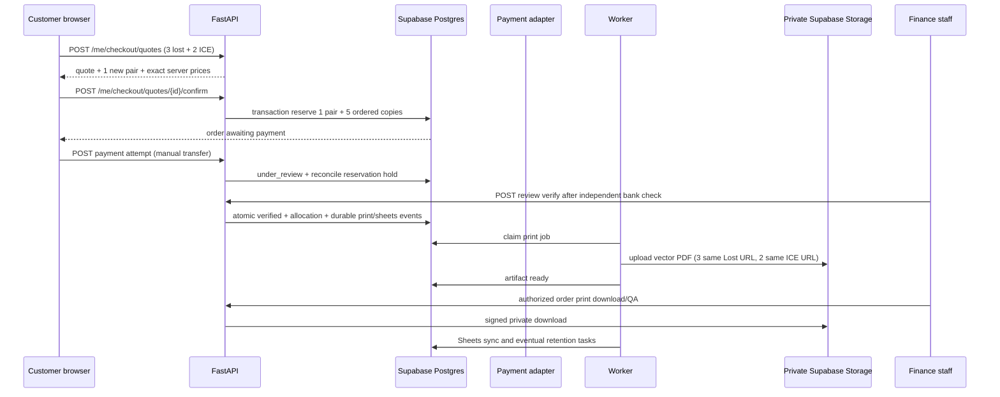

# SafeReturn — REST API Contract & OpenAPI Specification v1.2

**Document ID:** SR-API-003 | **Version:** 1.2 proposed implementation contract | **Date:** 2026-10-12  
**Product:** SafeReturn Lahore pilot; expandable multi-product QR platform.  
**Basis:** `SafeReturn_01_Product_Requirements_Document_v1.2.md`, `SafeReturn_02_Technical_Design_v1.2.md`, `SafeReturn_03_Database_Design_and_Migration_Spec_v1.2.md`, and the original API Contract v1.1.  
**Approval status:** Requires founder/security/finance review of explicit open decisions; not a claim that an API, migration, deployment, or complete machine-readable OpenAPI schema exists.

> **Precedence and preservation:** **Part A** specifies v1.2 additions and overrides. **Part B** preserves the original complete v1.1 API contract for unaffected endpoints and controls. When a Part B request/response or order-unit assumption conflicts with Part A, Part A takes precedence. Existing API-001–API-0xx IDs and their paths are retained unless explicitly extended below. The complete OpenAPI 3.1 spec must be generated from FastAPI and checked against BOTH parts before release. Examples are synthetic. Server-enforced permissions, transactional invariants and payment verification cannot be replaced with frontend conditions.

# PART A — AUTHORITATIVE v1.2 CHANGES

## A1. Invariants and canonical language

1. **One QR pair** = `tag_pairs.id` + one current `lost` QR + one current `ice` QR + one separate secret verifier. The pair is the activation/ownership unit. Both activate atomically. Users may own any number of authorized pairs.
2. **QR identity ≠ physical product ≠ printed copy.** For an order of three Lost stickers plus two ICE stickers, use **one** newly reserved pair, two current QR IDs/URLs, and five print occurrences with correct sizes. Repeating a URL in the printable PDF does not issue another QR identity.
3. Each `qr_codes.id` has its **own** independently editable matching Lost or ICE profile, consent, and publication settings; modifying one tag must never change unrelated profiles. Each print copy with the same QR URL resolves to the **same** profile.
4. Future keychains, children's badges, luggage/bag tags, and emergency badges are catalog product/variant data. They may use an **existing authorized QR** (shared profile) or provision a **new full pair** (independent pair/individual profiles) when product policy and feature flags permit. Never mint an orphan single tag. Children's/guardian publication requires a separately approved policy.
5. Catalog products, variants, images, and `order_items` snapshots must be independent from tag ownership. Order item snapshots of name, SKU, size, template, price, quantity and QR use survive catalog edits and archival.
6. Payment `verified` requires trusted staff's independent bank settlement check (pilot) or a verified signed gateway event (future); sender-entered details and screenshots never suffice. Payment states, order states, inventory states and shipping states are distinct.
7. Only eligible, digitally QA-approved unused pairs may be **reserved exclusively** at checkout. Review-pending payments cannot be silently released while credible transfer reconciliation is pending. A verified payment allocates exactly once.
8. The public scan never creates an ownership claim; token only identifies a QR. Scan → Activate → auth → activation with preserved context requires verified purchaser entitlement or the distinct concealed activation secret; no rescan. Finder and emergency responder scans remain anonymous and bilingual.
9. PDFs and proof files live in **private Supabase Storage**, protected by server authorization and short-lived controlled access; images for the public storefront use **Cloudinary**. PDFs use vector symbols and compact repeated artwork, Lost first then ICE, logo-centered print QA. Do not expose activation secrets or medical/ICE private data in print copies.
10. Google Sheets is a **redacted, eventual finance mirror**. Persistent Supabase PostgreSQL records and audited payment decisions are source of truth. Worker failures are retryable. Retention deletes private objects at approved cutoffs, not transaction/audit history.
11. All non-public reads/writes go through authenticated FastAPI with owner/role authorization, restrictive DB privileges/RLS defense-in-depth, explicit response allowlists, idempotency, and audit. Private initial ICE responses/HTML/hydration never contain full phone numbers.

## A2. Versioning, envelopes, error model and auth

- API prefix remains `/api/v1` (Next.js page URLs such as `/q/{token}`, `/shop`, `/activate`, `/dashboard`, `/admin/products` are **not** API routes).
- Production host is conditional on real domain verification. Local base: `http://localhost:8000/api/v1`.
- JSON UTF-8 unless a constrained signed object upload/download is used. Money is a **decimal string**, ISO 4217 `PKR` by default. UTC RFC3339 timestamps, UUIDs, opaque tokens; never float money.
- Supabase Auth bearer JWT for owner routes; verified backend roles/MFA for administrative finance/stock/print/catalog activities. Never authorize from body-supplied `owner_user_id`, client-supplied `role`, or token presence alone.
- Privacy-sensitive read responses use `Cache-Control: no-store`; cursor paging for lists, capped at 100. `Idempotency-Key` required for meaningful writes with dedupe; reject same key + different canonical payload with `409 IDEMPOTENCY_KEY_REUSED`. Conditional mutation/version or `If-Match` on mutable profiles and products; `409`/`412` when outdated.
- Standard error follows v1.1 schema: `error.code`, `error.message`, `error.request_id`, optional safe `error.details`. Do not return stack traces, full payment identifiers, raw tokens in server logs, or secrets.
- Errors: `400 VALIDATION_ERROR`, `401 AUTH_REQUIRED`, `403 FORBIDDEN`, `404 NOT_FOUND` (also use non-disclosing 404 for cross-owner), `409 CONFLICT`, `410 QR_REVOKED`, `412 VERSION_MISMATCH`, `413 FILE_TOO_LARGE`, `415 UNSUPPORTED_MEDIA_TYPE`, `422 BUSINESS_RULE_VIOLATION`, `429 RATE_LIMITED`, `503 PROVIDER_UNAVAILABLE`. Full localization mapping provided in English/Urdu for public QR/activation pages.
- Safe open URLs (public QR and customer-owned IDs) need separate policies: public tokens are unguessable, yet never claim credentials. Never reveal whether a tag is owned by another account through a protected activation error.
- All endpoints and DTOs below are **v1.2 planned contracts**, not deployed endpoints. Existing v1.1 exact route semantics continue where not overridden.

## A3. Roles and access matrix

| Resource/action | Anonymous | Customer verified owner | Catalog staff | Finance + MFA | Ops + MFA | Security superadmin |
|---|---|---|---|---|---|---|
| Published catalog/featured/variant | Read | Read | Read | Read | Read | Read |
| Lost/ICE public published QR | Public limited | Public limited | Public limited | Public limited | Public limited | Public limited |
| Finder message and protected phone reveal | Controlled public | Controlled public | Controlled public | Controlled public | Controlled public | Controlled public |
| Own QR list, pair detail, profiles | No | Own only | No default | No default | Minimum for support | Escalated audited |
| Create checkout/quote/order/payment attempt | Quote if configured; orders require auth | Own only | No | No | No | Controlled override |
| Admin catalog CRUD/images/featured | No | No | Yes | No | Optional delegated | Yes |
| Confirm bank payment/refund | No | No | No | Yes | No | Escalated audited |
| Generate pairs, QA, print/reprint/ship | No | No | No | No | Yes | Escalated audited |
| Finance Sheets job status/retry | No | No | No | Restricted | Restricted job ops | Yes |
| Delete private artifacts/bypass retention | No | No | No | Policy-governed proofs | Policy-governed PDF | Audited and retention-checked |

Audit reason, actor, time, previous/new state, request ID, and idempotency reference for sensitive changes. Reject cross-tenant attempts with non-disclosing errors. Staff roles derive from server-held authorization state, not JWT custom claims supplied by clients.

## A4. Endpoint registry — v1.2 additive/modified

The existing v1.1 API-001…API-0xx endpoints in Part B remain authoritative **unless marked modified**. New IDs intentionally start at **API-200** to avoid collisions with the v1.1 inventory. Paths are proposed and must be kept stable once approved.

| ID | Method and path | Who | Status |
|---|---|---|---|
| API-003 / API-004 | `GET /public/products`, `GET /public/products/{sku}` | Public | **Extended**: published catalog, variants, images, feature flag |
| API-010 | `GET /public/qr/{token}` | Public | **Extended**: unactivated `activation_available` public state, never credentials |
| API-030/031 | `GET /me/tag-pairs`, `GET /me/tag-pairs/{pair_id}` | Customer | **Extended**: unlimited paging, per-pair two tag summaries |
| API-032 | `POST /me/tag-pairs/activations` | Customer | **Extended**: scan-context activation with independent entitlement |
| API-040–049 | Existing Lost/ICE/contact preference routes | Customer | **Preserved**: always scoped to `qr_id` |
| API-060 | `POST /me/orders` | Customer | **Modified**: confirmed quote + order lines/QR binding/reservation |
| API-061/062 | `GET /me/orders`, `GET /me/orders/{order_id}` | Customer | **Extended**: line snapshots, QR uses and payment/print/ship states |
| API-063/064 | Payment submission routes | Customer | **Extended** manual adapter compatibility |
| API-080–096 | Admin finance/inventory/batches/shipments routes | Staff | **Extended** with v1.2 rules; preserve original role boundaries |
| API-200 | `GET /public/catalog/categories` | Public | New |
| API-201 | `GET /public/catalog/featured` | Public | New |
| API-202 | `GET /public/catalog/products/{product_id}/variants` | Public | New |
| API-203 | `POST /me/checkout/quotes` | Customer | New |
| API-204 | `POST /me/checkout/quotes/{quote_id}/confirm` | Customer | New |
| API-205 | `GET /me/qr` | Customer | New QR-level collection |
| API-206 | `GET /me/qr/{qr_id}` | Customer | New QR detail |
| API-207 | `GET /public/qr/{token}/activation-context` | Public | New minimal pre-auth context |
| API-208 | `POST /me/tag-pairs/activation-intents` | Customer | New owner-bound, expiring claim intent |
| API-209 | `GET /me/orders/{order_id}/payment-attempts` | Customer | New normalized payment attempts |
| API-210 | `POST /me/orders/{order_id}/payment-attempts` | Customer | New manual/future gateway initiating interface |
| API-211 | `POST /me/payment-attempts/{attempt_id}/evidence-uploads` | Customer | New private upload authorization |
| API-212 | `POST /me/payment-attempts/{attempt_id}/evidence-finalize` | Customer | New proof validation/finalization |
| API-213 | `GET /me/orders/{order_id}/print-summary` | Customer | New non-sensitive fulfillment progress |
| API-214 | `POST /payments/webhooks/{provider_key}` | Authenticated webhook | New, P1 disabled until configured |
| API-220 | `GET /admin/products` | Catalog role | New |
| API-221 | `POST /admin/products` | Catalog role | New |
| API-222 | `PATCH /admin/products/{product_id}` | Catalog role | New |
| API-223 | `POST /admin/products/{product_id}/variants` | Catalog role | New |
| API-224 | `PATCH /admin/product-variants/{variant_id}` | Catalog role | New |
| API-225 | `POST /admin/products/{product_id}/images` | Catalog role | New |
| API-226 | `DELETE /admin/products/{product_id}/images/{image_id}` | Catalog role | New metadata/image unlink |
| API-227 | `GET /admin/catalog/categories` | Catalog role | New |
| API-228 | `POST /admin/catalog/categories` | Catalog role | New |
| API-229 | `PATCH /admin/catalog/categories/{category_id}` | Catalog role | New |
| API-230 | `GET /admin/inventory/summary` | Ops | New |
| API-232 | `GET /admin/orders/ready-to-ship` | Ops | New |
| API-233 | `GET /admin/orders/{order_id}/print-jobs` | Ops | New |
| API-234 | `POST /admin/orders/{order_id}/print-jobs` | Ops | New privileged regenerate/reprint |
| API-235 | `GET /admin/print-jobs/{job_id}` | Ops | New |
| API-236 | `POST /admin/print-artifacts/{artifact_id}/download-grants` | Ops | New signed private download |
| API-237 | `POST /admin/print-jobs/{job_id}/qa` | Ops | New physical QA |
| API-238 | `GET /admin/finance/sheet-sync` | Finance | New |
| API-239 | `POST /admin/finance/sheet-sync/{sync_id}/retry` | Finance | New |
| API-240 | `GET /admin/orders/{order_id}/payment-attempts` | Finance | New |
| API-241 | `POST /admin/payment-attempts/{attempt_id}/reviews` | Finance + MFA | New normalized verification |
| API-242 | `GET /admin/storage/artifacts` | Ops/Security | New metadata only |
| API-243 | `POST /admin/storage/artifacts/{artifact_id}/retention-holds` | Approved staff | New audited hold |
| API-244 | `DELETE /admin/storage/artifacts/{artifact_id}/retention-holds` | Approved staff | New audited removal |

**Registry correction:** The original `API-090 POST /admin/qr-batches` remains the single inventory generation command; do not introduce a second endpoint. API-083 remains a compatibility path for legacy `payment_submissions` until safely migrated; API-241 is the canonical v1.2 review path. No conflicting second QR generation or payment approval implementation should exist.

## A5. Shared schemas and validations

```yaml
# Illustrative OpenAPI 3.1 component fragments (not a complete OpenAPI file)
components:
  schemas:
    Money:
      type: string
      pattern: '^\\d{1,10}\\.\\d{2}$'
      example: '750.00'
    QRUseRequest:
      type: object
      additionalProperties: false
      required: [mode, tag_type, copies]
      properties:
        mode: {type: string, enum: [new_pair, existing_owned]}
        tag_type: {type: string, enum: [lost, ice]}
        copies: {type: integer, minimum: 1, maximum: 100}
        existing_qr_id: {type: string, format: uuid}
        client_pair_group: {type: string, description: 'Cart-local correlation for ONE new pair, never an entitlement token'}
    CartLine:
      type: object
      additionalProperties: false
      required: [variant_id, quantity, qr_uses]
      properties:
        variant_id: {type: string, format: uuid}
        quantity: {type: integer, minimum: 1, maximum: 100}
        qr_uses: {type: array, minItems: 1, items: {$ref: '#/components/schemas/QRUseRequest'}}
    OrderLineSnapshot:
      type: object
      required: [order_item_id, product_id, variant_id, product_name_snapshot, sku_snapshot, quantity, unit_price, line_total, qr_uses]
      properties:
        order_item_id: {type: string, format: uuid}
        product_id: {type: string, format: uuid}
        variant_id: {type: string, format: uuid}
        product_name_snapshot: {type: string}
        variant_name_snapshot: {type: string}
        sku_snapshot: {type: string}
        material_snapshot: {type: [string, 'null']}
        size_mm_snapshot: {type: [string, 'null']}
        fulfillment_method_snapshot: {type: string}
        quantity: {type: integer, minimum: 1}
        unit_price: {$ref: '#/components/schemas/Money'}
        line_total: {$ref: '#/components/schemas/Money'}
        qr_uses: {type: array, items: {type: object}}
```

**Canonical validation:** `sum(qr_uses[*].copies) == line.quantity`. All order lines that refer to the same `client_pair_group` share exactly ONE newly created pair, with at least one `lost` and one `ice` usage for P0 sticker kits. Multiple size lines can use same tag QR. For reuse mode, `existing_qr_id` is required, `client_pair_group` must be omitted, and server must verify current tag + authenticated owner + allowed product policy. Ignore client-supplied product name/price/status/owner/QR public URL; server takes verified catalog versions and locked prices. `Money` pattern above is illustrative; precise max decimals/negative handling match Decimal + DB numeric scale, not JavaScript floating-point.

## A6. Catalog/public product API

**API-003 `GET /public/products` (extended)**: optional `category`, `cursor`, `limit`; returns published product cards with ID, slug, name, description excerpt, category, primary public Cloudinary image, from-price, supported pair modes and purchasable variant summary; excludes drafts/archived and disabled variants. `API-004 GET /public/products/{sku}` remains backward compatible for QR sticker SKU detail. On catalog upgrade, `sku` resolves an active variant and returns parent product; do not overload it to accept product ID silently.

**API-200 `GET /public/catalog/categories`**: `200 {"items":[{"id":"<uuid>","slug":"stickers","name":"Stickers"}]}`; only active categories with published items, cache with invalidation.

**API-201 `GET /public/catalog/featured`**: `200 {"items":[{"product_id":"<uuid>","name":"QR Stickers","primary_image_url":"https://...","min_price":"150.00","currency_code":"PKR","is_featured":true}],"next_cursor":null}`. Response supports homepage horizontally scrolling featured carousel; only admin-published/featured entries. Cloudinary URLs must be approved public assets; no private blobs.

**API-202 `GET /public/catalog/products/{product_id}/variants`**: returns active purchasable sizes/colors/material/stock status/price/QR modes and print template capabilities, with server-managed `catalog_version`. No secrets or internal production files. P0 only published QR Stickers, future catalog product flags P1.

**API-220/221/222 — Admin products:** `GET` supports status+cursor; `POST` creates `draft`; `PATCH` changes description/name/category/featured/sort/status/QR mode permissions. `If-Match` or integer catalog version enforced; status transition `draft→published→archived` and optional unpublished→draft policy approved. Cannot hard-delete ordered product. Publishing needs at least one valid sellable variant, approved images/alt text where displayed, and acceptable physical/privacy policy. Server audits update and triggers cache invalidation.

**API-223/224 — Admin variants:** create/update SKU (globally unique), `size_mm` Decimal, material/color, template key/version, fulfillment method `pdf_label|manufacturer_artwork|manual`, PKR price Decimal, active status; reject unsafe minimum QR dimensions and disallowed product combinations. When price changes old order snapshots are unchanged. Changes to template applied to new orders only; reprints use frozen template snapshot unless explicit operator-approved revision.

**API-225/226 — Admin images:** `POST` takes approved Cloudinary `public_id`, alt text, sort and primary flag after server verified asset belongs to controlled account/folder; direct browser uploads use short-lived signed authorized upload parameters. `DELETE` removes product-image association safely; Cloudinary asset deletion may be separate reference-counted cleanup. Public customer image upload is not allowed.

**API-227–229 — Admin categories:** CRUD-lite list/create/update with unique slug, active/sort status; no deletion when referenced. Never infer seller permissions from catalog access.

## A7. QR resolution, scan-to-activation, multiple QR ownership

**API-010 `GET /public/qr/{token}` (extended)**:
- Valid active Lost and ICE still return limited published v1.1 response. Finder never needs login. ICE public projection must not include full phones in network/SSR/hydration.
- Known unactivated current token returns `200 {"status":"not_activated","tag_type":"lost","activation_available":true,"next_action":"activate"}` (same for `ice`); reveal **no** owner email, pair owner ID, secret, order ID, detailed inventory, private profile, or confirmation of buyer. Unknown/revoked/suspended tokens follow secure old status policy; revoked tags do not become claimable.
- Scan URL stays `https://verified-domain/q/{token}` indefinitely for current tag; the displayed link and the logo at center are never sufficient ownership proof.

**API-207 `GET /public/qr/{token}/activation-context`**: public minimal context `200 {"status":"not_activated","can_begin":true,"tag_type":"ice","context_ttl_seconds":900}`. This is for rendering/UX only, cannot grant ownership. No credentials. Rate-limit; response `Cache-Control: no-store`.

**Browser continuation:** Next.js saves only a short-lived opaque `pending_scan_token` via safe same-origin flow or authorized server session across Supabase Auth redirect (sanitize `return_to` to prevent open redirects); no activation credentials in localStorage/query. After login, server re-reads token and checks pair entitlements, then prompts user to confirm. **Do not bind another user's pending scan through shared browser sessions;** require explicit confirmation, expiry and replay protection.

**API-208 `POST /me/tag-pairs/activation-intents`**: authenticated verified user; body `{ "scanned_token":"<opaque-token>", "activation_secret":null }` (secret optional only if verified purchaser entitlement) → `201 {"intent_id":"<uuid>","pair_id":"<uuid>","lost_qr_id":"<uuid>","ice_qr_id":"<uuid>","expires_at":"...","method":"order_entitlement"}`. Validate pair unactivated, two current children, not another user's property, buyer entitlement OR non-public distinct concealed credential; verify credential with constant-time verifier, no raw persistence/logging. Rate-limit guesses and credential attempts. Intent is actor-bound and short-lived; it is **not** the final activation.

**API-032 `POST /me/tag-pairs/activations` (extended)**: request `{ "intent_id":"<uuid>","confirm":true }` with `Idempotency-Key`, or legacy `{ "pair_reference":"...","activation_secret":"..." }` only while compatibility is explicitly supported. `200/201 {"pair_id":"...","status":"active","activated_at":"...","qr_codes":[{"qr_id":"...","tag_type":"lost"},{"qr_id":"...","tag_type":"ice"}]}`. One DB transaction binds owner and activates both; conflict with ownership/race yields `409`; retries return the original decision. Old secret verification rules remain. Activation must not unpublish privacy preferences unexpectedly.

**API-030 `GET /me/tag-pairs`**: cursor pages pair IDs, linked Lost+ICE QR summaries, product/source references where appropriate, activation state and profile-label previews, never emergency phones by default. **No one-pair-per-user limit**. `API-031` adds per-pair owner-authorized details.

**API-205 `GET /me/qr`**: query `tag_type=lost|ice`, `pair_id`, `status`, `cursor`, `limit`; customer-only collection items `{ "qr_id":"...", "pair_id":"...", "tag_type":"lost", "profile_label":"School Bag", "editable":true, "public_status":"published" }`. Do not include concealed activation secrets, private ICE contact payloads, other-owner QR IDs.

**API-206 `GET /me/qr/{qr_id}`**: owner-only detail shows QR-level tag identity, its pair, own profile navigation URLs, actual publish status and physical products that reference it when authorized. A QR's multiple prints do not yield duplicate QR entries. Do not bundle unrelated pair profiles.

**Existing API-040/041, 042/043, 044–047 and 048/049** keep current per-`qr_id` endpoints. The target implementation must ensure a matching Lost/ICE profile row keyed to QR, update only that QR, and guard `If-Match`/profile_version. ICE contact fields remain encrypted/revealed only through protected phone reveal rules. Editing Lost A must not touch Lost B, ICE A or a printed-copy table.

## A8. Checkout quote → order/reservation

**API-203 `POST /me/checkout/quotes`** (auth required to bind owned QR, quote may be anonymous only after separate approved feature):

```json
{
  "lines": [
    {"variant_id":"00000000-0000-4000-8000-000000000101","quantity":3,
     "qr_uses":[{"mode":"new_pair","tag_type":"lost","copies":3,"client_pair_group":"kit-1"}]},
    {"variant_id":"00000000-0000-4000-8000-000000000101","quantity":2,
     "qr_uses":[{"mode":"new_pair","tag_type":"ice","copies":2,"client_pair_group":"kit-1"}]}
  ],
  "shipping_address_id":"00000000-0000-4000-8000-000000000201",
  "contact_phone_confirmation":true
}
```

`200` response includes opaque `quote_id`, expiry, server-resolved `lines` with product ID/name/variant ID/name/SKU/size, quantity/unit price/line totals, QR mode summary, `new_pair_count=1`, subtotal/shipping/taxes/discount and **total**, currency, masked shipping contact/address confirmation, `catalog_version`, reservation policy. Prices and costs are strings, calculated entirely server-side. Quote itself is **not** paid and does not lock stock indefinitely. Reject invalid QR mode, stale variant or unavailable capacity (`409 INSUFFICIENT_PAIR_STOCK`), mismatched `sum(copies)` and missing both Lost/ICE for new sticker kit.

**API-204 `POST /me/checkout/quotes/{quote_id}/confirm`**: `Idempotency-Key` required; body `{ "accept_total":"750.00", "accept_currency":"PKR" }`; server locks price/quote validity, current stock and owner QR rights, inserts existing `orders`, `order_items` snapshots, `order_pair_units` one per **distinct** new group, and `order_item_qr_uses` correctly linked to same pair. Returns `201 {"order_id":"...","order_reference":"SR-...","order_status":"awaiting_payment","payment_status":"unpaid","reservation_state":"reserved","reserved_until":"...","total":"...","currency_code":"PKR"}`. Do **not** create one pair per print copy or row. Transaction uses `FOR UPDATE SKIP LOCKED` or equivalent and exclusive live index. Same idempotency key returns same order. If final allocation cannot be reserved, roll back all order rows. Reservation expiry triggers reconciliation if payment has been submitted.

**API-060 `POST /me/orders` (compatibility)**: retained as v1.1 entry point for existing clients; new frontend should call quote→confirm. If used for v1.2 carts, server must internally use **the exact same** validate/quote/atomic reservation service as API-204, or reject legacy unsupported payload with a documented upgrade error. It must not run independent checkout logic.

**API-061 `GET /me/orders`, API-062 `GET /me/orders/{order_id}`**: include order ID/reference, totals, shipping contact snapshot, immutable `order_items[]` names/SKU/quantities/size/material/unit prices, `qr_uses[]` with tag type, copies, authorized QR ID and `new_pair|existing_owned`, `pair_count`, payment attempt summary, order/payment/print/ship statuses and timestamps. Never include sender's full account number or another person's private QR profile. If a product is archived later, the customer's historical order remains readable.

**API-065 `POST /me/orders/{order_id}/cancel`**: preserve v1.1 rules, additionally re-evaluate submitted transfer holds and held/reserved pairs; no silent release while payment under review. Cancelling after verified payment requires explicit refund/reconciliation flow, never retroactively marks unverified.

## A9. Payments: provider-independent seam and storage

**Stable state normalization:** `payment_attempts` with provider_key `manual_bank` now; later `provider_key` per gateway. Supported current logical states: `initiated`, `submitted`, `under_review`, `verified`, `rejected`, `expired`, `refunded`, `disputed` (Doc 03). Capture authorization/settlement distinctions for future gateways through a reviewed schema migration rather than silently mapping `authorized` to `verified`. `orders` retain independent payment/order/fulfillment states.

**API-210 `POST /me/orders/{order_id}/payment-attempts`**: auth owner only; `Idempotency-Key`. Request `{ "provider_key":"manual_bank", "sender_account":"<provided-private>", "sender_holder_name":"<name>", "transfer_reference":"<optional>", "submitted_at":"<optional>" }`. Sensitive account/holder encrypted in database, masked in response, validated lengths and rate limits. `201 {"attempt_id":"...","state":"under_review","sender_account_masked":"****1234","evidence_upload_allowed":true,"payment_due":"..."}`. A screenshot is optional under approved policy, not required proof of payment, and cannot set `verified`. Future gateway payload is only a provider-specific safe initiation token/client redirect and must never ask for manual sender account details.

**API-209 `GET /me/orders/{order_id}/payment-attempts`** returns attempt IDs, amount/status/provider, mask, transfer reference when safe, review timestamp and user-facing status, with no raw account data. API-063/064 legacy manual payment submission endpoints call/reflect the same normalized adapter during migration; **never duplicate attempt rows for the same submitted transfer**.

**API-211 `POST /me/payment-attempts/{attempt_id}/evidence-uploads`**: request filename/content type/byte size/hash; returns short-lived **private Supabase Storage** upload authorization, narrow unique object key, max upload constraints, expiry; no public object URL. Only owner of attempt can use. Validate actual bytes and MIME signature (not extension alone), size, malware/content policy. Limit attempts; sanitize filenames.

**API-212 `POST /me/payment-attempts/{attempt_id}/evidence-finalize`**: body `{ "upload_token":"<opaque>","sha256":"<hash>" }`; confirm object exists, permitted content and size, save `payment_evidence` metadata. `200 {"evidence_id":"...","received":true,"payment_state":"under_review"}`. Merely finalizing upload **must not** approve payment. Direct evidence access only via separately authorized short-lived retrieval for finance staff; no Cloudinary and no Google Sheet public link.

**API-240 `GET /admin/orders/{order_id}/payment-attempts`** finance+MFA, returns minimal details needed for independently checking bank settlement and restricted evidence download grant. Staff cannot infer settlement from screenshot alone.

**API-241 `POST /admin/payment-attempts/{attempt_id}/reviews`** finance+MFA + idempotency: `{ "decision":"verify", "bank_match_reference":"<private-audit-reference>", "reason":"Independently matched settled amount" }` or `decision=reject`, reason required. Checks settled bank channel, amount/currency, duplicate transfer reference, order, review policy, and under-review state; atomically updates normalized payment, audit, durable outbox and allocation trigger exactly once. `200 {"attempt_id":"...","state":"verified","order_id":"...","fulfillment_eligible":true}`; `409` on conflict. Prevent finance from reusing same external transaction to approve multiple orders.

**API-214 `POST /payments/webhooks/{provider_key}`** **P1 off by default:** raw body + signature header from configured gateway, no Supabase user session. Verify provider endpoint allowlist, HMAC/asymmetric signature, event time/replay, provider event ID, order/attempt ID, amount/currency and final bank settlement semantics. Respond `2xx` to accepted duplicate only after idempotent database state; durable event ledger/outbox, no second print job, no payment approval from unsigned callback. Returning 5xx for transient errors permits provider retry. Do not couple checkout/order schema to provider API; provider adapter owns translation to normalized states.

## A10. Inventory, QR batches, admin reservations and QA

**API-230 `GET /admin/inventory/summary`** ops+MFA; return counts for digitally eligible unclaimed pairs, actively reserved, allocated, qa-held, active, low-stock threshold/indicator and last batch. Never count physical copies as pairs. Do not leak activation secret. Low stock notifications use scheduled worker/deduplication.

**API-090 `POST /admin/qr-batches` (existing, authoritative)**: request `{"pair_count":100,"batch_label":"OCT-2026-A","logo_template_key":"safe-return-primary","qr_ecc":"Q"}` plus approved physical controls; server generates exactly 100 pair IDs, 100 Lost + 100 ICE distinct public tokens, independent activation credential verifiers, and audit/batch QA metadata. Response only batch and counts; secret output through controlled one-time sealed insert production process (v1.1 API-093 constraints). This **does not** create pre-printed final customer stickers. Separate digital token QA from physical post-print QA per approved ADR.

**API-084–089** v1.1 admin inventory remains; manual allocation endpoints must refuse bypassing verified order, not be a second competing allocation path for automated P0 checkout. Exclusive `order_pair_units` reservation is created via API-204, not customer-picked ID. Reservation release or replacement is audited and never reuses already activated/shipped/printed pair. **No public endpoint to claim by Pair ID alone.**

## A11. Print generation, compact PDFs, Ready to Ship, delivery

**Event trigger:** after verified payment and successful final allocation, one durable worker job is queued using stable order/job revision idempotency. Production uses immutable order line snapshots and `order_item_qr_uses`. One `new_pair` group = two QR identities; any number of physical occurrences. Existing-owned usage may be printed on future merchandise only when explicitly enabled/authorized.

**Rendering requirements:** exact variant `size_mm`, correct printer PPI/point conversion, 4-module quiet zone, ECC selection verified with centered SafeReturn logo, product-specific cut marks/margins, bilingual instructions; **Lost occurrences first, ICE second**. Reuse vector QR art in a PDF to keep byte size small, compress shared logo once, embed fonts efficiently; refuse unvalidated physical dimensions, template/version, or scan results. Separate controlled insert for concealed activation credential; never include it in publicly visible QR sticker artwork.

**API-232 `GET /admin/orders/ready-to-ship`** ops+MFA, `cursor`, status filters. Only orders with payment verified, pair allocated, successful print-ready artifact and required physical QA/packing stage are eligible for a **ready-to-ship** label. If physical QA has not happened, return `ready_to_print`/`qa_pending` in separate workflow, **not** misleading ready-to-ship. Include order ID, physical line quantities/sizes, pair count, shipping reference/recipient subset, print job status, signed-download availability (no persistent public URL).

**API-233 `GET /admin/orders/{order_id}/print-jobs`** list versions/QA/status/hash/bytes and retention state; no raw activation secret.

**API-234 `POST /admin/orders/{order_id}/print-jobs`** ops+MFA, idempotency. For first auto render worker handles event; operator endpoint is **audited retry/reprint** `{ "reason":"damaged label","expected_revision":1 }` and must not mint new tokens. If old artifact deleted, regenerate same QR URLs/layout based on stored immutable template snapshot, require reprint approval policy. `202 {"job_id":"...","revision":2,"status":"queued"}`. Guard against duplicate active jobs.

**API-235 `GET /admin/print-jobs/{job_id}`** status including `queued|rendering|ready|failed|qa_passed|superseded|deleted`, warnings, byte size and role-safe failure code. Failures retry with backoff; no shipment until QA.

**API-236 `POST /admin/print-artifacts/{artifact_id}/download-grants`** ops+MFA; `201 {"download_url":"<short-lived-private-signed-url>","expires_at":"...","filename":"SR-...-print.pdf"}`. Backend validates job/order scope, staff permissions, artifact retention, account status. `Cache-Control:no-store`; log grants, not URLs. Signed URLs treated as bearer tokens, short lifetime. Download does not mark sent/shipped.

**API-237 `POST /admin/print-jobs/{job_id}/qa`** ops QA reviewer; body count per Lost/ICE, size, scanner passes, logo/quiet-zone checks, physical print matches order, cutting/packaging check, bilingual labels, failure reason. `200` updates QA record and release gate; never falsely pass if copies or dimensions mismatch. Original v1.1 API-094 tag pair generation QA still applies, but is distinct from final customer print QA.

**API-213 `GET /me/orders/{order_id}/print-summary`** owner view `{ "print_status":"ready","fulfillment_status":"awaiting_dispatch","copies":{"lost":3,"ice":2},"shipment_status":"not_shipped" }` without private staff print-artifact access or print secrets.

**API-095/096** original shipment API remains. Delivery confirmation uses trusted carrier callback (approved) or audited admin confirmation, then schedules **policy-bound** artifact cleanup after grace. No deletion of order items, pair ownership, QR profiles or audit. A hold prevents deletion until cleared. Artifacts already deleted -> `410 ARTIFACT_DELETED` and possible privileged approved regeneration. Refund/dispute/chargeback pauses shipment as policy demands.

## A12. Storage cleanup, finance Sheets sync and audit

**API-242 `GET /admin/storage/artifacts`** role-limited metadata-only inventory (private payment proofs or PDFs), retention/deletion statuses, filter by order/job, no direct public object URLs. **API-243** places a reasoned retention hold on object with approved category and audit; **API-244** removes hold with audit, after verifying legal/support constraints. Regular worker performs deletion when `retention_until` elapsed, delivery/grace policy satisfied (print), dispute window completed (evidence), no hold and no pending reprint/support process. Deletion must be idempotent and retryable; remove storage object first then mark `deleted_at`, preserving hash/object tombstone/reconciliation reference. Cloudinary public catalog images have their own unlink and asset cleanup policy, not shared with private files.

**API-238 `GET /admin/finance/sheet-sync`** finance role paginated sync status: order ID, masked payment method/status, `pending|synced|retry|failed`, last synced time and safe error. **API-239 `POST /admin/finance/sheet-sync/{sync_id}/retry`** requeues failed sync with audit, no editing payment. Durable worker upserts by stable order ID/row key and monotonic export version to restricted Google Sheet. If Google unavailable, retain committed Supabase payment/print state and retry; never expose full sender account, raw ICE profile, or unprotected screenshot link in Sheet.

Operational events: payment verified, allocation finalized, print requested, artifact stored, download granted, QA passed, shipment dispatched/delivered, evidence cleanup, artifact cleanup, catalog publication, activation, profile update and failed sync all audited with principal and request ID. Per-provider callbacks store minimal restricted event IDs for idempotency; retention per approved policy.

## A13. State machines and end-to-end sequences



```mermaid
sequenceDiagram
  participant B as Scanner browser
  participant API as FastAPI
  participant AUTH as Supabase Auth
  participant DB as Supabase Postgres
  B->>API: GET public QR token
  API-->>B: known, not activated + Activate QR option
  B->>AUTH: login/sign-up (preserve safe pending scan context)
  AUTH-->>B: verified session/return
  B->>API: POST activation intent with scanned token
  API->>DB: validate purchaser entitlement or concealed credential
  API-->>B: pair ID and two tag summaries; confirm
  B->>API: POST pair activation with intent/idempotency key
  API->>DB: atomic owner bind and activation for both tags
  API-->>B: active + dashboard navigation
```

**States remain independent:** payment `initiated/submitted/under_review/verified/rejected/expired/refunded/disputed`; order `awaiting_payment|processing|cancelled|...` (reconcile original enum); reservation `reserved|allocated|released|cancelled`; print `queued|rendering|ready|downloaded|qa_passed|failed|superseded|deleted`; shipment original v1.1 statuses. Never collapse all to one `status` field. If a paid reservation has expired unexpectedly, stop and reconcile, not allocate a random replacement silently.

## A14. OpenAPI completeness and API drift checks

The YAML fragments above are *illustrative*, not a canonical complete spec. Implementation must produce `openapi.json` from running FastAPI containing **every** old and new route, named DTOs and schema validation, response codes, auth policies, headers, uploads, webhooks and example payloads; run openapi-spec-validator (or equivalent), cross-check generated route inventory to this registry, and ship a static snapshot/versioned diff in CI. Protect signed upload/download schemas from arbitrary URL disclosure. Avoid claiming a complete OpenAPI 3.1 schema from prose/fragments alone.

A minimal public endpoint schema example (illustration only):

```yaml
openapi: 3.1.0
info:
  title: SafeReturn API
  version: 1.2.0
paths:
  /public/catalog/featured:
    get:
      operationId: getFeaturedProducts
      tags: [catalog]
      security: []
      responses:
        '200': {description: Published featured product cards}
  /me/checkout/quotes:
    post:
      operationId: createCheckoutQuote
      tags: [checkout]
      security: [{bearerAuth: []}]
      responses:
        '200': {description: Server-validated price quote}
        '409': {description: Unavailable product or insufficient pair stock}
```

## A15. Verification matrix / release blocks

| ID | API integration / E2E scenario | Required assertion |
|---|---|---|
| API12-001 | Scan known inactive Lost/ICE, login, resume | Activation option; no second scan; no ownership from token alone |
| API12-002 | Claim scanned QR without paid entitlement/secret | Denied without claiming; no buyer identity leak |
| API12-003 | 1 account owns 2+ pairs and edits Lost A/ICE A/Lost B | All separate correct profiles, zero cross-write |
| API12-004 | 3 Lost + 2 ICE stickers same pair | 2 QR tokens, 5 printable occurrences, 1 pair reservation |
| API12-005 | Two sizes of same Lost QR | Same URL, separate size copies/prices, correct PDF |
| API12-006 | Future keychain with existing QR | No new pair, shared profile, owner verified |
| API12-007 | Future keychain new identity | One additional complete pair, independently editable profiles |
| API12-008 | Try existing QR from another account | 403/404, zero order/item/print allocation |
| API12-009 | Change catalog name/price after purchase | Order snapshots unchanged; new quotes show new catalog price |
| API12-010 | Concurrent checkout on final eligible pair | Exactly one exclusive reservation; no oversell |
| API12-011 | Submitted proof while money not settled | Under review, no approval/print/ship |
| API12-012 | Finance verification repeats request | One verified decision/print job; same idempotent result |
| API12-013 | Gateway webhook duplicate/replay/invalid signature | Reject malicious events; valid duplicate no double transition |
| API12-014 | Google Sheets offline | Payment stays verified; retry eventual redacted mirror |
| API12-015 | PDF repeated QR symbols and centered logo | Correct counts, Lost then ICE, scanner passes physical QA, size monitored |
| API12-016 | Non-ops fetch private print URL | Denied; signed grant narrowly time-bounded |
| API12-017 | Delivery/grace cleanup | Private PDF deleted, all QR/order/audit records retained |
| API12-018 | Payment dispute before evidence cleanup | Retention hold prevents deletion |
| API12-019 | Admin publishes feature product | Shows in homepage featured carousel after cache invalidation |
| API12-020 | Draft/archived child badge on public catalog | Not visible or purchasable; guardian policy gate enforced |
| API12-021 | ICE initial response/SSR/network | Never contains phone; reveal separate protected action |
| API12-022 | Finder message with Resend outage | Message+outbox atomic; asynchronous retry |
| API12-023 | Reprint after deletion | Uses saved token/spec; no extra QR identities |
| API12-024 | Migration compatibility old API-060/063/083 | Same normalized services, no duplicate order/payment path |

**Stop-ship:** cross-owner QR leak, unauthorized activation, payment approved from evidence alone, double reservation/charge/print, publicly available private PDF, unprotected initial ICE phone, broken physical scan after logo placement, or loss of existing v1.1 consent/notification behavior.

## A16. Reconciliation and decision register

| Decision / conflict | Contract resolution or remaining approval |
|---|---|
| API-060 legacy order creation vs new quote flow | Retain route, delegate to same canonical service; new UI uses API-203/204; deprecate only after client migration |
| API-083 legacy payment review vs API-241 normalized attempts | Compatibility adapter only; **one** payment state machine and independent bank verification |
| Existing `products`/`order_items` migration differences | Compare actual migrations, create incremental changes; never blind-create a parallel table |
| `lost_item_profiles`/`ice_profiles` v1.1 vs v1.2 illustrative `lost_profiles`/`emergency_profiles` | Keep actual v1.1 canonical tables and add one-to-one QR association if missing; do not create duplicate profile sources |
| `pair_print_qa` generated inventory vs per-order print QA | Separate *digital eligible* stock QA from final physical cut/scan/ship QA; approve ADR and migration if original lifecycle assumes all inventory preprinted |
| One-pair default vs future many new pairs | P0 one `client_pair_group` per new sticker order; multi-group feature flag + tested quantity limits later |
| Existing-owned-QR resale | Feature flag OFF P0; P1 after secure cross-owner and product policy tests |
| Manual payment evidence retention | Founder/legal/finance set duration and hold policy; sample 7-day PDF grace is not final |
| Domain/logo/size/print templates | Verify domain before batch printing; logo/quiet-zone scanner testing and real printer QA required |
| Child / guardian data publication | Block child badge until guardian consent/legal and data-minimization approval |
| Quote lifetime/reservation lifetime/suspicion thresholds | Configurable settings, founder approval, tests; no fabricated production values |
| External gateway/webhook | Separate integration spec and verified provider signatures before enabling API-214 |
| Cloudinary vs Supabase | Cloudinary = only approved public catalog imagery; Supabase = all private payment proof + print PDFs |
| Google Sheets | Restricted service account + redacted order mirror, eventually consistent, never a settlement authority |
| OpenAPI contract | Machine-readable comprehensive schema not yet generated; FastAPI emits it during implementation |

**Approval gate:** Founder validates product/checkout/QR reuse and price policies; security validates activation, privacy, storage and webhook model; finance validates independent manual verification and evidence retention; ops/print QA validates actual logo/label sizes; database owner confirms additive migration name mappings. All release tests must pass before enabling P0 or future-product flags.

---

# PART B — ORIGINAL API CONTRACT v1.1 (REFERENCE, PRESERVED)

> The following text is the uploaded original v1.1 contract, retained for full historical detail and all unaffected routes. **Part A overrides any conflicting assumption** about per-copy pair counts, fixed SKU storefront, pre-print allocation time, scanned-QR activation, provider-dependent payments, printed QR size or single-product orders. This is not a second API to implement.

# SafeReturn — REST API Contract & OpenAPI Specification

**Document ID:** SR-API-003  
**Version:** 1.1-draft  
**Date:** 11 October 2026  
**Product:** SafeReturn — Lahore pilot  
**Status:** Proposed contract, pending founder decisions and implementation review  
**Format:** Markdown with OpenAPI 3.1 fragments; the canonical machine-readable OpenAPI file should be generated/maintained during implementation.  
**References:** SafeReturn PRD v1.0 + v1.1 amendment; Technical Design Document SR-TDD-001; Database Design & Migration Specification SR-DB-002.  
**Scope:** FastAPI REST endpoints, contracts, auth, errors, idempotency, privacy, pagination, examples, tests, and implementation sequence. UI screen/navigation specification is intentionally deferred until the final document.

> **Contract precedence:** Approved PRD product rules → approved architecture/database decisions → this API contract → generated FastAPI OpenAPI schema. Conflicts are not silently resolved by an AI coding agent. Open questions are listed in §26. Example UUIDs, domain names, and phone numbers are synthetic.

---

## 1. Contract objectives and architectural rules

1. Public QR scan and emergency use **never require login**.
2. All business data is served through FastAPI; browser clients do not write directly to business tables.
3. One physical **pair** contains one current lost tag and one current ICE tag; one secret activates both atomically.
4. Customer authorization derives from `tag_pairs.owner_user_id`, not a caller-supplied owner field.
5. Initial public ICE responses never contain full phone numbers or `tel:` URIs.
6. Finder location is **optional, explicit, one-time**, and never required to submit a message.
7. WhatsApp is an owner-enabled external click-to-chat link; opening it is **not** a SafeReturn message submission or auditable email event.
8. Finder messages and notification outbox events commit together; Resend sends asynchronously.
9. Order line quantity counts **pairs**, not stickers; manual transfer screenshots do not automatically verify payment.
10. Public user-facing error codes/messages support English and Urdu.
11. Every mutating sensitive endpoint has an audit and authorization policy.
12. Never return activation secrets, password hashes, service-role keys, encrypted private columns, or raw provider credentials.

### 1.1 API topology

| Component | Proposed base | Notes |
|---|---|---|
| Production API | `https://api.safereturn.pk/api/v1` | Domain must be verified before use |
| Staging API | `https://staging-api.example.invalid/api/v1` | Illustrative, not a real deployment |
| Local API | `http://localhost:8000/api/v1` | Development only |
| Public QR landing | `https://safereturn.pk/q/{token}` | Next.js route, **not** a REST endpoint |
| Auth identity | Supabase Auth | Auth tokens issued outside this API |

### 1.2 OpenAPI 3.1 header (illustrative)

```yaml
openapi: 3.1.0
info:
  title: SafeReturn API
  version: 1.1.0
  description: Paired QR kit, lost-item recovery and emergency contact API.
servers:
  - url: https://api.safereturn.pk/api/v1
    description: Production (subject to domain verification)
  - url: http://localhost:8000/api/v1
    description: Local development
security:
  - bearerAuth: []
components:
  securitySchemes:
    bearerAuth:
      type: http
      scheme: bearer
      bearerFormat: JWT
      description: Supabase-issued access token, validated by FastAPI.
```

**Implementation rule:** OpenAPI fragments in this Markdown are design illustrations, not a substitute for a complete machine-readable contract. Once code begins, `openapi.json` must be diff-checked against this document and a separately maintained OpenAPI YAML/JSON artifact. The user requested **only one Markdown file in this turn**, so no extra file is generated.

---

## 2. Transport and serialization

| Concern | Contract |
|---|---|
| Transport | HTTPS in staging/production; HTTP only localhost |
| Content type | `application/json; charset=utf-8`, except multipart evidence upload |
| API version | `/api/v1` in URL |
| Identifiers | UUID v4 or database-generated UUID; public tokens are opaque strings |
| Dates | RFC 3339 UTC timestamps with timezone (`2026-10-11T11:00:00Z`) |
| Money | JSON **string decimal** for PKR, e.g. `"750.00"`; never float |
| Phone | E.164 for private configuration, e.g. `+923001234567` |
| Locale | `Accept-Language: ur` or `en`; optional `?lang=ur` only on public GET where documented |
| Character encoding | UTF-8; Urdu content must round-trip |
| Unknown JSON properties | Reject for sensitive mutations (`extra=forbid` in Pydantic) |
| Body size | Route-specific limits; finder message <=1,000 characters |
| Request tracing | Server emits `X-Request-ID`; accepts trusted caller ID only after validation |
| Caching | Private/sensitive responses `Cache-Control: no-store` |
| CORS | Explicit approved frontend origins; no wildcard with credentials |
| Authentication | `Authorization: Bearer <access_token>` for protected routes |
| Pagination | Cursor-based for messages, orders, audit, inventory; max 100 |
| Concurrency | `If-Match` / version field where documented; DB locking for critical transactions |

### 2.1 Standard response envelope

Successful resource responses return the resource object directly. Collections use:

```json
{
  "items": [{"id": "550e8400-e29b-41d4-a716-446655440000"}],
  "next_cursor": null,
  "has_more": false
}
```

Use consistent HTTP semantics: 200 for reads/updates, 201 for created resources, 202 for accepted asynchronous work, 204 for successful empty deletes. Do not return 200 for every outcome.

### 2.2 Standard error schema

```json
{
  "error": {
    "code": "PAIR_NOT_ELIGIBLE",
    "message": "This kit cannot be activated.",
    "message_ur": "یہ کٹ فعال نہیں کی جا سکتی۔",
    "request_id": "req_01JABCDEF",
    "details": {}
  }
}
```

`message_ur` is an illustrative translation pending human review. API error `code` is stable and language-independent. Never return raw SQL, stack traces, whether a secret guess was correct, or a private account identifier.

### 2.3 Standard HTTP errors

| HTTP | Meaning | Typical code |
|---|---|---|
| 400 | Malformed or semantically invalid request | `BAD_REQUEST` |
| 401 | Missing/invalid/expired token | `AUTH_REQUIRED` |
| 403 | Authenticated but forbidden | `FORBIDDEN` |
| 404 | Resource absent or intentionally concealed | `NOT_FOUND` |
| 409 | State conflict or duplicate idempotency key with changed body | `STATE_CONFLICT` |
| 412 | Optimistic concurrency precondition failed | `VERSION_MISMATCH` |
| 413 | Upload/body too large | `PAYLOAD_TOO_LARGE` |
| 415 | Unsupported media type | `UNSUPPORTED_MEDIA_TYPE` |
| 422 | Field validation failed | `VALIDATION_ERROR` |
| 429 | Throttled or challenged | `RATE_LIMITED` / `CHALLENGE_REQUIRED` |
| 500 | Internal error | `INTERNAL_ERROR` |
| 502 | Upstream dependency failure | `UPSTREAM_ERROR` |
| 503 | Temporary outage | `SERVICE_UNAVAILABLE` |

For anonymous activation/contact endpoints, avoid user-enumeration signals and overly detailed error distinctions.

---

## 3. Authentication and authorization

### 3.1 Supabase JWT verification

FastAPI must validate signature against the configured issuer's supported signing keys, issuer, audience, expiry, and token purpose. Cache JWKS safely with key rotation. Reject `alg=none`, wrong audiences, refresh tokens used as access tokens, and user IDs supplied by the client as authority.

- **Anonymous**: QR scans, finder submission, contact reveal, public catalog, public policies.
- **Customer**: verified account for activation; owner checks for tag/profile/message settings.
- **Finance admin**: payment verification and refunds.
- **Operations admin**: print batches, QA, allocations, fulfillment.
- **Support**: limited case review; no blanket medical/location access.
- **Security admin**: high-risk suspension, abuse, and key operations.
- **Superadmin**: tightly limited, MFA, audited.

### 3.2 Authorization matrix

| Resource | Anonymous | Customer owner | Other customer | Ops | Finance | Security admin |
|---|---|---|---|---|---|---|
| Public safe QR profile | Read | Read | Read | Read | Read | Read |
| ICE full phone | Protected reveal | Protected reveal | Protected reveal | Only via controlled need | Only via controlled need | Audited need |
| Finder message create | Create | Create | Create | — | — | — |
| Finder message read | No | Own recipient only | No | Case-specific | No | Case-specific |
| Pair activate | No | With entitlement | No | Exception workflow | No | Exception workflow |
| Pair settings | No | Own | No | Limited support | No | Controlled |
| Manual payment approve | No | No | No | No | Yes | Limited override |
| Print manifest export | No | No | No | Authorized only | No | Audited only |
| Pair suspend | No | No | No | Case-specific | No | Yes |

### 3.3 Session and CSRF

When frontend uses cookies for auth/session, enforce secure/HttpOnly/SameSite cookies and CSRF protections for unsafe methods as applicable. If using bearer tokens in JS memory, do not store sensitive tokens in localStorage by default. Final strategy belongs in Security Specification and must match chosen Supabase SSR library.

---

## 4. Idempotency, optimistic concurrency, and auditing

### 4.1 Idempotency header

Use `Idempotency-Key: <UUID-or-random-string>` for:
- pair activation;
- order creation;
- payment evidence submission;
- manual payment approval;
- pair allocation/release;
- shipment creation/dispatch;
- tag replacement/transfer;
- finder submission where duplicate retry prevention is needed.

Server stores `(actor_scope, operation, key, canonical_request_hash, result)` in `idempotency_records`. Same key + same payload returns same semantic result; same key + different payload returns 409 `IDEMPOTENCY_CONFLICT`. For anonymous finder submissions, scope key to public token plus risk/session context and keep short retention.

### 4.2 `If-Match`

Mutable owner preferences and public profiles may expose `version` and accept `If-Match: "<version>"` to prevent lost updates. Return 412 on stale version. Pair activation uses row locks, not just optimistic versioning.

### 4.3 Audit obligations

Every activation, pair transfer, tag replacement, WhatsApp consent change, ICE publication change, payment review, inventory allocation, QA override, and admin suspension creates a non-sensitive `audit_events` row. Audit event insertion must be part of the same transaction where possible.

---

## 5. Data models and reusable schemas

### 5.1 Identifiers and enums

```yaml
components:
  schemas:
    TagType:
      type: string
      enum: [lost, ice]
    PairOwnershipStatus:
      type: string
      enum: [unclaimed, active, transfer_pending, disputed, revoked]
    QRPublicStatus:
      type: string
      enum: [unactivated, active, owner_disabled, admin_suspended, revoked]
    Locale:
      type: string
      enum: [en, ur]
    MoneyPKR:
      type: string
      pattern: '^\d{1,10}\.\d{2}$'
      examples: ['750.00']
    PublicToken:
      type: string
      minLength: 20
      maxLength: 80
      description: Opaque, cryptographically unpredictable URL-safe token.
```

### 5.2 `PublicQRProfile`

**Lost response** (safe fields only):

```json
{
  "tag_type": "lost",
  "status": "active",
  "locale_options": ["en", "ur"],
  "lost_item": {
    "label": "Blue backpack",
    "description": "Please contact the owner if found.",
    "reward_text": null
  },
  "features": {
    "finder_form_enabled": true,
    "whatsapp_contact_enabled": true,
    "location_sharing_available": true
  },
  "whatsapp_contact": {
    "action_available": true,
    "disclosure_notice": "Opening WhatsApp will reveal the owner's chosen number."
  }
}
```

**ICE response** (no phone):

```json
{
  "tag_type": "ice",
  "status": "active",
  "locale_options": ["en", "ur"],
  "ice": {
    "display_name": "A. Khan",
    "blood_group": "O+",
    "medical_notes": null,
    "contacts": [
      {
        "contact_id": "550e8400-e29b-41d4-a716-446655440001",
        "relationship_label": "Father",
        "display_name": "Emergency Contact",
        "reveal_available": true
      }
    ],
    "owner_information_disclaimer": "Owner-provided information is not medically verified."
  }
}
```

**Never** include phone, `tel_uri`, encrypted DB columns, owner account email, shipping address, internal pair ID, or activation secret in these public responses. For disabled/unactivated/revoked tags, return a minimal public status response; do not expose owner data.

### 5.3 `PairSummary`

```json
{
  "pair_id": "550e8400-e29b-41d4-a716-446655440010",
  "pair_reference": "SR-P-00001234",
  "ownership_status": "active",
  "inventory_status": "delivered",
  "activated_at": "2026-10-11T11:00:00Z",
  "tags": [
    {
      "qr_id": "550e8400-e29b-41d4-a716-446655440011",
      "tag_type": "lost",
      "public_status": "active",
      "public_url": "https://safereturn.pk/q/EXAMPLE_LOST_TOKEN_NOT_REAL"
    },
    {
      "qr_id": "550e8400-e29b-41d4-a716-446655440012",
      "tag_type": "ice",
      "public_status": "active",
      "public_url": "https://safereturn.pk/q/EXAMPLE_ICE_TOKEN_NOT_REAL"
    }
  ]
}
```

### 5.4 `FinderMessageCreate`

```json
{
  "finder_name": "Ali",
  "finder_email": "finder@example.com",
  "finder_phone": null,
  "preferred_contact": "email",
  "message": "I found your bag near a shop.",
  "contact_consent_accepted": true,
  "contact_consent_version": "finder-v1",
  "location": {
    "latitude": 31.5204,
    "longitude": 74.3587,
    "accuracy_m": 25.0,
    "consent_accepted": true,
    "consent_version": "location-v1"
  },
  "turnstile_token": null
}
```

`location` is nullable and optional. At least one valid finder contact method is required. Coordinates must be finite, latitude [-90,90], longitude [-180,180], and accuracy >=0. The browser obtains location only after an explicit click; server cannot infer consent solely from the presence of coordinates. Location is stored encrypted in `finder_message_locations` per database spec.

### 5.5 `FinderMessageReceipt`

```json
{
  "message_id": "550e8400-e29b-41d4-a716-446655440020",
  "status": "accepted",
  "submitted_at": "2026-10-11T11:00:00Z",
  "notification_status": "queued",
  "message": "Your message has been received by SafeReturn. Email delivery is not guaranteed."
}
```

Do not claim owner has read the message or that email was delivered. An anonymous response should use a non-enumerable receipt identifier if a message ID is exposed; avoid enabling anonymous message lookup.

### 5.6 `WhatsAppPreferences`

```json
{
  "whatsapp_enabled": true,
  "whatsapp_phone_masked": "+92******4567",
  "consent_recorded_at": "2026-10-11T11:00:00Z",
  "consent_version": "wa-public-v1",
  "version": 3
}
```

Owner may edit with `whatsapp_phone` input; read endpoints return masked phone, not raw stored number by default.

### 5.7 `EmergencyContact`

```json
{
  "id": "550e8400-e29b-41d4-a716-446655440001",
  "relationship_label": "Father",
  "display_name": "Emergency Contact",
  "published": true,
  "phone_masked": "+92******4567",
  "display_order": 1
}
```

Only owner management endpoints may return masked contact. Public scan returns even less. Actual phone appears only in protected reveal response.

---

## 6. Complete endpoint inventory

**Route notation:** All paths below are relative to `/api/v1`. Public QR URLs `/q/{token}` are frontend pages, not API paths.

### 6.1 Health and public content

| ID | Method | Route | Auth | Success | Purpose |
|---|---|---|---|---|---|
| API-001 | GET | `/health/live` | None | 200 | Process liveness |
| API-002 | GET | `/health/ready` | Internal/limited | 200/503 | Dependency readiness |
| API-003 | GET | `/public/products` | None | 200 | Active paired-kit catalog |
| API-004 | GET | `/public/products/{sku}` | None | 200 | Public SKU details |
| API-005 | GET | `/public/config` | None | 200 | Safe public locale/feature config |

### 6.2 Public QR and finder

| ID | Method | Route | Auth | Success | Purpose |
|---|---|---|---|---|---|
| API-010 | GET | `/public/qr/{token}` | None | 200 | Safe lost/ICE public profile |
| API-011 | POST | `/public/qr/{token}/messages` | None + abuse controls | 202 | Durable finder message |
| API-012 | POST | `/public/qr/{token}/contact-reveals` | None + abuse controls | 200 | ICE phone reveal |
| API-013 | POST | `/public/qr/{token}/whatsapp-link` | None + abuse controls | 200 | User-initiated opt-in WhatsApp URL |
| API-014 | POST | `/public/abuse-reports` | None + abuse controls | 202 | Report QR/message abuse |

### 6.3 Customer identity/profile

| ID | Method | Route | Auth | Success | Purpose |
|---|---|---|---|---|---|
| API-020 | GET | `/me` | Customer | 200 | Current user summary |
| API-021 | PATCH | `/me` | Customer | 200 | Preferred locale/display name |
| API-022 | GET | `/me/privacy-consents` | Customer | 200 | Consent history summary |
| API-023 | POST | `/me/account-deletion-requests` | Customer | 202 | Start verified deletion workflow |

### 6.4 Paired kit ownership and activation

| ID | Method | Route | Auth | Success | Purpose |
|---|---|---|---|---|---|
| API-030 | GET | `/me/tag-pairs` | Customer | 200 | Owned pairs |
| API-031 | GET | `/me/tag-pairs/{pair_id}` | Owner | 200 | Pair and two current tags |
| API-032 | POST | `/me/tag-pairs/activations` | Verified customer | 201 | Atomic two-tag activation |
| API-033 | POST | `/me/tag-pairs/{pair_id}/transfer-requests` | Owner | 202 | Initiate pair transfer (P1 unless approved P0) |
| API-034 | GET | `/me/tag-pairs/{pair_id}/activation-history` | Owner | 200 | Safe audit summary |
| API-035 | PATCH | `/me/qr/{qr_id}/public-status` | Owner | 200 | Disable/re-enable own tag |

### 6.5 Lost/ICE profiles and contact preferences

| ID | Method | Route | Auth | Success | Purpose |
|---|---|---|---|---|---|
| API-040 | GET | `/me/qr/{qr_id}/lost-profile` | Owner | 200 | Lost profile |
| API-041 | PUT | `/me/qr/{qr_id}/lost-profile` | Owner | 200 | Edit/publish lost profile |
| API-042 | GET | `/me/qr/{qr_id}/ice-profile` | Owner | 200 | ICE profile |
| API-043 | PUT | `/me/qr/{qr_id}/ice-profile` | Owner | 200 | Edit/publish ICE fields |
| API-044 | GET | `/me/qr/{qr_id}/ice-contacts` | Owner | 200 | Masked contacts |
| API-045 | POST | `/me/qr/{qr_id}/ice-contacts` | Owner | 201 | Add contact |
| API-046 | PATCH | `/me/qr/{qr_id}/ice-contacts/{contact_id}` | Owner | 200 | Update contact |
| API-047 | DELETE | `/me/qr/{qr_id}/ice-contacts/{contact_id}` | Owner | 204 | Remove contact |
| API-048 | GET | `/me/qr/{qr_id}/contact-preferences` | Owner | 200 | WhatsApp settings |
| API-049 | PUT | `/me/qr/{qr_id}/contact-preferences` | Owner | 200 | Opt-in/out WhatsApp |

### 6.6 Finder inbox

| ID | Method | Route | Auth | Success | Purpose |
|---|---|---|---|---|---|
| API-050 | GET | `/me/finder-messages` | Customer | 200 | Recipient-only inbox |
| API-051 | GET | `/me/finder-messages/{message_id}` | Recipient | 200 | Message and consented location |
| API-052 | PATCH | `/me/finder-messages/{message_id}` | Recipient | 200 | Viewed/archive/flag |
| API-053 | DELETE | `/me/finder-messages/{message_id}` | Recipient | 204 | Delete subject to retention/legal hold |

### 6.7 Orders, payments, shipping

| ID | Method | Route | Auth | Success | Purpose |
|---|---|---|---|---|---|
| API-060 | POST | `/me/orders` | Customer | 201 | Create order for paired kits |
| API-061 | GET | `/me/orders` | Customer | 200 | List own orders |
| API-062 | GET | `/me/orders/{order_id}` | Owner | 200 | Order detail |
| API-063 | POST | `/me/orders/{order_id}/payment-submissions` | Owner | 201 | Submit manual transfer proof |
| API-064 | GET | `/me/orders/{order_id}/payment-submissions` | Owner | 200 | Own evidence statuses |
| API-065 | POST | `/me/orders/{order_id}/cancel` | Owner | 200/202 | Request cancel if eligible |
| API-066 | GET | `/me/orders/{order_id}/shipments` | Owner | 200 | Shipping status |
| API-067 | POST | `/me/shipping-addresses` | Customer | 201 | Save private address |
| API-068 | GET | `/me/shipping-addresses` | Customer | 200 | List masked/private addresses |
| API-069 | PATCH | `/me/shipping-addresses/{address_id}` | Owner | 200 | Update address |
| API-070 | DELETE | `/me/shipping-addresses/{address_id}` | Owner | 204 | Delete if not referenced |

### 6.8 Admin operations

| ID | Method | Route | Role | Success | Purpose |
|---|---|---|---|---|---|
| API-080 | GET | `/admin/orders` | Ops/finance | 200 | Search orders |
| API-081 | GET | `/admin/orders/{order_id}` | Ops/finance | 200 | Order details |
| API-082 | GET | `/admin/payment-submissions` | Finance | 200 | Review queue |
| API-083 | POST | `/admin/payment-submissions/{id}/reviews` | Finance + MFA | 201 | Bank-verified decision |
| API-084 | GET | `/admin/tag-pairs` | Ops | 200 | Inventory search |
| API-085 | GET | `/admin/tag-pairs/{pair_id}` | Ops | 200 | Pair/child detail |
| API-086 | POST | `/admin/tag-pairs/{pair_id}/allocations` | Ops | 201 | Allocate verified order |
| API-087 | POST | `/admin/tag-pairs/{pair_id}/release-allocation` | Ops | 200 | Release eligible reservation |
| API-088 | POST | `/admin/tag-pairs/{pair_id}/suspend` | Security admin | 200 | Suspend both public tags |
| API-089 | POST | `/admin/tag-pairs/{pair_id}/replacements` | Ops + approval | 201 | Replace one damaged tag |
| API-090 | POST | `/admin/qr-batches` | Ops | 201 | Generate batch and pairs |
| API-091 | GET | `/admin/qr-batches` | Ops | 200 | List batches |
| API-092 | GET | `/admin/qr-batches/{batch_id}` | Ops | 200 | Batch detail |
| API-093 | POST | `/admin/qr-batches/{batch_id}/print-exports` | Privileged ops + MFA | 202 | Controlled print export |
| API-094 | POST | `/admin/tag-pairs/{pair_id}/print-qa` | Ops | 201 | Record two-tag QA |
| API-095 | POST | `/admin/shipments` | Ops | 201 | Create shipment of allocated pairs |
| API-096 | PATCH | `/admin/shipments/{shipment_id}` | Ops | 200 | Update dispatch/delivery |
| API-097 | GET | `/admin/support-cases` | Support | 200 | Case queue |
| API-098 | POST | `/admin/support-cases` | Support | 201 | Create case |
| API-099 | PATCH | `/admin/support-cases/{case_id}` | Support | 200 | Update case |
| API-100 | GET | `/admin/audit-events` | Security admin | 200 | Restricted audit search |
| API-101 | GET | `/admin/notification-outbox` | Ops/security | 200 | Safe delivery metadata |
| API-102 | POST | `/admin/notification-outbox/{id}/retry` | Ops/security | 202 | Audited retry of dead event |

**Not in P0:** arbitrary pair splitting, automatic WhatsApp Cloud API sending, automatic bank settlement, public chat threads, live location tracking, customer-generated QR downloads, full subscription billing, independent Tag A/Tag B transfer. Do not generate endpoints for these without a change request.

---

## 7. Endpoint contract — public catalog and configuration

### API-001 `GET /health/live`

**Auth:** none. **Response 200:** `{"status":"ok"}`. Must not disclose secrets, dependency URLs, or versions. Suitable for liveness probes.

### API-002 `GET /health/ready`

**Auth:** internal or otherwise restricted. **Response 200:** `{"status":"ready","database":"ok"}`. **503** when required dependencies unavailable. Do not call Resend on every readiness probe.

### API-003 `GET /public/products`

**Auth:** none. **Response 200:** collection of active `paired_kit` products with bilingual names, description, SKU, `unit_price_pkr` as decimal string, and contents (`lost_tag_count:1`, `ice_tag_count:1`). No inventory serials or secrets.

### API-004 `GET /public/products/{sku}`

**Auth:** none. **Response 200:** public product detail. **404:** unknown/inactive SKU. Price snapshot at checkout; frontend catalog price is not authoritative for order total.

### API-005 `GET /public/config`

**Auth:** none. Returns `supported_locales`, non-sensitive public feature flags, max finder message length, and human-readable privacy policy version. No API secrets, rate-limit thresholds, or privileged configuration.

---

## 8. Endpoint contract — public QR resolution

### API-010 `GET /public/qr/{token}`

**Auth:** anonymous. **Purpose:** determine tag type and return only explicitly published public content.  
**Parameters:** `token` required, URL-safe 20–80 chars; optional `lang=en|ur`.  
**200:** `PublicQRProfile` (§5.2).  
**404:** invalid token; avoid enumeration.  
**200 safe status:** known but unactivated, owner-disabled, suspended, or revoked tags, with no private owner content.  
**429:** abusive enumeration.  
**Cache:** `no-store` by default; never static generate contact information.  
**Audit:** aggregate privacy-safe scan event if enabled, not full IP+token in analytics.

**Acceptance:**
- Lost tag never returns ICE medical notes or contacts.
- ICE tag initial response never returns phone numbers, even in hidden fields.
- Both languages supported; public page itself always has bilingual critical instructions.
- Token not written to verbose logs.

### API-011 `POST /public/qr/{token}/messages`

**Auth:** anonymous with server-side abuse controls. **Tag:** active `lost` only.  
**Headers:** `Idempotency-Key` recommended; `Content-Type: application/json`.  
**Request:** `FinderMessageCreate` (§5.4).  
**Validation:** message 10–1,000 Unicode characters; optional finder name <=80; at least one contact method; explicit contact consent; optional location with consent and valid numeric ranges; no attachments; Turnstile as risk policy requires.  
**202:** `FinderMessageReceipt` (§5.5).  
**Errors:** 404 invalid token, 409 tag disabled, 422 invalid fields/consent, 429 spam/rate limit, 503 DB unavailable.  
**Atomic side effect:** finder message + optional encrypted location + notification outbox event in one transaction.  
**No guarantee:** email delivered or owner read.

**Example without location:**

```json
{
  "finder_email": "finder@example.com",
  "message": "I found your keys.",
  "contact_consent_accepted": true,
  "contact_consent_version": "finder-v1"
}
```

**Error example:**

```json
{
  "error": {
    "code": "LOCATION_CONSENT_REQUIRED",
    "message": "Please consent before sharing location, or remove it.",
    "request_id": "req_example",
    "details": {"field": "location.consent_accepted"}
  }
}
```

**Location rule:** `location=null` or omitted is valid. Denial/timeout of browser geolocation is not a backend error and must not block the form.

### API-012 `POST /public/qr/{token}/contact-reveals`

**Auth:** anonymous. **Tag:** active, published ICE only.  
**Request:**

```json
{
  "contact_id": "550e8400-e29b-41d4-a716-446655440001",
  "turnstile_token": null
}
```

**200:**

```json
{
  "phone": "+923001234567",
  "tel_uri": "tel:+923001234567"
}
```

**Errors:** 404 contact not published/not belonging to scanned QR, 409 tag unavailable, 429 rate limited or `CHALLENGE_REQUIRED`, 503 limited provider fallback.  
**Security:** no phone in initial DOM or page metadata; check contact belongs to this QR; no-store, no logs, rate limits by token/IP, risk-based Turnstile.  
**Emergency availability:** founder approval needed for risk-adaptive fallback when Turnstile unavailable; recommended allow tightly rate-limited low-risk reveal, deny abusive traffic.

**Turnstile challenge response:**

```json
{
  "error": {
    "code": "CHALLENGE_REQUIRED",
    "message": "Please complete verification to continue.",
    "request_id": "req_example",
    "details": {"challenge": "turnstile"}
  }
}
```

### API-013 `POST /public/qr/{token}/whatsapp-link`

**Auth:** anonymous, user-initiated, rate-limited. **Tag:** active lost tag with WhatsApp explicitly enabled.  
**Request:**

```json
{
  "intent": "open_chat",
  "turnstile_token": null
}
```

**200:**

```json
{
  "url": "https://wa.me/923001234567?text=Hello%2C%20I%20found%20your%20item",
  "disclosure": "This opens WhatsApp and reveals the owner's chosen contact number."
}
```

**Errors:** 404 if unavailable/disabled, 429 if abusive, 503 if temporary.  
**Privacy:** owner opted in; number is inherently exposed to anyone who obtains the destination. No Meta Cloud API, no server-sent WhatsApp messages. **Do not** insert `finder_messages` or mark email delivered merely because this endpoint was called.  
**Logging:** avoid logging returned URL/phone.  
**UX:** frontend must present bilingual disclosure and explicit user action; backend returns link, not an automatic redirect.

### API-014 `POST /public/abuse-reports`

**Auth:** anonymous, rate-limited. **Request:** QR token or report context, category (`spam`,`fraud`,`unsafe_content`,`other`), short message, optional contact, consent. **202:** accepted. **Security:** do not expose private report details or use as arbitrary notification spam channel.

---

## 9. Endpoint contract — customer identity

### API-020 `GET /me`

**Auth:** bearer. **200:** user ID, display name, preferred locale, email verification status, masked contact. Never return Supabase internals or tokens.

### API-021 `PATCH /me`

**Auth:** bearer. **Request:** optional `display_name`, `preferred_locale` (`en`,`ur`). **200:** updated profile and `version`. Reject arbitrary role/owner/verification fields.

### API-022 `GET /me/privacy-consents`

**Auth:** bearer. **200:** own consent records with purpose, version, timestamp, and active state; never another user's consents.

### API-023 `POST /me/account-deletion-requests`

**Auth:** bearer + recent reauthentication for high-risk action. **Request:** confirmation, reason optional. **202:** request ID/status. Deletion is a reviewed workflow because orders, pairs, audit, and legal retention may require staged handling. Do not immediately cascade-delete `auth.users`.

---

## 10. Endpoint contract — pair activation and ownership

### API-030 `GET /me/tag-pairs`

**Auth:** bearer. **Query:** `cursor`, `limit` (1–100), optional status. **200:** paginated `PairSummary` list for pairs where `owner_user_id` equals JWT subject.

### API-031 `GET /me/tag-pairs/{pair_id}`

**Auth:** pair owner. **200:** `PairSummary`, current Tag A and Tag B, masked settings summaries, profile completion flags. **404:** not owned/absent. Never expose activation verifier or old owner's data.

### API-032 `POST /me/tag-pairs/activations`

**Auth:** verified customer bearer. **Headers:** mandatory `Idempotency-Key`.  
**Request:**

```json
{
  "pair_reference": "SR-P-00001234",
  "activation_secret": "EXAMPLE-PRIVATE-SECRET"
}
```

**201:**

```json
{
  "pair_id": "550e8400-e29b-41d4-a716-446655440010",
  "status": "activated",
  "activated_at": "2026-10-11T11:00:00Z",
  "tags": [
    {"tag_type": "lost", "qr_id": "550e8400-e29b-41d4-a716-446655440011", "public_status": "active"},
    {"tag_type": "ice", "qr_id": "550e8400-e29b-41d4-a716-446655440012", "public_status": "active"}
  ]
}
```

**Preconditions:** verified email; verified purchase entitlement/order allocation; pair unclaimed/eligible; credential unused; QA passed; exactly one current lost and one current ICE child.  
**Atomicity:** pair ownership, both child states, credential consumption, audit, and outbox in one DB transaction.  
**Errors:** 401, 403 email unverified/entitlement missing, 409 generic pair not eligible/already claimed, 422 malformed, 429 lockout, 503 DB.  
**Security:** do not disclose whether the Pair ID exists or secret was correct. Rate limit by IP/account/Pair ID; failed attempt accounting persists separately. Never log activation secret.  
**Concurrency:** exactly one winner across simultaneous activators; repeat same idempotency key returns stable response.

### API-033 `POST /me/tag-pairs/{pair_id}/transfer-requests` — P1 by default

**Auth:** current owner + recent reauthentication. **Request:** recipient verification channel, explicit consent, reason. **202:** pending transfer. **P0:** may return `FEATURE_NOT_ENABLED` until a complete transfer protocol is approved. Never transfer Tag A alone. Former ICE/WhatsApp publication and finder inbox access must not pass to recipient.

### API-034 `GET /me/tag-pairs/{pair_id}/activation-history`

**Auth:** owner. **200:** safe timestamps, event types, non-sensitive status history. No secret hashes, raw activation attempt IPs, or previous owner identity.

### API-035 `PATCH /me/qr/{qr_id}/public-status`

**Auth:** pair owner. **Request:** `{"public_status":"owner_disabled","reason":"temporary"}` or `active` where allowed. **200:** updated status/version. Owner cannot undo admin suspension/revocation. Changes affect only selected child, not its sibling.

---

## 11. Endpoint contract — lost item profile

### API-040 `GET /me/qr/{qr_id}/lost-profile`

**Auth:** owner; `tag_type=lost`. **200:** `item_label`, `description`, `reward_text`, `published`, `version`, `updated_at`. **404:** not owned/wrong tag.

### API-041 `PUT /me/qr/{qr_id}/lost-profile`

**Auth:** owner; optimistic `If-Match` recommended. **Request:**

```json
{
  "item_label": "Blue backpack",
  "description": "School bag with books.",
  "reward_text": null,
  "published": true
}
```

**200:** normalized profile/version. **Validation:** label <=120, description <=1,000, reward <=200, no HTML, moderation rules. **Audit:** publication change. Owner's shipping/account data is never auto-copied.

---

## 12. Endpoint contract — emergency profile and contacts

### API-042 `GET /me/qr/{qr_id}/ice-profile`

**Auth:** owner, ICE tag. **200:** private owner management representation: display name, blood group, decrypted medical notes only for owner session if allowed, publish flags, consent version, version. **Cache:** no-store.

### API-043 `PUT /me/qr/{qr_id}/ice-profile`

**Auth:** owner + recent confirmation when publishing sensitive medical notes. **Request:**

```json
{
  "display_name": "A. Khan",
  "blood_group": "O+",
  "medical_notes": "Example note; not verified",
  "show_medical_notes": true,
  "published": true,
  "publication_consent_accepted": true,
  "publication_consent_version": "ice-public-v1"
}
```

**200:** updated profile/version. **Validation:** allowlisted blood groups; medical notes bounded (proposed <=1,000 chars); explicit consent required for publication. **Security:** never auto-publish private account data. **Audit:** consent and field-publication changes.

### API-044 `GET /me/qr/{qr_id}/ice-contacts`

**Auth:** owner. **200:** list of masked contacts with IDs, labels, order, published flags. No raw number by default.

### API-045 `POST /me/qr/{qr_id}/ice-contacts`

**Auth:** owner. **Request:**

```json
{
  "relationship_label": "Father",
  "display_name": "Emergency Contact",
  "phone": "+923001234567",
  "display_order": 1,
  "published": true,
  "publication_consent_accepted": true,
  "publication_consent_version": "ice-contact-v1"
}
```

**201:** masked `EmergencyContact`. **Validation:** E.164 normalization, max contacts per tag (proposed 3), explicit consent, relationship label length. **Encryption:** phone encrypted at rest. **Audit:** contact published.

### API-046 `PATCH /me/qr/{qr_id}/ice-contacts/{contact_id}`

**Auth:** owner and contact belongs to tag. **200:** updated masked contact. Changes to phone or publication require renewed consent; do not allow cross-tag contact IDs.

### API-047 `DELETE /me/qr/{qr_id}/ice-contacts/{contact_id}`

**Auth:** owner. **204:** contact removed/unpublished; protected reveal must immediately fail. Preserve minimal non-sensitive audit record.

---

## 13. Endpoint contract — WhatsApp preferences

### API-048 `GET /me/qr/{qr_id}/contact-preferences`

**Auth:** owner, eligible lost tag. **200:** `WhatsAppPreferences` (§5.6), masked number and consent metadata.

### API-049 `PUT /me/qr/{qr_id}/contact-preferences`

**Auth:** owner; `If-Match` recommended. **Request:**

```json
{
  "whatsapp_enabled": true,
  "whatsapp_phone": "+923001234567",
  "public_disclosure_consent": true,
  "consent_version": "wa-public-v1"
}
```

**200:** masked preference/version. **Validation:** enabled requires valid phone and recorded explicit consent; disabled may omit number and consent. Default off.  
**Security:** number is publicly discoverable via `wa.me` when enabled. Consent text must clearly say so in English and Urdu. Disable removes public feature immediately.  
**Audit:** who enabled, when, version, no raw number.  
**No external sending:** this endpoint does not send WhatsApp messages.

---

## 14. Endpoint contract — finder inbox

### API-050 `GET /me/finder-messages`

**Auth:** bearer. **Query:** `cursor`, `limit`, optional `status`, `qr_id`. **200:** paginated messages where `recipient_owner_user_id = JWT subject`, not merely current pair owner. Summary excludes precise coordinates and full contact unless necessary; sensitive values decrypted only for authorized owner.

### API-051 `GET /me/finder-messages/{message_id}`

**Auth:** original recipient owner. **200:**

```json
{
  "id": "550e8400-e29b-41d4-a716-446655440020",
  "tag_type": "lost",
  "finder_name": "Ali",
  "finder_email": "finder@example.com",
  "finder_phone": null,
  "message": "I found your bag near a shop.",
  "status": "new",
  "submitted_at": "2026-10-11T11:00:00Z",
  "location": {
    "latitude": 31.5204,
    "longitude": 74.3587,
    "accuracy_m": 25.0,
    "maps_url": "https://www.google.com/maps?q=31.5204,74.3587",
    "consent_at": "2026-10-11T11:00:00Z"
  }
}
```

If finder did not consent, `location: null`. **Cache:** no-store. **Privacy:** location only authorized owner and narrowly scoped staff; never in analytics. New pair owner cannot read old recipient's messages.

### API-052 `PATCH /me/finder-messages/{message_id}`

**Auth:** recipient. **Request:** `{"status":"viewed"}` or `archived` or `flagged`. **200:** updated status. Do not allow caller to edit finder message content or coordinates.

### API-053 `DELETE /me/finder-messages/{message_id}`

**Auth:** recipient. **204:** delete or schedule deletion subject to retention/legal hold. If hard deleted, `finder_message_locations` cascades. Return safe success without leaking retention exceptions; document actual deletion timing in privacy policy.

---

## 15. Endpoint contract — customer orders and payments

### API-060 `POST /me/orders`

**Auth:** customer; mandatory idempotency key. **Request:**

```json
{
  "items": [{"sku": "SR-PAIR-KIT", "quantity_pairs": 2}],
  "shipping_address_id": "550e8400-e29b-41d4-a716-446655440030",
  "payment_method": "raast"
}
```

**201:** order ID, order number, item snapshots, calculated PKR totals, payment instructions from trusted configuration, statuses. **Validation:** quantity positive, active SKU, address owned, backend computes price. Never accept client-supplied `total_pkr` as authority.

### API-061 `GET /me/orders`

**Auth:** customer. **200:** own paginated orders with statuses and totals.

### API-062 `GET /me/orders/{order_id}`

**Auth:** order owner. **200:** items, totals, manual payment status, allocation/shipment summaries. Do not expose raw bank verification notes or private staff IDs.

### API-063 `POST /me/orders/{order_id}/payment-submissions`

**Auth:** order owner; idempotency key. **Content:** recommended two-step private upload protocol or bounded multipart request. **Fields:** method `raast|bank_transfer`, claimed amount decimal string, reference, sender name, optional private evidence file (JPEG/PNG/PDF with MIME+magic validation and size cap, proposed 5 MB). **201:** submission ID and `under_review`.  
**Critical:** submission never marks payment verified. Store evidence in private bucket with non-public path. No raw file contents in DB.

### API-064 `GET /me/orders/{order_id}/payment-submissions`

**Auth:** owner. **200:** own submissions with sanitized review status and timestamps; no internal bank reconciliation metadata.

### API-065 `POST /me/orders/{order_id}/cancel`

**Auth:** owner; idempotency key. **Request:** reason. **200:** cancelled if unallocated/unshipped and eligible; **202:** support review if already allocated/packed/shipped/activated; **409:** prohibited state. Never automatically release activated kit to new customer.

### API-066 `GET /me/orders/{order_id}/shipments`

**Auth:** order owner. **200:** carrier, safe tracking reference, status/timestamps. No private warehouse staff or other customers' shipments.

### API-067–070 Shipping addresses

- `POST /me/shipping-addresses`: owner creates recipient name, phone, address, city, province, postal code; **201** ID; encrypted storage.
- `GET /me/shipping-addresses`: own addresses; **200**; no public exposure.
- `PATCH /me/shipping-addresses/{id}`: own unreferenced/mutable address; **200**; shipment snapshots should not be silently changed.
- `DELETE /me/shipping-addresses/{id}`: **204** if unreferenced; **409** if active shipment requires it. Prefer archive over destructive deletion if needed for order evidence.

---

## 16. Endpoint contract — admin payment review

### API-080 `GET /admin/orders`

**Role:** ops/finance, MFA as policy. **Query:** order number, payment status, date, cursor, limit. **200:** paginated operational summaries. Search fields must be parameterized and limited.

### API-081 `GET /admin/orders/{order_id}`

**Role:** ops/finance. **200:** order details relevant to role. Finance sees evidence and reconciliation; ops sees fulfillment, not unrelated bank data.

### API-082 `GET /admin/payment-submissions`

**Role:** finance. **200:** review queue, claimed references/amounts, safe signed evidence access through controlled endpoint. Avoid permanent public evidence URLs.

### API-083 `POST /admin/payment-submissions/{id}/reviews`

**Role:** finance admin + MFA, idempotency key. **Request:**

```json
{
  "decision": "approve",
  "bank_verified": true,
  "bank_reference_verified": "EXAMPLE-BANK-REF-123",
  "reason": "Matched official bank transaction."
}
```

**201:** review ID, decision, order payment status. **Rules:** approve only when `bank_verified=true` and independent bank evidence verified; duplicate settlement references flagged/rejected; reject with reason. **Atomic:** review + payment/order status + audit. **403:** insufficient role; **409:** already resolved/conflict. Screenshot alone is insufficient.

---

## 17. Endpoint contract — admin pair inventory

### API-084 `GET /admin/tag-pairs`

**Role:** ops. **Query:** `pair_reference`, `batch_id`, inventory status, ownership status, cursor. **200:** pairs with current child IDs/serials and QA state. Do not include activation secret verifier or printable raw secret.

### API-085 `GET /admin/tag-pairs/{pair_id}`

**Role:** ops. **200:** pair, two current tags, historical replacements, allocation, QA, status; owner ID only as needed. No private ICE medical details by default.

### API-086 `POST /admin/tag-pairs/{pair_id}/allocations`

**Role:** ops; idempotency key. **Request:** `{"order_item_id":"<uuid>","reason":"verified payment"}`. **201:** allocation ID/status. **Preconditions:** payment verified; order item needs another pair; pair QA passed, unclaimed, not already allocated. **Atomic:** row locks, allocation, pair inventory state, audit. **409:** race/duplicate.

### API-087 `POST /admin/tag-pairs/{pair_id}/release-allocation`

**Role:** ops; idempotency key. **Request:** reason. **200:** released if not shipped/activated; **409** otherwise. Must not erase fulfillment history.

### API-088 `POST /admin/tag-pairs/{pair_id}/suspend`

**Role:** security admin + MFA. **Request:** reason, scope `pair`. **200:** pair/child public availability suspended; audit. Do not revoke token permanently unless a separate explicit revocation workflow is approved. Suspension may disable public emergency access, so require reason and review.

### API-089 `POST /admin/tag-pairs/{pair_id}/replacements`

**Role:** authorized ops + approval, idempotency key. **Request:** `tag_type`, replacement batch/serial, QA reference, reason. **201:** new current child, old child revoked. **Atomic:** old `is_current=false`, new `is_current=true`, same pair/type, new public token, audit; deferred exactly-two check passes. Do not reuse old token.

---

## 18. Endpoint contract — production batches and QA

### API-090 `POST /admin/qr-batches`

**Role:** privileged ops + MFA where required; idempotency key. **Request:** batch code, kit count, ECC (`M|Q`), material/size specs. **201:** batch ID, generated pair count, status. **Server generates** Pair IDs, two random tokens and one high-entropy activation credential per pair. Raw activation secrets are only available through a separately authorized, controlled print export—not normal response.

### API-091 `GET /admin/qr-batches`

**Role:** ops. **200:** paginated batches with counts/status, no credentials.

### API-092 `GET /admin/qr-batches/{batch_id}`

**Role:** ops. **200:** batch metadata, QA counts, print status, no secrets.

### API-093 `POST /admin/qr-batches/{batch_id}/print-exports`

**Role:** privileged ops + MFA, idempotency key. **202:** restricted export job ID, short-lived retrieval mechanism. **Critical:** export includes sensitive activation material; must be encrypted, logged, time-limited, and not exposed via ordinary signed public links. If secret is only stored as a verifier, printing must occur at generation time or through a secure escrow workflow; **do not design an endpoint that magically reconstructs hashed secrets**. See §25 conflict resolution.

### API-094 `POST /admin/tag-pairs/{pair_id}/print-qa`

**Role:** ops. **Request:** QA round, both scan results, pair match, concealed credential, bilingual labels, ECC, quiet zone, indoor/outdoor size checks, packaging method, tamper evidence, notes. **201:** QA record and pair inventory transition if all mandatory checks pass. Cannot mark QA passed with missing tag or exposed secret.

---

## 19. Endpoint contract — shipments and support

### API-095 `POST /admin/shipments`

**Role:** ops; idempotency key. **Request:** order ID, shipping address snapshot/reference, allocated pair IDs, carrier. **201:** shipment ID/status. **Validate:** every pair belongs to that order, QA passed, payment verified, no conflicting shipment. No secret in shipping label.

### API-096 `PATCH /admin/shipments/{shipment_id}`

**Role:** ops. **Request:** status transition, tracking reference, timestamps, reason. **200:** updated shipment. **Rules:** ordered state machine, no delivery before dispatch without explicit override, audit.

### API-097 `GET /admin/support-cases`

**Role:** support. **200:** paginated cases with role-appropriate redacted data.

### API-098 `POST /admin/support-cases`

**Role:** support. **201:** case with type, optional pair/order reference, description, priority. Do not copy sensitive finder location/medical data into notes.

### API-099 `PATCH /admin/support-cases/{case_id}`

**Role:** support. **200:** status, assignment, resolution. Sensitive ownership disputes require security admin escalation.

### API-100 `GET /admin/audit-events`

**Role:** security admin + MFA. **200:** filtered, paginated sanitized events. Never return raw secrets or unredacted PII.

### API-101 `GET /admin/notification-outbox`

**Role:** ops/security. **200:** delivery status, attempts, timestamps, sanitized provider codes, no email body or finder coordinates.

### API-102 `POST /admin/notification-outbox/{id}/retry`

**Role:** ops/security + idempotency key. **202:** queued retry of eligible dead event; audit. Avoid duplicate sends; verify recipient eligibility and retention before retrying.

---

## 20. OpenAPI component examples — request/response schemas

The following are **valid design fragments** for OpenAPI 3.1 components; consolidate them into the generated full spec during implementation.

```yaml
components:
  schemas:
    ErrorResponse:
      type: object
      required: [error]
      properties:
        error:
          type: object
          required: [code, message, request_id]
          properties:
            code: {type: string}
            message: {type: string}
            message_ur: {type: [string, 'null']}
            request_id: {type: string}
            details: {type: object, additionalProperties: true}
    GeoLocationInput:
      type: object
      additionalProperties: false
      required: [latitude, longitude, consent_accepted, consent_version]
      properties:
        latitude: {type: number, minimum: -90, maximum: 90}
        longitude: {type: number, minimum: -180, maximum: 180}
        accuracy_m: {type: [number, 'null'], minimum: 0}
        consent_accepted: {type: boolean, const: true}
        consent_version: {type: string, minLength: 1, maxLength: 30}
    FinderMessageCreate:
      type: object
      additionalProperties: false
      required: [message, contact_consent_accepted, contact_consent_version]
      properties:
        finder_name: {type: [string, 'null'], maxLength: 80}
        finder_email: {type: [string, 'null'], format: email}
        finder_phone: {type: [string, 'null']}
        preferred_contact: {type: [string, 'null'], enum: [email, phone, null]}
        message: {type: string, minLength: 10, maxLength: 1000}
        contact_consent_accepted: {type: boolean, const: true}
        contact_consent_version: {type: string, minLength: 1}
        location:
          oneOf:
            - $ref: '#/components/schemas/GeoLocationInput'
            - type: 'null'
        turnstile_token: {type: [string, 'null']}
      description: At least one of finder_email or finder_phone must be supplied; enforce in Pydantic validator.
    PairActivationRequest:
      type: object
      additionalProperties: false
      required: [pair_reference, activation_secret]
      properties:
        pair_reference: {type: string, maxLength: 40}
        activation_secret: {type: string, minLength: 12, maxLength: 256}
    PairActivationResult:
      type: object
      required: [pair_id, status, activated_at, tags]
      properties:
        pair_id: {type: string, format: uuid}
        status: {type: string, const: activated}
        activated_at: {type: string, format: date-time}
        tags:
          type: array
          minItems: 2
          maxItems: 2
          items:
            type: object
            required: [tag_type, qr_id, public_status]
            properties:
              tag_type: {type: string, enum: [lost, ice]}
              qr_id: {type: string, format: uuid}
              public_status: {type: string, const: active}
```

**Note:** The `const` values and nullable type arrays follow OpenAPI 3.1 / JSON Schema. Do not downgrade them to OpenAPI 3.0 syntax without adapting validation.

### 20.1 Complete path fragment — activation

```yaml
paths:
  /me/tag-pairs/activations:
    post:
      operationId: activateTagPair
      summary: Activate a purchased paired kit atomically
      tags: [Tag Pairs]
      security: [{bearerAuth: []}]
      parameters:
        - in: header
          name: Idempotency-Key
          required: true
          schema: {type: string, minLength: 8, maxLength: 160}
      requestBody:
        required: true
        content:
          application/json:
            schema: {$ref: '#/components/schemas/PairActivationRequest'}
      responses:
        '201':
          description: Both tags activated
          content:
            application/json:
              schema: {$ref: '#/components/schemas/PairActivationResult'}
        '401':
          description: Authentication required
          content:
            application/json:
              schema: {$ref: '#/components/schemas/ErrorResponse'}
        '403': {description: Verified entitlement required}
        '409': {description: Pair not eligible or idempotency conflict}
        '422': {description: Invalid input}
        '429': {description: Rate limited}
        '503': {description: Temporary database unavailability}
```

### 20.2 Complete path fragment — public ICE reveal

```yaml
paths:
  /public/qr/{token}/contact-reveals:
    post:
      operationId: revealIceContact
      summary: Reveal an explicitly published emergency contact after user action
      tags: [Public QR]
      security: []
      parameters:
        - name: token
          in: path
          required: true
          schema: {type: string, minLength: 20, maxLength: 80}
      requestBody:
        required: true
        content:
          application/json:
            schema:
              type: object
              additionalProperties: false
              required: [contact_id]
              properties:
                contact_id: {type: string, format: uuid}
                turnstile_token: {type: [string, 'null']}
      responses:
        '200':
          description: Contact revealed; no-store response
          headers:
            Cache-Control:
              schema: {type: string, const: no-store}
          content:
            application/json:
              schema:
                type: object
                required: [phone, tel_uri]
                properties:
                  phone: {type: string}
                  tel_uri: {type: string}
        '404': {description: Contact unavailable}
        '429': {description: Rate limit or verification required}
        '503': {description: Temporary service failure}
```

---

## 21. Resend notification and external integration contract

### 21.1 Internal outbox event

No public endpoint directly sends the owner email. After accepted finder submission, backend writes `notification_outbox` event:

```json
{
  "event_type": "finder_message.created",
  "aggregate_type": "finder_message",
  "aggregate_id": "550e8400-e29b-41d4-a716-446655440020",
  "recipient_user_id": "550e8400-e29b-41d4-a716-446655440040",
  "payload_version": 1,
  "idempotency_key": "finder-message:550e8400-e29b-41d4-a716-446655440020:owner-email"
}
```

Payload should contain minimal references or encrypted data, not plaintext location. Worker decrypts authorized data, formats email, and calls Resend.

### 21.2 Finder email content contract

- Subject: neutral item-found notification; avoid sensitive personal details.
- Body: item label, finder message/contact, submitted timestamp, dashboard link.
- If location consented: include validated clickable Google Maps link.
- Do not include unrelated medical details or activation secrets.
- Do not promise delivery, response, or recovery.
- Record provider message ID and sanitized outcome.
- Retry transient failures with leases and exponential backoff.
- Use a verified sender domain; Resend test sender is not suitable for arbitrary real customers.

### 21.3 Provider webhook policy

**P0 recommendation:** Poll/send and store Resend API response; optional delivery webhook can be P1. If implemented, expose a **separately authenticated provider webhook route** with signature verification, replay protection, deduplication, and raw-body validation. Never expose an unauthenticated endpoint that marks arbitrary outbox messages delivered. Provider event status is not proof that an owner read an email.

### 21.4 WhatsApp and Google Maps boundaries

- `wa.me` is external, user-initiated; no WhatsApp API token, server message, or Meta messaging bill for click-to-chat itself.
- Google Maps link is constructed from validated numeric coordinates; clicking may disclose coordinates to Google.
- Browser geolocation is a browser API, not a FastAPI endpoint; requires HTTPS and explicit permission.

---

## 22. Security and abuse controls by endpoint family

| Family | Primary risks | Required controls |
|---|---|---|
| Public QR GET | Enumeration, scraping | 128+ bit tokens, throttles, safe payload, no-store |
| Finder POST | Spam, XSS, location leakage | Validation, abuse limits, consent, encryption, outbox |
| ICE reveal | Phone harvesting | No initial DOM phone, user action, rate limits, adaptive Turnstile |
| WhatsApp link | Owner phone disclosure | Opt-in, warning, user action, no passive HTML link |
| Activation | Secret brute force, ownership race | High entropy, lockouts, row locks, entitlement, idempotency |
| Owner profile | IDOR, accidental publication | Pair ownership, explicit field allowlist/consent |
| Inbox | Cross-owner PII access | Recipient snapshot authorization, no-store |
| Orders | Price tampering | Server pricing, immutable snapshots |
| Payment proof | Fake transfer, malicious upload | Manual bank verification, private storage, file checks |
| Admin | Privilege escalation | Server roles, MFA, audit, least privilege |
| Print export | Credential compromise | MFA, restricted encrypted export, short TTL, audit |
| Worker | Duplicate email, payload leak | Leases, idempotency, encrypted payload, redacted logs |

### 22.1 Privacy-sensitive headers

On private owner data, ICE reveal, finder inbox, and admin responses:

```http
Cache-Control: no-store
X-Content-Type-Options: nosniff
Referrer-Policy: strict-origin-when-cross-origin
```

CSP/HSTS are primarily set at web/reverse-proxy layers. Do not place phone numbers, activation secrets, or coordinates in URLs or query strings except the deliberately generated external Google Maps link.

### 22.2 Rate-limit thresholds

Exact values are **security configuration**, not frozen here. Start with conservative per-IP/per-token/per-account budgets, tune with pilot traffic, and implement shared counters for multiple Railway instances. Return `Retry-After` where practical. Do not publish exploitable detailed limits in public errors.

### 22.3 Bot challenge failover

Turnstile must be verified server-side. Emergency ICE reveal uses risk-adaptive fallback when Turnstile fails, subject to founder approval. Finder spam controls can fail closed more aggressively because they are less time-critical than emergency calling.

---

## 23. Contract-level validation rules

| Input | Rule |
|---|---|
| Public token | URL-safe opaque string, high entropy, never sequential |
| Pair reference | 1–40 chars, exact normalized format defined before print |
| Activation secret | High entropy; reject malformed; never echo/log |
| Finder message | 10–1,000 Unicode characters, plain text only |
| Finder name | <=80 characters |
| Finder contact | At least one valid email or phone |
| Finder location | Both lat/lon, explicit consent, finite valid ranges |
| Location accuracy | Optional nonnegative finite meters |
| WhatsApp number | Normalize E.164; remove `+` only when constructing `wa.me` |
| WhatsApp opt-in | Explicit consent/version, disabled by default |
| ICE contact | Belongs to requested ICE QR and published |
| Medical notes | Bounded, explicit consent, escaped output |
| Order quantity | Positive integer count of **pairs** |
| Currency | PKR only in P0 unless approved otherwise |
| Price | Backend snapshot; decimal string in API |
| Payment evidence | Private upload, MIME+magic, size cap, malware checks as feasible |
| Pagination | Limit 1–100, opaque cursor, deterministic sort |
| Status change | Allowlisted transitions only |
| Unknown fields | Reject on mutation |

### 23.1 Unicode and Urdu

All text fields must accept UTF-8 Urdu and English, preserve user content safely, and render RTL appropriately on frontend. Validation length semantics should be defined consistently (Unicode code points/graphemes) to avoid surprising rejection. Do not strip Urdu characters as “unsafe.” Normalize only where justified; always escape on output.

---

## 24. API acceptance test matrix

| Test ID | Endpoint(s) | Scenario | Expected |
|---|---|---|---|
| API-T001 | 010 | Valid lost QR | Only lost public fields |
| API-T002 | 010 | Valid ICE QR | No full phone in JSON |
| API-T003 | 010 | Unknown token | Safe 404 |
| API-T004 | 010 | Revoked token | No owner private data |
| API-T005 | 011 | Valid finder message | 202, DB message+outbox |
| API-T006 | 011 | Resend unavailable | 202 after DB commit, queued retry |
| API-T007 | 011 | Missing contact | 422 |
| API-T008 | 011 | Location denied/omitted | 202, no location row |
| API-T009 | 011 | Location with consent | Encrypted row and maps link later |
| API-T010 | 011 | Location without consent | 422 |
| API-T011 | 011 | Invalid lat/lon | 422 |
| API-T012 | 011 | Duplicate idempotency retry | One logical message/outbox event |
| API-T013 | 012 | Published ICE contact | 200 after user action |
| API-T014 | 012 | Cross-QR contact ID | 404 |
| API-T015 | 012 | Harvesting attempts | 429/challenge |
| API-T016 | 012 | Turnstile outage | Approved emergency fallback |
| API-T017 | 013 | WhatsApp disabled | 404/no URL |
| API-T018 | 013 | WhatsApp enabled | Encoded `wa.me` URL |
| API-T019 | 013 | WhatsApp-only open | No finder message/email record |
| API-T020 | 032 | Valid activation | Both tags active, one owner |
| API-T021 | 032 | Missing ICE child | Entire transaction rolled back |
| API-T022 | 032 | Two owners race | One winner, no split ownership |
| API-T023 | 032 | Same key/different body | 409 |
| API-T024 | 032 | Invalid secret brute force | Lockout, no secret details |
| API-T025 | 031 | Other owner's pair | 404/403 |
| API-T026 | 043 | Publish medical note no consent | 422 |
| API-T027 | 045 | Publish ICE contact no consent | 422 |
| API-T028 | 049 | Enable WhatsApp no consent | 422 |
| API-T029 | 049 | Disable WhatsApp | Public link unavailable immediately |
| API-T030 | 051 | Old owner message after transfer | Only original recipient can access |
| API-T031 | 060 | Tampered client total | Server-calculated price |
| API-T032 | 063 | Fake payment screenshot | Status remains under review |
| API-T033 | 083 | Approve without bank verification | 422/403 |
| API-T034 | 086 | Double allocation race | Only one allocation |
| API-T035 | 089 | Replace tag | New token, old revoked, one current child |
| API-T036 | 090 | Batch generate | Two distinct QR tokens and one secret per pair |
| API-T037 | 093 | Unauthorized print export | 403, audit |
| API-T038 | 094 | Missing bilingual label QA | Cannot QA-pass |
| API-T039 | 095 | Shipment wrong-order pair | 409/422 |
| API-T040 | 100 | Non-security admin audit read | 403 |
| API-T041 | all | Urdu text and errors | Correct UTF-8, locale support |
| API-T042 | all private | Cache headers | `no-store` |
| API-T043 | all | Unexpected JSON fields | 422 where strict |
| API-T044 | all | Auth token wrong issuer/audience | 401 |
| API-T045 | worker | Crash after provider acceptance | Safe at-least-once handling |
| API-T046 | migrations | Schema/API drift | CI fails on mismatch |

**Testing tools:** pytest + httpx/ASGI client, disposable PostgreSQL, concurrency tests with independent connections, Playwright for public QR flows, contract diff check against generated `/openapi.json`.

---

## 25. Reconciliation with database and technical design

### 25.1 Canonical pair structure

The database document chooses `qr_codes.pair_id` plus `is_current` and partial uniqueness for current `(pair_id,tag_type)` rather than redundant `tag_pairs.tag_id_lost`/`tag_id_ice` physical columns. API exposes the two current child IDs in a `tags` array or derived reporting view. Exactly-two is enforced at activation and via DB transition guards.

### 25.2 Geolocation schema

The PRD describes lat/lon fields logically under finder messages. The DB specification stores encrypted coordinates in `finder_message_locations` child table. API exposes a **single optional `location` object**; storage implementation is not leaked to client.

### 25.3 Print secret escrow issue — **must resolve before implementation**

The database stores only a verifier for activation secrets, which is correct for security. A later `print-exports` endpoint cannot reconstruct plaintext from a verifier. Choose **one** approved secure process:

- **Recommended:** generate secrets and print artifacts in one controlled production job, deliver encrypted print manifest directly to authorized printer, then securely destroy plaintext after verified handoff; allow no subsequent raw-secret re-export.
- **Alternative:** store secrets temporarily encrypted in a dedicated escrow table with short TTL, access logs, separate key custody, and deletion after QA; additional attack surface.

The API-093 print-export endpoint must be constrained by this decision. Do not implement a “reveal original activation secret” endpoint against hashed-only data.

### 25.4 Order entitlement timing

The PRD requires verified purchase entitlement. Define whether activation is allowed after verified payment and allocation, or only after `shipped`/`delivered`. **Recommended P0:** require verified payment + allocated pair; physical credential possession remains necessary. Consider theft/fraud risks and support policy before launch.

### 25.5 Phone reveal versus emergency accessibility

The user requested an invisible Turnstile check before reveal. TDD recommends adaptive challenge and a constrained fallback to avoid blocking emergency contact during third-party outage. This remains a **founder decision**, not an implicit product change.

### 25.6 Upload architecture

The DB references private `evidence_storage_path`, but this API document offers multipart upload in P0. If choosing signed direct-to-Supabase Storage uploads, add create-upload-session and finalize-upload endpoints with ownership, MIME, size, expiry, and orphan cleanup. **Do not implement both approaches casually.** Recommended for solo P0: backend-mediated bounded upload with private storage.

---

## 26. Open decisions and approval register

| ID | Decision | Recommendation | Blocking |
|---|---|---|---|
| API-DEC-01 | Production API domain | Verified SafeReturn-owned subdomain | Before deployment |
| API-DEC-02 | Canonical machine OpenAPI | Generated FastAPI schema + CI contract diff | Before parallel frontend/backend work |
| API-DEC-03 | Authentication transport | Supabase SSR-safe cookie/session strategy | Before auth implementation |
| API-DEC-04 | Activation entitlement timing | Verified payment + pair allocation | Before activation |
| API-DEC-05 | Pair transfer endpoint | P1 until complete secure workflow | No for P0 |
| API-DEC-06 | ICE reveal fallback | Risk-adaptive Turnstile with constrained fallback | Before ICE launch |
| API-DEC-07 | WhatsApp contact disclosure | Explicit owner opt-in and user action | Before finder launch |
| API-DEC-08 | Finder retention | <=180 days, local legal review | Before live PII |
| API-DEC-09 | Payment proof upload | Bounded backend upload to private bucket | Before checkout |
| API-DEC-10 | Print secret workflow | One-time controlled generation/export | Before production printing |
| API-DEC-11 | Public profile caching | No-store P0 | Before QR launch |
| API-DEC-12 | Admin MFA and permissions | Required on high-risk routes | Before admin launch |
| API-DEC-13 | Public WhatsApp-link anti-scraping | Protected user-initiated POST | Before finder launch |
| API-DEC-14 | ICE max contacts | 3 contacts P0 | Before profile UI |
| API-DEC-15 | Rate-limit values | Security-configured and pilot-tuned | Before production |
| API-DEC-16 | Error Urdu translations | Human-reviewed | Before pilot |
| API-DEC-17 | Resend webhook | Optional P1 | No for P0 |
| API-DEC-18 | Product price and shipping | Recalculate paired-kit costs | Before checkout |

---

## 27. Implementation order for Antigravity and Codex

1. Create typed Pydantic schemas and error envelope from this document.
2. Implement JWT verification and authorization dependencies.
3. Implement DB migrations/constraints from SR-DB-002.
4. Implement public QR safe lookup and tests.
5. Implement pair inventory generation and atomic activation.
6. Implement owner profile APIs and consent persistence.
7. Implement protected ICE contact reveal with rate limits and outage tests.
8. Implement finder submission + optional encrypted location + transactional outbox.
9. Implement outbox worker + Resend delivery and retries.
10. Implement opt-in WhatsApp preference and protected link action.
11. Implement manual order/payment/admin allocation/fulfillment endpoints.
12. Generate OpenAPI, diff against this contract, and run authorization/security tests.
13. Build frontend integrations only after endpoint request/response shapes stabilize.

**AI task template:** “Implement API-032 only, following SR-TDD-001 §6 and SR-DB-002 §15. Add tests API-T020–T024. Do not change unrelated routes. Show migration impact, tests run, and unresolved questions.”

### 27.1 Definition of done for each endpoint

- [ ] Pydantic request/response models match contract.
- [ ] Auth and object-level authorization enforced.
- [ ] Validation and stable errors implemented.
- [ ] Rate limiting/Turnstile where applicable.
- [ ] Sensitive values redacted from logs and responses.
- [ ] Correct DB transaction and audit behavior.
- [ ] Idempotency/concurrency tested where required.
- [ ] Unit/integration tests pass.
- [ ] Generated OpenAPI reflects behavior.
- [ ] Urdu/English public messages verified.
- [ ] No unrelated schema or product-rule changes.

---

## 28. Traceability to SafeReturn PRD v1.1

| PRD requirements | API coverage |
|---|---|
| FR-065–071 paired product | API-030–035, API-084–095 |
| FR-072–074, FR-083 bilingual | API-005, API-010–014, localized errors |
| FR-075–076, FR-089–098 WhatsApp | API-013, API-048–049 |
| FR-077–078, FR-099–108 geolocation | API-011, API-051 |
| SEC-041–047, SEC-055–057 ICE anti-harvesting | API-010, API-012 |
| FR-081, FR-084–088 atomic pair activation | API-032 |
| FR-109–112 durable email | API-011, internal outbox worker |
| FR-113–117 commerce and fulfillment | API-060–070, API-080–096 |
| PHY-005/006, PHY-016–026 | API-090–094, print QA |
| AC-025–070 | API-T001–T046 plus physical/E2E tests |

---

## 29. Final API sign-off checklist

- [ ] All P0 endpoint IDs have owners and tests.
- [ ] OpenAPI 3.1 machine contract is generated and reviewed.
- [ ] Pair activation is atomic, entitled, and idempotent.
- [ ] Two current child tags enforced by DB invariant.
- [ ] Public ICE response never exposes phone.
- [ ] Contact reveal requires user action and abuse controls.
- [ ] Turnstile outage policy approved and tested.
- [ ] WhatsApp opt-in/disclosure and external boundary documented.
- [ ] Finder geolocation is optional and consented.
- [ ] Location encrypted and absent when not shared.
- [ ] Finder message and outbox event are atomic.
- [ ] Resend failure does not lose messages.
- [ ] Manual bank verification required for payment approval.
- [ ] Pair allocation cannot double-sell.
- [ ] Print secret generation/export workflow resolved.
- [ ] No service-role key or secrets in frontend.
- [ ] Admin high-risk endpoints enforce MFA/permissions.
- [ ] Object-level authorization tested for every owner route.
- [ ] Urdu public validation/error messages human-reviewed.
- [ ] Database migration and OpenAPI drift checks pass.
- [ ] No raw phone, activation secret, or location in logs.
- [ ] Staging end-to-end pilot tests completed.

**End of Document 3 — API Contract & OpenAPI Specification.** The next document should be **AI Agent Instructions & Coding Standards** or the agreed next technical artifact. The comprehensive UI/UX screen and navigation specification remains **last**, as requested.
