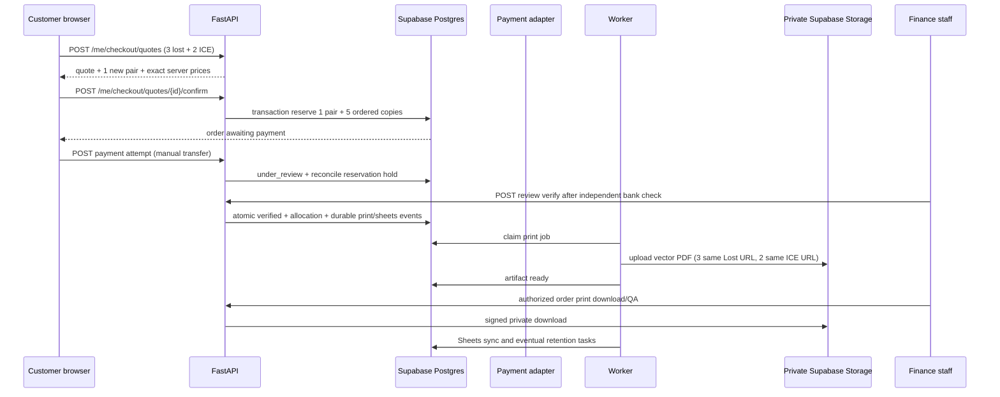

# SafeReturn — REST API Contract & OpenAPI Specification v1.2

> **Task5.1B owner approval / partial backend, 2026-10-20:** Owner approved A–E in `output/task51b/CONTRACT_REVIEW.md`, then explicitly approved a 43-character synthetic preview token matching the actual inventory issuer. This approval does not identify a physical-QA issuer or provide evidence. The implementation availability below supersedes Doc12's proposal-only wording for these routes only; existing catalog/printing APIs and API339 are unchanged. No runtime activation or migration application occurred.

### Task5.1B exact delivered transport and remaining unavailable actions

All paths below have `/api/v1` prefix. API300/302 reads explicitly allow operations/security_admin/superadmin with existing verified-account/live-session/MFA guards. API301/303/304/305/306 explicitly allow operations only, with existing signed-AMR recent authentication (300 seconds), final current authorization, and exact configured Origin if an Origin header is present. No role inheritance/grants. New `print_template_management_enabled` defaults false; no existing flag or configured credential changes. Missing pending0033 returns unavailable, not an empty registry success.

| ID | Method/path | Closed request | Delivered behavior |
|---|---|---|---|
|300|GET `/admin/print-templates`|Optional purpose lost/ice, status draft/active/retired, limit1–50 default20, encrypted cursor<=1024; no body/unknown/duplicate query keys|`{items:Template[],next_cursor:string/null,as_of:timestamp}`; UUID keyset cursor bound to actor/filter/limit and expires after900 seconds|
|301|POST same|`{key,name,purpose}`; key case-sensitive ASCII `[A-Za-z0-9._-]{3,80}`, no normalization; name1–100 plain text, purpose lost/ice|201 `{command_id,result:Template}`; globally unique permanent draft key, no renderer/configuration/physical approval inferred|
|302|GET `/admin/print-templates/{template_id}`|Optional revisions_limit1–50 default20,revisions_cursor; no body|`{template:Template,revisions:Revision[],next_cursor}` and template ETag; revisions paged by UUID|
|303|POST same `/revisions`|`{base_revision_id:UUID/null,content:Content,version_note:plain4–500}`; template If-Match|201 `{command_id,result:{template,revision}}`; allocate version under parent lock; first base null, later base must belong to template; one editable draft, max100 revisions/key|
|304|PATCH same `/revisions/{revision_id}`|`{content:Content,version_note:plain4–500}`; revision If-Match|`{command_id,result:Revision}`; full draft-content replacement, increment revision and parent row versions; pending QA content cannot be edited|
|305|POST same `/revisions/{revision_id}/preview`|`{expected_revision:strict-positive-int}`; same revision If-Match|Private inline `application/pdf` bytes, `X-Template-Fingerprint`, no bearer URL/storage object. Server-only fixed `https://preview.invalid/q/` +43 synthetic characters, one occurrence/page, visible synthetic warning. Asset enrollment and Linux process isolation required; otherwise503|
|306|POST same `/revisions/{revision_id}/submit-qa`|`{reason:plain4–500}`; revision If-Match|`{command_id,result:{revision,validation_status:"needs_independent_physical_qa"}}`; actual synthetic render validation, source/asset recheck, then freeze as pending_qa; this is not physical acceptance|
|307–310|Publish, binding create/read, retire at Doc12 reserved paths|Closed proposed command DTOs reject extra/client authority fields|Registered authenticated unavailable boundaries, always503 after applicable validation/authorization. No successful publisher, binding, retirement, evidence-import or checkout-source transition implemented. OpenAPI exposes no success response for these actions|

`Template={template_id,key,name,purpose,lifecycle_status:"draft",row_version,created_at}`. `Revision={revision_id,template_id,version,status:"draft"/"pending_qa",row_version,content,fingerprint_sha256:string/null,created_at,published_at:null}`. Command results are completion receipts, not current-state proofs. All objects recursively forbid extras; integer/boolean input coercion prohibited where specified. No user/role/customer/order/QR/path/URL/asset-byte fields. Mutations reject query arguments and content encoding, require one JSON Content-Type header, bound actual streamed body to32KiB. Every mutation requires one Idempotency-Key `[A-Za-z0-9._:-]{8,160}`; existing-resource mutations require one If-Match `"<positive row_version>"`. Same actor/operation/key + canonical body/resource/precondition returns the encrypted original receipt after current authority checks; changed input409. Content edits do not alter allocated template version. Missing preconditions400, stale412, duplicate key/lifecycle409, unsafe content422, oversized413, rate429, missing dependency503. Bilingual standard errors keep empty details and safe request IDs; existing recent-auth guard retains `REAUTH_REQUIRED`. No raw validation/provider/path/evidence payloads.

`Content` is exactly `schema_version:1,renderer:"safereturn-vector-v1",preset:"fixed-footer-v1",symbol_mm,width_mm,height_mm,qr_x_mm,qr_y_mm,logo_mm,min_pitch_mm,font_pt,header,english_lines,urdu_lines,asset_set_id,material_codes`. Decimal fields are strings with two fractional digits; current renderer bounds apply (symbol30–100,width40–190,height60–270,QR x>=4/y>=18,logo<=6 and15% symbol,pitch>=0.30,font8–14, all positive <=270). QR/caption fit enforced. Header1–50 and each of1–4 lines/language1–120 plain characters; no markup/code/URI/control text or mixed Latin/digits in Urdu runs. Materials1–10 unique sorted registry codes `[a-z0-9_-]{1,40}`. Asset references are UUIDs only. Canonical fingerprint covers content, allocated key/version/type, font/logo hashes and `synthetic-issuer43-v1` policy; no volatile timestamps. Real origin/token/material QA is still a publication gate.

Preview admission uses a separate short committed transaction (5 renders/60seconds/actor, including failures/replays), actor/key/body/fingerprint binding and admission audit. It releases admission/source locks before rendering; final live authorization/source/assets are rechecked. Preview/submit require operator-enrolled, unwithdrawn asset records plus absolute allowlisted root. Assets have no API upload/enrollment writer; commercial license/provenance review is not fabricated. Paths must remain under root with no symlink/junction, files<=5MB and matching SHA256; strict SVG and actual font/renderer parsing reject unsafe resources. The trusted Linux subprocess uses isolated Python, scrubbed environment, disabled socket creation,256MiB address-space/5CPU-second limits,5-second wall timeout and2MiB output cap, one renderer/process. Windows has no equivalent isolation implementation and fails503; unit mocks do not prove Linux limits. No private or real-order preview input or storage delivery.

API339 remains configuration-only with its original DTO/roles. No merging or automatic promotion into configuration, renderer bundles, variants, quotes, purchases or existing print jobs. Publication needs separately authenticated independent physical/native/licensing evidence and named issuer/procedure; existing API237 job QA and caller `confirmed`/`approval_id` cannot confer that authority. Binding/retirement and per-use purchase snapshot integration remain incomplete until that dependency is resolved and implemented. Existing historical manifests and order snapshots are untouched.

> **Owner-delegated contract review, 2026-10-19:** [BTR-20261019](SafeReturn_13_Blocked_Task_Contract_Review_2026-10-19.md) records reviewed/corrected decisions for all thirteen formerly blocked task cards. Its explicit design approvals amend conflicting proposals for those tasks only; runtime roles, live/destructive authorization and existing acceptance evidence are unchanged. Provider/legal/physical/recovery gates remain explicit. Reserved API IDs are contracts, not implemented endpoints.


**Document ID:** SR-API-003 | **Version:** 1.2 proposed implementation contract | **Date:** 2026-10-12  
**Product:** SafeReturn Lahore pilot; expandable multi-product QR platform.  
**Basis:** `SafeReturn_01_Product_Requirements_Document_v1.2.md`, `SafeReturn_02_Technical_Design_v1.2.md`, `SafeReturn_03_Database_Design_and_Migration_Spec_v1.2.md`, and the original API Contract v1.1.  
**Approval status:** Requires founder/security/finance review of explicit open decisions; not a claim that an API, migration, deployment, or complete machine-readable OpenAPI schema exists.

> **Precedence and preservation:** **Part A** specifies v1.2 additions and overrides. **Part B** preserves the original complete v1.1 API contract for unaffected endpoints and controls. When a Part B request/response or order-unit assumption conflicts with Part A, Part A takes precedence. Existing API-001–API-0xx IDs and their paths are retained unless explicitly extended below. The complete OpenAPI 3.1 spec must be generated from FastAPI and checked against BOTH parts before release. Examples are synthetic. Server-enforced permissions, transactional invariants and payment verification cannot be replaced with frontend conditions.

# PART A — AUTHORITATIVE v1.2 CHANGES

## A1. Invariants and canonical language

1. **One QR pair** = `tag_pairs.id` + one current `lost` QR + one current `ice` QR + one separate secret verifier. The pair is the activation/ownership unit. Both activate atomically. Users may own any number of authorized pairs.
2. **QR identity ≠ physical product ≠ printed copy.** For an order of three Lost stickers plus two ICE stickers, use **one** newly reserved pair, two current QR IDs/URLs, and five print occurrences with correct sizes. Repeating a URL in the printable PDF does not issue another QR identity.
3. Each `qr_codes.id` has its **own** independently editable matching Lost or ICE profile, consent, and publication settings; modifying one tag must never change unrelated profiles. Each print copy with the same QR URL resolves to the **same** profile.
4. Future keychains, children's badges, luggage/bag tags, and emergency badges are catalog product/variant data. They may use an **existing authorized QR** (shared profile) or provision a **new full pair** (independent pair/individual profiles) when product policy and feature flags permit. Never mint an orphan single tag. Children's/guardian publication requires a separately approved policy.
5. Catalog products, variants, images, and `order_items` snapshots must be independent from tag ownership. Order item snapshots of name, SKU, size, template, price, quantity and QR use survive catalog edits and archival.
6. Payment `verified` requires trusted staff's independent bank settlement check (pilot) or a verified signed gateway event (future); sender-entered details and screenshots never suffice. Payment states, order states, inventory states and shipping states are distinct.
7. Only eligible, digitally QA-approved unused pairs may be **reserved exclusively** at checkout. Review-pending payments cannot be silently released while credible transfer reconciliation is pending. A verified payment allocates exactly once.
8. The public scan never creates an ownership claim; token only identifies a QR. Scan → Activate → auth → activation with preserved context requires verified purchaser entitlement or the distinct concealed activation secret; no rescan. Finder and emergency responder scans remain anonymous and bilingual.
9. PDFs and proof files live in **private Supabase Storage**, protected by server authorization and short-lived controlled access; images for the public storefront use **Cloudinary**. PDFs use vector symbols and compact repeated artwork, Lost first then ICE, logo-centered print QA. Do not expose activation secrets or medical/ICE private data in print copies.
10. Google Sheets is a **redacted, eventual finance mirror**. Persistent Supabase PostgreSQL records and audited payment decisions are source of truth. Worker failures are retryable. Retention deletes private objects at approved cutoffs, not transaction/audit history.
11. All non-public reads/writes go through authenticated FastAPI with owner/role authorization, restrictive DB privileges/RLS defense-in-depth, explicit response allowlists, idempotency, and audit. Private initial ICE responses/HTML/hydration never contain full phone numbers.

## A2. Versioning, envelopes, error model and auth

- API prefix remains `/api/v1` (Next.js page URLs such as `/q/{token}`, `/shop`, `/activate`, `/dashboard`, `/admin/products` are **not** API routes).
- Production host is conditional on real domain verification. Local base: `http://localhost:8000/api/v1`.
- JSON UTF-8 unless a constrained signed object upload/download is used. Money is a **decimal string**, ISO 4217 `PKR` by default. UTC RFC3339 timestamps, UUIDs, opaque tokens; never float money.
- Supabase Auth bearer JWT for owner routes; verified backend roles/MFA for administrative finance/stock/print/catalog activities. Never authorize from body-supplied `owner_user_id`, client-supplied `role`, or token presence alone.
- Privacy-sensitive read responses use `Cache-Control: no-store`; cursor paging for lists, capped at 100. `Idempotency-Key` required for meaningful writes with dedupe; reject same key + different canonical payload with `409 IDEMPOTENCY_KEY_REUSED`. Conditional mutation/version or `If-Match` on mutable profiles and products; `409`/`412` when outdated.
- Standard error follows v1.1 schema: `error.code`, `error.message`, `error.request_id`, optional safe `error.details`. Do not return stack traces, full payment identifiers, raw tokens in server logs, or secrets.
- Errors: `400 VALIDATION_ERROR`, `401 AUTH_REQUIRED`, `403 FORBIDDEN`, `404 NOT_FOUND` (also use non-disclosing 404 for cross-owner), `409 CONFLICT`, `410 QR_REVOKED`, `412 VERSION_MISMATCH`, `413 FILE_TOO_LARGE`, `415 UNSUPPORTED_MEDIA_TYPE`, `422 BUSINESS_RULE_VIOLATION`, `429 RATE_LIMITED`, `503 PROVIDER_UNAVAILABLE`. Full localization mapping provided in English/Urdu for public QR/activation pages.
- Safe open URLs (public QR and customer-owned IDs) need separate policies: public tokens are unguessable, yet never claim credentials. Never reveal whether a tag is owned by another account through a protected activation error.
- All endpoints and DTOs below are **v1.2 planned contracts**, not deployed endpoints. Existing v1.1 exact route semantics continue where not overridden.

## A3. Roles and access matrix

| Resource/action | Anonymous | Customer verified owner | Catalog staff | Finance + MFA | Ops + MFA | Security superadmin |
|---|---|---|---|---|---|---|
| Published catalog/featured/variant | Read | Read | Read | Read | Read | Read |
| Lost/ICE public published QR | Public limited | Public limited | Public limited | Public limited | Public limited | Public limited |
| Finder message and protected phone reveal | Controlled public | Controlled public | Controlled public | Controlled public | Controlled public | Controlled public |
| Own QR list, pair detail, profiles | No | Own only | No default | No default | Minimum for support | Escalated audited |
| Create checkout/quote/order/payment attempt | Quote if configured; orders require auth | Own only | No | No | No | Controlled override |
| Admin catalog CRUD/images/featured | No | No | Yes | No | Optional delegated | Yes |
| Confirm bank payment/refund | No | No | No | Yes | No | Escalated audited |
| Generate pairs, QA, print/reprint/ship | No | No | No | No | Yes | Escalated audited |
| Finance Sheets job status/retry | No | No | No | Restricted | Restricted job ops | Yes |
| Delete private artifacts/bypass retention | No | No | No | Policy-governed proofs | Policy-governed PDF | Audited and retention-checked |

Audit reason, actor, time, previous/new state, request ID, and idempotency reference for sensitive changes. Reject cross-tenant attempts with non-disclosing errors. Staff roles derive from server-held authorization state, not JWT custom claims supplied by clients.

## A4. Endpoint registry — v1.2 additive/modified

The existing v1.1 API-001…API-0xx endpoints in Part B remain authoritative **unless marked modified**. New IDs intentionally start at **API-200** to avoid collisions with the v1.1 inventory. Paths are proposed and must be kept stable once approved.

| ID | Method and path | Who | Status |
|---|---|---|---|
| API-003 / API-004 | `GET /public/products`, `GET /public/products/{sku}` | Public | **Extended**: published catalog, variants, images, feature flag |
| API-010 | `GET /public/qr/{token}` | Public | **Extended**: unactivated `activation_available` public state, never credentials |
| API-030/031 | `GET /me/tag-pairs`, `GET /me/tag-pairs/{pair_id}` | Customer | **Extended**: unlimited paging, per-pair two tag summaries |
| API-032 | `POST /me/tag-pairs/activations` | Customer | **Extended**: scan-context activation with independent entitlement |
| API-040–049 | Existing Lost/ICE/contact preference routes | Customer | **Preserved**: always scoped to `qr_id` |
| API-060 | `POST /me/orders` | Customer | **Modified**: confirmed quote + order lines/QR binding/reservation |
| API-061/062 | `GET /me/orders`, `GET /me/orders/{order_id}` | Customer | **Extended**: line snapshots, QR uses and payment/print/ship states |
| API-063/064 | Payment submission routes | Customer | **Extended** manual adapter compatibility |
| API-080–096 | Admin finance/inventory/batches/shipments routes | Staff | **Extended** with v1.2 rules; preserve original role boundaries |
| API-200 | `GET /public/catalog/categories` | Public | New |
| API-201 | `GET /public/catalog/featured` | Public | New |
| API-202 | `GET /public/catalog/products/{product_id}/variants` | Public | New |
| API-203 | `POST /me/checkout/quotes` | Customer | New |
| API-204 | `POST /me/checkout/quotes/{quote_id}/confirm` | Customer | New |
| API-205 | `GET /me/qr` | Customer | New QR-level collection |
| API-206 | `GET /me/qr/{qr_id}` | Customer | New QR detail |
| API-207 | `GET /public/qr/{token}/activation-context` | Public | New minimal pre-auth context |
| API-208 | `POST /me/tag-pairs/activation-intents` | Customer | New owner-bound, expiring claim intent |
| API-209 | `GET /me/orders/{order_id}/payment-attempts` | Customer | New normalized payment attempts |
| API-210 | `POST /me/orders/{order_id}/payment-attempts` | Customer | New manual/future gateway initiating interface |
| API-211 | `POST /me/payment-attempts/{attempt_id}/evidence-uploads` | Customer | New private upload authorization |
| API-212 | `POST /me/payment-attempts/{attempt_id}/evidence-finalize` | Customer | New proof validation/finalization |
| API-213 | `GET /me/orders/{order_id}/print-summary` | Customer | New non-sensitive fulfillment progress |
| API-214 | `POST /payments/webhooks/{provider_key}` | Authenticated webhook | New, P1 disabled until configured |
| API-220 | `GET /admin/products` | Catalog role | New |
| API-221 | `POST /admin/products` | Catalog role | New |
| API-222 | `PATCH /admin/products/{product_id}` | Catalog role | New |
| API-223 | `POST /admin/products/{product_id}/variants` | Catalog role | New |
| API-224 | `PATCH /admin/product-variants/{variant_id}` | Catalog role | New |
| API-225 | `POST /admin/products/{product_id}/images` | Catalog role | New |
| API-226 | `DELETE /admin/products/{product_id}/images/{image_id}` | Catalog role | New metadata/image unlink |
| API-227 | `GET /admin/catalog/categories` | Catalog role | New |
| API-228 | `POST /admin/catalog/categories` | Catalog role | New |
| API-229 | `PATCH /admin/catalog/categories/{category_id}` | Catalog role | New |
| API-230 | `GET /admin/inventory/summary` | Ops | New |
| API-232 | `GET /admin/orders/ready-to-ship` | Ops | New |
| API-233 | `GET /admin/orders/{order_id}/print-jobs` | Ops | New |
| API-234 | `POST /admin/orders/{order_id}/print-jobs` | Ops | New privileged regenerate/reprint |
| API-235 | `GET /admin/print-jobs/{job_id}` | Ops | New |
| API-236 | `POST /admin/print-artifacts/{artifact_id}/download-grants` | Ops | New signed private download |
| API-237 | `POST /admin/print-jobs/{job_id}/qa` | Ops | New physical QA |
| API-238 | `GET /admin/finance/sheet-sync` | Finance | New |
| API-239 | `POST /admin/finance/sheet-sync/{sync_id}/retry` | Finance | New |
| API-240 | `GET /admin/orders/{order_id}/payment-attempts` | Finance | New |
| API-241 | `POST /admin/payment-attempts/{attempt_id}/reviews` | Finance + MFA | New normalized verification |
| API-242 | `GET /admin/storage/artifacts` | Ops/Security | New metadata only |
| API-243 | `POST /admin/storage/artifacts/{artifact_id}/retention-holds` | Approved staff | New audited hold |
| API-244 | `DELETE /admin/storage/artifacts/{artifact_id}/retention-holds` | Approved staff | New audited removal |
| API-245 | `POST /admin/storage/artifacts/{artifact_id}/cleanup-retry` | Security + MFA | Additive audited recovery |

**Registry correction:** The original `API-090 POST /admin/qr-batches` remains the single inventory generation command; do not introduce a second endpoint. API-083 remains a compatibility path for legacy `payment_submissions` until safely migrated; API-241 is the canonical v1.2 review path. No conflicting second QR generation or payment approval implementation should exist.

## A5. Shared schemas and validations

```yaml
# Illustrative OpenAPI 3.1 component fragments (not a complete OpenAPI file)
components:
  schemas:
    Money:
      type: string
      pattern: '^\\d{1,10}\\.\\d{2}$'
      example: '750.00'
    QRUseRequest:
      type: object
      additionalProperties: false
      required: [mode, tag_type, copies]
      properties:
        mode: {type: string, enum: [new_pair, existing_owned]}
        tag_type: {type: string, enum: [lost, ice]}
        copies: {type: integer, minimum: 1, maximum: 100}
        existing_qr_id: {type: string, format: uuid}
        client_pair_group: {type: string, description: 'Cart-local correlation for ONE new pair, never an entitlement token'}
    CartLine:
      type: object
      additionalProperties: false
      required: [variant_id, quantity, qr_uses]
      properties:
        variant_id: {type: string, format: uuid}
        quantity: {type: integer, minimum: 1, maximum: 100}
        qr_uses: {type: array, minItems: 1, items: {$ref: '#/components/schemas/QRUseRequest'}}
    OrderLineSnapshot:
      type: object
      required: [order_item_id, product_id, variant_id, product_name_snapshot, sku_snapshot, quantity, unit_price, line_total, qr_uses]
      properties:
        order_item_id: {type: string, format: uuid}
        product_id: {type: string, format: uuid}
        variant_id: {type: string, format: uuid}
        product_name_snapshot: {type: string}
        variant_name_snapshot: {type: string}
        sku_snapshot: {type: string}
        material_snapshot: {type: [string, 'null']}
        size_mm_snapshot: {type: [string, 'null']}
        fulfillment_method_snapshot: {type: string}
        quantity: {type: integer, minimum: 1}
        unit_price: {$ref: '#/components/schemas/Money'}
        line_total: {$ref: '#/components/schemas/Money'}
        qr_uses: {type: array, items: {type: object}}
```

**Canonical validation:** `sum(qr_uses[*].copies) == line.quantity`. All order lines that refer to the same `client_pair_group` share exactly ONE newly created pair, with at least one `lost` and one `ice` usage for P0 sticker kits. Multiple size lines can use same tag QR. For reuse mode, `existing_qr_id` is required, `client_pair_group` must be omitted, and server must verify current tag + authenticated owner + allowed product policy. Ignore client-supplied product name/price/status/owner/QR public URL; server takes verified catalog versions and locked prices. `Money` pattern above is illustrative; precise max decimals/negative handling match Decimal + DB numeric scale, not JavaScript floating-point.

## A6. Catalog/public product API

**API-003 `GET /public/products` (extended)**: optional `category`, `cursor`, `limit`; returns published product cards with ID, slug, name, description excerpt, category, primary public Cloudinary image, from-price, supported pair modes and purchasable variant summary; excludes drafts/archived and disabled variants. `API-004 GET /public/products/{sku}` remains backward compatible for QR sticker SKU detail. On catalog upgrade, `sku` resolves an active variant and returns parent product; do not overload it to accept product ID silently.

**API-200 `GET /public/catalog/categories`**: `200 {"items":[{"id":"<uuid>","slug":"stickers","name":"Stickers"}]}`; only active categories with published items, cache with invalidation.

**API-201 `GET /public/catalog/featured`**: `200 {"items":[{"product_id":"<uuid>","name":"QR Stickers","primary_image_url":"https://...","min_price":"150.00","currency_code":"PKR","is_featured":true}],"next_cursor":null}`. Response supports homepage horizontally scrolling featured carousel; only admin-published/featured entries. Cloudinary URLs must be approved public assets; no private blobs.

**API-202 `GET /public/catalog/products/{product_id}/variants`**: returns active purchasable sizes/colors/material/stock status/price/QR modes and print template capabilities, with server-managed `catalog_version`. No secrets or internal production files. P0 only published QR Stickers, future catalog product flags P1.

**API-220/221/222 — Admin products:** `GET` supports status+cursor; `POST` creates `draft`; `PATCH` changes description/name/category/featured/sort/status/QR mode permissions. `If-Match` or integer catalog version enforced; status transition `draft→published→archived` and optional unpublished→draft policy approved. Cannot hard-delete ordered product. Publishing needs at least one valid sellable variant, approved images/alt text where displayed, and acceptable physical/privacy policy. Server audits update and triggers cache invalidation.

**API-223/224 — Admin variants:** create/update SKU (globally unique), `size_mm` Decimal, material/color, template key/version, fulfillment method `pdf_label|manufacturer_artwork|manual`, PKR price Decimal, active status; reject unsafe minimum QR dimensions and disallowed product combinations. When price changes old order snapshots are unchanged. Changes to template applied to new orders only; reprints use frozen template snapshot unless explicit operator-approved revision.

**API-225/226 — Admin images:** `POST` takes approved Cloudinary `public_id`, alt text, sort and primary flag after server verified asset belongs to controlled account/folder; direct browser uploads use short-lived signed authorized upload parameters. `DELETE` removes product-image association safely; Cloudinary asset deletion may be separate reference-counted cleanup. Public customer image upload is not allowed.

**API-227–229 — Admin categories:** CRUD-lite list/create/update with unique slug, active/sort status; no deletion when referenced. Never infer seller permissions from catalog access.

## A7. QR resolution, scan-to-activation, multiple QR ownership

**API-010 `GET /public/qr/{token}` (extended)**:
- Valid active Lost and ICE still return limited published v1.1 response. Finder never needs login. ICE public projection must not include full phones in network/SSR/hydration.
- Known unactivated current token returns `200 {"status":"not_activated","tag_type":"lost","activation_available":true,"next_action":"activate"}` (same for `ice`); reveal **no** owner email, pair owner ID, secret, order ID, detailed inventory, private profile, or confirmation of buyer. Unknown/revoked/suspended tokens follow secure old status policy; revoked tags do not become claimable.
- Scan URL stays `https://verified-domain/q/{token}` indefinitely for current tag; the displayed link and the logo at center are never sufficient ownership proof.

**API-207 `GET /public/qr/{token}/activation-context`**: public minimal context `200 {"status":"not_activated","can_begin":true,"tag_type":"ice","context_ttl_seconds":900}`. This is for rendering/UX only, cannot grant ownership. No credentials. Rate-limit; response `Cache-Control: no-store`.

**Browser continuation:** Next.js saves only a short-lived opaque `pending_scan_token` via safe same-origin flow or authorized server session across Supabase Auth redirect (sanitize `return_to` to prevent open redirects); no activation credentials in localStorage/query. After login, server re-reads token and checks pair entitlements, then prompts user to confirm. **Do not bind another user's pending scan through shared browser sessions;** require explicit confirmation, expiry and replay protection.

**API-208 `POST /me/tag-pairs/activation-intents`**: authenticated verified user; body `{ "scanned_token":"<opaque-token>", "activation_secret":null }` (secret optional only if verified purchaser entitlement) → `201 {"intent_id":"<uuid>","pair_id":"<uuid>","lost_qr_id":"<uuid>","ice_qr_id":"<uuid>","expires_at":"...","method":"order_entitlement"}`. Validate pair unactivated, two current children, not another user's property, buyer entitlement OR non-public distinct concealed credential; verify credential with constant-time verifier, no raw persistence/logging. Rate-limit guesses and credential attempts. Intent is actor-bound and short-lived; it is **not** the final activation.

**API-032 `POST /me/tag-pairs/activations` (extended)**: request `{ "intent_id":"<uuid>","confirm":true }` with `Idempotency-Key`, or legacy `{ "pair_reference":"...","activation_secret":"..." }` only while compatibility is explicitly supported. `200/201 {"pair_id":"...","status":"active","activated_at":"...","qr_codes":[{"qr_id":"...","tag_type":"lost"},{"qr_id":"...","tag_type":"ice"}]}`. One DB transaction binds owner and activates both; conflict with ownership/race yields `409`; retries return the original decision. Old secret verification rules remain. Activation must not unpublish privacy preferences unexpectedly.

**API-030 `GET /me/tag-pairs`**: cursor pages pair IDs, linked Lost+ICE QR summaries, product/source references where appropriate, activation state and profile-label previews, never emergency phones by default. **No one-pair-per-user limit**. `API-031` adds per-pair owner-authorized details.

**API-205 `GET /me/qr`**: query `tag_type=lost|ice`, `pair_id`, `status`, `cursor`, `limit`; customer-only collection items `{ "qr_id":"...", "pair_id":"...", "tag_type":"lost", "profile_label":"School Bag", "editable":true, "public_status":"published" }`. Do not include concealed activation secrets, private ICE contact payloads, other-owner QR IDs.

**API-206 `GET /me/qr/{qr_id}`**: owner-only detail shows QR-level tag identity, its pair, own profile navigation URLs, actual publish status and physical products that reference it when authorized. A QR's multiple prints do not yield duplicate QR entries. Do not bundle unrelated pair profiles.

**Existing API-040/041, 042/043, 044–047 and 048/049** keep current per-`qr_id` endpoints. The target implementation must ensure a matching Lost/ICE profile row keyed to QR, update only that QR, and guard `If-Match`/profile_version. ICE contact fields remain encrypted/revealed only through protected phone reveal rules. Editing Lost A must not touch Lost B, ICE A or a printed-copy table.

## A8. Checkout quote → order/reservation

**API-203 `POST /me/checkout/quotes`** (auth required to bind owned QR, quote may be anonymous only after separate approved feature):

```json
{
  "lines": [
    {"variant_id":"00000000-0000-4000-8000-000000000101","quantity":3,
     "qr_uses":[{"mode":"new_pair","tag_type":"lost","copies":3,"client_pair_group":"kit-1"}]},
    {"variant_id":"00000000-0000-4000-8000-000000000101","quantity":2,
     "qr_uses":[{"mode":"new_pair","tag_type":"ice","copies":2,"client_pair_group":"kit-1"}]}
  ],
  "shipping_address_id":"00000000-0000-4000-8000-000000000201",
  "contact_phone_confirmation":true
}
```

`200` response includes opaque `quote_id`, expiry, server-resolved `lines` with product ID/name/variant ID/name/SKU/size, quantity/unit price/line totals, QR mode summary, `new_pair_count=1`, subtotal/shipping/taxes/discount and **total**, currency, masked shipping contact/address confirmation, `catalog_version`, reservation policy. Prices and costs are strings, calculated entirely server-side. Quote itself is **not** paid and does not lock stock indefinitely. Reject invalid QR mode, stale variant or unavailable capacity (`409 INSUFFICIENT_PAIR_STOCK`), mismatched `sum(copies)` and missing both Lost/ICE for new sticker kit.

**API-204 `POST /me/checkout/quotes/{quote_id}/confirm`**: `Idempotency-Key` required; body `{ "accept_total":"750.00", "accept_currency":"PKR" }`; server locks price/quote validity, current stock and owner QR rights, inserts existing `orders`, `order_items` snapshots, `order_pair_units` one per **distinct** new group, and `order_item_qr_uses` correctly linked to same pair. Returns `201 {"order_id":"...","order_reference":"SR-...","order_status":"awaiting_payment","payment_status":"unpaid","reservation_state":"reserved","reserved_until":"...","total":"...","currency_code":"PKR"}`. Do **not** create one pair per print copy or row. Transaction uses `FOR UPDATE SKIP LOCKED` or equivalent and exclusive live index. Same idempotency key returns same order. If final allocation cannot be reserved, roll back all order rows. Reservation expiry triggers reconciliation if payment has been submitted.

**API-060 `POST /me/orders` (compatibility)**: retained as v1.1 entry point for existing clients; new frontend should call quote→confirm. If used for v1.2 carts, server must internally use **the exact same** validate/quote/atomic reservation service as API-204, or reject legacy unsupported payload with a documented upgrade error. It must not run independent checkout logic.

**API-061 `GET /me/orders`, API-062 `GET /me/orders/{order_id}`**: include order ID/reference, totals, shipping contact snapshot, immutable `order_items[]` names/SKU/quantities/size/material/unit prices, `qr_uses[]` with tag type, copies, authorized QR ID and `new_pair|existing_owned`, `pair_count`, payment attempt summary, order/payment/print/ship statuses and timestamps. Never include sender's full account number or another person's private QR profile. If a product is archived later, the customer's historical order remains readable.

**API-065 `POST /me/orders/{order_id}/cancel`**: preserve v1.1 rules, additionally re-evaluate submitted transfer holds and held/reserved pairs; no silent release while payment under review. Cancelling after verified payment requires explicit refund/reconciliation flow, never retroactively marks unverified.

## A9. Payments: provider-independent seam and storage

**Stable state normalization:** `payment_attempts` with provider_key `manual_bank` now; later `provider_key` per gateway. Supported current logical states: `initiated`, `submitted`, `under_review`, `verified`, `rejected`, `expired`, `refunded`, `disputed` (Doc 03). Capture authorization/settlement distinctions for future gateways through a reviewed schema migration rather than silently mapping `authorized` to `verified`. `orders` retain independent payment/order/fulfillment states.

**API-210 `POST /me/orders/{order_id}/payment-attempts`**: auth owner only; `Idempotency-Key`. Request `{ "provider_key":"manual_bank", "sender_account":"<provided-private>", "sender_holder_name":"<name>", "transfer_reference":"<optional>", "submitted_at":"<optional>" }`. Sensitive account/holder encrypted in database, masked in response, validated lengths and rate limits. `201 {"attempt_id":"...","state":"under_review","sender_account_masked":"****1234","evidence_upload_allowed":true,"payment_due":"..."}`. A screenshot is optional under approved policy, not required proof of payment, and cannot set `verified`. Future gateway payload is only a provider-specific safe initiation token/client redirect and must never ask for manual sender account details.

**API-209 `GET /me/orders/{order_id}/payment-attempts`** returns attempt IDs, amount/status/provider, mask, transfer reference when safe, review timestamp and user-facing status, with no raw account data. API-063/064 legacy manual payment submission endpoints call/reflect the same normalized adapter during migration; **never duplicate attempt rows for the same submitted transfer**.

**API-211 `POST /me/payment-attempts/{attempt_id}/evidence-uploads`**: request filename/content type/byte size/hash; returns short-lived **private Supabase Storage** upload authorization, narrow unique object key, max upload constraints, expiry; no public object URL. Only owner of attempt can use. Validate actual bytes and MIME signature (not extension alone), size, malware/content policy. Limit attempts; sanitize filenames.

**API-212 `POST /me/payment-attempts/{attempt_id}/evidence-finalize`**: body `{ "upload_token":"<opaque>","sha256":"<hash>" }`; confirm object exists, permitted content and size, save `payment_evidence` metadata. `200 {"evidence_id":"...","received":true,"payment_state":"under_review"}`. Merely finalizing upload **must not** approve payment. Direct evidence access only via separately authorized short-lived retrieval for finance staff; no Cloudinary and no Google Sheet public link.

**API-240 `GET /admin/orders/{order_id}/payment-attempts`** finance+MFA, returns minimal details needed for independently checking bank settlement and restricted evidence download grant. Staff cannot infer settlement from screenshot alone.

**API-241 `POST /admin/payment-attempts/{attempt_id}/reviews`** finance+MFA + idempotency: `{ "decision":"verify", "bank_match_reference":"<private-audit-reference>", "reason":"Independently matched settled amount" }` or `decision=reject`, reason required. Checks settled bank channel, amount/currency, duplicate transfer reference, order, review policy, and under-review state; atomically updates normalized payment, audit, durable outbox and allocation trigger exactly once. `200 {"attempt_id":"...","state":"verified","order_id":"...","fulfillment_eligible":true}`; `409` on conflict. Prevent finance from reusing same external transaction to approve multiple orders.

**API-214 `POST /payments/webhooks/{provider_key}`** **P1 off by default:** raw body + signature header from configured gateway, no Supabase user session. Verify provider endpoint allowlist, HMAC/asymmetric signature, event time/replay, provider event ID, order/attempt ID, amount/currency and final bank settlement semantics. Respond `2xx` to accepted duplicate only after idempotent database state; durable event ledger/outbox, no second print job, no payment approval from unsigned callback. Returning 5xx for transient errors permits provider retry. Do not couple checkout/order schema to provider API; provider adapter owns translation to normalized states.

## A10. Inventory, QR batches, admin reservations and QA

**API-230 `GET /admin/inventory/summary`** ops+MFA; return counts for digitally eligible unclaimed pairs, actively reserved, allocated, qa-held, active, low-stock threshold/indicator and last batch. Never count physical copies as pairs. Do not leak activation secret. Low stock notifications use scheduled worker/deduplication.

**API-090 `POST /admin/qr-batches` (existing, authoritative)**: request `{"pair_count":100,"batch_label":"OCT-2026-A","logo_template_key":"safe-return-primary","qr_ecc":"Q"}` plus approved physical controls; server generates exactly 100 pair IDs, 100 Lost + 100 ICE distinct public tokens, independent activation credential verifiers, and audit/batch QA metadata. Response only batch and counts; secret output through controlled one-time sealed insert production process (v1.1 API-093 constraints). This **does not** create pre-printed final customer stickers. Separate digital token QA from physical post-print QA per approved ADR.

**API-084–089** v1.1 admin inventory remains; manual allocation endpoints must refuse bypassing verified order, not be a second competing allocation path for automated P0 checkout. Exclusive `order_pair_units` reservation is created via API-204, not customer-picked ID. Reservation release or replacement is audited and never reuses already activated/shipped/printed pair. **No public endpoint to claim by Pair ID alone.**

## A11. Print generation, compact PDFs, Ready to Ship, delivery

**Event trigger:** after verified payment and successful final allocation, one durable worker job is queued using stable order/job revision idempotency. Production uses immutable order line snapshots and `order_item_qr_uses`. One `new_pair` group = two QR identities; any number of physical occurrences. Existing-owned usage may be printed on future merchandise only when explicitly enabled/authorized.

**Rendering requirements:** exact variant `size_mm`, correct printer PPI/point conversion, 4-module quiet zone, ECC selection verified with centered SafeReturn logo, product-specific cut marks/margins, bilingual instructions; **Lost occurrences first, ICE second**. Reuse vector QR art in a PDF to keep byte size small, compress shared logo once, embed fonts efficiently; refuse unvalidated physical dimensions, template/version, or scan results. Separate controlled insert for concealed activation credential; never include it in publicly visible QR sticker artwork.

**API-232 `GET /admin/orders/ready-to-ship`** ops+MFA, `cursor`, status filters. Only orders with payment verified, pair allocated, successful print-ready artifact and required physical QA/packing stage are eligible for a **ready-to-ship** label. If physical QA has not happened, return `ready_to_print`/`qa_pending` in separate workflow, **not** misleading ready-to-ship. Include order ID, physical line quantities/sizes, pair count, shipping reference/recipient subset, print job status, signed-download availability (no persistent public URL).

**API-233 `GET /admin/orders/{order_id}/print-jobs`** list versions/QA/status/hash/bytes and retention state; no raw activation secret.

**API-234 `POST /admin/orders/{order_id}/print-jobs`** ops+MFA, idempotency. For first auto render worker handles event; operator endpoint is **audited retry/reprint** `{ "reason":"damaged label","expected_revision":1 }` and must not mint new tokens. If old artifact deleted, regenerate same QR URLs/layout based on stored immutable template snapshot, require reprint approval policy. `202 {"job_id":"...","revision":2,"status":"queued"}`. Guard against duplicate active jobs.

**API-235 `GET /admin/print-jobs/{job_id}`** status including `queued|rendering|ready|failed|qa_passed|superseded|deleted`, warnings, byte size and role-safe failure code. Failures retry with backoff; no shipment until QA.

**API-236 `POST /admin/print-artifacts/{artifact_id}/download-grants`** ops+MFA; `201 {"download_url":"<short-lived-private-signed-url>","expires_at":"...","filename":"SR-...-print.pdf"}`. Backend validates job/order scope, staff permissions, artifact retention, account status. `Cache-Control:no-store`; log grants, not URLs. Signed URLs treated as bearer tokens, short lifetime. Download does not mark sent/shipped.

**API-237 `POST /admin/print-jobs/{job_id}/qa`** ops QA reviewer; body count per Lost/ICE, size, scanner passes, logo/quiet-zone checks, physical print matches order, cutting/packaging check, bilingual labels, failure reason. `200` updates QA record and release gate; never falsely pass if copies or dimensions mismatch. Original v1.1 API-094 tag pair generation QA still applies, but is distinct from final customer print QA.

**API-213 `GET /me/orders/{order_id}/print-summary`** owner view `{ "print_status":"ready","fulfillment_status":"awaiting_dispatch","copies":{"lost":3,"ice":2},"shipment_status":"not_shipped" }` without private staff print-artifact access or print secrets.

**API-095/096** original shipment API remains. Delivery confirmation uses trusted carrier callback (approved) or audited admin confirmation, then schedules **policy-bound** artifact cleanup after grace. No deletion of order items, pair ownership, QR profiles or audit. A hold prevents deletion until cleared. Artifacts already deleted -> `410 ARTIFACT_DELETED` and possible privileged approved regeneration. Refund/dispute/chargeback pauses shipment as policy demands.

## A12. Storage cleanup, finance Sheets sync and audit

**API-242 `GET /admin/storage/artifacts`** role-limited metadata-only inventory (private payment proofs or PDFs), retention/deletion statuses, filter by order/job, no direct public object URLs. **API-243** places a reasoned retention hold on object with approved category and audit; **API-244** removes hold with audit, after verifying legal/support constraints. Regular worker performs deletion when `retention_until` elapsed, delivery/grace policy satisfied (print), dispute window completed (evidence), no hold and no pending reprint/support process. Deletion must be idempotent and retryable; remove storage object first then mark `deleted_at`, preserving hash/object tombstone/reconciliation reference. Cloudinary public catalog images have their own unlink and asset cleanup policy, not shared with private files.

**API-238 `GET /admin/finance/sheet-sync`** finance role paginated sync status: order ID, masked payment method/status, `pending|synced|retry|failed`, last synced time and safe error. **API-239 `POST /admin/finance/sheet-sync/{sync_id}/retry`** requeues failed sync with audit, no editing payment. Durable worker upserts by stable order ID/row key and monotonic export version to restricted Google Sheet. If Google unavailable, retain committed Supabase payment/print state and retry; never expose full sender account, raw ICE profile, or unprotected screenshot link in Sheet.

Operational events: payment verified, allocation finalized, print requested, artifact stored, download granted, QA passed, shipment dispatched/delivered, evidence cleanup, artifact cleanup, catalog publication, activation, profile update and failed sync all audited with principal and request ID. Per-provider callbacks store minimal restricted event IDs for idempotency; retention per approved policy.

## A13. State machines and end-to-end sequences



```mermaid
sequenceDiagram
  participant B as Scanner browser
  participant API as FastAPI
  participant AUTH as Supabase Auth
  participant DB as Supabase Postgres
  B->>API: GET public QR token
  API-->>B: known, not activated + Activate QR option
  B->>AUTH: login/sign-up (preserve safe pending scan context)
  AUTH-->>B: verified session/return
  B->>API: POST activation intent with scanned token
  API->>DB: validate purchaser entitlement or concealed credential
  API-->>B: pair ID and two tag summaries; confirm
  B->>API: POST pair activation with intent/idempotency key
  API->>DB: atomic owner bind and activation for both tags
  API-->>B: active + dashboard navigation
```

**States remain independent:** payment `initiated/submitted/under_review/verified/rejected/expired/refunded/disputed`; order `awaiting_payment|processing|cancelled|...` (reconcile original enum); reservation `reserved|allocated|released|cancelled`; print `queued|rendering|ready|downloaded|qa_passed|failed|superseded|deleted`; shipment original v1.1 statuses. Never collapse all to one `status` field. If a paid reservation has expired unexpectedly, stop and reconcile, not allocate a random replacement silently.

## A14. OpenAPI completeness and API drift checks

The YAML fragments above are *illustrative*, not a canonical complete spec. Implementation must produce `openapi.json` from running FastAPI containing **every** old and new route, named DTOs and schema validation, response codes, auth policies, headers, uploads, webhooks and example payloads; run openapi-spec-validator (or equivalent), cross-check generated route inventory to this registry, and ship a static snapshot/versioned diff in CI. Protect signed upload/download schemas from arbitrary URL disclosure. Avoid claiming a complete OpenAPI 3.1 schema from prose/fragments alone.

A minimal public endpoint schema example (illustration only):

```yaml
openapi: 3.1.0
info:
  title: SafeReturn API
  version: 1.2.0
paths:
  /public/catalog/featured:
    get:
      operationId: getFeaturedProducts
      tags: [catalog]
      security: []
      responses:
        '200': {description: Published featured product cards}
  /me/checkout/quotes:
    post:
      operationId: createCheckoutQuote
      tags: [checkout]
      security: [{bearerAuth: []}]
      responses:
        '200': {description: Server-validated price quote}
        '409': {description: Unavailable product or insufficient pair stock}
```

## A15. Verification matrix / release blocks

| ID | API integration / E2E scenario | Required assertion |
|---|---|---|
| API12-001 | Scan known inactive Lost/ICE, login, resume | Activation option; no second scan; no ownership from token alone |
| API12-002 | Claim scanned QR without paid entitlement/secret | Denied without claiming; no buyer identity leak |
| API12-003 | 1 account owns 2+ pairs and edits Lost A/ICE A/Lost B | All separate correct profiles, zero cross-write |
| API12-004 | 3 Lost + 2 ICE stickers same pair | 2 QR tokens, 5 printable occurrences, 1 pair reservation |
| API12-005 | Two sizes of same Lost QR | Same URL, separate size copies/prices, correct PDF |
| API12-006 | Future keychain with existing QR | No new pair, shared profile, owner verified |
| API12-007 | Future keychain new identity | One additional complete pair, independently editable profiles |
| API12-008 | Try existing QR from another account | 403/404, zero order/item/print allocation |
| API12-009 | Change catalog name/price after purchase | Order snapshots unchanged; new quotes show new catalog price |
| API12-010 | Concurrent checkout on final eligible pair | Exactly one exclusive reservation; no oversell |
| API12-011 | Submitted proof while money not settled | Under review, no approval/print/ship |
| API12-012 | Finance verification repeats request | One verified decision/print job; same idempotent result |
| API12-013 | Gateway webhook duplicate/replay/invalid signature | Reject malicious events; valid duplicate no double transition |
| API12-014 | Google Sheets offline | Payment stays verified; retry eventual redacted mirror |
| API12-015 | PDF repeated QR symbols and centered logo | Correct counts, Lost then ICE, scanner passes physical QA, size monitored |
| API12-016 | Non-ops fetch private print URL | Denied; signed grant narrowly time-bounded |
| API12-017 | Delivery/grace cleanup | Private PDF deleted, all QR/order/audit records retained |
| API12-018 | Payment dispute before evidence cleanup | Retention hold prevents deletion |
| API12-019 | Admin publishes feature product | Shows in homepage featured carousel after cache invalidation |
| API12-020 | Draft/archived child badge on public catalog | Not visible or purchasable; guardian policy gate enforced |
| API12-021 | ICE initial response/SSR/network | Never contains phone; reveal separate protected action |
| API12-022 | Finder message with Resend outage | Message+outbox atomic; asynchronous retry |
| API12-023 | Reprint after deletion | Uses saved token/spec; no extra QR identities |
| API12-024 | Migration compatibility old API-060/063/083 | Same normalized services, no duplicate order/payment path |

**Stop-ship:** cross-owner QR leak, unauthorized activation, payment approved from evidence alone, double reservation/charge/print, publicly available private PDF, unprotected initial ICE phone, broken physical scan after logo placement, or loss of existing v1.1 consent/notification behavior.

## A16. Reconciliation and decision register

| Decision / conflict | Contract resolution or remaining approval |
|---|---|
| API-060 legacy order creation vs new quote flow | Retain route, delegate to same canonical service; new UI uses API-203/204; deprecate only after client migration |
| API-083 legacy payment review vs API-241 normalized attempts | Compatibility adapter only; **one** payment state machine and independent bank verification |
| Existing `products`/`order_items` migration differences | Compare actual migrations, create incremental changes; never blind-create a parallel table |
| `lost_item_profiles`/`ice_profiles` v1.1 vs v1.2 illustrative `lost_profiles`/`emergency_profiles` | Keep actual v1.1 canonical tables and add one-to-one QR association if missing; do not create duplicate profile sources |
| `pair_print_qa` generated inventory vs per-order print QA | Separate *digital eligible* stock QA from final physical cut/scan/ship QA; approve ADR and migration if original lifecycle assumes all inventory preprinted |
| One-pair default vs future many new pairs | P0 one `client_pair_group` per new sticker order; multi-group feature flag + tested quantity limits later |
| Existing-owned-QR resale | Feature flag OFF P0; P1 after secure cross-owner and product policy tests |
| Manual payment evidence retention | Founder/legal/finance set duration and hold policy; sample 7-day PDF grace is not final |
| Domain/logo/size/print templates | Verify domain before batch printing; logo/quiet-zone scanner testing and real printer QA required |
| Child / guardian data publication | Block child badge until guardian consent/legal and data-minimization approval |
| Quote lifetime/reservation lifetime/suspicion thresholds | Configurable settings, founder approval, tests; no fabricated production values |
| External gateway/webhook | Separate integration spec and verified provider signatures before enabling API-214 |
| Cloudinary vs Supabase | Cloudinary = only approved public catalog imagery; Supabase = all private payment proof + print PDFs |
| Google Sheets | Restricted service account + redacted order mirror, eventually consistent, never a settlement authority |
| OpenAPI contract | Machine-readable comprehensive schema not yet generated; FastAPI emits it during implementation |

**Approval gate:** Founder validates product/checkout/QR reuse and price policies; security validates activation, privacy, storage and webhook model; finance validates independent manual verification and evidence retention; ops/print QA validates actual logo/label sizes; database owner confirms additive migration name mappings. All release tests must pass before enabling P0 or future-product flags.

---

# PART B — ORIGINAL API CONTRACT v1.1 (REFERENCE, PRESERVED)

> The following text is the uploaded original v1.1 contract, retained for full historical detail and all unaffected routes. **Part A overrides any conflicting assumption** about per-copy pair counts, fixed SKU storefront, pre-print allocation time, scanned-QR activation, provider-dependent payments, printed QR size or single-product orders. This is not a second API to implement.

# SafeReturn — REST API Contract & OpenAPI Specification

**Document ID:** SR-API-003  
**Version:** 1.1-draft  
**Date:** 11 October 2026  
**Product:** SafeReturn — Lahore pilot  
**Status:** Proposed contract, pending founder decisions and implementation review  
**Format:** Markdown with OpenAPI 3.1 fragments; the canonical machine-readable OpenAPI file should be generated/maintained during implementation.  
**References:** SafeReturn PRD v1.0 + v1.1 amendment; Technical Design Document SR-TDD-001; Database Design & Migration Specification SR-DB-002.  
**Scope:** FastAPI REST endpoints, contracts, auth, errors, idempotency, privacy, pagination, examples, tests, and implementation sequence. UI screen/navigation specification is intentionally deferred until the final document.

> **Contract precedence:** Approved PRD product rules → approved architecture/database decisions → this API contract → generated FastAPI OpenAPI schema. Conflicts are not silently resolved by an AI coding agent. Open questions are listed in §26. Example UUIDs, domain names, and phone numbers are synthetic.

---

## 1. Contract objectives and architectural rules

1. Public QR scan and emergency use **never require login**.
2. All business data is served through FastAPI; browser clients do not write directly to business tables.
3. One physical **pair** contains one current lost tag and one current ICE tag; one secret activates both atomically.
4. Customer authorization derives from `tag_pairs.owner_user_id`, not a caller-supplied owner field.
5. Initial public ICE responses never contain full phone numbers or `tel:` URIs.
6. Finder location is **optional, explicit, one-time**, and never required to submit a message.
7. WhatsApp is an owner-enabled external click-to-chat link; opening it is **not** a SafeReturn message submission or auditable email event.
8. Finder messages and notification outbox events commit together; Resend sends asynchronously.
9. Order line quantity counts **pairs**, not stickers; manual transfer screenshots do not automatically verify payment.
10. Public user-facing error codes/messages support English and Urdu.
11. Every mutating sensitive endpoint has an audit and authorization policy.
12. Never return activation secrets, password hashes, service-role keys, encrypted private columns, or raw provider credentials.

### 1.1 API topology

| Component | Proposed base | Notes |
|---|---|---|
| Production API | `https://api.safereturn.pk/api/v1` | Domain must be verified before use |
| Staging API | `https://staging-api.example.invalid/api/v1` | Illustrative, not a real deployment |
| Local API | `http://localhost:8000/api/v1` | Development only |
| Public QR landing | `https://safereturn.pk/q/{token}` | Next.js route, **not** a REST endpoint |
| Auth identity | Supabase Auth | Auth tokens issued outside this API |

### 1.2 OpenAPI 3.1 header (illustrative)

```yaml
openapi: 3.1.0
info:
  title: SafeReturn API
  version: 1.1.0
  description: Paired QR kit, lost-item recovery and emergency contact API.
servers:
  - url: https://api.safereturn.pk/api/v1
    description: Production (subject to domain verification)
  - url: http://localhost:8000/api/v1
    description: Local development
security:
  - bearerAuth: []
components:
  securitySchemes:
    bearerAuth:
      type: http
      scheme: bearer
      bearerFormat: JWT
      description: Supabase-issued access token, validated by FastAPI.
```

**Implementation rule:** OpenAPI fragments in this Markdown are design illustrations, not a substitute for a complete machine-readable contract. Once code begins, `openapi.json` must be diff-checked against this document and a separately maintained OpenAPI YAML/JSON artifact. The user requested **only one Markdown file in this turn**, so no extra file is generated.

---

## 2. Transport and serialization

| Concern | Contract |
|---|---|
| Transport | HTTPS in staging/production; HTTP only localhost |
| Content type | `application/json; charset=utf-8`, except multipart evidence upload |
| API version | `/api/v1` in URL |
| Identifiers | UUID v4 or database-generated UUID; public tokens are opaque strings |
| Dates | RFC 3339 UTC timestamps with timezone (`2026-10-11T11:00:00Z`) |
| Money | JSON **string decimal** for PKR, e.g. `"750.00"`; never float |
| Phone | E.164 for private configuration, e.g. `+923001234567` |
| Locale | `Accept-Language: ur` or `en`; optional `?lang=ur` only on public GET where documented |
| Character encoding | UTF-8; Urdu content must round-trip |
| Unknown JSON properties | Reject for sensitive mutations (`extra=forbid` in Pydantic) |
| Body size | Route-specific limits; finder message <=1,000 characters |
| Request tracing | Server emits `X-Request-ID`; accepts trusted caller ID only after validation |
| Caching | Private/sensitive responses `Cache-Control: no-store` |
| CORS | Explicit approved frontend origins; no wildcard with credentials |
| Authentication | `Authorization: Bearer <access_token>` for protected routes |
| Pagination | Cursor-based for messages, orders, audit, inventory; max 100 |
| Concurrency | `If-Match` / version field where documented; DB locking for critical transactions |

### 2.1 Standard response envelope

Successful resource responses return the resource object directly. Collections use:

```json
{
  "items": [{"id": "550e8400-e29b-41d4-a716-446655440000"}],
  "next_cursor": null,
  "has_more": false
}
```

Use consistent HTTP semantics: 200 for reads/updates, 201 for created resources, 202 for accepted asynchronous work, 204 for successful empty deletes. Do not return 200 for every outcome.

### 2.2 Standard error schema

```json
{
  "error": {
    "code": "PAIR_NOT_ELIGIBLE",
    "message": "This kit cannot be activated.",
    "message_ur": "یہ کٹ فعال نہیں کی جا سکتی۔",
    "request_id": "req_01JABCDEF",
    "details": {}
  }
}
```

`message_ur` is an illustrative translation pending human review. API error `code` is stable and language-independent. Never return raw SQL, stack traces, whether a secret guess was correct, or a private account identifier.

### 2.3 Standard HTTP errors

| HTTP | Meaning | Typical code |
|---|---|---|
| 400 | Malformed or semantically invalid request | `BAD_REQUEST` |
| 401 | Missing/invalid/expired token | `AUTH_REQUIRED` |
| 403 | Authenticated but forbidden | `FORBIDDEN` |
| 404 | Resource absent or intentionally concealed | `NOT_FOUND` |
| 409 | State conflict or duplicate idempotency key with changed body | `STATE_CONFLICT` |
| 412 | Optimistic concurrency precondition failed | `VERSION_MISMATCH` |
| 413 | Upload/body too large | `PAYLOAD_TOO_LARGE` |
| 415 | Unsupported media type | `UNSUPPORTED_MEDIA_TYPE` |
| 422 | Field validation failed | `VALIDATION_ERROR` |
| 429 | Throttled or challenged | `RATE_LIMITED` / `CHALLENGE_REQUIRED` |
| 500 | Internal error | `INTERNAL_ERROR` |
| 502 | Upstream dependency failure | `UPSTREAM_ERROR` |
| 503 | Temporary outage | `SERVICE_UNAVAILABLE` |

For anonymous activation/contact endpoints, avoid user-enumeration signals and overly detailed error distinctions.

---

## 3. Authentication and authorization

### 3.1 Supabase JWT verification

FastAPI must validate signature against the configured issuer's supported signing keys, issuer, audience, expiry, and token purpose. Cache JWKS safely with key rotation. Reject `alg=none`, wrong audiences, refresh tokens used as access tokens, and user IDs supplied by the client as authority.

- **Anonymous**: QR scans, finder submission, contact reveal, public catalog, public policies.
- **Customer**: verified account for activation; owner checks for tag/profile/message settings.
- **Finance admin**: payment verification and refunds.
- **Operations admin**: print batches, QA, allocations, fulfillment.
- **Support**: limited case review; no blanket medical/location access.
- **Security admin**: high-risk suspension, abuse, and key operations.
- **Superadmin**: tightly limited, MFA, audited.

### 3.2 Authorization matrix

| Resource | Anonymous | Customer owner | Other customer | Ops | Finance | Security admin |
|---|---|---|---|---|---|---|
| Public safe QR profile | Read | Read | Read | Read | Read | Read |
| ICE full phone | Protected reveal | Protected reveal | Protected reveal | Only via controlled need | Only via controlled need | Audited need |
| Finder message create | Create | Create | Create | — | — | — |
| Finder message read | No | Own recipient only | No | Case-specific | No | Case-specific |
| Pair activate | No | With entitlement | No | Exception workflow | No | Exception workflow |
| Pair settings | No | Own | No | Limited support | No | Controlled |
| Manual payment approve | No | No | No | No | Yes | Limited override |
| Print manifest export | No | No | No | Authorized only | No | Audited only |
| Pair suspend | No | No | No | Case-specific | No | Yes |

### 3.3 Session and CSRF

When frontend uses cookies for auth/session, enforce secure/HttpOnly/SameSite cookies and CSRF protections for unsafe methods as applicable. If using bearer tokens in JS memory, do not store sensitive tokens in localStorage by default. Final strategy belongs in Security Specification and must match chosen Supabase SSR library.

---

## 4. Idempotency, optimistic concurrency, and auditing

### 4.1 Idempotency header

Use `Idempotency-Key: <UUID-or-random-string>` for:
- pair activation;
- order creation;
- payment evidence submission;
- manual payment approval;
- pair allocation/release;
- shipment creation/dispatch;
- tag replacement/transfer;
- finder submission where duplicate retry prevention is needed.

Server stores `(actor_scope, operation, key, canonical_request_hash, result)` in `idempotency_records`. Same key + same payload returns same semantic result; same key + different payload returns 409 `IDEMPOTENCY_CONFLICT`. For anonymous finder submissions, scope key to public token plus risk/session context and keep short retention.

### 4.2 `If-Match`

Mutable owner preferences and public profiles may expose `version` and accept `If-Match: "<version>"` to prevent lost updates. Return 412 on stale version. Pair activation uses row locks, not just optimistic versioning.

### 4.3 Audit obligations

Every activation, pair transfer, tag replacement, WhatsApp consent change, ICE publication change, payment review, inventory allocation, QA override, and admin suspension creates a non-sensitive `audit_events` row. Audit event insertion must be part of the same transaction where possible.

---

## 5. Data models and reusable schemas

### 5.1 Identifiers and enums

```yaml
components:
  schemas:
    TagType:
      type: string
      enum: [lost, ice]
    PairOwnershipStatus:
      type: string
      enum: [unclaimed, active, transfer_pending, disputed, revoked]
    QRPublicStatus:
      type: string
      enum: [unactivated, active, owner_disabled, admin_suspended, revoked]
    Locale:
      type: string
      enum: [en, ur]
    MoneyPKR:
      type: string
      pattern: '^\d{1,10}\.\d{2}$'
      examples: ['750.00']
    PublicToken:
      type: string
      minLength: 20
      maxLength: 80
      description: Opaque, cryptographically unpredictable URL-safe token.
```

### 5.2 `PublicQRProfile`

**Lost response** (safe fields only):

```json
{
  "tag_type": "lost",
  "status": "active",
  "locale_options": ["en", "ur"],
  "lost_item": {
    "label": "Blue backpack",
    "description": "Please contact the owner if found.",
    "reward_text": null
  },
  "features": {
    "finder_form_enabled": true,
    "whatsapp_contact_enabled": true,
    "location_sharing_available": true
  },
  "whatsapp_contact": {
    "action_available": true,
    "disclosure_notice": "Opening WhatsApp will reveal the owner's chosen number."
  }
}
```

**ICE response** (no phone):

```json
{
  "tag_type": "ice",
  "status": "active",
  "locale_options": ["en", "ur"],
  "ice": {
    "display_name": "A. Khan",
    "blood_group": "O+",
    "medical_notes": null,
    "contacts": [
      {
        "contact_id": "550e8400-e29b-41d4-a716-446655440001",
        "relationship_label": "Father",
        "display_name": "Emergency Contact",
        "reveal_available": true
      }
    ],
    "owner_information_disclaimer": "Owner-provided information is not medically verified."
  }
}
```

**Never** include phone, `tel_uri`, encrypted DB columns, owner account email, shipping address, internal pair ID, or activation secret in these public responses. For disabled/unactivated/revoked tags, return a minimal public status response; do not expose owner data.

### 5.3 `PairSummary`

```json
{
  "pair_id": "550e8400-e29b-41d4-a716-446655440010",
  "pair_reference": "SR-P-00001234",
  "ownership_status": "active",
  "inventory_status": "delivered",
  "activated_at": "2026-10-11T11:00:00Z",
  "tags": [
    {
      "qr_id": "550e8400-e29b-41d4-a716-446655440011",
      "tag_type": "lost",
      "public_status": "active",
      "public_url": "https://safereturn.pk/q/EXAMPLE_LOST_TOKEN_NOT_REAL"
    },
    {
      "qr_id": "550e8400-e29b-41d4-a716-446655440012",
      "tag_type": "ice",
      "public_status": "active",
      "public_url": "https://safereturn.pk/q/EXAMPLE_ICE_TOKEN_NOT_REAL"
    }
  ]
}
```

### 5.4 `FinderMessageCreate`

```json
{
  "finder_name": "Ali",
  "finder_email": "finder@example.com",
  "finder_phone": null,
  "preferred_contact": "email",
  "message": "I found your bag near a shop.",
  "contact_consent_accepted": true,
  "contact_consent_version": "finder-v1",
  "location": {
    "latitude": 31.5204,
    "longitude": 74.3587,
    "accuracy_m": 25.0,
    "consent_accepted": true,
    "consent_version": "location-v1"
  },
  "turnstile_token": null
}
```

`location` is nullable and optional. At least one valid finder contact method is required. Coordinates must be finite, latitude [-90,90], longitude [-180,180], and accuracy >=0. The browser obtains location only after an explicit click; server cannot infer consent solely from the presence of coordinates. Location is stored encrypted in `finder_message_locations` per database spec.

### 5.5 `FinderMessageReceipt`

```json
{
  "message_id": "550e8400-e29b-41d4-a716-446655440020",
  "status": "accepted",
  "submitted_at": "2026-10-11T11:00:00Z",
  "notification_status": "queued",
  "message": "Your message has been received by SafeReturn. Email delivery is not guaranteed."
}
```

Do not claim owner has read the message or that email was delivered. An anonymous response should use a non-enumerable receipt identifier if a message ID is exposed; avoid enabling anonymous message lookup.

### 5.6 `WhatsAppPreferences`

```json
{
  "whatsapp_enabled": true,
  "whatsapp_phone_masked": "+92******4567",
  "consent_recorded_at": "2026-10-11T11:00:00Z",
  "consent_version": "wa-public-v1",
  "version": 3
}
```

Owner may edit with `whatsapp_phone` input; read endpoints return masked phone, not raw stored number by default.

### 5.7 `EmergencyContact`

```json
{
  "id": "550e8400-e29b-41d4-a716-446655440001",
  "relationship_label": "Father",
  "display_name": "Emergency Contact",
  "published": true,
  "phone_masked": "+92******4567",
  "display_order": 1
}
```

Only owner management endpoints may return masked contact. Public scan returns even less. Actual phone appears only in protected reveal response.

---

## 6. Complete endpoint inventory

**Route notation:** All paths below are relative to `/api/v1`. Public QR URLs `/q/{token}` are frontend pages, not API paths.

### 6.1 Health and public content

| ID | Method | Route | Auth | Success | Purpose |
|---|---|---|---|---|---|
| API-001 | GET | `/health/live` | None | 200 | Process liveness |
| API-002 | GET | `/health/ready` | Internal/limited | 200/503 | Dependency readiness |
| API-003 | GET | `/public/products` | None | 200 | Active paired-kit catalog |
| API-004 | GET | `/public/products/{sku}` | None | 200 | Public SKU details |
| API-005 | GET | `/public/config` | None | 200 | Safe public locale/feature config |

### 6.2 Public QR and finder

| ID | Method | Route | Auth | Success | Purpose |
|---|---|---|---|---|---|
| API-010 | GET | `/public/qr/{token}` | None | 200 | Safe lost/ICE public profile |
| API-011 | POST | `/public/qr/{token}/messages` | None + abuse controls | 202 | Durable finder message |
| API-012 | POST | `/public/qr/{token}/contact-reveals` | None + abuse controls | 200 | ICE phone reveal |
| API-013 | POST | `/public/qr/{token}/whatsapp-link` | None + abuse controls | 200 | User-initiated opt-in WhatsApp URL |
| API-014 | POST | `/public/abuse-reports` | None + abuse controls | 202 | Report QR/message abuse |

### 6.3 Customer identity/profile

| ID | Method | Route | Auth | Success | Purpose |
|---|---|---|---|---|---|
| API-020 | GET | `/me` | Customer | 200 | Current user summary |
| API-021 | PATCH | `/me` | Customer | 200 | Preferred locale/display name |
| API-022 | GET | `/me/privacy-consents` | Customer | 200 | Consent history summary |
| API-023 | POST | `/me/account-deletion-requests` | Customer | 202 | Start verified deletion workflow |

### 6.4 Paired kit ownership and activation

| ID | Method | Route | Auth | Success | Purpose |
|---|---|---|---|---|---|
| API-030 | GET | `/me/tag-pairs` | Customer | 200 | Owned pairs |
| API-031 | GET | `/me/tag-pairs/{pair_id}` | Owner | 200 | Pair and two current tags |
| API-032 | POST | `/me/tag-pairs/activations` | Verified customer | 201 | Atomic two-tag activation |
| API-033 | POST | `/me/tag-pairs/{pair_id}/transfer-requests` | Owner | 202 | Initiate pair transfer (P1 unless approved P0) |
| API-034 | GET | `/me/tag-pairs/{pair_id}/activation-history` | Owner | 200 | Safe audit summary |
| API-035 | PATCH | `/me/qr/{qr_id}/public-status` | Owner | 200 | Disable/re-enable own tag |

### 6.5 Lost/ICE profiles and contact preferences

| ID | Method | Route | Auth | Success | Purpose |
|---|---|---|---|---|---|
| API-040 | GET | `/me/qr/{qr_id}/lost-profile` | Owner | 200 | Lost profile |
| API-041 | PUT | `/me/qr/{qr_id}/lost-profile` | Owner | 200 | Edit/publish lost profile |
| API-042 | GET | `/me/qr/{qr_id}/ice-profile` | Owner | 200 | ICE profile |
| API-043 | PUT | `/me/qr/{qr_id}/ice-profile` | Owner | 200 | Edit/publish ICE fields |
| API-044 | GET | `/me/qr/{qr_id}/ice-contacts` | Owner | 200 | Masked contacts |
| API-045 | POST | `/me/qr/{qr_id}/ice-contacts` | Owner | 201 | Add contact |
| API-046 | PATCH | `/me/qr/{qr_id}/ice-contacts/{contact_id}` | Owner | 200 | Update contact |
| API-047 | DELETE | `/me/qr/{qr_id}/ice-contacts/{contact_id}` | Owner | 204 | Remove contact |
| API-048 | GET | `/me/qr/{qr_id}/contact-preferences` | Owner | 200 | WhatsApp settings |
| API-049 | PUT | `/me/qr/{qr_id}/contact-preferences` | Owner | 200 | Opt-in/out WhatsApp |

### 6.6 Finder inbox

| ID | Method | Route | Auth | Success | Purpose |
|---|---|---|---|---|---|
| API-050 | GET | `/me/finder-messages` | Customer | 200 | Recipient-only inbox |
| API-051 | GET | `/me/finder-messages/{message_id}` | Recipient | 200 | Message and consented location |
| API-052 | PATCH | `/me/finder-messages/{message_id}` | Recipient | 200 | Viewed/archive/flag |
| API-053 | DELETE | `/me/finder-messages/{message_id}` | Recipient | 204 | Delete subject to retention/legal hold |

### 6.7 Orders, payments, shipping

| ID | Method | Route | Auth | Success | Purpose |
|---|---|---|---|---|---|
| API-060 | POST | `/me/orders` | Customer | 201 | Create order for paired kits |
| API-061 | GET | `/me/orders` | Customer | 200 | List own orders |
| API-062 | GET | `/me/orders/{order_id}` | Owner | 200 | Order detail |
| API-063 | POST | `/me/orders/{order_id}/payment-submissions` | Owner | 201 | Submit manual transfer proof |
| API-064 | GET | `/me/orders/{order_id}/payment-submissions` | Owner | 200 | Own evidence statuses |
| API-065 | POST | `/me/orders/{order_id}/cancel` | Owner | 200/202 | Request cancel if eligible |
| API-066 | GET | `/me/orders/{order_id}/shipments` | Owner | 200 | Shipping status |
| API-067 | POST | `/me/shipping-addresses` | Customer | 201 | Save private address |
| API-068 | GET | `/me/shipping-addresses` | Customer | 200 | List masked/private addresses |
| API-069 | PATCH | `/me/shipping-addresses/{address_id}` | Owner | 200 | Update address |
| API-070 | DELETE | `/me/shipping-addresses/{address_id}` | Owner | 204 | Delete if not referenced |

### 6.8 Admin operations

| ID | Method | Route | Role | Success | Purpose |
|---|---|---|---|---|---|
| API-080 | GET | `/admin/orders` | Ops/finance | 200 | Search orders |
| API-081 | GET | `/admin/orders/{order_id}` | Ops/finance | 200 | Order details |
| API-082 | GET | `/admin/payment-submissions` | Finance | 200 | Review queue |
| API-083 | POST | `/admin/payment-submissions/{id}/reviews` | Finance + MFA | 201 | Bank-verified decision |
| API-084 | GET | `/admin/tag-pairs` | Ops | 200 | Inventory search |
| API-085 | GET | `/admin/tag-pairs/{pair_id}` | Ops | 200 | Pair/child detail |
| API-086 | POST | `/admin/tag-pairs/{pair_id}/allocations` | Ops | 201 | Allocate verified order |
| API-087 | POST | `/admin/tag-pairs/{pair_id}/release-allocation` | Ops | 200 | Release eligible reservation |
| API-088 | POST | `/admin/tag-pairs/{pair_id}/suspend` | Security admin | 200 | Suspend both public tags |
| API-089 | POST | `/admin/tag-pairs/{pair_id}/replacements` | Ops + approval | 201 | Replace one damaged tag |
| API-090 | POST | `/admin/qr-batches` | Ops | 201 | Generate batch and pairs |
| API-091 | GET | `/admin/qr-batches` | Ops | 200 | List batches |
| API-092 | GET | `/admin/qr-batches/{batch_id}` | Ops | 200 | Batch detail |
| API-093 | POST | `/admin/qr-batches/{batch_id}/print-exports` | Privileged ops + MFA | 202 | Controlled print export |
| API-094 | POST | `/admin/tag-pairs/{pair_id}/print-qa` | Ops | 201 | Record two-tag QA |
| API-095 | POST | `/admin/shipments` | Ops | 201 | Create shipment of allocated pairs |
| API-096 | PATCH | `/admin/shipments/{shipment_id}` | Ops | 200 | Update dispatch/delivery |
| API-097 | GET | `/admin/support-cases` | Support | 200 | Case queue |
| API-098 | POST | `/admin/support-cases` | Support | 201 | Create case |
| API-099 | PATCH | `/admin/support-cases/{case_id}` | Support | 200 | Update case |
| API-100 | GET | `/admin/audit-events` | Security admin | 200 | Restricted audit search |
| API-101 | GET | `/admin/notification-outbox` | Ops/security | 200 | Safe delivery metadata |
| API-102 | POST | `/admin/notification-outbox/{id}/retry` | Ops/security | 202 | Audited retry of dead event |

**Not in P0:** arbitrary pair splitting, automatic WhatsApp Cloud API sending, automatic bank settlement, public chat threads, live location tracking, customer-generated QR downloads, full subscription billing, independent Tag A/Tag B transfer. Do not generate endpoints for these without a change request.

---

## 7. Endpoint contract — public catalog and configuration

### API-001 `GET /health/live`

**Auth:** none. **Response 200:** `{"status":"ok"}`. Must not disclose secrets, dependency URLs, or versions. Suitable for liveness probes.

### API-002 `GET /health/ready`

**Auth:** internal or otherwise restricted. **Response 200:** `{"status":"ready","database":"ok"}`. **503** when required dependencies unavailable. Do not call Resend on every readiness probe.

### API-003 `GET /public/products`

**Auth:** none. **Response 200:** collection of active `paired_kit` products with bilingual names, description, SKU, `unit_price_pkr` as decimal string, and contents (`lost_tag_count:1`, `ice_tag_count:1`). No inventory serials or secrets.

### API-004 `GET /public/products/{sku}`

**Auth:** none. **Response 200:** public product detail. **404:** unknown/inactive SKU. Price snapshot at checkout; frontend catalog price is not authoritative for order total.

### API-005 `GET /public/config`

**Auth:** none. Returns `supported_locales`, non-sensitive public feature flags, max finder message length, and human-readable privacy policy version. No API secrets, rate-limit thresholds, or privileged configuration.

**Task4.4D approved backend clarification (2026-10-21):** Owner approved A–C in `output/task44d/CONTRACT_REVIEW.md`. Implemented canonical `/api/v1/public/config`, operation ID API-005; closed optional `lang=en|ur` query (English default), no body/unknown/duplicate query keys. Explicit language only; no cookie/Auth/browser-language personalization, database/provider access or config dump. Closed response: supported_locales/default_locale/locale, public_features, max_finder_message_length=1000, nullable privacy_policy_version, policies.privacy/terms, consent_versions, support, policy_publication_ready. All fields required. Policy fields are status/version/url/locale; support fields status/url; unavailable means null metadata. Fixed feature allowlist abuse_reporting_available/template_publication_available remains false, independent of deployment flags. Existing per-tag eligibility APIs remain authoritative.

**Versions/publication:** Typed immutable controlled registry starts empty. No legal/privacy version or support contact is invented. Available records require explicit record and localized-link approvals, bounded version, fixed HTTPS public URL without credentials/query/fragment; Urdu falls back only to explicitly approved English, reporting the actual selected locale. Top-level privacy version equals selected privacy.version. Readiness requires both selected policies and approved support; it is metadata completeness, not legal/native/launch acceptance. Consent compatibility arrays are finder_contact=[finder-v1,finder-public-v1], finder_location=[location-v1,finder-location-v1], ice_publication=[ice-public-v1], ice_contact=[ice-contact-v1], whatsapp_publication=[wa-public-v1], abuse_report=[abuse-report-v1]. These reflect working validators, not approved notice content. No existing consent validator/storage or API014/5.1B gate changes.

**Missing/cache/errors:** Missing/unapproved entries return200 unavailable/null and false readiness. Malformed controlled metadata returns503; invalid request422. Closed errors `{error:{code,message,details:{}}}` use PROVIDER_UNAVAILABLE/Service temporarily unavailable. or VALIDATION_ERROR/Invalid request.; no raw input/error/config reflection. Success and error headers: Cache-Control private, no-store; Pragma no-cache; Referrer-Policy no-referrer; X-Content-Type-Options nosniff. No validators/304/stale fallback. No new policy-content, support-ticket or publication writer API; frontend/legal/native/operational acceptance remains outstanding. Exact DTOs and constraints are in the approved review and backend public_configuration module.

---

## 8. Endpoint contract — public QR resolution

### API-010 `GET /public/qr/{token}`

**Auth:** anonymous. **Purpose:** determine tag type and return only explicitly published public content.  
**Parameters:** `token` required, URL-safe 20–80 chars; optional `lang=en|ur`.  
**200:** `PublicQRProfile` (§5.2).  
**404:** invalid token; avoid enumeration.  
**200 safe status:** known but unactivated, owner-disabled, suspended, or revoked tags, with no private owner content.  
**429:** abusive enumeration.  
**Cache:** `no-store` by default; never static generate contact information.  
**Audit:** aggregate privacy-safe scan event if enabled, not full IP+token in analytics.

**Acceptance:**
- Lost tag never returns ICE medical notes or contacts.
- ICE tag initial response never returns phone numbers, even in hidden fields.
- Both languages supported; public page itself always has bilingual critical instructions.
- Token not written to verbose logs.

### API-011 `POST /public/qr/{token}/messages`

**Auth:** anonymous with server-side abuse controls. **Tag:** active `lost` only.  
**Headers:** `Idempotency-Key` recommended; `Content-Type: application/json`.  
**Request:** `FinderMessageCreate` (§5.4).  
**Validation:** message 10–1,000 Unicode characters; optional finder name <=80; at least one contact method; explicit contact consent; optional location with consent and valid numeric ranges; no attachments; Turnstile as risk policy requires.  
**202:** `FinderMessageReceipt` (§5.5).  
**Errors:** 404 invalid token, 409 tag disabled, 422 invalid fields/consent, 429 spam/rate limit, 503 DB unavailable.  
**Atomic side effect:** finder message + optional encrypted location + notification outbox event in one transaction.  
**No guarantee:** email delivered or owner read.

**Example without location:**

```json
{
  "finder_email": "finder@example.com",
  "message": "I found your keys.",
  "contact_consent_accepted": true,
  "contact_consent_version": "finder-v1"
}
```

**Error example:**

```json
{
  "error": {
    "code": "LOCATION_CONSENT_REQUIRED",
    "message": "Please consent before sharing location, or remove it.",
    "request_id": "req_example",
    "details": {"field": "location.consent_accepted"}
  }
}
```

**Location rule:** `location=null` or omitted is valid. Denial/timeout of browser geolocation is not a backend error and must not block the form.

### API-012 `POST /public/qr/{token}/contact-reveals`

**Auth:** anonymous. **Tag:** active, published ICE only.  
**Request:**

```json
{
  "contact_id": "550e8400-e29b-41d4-a716-446655440001",
  "turnstile_token": null
}
```

**200:**

```json
{
  "phone": "+923001234567",
  "tel_uri": "tel:+923001234567"
}
```

**Errors:** 404 contact not published/not belonging to scanned QR, 409 tag unavailable, 429 rate limited or `CHALLENGE_REQUIRED`, 503 limited provider fallback.  
**Security:** no phone in initial DOM or page metadata; check contact belongs to this QR; no-store, no logs, rate limits by token/IP, risk-based Turnstile.  
**Emergency availability:** founder approval needed for risk-adaptive fallback when Turnstile unavailable; recommended allow tightly rate-limited low-risk reveal, deny abusive traffic.

**Turnstile challenge response:**

```json
{
  "error": {
    "code": "CHALLENGE_REQUIRED",
    "message": "Please complete verification to continue.",
    "request_id": "req_example",
    "details": {"challenge": "turnstile"}
  }
}
```

### API-013 `POST /public/qr/{token}/whatsapp-link`

**Auth:** anonymous, user-initiated, rate-limited. **Tag:** active lost tag with WhatsApp explicitly enabled.  
**Request:**

```json
{
  "intent": "open_chat",
  "turnstile_token": null
}
```

**200:**

```json
{
  "url": "https://wa.me/923001234567?text=Hello%2C%20I%20found%20your%20item",
  "disclosure": "This opens WhatsApp and reveals the owner's chosen contact number."
}
```

**Errors:** 404 if unavailable/disabled, 429 if abusive, 503 if temporary.  
**Privacy:** owner opted in; number is inherently exposed to anyone who obtains the destination. No Meta Cloud API, no server-sent WhatsApp messages. **Do not** insert `finder_messages` or mark email delivered merely because this endpoint was called.  
**Logging:** avoid logging returned URL/phone.  
**UX:** frontend must present bilingual disclosure and explicit user action; backend returns link, not an automatic redirect.

### API-014 `POST /public/abuse-reports`

**Auth:** anonymous, rate-limited. **Request:** QR token or report context, category (`spam`,`fraud`,`unsafe_content`,`other`), short message, optional contact, consent. **202:** accepted. **Security:** do not expose private report details or use as arbitrary notification spam channel.

---

## 9. Endpoint contract — customer identity

### API-020 `GET /me`

**Auth:** bearer. **200:** user ID, display name, preferred locale, email verification status, masked contact. Never return Supabase internals or tokens.

### API-021 `PATCH /me`

**Auth:** bearer. **Request:** optional `display_name`, `preferred_locale` (`en`,`ur`). **200:** updated profile and `version`. Reject arbitrary role/owner/verification fields.

### API-022 `GET /me/privacy-consents`

**Auth:** bearer. **200:** own consent records with purpose, version, timestamp, and active state; never another user's consents. Current projection returns the latest 100 immutable actor-scoped QR consent/publication events plus `has_more`; `state_scope=recorded_event` means `active` describes the state at that event, not a claim that a historical consent remains active today. Full contacts, medical content and unrelated audit details are excluded.

### API-023 `POST /me/account-deletion-requests`

**Auth:** bearer + recent reauthentication for high-risk action. **Request:** confirmation, reason optional. **202:** request ID/status. Deletion is a reviewed workflow because orders, pairs, audit, and legal retention may require staged handling. Do not immediately cascade-delete `auth.users`.

Current request body is `{ "confirm": true, "reason": "optional, at most 1000 characters" }`, with unknown fields rejected. Require verified email and signed provider AMR authentication within the existing 300-second high-risk window; token refresh alone is insufficient. Persist a `privacy` support case and minimal `account.deletion.requested` audit marker atomically. Optional reason is encrypted with the profile keyring, bound to actor UUID and `account_deletion_reason`; never copy it to audit/response. Per-actor transaction locking returns the same open/investigating request on retries. This endpoint does not erase, transfer, disable or email any account; approved manual retention/security review and actual erasure remain separate release gates.

---

## 10. Endpoint contract — pair activation and ownership

### API-030 `GET /me/tag-pairs`

**Auth:** bearer. **Query:** `cursor`, `limit` (1–100), optional status. **200:** paginated `PairSummary` list for pairs where `owner_user_id` equals JWT subject.

### API-031 `GET /me/tag-pairs/{pair_id}`

**Auth:** pair owner. **200:** `PairSummary`, current Tag A and Tag B, masked settings summaries, profile completion flags. **404:** not owned/absent. Never expose activation verifier or old owner's data.

### API-032 `POST /me/tag-pairs/activations`

**Auth:** verified customer bearer. **Headers:** mandatory `Idempotency-Key`.  
**Request:**

```json
{
  "pair_reference": "SR-P-00001234",
  "activation_secret": "EXAMPLE-PRIVATE-SECRET"
}
```

**201:**

```json
{
  "pair_id": "550e8400-e29b-41d4-a716-446655440010",
  "status": "activated",
  "activated_at": "2026-10-11T11:00:00Z",
  "tags": [
    {"tag_type": "lost", "qr_id": "550e8400-e29b-41d4-a716-446655440011", "public_status": "active"},
    {"tag_type": "ice", "qr_id": "550e8400-e29b-41d4-a716-446655440012", "public_status": "active"}
  ]
}
```

**Preconditions:** verified email; verified purchase entitlement/order allocation; pair unclaimed/eligible; credential unused; QA passed; exactly one current lost and one current ICE child.  
**Atomicity:** pair ownership, both child states, credential consumption, audit, and outbox in one DB transaction.  
**Errors:** 401, 403 email unverified/entitlement missing, 409 generic pair not eligible/already claimed, 422 malformed, 429 lockout, 503 DB.  
**Security:** do not disclose whether the Pair ID exists or secret was correct. Rate limit by IP/account/Pair ID; failed attempt accounting persists separately. Never log activation secret.  
**Concurrency:** exactly one winner across simultaneous activators; repeat same idempotency key returns stable response.

### API-033 `POST /me/tag-pairs/{pair_id}/transfer-requests` — P1 by default

**Auth:** current owner + recent reauthentication. **Request:** recipient verification channel, explicit consent, reason. **202:** pending transfer. **P0:** may return `FEATURE_NOT_ENABLED` until a complete transfer protocol is approved. Never transfer Tag A alone. Former ICE/WhatsApp publication and finder inbox access must not pass to recipient.

### API-034 `GET /me/tag-pairs/{pair_id}/activation-history`

**Auth:** owner. **200:** safe timestamps, event types, non-sensitive status history. No secret hashes, raw activation attempt IPs, or previous owner identity.

### API-035 `PATCH /me/qr/{qr_id}/public-status`

**Auth:** pair owner. **Request:** `{"public_status":"owner_disabled","reason":"temporary"}` or `active` where allowed. **200:** updated status/version. Owner cannot undo admin suspension/revocation. Changes affect only selected child, not its sibling.

---

## 11. Endpoint contract — lost item profile

### API-040 `GET /me/qr/{qr_id}/lost-profile`

**Auth:** owner; `tag_type=lost`. **200:** `item_label`, `description`, `reward_text`, `published`, `version`, `updated_at`. **404:** not owned/wrong tag.

### API-041 `PUT /me/qr/{qr_id}/lost-profile`

**Auth:** owner; optimistic `If-Match` recommended. **Request:**

```json
{
  "item_label": "Blue backpack",
  "description": "School bag with books.",
  "reward_text": null,
  "published": true
}
```

**200:** normalized profile/version. **Validation:** label <=120, description <=1,000, reward <=200, no HTML, moderation rules. **Audit:** publication change. Owner's shipping/account data is never auto-copied.

---

## 12. Endpoint contract — emergency profile and contacts

### API-042 `GET /me/qr/{qr_id}/ice-profile`

**Auth:** owner, ICE tag. **200:** private owner management representation: display name, blood group, decrypted medical notes only for owner session if allowed, publish flags, consent version, version. **Cache:** no-store.

### API-043 `PUT /me/qr/{qr_id}/ice-profile`

**Auth:** owner + recent confirmation when publishing sensitive medical notes. **Request:**

```json
{
  "display_name": "A. Khan",
  "blood_group": "O+",
  "medical_notes": "Example note; not verified",
  "show_medical_notes": true,
  "published": true,
  "publication_consent_accepted": true,
  "publication_consent_version": "ice-public-v1"
}
```

**200:** updated profile/version. **Validation:** allowlisted blood groups; medical notes bounded (proposed <=1,000 chars); explicit consent required for publication. **Security:** never auto-publish private account data. **Audit:** consent and field-publication changes.

### API-044 `GET /me/qr/{qr_id}/ice-contacts`

**Auth:** owner. **200:** list of masked contacts with IDs, labels, order, published flags. No raw number by default.

### API-045 `POST /me/qr/{qr_id}/ice-contacts`

**Auth:** owner. **Request:**

```json
{
  "relationship_label": "Father",
  "display_name": "Emergency Contact",
  "phone": "+923001234567",
  "display_order": 1,
  "published": true,
  "publication_consent_accepted": true,
  "publication_consent_version": "ice-contact-v1"
}
```

**201:** masked `EmergencyContact`. **Validation:** E.164 normalization, max contacts per tag (proposed 3), explicit consent, relationship label length. **Encryption:** phone encrypted at rest. **Audit:** contact published.

### API-046 `PATCH /me/qr/{qr_id}/ice-contacts/{contact_id}`

**Auth:** owner and contact belongs to tag. **200:** updated masked contact. Changes to phone or publication require renewed consent; do not allow cross-tag contact IDs.

### API-047 `DELETE /me/qr/{qr_id}/ice-contacts/{contact_id}`

**Auth:** owner. **204:** contact removed/unpublished; protected reveal must immediately fail. Preserve minimal non-sensitive audit record.

---

## 13. Endpoint contract — WhatsApp preferences

### API-048 `GET /me/qr/{qr_id}/contact-preferences`

**Auth:** owner, eligible lost tag. **200:** `WhatsAppPreferences` (§5.6), masked number and consent metadata.

### API-049 `PUT /me/qr/{qr_id}/contact-preferences`

**Auth:** owner; `If-Match` recommended. **Request:**

```json
{
  "whatsapp_enabled": true,
  "whatsapp_phone": "+923001234567",
  "public_disclosure_consent": true,
  "consent_version": "wa-public-v1"
}
```

**200:** masked preference/version. **Validation:** enabled requires valid phone and recorded explicit consent; disabled may omit number and consent. Default off.  
**Security:** number is publicly discoverable via `wa.me` when enabled. Consent text must clearly say so in English and Urdu. Disable removes public feature immediately.  
**Audit:** who enabled, when, version, no raw number.  
**No external sending:** this endpoint does not send WhatsApp messages.

---

## 14. Endpoint contract — finder inbox

### API-050 `GET /me/finder-messages`

**Auth:** bearer. **Query:** opaque bounded `cursor` (UTC timestamp + UUID tie-breaker), `limit`, optional `status`, `qr_id`. Fetch one extra row to determine continuation; invalid cursors return 422. **200:** paginated messages where `recipient_owner_user_id = JWT subject`, not merely current pair owner. Summary excludes precise coordinates and full contact unless necessary; sensitive values decrypted only for authorized owner.

### API-051 `GET /me/finder-messages/{message_id}`

**Auth:** original recipient owner. **200:**

```json
{
  "id": "550e8400-e29b-41d4-a716-446655440020",
  "tag_type": "lost",
  "finder_name": "Ali",
  "finder_email": "finder@example.com",
  "finder_phone": null,
  "message": "I found your bag near a shop.",
  "status": "new",
  "submitted_at": "2026-10-11T11:00:00Z",
  "location": {
    "latitude": 31.5204,
    "longitude": 74.3587,
    "accuracy_m": 25.0,
    "maps_url": "https://www.google.com/maps?q=31.5204,74.3587",
    "consent_at": "2026-10-11T11:00:00Z"
  }
}
```

If finder did not consent, `location: null`. **Cache:** no-store. **Privacy:** location only authorized owner and narrowly scoped staff; never in analytics. New pair owner cannot read old recipient's messages.

### API-052 `PATCH /me/finder-messages/{message_id}`

**Auth:** recipient. **Request:** `{"status":"viewed"}` or `archived` or `flagged`. **200:** updated status. Do not allow caller to edit finder message content or coordinates.

### API-053 `DELETE /me/finder-messages/{message_id}`

**Auth:** recipient. **204:** delete or schedule deletion subject to retention/legal hold. If hard deleted, `finder_message_locations` cascades. Return safe success without leaking retention exceptions; document actual deletion timing in privacy policy.

**Current implementation:** idempotently set `status=deleted` to persist the customer deletion request and hide it from recipient list/detail/status edits. Preserve encrypted contents, consent, location, outbox and holds; do not set the physical `deleted_at` tombstone or invent an erasure deadline. Both held and unheld requests return 204; other recipients receive concealed 404. Message erasure approval and an approved purge workflow/privacy-policy timing remain explicit release gates. This operation performs no storage deletion or email delivery.

---

## 15. Endpoint contract — customer orders and payments

### API-060 `POST /me/orders`

**Auth:** customer; mandatory idempotency key. **Request:**

```json
{
  "items": [{"sku": "SR-PAIR-KIT", "quantity_pairs": 2}],
  "shipping_address_id": "550e8400-e29b-41d4-a716-446655440030",
  "payment_method": "raast"
}
```

**201:** order ID, order number, item snapshots, calculated PKR totals, payment instructions from trusted configuration, statuses. **Validation:** quantity positive, active SKU, address owned, backend computes price. Never accept client-supplied `total_pkr` as authority.

### API-061 `GET /me/orders`

**Auth:** customer. **200:** own paginated orders with statuses and totals.

### API-062 `GET /me/orders/{order_id}`

**Auth:** order owner. **200:** items, totals, manual payment status, allocation/shipment summaries. Do not expose raw bank verification notes or private staff IDs.

### API-063 `POST /me/orders/{order_id}/payment-submissions`

**Auth:** order owner; idempotency key. **Content:** recommended two-step private upload protocol or bounded multipart request. **Fields:** method `raast|bank_transfer`, claimed amount decimal string, reference, sender name, optional private evidence file (JPEG/PNG/PDF with MIME+magic validation and size cap, proposed 5 MB). **201:** submission ID and `under_review`.  
**Critical:** submission never marks payment verified. Store evidence in private bucket with non-public path. No raw file contents in DB.

### API-064 `GET /me/orders/{order_id}/payment-submissions`

**Auth:** owner. **200:** own submissions with sanitized review status and timestamps; no internal bank reconciliation metadata.

### API-065 `POST /me/orders/{order_id}/cancel`

**Owner-approved 5.3A amendment (2026-10-20):** BTR-06 and the four-item Task 5.3A proposal were explicitly approved in chat. The following overrides legacy instant-cancel/reason-only semantics. Feature defaults disabled; enabling/configuring/migrating the installed runtime is separate authorization. Every mutation requires verified live session, exact single configured cancellation Origin, closed DTOs, private/no-store/nosniff, actor/resource-bound encrypted Idempotency-Key receipts, atomic metadata-only audit/history. Core order/payment/fulfillment states stay independent. Foreign resources 404, stale versions 409 VERSION_MISMATCH, policy/reconciliation/closed conflicts 409, validation 422, missing key 400, auth/role/Origin 401/403, unavailable configuration/crypto/database 503. All revisions are strict positive integers ≤2147483646, confirmed is strictly true. No refunds or provider operations.

- **API-065:** `{expected_revision,reason_code:'ordered_by_mistake'|'no_longer_needed'|'other',confirmed:true}`. Always review-only 202 `{request_id,order_id,request_status,revision,next_action:'await_review'}`. Revision means core revision captured by the original stable receipt, not execution authority. Exact-key replay precedes state re-resolution; changed body conflicts. New keys deduplicate active requests after ownership/current revision checks. Draft/cancelled/fulfilled orders deny new requests; paid/printed/dispatched orders may request review without release. Existing API-062 and operations/finance API-081 add current `order_revision` and `cancellation_request:{request_id,request_status,request_revision}|null` only when the migrated feature is enabled. No new owner read endpoint, private bank/reconciliation rows or unrelated projections.
- **API-340 POST `/admin/orders/{order_id}/cancellation-reconciliations`**, explicit finance + current MFA: `{request_id,expected_order_revision,expected_request_revision,confirmed:true,outcome:'clear'|'escalate',reason_code:'no_settlement_pending'|'settlement_requires_review'}`; outcome/reason must correspond. Investigating request required. 200 `{reconciliation_id,order_revision,request_revision,valid_until,outcome}`. Finance independently attests and server checks eligibility; immutable attestation expires at server creation + approved 300 seconds. No raw bank/evidence payload or claim of automatic bank verification.
- **API-341 POST `/admin/orders/{order_id}/cancellation-decisions`**, explicit operations + current MFA: `{request_id,expected_order_revision,expected_request_revision,confirmed:true,decision:'investigate'|'approve'|'reject'|'escalate',reason_code:'review_started'|'eligible_unpaid'|'request_declined'|'requires_review',reconciliation_id?:UUID}`. Decision/reason correspond in that order, reconciliation required only for approve. requested/escalated→investigating; investigating→approved/rejected/escalated; approved→completed only via API-087. Approval requires fresh independent clear attestation and distinct finance actor, including multi-role accounts. Reject leaves underlying order unchanged. 200 `{request_id,order_id,request_status,revision,request_revision,next_action:'await_review'|'none'}`.
- **API-087 POST `/admin/tag-pairs/{pair_id}/release-allocation`**, operations + current MFA plus signed AMR within 300 seconds: `{request_id,reconciliation_id,expected_order_revision,expected_request_revision,confirmed:true}`. Pair belongs to locked request/order; cancel complete order, never subset. Approved request and selected unconsumed clear attestation must match current core/request revisions, be unexpired and name a different finance person from executor. Require placed/unallocated order with payment awaiting_transfer/rejected, all units reserved/unclaimed/unactivated/unowned with eligible inventory, and attempts absent or only independently reconciled rejected/expired. Any order print job/artifact/production/print enqueue, post-placement pair QA or shipment of any status prevents release; manufacturing QA predating this order remains inventory history. Unknown/pending/submitted/review/verified/disputed/refunded payment, allocation or activation fails closed. Expired/stale/unsafe attestation on approve/execute reopens investigating and returns 200 review-status envelope, without releasing anything; stale caller revisions conflict. Success atomically consumes attestation, cancels eligible units/order, completes request and appends immutable event/audit/receipt. Never erase purchase/address/QR-use/payment/ownership history or resurrect/reassign closed/allocated stock after late transfer. No TTL-authorized release or instant refund.

Finance attestation does not advance request revision; approval advances it once and binds that record, execution requires that exact approved revision. Every relevant business order/payment/attempt/unit/pair/QR/activation/production/shipment change fences authoritative core revision across API/worker/DB writers. Customer order request/status controls are bilingual, transient memory only, with same-key retry and explicit review confirmation; staff console decision context remains later 5.7E. PostgreSQL migration/RLS/grants/revision/deadlock/lease/rollback acceptance and integrated manual bilingual/accessibility remain gates, not synthetic-test claims.

**Auth:** owner; idempotency key. **Request:** reason. **200:** cancelled if unallocated/unshipped and eligible; **202:** support review if already allocated/packed/shipped/activated; **409:** prohibited state. Never automatically release activated kit to new customer.

### API-066 `GET /me/orders/{order_id}/shipments`

**Auth:** order owner. **200:** carrier, safe tracking reference, status/timestamps. No private warehouse staff or other customers' shipments.

### API-067–070 Shipping addresses

**Owner-approved 5.2A contract amendment, 2026-10-20:** The following precise contract supersedes the short outlines below. Existing API IDs/methods remain; no new backend endpoint. Require existing verified-account/live-session authentication on every request. Writes require exactly one Origin equal to explicitly configured `shipping_address_web_origin` (unset fails closed); the customer relay forwards the configured same origin. All address/quote responses, including errors, are private/no-store with nosniff; no request/address details in safe errors, audit, browser storage or analytics. Other-owner/missing/historical IDs are concealed 404. Malformed DTO 422; version mismatch 409 VERSION_MISMATCH; referenced/capacity conflict 409 CONFLICT; unavailable crypto/database 503. Current task does not authorize configuring a real origin or applying a migration.

- Existing `Address` fields: recipient_name 1–160, phone international ASCII `+` followed by 8–15 digits (first nonzero), address 1–500, city 1–100, nullable province ≤100/postal_code ≤20. Whitespace trimmed, extra fields forbidden; owner/ciphertext are never inputs. Saved entries have positive integer version, optional single per-owner default; books start at version 0 before first write. Maximum 100 saved entries per owner, list bounded to 100 sorted created_at/id, no implicit truncation of valid books. Historical checkout source rows excluded.
- API-067 POST body: Address fields, optional strict boolean is_default=false, required strict integer expected_book_version (0–2147483646). 201 `{book_version,item}`. `item` contains exactly id, version, is_default and Address fields; full plaintext only to authenticated owner for editing. Default remains unset unless explicitly selected.
- API-068 GET: 200 `{book_version,items:[item]}`; no public/staff/finance/address export projection added. Browser lists and checkout choices display city and last four phone digits; editing may display the owner's full Address fields transiently.
- API-069 PATCH body: `{address:Address,is_default:boolean,expected_version:int,expected_book_version:int}`. This is a complete replacement of editable Address fields under PATCH, with explicit nullable values; no ambiguous omitted-field merge. Positive expected_version ≤2147483646; book bounds as POST. 200 `{book_version,item}`. Serialize per-owner writers and compare both versions; increment book and edited-row versions, and previous default-row version if deselected. No automatic default on first create and no replacement default after clear/delete.
- API-070 DELETE query: expected_version and expected_book_version with the same bounds; no body. 204 only for owned saved/unreferenced entry. **Any** order_shipping_snapshots or shipments reference (active or terminal) rejects PATCH/DELETE with 409, retaining source/evidence. No archive, retention period, cascade, FK relaxation or physical object deletion. Clear default pointer before deleting its row. Conceal ownership before comparing supplied versions. All row/book/default changes and metadata-only audit commit/roll back together.
- API-203 additive selection: exactly one source, existing inline `address:Address`, or `shipping_address_id:UUID` plus positive strict `shipping_address_version:int` (≤2147483646). Explicit contact_phone_confirmation remains mandatory. Saved selection requires the same Origin guard as CRUD writes. Under the same owner-book lock, check ownership and row version, then encrypt an independent quote address under quote UUID using existing crypto. No default inference or plaintext in quote payload JSON. Missing/foreign IDs 404; stale version 409. Existing idempotency replay precedes re-resolution. Edits/deletion/default changes **after** quote creation do not alter/invalidate its frozen address. API-204 consumes that snapshot and continues making a separate historical source row plus immutable order shipping snapshot; it never points shipment history at the mutable saved entry. Existing inline clients remain compatible. Quote confirmation retains existing pricing/stock/session/idempotency guards.

Customer route `/account/shipping-addresses` provides bilingual owner management; checkout has an explicit saved selector/default preselection plus existing inline entry. Selection invalidates the displayed quote and resets contact/total confirmation. No address values or selected IDs in localStorage/sessionStorage/URLs/analytics. Database application, restricted-role/RLS/race proof and manual bilingual/accessibility acceptance remain separately recorded gates.

- `POST /me/shipping-addresses`: owner creates recipient name, phone, address, city, province, postal code; **201** ID; encrypted storage.
- `GET /me/shipping-addresses`: own addresses; **200**; no public exposure.
- `PATCH /me/shipping-addresses/{id}`: own unreferenced/mutable address; **200**; shipment snapshots should not be silently changed.
- `DELETE /me/shipping-addresses/{id}`: **204** if unreferenced; **409** if active shipment requires it. Prefer archive over destructive deletion if needed for order evidence.

---

## 16. Endpoint contract — admin payment review

### API-080 `GET /admin/orders`

**Role:** ops/finance, MFA as policy. **Query:** order number, payment status, date, cursor, limit. **200:** paginated operational summaries. Search fields must be parameterized and limited.

### API-081 `GET /admin/orders/{order_id}`

**Role:** ops/finance. **200:** order details relevant to role. Finance sees evidence and reconciliation; ops sees fulfillment, not unrelated bank data.

### API-082 `GET /admin/payment-submissions`

**Role:** finance. **200:** review queue, claimed references/amounts, safe signed evidence access through controlled endpoint. Avoid permanent public evidence URLs.

### API-083 `POST /admin/payment-submissions/{id}/reviews`

**Role:** finance admin + MFA, idempotency key. **Request:**

```json
{
  "decision": "approve",
  "bank_verified": true,
  "bank_reference_verified": "EXAMPLE-BANK-REF-123",
  "reason": "Matched official bank transaction."
}
```

**201:** review ID, decision, order payment status. **Rules:** approve only when `bank_verified=true` and independent bank evidence verified; duplicate settlement references flagged/rejected; reject with reason. **Atomic:** review + payment/order status + audit. **403:** insufficient role; **409:** already resolved/conflict. Screenshot alone is insufficient.

---

## 17. Endpoint contract — admin pair inventory

### API-084 `GET /admin/tag-pairs`

**Role:** ops. **Query:** `pair_reference`, `batch_id`, inventory status, ownership status, cursor. **200:** pairs with current child IDs/serials and QA state. Do not include activation secret verifier or printable raw secret.

### API-085 `GET /admin/tag-pairs/{pair_id}`

**Role:** ops. **200:** pair, two current tags, historical replacements, allocation, QA, status; owner ID only as needed. No private ICE medical details by default.

### API-086 `POST /admin/tag-pairs/{pair_id}/allocations`

**Role:** ops; idempotency key. **Request:** `{"order_item_id":"<uuid>","reason":"verified payment"}`. **201:** allocation ID/status. **Preconditions:** payment verified; order item needs another pair; pair QA passed, unclaimed, not already allocated. **Atomic:** row locks, allocation, pair inventory state, audit. **409:** race/duplicate.

### API-087 `POST /admin/tag-pairs/{pair_id}/release-allocation`

**Role:** ops; idempotency key. **Request:** reason. **200:** released if not shipped/activated; **409** otherwise. Must not erase fulfillment history.

### API-088 `POST /admin/tag-pairs/{pair_id}/suspend`

**Role:** security admin + MFA. **Request:** reason, scope `pair`. **200:** pair/child public availability suspended; audit. Do not revoke token permanently unless a separate explicit revocation workflow is approved. Suspension may disable public emergency access, so require reason and review.

### API-089 `POST /admin/tag-pairs/{pair_id}/replacements`

**Role:** authorized ops + approval, idempotency key. **Request:** `tag_type`, replacement batch/serial, QA reference, reason. **201:** new current child, old child revoked. **Atomic:** old `is_current=false`, new `is_current=true`, same pair/type, new public token, audit; deferred exactly-two check passes. Do not reuse old token.

---

## 18. Endpoint contract — production batches and QA

### API-090 `POST /admin/qr-batches`

**Role:** privileged ops + MFA where required; idempotency key. **Request:** batch code, kit count, ECC (`M|Q`), material/size specs. **201:** batch ID, generated pair count, status. **Server generates** Pair IDs, two random tokens and one high-entropy activation credential per pair. Raw activation secrets are only available through a separately authorized, controlled print export—not normal response.

### API-091 `GET /admin/qr-batches`

**Role:** ops. **200:** paginated batches with counts/status, no credentials.

### API-092 `GET /admin/qr-batches/{batch_id}`

**Role:** ops. **200:** batch metadata, QA counts, print status, no secrets.

### API-093 `POST /admin/qr-batches/{batch_id}/print-exports`

**Role:** privileged ops + MFA, idempotency key. **202:** restricted export job ID, short-lived retrieval mechanism. **Critical:** export includes sensitive activation material; must be encrypted, logged, time-limited, and not exposed via ordinary signed public links. If secret is only stored as a verifier, printing must occur at generation time or through a secure escrow workflow; **do not design an endpoint that magically reconstructs hashed secrets**. See §25 conflict resolution.

### API-094 `POST /admin/tag-pairs/{pair_id}/print-qa`

**Role:** ops. **Request:** QA round, both scan results, pair match, concealed credential, bilingual labels, ECC, quiet zone, indoor/outdoor size checks, packaging method, tamper evidence, notes. **201:** QA record and pair inventory transition if all mandatory checks pass. Cannot mark QA passed with missing tag or exposed secret.

---

## 19. Endpoint contract — shipments and support

### API-095 `POST /admin/shipments`

**Role:** ops; idempotency key. **Request:** order ID, shipping address snapshot/reference, allocated pair IDs, carrier. **201:** shipment ID/status. **Validate:** every pair belongs to that order, QA passed, payment verified, no conflicting shipment. No secret in shipping label.

### API-096 `PATCH /admin/shipments/{shipment_id}`

**Role:** ops. **Request:** status transition, tracking reference, timestamps, reason. **200:** updated shipment. **Rules:** ordered state machine, no delivery before dispatch without explicit override, audit.

### API-097 `GET /admin/support-cases`

**Role:** support. **200:** paginated cases with role-appropriate redacted data.

### API-098 `POST /admin/support-cases`

**Role:** support. **201:** case with type, optional pair/order reference, description, priority. Do not copy sensitive finder location/medical data into notes.

### API-099 `PATCH /admin/support-cases/{case_id}`

**Role:** support. **200:** status, assignment, resolution. Sensitive ownership disputes require security admin escalation.

### API-100 `GET /admin/audit-events`

**Role:** security admin + MFA. **200:** filtered, paginated sanitized events. Never return raw secrets or unredacted PII.

### API-101 `GET /admin/notification-outbox`

**Role:** ops/security. **200:** delivery status, attempts, timestamps, sanitized provider codes, no email body or finder coordinates.

### API-102 `POST /admin/notification-outbox/{id}/retry`

**Role:** ops/security + idempotency key. **202:** queued retry of eligible dead event; audit. Avoid duplicate sends; verify recipient eligibility and retention before retrying.

---

## 20. OpenAPI component examples — request/response schemas

The following are **valid design fragments** for OpenAPI 3.1 components; consolidate them into the generated full spec during implementation.

```yaml
components:
  schemas:
    ErrorResponse:
      type: object
      required: [error]
      properties:
        error:
          type: object
          required: [code, message, request_id]
          properties:
            code: {type: string}
            message: {type: string}
            message_ur: {type: [string, 'null']}
            request_id: {type: string}
            details: {type: object, additionalProperties: true}
    GeoLocationInput:
      type: object
      additionalProperties: false
      required: [latitude, longitude, consent_accepted, consent_version]
      properties:
        latitude: {type: number, minimum: -90, maximum: 90}
        longitude: {type: number, minimum: -180, maximum: 180}
        accuracy_m: {type: [number, 'null'], minimum: 0}
        consent_accepted: {type: boolean, const: true}
        consent_version: {type: string, minLength: 1, maxLength: 30}
    FinderMessageCreate:
      type: object
      additionalProperties: false
      required: [message, contact_consent_accepted, contact_consent_version]
      properties:
        finder_name: {type: [string, 'null'], maxLength: 80}
        finder_email: {type: [string, 'null'], format: email}
        finder_phone: {type: [string, 'null']}
        preferred_contact: {type: [string, 'null'], enum: [email, phone, null]}
        message: {type: string, minLength: 10, maxLength: 1000}
        contact_consent_accepted: {type: boolean, const: true}
        contact_consent_version: {type: string, minLength: 1}
        location:
          oneOf:
            - $ref: '#/components/schemas/GeoLocationInput'
            - type: 'null'
        turnstile_token: {type: [string, 'null']}
      description: At least one of finder_email or finder_phone must be supplied; enforce in Pydantic validator.
    PairActivationRequest:
      type: object
      additionalProperties: false
      required: [pair_reference, activation_secret]
      properties:
        pair_reference: {type: string, maxLength: 40}
        activation_secret: {type: string, minLength: 12, maxLength: 256}
    PairActivationResult:
      type: object
      required: [pair_id, status, activated_at, tags]
      properties:
        pair_id: {type: string, format: uuid}
        status: {type: string, const: activated}
        activated_at: {type: string, format: date-time}
        tags:
          type: array
          minItems: 2
          maxItems: 2
          items:
            type: object
            required: [tag_type, qr_id, public_status]
            properties:
              tag_type: {type: string, enum: [lost, ice]}
              qr_id: {type: string, format: uuid}
              public_status: {type: string, const: active}
```

**Note:** The `const` values and nullable type arrays follow OpenAPI 3.1 / JSON Schema. Do not downgrade them to OpenAPI 3.0 syntax without adapting validation.

### 20.1 Complete path fragment — activation

```yaml
paths:
  /me/tag-pairs/activations:
    post:
      operationId: activateTagPair
      summary: Activate a purchased paired kit atomically
      tags: [Tag Pairs]
      security: [{bearerAuth: []}]
      parameters:
        - in: header
          name: Idempotency-Key
          required: true
          schema: {type: string, minLength: 8, maxLength: 160}
      requestBody:
        required: true
        content:
          application/json:
            schema: {$ref: '#/components/schemas/PairActivationRequest'}
      responses:
        '201':
          description: Both tags activated
          content:
            application/json:
              schema: {$ref: '#/components/schemas/PairActivationResult'}
        '401':
          description: Authentication required
          content:
            application/json:
              schema: {$ref: '#/components/schemas/ErrorResponse'}
        '403': {description: Verified entitlement required}
        '409': {description: Pair not eligible or idempotency conflict}
        '422': {description: Invalid input}
        '429': {description: Rate limited}
        '503': {description: Temporary database unavailability}
```

### 20.2 Complete path fragment — public ICE reveal

```yaml
paths:
  /public/qr/{token}/contact-reveals:
    post:
      operationId: revealIceContact
      summary: Reveal an explicitly published emergency contact after user action
      tags: [Public QR]
      security: []
      parameters:
        - name: token
          in: path
          required: true
          schema: {type: string, minLength: 20, maxLength: 80}
      requestBody:
        required: true
        content:
          application/json:
            schema:
              type: object
              additionalProperties: false
              required: [contact_id]
              properties:
                contact_id: {type: string, format: uuid}
                turnstile_token: {type: [string, 'null']}
      responses:
        '200':
          description: Contact revealed; no-store response
          headers:
            Cache-Control:
              schema: {type: string, const: no-store}
          content:
            application/json:
              schema:
                type: object
                required: [phone, tel_uri]
                properties:
                  phone: {type: string}
                  tel_uri: {type: string}
        '404': {description: Contact unavailable}
        '429': {description: Rate limit or verification required}
        '503': {description: Temporary service failure}
```

---

## 21. Resend notification and external integration contract

### 21.1 Internal outbox event

No public endpoint directly sends the owner email. After accepted finder submission, backend writes `notification_outbox` event:

```json
{
  "event_type": "finder_message.created",
  "aggregate_type": "finder_message",
  "aggregate_id": "550e8400-e29b-41d4-a716-446655440020",
  "recipient_user_id": "550e8400-e29b-41d4-a716-446655440040",
  "payload_version": 1,
  "idempotency_key": "finder-message:550e8400-e29b-41d4-a716-446655440020:owner-email"
}
```

Payload should contain minimal references or encrypted data, not plaintext location. Worker decrypts authorized data, formats email, and calls Resend.

### 21.2 Finder email content contract

- Subject: neutral item-found notification; avoid sensitive personal details.
- Body: item label, finder message/contact, submitted timestamp, dashboard link.
- If location consented: include validated clickable Google Maps link.
- Do not include unrelated medical details or activation secrets.
- Do not promise delivery, response, or recovery.
- Record provider message ID and sanitized outcome.
- Retry transient failures with leases and exponential backoff.
- Use a verified sender domain; Resend test sender is not suitable for arbitrary real customers.

### 21.3 Provider webhook policy

**P0 recommendation:** Poll/send and store Resend API response; optional delivery webhook can be P1. If implemented, expose a **separately authenticated provider webhook route** with signature verification, replay protection, deduplication, and raw-body validation. Never expose an unauthenticated endpoint that marks arbitrary outbox messages delivered. Provider event status is not proof that an owner read an email.

### 21.4 WhatsApp and Google Maps boundaries

- `wa.me` is external, user-initiated; no WhatsApp API token, server message, or Meta messaging bill for click-to-chat itself.
- Google Maps link is constructed from validated numeric coordinates; clicking may disclose coordinates to Google.
- Browser geolocation is a browser API, not a FastAPI endpoint; requires HTTPS and explicit permission.

---

## 22. Security and abuse controls by endpoint family

| Family | Primary risks | Required controls |
|---|---|---|
| Public QR GET | Enumeration, scraping | 128+ bit tokens, throttles, safe payload, no-store |
| Finder POST | Spam, XSS, location leakage | Validation, abuse limits, consent, encryption, outbox |
| ICE reveal | Phone harvesting | No initial DOM phone, user action, rate limits, adaptive Turnstile |
| WhatsApp link | Owner phone disclosure | Opt-in, warning, user action, no passive HTML link |
| Activation | Secret brute force, ownership race | High entropy, lockouts, row locks, entitlement, idempotency |
| Owner profile | IDOR, accidental publication | Pair ownership, explicit field allowlist/consent |
| Inbox | Cross-owner PII access | Recipient snapshot authorization, no-store |
| Orders | Price tampering | Server pricing, immutable snapshots |
| Payment proof | Fake transfer, malicious upload | Manual bank verification, private storage, file checks |
| Admin | Privilege escalation | Server roles, MFA, audit, least privilege |
| Print export | Credential compromise | MFA, restricted encrypted export, short TTL, audit |
| Worker | Duplicate email, payload leak | Leases, idempotency, encrypted payload, redacted logs |

### 22.1 Privacy-sensitive headers

On private owner data, ICE reveal, finder inbox, and admin responses:

```http
Cache-Control: no-store
X-Content-Type-Options: nosniff
Referrer-Policy: strict-origin-when-cross-origin
```

CSP/HSTS are primarily set at web/reverse-proxy layers. Do not place phone numbers, activation secrets, or coordinates in URLs or query strings except the deliberately generated external Google Maps link.

### 22.2 Rate-limit thresholds

Exact values are **security configuration**, not frozen here. Start with conservative per-IP/per-token/per-account budgets, tune with pilot traffic, and implement shared counters for multiple Railway instances. Return `Retry-After` where practical. Do not publish exploitable detailed limits in public errors.

### 22.3 Bot challenge failover

Turnstile must be verified server-side. Emergency ICE reveal uses risk-adaptive fallback when Turnstile fails, subject to founder approval. Finder spam controls can fail closed more aggressively because they are less time-critical than emergency calling.

---

## 23. Contract-level validation rules

| Input | Rule |
|---|---|
| Public token | URL-safe opaque string, high entropy, never sequential |
| Pair reference | 1–40 chars, exact normalized format defined before print |
| Activation secret | High entropy; reject malformed; never echo/log |
| Finder message | 10–1,000 Unicode characters, plain text only |
| Finder name | <=80 characters |
| Finder contact | At least one valid email or phone |
| Finder location | Both lat/lon, explicit consent, finite valid ranges |
| Location accuracy | Optional nonnegative finite meters |
| WhatsApp number | Normalize E.164; remove `+` only when constructing `wa.me` |
| WhatsApp opt-in | Explicit consent/version, disabled by default |
| ICE contact | Belongs to requested ICE QR and published |
| Medical notes | Bounded, explicit consent, escaped output |
| Order quantity | Positive integer count of **pairs** |
| Currency | PKR only in P0 unless approved otherwise |
| Price | Backend snapshot; decimal string in API |
| Payment evidence | Private upload, MIME+magic, size cap, malware checks as feasible |
| Pagination | Limit 1–100, opaque cursor, deterministic sort |
| Status change | Allowlisted transitions only |
| Unknown fields | Reject on mutation |

### 23.1 Unicode and Urdu

All text fields must accept UTF-8 Urdu and English, preserve user content safely, and render RTL appropriately on frontend. Validation length semantics should be defined consistently (Unicode code points/graphemes) to avoid surprising rejection. Do not strip Urdu characters as “unsafe.” Normalize only where justified; always escape on output.

---

## 24. API acceptance test matrix

| Test ID | Endpoint(s) | Scenario | Expected |
|---|---|---|---|
| API-T001 | 010 | Valid lost QR | Only lost public fields |
| API-T002 | 010 | Valid ICE QR | No full phone in JSON |
| API-T003 | 010 | Unknown token | Safe 404 |
| API-T004 | 010 | Revoked token | No owner private data |
| API-T005 | 011 | Valid finder message | 202, DB message+outbox |
| API-T006 | 011 | Resend unavailable | 202 after DB commit, queued retry |
| API-T007 | 011 | Missing contact | 422 |
| API-T008 | 011 | Location denied/omitted | 202, no location row |
| API-T009 | 011 | Location with consent | Encrypted row and maps link later |
| API-T010 | 011 | Location without consent | 422 |
| API-T011 | 011 | Invalid lat/lon | 422 |
| API-T012 | 011 | Duplicate idempotency retry | One logical message/outbox event |
| API-T013 | 012 | Published ICE contact | 200 after user action |
| API-T014 | 012 | Cross-QR contact ID | 404 |
| API-T015 | 012 | Harvesting attempts | 429/challenge |
| API-T016 | 012 | Turnstile outage | Approved emergency fallback |
| API-T017 | 013 | WhatsApp disabled | 404/no URL |
| API-T018 | 013 | WhatsApp enabled | Encoded `wa.me` URL |
| API-T019 | 013 | WhatsApp-only open | No finder message/email record |
| API-T020 | 032 | Valid activation | Both tags active, one owner |
| API-T021 | 032 | Missing ICE child | Entire transaction rolled back |
| API-T022 | 032 | Two owners race | One winner, no split ownership |
| API-T023 | 032 | Same key/different body | 409 |
| API-T024 | 032 | Invalid secret brute force | Lockout, no secret details |
| API-T025 | 031 | Other owner's pair | 404/403 |
| API-T026 | 043 | Publish medical note no consent | 422 |
| API-T027 | 045 | Publish ICE contact no consent | 422 |
| API-T028 | 049 | Enable WhatsApp no consent | 422 |
| API-T029 | 049 | Disable WhatsApp | Public link unavailable immediately |
| API-T030 | 051 | Old owner message after transfer | Only original recipient can access |
| API-T031 | 060 | Tampered client total | Server-calculated price |
| API-T032 | 063 | Fake payment screenshot | Status remains under review |
| API-T033 | 083 | Approve without bank verification | 422/403 |
| API-T034 | 086 | Double allocation race | Only one allocation |
| API-T035 | 089 | Replace tag | New token, old revoked, one current child |
| API-T036 | 090 | Batch generate | Two distinct QR tokens and one secret per pair |
| API-T037 | 093 | Unauthorized print export | 403, audit |
| API-T038 | 094 | Missing bilingual label QA | Cannot QA-pass |
| API-T039 | 095 | Shipment wrong-order pair | 409/422 |
| API-T040 | 100 | Non-security admin audit read | 403 |
| API-T041 | all | Urdu text and errors | Correct UTF-8, locale support |
| API-T042 | all private | Cache headers | `no-store` |
| API-T043 | all | Unexpected JSON fields | 422 where strict |
| API-T044 | all | Auth token wrong issuer/audience | 401 |
| API-T045 | worker | Crash after provider acceptance | Safe at-least-once handling |
| API-T046 | migrations | Schema/API drift | CI fails on mismatch |

**Testing tools:** pytest + httpx/ASGI client, disposable PostgreSQL, concurrency tests with independent connections, Playwright for public QR flows, contract diff check against generated `/openapi.json`.

---

## 25. Reconciliation with database and technical design

### 25.1 Canonical pair structure

The database document chooses `qr_codes.pair_id` plus `is_current` and partial uniqueness for current `(pair_id,tag_type)` rather than redundant `tag_pairs.tag_id_lost`/`tag_id_ice` physical columns. API exposes the two current child IDs in a `tags` array or derived reporting view. Exactly-two is enforced at activation and via DB transition guards.

### 25.2 Geolocation schema

The PRD describes lat/lon fields logically under finder messages. The DB specification stores encrypted coordinates in `finder_message_locations` child table. API exposes a **single optional `location` object**; storage implementation is not leaked to client.

### 25.3 Print secret escrow issue — **must resolve before implementation**

The database stores only a verifier for activation secrets, which is correct for security. A later `print-exports` endpoint cannot reconstruct plaintext from a verifier. Choose **one** approved secure process:

- **Recommended:** generate secrets and print artifacts in one controlled production job, deliver encrypted print manifest directly to authorized printer, then securely destroy plaintext after verified handoff; allow no subsequent raw-secret re-export.
- **Alternative:** store secrets temporarily encrypted in a dedicated escrow table with short TTL, access logs, separate key custody, and deletion after QA; additional attack surface.

The API-093 print-export endpoint must be constrained by this decision. Do not implement a “reveal original activation secret” endpoint against hashed-only data.

### 25.4 Order entitlement timing

The PRD requires verified purchase entitlement. Define whether activation is allowed after verified payment and allocation, or only after `shipped`/`delivered`. **Recommended P0:** require verified payment + allocated pair; physical credential possession remains necessary. Consider theft/fraud risks and support policy before launch.

### 25.5 Phone reveal versus emergency accessibility

The user requested an invisible Turnstile check before reveal. TDD recommends adaptive challenge and a constrained fallback to avoid blocking emergency contact during third-party outage. This remains a **founder decision**, not an implicit product change.

### 25.6 Upload architecture

The DB references private `evidence_storage_path`, but this API document offers multipart upload in P0. If choosing signed direct-to-Supabase Storage uploads, add create-upload-session and finalize-upload endpoints with ownership, MIME, size, expiry, and orphan cleanup. **Do not implement both approaches casually.** Recommended for solo P0: backend-mediated bounded upload with private storage.

---

## 26. Open decisions and approval register

| ID | Decision | Recommendation | Blocking |
|---|---|---|---|
| API-DEC-01 | Production API domain | Verified SafeReturn-owned subdomain | Before deployment |
| API-DEC-02 | Canonical machine OpenAPI | Generated FastAPI schema + CI contract diff | Before parallel frontend/backend work |
| API-DEC-03 | Authentication transport | Supabase SSR-safe cookie/session strategy | Before auth implementation |
| API-DEC-04 | Activation entitlement timing | Verified payment + pair allocation | Before activation |
| API-DEC-05 | Pair transfer endpoint | P1 until complete secure workflow | No for P0 |
| API-DEC-06 | ICE reveal fallback | Risk-adaptive Turnstile with constrained fallback | Before ICE launch |
| API-DEC-07 | WhatsApp contact disclosure | Explicit owner opt-in and user action | Before finder launch |
| API-DEC-08 | Finder retention | <=180 days, local legal review | Before live PII |
| API-DEC-09 | Payment proof upload | Bounded backend upload to private bucket | Before checkout |
| API-DEC-10 | Print secret workflow | One-time controlled generation/export | Before production printing |
| API-DEC-11 | Public profile caching | No-store P0 | Before QR launch |
| API-DEC-12 | Admin MFA and permissions | Required on high-risk routes | Before admin launch |
| API-DEC-13 | Public WhatsApp-link anti-scraping | Protected user-initiated POST | Before finder launch |
| API-DEC-14 | ICE max contacts | 3 contacts P0 | Before profile UI |
| API-DEC-15 | Rate-limit values | Security-configured and pilot-tuned | Before production |
| API-DEC-16 | Error Urdu translations | Human-reviewed | Before pilot |
| API-DEC-17 | Resend webhook | Optional P1 | No for P0 |
| API-DEC-18 | Product price and shipping | Recalculate paired-kit costs | Before checkout |

---

## 27. Implementation order for Antigravity and Codex

1. Create typed Pydantic schemas and error envelope from this document.
2. Implement JWT verification and authorization dependencies.
3. Implement DB migrations/constraints from SR-DB-002.
4. Implement public QR safe lookup and tests.
5. Implement pair inventory generation and atomic activation.
6. Implement owner profile APIs and consent persistence.
7. Implement protected ICE contact reveal with rate limits and outage tests.
8. Implement finder submission + optional encrypted location + transactional outbox.
9. Implement outbox worker + Resend delivery and retries.
10. Implement opt-in WhatsApp preference and protected link action.
11. Implement manual order/payment/admin allocation/fulfillment endpoints.
12. Generate OpenAPI, diff against this contract, and run authorization/security tests.
13. Build frontend integrations only after endpoint request/response shapes stabilize.

**AI task template:** “Implement API-032 only, following SR-TDD-001 §6 and SR-DB-002 §15. Add tests API-T020–T024. Do not change unrelated routes. Show migration impact, tests run, and unresolved questions.”

### 27.1 Definition of done for each endpoint

- [ ] Pydantic request/response models match contract.
- [ ] Auth and object-level authorization enforced.
- [ ] Validation and stable errors implemented.
- [ ] Rate limiting/Turnstile where applicable.
- [ ] Sensitive values redacted from logs and responses.
- [ ] Correct DB transaction and audit behavior.
- [ ] Idempotency/concurrency tested where required.
- [ ] Unit/integration tests pass.
- [ ] Generated OpenAPI reflects behavior.
- [ ] Urdu/English public messages verified.
- [ ] No unrelated schema or product-rule changes.

---

## 28. Traceability to SafeReturn PRD v1.1

| PRD requirements | API coverage |
|---|---|
| FR-065–071 paired product | API-030–035, API-084–095 |
| FR-072–074, FR-083 bilingual | API-005, API-010–014, localized errors |
| FR-075–076, FR-089–098 WhatsApp | API-013, API-048–049 |
| FR-077–078, FR-099–108 geolocation | API-011, API-051 |
| SEC-041–047, SEC-055–057 ICE anti-harvesting | API-010, API-012 |
| FR-081, FR-084–088 atomic pair activation | API-032 |
| FR-109–112 durable email | API-011, internal outbox worker |
| FR-113–117 commerce and fulfillment | API-060–070, API-080–096 |
| PHY-005/006, PHY-016–026 | API-090–094, print QA |
| AC-025–070 | API-T001–T046 plus physical/E2E tests |

---

## 29. Final API sign-off checklist

- [ ] All P0 endpoint IDs have owners and tests.
- [ ] OpenAPI 3.1 machine contract is generated and reviewed.
- [ ] Pair activation is atomic, entitled, and idempotent.
- [ ] Two current child tags enforced by DB invariant.
- [ ] Public ICE response never exposes phone.
- [ ] Contact reveal requires user action and abuse controls.
- [ ] Turnstile outage policy approved and tested.
- [ ] WhatsApp opt-in/disclosure and external boundary documented.
- [ ] Finder geolocation is optional and consented.
- [ ] Location encrypted and absent when not shared.
- [ ] Finder message and outbox event are atomic.
- [ ] Resend failure does not lose messages.
- [ ] Manual bank verification required for payment approval.
- [ ] Pair allocation cannot double-sell.
- [ ] Print secret generation/export workflow resolved.
- [ ] No service-role key or secrets in frontend.
- [ ] Admin high-risk endpoints enforce MFA/permissions.
- [ ] Object-level authorization tested for every owner route.
- [ ] Urdu public validation/error messages human-reviewed.
- [ ] Database migration and OpenAPI drift checks pass.
- [ ] No raw phone, activation secret, or location in logs.
- [ ] Staging end-to-end pilot tests completed.

**End of Document 3 — API Contract & OpenAPI Specification.** The next document should be **AI Agent Instructions & Coding Standards** or the agreed next technical artifact. The comprehensive UI/UX screen and navigation specification remains **last**, as requested.


### Task 5.3 implementation clarification — development acceptance, 2026-10-16

API-241 verification explicitly supplies `bank_verified`, `bank_match_reference`, `settled_amount` (two-place decimal string), `settled_currency` and nonempty `reason`. These are authorized finance assertions following an independent ledger check, never customer settlement evidence. API-211 takes `filename`, `content_type`, `bytes_size` and `sha256`; API-212 uses the documented `upload_token` and `sha256`. The configured private bucket enforces a 5 MB maximum. Response distinguishes `upload_expires_in_seconds=7200` (Supabase capability lifetime) from `finalize_expires_in_seconds=300` (application receipt deadline); provider acceptance remains separately gated.

API-240 returns minimal private payer details and evidence IDs to finance+MFA, with audited access. The additive `GET /admin/payment-evidence/{evidence_id}` retrieval extension implements the required separately authorized evidence access: finance+MFA is rechecked on every request, actual object hash/content is checked, and an audited no-store attachment is returned rather than a public URL. OpenAPI operation ID: `payment-evidence-read`. This endpoint does not alter retention or authorize deletion. Screenshots remain optional and cannot approve payments. Unconfigured storage fails closed; malware scanning, bucket ACLs and live provider checks are not implied by simulated acceptance.


### Task 5.4 implementation clarification — development verification, 2026-10-17

API-233 and API-213 implement staff print history and owner-only summaries. API-234 uses `{reason, expected_revision}` with idempotency; first explicit enqueue uses revision 0, retry/reprint uses the current revision. Bindings, copy counts, assets/copy/dimensions and HTTPS QR URLs are frozen in the encrypted durable render payload, with its digest stored on the immutable print job. `render_config` retains its existing safe scalar fields; no cleartext token/credential manifest is added there. Reprints never change QR identities. Automated paid-order enqueue is gated by disabled-by-default printing configuration and remains independent of finance sync.

API-236 implements the short-lived private access requirement with a five-minute, actor-bound application grant (`grant_id`, `download_token`, `download_url`, `expires_at`, `filename`). The additive `POST /admin/print-downloads` (`print-download-redeem`) accepts `{grant_id, download_token}` and requires current operations+MFA authorization on every redemption. The grant is single-use and audited; object/hash/retention/payment/current QR checks precede a no-store PDF attachment. No persistent/public Storage URL is returned. Grant creation does not mark the file downloaded or shipped.

API-237 uses `{approved, artifact_sha256, observed:[{tag_type,symbol_mm,copies}], scan_passed, logo_quiet_zone_passed, bilingual_passed, cutting_packaging_passed, actual_scale_passed, reason}`. Sizes are decimal strings; positive counts aggregate by type/size and must exactly match the frozen order on approval. All confirmations are explicit human physical observations; synthetic fixtures do not approve retail artwork/materials. History is append-only and artifact-specific. API-094 remains the distinct pair/concealed-credential QA path. Staff job/QA UI follows ADM-26 `/admin/print-jobs/[jobId]`; arbitrary template design/publishing remains P1 disabled.


### Task 5.5 contract clarification — fulfillment implementation

API-061 cursor is opaque base64url JSON `[created_at,id]`, descending by both fields, bounded limit 1–100. API-062 includes `items`, `qr_uses`, `pair_units`, `pair_count`, `print_status` and owner-only `shipping_snapshot`; monetary values are decimal strings. API-066 contains safe carrier/tracking/server timestamps without internal notes or private print URLs.

API-232 requires operations+MFA. Default/allocated/packed filters include only current paid-allocation and latest artifact-specific physical QA plus latest pair-QA eligibility. Each result distinguishes `packing_pending` from `ready_to_ship`; explicit dispatched/delivered/exception/returned filters return `shipment_history`. Results are cursor-paged and expose destination reference/city, immutable line/copy summaries and safe shipment state, not full recipient data.

API-095 requires canonical Idempotency-Key, `order_id`, `shipping_address_id`, complete unique `pair_ids`, bounded `carrier` and `reason`. Returns shipment ID, order ID, preparing status and authorized immutable shipping snapshot. Duplicate same-key payload replays; changed payload is 409; another-key duplicate order shipment is 409. The P0 complete-order path does not support partial shipments or inferred subset contents.

API-096 requires canonical Idempotency-Key, `expected_status`, `status`, `reason`, and optional `tracking_reference`/`packing_confirmed`. Stale expected state is 412; unordered transition is 409; packing without explicit confirmation and dispatch without tracking are 422. preparing→packed/exception; packed→dispatched/exception; dispatched→delivered/exception/returned; exception→returned; terminal delivered/returned. Server creates immutable stage timestamps. Delivery is reasoned audited manual confirmation; carrier webhooks and automatic policy-bound cleanup are not enabled.

Canonical API-081 `GET /admin/orders/{order_id}` returns safe order/line/copy/status detail to operations/finance+MFA. Only operations receives the purchase shipping snapshot, with an address-read audit in the same transaction. The existing approved order route supports address retrieval; no new shipment GET endpoint is introduced. All reads/receipts are no-store; no shipment endpoint returns payment evidence, QR tokens, activation inserts, persistent storage URLs or finance identifiers.

The operations eligibility decision runs through the API-only, pinned-search-path `sr_fulfillment_eligible(uuid)` boolean function in 0018. Operations actors still cannot read finance payment-attempt rows through RLS. The function exposes no settlement identifiers and is not executable by anonymous/authenticated browser roles or the worker. Deferred shipment/membership triggers independently reject incomplete allocated contents or missing current QA/settlement at commit. Existing payment, immutable shipping and physical pair-QA guards remain intact.

The exception filter also exposes already-created preparing/packed/dispatched shipments whose current eligibility is false, so paid/QA changes cannot silently hide paused packages. A narrowly scoped existing shipment-guard correction permits only downward exception/return transitions after refund/dispute; it never permits packing/dispatch/delivery without matching verified settlement.


### Task 5.6 recovery contract clarification (2026-10-18)

API-243/244 approved staff means security_admin or superadmin with verified MFA,
aligned with existing database RLS; operations and finance can inspect permitted
artifact metadata but cannot place/release legal holds. Hold placement after a
committed deletion intent returns 409, before any hold mutation. Existing
multiple active hold reasons are preserved until explicitly released. API-242
includes `cleanup_job` metadata (job ID, status, attempts, safe error code) and
reflects parent-order holds without disclosing their private details. API-238
also exposes exhausted/crashed finance jobs as failed; API-239 reuses an existing
active job and never mutates settlement or fulfillment.

**API-245 `POST /admin/storage/artifacts/{artifact_id}/cleanup-retry`** requires
security_admin/superadmin + MFA, strict JSON `{ "reason_code": "APPROVED_REPLAY" }`.
Returns 202 `{ "job_id": "uuid" }`, or 404 when no cleanup job exists. An exhausted
job is rearmed with an append-only audit recording the reason and previous
attempt count; repeating while active does not create another job/audit. Normal
policy, holds and workflow checks remain mandatory on every newly authorized
cleanup. A previously committed remote-delete intent is recovered idempotently
against the same immutable key; it cannot admit a new conflicting hold/reprint.
No retention duration, approval or external Sheet configuration is implied.

### Task 2.3A — staff MFA bootstrap contract
`GET /api/v1/me/staff-security` (`staffSecurity`): requires verified email and
existing authenticated live-session guard. Returns only caller active explicit
`roles: string[]` and `mfa_verified: boolean` from signed JWT plus live session
AAL. AAL1 permits setup only; no staff 403, invalid/revoked session 401,
unavailable verification 503. Always no-store. No credential/factor/role writes.
Privileged endpoints keep explicit role lists and MFA requirements. Supabase
TOTP server actions require exact Origin, fresh staff state before mutation and
after verification. Fixed return paths only; destination APIs retain permission
checks. Lost-factor entry provides controlled security-owner escalation only.

### Task 5.7A — staff console capability contract
Extends `GET /api/v1/me/staff-security` with `capabilities: string[]`. The existing
live session, verified email, active-role and signed/live AAL checks remain.
AAL1 has an empty capability list. AAL2 receives the union of these explicit
role permissions, with no superadmin inheritance:

| Capability | Exact active roles | Existing endpoints/pages |
| --- | --- | --- |
| `catalog.manage` | operations, security_admin, superadmin | catalog administration; /admin/products |
| `payments.review` | finance | payment review; /admin/payments |
| `fulfillment.manage` | operations | ready-to-ship and shipping; /admin/ready-to-ship, /admin/shipments |
| `printing.manage` | operations | contextual print detail; /admin/print-jobs/[jobId] |

Support can enter the console with MFA but has no implemented module links yet.
Every console page checks current capabilities server-side before rendering its
module, including direct URL/RSC requests. Existing endpoint role checks remain
authoritative on every read/write. Capability responses are never persisted.
Post-login /auth/continue revalidates provider/session, keeps signed activation
returns, sends customers to /account and staff to MFA then /admin. Recovery
callbacks keep /auth/reset-password precedence. No arbitrary return URL, new
staff grants, dashboard aggregates or new database access is introduced.

### Task 3.5A — inventory read projections (API-084/085/091/092/230)
All five reads require the existing verified live session, email, signed/live
MFA and **explicit operations role** on every request. Finance, support,
security_admin and superadmin do not inherit operations. Existing RLS remains.
Every success/denial is no-store. No activation verifier/key, sealed insert,
public token/URL, customer profile/contact/address or QA free text is projected.
No generation/allocation/release/export/QA writer is added or changed.

- API-084 accepts exact `pair_reference`, `batch_id`, `inventory_status`,
  `ownership_status`, `limit` (1–100, default 20) and `cursor`. Returns
  `{items:[PairMetadata],next_cursor}` ordered by immutable `(created_at,id)`
  descending. PairMetadata: pair_id/reference, batch_id, inventory/ownership
  statuses, created_at, current_tags, latest_qa (round/approved/inspected_at or null).
- API-085 returns PairMetadata plus `live_allocation` (unit_id, order_id, status,
  reserved_until, allocated_at, or null) and `historical_tags:{items,next_cursor}`.
  Replacement history uses `history_limit` (1–100/default 20), `history_cursor`.
  Tag metadata is qr_id/type/serial/public_status/replaces_qr_id/created_at only.
  Current tags are separate from historical replacements; no owner ID required.
- API-091 accepts exact `batch_label`, batch `status`, `limit`, `cursor`. Returns
  `{items:[BatchMetadata],next_cursor}` with the same stable descending ordering.
- API-092 returns BatchMetadata: batch_id/label/status, created_at/generated_at,
  printed_at/qa_approved_at, ecc_level/material/template/environment and
  pair_count/current_tag_count/historical_tag_count/qa_passed_pair_count.
  Printed/QA timestamps are existing records, not a claim of physical release.
  Batch metadata remains unchanged; Task 5.4A export status is separately scoped to API-336 under its approved authority contract below.
- API-230 returns `as_of`, pair_count, current_tag_count, historical_tag_count,
  available_pairs, reserved_pairs, allocated_pairs, qa_held_pairs, active_pairs,
  low_stock_threshold, low_stock, last_batch (id/label/status/generated_at or null).
  Pair counts never multiply by tags/QA/allocation-history rows. Available means
  exactly the existing `sr_checkout_reserve` predicate: unclaimed + qa_passed,
  no reserved/allocated order_pair_unit, exactly two current unactivated tags,
  unused activation credential. It is the full count, not the customer capacity
  helper's capped 100. A reservation stays reserved even after its timer until
  the existing reviewed release workflow actually changes its state. Allocated
  counts live allocated units; qa_held means generated/printed/rejected inventory;
  active means ownership_status=active. These are independent counts, not a
  partition to sum. No stock is inferred from physical printed-copy quantities.

`SAFERETURN_INVENTORY_LOW_STOCK_THRESHOLD` is optional, default unset. Unset means
both threshold and indicator are null (unknown); an approved configured value
sets `low_stock = available_pairs < threshold`. No production threshold is
chosen or alert/notification writer added. Threshold approval remains a gate.
Malformed/bounded queries/cursors return safe 422, missing detail 404, role/MFA
403, invalid/revoked session 401, verification/database failure 503. Cursors are
bounded opaque timestamp/UUID locators, not authorizations or snapshot tokens;
concurrent committed additions sort ahead, and each statement uses one database
snapshot. Current fields remain current on later pages. No migration is needed
unless measured query plans justify one; review and rehearse it first.

### Task 5.5A contract amendment — order and shipment discovery
The prior 5.5 record intentionally introduced no shipment GET contract. This
amendment supplies the missing metadata reads identified in UI §11.3, reviewed
against existing shipment state/role/eligibility rules for Task 5.5A. It does not
change API-095/096 writers, address access or role grants.

- **API-080 GET /admin/orders**: existing operations/finance + verified live
  session/email/MFA. Fixed `sort=newest|oldest` (default newest), `limit=1..100`
  (20), cursor; exact `order_number`, order_status, payment_status,
  fulfillment_status and UTC-aware `created_from` inclusive / `created_before`
  exclusive. Date range must be ordered. All search values bound parameters.
  Returns `{items,next_cursor}` sorted by immutable `(created_at,id)` with
  matching direction. Common fields: order_id/number/statuses, currency_code,
  exact decimal-string total_pkr, created_at, placed_at, projection discriminator.
  Finance projection contains only common fields. Operations adds shipment_count,
  latest_shipment metadata (or null) and current fulfillment_eligible. No customer
  identifier/contact/address, bank identifier, evidence or print URL is returned.
- **API-246 GET /admin/shipments**: explicit operations + verified live MFA.
  Same limit/cursor/sort and created-date boundaries (shipment creation date),
  exact order_id/order_number, shipment status, carrier and tracking_reference;
  optional requires_review filters only active preparing/packed/dispatched
  packages whose order currently fails existing sr_fulfillment_eligible.
  Returns `{items,next_cursor}` of ShipmentSummary: shipment_id, order_id/number,
  status, carrier/tracking, created_at, packed_at/dispatched_at/delivered_at,
  pair_count, fulfillment_eligible, requires_review. Stored state is never
  rewritten to a derived exception. Every package is independently paginated;
  multiple packages for an order cannot multiply order summaries.
- **API-247 GET /admin/shipments/{shipment_id}**: same operations guard; returns
  ShipmentSummary plus `pairs:{items,next_cursor}`. Pair metadata is pair_id,
  packed_qa_confirmed, packed_at only. `pair_limit=1..100` (20) and opaque UUID
  pair_cursor paginate immutable pair IDs ascending. No packed-by identity,
  QR tokens/profiles, payment/bank/evidence/storage fields or shipping address.
  Existing API-081 remains the only operations purchase-address read, with its
  existing atomic audit. Finance cannot call API-246/247 even for its own order.

All reads are no-store. Admission guards and current SQL role predicates retain
explicit roles (no security_admin/superadmin inheritance); operations+finance
gets operations projection. Cursor locators are bounded, typed and never grant
access; each request rechecks authorization. New writes committed ahead of a
cursor do not disturb older-page ties; mutable statuses/eligibility remain
current, not snapshot claims. Invalid filters/cursors/date ranges 422, missing
shipment 404, wrong role/MFA 403, invalid/revoked session 401, unavailable
verification/database 503. Existing state vocabulary is preparing/packed/
dispatched/delivered/exception/returned; no carrier calls, actual dispatch,
notifications or physical approval are authorized by reading these projections.

### Task 5.7H implementation clarification — canonical API-101/102 (2026-10-19)

This clarification implements the existing ops/security contracts, not new endpoints or roles. Both routes require explicit `operations` OR `security_admin`, verified email, live session and genuine MFA; finance/support/superadmin alone are denied. No implicit role inheritance.

API-101 accepts `limit=1..100` (20), descending immutable `(created_at,id)` cursor, exact `status=pending|leased|retry|sent|dead`, and exact `id` UUID. Exact-ID results may include descending bounded attempts (`attempt_limit=1..100`, default 20, `attempt_before` positive integer). The response is `{items,next_cursor,current_template}`. Each item is fixed metadata: id, event_type, status, attempt_count, created_at, next_attempt_at, lease_until, sent_at, safe allowlisted error code, first_attempt_at, due_lag_seconds, retry_blocked_reason and (exact-ID only) bounded attempts/next_attempt_before. Attempts expose number/outcome/timestamps/safe code only. Provider acceptance (`sent`) does not prove inbox receipt or physical item return. No recipient/aggregate/customer/message IDs, email, body, coordinates, ciphertext, provider message ID, provider key, lease-owner identity or private links. Unknown provider codes become `provider_failure`. Lag is per-event due age, not invented worker-health telemetry or an alert threshold.

API-102 requires Idempotency-Key (8..160 approved characters) and closed JSON `{expected_attempt_count: integer >= 1, reason: "provider_recovered"|"recipient_reverified", confirmed: true}`. Returns 202 `{id,status:"retry",expected_attempt_count}` as a command receipt, not current delivery state. Atomically lock event, recheck current role/recipient/message eligibility, require dead state and matching attempt count, remaining configured attempt budget, known recoverable code, no successful historical attempt, and first attempt strictly less than 23 hours old. Active/leased/sent events, missing/deleted/ineligible recipient/message, unknown event/payload, exhausted budget, unknown failure, old/ambiguous sends are refused (409); stale attempt count 412; missing event 404; reused key with changed request 409; invalid input 400/422; auth/role 401/403; unavailable DB/crypto 503. Audit and acknowledgment are atomic and same-key replay is scoped to actor/event; retry preserves attempt history, original provider key, recipient snapshot and counters. No send occurs in an API request. Worker revalidates eligibility and the same original provider key before its fenced send. No budget reset or bulk retry.

Template operations are read-only: expose the current fixed worker template identifier and content fingerprint, with historical template version explicitly `not_recorded`. Payload schema version is not a template version. Copy/domain review remains 4.4C; no template editor, publication, selectable replacement, or retrospective claim of review is introduced. No separate detail API: `/admin/notifications/[id]` consumes exact-ID API-101.

### Task 5.7I — canonical case scope clarification (2026-10-19)

The owner approved: support sees redacted unassigned queue metadata, may atomically claim an unassigned case for itself, and reads/writes private notes only on its own assigned cases; other agents' cases return 404. Reassignment, security-only holds and high-risk resolutions remain unavailable until separately authorized. Legacy account-deletion reasons remain restricted. Closing a case performs no erasure, ownership or payment action.

Implement existing API-097/098/099 only, with explicit support role, verified email/live session and MFA. Security_admin/superadmin/operations/finance alone have no inherited support access. API-097 accepts limit 1..100 (20), descending immutable created_at+UUID cursor, exact case_id/type/status/priority and queue=unassigned|mine|all (all means only mine plus redacted unassigned). Exact-ID read is the documented detail transport; no new detail API. Unassigned detail is metadata only and permits a self-claim for open/investigating cases. Assigned-other and absent IDs both produce 404 for exact read/update. Queue never includes descriptions, notes, subject IDs or private context. Exact assigned detail may include existing order/pair/opener references, new-format description, bounded append-only event/actor metadata and decrypted own-case notes (event_limit 1..100, before_revision positive integer). Legacy descriptions/account-deletion reasons are never decrypted by this console; source is identified from the existing audit marker without exposing its body. Historical gaps are explicit, not fabricated.

API-098 closed JSON: case_type=activation|lost_tag|payment|privacy|ownership_dispute|other, priority=low|normal|high|urgent (normal), optional pair_id/order_id, description 4..2000 characters. New intake is assigned to the creating support agent. Validate optional references and pair/order relationship without exposing unrelated customer data. API-099 closed JSON: expected_revision positive integer, action=claim|update; update may contain next status, priority and/or note 4..2000 characters, with explicit confirmed=true. Claim only assigns the current actor; no arbitrary assignee or reference rewrite. Normal transitions are open→investigating→resolved→closed; notes/priority may change without a status transition while nonterminal. Closed cases are immutable; no reopening. Payment/privacy/ownership-dispute cases may be investigated/noted but cannot be resolved/closed through this console; escalation is a recorded requirement, not a new privileged operation. Active legal holds block resolution/closure; the console cannot create/release holds. Related order locks preserve existing retention/print/deletion admission and hold serialization. No new shipping/finance/QR reader or physical/retention approval is introduced.

Writes require actor-scoped Idempotency-Key, stable encrypted command receipts and atomic case/event/minimal audit commits. Case revision fences concurrent claim/edit/stale forms; append-only notes remain AEAD encrypted and bound to event UUIDs. No prior note/history deletion or plaintext logging. Missing/foreign case 404, stale revision 412, closed/illegal/high-risk/held transitions or conflicting context 409, invalid JSON/extra fields/bounds 422, missing/invalid key 400, auth/role 401/403, unavailable crypto/database 503. Safe validation errors never echo notes. Reads are private/no-store; private detail reads are audited. Existing API-023 encryption and its original records remain unchanged; actual export/erasure remains 5.7J/K.


### BTR-20261019 approved future contract reservations

The owner delegated review/correction/design approval on 2026-10-19. The full normative schemas, scope/authority, state machines, encryption, error/idempotency rules and remaining gates are in [Doc 13](SafeReturn_13_Blocked_Task_Contract_Review_2026-10-19.md). These reservations do not add runtime routes or grants. Existing API-023 and API-053 remain request/hide operations, not erasure proof; API-065/089/093 retain their canonical IDs with the reviewed future semantics. Refund execution stays disabled.


| ID | Method | Path | Task / status |
| --- | --- | --- | --- |
| API-300–310 | As Doc 12 corrected table | Existing proposed print-template paths | O-05 / future; P1 disabled; role names still require an explicit existing-role mapping, not new granted roles |
| API-320 | POST | `/admin/users/{user_id}/suspensions` | 2.3D design approved |
| API-321 | POST | `/admin/users/{user_id}/restorations` | 2.3D design approved |
| API-322 | POST | `/admin/users/{user_id}/recovery-escalations` | 2.3D design approved |
| API-323 | POST | `/admin/support-cases/{case_id}/financial-decisions` | 5.3B design approved |
| API-324 | GET | `/admin/support-cases/{case_id}/financial-review` | 5.3B design approved |
| API-325 | POST | `/me/privacy/exports` | 5.7J design approved |
| API-326 | GET | `/me/privacy/exports/{request_id}` | 5.7J design approved |
| API-327 | POST | `/admin/privacy/exports/{request_id}/decisions` | 5.7J design approved |
| API-328 | POST | `/me/privacy/exports/{request_id}/download-grants` | 5.7J design approved |
| API-329 | POST | `/me/privacy/exports/{request_id}/download` | 5.7J design approved |
| API-330 | GET | `/admin/privacy/exports` | 5.7J design approved |
| API-331 | GET | `/admin/privacy/erasures` | 5.7K plan/status design approved |
| API-332 | POST | `/admin/privacy/erasures/{case_id}/plans` | 5.7K plan/status design approved |
| API-333 | POST | `/admin/privacy/erasures/{case_id}/decisions` | 5.7K plan/status design approved |
| API-334 | GET | `/me/privacy/erasures/{case_id}` | 5.7K requester status design approved |
| API-335 | POST | `/admin/privacy/erasures/{case_id}/execute` | 5.7K execution blocked / not enabled |
| API-336 | GET | `/admin/qr-batches/{batch_id}/print-exports/{job_id}` | 5.4A approved metadata only |
| API-337 | POST | `/admin/qr-batches/{batch_id}/print-exports/{job_id}/download` | 5.4A approved encrypted bytes only; one-use session-bound grant, never plaintext |
| API-338 | POST | `/admin/qr-batches/{batch_id}/print-exports/{job_id}/download-grants` | 5.4A approved ready-job grant issuance; current role/authority/recipient checks |
| API-340 | POST | `/admin/orders/{order_id}/cancellation-reconciliations` | 5.3A owner-approved finance/MFA attestation; exact contract at API-065 amendment |
| API-341 | POST | `/admin/orders/{order_id}/cancellation-decisions` | 5.3A owner-approved operations/MFA decision; exact contract at API-065 amendment |
| API-349 | GET | `/admin/print-jobs` | 5.7F owner-approved bounded investigation metadata only |
| API-350 | GET | `/admin/print-jobs/counts` | 5.7F owner-approved filtered capped job/order counts only |

API-311–319 and API-351 onwards remain unallocated after the explicit 5.3A approval of API-340/341, 5.3C approval of API-342/343, 5.7B approval of API-344/345 and 2.3C approval of API-346/347/348, plus owner-approved5.7F metadata reads API-349/350. API-339 is allocated by the owner-approved 5.1A configured-template discovery contract below; it does not activate P1 template management. Runtime API-245/246/247 and all existing canonical routes/operation IDs remain unchanged. The ledger does not authorize implementation of optional template management or new staff-role grants. A future task must implement actual schema/DTO/OpenAPI tests and rehearse any migration before requesting application.


### Task 5.7M — API-100 implementation boundary (2026-10-19)

Canonical `GET /admin/audit-events` is implemented only for the explicitly named
`security_admin`, verified email/live session, verified AAL2 and signed AMR within
300 seconds. No implicit superadmin inheritance or contextual ops/finance/support
search is introduced. Their delegation and a separate security-exception source
remain review gaps; no additional endpoint is invented.

The minimal metadata response is `{items,next_cursor,scope:'security_metadata'}`;
each item contains only `id,occurred_at,actor_kind,actor_user_id,action,target_type,target_id`.
UUID references do not authorize reading the referenced case/order/profile. No
joins to subject/private records, raw reason, request ID, `safe_details`, note,
ciphertext, credential, URL or export is included. Known action/target labels use
a fixed server allowlist; unreviewed historical strings become `restricted_event`
and `restricted`, retaining event identity/time without exposing arbitrary text.
Independent security review of additional labels/details is still required.

Optional exact filters: UUID `actor_id`, UUID `target_id`, fixed `target_type`,
exact allowlisted `action`; aware `start` inclusive and `end` exclusive. Default
window is seven days, maximum 31 days. Fixed order `occurred_at DESC,id DESC`;
`limit` 1–100 (20 default); opaque cursor uses the existing base64url JSON
`[occurred_at,id]` convention. All filters/guards reapply on every page. Unknown,
duplicate or invalid parameters return sanitized 422; absent auth/session 401,
role/AAL/recent-authentication denial 403, database/query-budget failure 503.
Responses are private/no-store. A 3-second transaction query budget bounds broad
time searches; existing actor/target indexes are reused. No global history/time
index, production capacity guarantee or new migration is implied. Successful
searches append only `audit.search` with actor identity, without copying filters
or returned private fields into audit metadata. Existing events are immutable.


## API-323/324 — Independent case financial review (owner approved 2026-10-20)

The owner explicitly approved the four Task 5.3B proposals. This exact contract fills BTR-07's authority/DTO/fence gaps; refund execution and fence removal/restoration remain disabled. No additional backend endpoint or authority editor. Runtime defaults `financial_review_enabled=false`, `financial_review_web_origin` unset; deployment/configuration/migration/provisioning needs separate authorization.

Both routes require existing verified live session, explicit finance and signed/current provider MFA. A separately provisioned unrevoked case grant with can_review is mandatory even on encrypted receipt replay; finance alone cannot discover cases. Payment case binds one explicit order and its exact attempt; optional pair must match. API-323 additionally requires can_decide, recent signed AMR within the existing 300 seconds, and actor distinct from the grant provisioner and every original verified-settlement reviewer for the bound attempt. No implicit security/superadmin finance access. Missing/foreign/unauthorized case, grant or review UUID is concealed 404 after role authentication. Wrong role/session/Origin 401/403, version/policy/closed-case conflict 409, invalid closed DTO/cursor 422, missing idempotency key 400, unavailable crypto/config/DB 503. All success/error responses private/no-store/nosniff; no private payloads in logs/analytics/browser storage.

**API-324 GET `/admin/support-cases/{case_id}/financial-review`:** query limit default 20, 1–100; optional opaque AEAD cursor bound to case UUID and current case revision, stale revision 409. Closed 200 fields: case_id, case_type=payment, case_status, case_revision, order_id, order_revision, attempt_id, amount (exact decimal string, never float), currency, settlement_state, order_payment_status, dispute_fence=active|none, exceptions (FINANCIAL_FENCE/PACKAGE_REQUIRES_REVIEW/ACTIVE_RETENTION_HOLD), prior_decisions, next_cursor, refund_execution_enabled=false. Prior decisions contain only decision_id, revision, decision, effective_decision, reason_code, created_at; limit+1 paging is bounded and ties use unique case revisions. No case descriptions/support notes/legacy review reasons, bank/sender identifiers, address/medical/finder data, private URLs or unrelated attempts/cases. Authorized private reads are audited.

**API-323 POST `/admin/support-cases/{case_id}/financial-decisions`:** exact single configured Origin and actor+case-scoped Idempotency-Key. Closed body `{expected_revision,expected_order_revision,decision,settlement_review_reference,reason_code,confirmed}`. Both revisions strict positive integers ≤2147483646; expected_revision is case_revision, confirmed strictly true. Decisions investigate|confirm_dispute|resolve_no_change|escalate respectively require reason codes review_started|settlement_disputed|no_financial_change|requires_review. Reference is an immutable payment_reviews UUID of the bound attempt/order, required for confirm/resolve and nullable/omittable for investigate/escalate; never a raw bank reference/URL. Confirm requires a genuine bank-verified settlement review, retained verified timestamp and matching exact amount/currency. Closed 200 `{decision_id,case_id,case_revision,order_id,order_revision,decision,effective_decision,dispute_fence,next_action,refund_execution_enabled:false}`. next_action=review_recorded|await_reconciliation|escalated. Closed/resolved cases deny new decisions. Current grant/independence checked before exact-key replay; exact replay returns original receipt, changed same-key body conflicts. Commit decision/history/fence/package exceptions/case and core versions/audit/encrypted receipt atomically; partial failures roll back.

Investigate records review only. Confirm activates a separate immutable financial fence while preserving original payment verification/history/amounts. Escalate also activates a review safety fence, not a settlement reversal. For preparing/packed packages with no already-dispatched/delivered/returned package, move only allowed shipment/order fulfillment state to exception, preserving tracking/contents/timestamps. Confirmation of an already-dispatched/delivered/returned package (including dispatched_at on an exception) becomes effective escalation; leave shipment states/history intact. Allow only existing authorized downward exception/returned paths while fenced. No carrier call, ownership revocation or automatic payment/shipment restart. Resolve_no_change appends an outcome and never clears a confirmed/escalated fence or independent retention holds. Support status/assignment/notes remain unchanged; finance decisions advance case_revision. No refund/clear/restore action exists.

The same no-financial-fence predicate gates allocation/finalization, new paid claims, print/reprint/enqueue/worker render and commit, download issuance/consumption/final response recheck, packing/dispatch/delivery, and direct writers. Preserve owned pairs/public profiles and all purchase/address/QR-use/settlement evidence. Database function OIDs/grants/history are preserved when extending existing eligibility functions. No decision UI before canonical fences; broader staff console remains 5.7E. Actual PostgreSQL authority/RLS/locks/worker/direct-write/dispatch/reprint/rollback and manual acceptance remain gates; in-memory tests cannot prove SQL or recall already-downloaded physical material.

## API-339 — Configured catalog template discovery (owner approved 2026-10-19)

**Approval:** The owner explicitly approved version 1 of the review in PHASE_IMPLEMENTATION.md (`catalog-template-discovery-review`) and its dropdown behavior. Only this narrow read and picker are authorized; no real template approval/configuration, P1 O-05 designer, migration, provider action or deployment follows from it.

**GET `/admin/catalog/approved-templates`**, operation ID **API-339**, under `/api/v1`. Reuse current `Authenticated` and catalog `guard()` → explicit operations/security_admin/superadmin, verified email, signed/current provider MFA and live session/non-revoked staff role. Finance/support/customer alone denied; mixed independent roles retain their union. No new capability/grant, recent-AMR requirement, SQL helper or relation.

**Request:** no query parameters or nonempty request body. Authenticate/authorize before inspecting/projecting config. **200:** closed DTO `{as_of: <RFC3339 UTC timestamp ending Z>, items: [{template_key: <ASCII ^[A-Za-z0-9._-]{3,80}$>, template_version: <strict JSON integer 1..100000>}]}`; 0..100 items, no extra fields. `as_of` is observation time, not approval date/expiry. Source only the responding API process's `catalog_approved_templates`; at most 100 raw entries, each canonical key@version (5..87 chars; version `[1-9][0-9]{0,5}`, <=100000). No trim/case-fold/coercion/leading zeros. Reject any invalid/oversize list with safe 503 as a whole; deduplicate valid pairs and sort by ASCII key then numeric version. Default empty configuration returns `items:[]`. Do not read renderer files, providers, customer/order/QR data or expose source configuration, paths, keys other than the bounded template references, secrets or approval notes.

**Errors:** safe fixed bilingual envelope `{error:{code,message,message_ur,request_id,details:{}}}`; 401 AUTH_REQUIRED (WWW-Authenticate Bearer), 403 FORBIDDEN, 422 VALIDATION_ERROR for query/body, 503 PROVIDER_UNAVAILABLE for config/Auth/DB unavailability. Non-GET 405 METHOD_NOT_ALLOWED with Allow GET. Every response private/no-store, nosniff and correlated request ID, no ETag/304 or upstream cookie forwarding. Invalid configuration/input values are not echoed/logged. Existing bounded catalog relay HTTP timeout and redirect:error retained.

**Relay:** existing `/admin/catalog-api?path=/admin/catalog/approved-templates`, exactly one path parameter, no others, GET only. POST payload/method overrides cannot reach this target. Relay verifies provider session, passes bearer to backend guards, validates successful closed DTO and emits fixed errors; never passes provider response bodies/cookies. Existing mutation Origin/If-Match/idempotency rules unchanged.

**Meaning:** membership is current process catalog allowlisting only. It cannot assert renderer bundle enablement/checksum/assets, key/version/tag-type/size compatibility, commercial/artwork/native/physical scan or production release acceptance. Existing publication and renderer guards remain authoritative, including all active eligible variants and verified public image. Multiple processes can have different configured snapshots during rollout; discovery is not a cross-instance consistency guarantee or write capability.

**Picker:** display configured choices with independent physical/renderer warning; atomically set key+version, never first-option auto-selection or manual version guessing. Fetch on variant editor open, Retry/Refresh and return to visible tab. Monotonic 60-second client freshness budget; stale/unavailable data disabled, distinguish successful empty configuration from failure, keep prior references as historical text only. Refetch immediately before a changed non-null template pair is submitted. Removed/legacy references remain visible without becoming approved options; preserve fields and require a fresh listed pair or explicit draft clear for a changed missing choice. Unchanged references/ordinary metadata saves keep existing server behavior. Parent draft product allows new variant `template_key=null` with schema default version 1 (not approval); clearing retains valid version and never silently unpublishes. No persistence in browser storage, automatic mutation replay or silent version/idempotency rebase. Native/human/physical/provider acceptance gates remain separate.

### Task 5.3C owner-approved amendment — 2026-10-20

Owner approved proposals A–C at the Task 5.3C card in PHASE_IMPLEMENTATION.md. Allocate API-342/343 to these two GET routes; future IDs begin344. API-240/241 stay unchanged as the existing bank-review drill-down and sole settlement writer. Feature finance_reconciliation_enabled defaults false. UI stays later5.7E/5.7B; migration/config/runtime/manual approval remain separate.

**API-342 GET `/admin/finance/reconciliation`:** live verified finance+MFA. Query limit default20/max100/min1, optional reason from register below, optional encrypted cursor max4096. Unknown/repeated parameters422. Closed response `{as_of,items,next_cursor,unavailable_checks}`. Closed item `{order_id,attempt_id,reason_code,observed_since,attempt_amount,order_amount,currency,order_currency,next_action}`. UUID identifiers; order-level attempt fields null. Amounts exact two-place Decimal strings, never floats. No customer details, sender/bank IDs, fingerprints/masks, evidence URLs, case details, support notes, addresses or free text. unavailable_checks exactly BANK_LEDGER_AMOUNT_COMPARISON / REJECTED_REFERENCE_MATCHES: history does not retain independent bank-settled amounts or structured rejected duplicate events. Do not infer these from masks, free text, screenshots or Sheets.

Sort ascending `(observed_since,order_id,coalesce(attempt_id,zero_uuid),reason_code COLLATE C)`, limit+1. observed_since is attempt/order creation, not review age or overdue status. AEAD cursor binds actor, reason, first-page as_of and exact last key; current session/role/MFA checked first. Missing server key503; malformed/tampered/foreign/filter-changed cursor422. First-page ceiling excludes newly created attempts/orders; live keyset paging is not a historical snapshot, and concurrently resolved rows can disappear. No aging/SLA threshold.

| Reason | Exact predicate and counting unit | Permitted next_action |
| --- | --- | --- |
| REVIEW_PENDING | attempt submitted/under_review; one attempt/reason | review_payment using API-240/241 and independent bank evidence |
| ATTEMPT_ORDER_AMOUNT_MISMATCH | stored attempt amount differs from frozen order total; attempt/reason | investigate_order |
| ATTEMPT_ORDER_CURRENCY_MISMATCH | attempt currency differs from order currency; attempt/reason | investigate_order |
| VERIFIED_HISTORY_MISMATCH | verified attempt missing bank-verified verify review or verified_at, or verify review on nonverified attempt; attempt/reason | investigate_order |
| ORDER_SETTLEMENT_MISMATCH | verified order without verified attempt, or verified attempt on nonverified order; order/reason | investigate_order |
| VERIFIED_ALLOCATION_MISMATCH | verified order missing units or any unit not allocated; order/reason | investigate_order |
| DUPLICATE_VERIFIED_REFERENCE | verify fingerprint shared by distinct attempts; attempt/reason regardless of review fan-out | investigate_order |

Canonical unit states are reserved/allocated/released/cancelled; downstream packing/delivery leave units allocated. Duplicate verify fingerprints are normally impossible under current uniqueness; this is not rejected-submission matching. Investigation requires independent finance evidence and existing permitted case/review workflows; no auto repair/rejection/allocation, closed-payment edit or fence removal. Case-specific authority and independent decisions remain required for API-323/324; list discloses no case data or new case authority.

**API-343 GET `/admin/finance/reconciliation/counts`:** same guards, no query parameters. Closed `{as_of,by_reason,affected_orders,unavailable_checks}`; all seven reasons always present on success. Count object `{value,is_exact}`; count distinct item keys per reason and independently distinct affected orders. Overlapping reasons cannot be summed as orders. Cap1000; value1000/is_exact=false is a lower bound even if exactly1000. Separate distinct-order cap avoids losing orders behind one order's many attempts. Single SQL statement snapshot; as_of is this request's own ceiling, not another page's snapshot. Unknown/error503, never zero.

Both routes GET-only (other methods405), private/no-store/nosniff on successes/errors. No business writes/row locks, bank replication, settlement changes, provider/Sheets calls, refunds or automatic fulfillment restoration. Only existing safe append-only privileged-read audit; query/audit/commit failure503 with transaction rollback. Reuse guards/encryption, no browser storage/analytics. Output limits/count caps plus3s statement timeout do not prove constant SQL work: full matching-set materialization, query plans/memory/index/RLS acceptance remain rollout gates.

### Task 5.4A / BTR-08 exact approved implementation contract (2026-10-20)

Owner approved the four recorded pre-implementation directions in chat. This section resolves those choices for that implementation; it introduces no endpoint beyond API-093/336/337/338. Operations remains the executor role; a different person with active security_admin independently provisions a single batch approval through controlled privileged operations, with current role checks, MFA and no runtime provisioning/revocation/handoff EXECUTE grants. Holding both roles never permits self-approval. Approval pins original PEM-byte SHA-256 recipient fingerprint, original sealed checksum, executor, independent approver, approval reference and a separately supplied 32-byte Ed25519 printer acknowledgment public key. Revocation invalidates transport, receipts, workers and grants; no recipient rotation/rebinding or post-job replacement approval.

Use the original API-090 canonical sealed JSON unchanged. Opt-in generation enrolls source provenance atomically after its original receipt/audit; disabled generation remains unchanged. Source enrollment proves actor/key/receipt request hash, exact original canonical request model (including verifier version and PEM fingerprint), audit batch link, checksum and matching current Lost/ICE metadata. Existing sources are not backfilled or recovered automatically. Controlled adoption needs that exact original evidence and actor, or fails closed. No verifier reversal, plaintext-secret access, resealing or identity/URL changes. Pair count 1–1000, exactly one distinct current Lost and ICE per pair, no duplicate tokens; unchanged generated/unowned/unreserved/unactivated stock only. Metadata checks do not decrypt or independently prove opaque ciphertext contents: generation and independent provenance review remain required evidence.

Transport uses an encrypted database spool, not a new Storage bucket, object class or external provider grant. Existing versioned AEAD protects the already printer-encrypted source and idempotent receipts with batch/purpose AAD. Reuse durable_jobs with additive manufacturing.export kind, same immutable payload, random per-attempt owner, attempt+clock fencing, 180-second lease, at most 5 attempts, 30-second failure backoff; one explicitly selected batch per worker invocation. Maximum original sealed envelope 2,000,000 bytes. No network, upload/delete or printer connector exists in this path. A failed/truncated stand-in spool readback cannot publish ready; actual provider transport is a remaining separately authorized gate. No retention/automatic expiry/deletion of source, receipt or handoff history is introduced.

All four APIs require existing verified account/live session, explicit active operations, signed/live AAL2 and signed AMR within 300 seconds. Every access/replay rechecks batch approval, active executor/security roles, exact recipient/source/current identities and eligible stock. Mutations require exactly one configured same Origin; manufacturing_exports_enabled defaults false and manufacturing_export_web_origin defaults unset. Session identifiers come only from the verified principal. Private/no-store/nosniff/no-referrer headers apply even on denial/validation errors. No frontend/ordinary admin/browser storage/analytics projection contains credentials, sealed manifest, source/receipt ciphertext, URLs/tokens, custody key/signatures or provider errors.

- **API-093 POST /admin/qr-batches/{batch_id}/print-exports:** closed request `{expected_revision:0..2147483646,printer_key_fingerprint:lowercase_sha256,production_approval_id:uuid,reason_code:initial_transport|same_payload_retry,confirmed:true}`, exactly one Idempotency-Key matching existing 8–160 ASCII key convention. 202 closed receipt `{job_id,batch_id,revision,status,manifest_sha256}`. First request expected_revision=0/initial_transport; creates one immutable batch job at revision 1/queued. Same-payload retry with current revision returns that same queued/ready job, never a second job/run. Accepted/awaiting_ack/failed batches conflict. Same-key same-body replay returns its original encrypted acceptance receipt only while current job is queued/ready and authority still matches. Changed body conflicts. Scope hashes actor+verified session+batch+operation+key; receipt has no fabricated retention/expiry policy.
- **API-336 GET /admin/qr-batches/{batch_id}/print-exports/{job_id}:** closed receipt plus `{pair_count,tag_count,attempt_count,physical_release_enabled:false}`. No history pagination or custody writer added. Status is queued|ready|awaiting_ack|accepted|failed; worker-ready/terminal failure, consumption and signed reconciliation each increment job revision. Grant issuance does not increment it. Only exact authorized batch/job metadata is returned.
- **API-338 POST .../{job_id}/download-grants:** `{expected_revision:1..2147483646,confirmed:true}`, Idempotency-Key required. 200 `{grant_id,grant_token,job_id,revision,expires_at}`. Ready only; 32-byte random token (43 base64url characters), SHA-256 verifier stored; session+actor+job+revision bound. Deadline 299 seconds from issuance (within approved 300-second maximum). New issuance supersedes unused grants for that job/session. Idempotent replay revalidates original grant; expired/consumed/superseded/revision-changed grants are 410, never renewed through replay.
- **API-337 POST .../{job_id}/download:** no body; exactly one `X-Print-Grant: <uuid>.<43-char-base64url-token>`. After all guards, original checksum/bytes and constant-time token verification, atomically consumes grant, invalidates other active grants for job, sets awaiting_ack and increments revision before returning 200 original sealed JSON bytes. MIME application/vnd.safereturn.sealed-insert+json, fixed attachment filename sealed-insert.json. No signed URL/public asset. Delivery ID is consumed grant ID. Client/network response loss still leaves awaiting_ack; HTTP success alone is not acceptance. Duplicate/invalid/expired/used grants 410. Anonymous/expired session 401; role/MFA/recent-AMR/Origin 403; missing/foreign/stale authority/resource 404; version, payload/provenance/stock/recipient/reconciliation conflicts 409; malformed input 422; invalid/missing idempotency key 400; disabled/key/DB/crypto unavailability 503. Fixed safe errors only.

Controlled handoff import (no web endpoint/runtime grant) verifies Ed25519 signature over sorted compact ASCII JSON with exact fields `{format:safereturn-printer-handoff-v1,batch_id,job_id,revision,manifest_sha256,printer_key_fingerprint,delivery_id,outcome:accepted|not_received}`. Record must match current awaiting_ack job/revision/delivery and pinned key/checksum; recorder is the original independent security approver, different from executor. Signature and record are append-only private custody evidence. Accepted moves to terminal accepted; not_received moves to ready with incremented revision, allowing explicit same-byte retry/new grant, not a new job or physical run. A printer must attest not_received only when it can prove no production custody/use occurred; unknown/partial/unreconciled receipt cannot use that outcome. Task 6.4 release is not implemented here; changed batch status/printed_at or stock/identity prevents transport. No plaintext archive, destruction schedule, credential recovery, physical release, automatic printer acknowledgment or second-run permission is inferred. Actual printer trust-key/custodian provisioning and signed-record operational acceptance remain manual gates.

### Task 5.7B approved operational dashboard contract (2026-10-20)

Owner explicitly approved proposals A–D in PHASE_IMPLEMENTATION.md. Allocate API-344 GET `/admin/dashboard/summary` and API-345 GET `/admin/dashboard/trends`; future unallocated IDs begin 346. New dashboard_enabled defaults false. No role/capability grants or existing endpoint changes. Both require existing verified email/account, genuine current session, signed+live MFA and explicit staff role. Current roles gate each helper and are reread with live session/MFA at response completion. Multi-role union is allowed; no implicit security/superadmin inheritance. Closed DTOs/private-no-store/nosniff, no arbitrary paths/filters/date ranges, safe errors and no raw private data, provider calls or writers. Next.js read-only same-origin relay `/admin/dashboard/api?kind=summary|trends` is a page adapter, not an additional backend endpoint; fixed upstream path, current provider session/backend staff-security guard, no bearer returned to browser, redirects denied, strict bounded 64,000-byte JSON parsing, 10-second upstream deadline. Summary accepts no query; trends accepts only single display_timezone=UTC|Asia/Karachi (default UTC); unknown/repeated parameters 422. Anonymous/expired 401, role/MFA/no staff access 403, outer configuration/feature/session-DB unavailability 503, independently failed authorized observations stay unavailable within 200. No registered-user count until separate 2.3C implementation; no broad Auth access.

API-344 closed response `{as_of,groups:[{group,status,as_of,metrics,reason_code}]}`. group allowlist: catalog, inventory, fulfillment, printing, finance, notifications, support, finance_mirror. status ready|unavailable; unavailable means group as_of=null, metrics=[], fixed reason_code. Ready has group as_of and reason_code=null. Each metric is `{metric_id,unit,count:{value,is_exact},drilldown}`; value strict integer0..1000, is_exact equals value<1000 (1000 always displayed1000+). Max8 groups/8 metrics per group. Summary as_of is request observation start; group as_of is individual query observation start, not a common historical snapshot. No rows/IDs/customer/credential/token/URL-to-private-object/money/reason text. Omit unauthorized groups completely, including unavailable metadata.

Exact role groups mirror existing detail guard lists: catalog operations/security_admin/superadmin; inventory/fulfillment/printing operations only; finance finance only; notifications operations/security_admin; support support only; finance_mirror finance/security_admin/superadmin. No role/capability projection changed. Support scope is assigned_staff_id IS NULL OR assigned_staff_id=current actor, matching API-097. SQL helpers do not infer ownership or read suppressed groups. Their JSON contains only known metric IDs and integer counts; unexpected keys/types fail that group closed.

Exact usable drill-down subset, deliberately without inventing missing screens or ignored URL filters:

- catalog.products counts retained products once across all lifecycle states, catalog.variants counts retained variants once across all active flags; both link `/admin/products`, labelled all states. Per-state/active-flag breakdowns are withheld because the existing page does not implement those URL filters; this task does not expand 5.1A.
- fulfillment.ready_orders counts the complete canonical API-232 outbound predicate: orders joined to their shipping snapshot, sr_fulfillment_eligible(id), fulfillment_status allocated|packed, and no shipment dispatched|delivered|exception|returned. Link `/admin/ready-to-ship` default queue, which starts in precisely that view; page requires explicit Load. Count does not mean packed/dispatched/received.
- shipments.preparing|packed|dispatched|delivered|exception|returned count distinct shipment rows in that exact current state, link `/admin/shipments?status=<state>` (implemented URL filters). Returned remains distinct from exception. fulfillment.requires_review counts preparing|packed|dispatched shipments whose existing canonical eligibility is false, linking `/admin/shipments?requires_review=true`.
- notifications.pending|leased|retry|sent|dead count distinct outbox events in those exact stored states, link `/admin/notifications?status=<state>` (implemented URL filters). No attempt count, expired-lease alarm or claimed provider/inbox health is fabricated.
- support.open|investigating count distinct cases in that exact state and approved actor scope, link `/admin/support?status=<state>` (implemented URL filters; default all is the actor-safe queue).
- finance_mirror.records counts retained finance_sheet_sync rows once across all states, link `/admin/finance/sheet-sync` (all-state record view with bounded server paging). No per-state URL filter is supported by this page; status breakdowns remain withheld and no financial truth is derived from the mirror.
- inventory and printing remain unavailable: their inventory/global print drill-downs are future5.7D/F. Inventory reason LOW_STOCK_UNCONFIGURED if existing threshold is unset, otherwise DRILLDOWN_UNAVAILABLE; no new threshold/value exposed or stock predicate rewritten. Finance reason FEATURE_DISABLED if5.3C flag false, otherwise DRILLDOWN_UNAVAILABLE because5.7E reconciliation/review queue is absent. Do not bypass feature-disabled/unapplied0026 helpers, invent a matching screen, or run hidden finance aggregates without a usable approved drill-down. Existing API-343 predicates/caps/unavailable-bank-history definitions remain unchanged and must be reused when that separate dependency is available. Existing writer form requiring a known order ID is not a queue drill-down.

Fixed needs_review warnings when count>0 only for fulfillment.requires_review, shipments.exception and notifications.dead. Owners/runbook are Operations/Doc09 fulfillment controls or Operations+Security/Doc09 notification reconciliation. These warnings do not assign a new SLA/aging/severity threshold, execute remediation or declare provider health. Other counters are observations with explicit labels. No registered users, QR/public-status/activation/revenue/refund/profit/security-audit/provider-health value is synthesized.

API-345 closed response `{as_of,range_start,range_end,bucket_timezone:UTC,display_timezone,series:[{series_id,unit,status,reason_code,buckets:[{start,end,count}]}]}`. Max3 series, exactly30 sequential daily buckets for a ready series; unavailable has empty buckets/fixed reason. Window is30 completed UTC days ending current UTC midnight, half-open throughout; display timezone changes labels only. Daily counts have same1000+ cap. shipments_dispatched (operations, unit shipment) counts retained shipments by non-null dispatched_at in each UTC interval, regardless of later current state; link all-state `/admin/shipments`, explicitly labelled all dates/states, not a fictitious dispatch-time filter. notifications_created (operations/security_admin, unit outbox_event) counts retained events by created_at once per day, links all-state `/admin/notifications`. orders_placed (operations OR finance, unit order) remains unavailable/DRILLDOWN_UNAVAILABLE until5.7E order-query UI exists. Finance/support-only roles may have no ready trend; do not render fake series. Rows are observations of currently retained evidence, not a reconstructed historical state snapshot; late-arriving retained evidence can alter a later read. No lifetime/public scan/activation/money chart.

Helpers in pending0028 follow0027, SECURITY DEFINER/pg_catalog search_path, explicit per-group roles, EXECUTE only safereturn_api; no runtime table-grant change, worker access or schema/data writer. New helper counts use scalar capped subqueries with no item/pair/attempt fanout; per-day correlated scans stop counting at1000, not a production query-plan/constant-work claim. Savepoints isolate independent SQL failures. Query-admission budget8s per endpoint plus authentication/final checks; per-query statement_timeout at most3s and remaining budget, restored after success or savepoint rollback. It is a bounded query budget, not a certified8-second end-to-end latency SLA. Later groups are unavailable if exhausted. Actual RLS/helper ownership/ACL/session/revocation/MVCC/EXPLAIN/resource/lock/rollback acceptance remains a PostgreSQL gate; no migration application authorized.

Frontend preserves existing /admin module links/shell. Independent counts/trends loading/errors, safe refresh, explicit observation times, stale-on-leave notice (no guessed freshness SLA), English/Urdu/RTL, UTC/Karachi display labels, real bars with full table equivalents and fixed authorized links. Auth denial clears prior observations; private data is never persisted in web storage or analytics. Unsupported widgets are explanatory gaps, never zero. Source typecheck/webpack build/test output isolated to tmp/task57b-web and output/task57b; no new exposed test service, live rebuild/promotion/restart or changes to configured Auth/3031/API8030/mobile launcher. Backend tests use in-memory gateway/SQL predicate stand-ins only. A browser harness must use intercepted about:blank assets/routes without opening a listener; actual Next/Auth/browser/native/accessibility integration remains a separate gate.


## Approved Task 2.3C — staff directory metadata reads (2026-10-20)

Owner explicitly approved A–E in PHASE_IMPLEMENTATION.md after the contract review. Allocate **API-346 GET `/admin/users`**, **API-347 GET `/admin/users/{user_id}`**, **API-348 GET `/admin/users/count`** (paths relative to `/api/v1`); future IDs start349. API-339/344/345 and their contracts remain unchanged. These are backend reads only: no 5.7C page, dashboard user metric, account-state writer, recovery/reset or role-management grant.

All three require existing verified account, live subject-bound session, genuine signed+provider AAL2 and explicit **security_admin**. Recheck live session/MFA/current role before returning data. Superadmin/support/operations/finance alone are denied; multiple roles qualify only through security_admin. No owner role changes. `staff_directory_enabled` defaults false. Missing/disabled helper/config returns503, never a profile/session/provider-list fallback. Runtime has only narrow helper execution, no general Auth SELECT.

Closed item DTO `{user_id:UUID,registered_at:UTC timestamp,email_verified:boolean,provider_access:banned|not_banned}`. List `{as_of,items:[item],next_cursor:string|null}`. Detail `{as_of,user:item,application_suspension:{status:unavailable,reason_code:NOT_IMPLEMENTED}}`. Application suspension is not implemented in 2.3C; not_banned never means session-valid/application-active/MFA-enrolled. No contact (including masked email/phone), display name, medical/location/profile/private case content, staff role list, credentials, factors, sessions, provider identities, arbitrary metadata, last login, ban expiry or ban reason.

The population is retained `auth.users` with `deleted_at IS NULL AND NOT COALESCE(is_anonymous,false)`, including unverified and banned registrations, irrespective of profile/session existence. `registered_at=created_at`; `email_verified=(email_confirmed_at IS NOT NULL)`; provider_access is banned iff `banned_until > statement_timestamp()` at the helper's observation time. Equality/expired/null ban means not_banned. Deleted/anonymous/missing detail all404. No claim of historical registrations after provider deletion.

List/count accept single exact `user_id` UUID, `email_verified=true|false`, `provider_access=banned|not_banned`; no name/email/phone/fuzzy/prefix search. List additionally accepts `limit=1..100` (20) and max1024-character versioned base64url keyset cursor. Fixed `(created_at DESC,id DESC)`, limit+1, canonical cursor binds exact normalized filters and last returned timestamp/UUID; changed filters require a new page. Cursor is an opaque pagination convention, not a credential or immutable snapshot. Concurrent changes may change membership between requests. No offset/custom sorting/list total/field expansion; unknown/repeated parameters and malformed/bound-mismatched cursor422. Original2.3C detail accepts no query; the separately approved5.7C opt-in extension below additionally permits include=account_security. Count is declared before UUID detail routing.

Count closed DTO `{as_of,definition:retained_nonanonymous_auth_registrations_v1,filters:{user_id:UUID|null,email_verified:boolean|null,provider_access:banned|not_banned|null},count:{value:0..1000,is_exact:boolean}}`. Same predicates as list/detail, unique Auth PK registrations counted once, no profile/session joins or approximations. Stop at1000 matches; at1000 `is_exact=false` (1000+), otherwise true. Count branch has no pagination sort/cursor. No totals/breakdowns for unauthorized roles or summing overlapping filters.

No new support account lookup: assigned-case scope does not select an approved unique subject from opener/order/pair references. API-097/098/099 and their own-assigned/private vs redacted-unassigned rules are unchanged. A separate approved case-subject/field/purpose contract is needed before any support account-state access.

Errors401 anonymous/expired/invalid/revoked live session;403 wrong role/unverified/MFA/denied helper;404 concealed missing/deleted/anonymous detail;422 invalid query/path;503 disabled/missing helper/DB/projection/commit failure. Fixed safe error payloads; no submitted/private value echoes. Private/no-store/nosniff headers on successful/error reads. A failed helper rolls back its savepoint, and failed assurance/projection/DB requests unwind the outer transaction before safe response handling. Per-query3s local statement timeout restored after success and on savepoint rollback. A final authorization recheck cannot prove arbitrary cross-statement revocation serialization; actual PostgreSQL/MVCC acceptance remains required.

Pending0029 implements a single closed read helper guarded by current explicit role/MFA and existing actor/session function. Managed Auth metadata column types are checked before helper creation. No Auth table/index writes or runtime table grant; no full unbounded provider fetch. Actual helper ownership/ACL/RLS/query plans/resource limits/session races and manual fixture comparison are unverified until separately authorized PostgreSQL acceptance. Feature remains disabled; no migration application or runtime activation.


## Owner-approved Task2.3D command and fencing contract (2026-10-20)

Owner explicitly approved A–F in PHASE_IMPLEMENTATION.md. Only API320 POST `/admin/users/{user_id}/suspensions`,321 POST `.../restorations`,322 POST `.../recovery-escalations` are implemented by this slice. No additional IDs, UI/5.7C, role writer, provider account/factor/email mutation or external referral delivery. `account_lifecycle_enabled=false` and `account_lifecycle_web_origin` unset by default. Enforcement of installed durable security state is independent of command enablement. Neither migration nor configuration is applied here.

All commands: verified account/live subject-bound session, signed+provider AAL2, explicit security_admin (no superadmin inheritance), signed recognized AMR within300seconds, one exact configured Origin, no query, Idempotency-Key8..160 `[A-Za-z0-9._:-]`. Closed JSON `{case_id:UUID,expected_revision:strict integer1..2147483646,reason_code,confirmed:true}`. Reasons: suspend suspected_compromise|abuse_review|security_review; restore review_cleared; recovery factor_loss|account_access_review. No explanations/secrets/identity evidence in API input. Implicit absent account state active/revision1/epochNULL. Self-target is denied for all actions.

Case must be open/investigating and controlled-provisioned account_case_bindings must select exactly the target subject; no opener/order/pair inference or support-case notes/assignment access. Single-use approval binds subject/case/executor/action/reason/expected_revision; unexpired/unrevoked and approved by a distinct currently eligible security_admin custodian, different from executor and target. Approvals for new actions must be issued after the latest target state update. Custodian registry has independently verified opaque evidence UUID/verified_at/expiry/revocation; no custody secret or real provisioning in this task. Last-custodian protection counts only current role, verified retained/nonanonymous/non-provider-banned/nonsuspended account plus current custody evidence, never role count alone. Independent qualified approver necessarily provides another custodian; the explicit remaining-custodian guard is retained in depth. Missing evidence denies, never auto-seeds the owner.

Successful suspend/restore200 `{user_id,case_id,action:suspend|restore,state:active|suspended,revision,event_id,occurred_at:UTC,fresh_sign_in_required:true}`. Recovery202 `{user_id,case_id,action:recovery_escalated,revision,event_id,occurred_at:UTC,status:referred}`; appends event/referral and increments revision, preserving state and epoch, creates no notification/provider recovery. Suspend/restore advance epoch under exclusive target lock to database clock time. Old sessions fail even with fresh AMR or token refresh; new session must have managed immutable sessions.created_at strictly after restoration epoch. Provider bans/deletion remain authoritative. Actual creation-time semantics are an activation gate, not proven by fixture timestamps.

Global lifecycle/custody try-lock plus target-exclusive try-lock serialize commands; contention409/retry avoids cross-target actor-shared-lock deadlocks. Existing signature sr_account_session_state now takes actor-shared transaction lock and applies app state/session-created-at cutoff; all protected requests using it retain their lock through transaction completion, serializing in-flight authenticated mutations with target lifecycle changes. Approver/custody/role rows are rechecked/locked and admission helpers hold principal shared locks. Controlled privileged provisioning/revocation must honor global/subject lock protocol; this task implements no role/custody writer. Raw external/provider races and actual PG lock/MVCC ordering remain gates.

Same-state new command409, stale revision412, absent key400, invalid closed input422, wrong role/AAL/AMR/Origin403, invalid live session401, missing/foreign/expired/revoked action authority/subject404, disabled/dependency/crypto/DB/projection failure503. Fixed safe errors with correlation; private/no-store/nosniff. Actor/action/target/key-scoped encrypted receipt; same key/body replays only with current authority and original consumed approval, changed body409. Replay does not compare original revision against later target state, but cannot bypass case closure, approval expiry/revocation, current actor/approver validity or current AMR. State/event/minimal audit/approval consumption/encrypted receipt are atomic; final authority/session checks occur after receipt persistence before response. Outer transaction errors propagate without being converted inside the route wrapper. Local3s statement timeout restored on success and rollback.

Exact dependent-authority inventory and additive0030 admission changes (prior migration files untouched):

| Authority/job | Binding evidence | Fence |
| --- | --- | --- |
| Protected API session, including directory and all existing writers | auth.sessions.user_id/id/created_at + account epoch | sr_account_session_state signature preserved; shared lock and strict creation cutoff; old sessions never revive |
| print_download_grants | granted_to + created_at | existing select/insert/use policies require account epoch admission; no grant deletion/role changes |
| privacy export request/decision/uncompleted worker job | subject_id + request.created_at; approver_id + approved_at | preflight/decide/current helpers and worker RLS require current subject/approver epoch; claim/page/snapshot/completion deny after invalidation; stored completed history retained |
| privacy_export_authorities | reviewer_id + authorized_by; no issuance timestamp | fail closed after either principal has an invalidation epoch; new authority eligibility remains unavailable until separately reviewed issuance/epoch binding; never invent a timestamp/reapproval policy |
| privacy_export_grants | request/session/revision, no issuance timestamp | owning request/approval epoch plus subject live-session admission fences existing consume/grant paths; old requests/grants cannot revive |
| manufacturing approval/uncompleted export job | executor/approver + approval.created_at; job.created_at | sr_mfg_authorized augmented, preserving identity/stock/role rules; existing context/claim/finish/grant/consume/handoff use it; old approval/job cannot revive |
| manufacturing download grants | actor/session + bound original job/approval | original approval/job fence and live-session helper apply before grant_live/consume; no artifact deletion or new download |
| financial_case_authorities | finance_user_id/provisioned_by + created_at | original financial context augmented before reads/decision/replay; no settlement/decision/history mutation |
| account action approval/custodian evidence | executor/approver + approval.created_at; custodian.verified_at | active epoch, revision, expiry/revocation and independent evidence checks; no web provisioning |

Business printing/allocation/payment/shipping/notification/outbox jobs run from their own durable business authority, not ongoing customer-session authorization. They are not canceled by account suspension; ownership/finance/stock/public QR/fulfilled history and physical release gates remain unchanged. A stale subject-dependent worker cannot publish completion; external I/O already in flight cannot be recalled by a DB lock, so no claimed provider cancellation. This task executes no workers or providers. API346–348 DTOs/disabled flag and their NOT_IMPLEMENTED application-suspension projection remain unchanged; no dashboard metric or5.7C consumer is introduced. Actual PG/ACL/worker/MVCC/provider/manual acceptance remains pending.


## Owner-approved Task5.7C — console and opt-in account state (2026-10-20)

Owner explicitly approved A–F in PHASE_IMPLEMENTATION.md. Existing backend IDs320–322/339/344/345/346–348 are retained; no new backend API ID (future IDs349+). Pages `/admin/users` and `/admin/users/[userId]` reuse the staff shell with explicit security_admin, genuine current verified session/MFA and navigation-only `users.manage` capability. Backend staff-security projects that capability only for security_admin with AAL2; it never grants a role or substitutes for endpoint authority. Standalone superadmin/support/operations/finance are denied. MFA return allowlist adds only fixed `/admin/users`; subject-specific/query/external return paths remain rejected.

API347 default/no-query response is unchanged: original user/as_of plus application_suspension `{status:unavailable,reason_code:NOT_IMPLEMENTED}`. New single optional query **include=account_security** opts into application_suspension closed union: ready `{status:ready,state:active|suspended,revision:strict integer1..2147483647,as_of:UTC,commands_available:boolean}` or unavailable `{status:unavailable,reason_code:STATE_UNAVAILABLE}`. Repeated/unknown/other query values422. Existing list/count, account DTOs, predicates, caps and filters remain unchanged. Provider ban, directory count and command receipt are never current application-state sources. An absent state row implies active/revision1 only after0031 helper and0030 schema are actually available. commands_available reflects enabled command configuration plus configured origin only; it is not case approval, recent-AMR/custody proof or eligibility.

Pending0031 API-only read helper exposes only current application state/revision/observation, not epochs, role/custody/approval/session/credential/contact/profile/case contents. Bounded3s savepoint isolation maps helper/schema/projection failure to STATE_UNAVAILABLE; role/session/MFA denial is not masked and final assurance still applies. Separate directory/state observations are not claimed to be globally atomic. Feature flags remain unchanged/disabled; no migration application or general Auth table access.

Next `/admin/users/api` is a page adapter, not a new backend API. GET kind=list|detail|count validates only exact UUID/approved boolean/provider filters/limit/cursor and maps fixed upstream routes; detail explicitly opts into account_security. POST kind=suspend|restore|recovery accepts only exact subject UUID, existing closed body and one valid Idempotency-Key, mapping only320/321/322. Same-origin Origin required for commands; cross-site reads rejected. Trusted configured frontend Origin is forwarded to backend, never arbitrary client Origin. Provider-verified token stays server-side, current backend role/MFA checked before and after calls, redirect:error/cache:no-store, finite10s upstream timeout, max64KiB response/2KiB command body. Strict closed DTO parsing; no raw upstream text/details/token forwarding. Safe fixed allowlisted errors only. Existing proxy covers /admin with private/no-store; adapter adds nosniff/no-referrer and private/no-store on all returned results/errors. No render/effect/prefetch mutation or automatic retry.

Directory is UUID-only search with verification/provider restriction filters and20/50/100 UI page sizes (API1..100), explicit cursor next/reset and independent matching-registration count.1000+ cap, current retained-nonanonymous definition and observation times are explicit. Zero, empty, unknown/unavailable and stale differ. Detail separates provider restriction from application state. Commands require current ready state/revision/configuration, explicit case UUID/action/reason/confirmed review; state/revision never comes from receipt. Refresh resets action/reason/confirmation. Case/custody/approval/self-action/recent-AMR checks remain authoritative in320–322; no UI grant/provisioner/discovery is invented. Expired max revision disables commands.

No linked-case discovery reader is approved: console states discovery unavailable and accepts an already-authorized case reference. Entered/receipt reference is not proof of approval. Generic support/audit module links appear only under independent existing capabilities; no unsupported query-prefilled target link or inherited case access. Full linked-review discovery remains an acceptance gap pending a separate minimum-fields/subject/permission contract.

Explicit command submission uses one pending key/body in component memory only. Success shows an operation receipt and rereads authoritative detail; recovery says referral recorded with no credentials/factors/email change or delivery. Unknown outcome disables new commands until fresh read/review, then permits only explicit same-key/body retry; no new key/automatic resubmission. Reload losing that key requires controlled review.401/403 clear rows/count/detail/receipts/action fields/pending authority and offer fixed sign-in/step-up/denied states. Failed reads clear affected state/actions without false zero; filters/subject changes, visibility staleness and generation/AbortController checks prevent old reads replacing current results. No browser storage/analytics or private case/contact/medical/location data.

Synthetic projection/relay/component/browser evidence is not integrated Next/Auth/SSR/RSC/PG/custody acceptance. Actual0031 ownership/ACL/RLS/timeouts/MVCC/plans, pending chain, real provider session semantics, named independent human custody and native accessibility remain gates; all prior statuses/gates retained.


## Task5.7D owner-approved console adapter contract (2026-10-20)

Owner approved PHASE_IMPLEMENTATION.md A–F. The six Doc11 inventory/batch/pair-QA pages require explicit operations/current live session/provider-verified and signed AAL2. inventory.manage is navigation-only, operations only; no role grant or superadmin inheritance. Fixed MFA return paths add only /admin/inventory and /admin/batches. Canonical084/085/090/091/092/094/230 and every other API remain unchanged; no REST identifier or migration added.

Same-origin /admin/inventory/api accepts closed unique query keys: GET kind=pairs with exact pair_reference/batch_id/inventory_status/ownership_status/limit/cursor; pair with pair_id/history_limit/history_cursor; batches with batch_label/status/limit/cursor; batch with batch_id; stock without extra query. Targets are fixed to084/085/091/092/230. Limits1..100/default20, UI20/50/100, immutable created_at/UUID descending opaque keysets; cursor resets on search/size change and separate history paging. No fuzzy/client-scanning search or filtered total.230 remains global full eligibility predicate, nonadditive independent counts, separate current/historical identities, and null threshold/indicator unknown. No stock threshold chosen and no timer-based release inference.

POST kind=generate (no target query) or qa with pair_id uses closed UI-only envelope {confirmed:true,command:<original canonical DTO>}, valid Idempotency-Key and exact configured web Origin. Envelope confirmation is stripped before canonical POST. Generation uses exact BatchRequest including material/environment/decimal sizes; synchronous201, not an async job. Full bounded original BatchResponse/sealed_insert shape is validated server-side, then sealed_insert is stripped completely. Browser receives exactly {batch_id,batch_label,generated_pair_count,generated_qr_count,status}; counts must match N/2N. No ciphertext, token, verifier or secret is delivered to browser, HTML, RSC, browser storage or logs. Existing disabled manufacturing source enrollment/configuration is unchanged.

Pair QA uses exact094 DTO without notes: qa_round1..1000, nine explicit observation booleans, packaging_method scratch_off|sealed_sleeve|peel_seal and approved. Every observation must pass for approval; response exactly {qa_id,pair_id,approved}. Existing QA-round uniqueness is not an optimistic version. No expected_revision invented, auto round increment, quarantine or previous-pass revocation inferred from negative observations. Existing eligibility and state transitions remain authoritative. API237 artifact-specific order QA remains separate, with no physical dispatch/release authority conferred here.

Both writes require provider-SDK verified getClaims for the transported token/sub/AAL2 and the same recognized signed AMR events/window as core/auth.py/recent(): password/otp/totp/mfa/totp/webauthn/oauth, integral nonfuture timestamps, age<=300s, never token iat. This is an additional server-adapter guard, not a change to canonical090/094 security contracts. Existing verifiedSession/staffState session/role/MFA entry and completion checks remain; final recent AMR check. Exact Origin, no redirects, private/no-store/nosniff/no-referrer, bounded JSON (4KiB UI request;256KiB metadata;2MiB generation ciphertext before stripping),10s read/30s write timeout. Safe fixed error categories; upstream payloads/messages never forwarded. Late authorization failure suppresses the response; it cannot undo a canonical command already committed upstream.

Pending write key/body live only in component memory; explicit confirmation and fresh read required before same-key retry after unknown outcome, no auto POST/new-key retry. Lost key requires controlled review. Receipt is not current state; reread after success. Read/authorization failure clears privileged data; denied access also clears forms/receipts/pending operation. Generation tokens fence old read completion; abort/visibility staleness clears actions and permits refresh. No global Auth access or client enumeration.

Unavailable:034/035/088/089 and allocation/release writers; no3.5B/C implementation or fabricated case/security authority. No093/337/338 exports/download/grants or approval/custody provisioning/discovery.336 metadata discovery is deferred because batch detail has no reviewed job-discovery binding. No export status inferred from timestamps, opaque ciphertext or local receipts. No physical release writer.


### Task 5.7E approved metadata console boundary (2026-10-20)

Owner explicitly approved A–D at the Task5.7E prerequisite review in PHASE_IMPLEMENTATION.md. This is the approved reduced read slice, not an API082/history/financial-command extension. Navigation-only `orders.read` in the existing staff bootstrap maps to explicit operations OR finance, only with current MFA. No superadmin inheritance or role grant. Existing API080/081/240/241/342/343 signatures, business state machines and feature flags are unchanged.

Five protected views: `/admin/orders`, `/admin/orders/[orderId]`, `/admin/payments`, `/admin/payments/attempts/[attemptId]?orderId=<uuid>` and `/admin/finance/reconciliation`. Order pages accept operations/finance; payment/reconciliation pages require finance. Dynamic MFA returns use fixed parent routes only. Invalid/repeated order context fails closed; a normalized attempt deep link must match a row returned by240 for that exact order. No global attempt lookup or inferred legacy submission mapping.

Same-origin GET `/admin/orders/api` is a Next server adapter, not a new FastAPI operation. Closed unique query keys: kind=orders accepts080 order_number/order_status/payment_status/fulfillment_status/created_from/created_before/sort/limit/cursor; kind=order and attempts require order_id; kind=signals accepts342 reason/limit/cursor; kind=counts accepts no other query. Exactly five fixed upstream paths:080/081/240/342/343. No arbitrary path, body, write, export or storage target. UI page sizes20/50/100; relay1..100/default20; exact search and UTC-aware half-open creation range.080 has no filtered total. Cursor resets on search, changing target remounts state.342 pagination remains live oldest observation/time-ceiling paging, not a historical snapshot or submission-age queue.

Entry and completion use verifiedSession/staffState current role/session/MFA guards; loss of the role that admitted a projection denies the response even if another role remains. Server-only bearer, fixed safe errors, redirect:error, cache:no-store,10s upstream read timeout,524288-byte JSON response ceiling and closed nested DTO validation. Private/no-store/nosniff/no-referrer on adapter success and errors. Browser data exists only in memory; generation+abort fences late reads, visibility/pagehide clears stale results and every authorization/read failure clears privileged results. No mutation surface, so new confirmation/idempotency/recent-AMR writers are deliberately absent; canonical high-risk mechanisms remain unchanged and are regression-tested in memory.

081 still performs its existing audited operations shipping read; the server adapter validates the known address DTO and removes it wholesale before browser serialization. The console additionally reduces immutable line/QR-use metadata to counts and reservation units to status/timing; no QR identifiers, address/contact/customer/medical/location data or private case contents are projected.240 validates known sender/evidence DTOs then strips sender_account/sender_holder/evidence entirely. Money in080/240/342 is exact decimal text; existing unmodelled081 serializes Numeric values as JSON numbers, accepted only when finite/nonnegative and exactly representable to two decimal places, normalized to fixed decimal text. No raw provider URL, broad Storage access, evidence download, private scanner or new evidence authority.

`/admin/payments` reuses342 reason=REVIEW_PENDING as explicitly labelled stored-state review signals; observed_since is not submission age or proof of settlement. Disabled reconciliation returns unavailable; never enable the feature or scan orders as fallback.343 independent counts retain their own as_of, seven reasons, distinct affected-order count,1000+ lower bounds and unavailable BANK_LEDGER_AMOUNT_COMPARISON/REJECTED_REFERENCE_MATCHES checks. Counts overlap and are not summed or represented as filtered080 totals.240 is labelled at most100 attempts, no complete-history/pagination claim. Canonical returned cancellation request/revision is metadata only; absent opt-in state is unavailable. No dispute/case/history/approval discovery is invented.

Settlement verify/reject/more-info, cancellation/dispute/release execution, refunds, financial-fence restoration and mirror actions are unavailable in this new console.241 has no expected-version or independent-approver reference; no frontend field may pretend to enforce them. Original FinanceForm source and canonical241 remain unchanged.082/083/complete payment history/legacy detail mapping require separately approved contracts; no registry entry is presented as implemented. Actual PostgreSQL/pending migration chain/provider/integrated Auth/runtime/independent authority/manual settlement/native Urdu/accessibility gates remain open.


### Task5.7F owner-approved metadata discovery (2026-10-20)

Owner explicitly approved A–E in PHASE_IMPLEMENTATION.md. Allocate API-349 GET `/admin/print-jobs` and API-350 GET `/admin/print-jobs/counts`; future unallocated IDs start351. Explicit operations only, verified live account/session/signed+provider MFA, final live session/role/MFA recheck; no superadmin inheritance. Read metadata independently of print execution flag, never enable it. These are investigation reads, including jobs on held/cancelled/unpaid orders; inclusion grants no production/download/QA/reprint authority. Existing233–237 signatures/guards/state machines are unchanged.

Both accept only optional exact job_id/order_id UUID, order_number1..40, job_status from queued/rendering/ready/downloaded/qa_passed/failed/superseded/deleted, independent canonical order_status/payment_status/fulfillment_status, aware created_from inclusive / created_before exclusive on job creation; ordered date range, unknown/repeated keys422.349 additionally accepts sort oldest|newest(default oldest), limit1..100(default20), AEAD cursor(max4096) bound to actor/all normalized filters/sort/first-page as_of. Immutable(job.created_at,job.id) directional keysets with creation-time ceiling; statuses remain live, not snapshot claims.350 accepts no pagination/sort keys.

349 closed `{as_of,items,next_cursor}`. Item exactly `{job_id,order_id,order_number,job_revision,job_status,created_at,order_status,payment_status,fulfillment_status,attempt_count,failure_category}`. failure_category null|PHYSICAL_QA_FAILED|PRINT_FAILURE_RECORDED: physical_qa_failed maps to first, any other stored non-null failure maps to second. No raw failure/provider text, notes, names/address/contact, QR/token/render manifest, private case/financial evidence, Storage key/URL or credentials.350 closed `{as_of,matching_jobs,by_job_status,affected_orders}`, exactly eight by_job_status keys; every value is `{value:0..1000,is_exact:boolean}`,1000 always lower bound/false. Same filters including job_status apply to all measures; distinct affected order IDs, no artifact/QA joins or sums used as totals. All counts share one request SQL statement/as_of; separate from349 list ceiling. Bound output and3s statement timeout do not prove bounded production work; PostgreSQL plans/cardinality/resources remain gates.

No new schema/helper/grant/migration. Private/no-store/nosniff/no-referrer on success/errors; safe unavailable503 on query/audit/commit/projection/key failure, invalid query/cursor422, authentication401, role/MFA403. Append-only metadata-only read audit. Authorization exceptions propagate through transaction rollback; headers applied outside the dependency. Counts route registered before existing235 dynamic job route.

UI `/admin/print-jobs` and existing `/admin/print-jobs/[jobId]` use printing.manage + explicit operations/shared shell, fixed parent MFA return. New fixed-target GET-only server adapter at `/admin/print-jobs/console-api` supports list/count/detail only; detail reuses235. Server-only bearer, entry+completion live staff checks, redirect:error/private-no-store,10s upstream timeout and512KiB JSON cap. Validate original235 closed DTO and max100 artifacts; overflow unavailable. Mask all raw failure codes to fixed categories. No download grants, bytes/preview, QA/enqueue/reprint POST adapter. Prior PrintingAdmin source and compatibility relay retained; new console does not call their command paths.

Detail shows only original job metadata/fingerprint and artifacts{id,format,size_bytes,sha256_hex,deleted_at}; not-deleted metadata is not retained/downloadable/eligible proof. Retention_until/holds, complete QA history/frozen expectations, current binding/financial eligibility/dead worker leases and independent approvals remain unavailable. Per-order version discovery reuses349 order_id paging rather than unbounded233. State changes never imply custody, physical QA/release, settlement or dispatch. No3.5B implementation or financial-fence rollout claim.234 independent reprint authority and237 expected-version/authority contracts remain separately gated. Original single-use application grant/redeem mechanism supersedes historical raw provider signed-URL wording; no grant use is added here. Native/manual/physical/provider/actual PostgreSQL acceptance remains open.


### Task3.5B owner-approved owner lifecycle slice (2026-10-20)

Owner explicitly approved PHASE_IMPLEMENTATION.md Task3.5B A–F. Existing034/035 are now the only routes authorized for implementation here;088/staff restore/permanent revoke/089 remain unavailable pending separate authority contracts. New qr_lifecycle_enabled defaults false and qr_lifecycle_web_origin unset; no configured environment/flag/migration activation. Pending0032 after0031 adds narrow pinned owner helpers only; API execute, no broad owner pair UPDATE/audit SELECT or new history table. qr_codes.qr_version is encoding metadata, never optimistic version.

034 GET `/me/tag-pairs/{pair_id}/activation-history`: verified live current active/activated pair owner, concealed404 for missing/foreign/nonactive ownership. Exactly optional limit1..100/default20 and actor/pair-bound encrypted cursor(max4096); reject unknown/repeated keys. Closed `{pair_id,pair_revision,current_tags:[{qr_id,tag_type,public_status}],items:[{event_id,event_type,occurred_at,tag_type,from_status,to_status}],next_cursor}`. Pair revision is authoritative tag_pairs.row_version. Exactly one current Lost/ICE; all canonical child states may be read. Events only existing pair.activated→activation_completed or new qr.owner_disabled/qr.owner_enabled audits, correct target/current child/current actor, occurred_at>=current pair activated_at. No prior owner/retired identity or raw audit/reason/IP/device/case/contact/profile data. Activation tag/from/to are null; owner transition event has lost|ice and active↔owner_disabled. Immutable descending(occurred_at,event_id) paging, current revision/tags are reread independently; this is available current-owner event history, not complete lifetime/security history.

035 PATCH `/me/qr/{qr_id}/public-status`: same owner/live/verified guard, exact configured Origin, signed recognized recent AMR<=300s (not token iat), one Idempotency-Key8..160 ASCII. No staff role/MFA enrollment requirement for owners. Closed `{public_status:owner_disabled|active,expected_revision:1..2147483646,reason:temporary|resume,confirmed:true,public_access_acknowledged:true}`. temporary matches disable; resume matches active. Only current selected child active→owner_disabled or owner_disabled→active under parent/current-child locks; same-state new command409. Unactivated/historical/admin_suspended/revoked or disputed/transfer_pending/revoked ownership unavailable. Both child public access implications acknowledged; ICE explains emergency profile/contact suppression; sibling unchanged. Re-enable preserves existing publication/consent values and all security/financial/print/fulfillment authority; it is not auto-publish/restoration or evidence work is permitted.

035 returns exactly `{pair_id,qr_id,tag_type,public_status,pair_revision}`. Increment parent row_version once for selected-child status/audit/receipt transaction; shared parent revision intentionally conflicts sibling changes. Foreign/missing concealed404, stale412, state/key-body conflict409, invalid422/missing key400, expired401, recent/Origin403, disabled/DB/key/projection503. Actor/operation/resource/key-scoped encrypted original receipt replay rechecks current ownership/live session/recent authority, not original revision versus later state; changed same-key body409. Receipt is not current state;034 refresh required. Read/write/decrypt/audit/receipt/final-assurance/commit failure rolls back before fixed errors. Existing audit keys only, metadata actions target exact child; no private fields/new audit JSON.

Fixed same-origin owner adapter GET034/PATCH035 only, server-only token, closed bounded input/output/no redirects/private-no-store/nosniff/no-referrer,10s reads/30s writes. Owner page `/kits/[pairId]/history` precedes generic section redirect and links from owned pair management. In-memory pending key/body only; explicit acknowledgement/confirmation, refresh resets action reviews, unknown outcome permits only reviewed same-key/body retry, no automatic fresh key; lost key requires controlled review. Denial/stale/visibility/target change clears private/action state and late reads fenced. Reauthentication requirement is displayed safely; no fabricated factor/session bypass. No storage/provider URL/scanning/private projection.

Existing public non-active projections/contact locks and all-or-nothing sr_print_occurrences plus fulfillment current-state predicates remain unchanged; no claim of changed global fences or software recall of previously returned public information. Actual PostgreSQL parent/child/contact/activation/print/worker/dispatch lock interactions, direct writers/ACL/RLS/OIDs/key rotation/audit/receipt/rollback/plans, pending migration chain and provider/Next/Auth/SSR/RSC/cookies/no-store/native Urdu/emergency-access/physical/manual acceptance remain gates. No migration application or actual QR/customer/security/provider/financial action authorized.
# Task5.1B continuation contract addendum — 2026-10-21

Owner-approved C1–C5 supersede the earlier307–310 unavailable placeholders with production application/repository capability. Actual runtime success still requires unapplied0034, separately authorized named authority/asset/policy enrollment and acceptance; empty registries confer no publication power.300–306 and339 remain as previously delivered;339 is configuration-only discovery, never publication/physical approval. No new HTTP IDs, designer role, superadmin inheritance or frontend workflow.

307 POST retains `{approval_id,confirmed:true}`, quoted revision If-Match/Idempotency-Key;200 `{command_id,result:{revision,approval_id}}`. It requires explicit operations plus independent registered publisher assignment and reverified protected Ed25519 evidence.310 retains `{reason,confirmed:true}`, revision If-Match/idempotency;200 `{command_id,result:{revision,template}}`, refusing active bindings. Revision status now includes published/retired and published_at timestamp/null; template state includes draft/active/retired. Private projections omit authority/evidence/contributor internals.

308 POST `/admin/print-template-bindings` is closed `{variant_id,tag_type,revision_id:UUID/null,expected_variant_version,expected_binding_id:UUID/null,confirmed:true}` with variant If-Match/idempotency;201 `{command_id,result:{binding,variant_row_version}}`. Owner explicitly approved null revision_id only to deactivate a mandatory expected active binding on an inactive variant. Both versions must match catalog_version. Binding is closed `{binding_id,variant_id,tag_type,revision_id,is_active,row_version,created_at}`. Permanent registry adoption/generation prevents fallback or silent catalog edits.309 GET supports only variant_id/tag_type/active/limit1–50/cursor; closed200 `{items,next_cursor,as_of}`, actor/filter-bound encrypted cursor and explicit existing metadata read roles. All template routes remain private/no-store/nosniff and reject unknown DTO/query fields.

Controlled stdin backend import/revoke uses existing JWT/live-session/MFA/recent authentication plus explicit security_admin and scoped custody assignment. Closed transport `{operation:"import"/"revoke",authorization,idempotency_key,envelope OR withdrawal}`,160KiB outer/128KiB evidence, no file/URL/key upload or argv credential. The exact signed envelope, approved import/revoke receipts and authority/expiry/independence contracts are in `output/task51b/CONTINUATION_REVIEW.md` C1–C3; implementation details in CONTINUATION_IMPLEMENTATION.md. No authority enrollment writer exists. Existing catalog/checkout/printing DTOs remain compatible; private registry specs never enter public quote output. Frozen purchase/manifests are authoritative for admitted orders; security withdrawals add separate unshipped-order holds, ordinary retirement does not rewrite history. Current runtime/PG/Linux/physical acceptance remains incomplete; IMPLEMENTED, not VERIFIED.
## API014 approved backend implementation addendum — 2026-10-21

Owner approved output/task44b/CONTRACT_REVIEW.md A–C/E, empty-policy/default-off fail-closed implementation and intake-only unappointed escalation. This supersedes the earlier vague optional-contact/arbitrary-context API014 proposal. Code now registers canonical POST `/api/v1/public/abuse-reports`; running API8030 was not restarted/queried, no activation or runtime availability claim. No other endpoint ID or existing API schema is changed.

Closed strict JSON: `{qr_token:secret-base64url[20..80],message_id:UUID/null=null,category:spam|fraud|unsafe_content|other,message:plain-string[1..500]/null=null,consent_accepted:true,consent_version:"abuse-report-v1",turnstile_token:secret-string[1..2048]/null=null}`. Required Idempotency-Key base64url16..100. Reject unknown/duplicate JSON fields, query parameters, unsafe controls/HTML/script markup and non-JSON/compressed/oversized bodies; max8192 bytes. No contact/attachment/location/owner/actor/priority/enforcement parameters.202 is exactly `{status:"accepted"}` for new/duplicate/unknown/unverified target claims; internal report/case IDs/timestamps/status are stored, not exposed as a public tracking capability. No target existence/content lookup, finder read, owner notification or enforcement.

Fixed closed errors `{error:{code,message,message_ur,request_id,details}}`:400 VALIDATION_ERROR,415 UNSUPPORTED_MEDIA_TYPE,413 FILE_TOO_LARGE,429 RATE_LIMITED/CHALLENGE_REQUIRED,409 IDEMPOTENCY_KEY_REUSED,503 PROVIDER_UNAVAILABLE,405 METHOD_NOT_ALLOWED. request_id is server32-hex; details={} or fixed challenge:"turnstile". No target-status404/403 or echoed input/provider details. All successes/errors private/no-store/no-referrer/nosniff/noindex. Separate committed20-peer/5-peer+target per15min budgets, direct ASGI peer, mandatory fresh action/resource-bound challenge and committed single-use proof; no change to finder/contact/activation budgets or proxy launcher.

Support097–099 retain existing fields/explicit support+live-session/email/MFA scope. New reports create unassigned other/normal cases with unverified encrypted caller explanation; only assigned support reads it. Target context and underlying private finder/owner records stay excluded. Linked cases show existing requires_escalation=true, honest missing staff-created history, and cannot resolve/close/detach/delete even when public admission is disabled. Current policy/retention gates linked-case processing; ordinary cases retain existing behavior. No role inheritance, public report-detail API, policy writer, privileged moderation or SLA. Actual policy/notice/enrollment, operational owner/channel/response targets/resolution and PostgreSQL/live acceptance remain incomplete; see output/task44b/IMPLEMENTATION.md. No frontend work or launch authorization.


## Phase 4 independent admin order metadata — implemented source addendum (2026-10-23)

New GET `/api/v1/admin/order-metadata`, named operation `admin_order_metadata_list`, implements the separately reviewed minimized metadata design following the user's Phase4 continuation instruction. No numeric API identifier assigned here. This is a new independent contract; API-080 and API-081 are unchanged and remain excluded from this integration. Deployed PostgreSQL/RLS/auth/performance acceptance remains blocked pending a provisioned non-production environment.

Authorization: existing verified JWT/live session/email/MFA plus actual operations OR finance; same response for both/mixed roles, no inherited superadmin permission. Uses safereturn_api/orders SELECT RLS and final session/role recheck, no new grants. Explicit orders-only SELECT and no fulfillment eligibility, related entity/QR/pair/ownership/QA/worker service or mutation.

Closed200 `{items:[{order_id:UUID,order_number:string1..40,order_status:draft|placed|processing|fulfilled|cancelled,payment_status:awaiting_transfer|proof_submitted|under_review|verified|rejected|refunded,currency_code:uppercase3,total_amount:decimal-string NUMERIC(12,2) nonnegative,created_at:UTC-RFC3339,placed_at:UTC-RFC3339|null}],next_cursor:opaque-string|null,as_of:UTC-RFC3339}`. Amount aliases stored total_pkr and preserves explicit stored currency, including legacy non-PKR; no current catalog arithmetic/conversion. No customer reference/private contact, fulfillment, shipment, line/identity/QR/allocation fields.

Only queries: exact order_number (no control/DEL), order_status, payment_status, timezone-aware created_from inclusive/created_before exclusive with increasing range, sort newest(default)|oldest, limit1..100(default20), cursor<=2048. Unknown/duplicate/body/encoded-body rejected422. Keyset created_at+id, limit+1, encrypted actor/filter/sort/limit/namespace-bound15-minute cursor preserving microseconds and original expiry/as_of. as_of is creation watermark, not cross-request snapshot isolation. No totals/page counts/global search/detail route. GET only; errors sanitized401/403/422/405/503 and infrastructure429 where applicable. Missing crypto fails closed503. Private/no-store/nosniff/no-referrer. No idempotency/If-Match because no business mutation.

The future-work proposal and implementation evidence/limits are recorded in `frontend/ADMIN_ORDERS_METADATA_API_PROPOSAL.md` and `frontend/ADMIN_BACKEND_INTEGRATION_PROGRESS.md` Phase4 implementation. No permission to invoke excluded functions/APIs for setup or tests is granted by this addendum.

## Phase 9A implementation record — independent support metadata (2026-10-24)

**IMPLEMENTED — PENDING ACCEPTANCE; no frontend allowlist admission or live acceptance.** User requested backend read-only implementation of the Phase9 proposal's independently verified metadata/history scope. This record documents actual source; it does not approve remaining content/mutation/financial proposals, new numeric API IDs, migration application or deployed release.

New GET operations under `/api/v1`: `/admin/support-case-metadata` (`support_metadata_list_v1`), `/admin/support-case-metadata/{case_id}` (`support_metadata_detail_v1`), `/admin/support-case-metadata/{case_id}/history` (`support_metadata_history_v1`). Closed Pydantic response models are `Page`, `Detail`, `History` in `app/services/support_metadata.py`. List queries and response schemas are exposed in OpenAPI; unknown/duplicate queries and request bodies are rejected. Request/response/security/cursor/error/test details are recorded in the Phase9A addendum of `frontend/ADMIN_BACKEND_API_INVENTORY.md`.

List filters: case_id UUID, case_type existing enum, status existing enum, priority existing enum, queue all|mine|unassigned defaultall, limit1..100 default20, cursor<=2000. Detail no query; history limit/cursor only. List200 `{as_of,items:[{case_id,case_type,status,priority,case_revision,created_at,assignment:mine|unassigned,assigned_to_me}],next_cursor}`; detail200 same item plus `content_available:false`; history200 `{case_id,case_revision,items:[{event_id,case_revision,event_type,from_status,to_status,priority,created_at}],next_cursor}`. UUIDs canonical serialized strings; timestamps UTC; revisions1..2147483647; statuses/types/priorities match existing support schema, event types created|claimed|updated. No updated_at/customer/staff identity, free text, credentials, related references or derived eligibility.

Explicit Support/current live session/email/MFA only; unassigned/current-actor queue visibility, assigned-only history and restrictive retained abuse policy; missing sr_abuse_case_readable fails503. Existing RLS/grants unchanged; no migration/new definer helper. Observations use fixed support-case/event SELECT projections and safe transactional audit INSERT only. Current auth/role recheck before return; no protected case update, context enrichment, retention admission, pair relation/helper/row lock, payment/fulfillment/evidence lookup or worker. All five quarantined original APIs and Phase4 Orders behavior unchanged.

Actor/filter-bound encrypted list cursor uses created_at/id descending; actor/case/revision-bound history cursor uses event revision descending and rejects changed revision409. No cursor lifetime or stable multi-page snapshot claim; list as_of marks observation start. Content endpoint is absent, pending approved disclosure/redaction policy. No business mutation/idempotency requirement. Safe auth/dependency errors401/403/404/503, query400, invalid inputs/cursor422, stale history409, methods405; private/no-store/nosniff/no-referrer. Authoritative deployed PostgreSQL/RLS/policy/role/session/crypto/nested-SQL acceptance remains blocked without a provisioned authorized environment.
