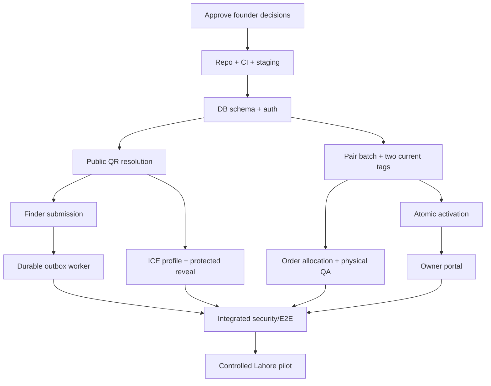

# SafeReturn — Implementation Plan & Task Backlog v1.2

**Document ID:** SR-PLAN-005 | **Version:** 1.2 proposed | **Date:** 12 October 2026 | **Project:** SafeReturn Lahore pilot  
**Repository target:** `docs/06-implementation-plan.md` | **Status:** Implementation plan for review; NOT an assertion that tickets, tests, providers, migrations or deployment are complete.

**Authoritative inputs:** `SafeReturn_01_Product_Requirements_Document_v1.2.md`, `SafeReturn_02_Technical_Design_v1.2.md`, `SafeReturn_03_Database_Design_and_Migration_Spec_v1.2.md`, `SafeReturn_04_API_Contract_and_OpenAPI_Spec_v1.2.md`, `SafeReturn_05_AI_Agent_Instructions_and_Coding_Standards_v1.2.md`, plus the complete original Implementation Plan v1.1 archived in Part B of this file. The original PRD v1.0 has not been provided in this document sequence; unchanged v1.0 requirements referenced by the sources should be verified before release.

> **Authority and conflict precedence:** Founder-approved PRD and ADRs → approved TDD/DB/API contracts → security constraints → this execution plan and agent instructions. **Part A supersedes conflicts in archived Part B**; all unaffected v1.1 work and controls are retained. Neither this backlog nor an AI-generated proposal authorizes production migrations, payments, secrets access or deployment. This is an execution plan, not code or a claim of completed testing.

# PART A — CURRENT v1.2 IMPLEMENTATION BASELINE

## 1. Product and security invariants

1. One *new* QR identity unit is one `tag_pairs` record and exactly two **current** unique `qr_codes`, one `lost` and one `ice`, with one separate concealed activation credential; pair ownership and activation are atomic.
2. One account may own **many** pairs; each QR has an independently editable purpose-specific profile. Changes to Lost QR A cannot modify Lost QR B or ICE QR A. Different printed copies of the **same** QR token share **one** profile.
3. Purchasing three Lost stickers plus two ICE stickers for a *new* kit produces five print occurrences but **one** pair and two unique tokens. QR identity, printed copy, physical product and order line are separate entities.
4. Future badges, keychains, bag tags and other categories must use catalog/variant/order lines and product-specific production templates. Future add-ons may reuse an authorized existing QR (same profile) or request a **new full pair** (independent profiles); never create an orphan single tag.
5. QR public tokens are high entropy and never activation secrets. Scan context survives login, but does **not** prove ownership; a verified purchase entitlement or concealed credential must gate activation. Never require a second scan.
6. Public Finder/ICE pages are bilingual English/Urdu and anonymous. No full ICE phone in initial HTML, hydration or public JSON. Emergency reveal protections and fallback need founder/security approval; WhatsApp is explicit opt-in and discloses selected phone; geolocation is one-time optional consented.
7. Finder message plus durable outbox event commit atomically; Resend delivery is retried by a separate worker. Never claim email delivery guaranteed.
8. Pair reservation is exclusive and transactionally safe; a plausibly submitted transfer awaiting finance reconciliation cannot be silently expired and reissued. Verified payment is the only release gate for final allocation/production.
9. A screenshot, sender account entry or Sheet row is **not** proof of payment. Pilot uses manual trusted bank verification; future signed payment-provider confirmation feeds the **same** internal canonical verification transition.
10. Price computation and final quote are authoritative on the backend, use decimal PKR monetary types, store immutable order-line product name/SKU/variant/price snapshots, and enforce idempotency.
11. Supabase PostgreSQL is authoritative, private Supabase Storage houses evidence/print PDFs, Cloudinary houses public product imagery; Google Sheets is a redacted eventual finance mirror, never a financial database or authority for fulfillment.
12. Branded QR has center logo subject to scan/geometry/physical QA; print-ready vector PDFs contain exactly the requested Lost copies first, ICE copies second, with real dimensions and cut margins. Activation secret is separately concealed in packaging.
13. Evidence/PDF access is private, audited and expiring; deletion follows approved retention and delivery/reprint grace periods. Essential transaction, QR identity, copy-count and audit history survives artifact deletion.
14. No browser service secrets or direct client writes to business tables; enforce owner authorization, staff MFA, RLS/grants, encryption, request validation, secure signed storage access and no sensitive logging.

## 2. Scope and release boundaries

| Work | Launch P0 (Lahore) | Future-ready now / feature-gated until approved |
|---|---|---|
| QR sales | One new paired QR identity with independently sized Lost and ICE sticker copy counts | Additional physical product families; QR reuse on add-on merchandise |
| Customer | Many pairs and independent Lost/ICE editing; scan-led activation | Product-specific content/guardian workflows beyond approved public profile model |
| Catalog | Real sticker product/variants; backend featured API; admin catalog CRUD foundation | Published keychains/badges, manufacturer-specific workflows and new stock sources |
| Checkout | Immutable product/variant snapshots, quote, payment submission, exclusive reservation | Future gateway checkout/webhook and multiple special manufacturing methods |
| Finance | Human-verifies actual bank receipt; proof optional per approved policy; audited status | Automated gateway settlement after signed verification + reconciliation certification |
| Printing | Private compact sticker PDF; centered logo, copies in order, QA and controlled staff download | Keychain/badge production template and vendor exports |
| Operations | Google Sheet redacted mirror, Supabase private storage, Cloudinary public imagery, retention jobs | Broader provider integrations and multi-warehouse logistics |

**Feature flags:** Explicitly hide/police `catalog.future_products`, `checkout.existing_qr_reuse`, `payments.gateway`, `manufacturing.non_sticker_templates`, and sensitive guardian features until documented contract, consent, tests and launch approval. Backend must reject disabled actions even if someone bypasses UI.

## 3. Source reconciliation and mandatory phase-zero ADRs

| Decision / contract | Source grounding | Required decision or freeze |
|---|---|---|
| Pair/current-tag uniqueness and independent profile FK | DB v1.2 §§1–7; API v1.2 QR families | Freeze final table and FK names after inspecting v1.1 schema and DDL; preserve historical revocation |
| Product & variant IDs, order line snapshots | PRD v1.2 product amendment; DB v1.2 §§4–5 | Approve catalog naming, SKU and specific v1.2 migration plan |
| Quote, order, reservation atomicity | TDD v1.2 §§6–7; API v1.2 API-203/204 | Freeze allocation/hold state-machine including under-review transfer |
| Payment provider state transitions | PRD v1.2 A7; API v1.2 payment contracts | Approve manual proof fields, reviewer roles, payment gateway interface and replay behavior |
| QR logo scan tolerance, sizes | TDD v1.2 §§4,8,14; physical SOP v1.1 | Approve artwork, dimension matrix, validated phones/printers and print supplier |
| Cloudinary / Storage scopes | PRD v1.2 A8; DB v1.2 §9 | Private Supabase PDFs and proof; Cloudinary public catalog only, unless new ADR |
| Sheets finance reporting | PRD v1.2 A7.3; DB v1.2 §10 | Sheet ID/owner/service-account permissions, redaction policy, retry/retention |
| Public ICE/contact fallbacks, privacy retention | Security v1.1; PRD v1.2 | Founder/privacy/security approval before production |
| Product reuse on new physical item | PRD/TDD v1.2 extensibility amendments | Contract exists now; feature-gated until production/ownership support passes |
| Exact endpoint inventory | API v1.2 Part A overrides archive | Validate canonical OpenAPI spec; reject route guessing and duplicates |

**Naming reconciliation warning:** The original documents retain archived v1.1 structures, and newer v1.2 amendments sometimes describe logical domain concepts not yet applied as DDL. Build a *schema/API naming crosswalk* in SR-00-11 before first migration. Never invent a column just because an example uses a different term. Capture contradictions as ADRs and block affected tickets pending approval.

## 4. Task governance and definition of evidence

Keep all original **SR-00-01 through SR-08-05** IDs unchanged (archived full tickets in Part B). Existing tasks are **modified by the delta tickets and conditions in this Part A**, not silently completed or removed. New v1.2 IDs use suffixes `SR-XX-20+` to avoid collisions. Priority: `P0` launch-critical, `P1` feature-gated integration/foundation, `P2` later enhancement. Status starts **BACKLOG** for every item, not `DONE`. Codex = backend/database/tests; Antigravity = frontend/E2E; Human = architecture/financial/physical/security approval; reviewer = independent checks. Actual assignment is flexible.

**For every ticket:** acceptance criteria, named dependencies, code/tests/artifacts, least-privilege owner, migration and rollback impact, E2E/security evidence. Work in one branch/worktree per agent, avoid concurrent edits to migration chain. Record commands run, whether CI/staging/physical verification was actually performed, and remaining risks. The old plan's task-template, DoR/DoD, review, sign-off and rollback constraints remain mandatory.

### Standard task Definition of Done (DoD)

- Relevant PRD/ADR/DB/API contract referenced and no unapproved product/route/schema changes.
- Reviewed code, unit + PostgreSQL integration + contract tests + relevant Playwright tests pass in an *actual executed* environment; include evidence; physical QR cases require real print/hardware evidence.
- Authz/role, idempotency, transactions, failure recovery, audit, log-redaction and provider timeout cases verified where relevant.
- OpenAPI generated, linted, contract-diff checked and checked against frontend typing; migration upgrade/downgrade/restore rehearsed where data changes.
- Alert/ops/runbook/UI help text updated; feature flags off where unapproved; no leaked secrets, screenshots or identifiable customer details.
- Human approves production payment, security/privacy, actual manufacturing and deployment gates. No ticket marked complete solely from a model assertion.

## 5. Roadmap, dependencies and revised release gates

| Gate | Phase | Deliverable to demonstrate | Dependencies / blocker |
|---|---|---|---|
| G0 | Decisions and contracts | Approved state diagrams, catalog/QR models, backend route/SQL crosswalk and feature flags | Founder reviews ADRs and pricing/privacy settings |
| G1 | Platform & CI | Repo, `.env.example`, staging credentials, lint/tests, OpenAPI lint, migration baseline | G0 |
| G2 | DB/identity/catalog | Validated migrations, RLS/auth, catalog/variant/snapshot schema, multi-owner pairs/profiles | G1 |
| G3 | QR/inventory/activation | Branded generation, batch stock, reservations, ownership-safe scan activation and print token QA | G2 |
| G4 | Public recovery/emergency | English/Urdu finder and ICE flows, protected reveal, encrypted consented location | G3 + privacy approval |
| G5 | Owner & notifications | Multiple pairs/independent profile editing, finder inbox, durable mail and opt-in WhatsApp | G4 |
| G6 | Commerce/payment | Quote/order snapshots, sticker copies, private transfer proof, manual finance validation, resilient reservations | G3 + G5 |
| G7 | Print, sync and shipping | Compact private PDFs, print QA, staff download, ready-to-ship, shipping, Sheets mirror, retention cleanup | G6 |
| G8 | Security & physical acceptance | Concurrency/payment replay/IDOR/scanability/durability tests + full release checklist | G7 |
| G9 | Lahore pilot | Founder-approved staged launch, supervised orders, incident rollback plan | G8 |
| G10 | Extension certification | Keychain/badge templates, authorized QR reuse, future gateway provider verification | P1 after proven G9; **not P0** |

**Critical path:** Contracts/ADRs → migration & auth → pair generation + entitlement → checkout/reservation + payment settlement → print PDF + physical QA → dispatch/delivery + retention → pilot. Public QR recovery can be built alongside commerce once pair identity and security are stable. The old G0–G11 nomenclature in Part B is an archive; use this table's v1.2 gating terms for new task references, and maintain an ADR crosswalk before opening tickets.

## 6. v1.1 tickets amended by v1.2 — explicit mapping

| Existing ticket IDs | Mandatory v1.2 adjustment |
|---|---|
| SR-00-01, 00-09, 00-10 | Resolve product/copy semantics, pre-auth scan intent, manual-to-gateway provider seam; freeze database/API crosswalk |
| SR-01-03–01-06 | Pair-per-owner multiplicity, independent QR profiles and unchanged existing ICE privacy constraints |
| SR-01-09–01-11 | Normalized product/variant/catalog, order lines, quote/QR selections, payment attempts/intent, reservations, print jobs and storage metadata; new migration, RLS tests |
| SR-02-03–02-08 | Logo-centered QR verification, atomic new pair allocation, scan context ownership verified; don't mint QR per printed copy |
| SR-02-11, SR-03-06 | Unactivated QR → activation CTA → auth → saved context → no rescan and proper revoked/suspended states |
| SR-04-01–04-02; SR-05-06–05-07 | Many owned QR identities, separate edit state for each Lost/ICE QR, cross-owner and copy-sharing tests |
| SR-06-01–06-03 | Admin-configured catalog, size/quantity choice by QR type, quote, immutable order snapshots, accurate subtotal/address/contact confirmation |
| SR-06-04–06-07 | Masked sender identifiers, private optional screenshot, manual independent bank verification, separate payment and fulfillment states |
| SR-06-08–06-09 | Expiring but reconciliation-safe exclusive reservations, final allocation only on verification, idempotent retry and no double sell |
| SR-06-10–06-13 | Print jobs/ready-to-ship PDF QA, compact file and controlled downloads, delivery retention and historical order details |
| SR-07-01–07-12 | Logo scan/error correction; mixed-size print templates; privacy, state race, gateway seam, Sheets retry and storage cleanup tests |
| SR-08-01–08-05 | Pilot with actual 3-Lost/2-ICE one-pair order, scan-based claim, failure drills, print/cut/ship experience |

## 7. New v1.2 backlog tickets

**Notation:** `Depends` references existing v1.1 tickets and/or new tasks. Each detailed ticket's acceptance conditions are release obligations, not test results. Exact SQL/API names must match frozen Document 03/04; endpoint suggestions below refer to the API registry, not an invitation to invent routes.

### SR-00-20 — Contract and migration crosswalk

**Priority:** P0 | **Status:** BACKLOG | **Suggested owner:** Human + Codex  
**Depends:** SR-00-01,SR-00-09,SR-00-10  
**Scope:** Create checked mapping of v1.1 tables/endpoint IDs to DB/API v1.2; list conflicts/ADRs and owner.  
**Acceptance/evidence:** No unresolved high-risk schema/API naming contradictions; signed route and DDL version map. Include automated failure-path verification, audit/auth checks where applicable, and actual command/staging evidence in ticket record.  
**Rollback/feature gate:** Prefer additive migration/reversible release; apply existing phase security gates and never enable future product/payment features without approval.

### SR-00-21 — Commercial parameters and policy approvals

**Priority:** P0 | **Status:** BACKLOG | **Suggested owner:** Human  
**Depends:** SR-00-01  
**Scope:** Approve live sticker variants, prices, shipping/tax rules, QR sizes, stock hold time, dispute window, evidence/PDF retention, ICE fallback, legal/guardian notices.  
**Acceptance/evidence:** Configuration is reviewed without placeholder prices/secrets; unresolved safety policy gates remain blocked. Include automated failure-path verification, audit/auth checks where applicable, and actual command/staging evidence in ticket record.  
**Rollback/feature gate:** Prefer additive migration/reversible release; apply existing phase security gates and never enable future product/payment features without approval.

### SR-00-22 — Feature flags and rollout matrix

**Priority:** P0 | **Status:** BACKLOG | **Suggested owner:** Codex + Antigravity  
**Depends:** SR-00-06,SR-00-09  
**Scope:** Implement backend/server flags for current stickers, future merchandise, reuse, gateways and guardian product flow.  
**Acceptance/evidence:** Disabled future endpoints reject requests; hidden UI cannot alone bypass backend guard. Include automated failure-path verification, audit/auth checks where applicable, and actual command/staging evidence in ticket record.  
**Rollback/feature gate:** Prefer additive migration/reversible release; apply existing phase security gates and never enable future product/payment features without approval.

### SR-00-23 — Canonical generated OpenAPI and typed client

**Priority:** P0 | **Status:** BACKLOG | **Suggested owner:** Codex + Antigravity  
**Depends:** SR-00-09,SR-00-07,SR-00-20  
**Scope:** Implement machine-readable full FastAPI schema, drift CI, typed frontend client and cross-API DTO smoke tests.  
**Acceptance/evidence:** All documented v1.2 required endpoints represented, stable IDs, no duplicate paths, CI drift fails. Include automated failure-path verification, audit/auth checks where applicable, and actual command/staging evidence in ticket record.  
**Rollback/feature gate:** Prefer additive migration/reversible release; apply existing phase security gates and never enable future product/payment features without approval.

### SR-01-20 — Catalog categories and products migration

**Priority:** P0 | **Status:** BACKLOG | **Suggested owner:** Codex  
**Depends:** SR-01-09,SR-00-20  
**Scope:** Create reviewed additive catalog/variants/images with active/published/featured state and soft archive; seed launch sticker product.  
**Acceptance/evidence:** Constraints/indexes/foreign keys/RLS/rollback reviewed; archived catalog retains historical order references. Include automated failure-path verification, audit/auth checks where applicable, and actual command/staging evidence in ticket record.  
**Rollback/feature gate:** Prefer additive migration/reversible release; apply existing phase security gates and never enable future product/payment features without approval.

### SR-01-21 — Order lines and immutable snapshots migration

**Priority:** P0 | **Status:** BACKLOG | **Suggested owner:** Codex  
**Depends:** SR-01-09,SR-01-20  
**Scope:** Create purchase-time product name, SKU, variant, size/material, price/currency, units and per-type print copy specification.  
**Acceptance/evidence:** Updating/archiving product never mutates previous order line fields. Include automated failure-path verification, audit/auth checks where applicable, and actual command/staging evidence in ticket record.  
**Rollback/feature gate:** Prefer additive migration/reversible release; apply existing phase security gates and never enable future product/payment features without approval.

### SR-01-22 — QR-use mapping and per-tag profile migration

**Priority:** P0 | **Status:** BACKLOG | **Suggested owner:** Codex  
**Depends:** SR-01-03,SR-01-06,SR-01-21  
**Scope:** Ensure separate Lost/ICE profiles per QR, many pairs per owner, catalog QR-use associations, shared physical copies per tag token.  
**Acceptance/evidence:** Cross-pair edits isolated; unique-current constraints preserved; no orphan single-tag purchase. Include automated failure-path verification, audit/auth checks where applicable, and actual command/staging evidence in ticket record.  
**Rollback/feature gate:** Prefer additive migration/reversible release; apply existing phase security gates and never enable future product/payment features without approval.

### SR-01-23 — Reservations and payment normalization migration

**Priority:** P0 | **Status:** BACKLOG | **Suggested owner:** Codex  
**Depends:** SR-01-09,SR-01-21  
**Scope:** Create/reconcile quote reservations, owner/order ties, payment attempts/provider refs/reconciliation and idempotency constraints.  
**Acceptance/evidence:** Concurrent reserve cannot double-claim; review-pending transfer not silently returned to stock. Include automated failure-path verification, audit/auth checks where applicable, and actual command/staging evidence in ticket record.  
**Rollback/feature gate:** Prefer additive migration/reversible release; apply existing phase security gates and never enable future product/payment features without approval.

### SR-01-24 — Print job, artifact and cleanup migration

**Priority:** P0 | **Status:** BACKLOG | **Suggested owner:** Codex  
**Depends:** SR-01-09,SR-01-21  
**Scope:** Add render revision, artifact private key, created/expiry/deletion metadata, QA states, reprint audit, delivery and artifact-retention markers.  
**Acceptance/evidence:** Deletion does not cascade to order identities or purchased copy counts. Include automated failure-path verification, audit/auth checks where applicable, and actual command/staging evidence in ticket record.  
**Rollback/feature gate:** Prefer additive migration/reversible release; apply existing phase security gates and never enable future product/payment features without approval.

### SR-01-25 — Finance sync outbox and permissions migration

**Priority:** P0 | **Status:** BACKLOG | **Suggested owner:** Codex  
**Depends:** SR-01-08,SR-01-10,SR-01-23  
**Scope:** Add idempotent provider-independent Sheets-sync jobs and restricted staff permissions; redact evidence/account values.  
**Acceptance/evidence:** On sync retries one order/payment maps to one expected Sheet row; RBAC/RLS tested. Include automated failure-path verification, audit/auth checks where applicable, and actual command/staging evidence in ticket record.  
**Rollback/feature gate:** Prefer additive migration/reversible release; apply existing phase security gates and never enable future product/payment features without approval.

### SR-02-20 — Centered-logo QR renderer and density testing

**Priority:** P0 | **Status:** BACKLOG | **Suggested owner:** Codex + Human  
**Depends:** SR-02-05,SR-00-21  
**Scope:** Add verified-domain SVG/vector logo-backed QR printing with four-module quiet zone and size policy; real hardware scan matrix.  
**Acceptance/evidence:** Smallest permitted size scans across approved test phones/printers and scratch/lighting tests; no logo-only authenticity claim. Include automated failure-path verification, audit/auth checks where applicable, and actual command/staging evidence in ticket record.  
**Rollback/feature gate:** Prefer additive migration/reversible release; apply existing phase security gates and never enable future product/payment features without approval.

### SR-02-21 — Pre-auth QR context and login return

**Priority:** P0 | **Status:** BACKLOG | **Suggested owner:** Codex + Antigravity  
**Depends:** SR-02-07,SR-02-11,SR-03-06  
**Scope:** Persist short-lived minimal scan context across signup/login/email verification without revealing activation secrets.  
**Acceptance/evidence:** Same QR resumes after auth without second scan; crafted/expired/cross-owner context cannot claim pair. Include automated failure-path verification, audit/auth checks where applicable, and actual command/staging evidence in ticket record.  
**Rollback/feature gate:** Prefer additive migration/reversible release; apply existing phase security gates and never enable future product/payment features without approval.

### SR-02-22 — Entitled atomic activation and QR collection

**Priority:** P0 | **Status:** BACKLOG | **Suggested owner:** Codex + Antigravity  
**Depends:** SR-02-08,SR-01-22,SR-02-21  
**Scope:** Implement owner-bound claim intent and atomic pair activation; customer collection API supports pages of pairs and individual tags.  
**Acceptance/evidence:** Activation rolls back both tags on failure; retry idempotent, many owned pairs remain independent. Include automated failure-path verification, audit/auth checks where applicable, and actual command/staging evidence in ticket record.  
**Rollback/feature gate:** Prefer additive migration/reversible release; apply existing phase security gates and never enable future product/payment features without approval.

### SR-03-20 — Inactive QR bilingual activation CTA

**Priority:** P0 | **Status:** BACKLOG | **Suggested owner:** Antigravity  
**Depends:** SR-03-06,SR-02-21  
**Scope:** Display normal unactivated valid QR experience with Activate option, safe sign-in and owner-confirm; retain anonymous active scan access.  
**Acceptance/evidence:** No generic error for valid unactivated tags; invalid/revoked/claimed foreign tags handled safely. Include automated failure-path verification, audit/auth checks where applicable, and actual command/staging evidence in ticket record.  
**Rollback/feature gate:** Prefer additive migration/reversible release; apply existing phase security gates and never enable future product/payment features without approval.

### SR-04-20 — Independent tag profile update and consent E2E

**Priority:** P0 | **Status:** BACKLOG | **Suggested owner:** Codex + Antigravity  
**Depends:** SR-04-01,SR-04-02,SR-01-22  
**Scope:** Implement QR-scoped edits for lost item and ICE data (including ICE contacts/privacy toggle) and optimistic versions.  
**Acceptance/evidence:** QR A changes do not alter QR B; printed copies of QR A display the same updated public record. Include automated failure-path verification, audit/auth checks where applicable, and actual command/staging evidence in ticket record.  
**Rollback/feature gate:** Prefer additive migration/reversible release; apply existing phase security gates and never enable future product/payment features without approval.

### SR-05-20 — Many-pair dashboard and item-specific settings

**Priority:** P0 | **Status:** BACKLOG | **Suggested owner:** Antigravity  
**Depends:** SR-05-06,SR-05-07,SR-02-22  
**Scope:** Customer dashboard lists pair and distinct Lost/ICE QR cards with profile edit routes and status.  
**Acceptance/evidence:** No ownership leakage, pagination responsive, RTL public experience retained. Include automated failure-path verification, audit/auth checks where applicable, and actual command/staging evidence in ticket record.  
**Rollback/feature gate:** Prefer additive migration/reversible release; apply existing phase security gates and never enable future product/payment features without approval.

### SR-06-20 — Catalog APIs and homepage featured carousel

**Priority:** P0 | **Status:** BACKLOG | **Suggested owner:** Codex + Antigravity  
**Depends:** SR-01-20,SR-00-22  
**Scope:** Expose published product variants and featured list; build accessible horizontal mobile swipe/desktop controls, server-fed not hardcoded.  
**Acceptance/evidence:** Unpublished/disabled products hidden and rejected server-side; empty-state and image fallback validated. Include automated failure-path verification, audit/auth checks where applicable, and actual command/staging evidence in ticket record.  
**Rollback/feature gate:** Prefer additive migration/reversible release; apply existing phase security gates and never enable future product/payment features without approval.

### SR-06-21 — Admin product CRUD, images and feature flags

**Priority:** P0 | **Status:** BACKLOG | **Suggested owner:** Codex + Antigravity  
**Depends:** SR-01-20,SR-06-20  
**Scope:** Role-controlled products, variants, categories, image order, Cloudinary public upload and publish/archive; prevent hard deletes of ordered SKUs.  
**Acceptance/evidence:** Only catalog role can modify; CDN URLs validated; existing orders retain snapshots. Include automated failure-path verification, audit/auth checks where applicable, and actual command/staging evidence in ticket record.  
**Rollback/feature gate:** Prefer additive migration/reversible release; apply existing phase security gates and never enable future product/payment features without approval.

### SR-06-22 — Per-type copy and size shopping configurator

**Priority:** P0 | **Status:** BACKLOG | **Suggested owner:** Antigravity  
**Depends:** SR-06-01,SR-06-20  
**Scope:** Create Lost and ICE rows each with size/quantity controls; one new identity pair, repeated print occurrences; accessible validation and price preview.  
**Acceptance/evidence:** 3 Lost + 2 ICE choices result in one new pair request, five physical copies; backend controls final price. Include automated failure-path verification, audit/auth checks where applicable, and actual command/staging evidence in ticket record.  
**Rollback/feature gate:** Prefer additive migration/reversible release; apply existing phase security gates and never enable future product/payment features without approval.

### SR-06-23 — Quotes and checkout address snapshot

**Priority:** P0 | **Status:** BACKLOG | **Suggested owner:** Codex + Antigravity  
**Depends:** SR-01-21,SR-06-22,SR-00-23  
**Scope:** Implement authoritative quote, TTL, tax/shipping, contact and shipping address confirmation; optimistic quote validation at submit.  
**Acceptance/evidence:** Changing prices/quantities invalidates quote; no client-supplied total trusted; order line immutable. Include automated failure-path verification, audit/auth checks where applicable, and actual command/staging evidence in ticket record.  
**Rollback/feature gate:** Prefer additive migration/reversible release; apply existing phase security gates and never enable future product/payment features without approval.

### SR-06-24 — Checkout inventory reservation service

**Priority:** P0 | **Status:** BACKLOG | **Suggested owner:** Codex  
**Depends:** SR-01-23,SR-06-23,SR-02-03  
**Scope:** Reserve eligible digitally QA-approved unallocated pairs under lock, manage timeout and under-review exceptions; persist audit.  
**Acceptance/evidence:** No double reservation under concurrency; valid pending bank review not silently released. Include automated failure-path verification, audit/auth checks where applicable, and actual command/staging evidence in ticket record.  
**Rollback/feature gate:** Prefer additive migration/reversible release; apply existing phase security gates and never enable future product/payment features without approval.

### SR-06-25 — Payment provider interface and manual adapter

**Priority:** P0 | **Status:** BACKLOG | **Suggested owner:** Codex  
**Depends:** SR-01-23,SR-06-05,SR-06-24  
**Scope:** Implement provider-normalized intent/attempt/status service; manual transfer fields, masked sender account and optional private evidence.  
**Acceptance/evidence:** Payment submission never verifies itself; provider interface enables eventual gateway without altering orders. Include automated failure-path verification, audit/auth checks where applicable, and actual command/staging evidence in ticket record.  
**Rollback/feature gate:** Prefer additive migration/reversible release; apply existing phase security gates and never enable future product/payment features without approval.

### SR-06-26 — Finance approval/rejection and reconciliation

**Priority:** P0 | **Status:** BACKLOG | **Suggested owner:** Codex + Antigravity + Human  
**Depends:** SR-06-25,SR-06-06,SR-06-07  
**Scope:** Finance MFA verifies trusted bank transfer; idempotently records payment, applies final allocation and queues print; handles late-paid expired reservations.  
**Acceptance/evidence:** Double approval does not double-allocate/print; settlement mismatch escalates without issuing another buyer’s pair. Include automated failure-path verification, audit/auth checks where applicable, and actual command/staging evidence in ticket record.  
**Rollback/feature gate:** Prefer additive migration/reversible release; apply existing phase security gates and never enable future product/payment features without approval.

### SR-06-27 — Customer payment and order status history

**Priority:** P0 | **Status:** BACKLOG | **Suggested owner:** Antigravity  
**Depends:** SR-06-23,SR-06-25  
**Scope:** My Orders shows order number, purchased line names/IDs/sizes/counts, masked sender reference and separate payment/fulfillment state.  
**Acceptance/evidence:** Pending review not labeled paid; inaccessible to other customers; past SKU names unchanged. Include automated failure-path verification, audit/auth checks where applicable, and actual command/staging evidence in ticket record.  
**Rollback/feature gate:** Prefer additive migration/reversible release; apply existing phase security gates and never enable future product/payment features without approval.

### SR-06-28 — Private payment evidence storage + deletion

**Priority:** P0 | **Status:** BACKLOG | **Suggested owner:** Codex  
**Depends:** SR-06-25,SR-01-24  
**Scope:** Private Supabase proof upload with MIME/size/malware policy, signed access, expiry and retention job; no public Cloudinary proof.  
**Acceptance/evidence:** Only allowed finance staff can view; scheduled deletion after approved window preserves audit references. Include automated failure-path verification, audit/auth checks where applicable, and actual command/staging evidence in ticket record.  
**Rollback/feature gate:** Prefer additive migration/reversible release; apply existing phase security gates and never enable future product/payment features without approval.

### SR-06-29 — Gateway verification interface contract tests

**Priority:** P1 | **Status:** BACKLOG | **Suggested owner:** Codex  
**Depends:** SR-06-25,SR-06-26  
**Scope:** Implement disabled gateway adapter seam and simulated signed webhook/replay tests; no real provider until approved.  
**Acceptance/evidence:** Only trusted webhook/provider validation emits canonical verified transition; old manual flow unaffected. Include automated failure-path verification, audit/auth checks where applicable, and actual command/staging evidence in ticket record.  
**Rollback/feature gate:** Prefer additive migration/reversible release; apply existing phase security gates and never enable future product/payment features without approval.

### SR-06-30 — Existing owned QR reuse for future products

**Priority:** P1 | **Status:** BACKLOG | **Suggested owner:** Codex + Antigravity  
**Depends:** SR-01-22,SR-06-21,SR-00-22  
**Scope:** Feature-gated flow to assign authorized owned QR to accessory, or buy new pair with independent profiles.  
**Acceptance/evidence:** Cross-owner reuse rejected; existing-profile sharing explicit; new identity always creates full pair. Include automated failure-path verification, audit/auth checks where applicable, and actual command/staging evidence in ticket record.  
**Rollback/feature gate:** Prefer additive migration/reversible release; apply existing phase security gates and never enable future product/payment features without approval.

### SR-07-20 — Compact private vector print PDF worker

**Priority:** P0 | **Status:** BACKLOG | **Suggested owner:** Codex  
**Depends:** SR-06-26,SR-01-24,SR-02-20  
**Scope:** On confirmed payment/final allocation enqueue render once; template by physical size, logo centered, Lost block first ICE next, repeat same token as ordered; compress vector and font assets.  
**Acceptance/evidence:** Print 3 Lost+2 ICE = five labels, two distinct tokens, one pair; PDF dimensions and size budget checked. Include automated failure-path verification, audit/auth checks where applicable, and actual command/staging evidence in ticket record.  
**Rollback/feature gate:** Prefer additive migration/reversible release; apply existing phase security gates and never enable future product/payment features without approval.

### SR-07-21 — Ready-to-ship print QA/admin downloads

**Priority:** P0 | **Status:** BACKLOG | **Suggested owner:** Codex + Antigravity  
**Depends:** SR-07-20,SR-06-10,SR-06-11  
**Scope:** Admin role sees verified paid allocated orders with restricted signed PDF download, QA result and dispatch action.  
**Acceptance/evidence:** Never expose unverified/private manifest; repeat downloads do not regenerate duplicates. Include automated failure-path verification, audit/auth checks where applicable, and actual command/staging evidence in ticket record.  
**Rollback/feature gate:** Prefer additive migration/reversible release; apply existing phase security gates and never enable future product/payment features without approval.

### SR-07-22 — PDF/evidence lifecycle deletion and reprint

**Priority:** P0 | **Status:** BACKLOG | **Suggested owner:** Codex  
**Depends:** SR-07-20,SR-07-21,SR-01-24  
**Scope:** Auto-delete PDFs after verified delivery plus approved reprint grace; evidence after finance retention; controlled reprint regeneration.  
**Acceptance/evidence:** DB order, QR identity, copy counts and audit retained; missing file recoverable from versioned spec. Include automated failure-path verification, audit/auth checks where applicable, and actual command/staging evidence in ticket record.  
**Rollback/feature gate:** Prefer additive migration/reversible release; apply existing phase security gates and never enable future product/payment features without approval.

### SR-07-23 — Google Sheets reporting adapter and retry

**Priority:** P0 | **Status:** BACKLOG | **Suggested owner:** Codex  
**Depends:** SR-01-25,SR-06-26  
**Scope:** Write redacted order/payment row/upsert asynchronously after DB commit, update approved status by stable ID and dead-letter/alert on repeated provider errors.  
**Acceptance/evidence:** Sheets offline never prevents payment truth or shipping; no raw bank account or public screenshot links. Include automated failure-path verification, audit/auth checks where applicable, and actual command/staging evidence in ticket record.  
**Rollback/feature gate:** Prefer additive migration/reversible release; apply existing phase security gates and never enable future product/payment features without approval.

### SR-07-24 — Shipments and delivery state processing

**Priority:** P0 | **Status:** BACKLOG | **Suggested owner:** Codex + Antigravity  
**Depends:** SR-07-21,SR-06-10  
**Scope:** Provide manifest/packing matching pair, customer shipping info, dispatch tracking, proof-of-delivery rules and idempotent transitions.  
**Acceptance/evidence:** Delivery alone cannot expose activation secret; artifact-retention trigger requires trusted delivery evidence. Include automated failure-path verification, audit/auth checks where applicable, and actual command/staging evidence in ticket record.  
**Rollback/feature gate:** Prefer additive migration/reversible release; apply existing phase security gates and never enable future product/payment features without approval.

### SR-07-25 — Manufacturer template extension interface

**Priority:** P1 | **Status:** BACKLOG | **Suggested owner:** Codex  
**Depends:** SR-07-20,SR-06-30  
**Scope:** Allow future product/variant print dimensions and templates for keychains/badges, feature-gated and separately QA approved.  
**Acceptance/evidence:** Sticker production unchanged; invalid size/template cannot yield released artifact. Include automated failure-path verification, audit/auth checks where applicable, and actual command/staging evidence in ticket record.  
**Rollback/feature gate:** Prefer additive migration/reversible release; apply existing phase security gates and never enable future product/payment features without approval.

### SR-07-26 — Admin stock alert and batch regeneration

**Priority:** P0 | **Status:** BACKLOG | **Suggested owner:** Codex + Antigravity  
**Depends:** SR-02-03,SR-07-21  
**Scope:** Inventory admin sees low available pair threshold, enters number of **pairs**, generates two QRs per pair and records digital QA status.  
**Acceptance/evidence:** Zero inventory prevents checkout gracefully, no duplicate tokens, concurrency/rate limits and audit. Include automated failure-path verification, audit/auth checks where applicable, and actual command/staging evidence in ticket record.  
**Rollback/feature gate:** Prefer additive migration/reversible release; apply existing phase security gates and never enable future product/payment features without approval.

### SR-08-20 — Full cross-domain E2E release scenarios

**Priority:** P0 | **Status:** BACKLOG | **Suggested owner:** Codex + Antigravity  
**Depends:** SR-07-20,SR-07-22,SR-07-23,SR-06-26  
**Scope:** Stage successful and failure flows: multi-pair profiles, QR claim/no rescan, 3+2 prints, pending bank review, concurrent reserve, resend outage, Sheets outage, cleanup.  
**Acceptance/evidence:** CI and staging actual results recorded; no release if critical scenario fails. Include automated failure-path verification, audit/auth checks where applicable, and actual command/staging evidence in ticket record.  
**Rollback/feature gate:** Prefer additive migration/reversible release; apply existing phase security gates and never enable future product/payment features without approval.

### SR-08-21 — Print-shop physical validation

**Priority:** P0 | **Status:** BACKLOG | **Suggested owner:** Human + Codex  
**Depends:** SR-08-20,SR-07-01,SR-07-02  
**Scope:** Print smallest/largest supported sizes on selected actual media; physically measure modules, cut margins, quiet zone, centered logo, bilingual label and scan every copy.  
**Acceptance/evidence:** Evidence includes devices, lighting, dimensions, printer and failure rate; no unaudited exceptions. Include automated failure-path verification, audit/auth checks where applicable, and actual command/staging evidence in ticket record.  
**Rollback/feature gate:** Prefer additive migration/reversible release; apply existing phase security gates and never enable future product/payment features without approval.

### SR-08-22 — Security/privacy/data retention review

**Priority:** P0 | **Status:** BACKLOG | **Suggested owner:** Independent reviewer + Human  
**Depends:** SR-08-20,SR-07-04,SR-07-07  
**Scope:** Review owner isolation, ICE response leaks, consent and child-sensitive fields, staff MFA, evidence/PDF URLs, webhook replay and storage deletion.  
**Acceptance/evidence:** No high/critical findings remain; founder-approved policies and stop-ship evidence signed. Include automated failure-path verification, audit/auth checks where applicable, and actual command/staging evidence in ticket record.  
**Rollback/feature gate:** Prefer additive migration/reversible release; apply existing phase security gates and never enable future product/payment features without approval.

### SR-08-23 — Staging deploy, backups and rollback rehearsal

**Priority:** P0 | **Status:** BACKLOG | **Suggested owner:** Human + Codex  
**Depends:** SR-08-22,SR-07-08,SR-07-09  
**Scope:** Run staged SQL migration and restore; verify env segregation, providers, domain, worker, Sheets retries, storage backup and revert playbook.  
**Acceptance/evidence:** Recovery rehearsed and recorded, no production secrets in repo or browser. Include automated failure-path verification, audit/auth checks where applicable, and actual command/staging evidence in ticket record.  
**Rollback/feature gate:** Prefer additive migration/reversible release; apply existing phase security gates and never enable future product/payment features without approval.

### SR-08-24 — Founder launch checklist and Lahore pilot

**Priority:** P0 | **Status:** BACKLOG | **Suggested owner:** Human  
**Depends:** SR-08-21,SR-08-22,SR-08-23  
**Scope:** Approve bank verification SOP, product pricing, minimum QR geometry, privacy/legal disclosures, carrier, refund/customer care and go/no-go.  
**Acceptance/evidence:** Only founder/release operator runs production enablement; first pilot order traced end-to-end. Include automated failure-path verification, audit/auth checks where applicable, and actual command/staging evidence in ticket record.  
**Rollback/feature gate:** Prefer additive migration/reversible release; apply existing phase security gates and never enable future product/payment features without approval.

### SR-09-20 — Keychains/badges product release certification

**Priority:** P1 | **Status:** BACKLOG | **Suggested owner:** Human + Codex + Antigravity  
**Depends:** SR-07-25,SR-06-30,SR-08-24  
**Scope:** Certify new substrate durability, manufacturing files, privacy/legal guardian requirements, variant stock, and cross-product checkout before publishing.  
**Acceptance/evidence:** Feature flag stays off until full E2E/print/legal approval. Include automated failure-path verification, audit/auth checks where applicable, and actual command/staging evidence in ticket record.  
**Rollback/feature gate:** Prefer additive migration/reversible release; apply existing phase security gates and never enable future product/payment features without approval.

### SR-09-21 — Payment gateway pilot integration

**Priority:** P1 | **Status:** BACKLOG | **Suggested owner:** Codex + Human  
**Depends:** SR-06-29,SR-08-24  
**Scope:** Select trusted provider, verify signed events server-side, implement refunds/partial/duplicate/out-of-order event reconciliation.  
**Acceptance/evidence:** Test sandbox reconciliation before any enablement; order and print invariants unchanged. Include automated failure-path verification, audit/auth checks where applicable, and actual command/staging evidence in ticket record.  
**Rollback/feature gate:** Prefer additive migration/reversible release; apply existing phase security gates and never enable future product/payment features without approval.

## 8. Verification matrix and acceptance scenarios

| Case ID | Scenario | Test level | Required observable outcome |
|---|---|---|---|
| V12-01 | Single user activates two different purchased pairs | API + PostgreSQL + browser | 4 current tags; each pair/QR keeps own edit state |
| V12-02 | 3 Lost 2 ICE sticker copies of one new pair | API + PDF geometry + physical print | Exactly 2 unique public tokens, five printed labels, one pair allocation |
| V12-03 | Two copies of one Lost QR edited | E2E | Both scanned copies reflect same new Lost profile, ICE unaffected |
| V12-04 | Change Lost QR of pair A with pair B existing | Authz + integration | Pair B and ICE A unchanged |
| V12-05 | Scan unactivated QR, sign up, return | Browser E2E | Activation intent preserved, no rescan, entitlement required |
| V12-06 | Other user photographs unused public QR | Security test | Unauthorized claim denied and concealed credential not exposed |
| V12-07 | Concurrent last-pair checkout | Postgres race | Only one active reservation; loser sees honest unavailability |
| V12-08 | Payment submitted while reservation timer runs | Race + worker | Pair not reassigned before verified reconciliation / approved exception |
| V12-09 | Double manual finance approval/retry | API + DB | Exactly one verified state, allocation and print job |
| V12-10 | Screenshot faked but bank not settled | Finance UAT | Remains pending/rejected; never fulfilled |
| V12-11 | Google Sheets outage / repeated update | Integration | Supabase is authoritative; queued retry yields one updated row |
| V12-12 | Payment gateway forged unsigned/replayed webhook | Security contract | No verified payment; valid signed event idempotent (feature-gated) |
| V12-13 | QR vector logo and smallest allowed print | Physical | Approved scan accuracy/quiet zone after actual cut/lamination |
| V12-14 | PDF download from foreign role/owner | Security | Denied without leaked private URL or object key |
| V12-15 | Delivery and cleanup | Integration | Temporary private file removed after policy, persistent order/QR metadata preserved |
| V12-16 | Admin changes or archives product | Integration | Historical order item name, SKU, unit price, copies remain unchanged |
| V12-17 | Future product reuses another user's QR | Security | Forbidden; same-owner reuse only while feature enabled |
| V12-18 | Revoked QR replacement | API + DB | Old token no longer active, replacement history and current constraints preserved |
| V12-19 | Finder optional location refused | Browser | Finder message still persists and queues Resend |
| V12-20 | Initial ICE page inspected HTML/network | Browser security | No full private phone or unconsented medical detail |
| V12-21 | Public featured carousel | Browser a11y | Mobile swipe, keyboard desktop navigation, server-published products only |
| V12-22 | Public/Cloudinary image and private/Supabase proof separation | Storage audit | No private evidence or print PDF public CDN URLs |
| V12-23 | Render provider outage/missing artifact | Recovery | Job retries; order remains paid, safe reprint possible, no duplicate allocation |
| V12-24 | Urdu/English public text and print | Localization + physical | Correct RTL, readable text, scan and emergency action remain accessible |

**Release blocker:** Any high/critical failure in owner isolation, ICE phone privacy, payment truth, double allocation, claim authorization, QR print scanability, or access to private objects blocks public production release. Every test must identify real evidence (`command`, `environment`, `artifact`, reviewer); a described test is not a passed test.

## 9. Detailed release sequence / suggested development sprints

1. **Sprint A — Freeze interfaces:** SR-00-20–23, review ADRs, decide launch sticker sizes/prices/stock holds/retention, baseline CI and migrations; no production action.
2. **Sprint B — Database and ownership:** SR-01-20–25, core v1.1 migration tasks, RLS and auth tests, seed stickers. Complete G2.
3. **Sprint C — QR core:** SR-02-20–22, SR-03-20 and original pair generation, public resolver and replacement safeguards; G3.
4. **Sprint D — Public & owner:** Original Phase 3–5 tasks, SR-04-20, SR-05-20, messaging, ICE, consent, Resend and WhatsApp; G4–G5.
5. **Sprint E — Catalog & checkout:** SR-06-20–24, size/quantity configurator and quote, exclusive locks and line snapshots.
6. **Sprint F — Finance:** SR-06-25–28, finance MFA and verified bank transitions, order history, payment evidence; G6.
7. **Sprint G — Production & shipping:** SR-07-20–24, SR-07-26, asynchronous Sheets sync, compact private PDFs, physical QA and retention; G7.
8. **Sprint H — Release testing:** SR-08-20–24, actual hardware QA, penetration/privacy, backups, staging and founder go/no-go; G8–G9.
9. **Postpilot gated extensions:** SR-06-29/30, SR-07-25, SR-09-20/21. Never ship future catalog manufacturing or gateway settlement from placeholders alone.

Each sprint length/effort depends on engineer availability, hardware, domain/payment account approvals and integration findings. These are *order and dependency recommendations*, not guaranteed calendar estimates.

## 10. Operational failure handling and recovery ownership

| Failure | Expected system behavior | Operator action |
|---|---|---|
| Bank transfer reported but not in bank | Under review, no paid signal or printing | Finance reconcile against independent bank source; safe reject/escalate |
| Payment arrives after expired reservation | Reconciliation exception; do not seize an already sold pair | Finance/ops re-reserve safe stock or refund per policy; audit |
| Duplicate webhook/manual review | Deduplicated canonical payment event | Inspect provider event log and idempotency, no reprint by default |
| DB commit succeeded; Sheets failed | Source-of-truth unchanged, retry sync | Operations view retries and alerts; restricted access |
| PDF worker crashes midway | Job durable with retries, no double artifact | Ops regenerate from print revision with audit |
| Private PDF missing or deleted early | Controlled regeneration from persisted order/QR copy spec | Authorized staff reprint and audit |
| Cloudinary down | Placeholder marketing image; checkout still safe | Retry public image/CDN sync; no PII upload fallback |
| Supabase private object failure | Fail evidence upload or print job safely | Retry with backoff; do not falsely claim success |
| Inactive QR scanned by finder | Activation invitation only, no owner details | Customer support ownership/activation route; no anonymous claim |
| Suspected exposure of activation credentials | Revoke/reissue affected pair, preserve history | Security lead coordinates incident and reprint |
| ICE bot challenge unavailable | Apply only approved safe emergency fallback | Incident operator monitors abuse while maintaining reviewed access |

## 11. Deployment, retention, rollback and monitoring

- Keep staging and production databases, buckets, Cloudinary folders and Google Sheets separate. Never use live service-role credentials in Next.js frontend or repo.
- Supply `.env.example` with *names only*: auth URLs, Supabase DB/buckets, Cloudinary public image config, Resend/Turnstile secrets, Sheets service identity and sheet id, feature flags, verified domain, webhook signing keys **when future gateway enabled**. Actual secrets stored in approved provider settings.
- Workers: transactional outbox/Resend, finance Sheets job retries, post-verification PDF generation, low-stock/batch notifications, reservation reconciliation and artifact retention. Use idempotent DB-backed jobs; do not introduce Kafka/Celery/Redis without ADR.
- Observability: request trace ID, pair inventory counts, checkout quote errors, reserved/review-pending aging, manual payment exceptions, PDF bytes/job failure rate, fulfillment age, Sheet sync lag, storage cleanup count, phone reveal abuse and email outbox retry. Redact all public token paths, full sender bank IDs, ICE phones, precise location and evidence links from normal logs.
- Restore-test PostgreSQL with non-production data; retain artifact metadata and purchase-time immutable order snapshots. Signed print download URLs should be short-lived and auditable; PDF cleanup must not delete the database records used for authorized reproduction.
- Production schema migration sequence: verify existing schema → non-destructive additive DDL → backfill/sanitize → deploy dual-read/write if necessary → constraint validation → switch traffic/flags → review old columns, do not destructively drop until separately approved. Document downgrade or forward-fix for irreversible operations.

## 12. Requirement and endpoint traceability

| Business capability | PRD/TDD/DB basis | API v1.2 group | Execution tickets |
|---|---|---|---|
| Multi-pair ownership & independent profiles | PRD amendment; TDD ext.; DB §§1,6 | API-030–049, 205–208 | SR-01-22,02-22,04-20,05-20 |
| New-pair stickers with QR copies | PRD A5, DB §§5,7 | API-203–204, API-060 | SR-06-22–24,07-20 |
| Admin catalog/featured product listing | PRD ext.; DB §4 | API-200–202,220–229 | SR-01-20,06-20,06-21 |
| Scan/login activation without rescan | PRD A4, TDD §5 | API-010,032,207–208 | SR-02-21,02-22,03-20 |
| Manual/future-compatible payment | PRD A7, DB §8 | API-063/064,209–214 | SR-06-25–29 |
| Private evidence and downloadable print files | PRD A8; TDD §8; DB §9 | API-211–212,232–236 | SR-06-28,07-20–22 |
| Google Sheets redacted sync | PRD A7.3; DB §10 | Admin sync/status routes per API §A4 | SR-01-25,07-23 |
| Physical dispatch & cleanup | Physical SOP v1.1; DB §9 | Existing shipping APIs and expanded print job contracts | SR-07-21–24 |
| Future new product and QR reuse | PRD A11 amendment; TDD ext. | QR binding/catalog routes per API §A4 | SR-06-30,07-25,09-20 |
| Future gateway verified settlement | PRD A7; TDD §7 | API-214 webhook | SR-06-29,09-21 |

**Traceability caveat:** Section titles and contract IDs above are pointers to the supplied v1.2 inputs, not a claim every route already exists in code. Implementation must reconcile the complete machine-readable spec and DB migrations before enabling a workstream.

## 13. Change control, open risks and sign-off

- **Founder sign-off required:** Commercial price, tax/shipping/returns, product SKU and sizes, reservation timeout + bank-review exception window, admin staffing/MFA, screenshot evidence and print artifact deletion windows, public-domain proof, ICE phone reveal fallback, child/elder emergency consent wording, QR artwork/print supplier, Cloudinary/Supabase credentials, Google Sheets sharing constraints and future gateway/provider.
- **Technical review required:** final DDL constraints, deterministic printer layout and reusable-vector PDF technique, idempotent allocation/payment event, distinct profile ownership, signing/storage security and worker/Sheets error retry.
- **Operational release requires:** actual printed physical scanner QA, real bank settlement review SOP, verified sender domain, monitoring, data restore rehearsal, shipping support and signed production release record.
- The surviving archived original §25 sign-off sheet is informational; create a **new v1.2** signed release decision with timestamp, names/roles, ADR hashes and exact Git SHA after implementation.

## 14. Handoff to next document

Next is **Document 07 — Security & Privacy Specification v1.2**. It must expand the original security rules for cross-product QR-use authorization, child/badge consent, manual-to-gateway payment verification, private Supabase files, Cloudinary public assets, print download access, and deletion with durable audit. **Do not generate Document 07 in this step.**

---

# PART B — ARCHIVED ORIGINAL IMPLEMENTATION PLAN v1.1 (TRACEABILITY ONLY)

> **Archive notice:** The original v1.1 plan appears below *unaltered*. Its older statement that order quantity counts pairs rather than individual stickers, prior fixed-only catalog behavior, and old commerce sequencing are superseded by Part A where conflicting. All unaffected security, worker, privacy, QA, testing and deployment safeguards remain applicable. Do not independently execute a task from Part B without also reading the Part A mapping and current v1.2 API/database contracts.

# SafeReturn — Implementation Plan & Task Backlog

**Document ID:** SR-PLAN-005  
**Version:** 1.1-draft  
**Date:** 11 October 2026  
**Status:** Proposed execution baseline — founder sign-off required  
**Project:** SafeReturn Lahore pilot — paired lost-item + ICE QR kit  
**Purpose:** Convert PRD v1.1 and Documents 1–4 into bounded, verifiable work for Antigravity Pro, Codex Plus, and a human owner.

> **Document numbering:** This is the **fifth newly created supporting document** and is saved as `docs/06-implementation-plan.md` in the proposed repository, because `docs/01-PRD.md` precedes the supporting set. The UI/UX screen and navigation specification remains the **last** document in the series.

## 1. Inputs, authority, and constraints

| Input | Authority / relevant material |
|---|---|
| PRD v1.0 + v1.1 amendment | Product behavior; FR/SEC/PHY/AC requirements; founder decisions |
| `02-technical-design.md` | Modular monolith, service boundaries, data flows, security, physical production |
| `03-database-design.md` | Pair schema, partial current-tag uniqueness, outbox, migrations, privacy |
| `04-api-contract.md` | Endpoint inventory (§6), family contracts (§§7–19), API acceptance (§24) |
| `05-agent-instructions.md` | AI operating rules, code standards, approval boundaries, prompt patterns |
| This plan | Sequencing, ownership, scope, acceptance evidence, release gates |

**Precedence:** Product requirements and approved founder decisions govern. A code agent may not silently reconcile contradictory specs. An API route mentioned in a task means the **approved API contract route**, not a guessed path. The Markdown API contract contains OpenAPI examples/fragments; producing and validating the complete machine-readable contract is an explicit task.

### 1.1 Product invariants every phase must preserve

1. **One kit = one Pair ID + two current QR tags (`lost`, `ice`) + one activation secret.**
2. Two tags activate **atomically**, with pair-level ownership and order entitlement.
3. QR public tokens are high entropy and separate from activation credentials.
4. Finder and responder public scans are anonymous, bilingual English/Urdu.
5. ICE phone absent from initial DOM, hydration, metadata, and public profile JSON.
6. ICE phone reveal is a protected user action with anti-abuse controls and an approved outage policy.
7. WhatsApp click-to-chat is **off by default**, explicit opt-in, and exposes the selected number; WhatsApp-only chats are not captured by SafeReturn.
8. Finder geolocation is one-time, optional, consented, validated, and encrypted; denial cannot block a message.
9. Finder submission and outbox event persist in the same transaction; Resend is dispatched by a separate worker.
10. Payment evidence is not bank verification; a human operator confirms Raast/bank transfer.
11. Inventory and order quantities count **pairs**, never individual stickers.
12. Print QA checks 30×30 mm indoor and 35×35 mm outdoor including four-module quiet zone, ECC M/Q, bilingual labels, and concealed activation secret.
13. Customer, admin, and anonymous access are independently authorized server-side.
14. No production secrets, raw ICE phones, activation secrets, finder text, or precise coordinates in logs.

### 1.2 Explicitly out of scope for P0 unless approved

Automated bank settlement; WhatsApp Cloud API; chatbot; mobile native apps; microservices; Redis/Celery/Kafka; multi-warehouse logistics; marketplace integrations; AI diagnosis or medical verification; public finder-to-owner real-time chat; subscriptions; automatic account-to-account transfer without verification; QR tracking of finders; arbitrary custom sticker types.

---

## 2. Execution strategy

**Build order:** Decisions → repo/toolchain → database/identity → pair generation/QA → activation → public bilingual scan → finder/ICE → outbox/WhatsApp → customer management → commerce/admin → physical pilot → security and launch.

**Vertical-slice rule:** Each task should be independently reviewable and testable. Avoid implementing all frontend screens before backend contracts stabilize. Backend and frontend may be built on separate branches, but **never allow two agents to edit the same working tree or migration chain concurrently**.

### 2.1 Suggested responsibility split

| Actor | Primary work | Boundaries |
|---|---|---|
| **Codex** | Python/FastAPI, SQLAlchemy/Alembic, transactions, security tests, worker, API contract | No production DB operations without approval |
| **Antigravity** | Next.js components, bilingual/RTL public flows, owner/admin UI implementation, browser checks | No independent product-route invention; no secrets |
| **Human founder** | Product decisions, account setup, bank verification, QR substrate QA, legal copy, acceptance, deploy approvals | Must review critical security and payments |
| **Independent reviewer** | Review diff for auth, privacy, races, migrations and test evidence | May be other agent in read-only mode |

These are suggested task assignments, not an assertion that either AI tool is inherently better at a particular task.

### 2.2 Branching and task protocol

- One issue/ticket per task ID in this document.
- One branch/worktree per agent task, e.g. `feat/SR-DB-04-current-tags`.
- Agent reads `AGENTS.md` and relevant docs before editing.
- Agent starts with inspection + short plan, then bounded implementation.
- Commit only tested changes; do not overwrite pre-existing user changes.
- Review critical diffs, migrations, generated contracts and environment changes.
- Human integrates/merges sequentially and runs smoke tests.
- Update task state only with evidence.

### 2.3 Ticket status definitions

| Status | Meaning |
|---|---|
| `BACKLOG` | Defined but not approved to start |
| `READY` | Prerequisites met and acceptance criteria clear |
| `IN_PROGRESS` | Assigned to one actor/branch |
| `BLOCKED` | Explicit blocker and decision owner recorded |
| `IN_REVIEW` | Diff and test evidence available |
| `DONE` | Acceptance criteria and verification passed, merged |
| `DEFERRED` | Founder-approved move out of P0 |

No task is DONE merely because an AI agent says it finished.

---

## 3. Founder decisions and phase-zero gates

**Do not start production-oriented schema, printing, or public privacy implementation until these are resolved.**

| Decision ID | Required decision | Recommended default | Blocks |
|---|---|---|---|
| DEC-P01 | Product is paired kit only? | Yes, fixed lost+ICE roles | Schema, catalog, print |
| DEC-P02 | Canonical child schema | `qr_codes.pair_id`, partial unique current child | Migrations |
| DEC-P03 | Exact-two enforcement | Deferred DB guard + service locks | Activation |
| DEC-P04 | Activation entitlement | Verified order allocation + verified customer | Activation |
| DEC-P05 | ICE Turnstile outage | Risk-adaptive challenge + rate-limited fallback | ICE reveal |
| DEC-P06 | WhatsApp consent | Explicit public-number warning, default off | Finder |
| DEC-P07 | Finder location storage | Encrypted child table | Finder |
| DEC-P08 | Finder location retention | Proposed ≤180 days, review legally | Privacy/launch |
| DEC-P09 | Public domain + Resend sender | Verified SafeReturn-controlled domain | Print/email |
| DEC-P10 | QR ECC and print sizes | Q preferred; M after scan QA; 30/35 mm | Print |
| DEC-P11 | Secret concealment | QA-approved sealed opaque pouch if scratch-off fails | Fulfillment |
| DEC-P12 | Kit price, shipping and refund policy | Recalculate for 2-tag unit | Checkout |
| DEC-P13 | Admin MFA and permissions | Required for finance/ops | Admin |
| DEC-P14 | Legal/medical copy | Human reviewed Urdu/English, local advice | Public launch |
| DEC-P15 | Pilot operational SLO, backup/RTO | Approve measured, affordable target | Launch |

**Decision log format:** ID; date; approver; options considered; choice; consequence; docs updated; related task IDs.

---

## 4. Milestone roadmap

**Planning estimate, not a commitment:** approximately **17–21 part-time weeks** if a single founder works steadily with AI assistance, with variation from integration, provider verification, and physical print lead times. Use task completion evidence rather than calendar alone. Dependencies are the controlling factor.

| Milestone | Suggested window | Exit artifact / gate |
|---|---|---|
| M0 — Decisions and setup | Weeks 1–2 | Approved ADRs, repo, staging, CI skeleton |
| M1 — Data and identity foundation | Weeks 2–4 | Migrated DB, secure auth, RLS/grants |
| M2 — Pair production and activation | Weeks 4–7 | Two-tag inventory, print export, atomic activation |
| M3 — Public QR and emergency/finder | Weeks 7–11 | Bilingual scan, ICE reveal, finder submission |
| M4 — Notifications and owner features | Weeks 10–13 | Outbox worker, WhatsApp opt-in, owner inbox |
| M5 — Commerce and operations | Weeks 12–16 | Manual payment, allocations, packing/dispatch |
| M6 — Physical QA and hardening | Weeks 15–19 | Tested physical kits, security/E2E pass |
| M7 — Lahore pilot | Weeks 19–21 | Controlled launch, metrics, incident readiness |

Some work can overlap on separate branches **only after contracts and ownership boundaries are stable**. For a solo founder, sequential integration is safer than maximum concurrency.

### 4.1 Dependency critical path



**Hard blockers:** A real domain before production printing; verified Resend sender before customer notifications; approved consent text before real finder location or public phone publication; confirmed bank workflow before collecting real payments.

---

## 5. Backlog ticket template

Every task below uses this structure:

```markdown
### SR-XX-YY — Short title
- Priority: P0/P1
- Owner: Codex / Antigravity / Human
- Depends on: SR-... (or none)
- References: PRD FR/AC/SEC/PHY; TDD/DB/API sections
- Scope: explicit small deliverable
- Acceptance:
  1. observable behavior / invariant
  2. negative case
  3. contract and docs alignment
- Tests / evidence: exact type of test or review
- Files: expected modules (proposed, inspect actual repo first)
- Done when: merged + required evidence attached
```

**Sizing rule:** If a task requires more than one independent business behavior or becomes hard to review, split it before implementation. Exact task estimates are intentionally not promised until repo/toolchain and founder decisions are known.

---

## 6. Phase 0 — Decisions, repository and developer experience

**Entry:** PRD and Documents 1–4 available.  
**Exit:** Repo is reproducible; decisions and access boundaries are recorded; no real secrets in code.

### SR-00-01 — Approve product/architecture decisions

- **Priority:** P0 | **Lead:** Human | **Status:** BACKLOG
- **Dependencies:** None
- **References:** PRD/TDD/DB/API/Agent §§0–4; applicable PRD v1.1 FR/SEC/PHY/AC; API contract endpoint family where relevant.
- **Scope:** Record DEC-P01–P15 with explicit sign-off and unresolved blockers.
- **Acceptance criteria:**
  1. All blocking choices signed; decision register linked.
  2. Unauthorized, malformed, concurrent, or failed operations do not bypass the corresponding SafeReturn invariants.
  3. Changed API/DB behavior matches approved contracts; docs and tests are updated if affected.
- **Verification:** Decision register review; inspect diff, negative path, and logs for secret/PII leaks.
- **Expected deliverables:** Small reviewable diff, focused automated/manual evidence, and completion report per Document 4 §27.
- **Done when:** Evidence reviewed, blockers resolved, branch merged, and ticket linked to commit/test result.

### SR-00-02 — Create repository structure and root AGENTS.md

- **Priority:** P0 | **Lead:** Codex | **Status:** BACKLOG
- **Dependencies:** SR-00-01
- **References:** PRD/TDD/DB/API/Agent §§0–4; applicable PRD v1.1 FR/SEC/PHY/AC; API contract endpoint family where relevant.
- **Scope:** Scaffold frontend/backend/docs/scripts without business logic; add short agent rules.
- **Acceptance criteria:**
  1. Clean tree and README; AGENTS.md links to full policy.
  2. Unauthorized, malformed, concurrent, or failed operations do not bypass the corresponding SafeReturn invariants.
  3. Changed API/DB behavior matches approved contracts; docs and tests are updated if affected.
- **Verification:** Fresh clone and directory check; inspect diff, negative path, and logs for secret/PII leaks.
- **Expected deliverables:** Small reviewable diff, focused automated/manual evidence, and completion report per Document 4 §27.
- **Done when:** Evidence reviewed, blockers resolved, branch merged, and ticket linked to commit/test result.

### SR-00-03 — Configure Git protection and worktrees

- **Priority:** P0 | **Lead:** Human | **Status:** BACKLOG
- **Dependencies:** SR-00-02
- **References:** PRD/TDD/DB/API/Agent §§0–4; applicable PRD v1.1 FR/SEC/PHY/AC; API contract endpoint family where relevant.
- **Scope:** Set branch naming, review rules, secret scan, independent worktrees.
- **Acceptance criteria:**
  1. No concurrent edits to same tree; protected main.
  2. Unauthorized, malformed, concurrent, or failed operations do not bypass the corresponding SafeReturn invariants.
  3. Changed API/DB behavior matches approved contracts; docs and tests are updated if affected.
- **Verification:** Branch protection screenshot/review; inspect diff, negative path, and logs for secret/PII leaks.
- **Expected deliverables:** Small reviewable diff, focused automated/manual evidence, and completion report per Document 4 §27.
- **Done when:** Evidence reviewed, blockers resolved, branch merged, and ticket linked to commit/test result.

### SR-00-04 — Bootstrap Python FastAPI project

- **Priority:** P0 | **Lead:** Codex | **Status:** BACKLOG
- **Dependencies:** SR-00-02
- **References:** PRD/TDD/DB/API/Agent §§0–4; applicable PRD v1.1 FR/SEC/PHY/AC; API contract endpoint family where relevant.
- **Scope:** Typed config, health endpoint, dependency lock, pytest skeleton.
- **Acceptance criteria:**
  1. API starts with fake env; no production secrets.
  2. Unauthorized, malformed, concurrent, or failed operations do not bypass the corresponding SafeReturn invariants.
  3. Changed API/DB behavior matches approved contracts; docs and tests are updated if affected.
- **Verification:** Startup and pytest smoke; inspect diff, negative path, and logs for secret/PII leaks.
- **Expected deliverables:** Small reviewable diff, focused automated/manual evidence, and completion report per Document 4 §27.
- **Done when:** Evidence reviewed, blockers resolved, branch merged, and ticket linked to commit/test result.

### SR-00-05 — Bootstrap Next.js TypeScript project

- **Priority:** P0 | **Lead:** Antigravity | **Status:** BACKLOG
- **Dependencies:** SR-00-02
- **References:** PRD/TDD/DB/API/Agent §§0–4; applicable PRD v1.1 FR/SEC/PHY/AC; API contract endpoint family where relevant.
- **Scope:** App Router, Tailwind, strict TS, basic accessible shell.
- **Acceptance criteria:**
  1. Build and lint succeed; no service role in bundle.
  2. Unauthorized, malformed, concurrent, or failed operations do not bypass the corresponding SafeReturn invariants.
  3. Changed API/DB behavior matches approved contracts; docs and tests are updated if affected.
- **Verification:** Build/lint and source inspection; inspect diff, negative path, and logs for secret/PII leaks.
- **Expected deliverables:** Small reviewable diff, focused automated/manual evidence, and completion report per Document 4 §27.
- **Done when:** Evidence reviewed, blockers resolved, branch merged, and ticket linked to commit/test result.

### SR-00-06 — Define environments and secret inventory

- **Priority:** P0 | **Lead:** Human | **Status:** BACKLOG
- **Dependencies:** SR-00-02
- **References:** PRD/TDD/DB/API/Agent §§0–4; applicable PRD v1.1 FR/SEC/PHY/AC; API contract endpoint family where relevant.
- **Scope:** Local/staging/prod matrix; .env.example with fake values.
- **Acceptance criteria:**
  1. No real keys in Git; least-privilege account plan.
  2. Unauthorized, malformed, concurrent, or failed operations do not bypass the corresponding SafeReturn invariants.
  3. Changed API/DB behavior matches approved contracts; docs and tests are updated if affected.
- **Verification:** Secret scan and manual checklist; inspect diff, negative path, and logs for secret/PII leaks.
- **Expected deliverables:** Small reviewable diff, focused automated/manual evidence, and completion report per Document 4 §27.
- **Done when:** Evidence reviewed, blockers resolved, branch merged, and ticket linked to commit/test result.

### SR-00-07 — Create CI baseline

- **Priority:** P0 | **Lead:** Codex | **Status:** BACKLOG
- **Dependencies:** SR-00-04, SR-00-05
- **References:** PRD/TDD/DB/API/Agent §§0–4; applicable PRD v1.1 FR/SEC/PHY/AC; API contract endpoint family where relevant.
- **Scope:** Lint/typecheck/tests/secret scan; fail on errors.
- **Acceptance criteria:**
  1. PR CI runs in clean environment.
  2. Unauthorized, malformed, concurrent, or failed operations do not bypass the corresponding SafeReturn invariants.
  3. Changed API/DB behavior matches approved contracts; docs and tests are updated if affected.
- **Verification:** CI green screenshot/log; inspect diff, negative path, and logs for secret/PII leaks.
- **Expected deliverables:** Small reviewable diff, focused automated/manual evidence, and completion report per Document 4 §27.
- **Done when:** Evidence reviewed, blockers resolved, branch merged, and ticket linked to commit/test result.

### SR-00-08 — Set up staging provider accounts

- **Priority:** P0 | **Lead:** Human | **Status:** BACKLOG
- **Dependencies:** SR-00-06
- **References:** PRD/TDD/DB/API/Agent §§0–4; applicable PRD v1.1 FR/SEC/PHY/AC; API contract endpoint family where relevant.
- **Scope:** Staging Supabase, Railway, Vercel, Turnstile, Resend test credentials.
- **Acceptance criteria:**
  1. Separate staging/prod secrets and access.
  2. Unauthorized, malformed, concurrent, or failed operations do not bypass the corresponding SafeReturn invariants.
  3. Changed API/DB behavior matches approved contracts; docs and tests are updated if affected.
- **Verification:** Staging connectivity checklist; inspect diff, negative path, and logs for secret/PII leaks.
- **Expected deliverables:** Small reviewable diff, focused automated/manual evidence, and completion report per Document 4 §27.
- **Done when:** Evidence reviewed, blockers resolved, branch merged, and ticket linked to commit/test result.

### SR-00-09 — Freeze API naming and initial contract skeleton

- **Priority:** P0 | **Lead:** Codex | **Status:** BACKLOG
- **Dependencies:** SR-00-01
- **References:** PRD/TDD/DB/API/Agent §§0–4; applicable PRD v1.1 FR/SEC/PHY/AC; API contract endpoint family where relevant.
- **Scope:** Reconcile Markdown API fragments into canonical route inventory.
- **Acceptance criteria:**
  1. No invented endpoints; unresolved routes flagged.
  2. Unauthorized, malformed, concurrent, or failed operations do not bypass the corresponding SafeReturn invariants.
  3. Changed API/DB behavior matches approved contracts; docs and tests are updated if affected.
- **Verification:** Contract review and schema validation plan; inspect diff, negative path, and logs for secret/PII leaks.
- **Expected deliverables:** Small reviewable diff, focused automated/manual evidence, and completion report per Document 4 §27.
- **Done when:** Evidence reviewed, blockers resolved, branch merged, and ticket linked to commit/test result.

### SR-00-10 — Create ADR and change-control workflow

- **Priority:** P0 | **Lead:** Human | **Status:** BACKLOG
- **Dependencies:** SR-00-01
- **References:** PRD/TDD/DB/API/Agent §§0–4; applicable PRD v1.1 FR/SEC/PHY/AC; API contract endpoint family where relevant.
- **Scope:** ADR template, requirement-to-task traceability, decision log.
- **Acceptance criteria:**
  1. Sensitive decisions require human approval.
  2. Unauthorized, malformed, concurrent, or failed operations do not bypass the corresponding SafeReturn invariants.
  3. Changed API/DB behavior matches approved contracts; docs and tests are updated if affected.
- **Verification:** Governance review; inspect diff, negative path, and logs for secret/PII leaks.
- **Expected deliverables:** Small reviewable diff, focused automated/manual evidence, and completion report per Document 4 §27.
- **Done when:** Evidence reviewed, blockers resolved, branch merged, and ticket linked to commit/test result.


## 7. Phase 1 — Database, security and identity

**Reference baseline:** DB §§2–6,12–20; API §§3–5,9. **Entry:** prerequisite tasks and founder decisions complete. **Exit:** all P0 tasks DONE with evidence; unresolved items recorded.

### SR-01-01 — Create database connection and session pattern

- **Priority:** P0 | **Lead:** Codex | **Status:** BACKLOG
- **Dependencies:** SR-00-04, SR-00-08
- **References:** DB §§2–6,12–20; API §§3–5,9; applicable PRD v1.1 FR/SEC/PHY/AC; API contract endpoint family where relevant.
- **Scope:** SQLAlchemy async/sync strategy, pool, session dependency, transactions.
- **Acceptance criteria:**
  1. No implicit commit in repositories; env isolation.
  2. Unauthorized, malformed, concurrent, or failed operations do not bypass the corresponding SafeReturn invariants.
  3. Changed API/DB behavior matches approved contracts; docs and tests are updated if affected.
- **Verification:** Integration connection tests; inspect diff, negative path, and logs for secret/PII leaks.
- **Expected deliverables:** Small reviewable diff, focused automated/manual evidence, and completion report per Document 4 §27.
- **Done when:** Evidence reviewed, blockers resolved, branch merged, and ticket linked to commit/test result.

### SR-01-02 — Migrate extensions, user profile and staff roles

- **Priority:** P0 | **Lead:** Codex | **Status:** BACKLOG
- **Dependencies:** SR-01-01
- **References:** DB §§2–6,12–20; API §§3–5,9; applicable PRD v1.1 FR/SEC/PHY/AC; API contract endpoint family where relevant.
- **Scope:** Alembic M001–M002; profile/role constraints.
- **Acceptance criteria:**
  1. Clean upgrade; staff cannot self-grant.
  2. Unauthorized, malformed, concurrent, or failed operations do not bypass the corresponding SafeReturn invariants.
  3. Changed API/DB behavior matches approved contracts; docs and tests are updated if affected.
- **Verification:** Migration + permission tests; inspect diff, negative path, and logs for secret/PII leaks.
- **Expected deliverables:** Small reviewable diff, focused automated/manual evidence, and completion report per Document 4 §27.
- **Done when:** Evidence reviewed, blockers resolved, branch merged, and ticket linked to commit/test result.

### SR-01-03 — Migrate pair batches and QR children

- **Priority:** P0 | **Lead:** Codex | **Status:** BACKLOG
- **Dependencies:** SR-01-02, SR-00-01
- **References:** DB §§2–6,12–20; API §§3–5,9; applicable PRD v1.1 FR/SEC/PHY/AC; API contract endpoint family where relevant.
- **Scope:** M003; pair owner parent; current-child partial uniqueness.
- **Acceptance criteria:**
  1. One current lost and ICE; duplicates rejected.
  2. Unauthorized, malformed, concurrent, or failed operations do not bypass the corresponding SafeReturn invariants.
  3. Changed API/DB behavior matches approved contracts; docs and tests are updated if affected.
- **Verification:** DBT-001/002/008; inspect diff, negative path, and logs for secret/PII leaks.
- **Expected deliverables:** Small reviewable diff, focused automated/manual evidence, and completion report per Document 4 §27.
- **Done when:** Evidence reviewed, blockers resolved, branch merged, and ticket linked to commit/test result.

### SR-01-04 — Migrate credential and print QA tables

- **Priority:** P0 | **Lead:** Codex | **Status:** BACKLOG
- **Dependencies:** SR-01-03
- **References:** DB §§2–6,12–20; API §§3–5,9; applicable PRD v1.1 FR/SEC/PHY/AC; API contract endpoint family where relevant.
- **Scope:** M004 with verifier fields, QA rounds, indexes.
- **Acceptance criteria:**
  1. No raw secrets; one credential per pair.
  2. Unauthorized, malformed, concurrent, or failed operations do not bypass the corresponding SafeReturn invariants.
  3. Changed API/DB behavior matches approved contracts; docs and tests are updated if affected.
- **Verification:** DBT-026 + migration tests; inspect diff, negative path, and logs for secret/PII leaks.
- **Expected deliverables:** Small reviewable diff, focused automated/manual evidence, and completion report per Document 4 §27.
- **Done when:** Evidence reviewed, blockers resolved, branch merged, and ticket linked to commit/test result.

### SR-01-05 — Add exactly-two deferred integrity guard

- **Priority:** P0 | **Lead:** Codex | **Status:** BACKLOG
- **Dependencies:** SR-01-03
- **References:** DB §§2–6,12–20; API §§3–5,9; applicable PRD v1.1 FR/SEC/PHY/AC; API contract endpoint family where relevant.
- **Scope:** DB-level activated-pair invariant on child and pair transitions.
- **Acceptance criteria:**
  1. Cannot commit active pair missing a current child.
  2. Unauthorized, malformed, concurrent, or failed operations do not bypass the corresponding SafeReturn invariants.
  3. Changed API/DB behavior matches approved contracts; docs and tests are updated if affected.
- **Verification:** Direct SQL bypass tests DBT-003/004; inspect diff, negative path, and logs for secret/PII leaks.
- **Expected deliverables:** Small reviewable diff, focused automated/manual evidence, and completion report per Document 4 §27.
- **Done when:** Evidence reviewed, blockers resolved, branch merged, and ticket linked to commit/test result.

### SR-01-06 — Migrate public profile and contact tables

- **Priority:** P0 | **Lead:** Codex | **Status:** BACKLOG
- **Dependencies:** SR-01-03
- **References:** DB §§2–6,12–20; API §§3–5,9; applicable PRD v1.1 FR/SEC/PHY/AC; API contract endpoint family where relevant.
- **Scope:** M005 lost, ICE, contacts, WhatsApp prefs with consent.
- **Acceptance criteria:**
  1. Encrypted sensitive fields; consent check.
  2. Unauthorized, malformed, concurrent, or failed operations do not bypass the corresponding SafeReturn invariants.
  3. Changed API/DB behavior matches approved contracts; docs and tests are updated if affected.
- **Verification:** Schema/constraint tests; inspect diff, negative path, and logs for secret/PII leaks.
- **Expected deliverables:** Small reviewable diff, focused automated/manual evidence, and completion report per Document 4 §27.
- **Done when:** Evidence reviewed, blockers resolved, branch merged, and ticket linked to commit/test result.

### SR-01-07 — Migrate finder and encrypted location tables

- **Priority:** P0 | **Lead:** Codex | **Status:** BACKLOG
- **Dependencies:** SR-01-06
- **References:** DB §§2–6,12–20; API §§3–5,9; applicable PRD v1.1 FR/SEC/PHY/AC; API contract endpoint family where relevant.
- **Scope:** M006 message and optional location child table.
- **Acceptance criteria:**
  1. No location without consent; cascade delete.
  2. Unauthorized, malformed, concurrent, or failed operations do not bypass the corresponding SafeReturn invariants.
  3. Changed API/DB behavior matches approved contracts; docs and tests are updated if affected.
- **Verification:** DBT-012–014; inspect diff, negative path, and logs for secret/PII leaks.
- **Expected deliverables:** Small reviewable diff, focused automated/manual evidence, and completion report per Document 4 §27.
- **Done when:** Evidence reviewed, blockers resolved, branch merged, and ticket linked to commit/test result.

### SR-01-08 — Migrate outbox and attempt tables

- **Priority:** P0 | **Lead:** Codex | **Status:** BACKLOG
- **Dependencies:** SR-01-07
- **References:** DB §§2–6,12–20; API §§3–5,9; applicable PRD v1.1 FR/SEC/PHY/AC; API contract endpoint family where relevant.
- **Scope:** M007 with unique idempotency and due indexes.
- **Acceptance criteria:**
  1. Due work query indexed; status checks.
  2. Unauthorized, malformed, concurrent, or failed operations do not bypass the corresponding SafeReturn invariants.
  3. Changed API/DB behavior matches approved contracts; docs and tests are updated if affected.
- **Verification:** Worker claim query integration; inspect diff, negative path, and logs for secret/PII leaks.
- **Expected deliverables:** Small reviewable diff, focused automated/manual evidence, and completion report per Document 4 §27.
- **Done when:** Evidence reviewed, blockers resolved, branch merged, and ticket linked to commit/test result.

### SR-01-09 — Migrate orders, payments, shipments

- **Priority:** P0 | **Lead:** Codex | **Status:** BACKLOG
- **Dependencies:** SR-01-03
- **References:** DB §§2–6,12–20; API §§3–5,9; applicable PRD v1.1 FR/SEC/PHY/AC; API contract endpoint family where relevant.
- **Scope:** M008–M009 with pair allocations and payment review.
- **Acceptance criteria:**
  1. Double allocation rejected; numeric PKR.
  2. Unauthorized, malformed, concurrent, or failed operations do not bypass the corresponding SafeReturn invariants.
  3. Changed API/DB behavior matches approved contracts; docs and tests are updated if affected.
- **Verification:** DBT-009/010/023/024; inspect diff, negative path, and logs for secret/PII leaks.
- **Expected deliverables:** Small reviewable diff, focused automated/manual evidence, and completion report per Document 4 §27.
- **Done when:** Evidence reviewed, blockers resolved, branch merged, and ticket linked to commit/test result.

### SR-01-10 — Migrate audit, idempotency and support

- **Priority:** P0 | **Lead:** Codex | **Status:** BACKLOG
- **Dependencies:** SR-01-02
- **References:** DB §§2–6,12–20; API §§3–5,9; applicable PRD v1.1 FR/SEC/PHY/AC; API contract endpoint family where relevant.
- **Scope:** M010 and access-controlled audit metadata.
- **Acceptance criteria:**
  1. Idempotency scope unique; audit append-only.
  2. Unauthorized, malformed, concurrent, or failed operations do not bypass the corresponding SafeReturn invariants.
  3. Changed API/DB behavior matches approved contracts; docs and tests are updated if affected.
- **Verification:** DBT-022/027; inspect diff, negative path, and logs for secret/PII leaks.
- **Expected deliverables:** Small reviewable diff, focused automated/manual evidence, and completion report per Document 4 §27.
- **Done when:** Evidence reviewed, blockers resolved, branch merged, and ticket linked to commit/test result.

### SR-01-11 — Apply restrictive grants and RLS

- **Priority:** P0 | **Lead:** Codex | **Status:** BACKLOG
- **Dependencies:** SR-01-06, SR-01-07, SR-01-08, SR-01-09, SR-01-10
- **References:** DB §§2–6,12–20; API §§3–5,9; applicable PRD v1.1 FR/SEC/PHY/AC; API contract endpoint family where relevant.
- **Scope:** M011, revoke anon/auth direct business-table access.
- **Acceptance criteria:**
  1. PostgREST cannot read sensitive data.
  2. Unauthorized, malformed, concurrent, or failed operations do not bypass the corresponding SafeReturn invariants.
  3. Changed API/DB behavior matches approved contracts; docs and tests are updated if affected.
- **Verification:** DBT-017/019 + role test; inspect diff, negative path, and logs for secret/PII leaks.
- **Expected deliverables:** Small reviewable diff, focused automated/manual evidence, and completion report per Document 4 §27.
- **Done when:** Evidence reviewed, blockers resolved, branch merged, and ticket linked to commit/test result.

### SR-01-12 — Build authenticated current-user dependency

- **Priority:** P0 | **Lead:** Codex | **Status:** BACKLOG
- **Dependencies:** SR-01-02
- **References:** DB §§2–6,12–20; API §§3–5,9; applicable PRD v1.1 FR/SEC/PHY/AC; API contract endpoint family where relevant.
- **Scope:** Validate Supabase JWT issuer/audience/signature/expiry; verified email.
- **Acceptance criteria:**
  1. Forged/expired JWT rejected.
  2. Unauthorized, malformed, concurrent, or failed operations do not bypass the corresponding SafeReturn invariants.
  3. Changed API/DB behavior matches approved contracts; docs and tests are updated if affected.
- **Verification:** Auth negative tests; inspect diff, negative path, and logs for secret/PII leaks.
- **Expected deliverables:** Small reviewable diff, focused automated/manual evidence, and completion report per Document 4 §27.
- **Done when:** Evidence reviewed, blockers resolved, branch merged, and ticket linked to commit/test result.

### SR-01-13 — Implement owner and staff authorization helpers

- **Priority:** P0 | **Lead:** Codex | **Status:** BACKLOG
- **Dependencies:** SR-01-12, SR-01-10
- **References:** DB §§2–6,12–20; API §§3–5,9; applicable PRD v1.1 FR/SEC/PHY/AC; API contract endpoint family where relevant.
- **Scope:** Pair ownership joins and server-side permission checks.
- **Acceptance criteria:**
  1. Customer cannot read others; staff least privilege.
  2. Unauthorized, malformed, concurrent, or failed operations do not bypass the corresponding SafeReturn invariants.
  3. Changed API/DB behavior matches approved contracts; docs and tests are updated if affected.
- **Verification:** IDOR and role escalation tests; inspect diff, negative path, and logs for secret/PII leaks.
- **Expected deliverables:** Small reviewable diff, focused automated/manual evidence, and completion report per Document 4 §27.
- **Done when:** Evidence reviewed, blockers resolved, branch merged, and ticket linked to commit/test result.

### SR-01-14 — Implement encrypted field adapter and key versions

- **Priority:** P0 | **Lead:** Codex | **Status:** BACKLOG
- **Dependencies:** SR-01-06, SR-00-06
- **References:** DB §§2–6,12–20; API §§3–5,9; applicable PRD v1.1 FR/SEC/PHY/AC; API contract endpoint family where relevant.
- **Scope:** Approved AEAD library, envelope versioning, safe failure.
- **Acceptance criteria:**
  1. No plaintext sensitive columns/logs; rotation feasible.
  2. Unauthorized, malformed, concurrent, or failed operations do not bypass the corresponding SafeReturn invariants.
  3. Changed API/DB behavior matches approved contracts; docs and tests are updated if affected.
- **Verification:** Roundtrip/tamper tests; inspect diff, negative path, and logs for secret/PII leaks.
- **Expected deliverables:** Small reviewable diff, focused automated/manual evidence, and completion report per Document 4 §27.
- **Done when:** Evidence reviewed, blockers resolved, branch merged, and ticket linked to commit/test result.

### SR-01-15 — Add database seed fixtures and migration CI

- **Priority:** P0 | **Lead:** Codex | **Status:** BACKLOG
- **Dependencies:** SR-01-11
- **References:** DB §§2–6,12–20; API §§3–5,9; applicable PRD v1.1 FR/SEC/PHY/AC; API contract endpoint family where relevant.
- **Scope:** Synthetic users, valid/invalid pairs; upgrade in disposable PG.
- **Acceptance criteria:**
  1. Reproducible CI; no real PII.
  2. Unauthorized, malformed, concurrent, or failed operations do not bypass the corresponding SafeReturn invariants.
  3. Changed API/DB behavior matches approved contracts; docs and tests are updated if affected.
- **Verification:** DBT-029/030; inspect diff, negative path, and logs for secret/PII leaks.
- **Expected deliverables:** Small reviewable diff, focused automated/manual evidence, and completion report per Document 4 §27.
- **Done when:** Evidence reviewed, blockers resolved, branch merged, and ticket linked to commit/test result.


## 8. Phase 2 — Pair manufacturing and atomic activation

**Reference baseline:** TDD §§6–7,14; DB §§5–6,15; API §§10,17–18. **Entry:** prerequisite tasks and founder decisions complete. **Exit:** all P0 tasks DONE with evidence; unresolved items recorded.

### SR-02-01 — Implement secure public token generation

- **Priority:** P0 | **Lead:** Codex | **Status:** BACKLOG
- **Dependencies:** SR-01-03
- **References:** TDD §§6–7,14; DB §§5–6,15; API §§10,17–18; applicable PRD v1.1 FR/SEC/PHY/AC; API contract endpoint family where relevant.
- **Scope:** CSPRNG 128+ bits, unique URL-safe tokens, immutable after print.
- **Acceptance criteria:**
  1. No owner/secret encoded in URL.
  2. Unauthorized, malformed, concurrent, or failed operations do not bypass the corresponding SafeReturn invariants.
  3. Changed API/DB behavior matches approved contracts; docs and tests are updated if affected.
- **Verification:** Collision/entropy format tests; inspect diff, negative path, and logs for secret/PII leaks.
- **Expected deliverables:** Small reviewable diff, focused automated/manual evidence, and completion report per Document 4 §27.
- **Done when:** Evidence reviewed, blockers resolved, branch merged, and ticket linked to commit/test result.

### SR-02-02 — Implement Pair ID and secret generation

- **Priority:** P0 | **Lead:** Codex | **Status:** BACKLOG
- **Dependencies:** SR-01-04
- **References:** TDD §§6–7,14; DB §§5–6,15; API §§10,17–18; applicable PRD v1.1 FR/SEC/PHY/AC; API contract endpoint family where relevant.
- **Scope:** Distinct Pair ID and high-entropy activation secret; store verifier.
- **Acceptance criteria:**
  1. Raw secret never persisted in DB.
  2. Unauthorized, malformed, concurrent, or failed operations do not bypass the corresponding SafeReturn invariants.
  3. Changed API/DB behavior matches approved contracts; docs and tests are updated if affected.
- **Verification:** Verifier and logging tests; inspect diff, negative path, and logs for secret/PII leaks.
- **Expected deliverables:** Small reviewable diff, focused automated/manual evidence, and completion report per Document 4 §27.
- **Done when:** Evidence reviewed, blockers resolved, branch merged, and ticket linked to commit/test result.

### SR-02-03 — Create atomic batch generation service

- **Priority:** P0 | **Lead:** Codex | **Status:** BACKLOG
- **Dependencies:** SR-02-01, SR-02-02, SR-01-05
- **References:** TDD §§6–7,14; DB §§5–6,15; API §§10,17–18; applicable PRD v1.1 FR/SEC/PHY/AC; API contract endpoint family where relevant.
- **Scope:** One transaction inserts pair, two children and credential.
- **Acceptance criteria:**
  1. No incomplete committed pair on error.
  2. Unauthorized, malformed, concurrent, or failed operations do not bypass the corresponding SafeReturn invariants.
  3. Changed API/DB behavior matches approved contracts; docs and tests are updated if affected.
- **Verification:** Rollback and invariant tests; inspect diff, negative path, and logs for secret/PII leaks.
- **Expected deliverables:** Small reviewable diff, focused automated/manual evidence, and completion report per Document 4 §27.
- **Done when:** Evidence reviewed, blockers resolved, branch merged, and ticket linked to commit/test result.

### SR-02-04 — Implement controlled print manifest export

- **Priority:** P0 | **Lead:** Codex | **Status:** BACKLOG
- **Dependencies:** SR-02-03
- **References:** TDD §§6–7,14; DB §§5–6,15; API §§10,17–18; applicable PRD v1.1 FR/SEC/PHY/AC; API contract endpoint family where relevant.
- **Scope:** Restricted one-time export, checksum, access audit, safe cleanup.
- **Acceptance criteria:**
  1. Manifest contains correct mapping; no public access.
  2. Unauthorized, malformed, concurrent, or failed operations do not bypass the corresponding SafeReturn invariants.
  3. Changed API/DB behavior matches approved contracts; docs and tests are updated if affected.
- **Verification:** Export access and checksum tests; inspect diff, negative path, and logs for secret/PII leaks.
- **Expected deliverables:** Small reviewable diff, focused automated/manual evidence, and completion report per Document 4 §27.
- **Done when:** Evidence reviewed, blockers resolved, branch merged, and ticket linked to commit/test result.

### SR-02-05 — Build Segno QR artwork pipeline

- **Priority:** P0 | **Lead:** Codex | **Status:** BACKLOG
- **Dependencies:** SR-02-01, SR-02-03
- **References:** TDD §§6–7,14; DB §§5–6,15; API §§10,17–18; applicable PRD v1.1 FR/SEC/PHY/AC; API contract endpoint family where relevant.
- **Scope:** SVG/PNG export with production domain, ECC M/Q, 4-module quiet zone.
- **Acceptance criteria:**
  1. Two distinct scannable QR URLs; no secret in tag.
  2. Unauthorized, malformed, concurrent, or failed operations do not bypass the corresponding SafeReturn invariants.
  3. Changed API/DB behavior matches approved contracts; docs and tests are updated if affected.
- **Verification:** Image dimensions and QR decode test; inspect diff, negative path, and logs for secret/PII leaks.
- **Expected deliverables:** Small reviewable diff, focused automated/manual evidence, and completion report per Document 4 §27.
- **Done when:** Evidence reviewed, blockers resolved, branch merged, and ticket linked to commit/test result.

### SR-02-06 — Implement batch/kit QA recording API

- **Priority:** P0 | **Lead:** Codex | **Status:** BACKLOG
- **Dependencies:** SR-01-04, SR-02-05
- **References:** TDD §§6–7,14; DB §§5–6,15; API §§10,17–18; applicable PRD v1.1 FR/SEC/PHY/AC; API contract endpoint family where relevant.
- **Scope:** Staff records both scan checks, bilingual print, concealment.
- **Acceptance criteria:**
  1. Only full QA passes allow sellable state.
  2. Unauthorized, malformed, concurrent, or failed operations do not bypass the corresponding SafeReturn invariants.
  3. Changed API/DB behavior matches approved contracts; docs and tests are updated if affected.
- **Verification:** State transition tests; inspect diff, negative path, and logs for secret/PII leaks.
- **Expected deliverables:** Small reviewable diff, focused automated/manual evidence, and completion report per Document 4 §27.
- **Done when:** Evidence reviewed, blockers resolved, branch merged, and ticket linked to commit/test result.

### SR-02-07 — Implement pair lookup and entitlement validation

- **Priority:** P0 | **Lead:** Codex | **Status:** BACKLOG
- **Dependencies:** SR-01-09, SR-01-13
- **References:** TDD §§6–7,14; DB §§5–6,15; API §§10,17–18; applicable PRD v1.1 FR/SEC/PHY/AC; API contract endpoint family where relevant.
- **Scope:** Check verified order allocation/customer and eligible inventory.
- **Acceptance criteria:**
  1. No entitlement = no activation.
  2. Unauthorized, malformed, concurrent, or failed operations do not bypass the corresponding SafeReturn invariants.
  3. Changed API/DB behavior matches approved contracts; docs and tests are updated if affected.
- **Verification:** Authorization and conflict tests; inspect diff, negative path, and logs for secret/PII leaks.
- **Expected deliverables:** Small reviewable diff, focused automated/manual evidence, and completion report per Document 4 §27.
- **Done when:** Evidence reviewed, blockers resolved, branch merged, and ticket linked to commit/test result.

### SR-02-08 — Implement atomic pair activation service

- **Priority:** P0 | **Lead:** Codex | **Status:** BACKLOG
- **Dependencies:** SR-02-02, SR-02-06, SR-02-07, SR-01-05
- **References:** TDD §§6–7,14; DB §§5–6,15; API §§10,17–18; applicable PRD v1.1 FR/SEC/PHY/AC; API contract endpoint family where relevant.
- **Scope:** Lock pair/credential/tags; activate both; consume secret; audit/outbox.
- **Acceptance criteria:**
  1. All-or-nothing, no split ownership.
  2. Unauthorized, malformed, concurrent, or failed operations do not bypass the corresponding SafeReturn invariants.
  3. Changed API/DB behavior matches approved contracts; docs and tests are updated if affected.
- **Verification:** DBT-003–006 and race tests; inspect diff, negative path, and logs for secret/PII leaks.
- **Expected deliverables:** Small reviewable diff, focused automated/manual evidence, and completion report per Document 4 §27.
- **Done when:** Evidence reviewed, blockers resolved, branch merged, and ticket linked to commit/test result.

### SR-02-09 — Implement activation idempotency and lockouts

- **Priority:** P0 | **Lead:** Codex | **Status:** BACKLOG
- **Dependencies:** SR-02-08, SR-01-10
- **References:** TDD §§6–7,14; DB §§5–6,15; API §§10,17–18; applicable PRD v1.1 FR/SEC/PHY/AC; API contract endpoint family where relevant.
- **Scope:** Idempotency scope, invalid-secret attempt persistence, bounded throttles.
- **Acceptance criteria:**
  1. Duplicate key stable; brute force blocked.
  2. Unauthorized, malformed, concurrent, or failed operations do not bypass the corresponding SafeReturn invariants.
  3. Changed API/DB behavior matches approved contracts; docs and tests are updated if affected.
- **Verification:** Same-key/different-payload and lockout tests; inspect diff, negative path, and logs for secret/PII leaks.
- **Expected deliverables:** Small reviewable diff, focused automated/manual evidence, and completion report per Document 4 §27.
- **Done when:** Evidence reviewed, blockers resolved, branch merged, and ticket linked to commit/test result.

### SR-02-10 — Implement pair replacement transaction

- **Priority:** P0 | **Lead:** Codex | **Status:** BACKLOG
- **Dependencies:** SR-02-08, SR-01-03
- **References:** TDD §§6–7,14; DB §§5–6,15; API §§10,17–18; applicable PRD v1.1 FR/SEC/PHY/AC; API contract endpoint family where relevant.
- **Scope:** Revoke old current tag, add replacement, preserve history.
- **Acceptance criteria:**
  1. One current child per type after commit.
  2. Unauthorized, malformed, concurrent, or failed operations do not bypass the corresponding SafeReturn invariants.
  3. Changed API/DB behavior matches approved contracts; docs and tests are updated if affected.
- **Verification:** DBT-007/025; inspect diff, negative path, and logs for secret/PII leaks.
- **Expected deliverables:** Small reviewable diff, focused automated/manual evidence, and completion report per Document 4 §27.
- **Done when:** Evidence reviewed, blockers resolved, branch merged, and ticket linked to commit/test result.

### SR-02-11 — Build activation customer flow

- **Priority:** P0 | **Lead:** Antigravity | **Status:** BACKLOG
- **Dependencies:** SR-02-08, SR-00-05
- **References:** TDD §§6–7,14; DB §§5–6,15; API §§10,17–18; applicable PRD v1.1 FR/SEC/PHY/AC; API contract endpoint family where relevant.
- **Scope:** Typed form for Pair ID/secret; safe errors, progress, success.
- **Acceptance criteria:**
  1. No secret in URL/local storage; keyboard accessible.
  2. Unauthorized, malformed, concurrent, or failed operations do not bypass the corresponding SafeReturn invariants.
  3. Changed API/DB behavior matches approved contracts; docs and tests are updated if affected.
- **Verification:** Playwright happy/failure + privacy inspection; inspect diff, negative path, and logs for secret/PII leaks.
- **Expected deliverables:** Small reviewable diff, focused automated/manual evidence, and completion report per Document 4 §27.
- **Done when:** Evidence reviewed, blockers resolved, branch merged, and ticket linked to commit/test result.

### SR-02-12 — Build staff batch/QA workflow frontend

- **Priority:** P0 | **Lead:** Antigravity | **Status:** BACKLOG
- **Dependencies:** SR-02-04, SR-02-06
- **References:** TDD §§6–7,14; DB §§5–6,15; API §§10,17–18; applicable PRD v1.1 FR/SEC/PHY/AC; API contract endpoint family where relevant.
- **Scope:** Restricted staff interface for batch and QA tasks.
- **Acceptance criteria:**
  1. No secrets in public UI; role gating.
  2. Unauthorized, malformed, concurrent, or failed operations do not bypass the corresponding SafeReturn invariants.
  3. Changed API/DB behavior matches approved contracts; docs and tests are updated if affected.
- **Verification:** Staff role E2E; inspect diff, negative path, and logs for secret/PII leaks.
- **Expected deliverables:** Small reviewable diff, focused automated/manual evidence, and completion report per Document 4 §27.
- **Done when:** Evidence reviewed, blockers resolved, branch merged, and ticket linked to commit/test result.


## 9. Phase 3 — Public bilingual QR resolution

**Reference baseline:** TDD §§5,12; API §§7–8; PRD bilingual P0. **Entry:** prerequisite tasks and founder decisions complete. **Exit:** all P0 tasks DONE with evidence; unresolved items recorded.

### SR-03-01 — Implement public QR resolution API

- **Priority:** P0 | **Lead:** Codex | **Status:** BACKLOG
- **Dependencies:** SR-02-01, SR-01-06
- **References:** TDD §§5,12; API §§7–8; PRD bilingual P0; applicable PRD v1.1 FR/SEC/PHY/AC; API contract endpoint family where relevant.
- **Scope:** Allowlisted lost/ICE DTO; state-specific generic errors.
- **Acceptance criteria:**
  1. No private owner fields in public response.
  2. Unauthorized, malformed, concurrent, or failed operations do not bypass the corresponding SafeReturn invariants.
  3. Changed API/DB behavior matches approved contracts; docs and tests are updated if affected.
- **Verification:** Public contract and privacy tests; inspect diff, negative path, and logs for secret/PII leaks.
- **Expected deliverables:** Small reviewable diff, focused automated/manual evidence, and completion report per Document 4 §27.
- **Done when:** Evidence reviewed, blockers resolved, branch merged, and ticket linked to commit/test result.

### SR-03-02 — Implement public QR URL handling

- **Priority:** P0 | **Lead:** Antigravity | **Status:** BACKLOG
- **Dependencies:** SR-03-01, SR-00-05
- **References:** TDD §§5,12; API §§7–8; PRD bilingual P0; applicable PRD v1.1 FR/SEC/PHY/AC; API contract endpoint family where relevant.
- **Scope:** Dynamic scan route with safe no-store handling.
- **Acceptance criteria:**
  1. No static stale private data; invalid token safe.
  2. Unauthorized, malformed, concurrent, or failed operations do not bypass the corresponding SafeReturn invariants.
  3. Changed API/DB behavior matches approved contracts; docs and tests are updated if affected.
- **Verification:** SSR and cache tests; inspect diff, negative path, and logs for secret/PII leaks.
- **Expected deliverables:** Small reviewable diff, focused automated/manual evidence, and completion report per Document 4 §27.
- **Done when:** Evidence reviewed, blockers resolved, branch merged, and ticket linked to commit/test result.

### SR-03-03 — Add English/Urdu dictionary infrastructure

- **Priority:** P0 | **Lead:** Antigravity | **Status:** BACKLOG
- **Dependencies:** SR-00-05
- **References:** TDD §§5,12; API §§7–8; PRD bilingual P0; applicable PRD v1.1 FR/SEC/PHY/AC; API contract endpoint family where relevant.
- **Scope:** Locale switch, key parity, RTL, bidi-safe phone/URLs.
- **Acceptance criteria:**
  1. No missing public translation keys.
  2. Unauthorized, malformed, concurrent, or failed operations do not bypass the corresponding SafeReturn invariants.
  3. Changed API/DB behavior matches approved contracts; docs and tests are updated if affected.
- **Verification:** i18n lint + RTL snapshot; inspect diff, negative path, and logs for secret/PII leaks.
- **Expected deliverables:** Small reviewable diff, focused automated/manual evidence, and completion report per Document 4 §27.
- **Done when:** Evidence reviewed, blockers resolved, branch merged, and ticket linked to commit/test result.

### SR-03-04 — Build lost public scan content

- **Priority:** P0 | **Lead:** Antigravity | **Status:** BACKLOG
- **Dependencies:** SR-03-01, SR-03-03
- **References:** TDD §§5,12; API §§7–8; PRD bilingual P0; applicable PRD v1.1 FR/SEC/PHY/AC; API contract endpoint family where relevant.
- **Scope:** Public lost page content and recovery actions per API.
- **Acceptance criteria:**
  1. Anonymous usable on low-end mobile.
  2. Unauthorized, malformed, concurrent, or failed operations do not bypass the corresponding SafeReturn invariants.
  3. Changed API/DB behavior matches approved contracts; docs and tests are updated if affected.
- **Verification:** Mobile E2E + accessibility; inspect diff, negative path, and logs for secret/PII leaks.
- **Expected deliverables:** Small reviewable diff, focused automated/manual evidence, and completion report per Document 4 §27.
- **Done when:** Evidence reviewed, blockers resolved, branch merged, and ticket linked to commit/test result.

### SR-03-05 — Build ICE public scan content

- **Priority:** P0 | **Lead:** Antigravity | **Status:** BACKLOG
- **Dependencies:** SR-03-01, SR-03-03
- **References:** TDD §§5,12; API §§7–8; PRD bilingual P0; applicable PRD v1.1 FR/SEC/PHY/AC; API contract endpoint family where relevant.
- **Scope:** Published ICE info and safe contact labels, not phone.
- **Acceptance criteria:**
  1. No full phone in initial DOM/hydration.
  2. Unauthorized, malformed, concurrent, or failed operations do not bypass the corresponding SafeReturn invariants.
  3. Changed API/DB behavior matches approved contracts; docs and tests are updated if affected.
- **Verification:** DOM/network leak test; inspect diff, negative path, and logs for secret/PII leaks.
- **Expected deliverables:** Small reviewable diff, focused automated/manual evidence, and completion report per Document 4 §27.
- **Done when:** Evidence reviewed, blockers resolved, branch merged, and ticket linked to commit/test result.

### SR-03-06 — Build inactive/revoked/suspended states

- **Priority:** P0 | **Lead:** Antigravity | **Status:** BACKLOG
- **Dependencies:** SR-03-02, SR-03-03
- **References:** TDD §§5,12; API §§7–8; PRD bilingual P0; applicable PRD v1.1 FR/SEC/PHY/AC; API contract endpoint family where relevant.
- **Scope:** Bilingual safe pages without owner disclosure.
- **Acceptance criteria:**
  1. No account enumeration or dead-end.
  2. Unauthorized, malformed, concurrent, or failed operations do not bypass the corresponding SafeReturn invariants.
  3. Changed API/DB behavior matches approved contracts; docs and tests are updated if affected.
- **Verification:** State matrix E2E; inspect diff, negative path, and logs for secret/PII leaks.
- **Expected deliverables:** Small reviewable diff, focused automated/manual evidence, and completion report per Document 4 §27.
- **Done when:** Evidence reviewed, blockers resolved, branch merged, and ticket linked to commit/test result.

### SR-03-07 — Add accessibility and slow-network baseline

- **Priority:** P0 | **Lead:** Antigravity | **Status:** BACKLOG
- **Dependencies:** SR-03-04, SR-03-05
- **References:** TDD §§5,12; API §§7–8; PRD bilingual P0; applicable PRD v1.1 FR/SEC/PHY/AC; API contract endpoint family where relevant.
- **Scope:** Keyboard, touch targets, focus, loading/error/offline states.
- **Acceptance criteria:**
  1. Public critical actions remain usable.
  2. Unauthorized, malformed, concurrent, or failed operations do not bypass the corresponding SafeReturn invariants.
  3. Changed API/DB behavior matches approved contracts; docs and tests are updated if affected.
- **Verification:** axe/manual mobile and throttled network; inspect diff, negative path, and logs for secret/PII leaks.
- **Expected deliverables:** Small reviewable diff, focused automated/manual evidence, and completion report per Document 4 §27.
- **Done when:** Evidence reviewed, blockers resolved, branch merged, and ticket linked to commit/test result.

### SR-03-08 — Implement public scan abuse telemetry

- **Priority:** P0 | **Lead:** Codex | **Status:** BACKLOG
- **Dependencies:** SR-03-01
- **References:** TDD §§5,12; API §§7–8; PRD bilingual P0; applicable PRD v1.1 FR/SEC/PHY/AC; API contract endpoint family where relevant.
- **Scope:** Privacy-safe counters, token/IP limits, no raw PII logging.
- **Acceptance criteria:**
  1. Anomaly signals without tracking location.
  2. Unauthorized, malformed, concurrent, or failed operations do not bypass the corresponding SafeReturn invariants.
  3. Changed API/DB behavior matches approved contracts; docs and tests are updated if affected.
- **Verification:** Rate-limit tests and log review; inspect diff, negative path, and logs for secret/PII leaks.
- **Expected deliverables:** Small reviewable diff, focused automated/manual evidence, and completion report per Document 4 §27.
- **Done when:** Evidence reviewed, blockers resolved, branch merged, and ticket linked to commit/test result.


## 10. Phase 4 — ICE protection, finder and location

**Reference baseline:** TDD §§7–8; DB §§7–8; API §§8,11–14. **Entry:** prerequisite tasks and founder decisions complete. **Exit:** all P0 tasks DONE with evidence; unresolved items recorded.

### SR-04-01 — Implement owner lost-profile CRUD

- **Priority:** P0 | **Lead:** Codex | **Status:** BACKLOG
- **Dependencies:** SR-01-13, SR-01-06
- **References:** TDD §§7–8; DB §§7–8; API §§8,11–14; applicable PRD v1.1 FR/SEC/PHY/AC; API contract endpoint family where relevant.
- **Scope:** Owner can publish safe lost profile; enforce tag type.
- **Acceptance criteria:**
  1. Cross-owner edits rejected.
  2. Unauthorized, malformed, concurrent, or failed operations do not bypass the corresponding SafeReturn invariants.
  3. Changed API/DB behavior matches approved contracts; docs and tests are updated if affected.
- **Verification:** API auth and type tests; inspect diff, negative path, and logs for secret/PII leaks.
- **Expected deliverables:** Small reviewable diff, focused automated/manual evidence, and completion report per Document 4 §27.
- **Done when:** Evidence reviewed, blockers resolved, branch merged, and ticket linked to commit/test result.

### SR-04-02 — Implement ICE profile and contact CRUD

- **Priority:** P0 | **Lead:** Codex | **Status:** BACKLOG
- **Dependencies:** SR-01-13, SR-01-06
- **References:** TDD §§7–8; DB §§7–8; API §§8,11–14; applicable PRD v1.1 FR/SEC/PHY/AC; API contract endpoint family where relevant.
- **Scope:** Owner explicitly publishes ICE fields/contacts; encryption.
- **Acceptance criteria:**
  1. Private account data never auto-published.
  2. Unauthorized, malformed, concurrent, or failed operations do not bypass the corresponding SafeReturn invariants.
  3. Changed API/DB behavior matches approved contracts; docs and tests are updated if affected.
- **Verification:** Consent and cross-owner tests; inspect diff, negative path, and logs for secret/PII leaks.
- **Expected deliverables:** Small reviewable diff, focused automated/manual evidence, and completion report per Document 4 §27.
- **Done when:** Evidence reviewed, blockers resolved, branch merged, and ticket linked to commit/test result.

### SR-04-03 — Implement protected ICE contact reveal API

- **Priority:** P0 | **Lead:** Codex | **Status:** BACKLOG
- **Dependencies:** SR-04-02, SR-03-01
- **References:** TDD §§7–8; DB §§7–8; API §§8,11–14; applicable PRD v1.1 FR/SEC/PHY/AC; API contract endpoint family where relevant.
- **Scope:** Contact belongs to scanned active ICE QR; reveal only on action.
- **Acceptance criteria:**
  1. No number in scan JSON; cross-QR reveal denied.
  2. Unauthorized, malformed, concurrent, or failed operations do not bypass the corresponding SafeReturn invariants.
  3. Changed API/DB behavior matches approved contracts; docs and tests are updated if affected.
- **Verification:** DBT-015 and API abuse tests; inspect diff, negative path, and logs for secret/PII leaks.
- **Expected deliverables:** Small reviewable diff, focused automated/manual evidence, and completion report per Document 4 §27.
- **Done when:** Evidence reviewed, blockers resolved, branch merged, and ticket linked to commit/test result.

### SR-04-04 — Implement reveal throttling and Turnstile

- **Priority:** P0 | **Lead:** Codex | **Status:** BACKLOG
- **Dependencies:** SR-04-03, SR-00-01
- **References:** TDD §§7–8; DB §§7–8; API §§8,11–14; applicable PRD v1.1 FR/SEC/PHY/AC; API contract endpoint family where relevant.
- **Scope:** Server challenge verification, shared rate limit, outage policy.
- **Acceptance criteria:**
  1. Adaptive fallback only after approval.
  2. Unauthorized, malformed, concurrent, or failed operations do not bypass the corresponding SafeReturn invariants.
  3. Changed API/DB behavior matches approved contracts; docs and tests are updated if affected.
- **Verification:** Provider failure and 429 tests; inspect diff, negative path, and logs for secret/PII leaks.
- **Expected deliverables:** Small reviewable diff, focused automated/manual evidence, and completion report per Document 4 §27.
- **Done when:** Evidence reviewed, blockers resolved, branch merged, and ticket linked to commit/test result.

### SR-04-05 — Build ICE reveal interaction

- **Priority:** P0 | **Lead:** Antigravity | **Status:** BACKLOG
- **Dependencies:** SR-04-03, SR-04-04, SR-03-05
- **References:** TDD §§7–8; DB §§7–8; API §§8,11–14; applicable PRD v1.1 FR/SEC/PHY/AC; API contract endpoint family where relevant.
- **Scope:** Bilingual tap-to-reveal, accessible call action, errors.
- **Acceptance criteria:**
  1. No phone preloaded; emergency use not needlessly blocked.
  2. Unauthorized, malformed, concurrent, or failed operations do not bypass the corresponding SafeReturn invariants.
  3. Changed API/DB behavior matches approved contracts; docs and tests are updated if affected.
- **Verification:** DOM/network + mobile E2E; inspect diff, negative path, and logs for secret/PII leaks.
- **Expected deliverables:** Small reviewable diff, focused automated/manual evidence, and completion report per Document 4 §27.
- **Done when:** Evidence reviewed, blockers resolved, branch merged, and ticket linked to commit/test result.

### SR-04-06 — Implement finder submission API

- **Priority:** P0 | **Lead:** Codex | **Status:** BACKLOG
- **Dependencies:** SR-01-07, SR-01-08, SR-03-01
- **References:** TDD §§7–8; DB §§7–8; API §§8,11–14; applicable PRD v1.1 FR/SEC/PHY/AC; API contract endpoint family where relevant.
- **Scope:** Anonymous validated message, owner snapshot, outbox in transaction.
- **Acceptance criteria:**
  1. Resend outage does not lose accepted message.
  2. Unauthorized, malformed, concurrent, or failed operations do not bypass the corresponding SafeReturn invariants.
  3. Changed API/DB behavior matches approved contracts; docs and tests are updated if affected.
- **Verification:** DBT-011 and validation tests; inspect diff, negative path, and logs for secret/PII leaks.
- **Expected deliverables:** Small reviewable diff, focused automated/manual evidence, and completion report per Document 4 §27.
- **Done when:** Evidence reviewed, blockers resolved, branch merged, and ticket linked to commit/test result.

### SR-04-07 — Implement finder geolocation capture and storage

- **Priority:** P0 | **Lead:** Codex | **Status:** BACKLOG
- **Dependencies:** SR-04-06, SR-01-14
- **References:** TDD §§7–8; DB §§7–8; API §§8,11–14; applicable PRD v1.1 FR/SEC/PHY/AC; API contract endpoint family where relevant.
- **Scope:** Validate coordinates/accuracy, encrypt with consent timestamp.
- **Acceptance criteria:**
  1. No consent = no row; invalid values rejected.
  2. Unauthorized, malformed, concurrent, or failed operations do not bypass the corresponding SafeReturn invariants.
  3. Changed API/DB behavior matches approved contracts; docs and tests are updated if affected.
- **Verification:** DBT-012–014 + privacy tests; inspect diff, negative path, and logs for secret/PII leaks.
- **Expected deliverables:** Small reviewable diff, focused automated/manual evidence, and completion report per Document 4 §27.
- **Done when:** Evidence reviewed, blockers resolved, branch merged, and ticket linked to commit/test result.

### SR-04-08 — Build bilingual finder form

- **Priority:** P0 | **Lead:** Antigravity | **Status:** BACKLOG
- **Dependencies:** SR-04-06, SR-03-04, SR-03-03
- **References:** TDD §§7–8; DB §§7–8; API §§8,11–14; applicable PRD v1.1 FR/SEC/PHY/AC; API contract endpoint family where relevant.
- **Scope:** Anonymous form, contact method, errors, confirmation.
- **Acceptance criteria:**
  1. Language switch preserves draft; no account needed.
  2. Unauthorized, malformed, concurrent, or failed operations do not bypass the corresponding SafeReturn invariants.
  3. Changed API/DB behavior matches approved contracts; docs and tests are updated if affected.
- **Verification:** Playwright submit and validation; inspect diff, negative path, and logs for secret/PII leaks.
- **Expected deliverables:** Small reviewable diff, focused automated/manual evidence, and completion report per Document 4 §27.
- **Done when:** Evidence reviewed, blockers resolved, branch merged, and ticket linked to commit/test result.

### SR-04-09 — Build optional location interaction

- **Priority:** P0 | **Lead:** Antigravity | **Status:** BACKLOG
- **Dependencies:** SR-04-07, SR-04-08
- **References:** TDD §§7–8; DB §§7–8; API §§8,11–14; applicable PRD v1.1 FR/SEC/PHY/AC; API contract endpoint family where relevant.
- **Scope:** Request permission only after click; removal before submit.
- **Acceptance criteria:**
  1. Denied/timeout still allows submission.
  2. Unauthorized, malformed, concurrent, or failed operations do not bypass the corresponding SafeReturn invariants.
  3. Changed API/DB behavior matches approved contracts; docs and tests are updated if affected.
- **Verification:** Mock geolocation E2E; inspect diff, negative path, and logs for secret/PII leaks.
- **Expected deliverables:** Small reviewable diff, focused automated/manual evidence, and completion report per Document 4 §27.
- **Done when:** Evidence reviewed, blockers resolved, branch merged, and ticket linked to commit/test result.

### SR-04-10 — Build owner finder inbox API

- **Priority:** P0 | **Lead:** Codex | **Status:** BACKLOG
- **Dependencies:** SR-04-06, SR-01-13
- **References:** TDD §§7–8; DB §§7–8; API §§8,11–14; applicable PRD v1.1 FR/SEC/PHY/AC; API contract endpoint family where relevant.
- **Scope:** Paginated owner-only messages with optional Maps link.
- **Acceptance criteria:**
  1. New owner cannot inherit old inbox.
  2. Unauthorized, malformed, concurrent, or failed operations do not bypass the corresponding SafeReturn invariants.
  3. Changed API/DB behavior matches approved contracts; docs and tests are updated if affected.
- **Verification:** DBT-018 and pagination tests; inspect diff, negative path, and logs for secret/PII leaks.
- **Expected deliverables:** Small reviewable diff, focused automated/manual evidence, and completion report per Document 4 §27.
- **Done when:** Evidence reviewed, blockers resolved, branch merged, and ticket linked to commit/test result.

### SR-04-11 — Build owner finder inbox UI

- **Priority:** P0 | **Lead:** Antigravity | **Status:** BACKLOG
- **Dependencies:** SR-04-10, SR-00-05
- **References:** TDD §§7–8; DB §§7–8; API §§8,11–14; applicable PRD v1.1 FR/SEC/PHY/AC; API contract endpoint family where relevant.
- **Scope:** Safe message display, statuses, Maps link if consented.
- **Acceptance criteria:**
  1. No HTML injection; owner-only navigation.
  2. Unauthorized, malformed, concurrent, or failed operations do not bypass the corresponding SafeReturn invariants.
  3. Changed API/DB behavior matches approved contracts; docs and tests are updated if affected.
- **Verification:** E2E inbox and XSS checks; inspect diff, negative path, and logs for secret/PII leaks.
- **Expected deliverables:** Small reviewable diff, focused automated/manual evidence, and completion report per Document 4 §27.
- **Done when:** Evidence reviewed, blockers resolved, branch merged, and ticket linked to commit/test result.

### SR-04-12 — Create abuse reporting and moderation hooks

- **Priority:** P0 | **Lead:** Codex | **Status:** BACKLOG
- **Dependencies:** SR-04-06, SR-01-10
- **References:** TDD §§7–8; DB §§7–8; API §§8,11–14; applicable PRD v1.1 FR/SEC/PHY/AC; API contract endpoint family where relevant.
- **Scope:** Flag messages and audit staff review without exposing raw PII.
- **Acceptance criteria:**
  1. Only permitted staff can moderate.
  2. Unauthorized, malformed, concurrent, or failed operations do not bypass the corresponding SafeReturn invariants.
  3. Changed API/DB behavior matches approved contracts; docs and tests are updated if affected.
- **Verification:** Role tests; inspect diff, negative path, and logs for secret/PII leaks.
- **Expected deliverables:** Small reviewable diff, focused automated/manual evidence, and completion report per Document 4 §27.
- **Done when:** Evidence reviewed, blockers resolved, branch merged, and ticket linked to commit/test result.


## 11. Phase 5 — Resend worker, WhatsApp and owner management

**Reference baseline:** TDD §§8–10; API §§13–14,21. **Entry:** prerequisite tasks and founder decisions complete. **Exit:** all P0 tasks DONE with evidence; unresolved items recorded.

### SR-05-01 — Implement worker lease/claim loop

- **Priority:** P0 | **Lead:** Codex | **Status:** BACKLOG
- **Dependencies:** SR-01-08
- **References:** TDD §§8–10; API §§13–14,21; applicable PRD v1.1 FR/SEC/PHY/AC; API contract endpoint family where relevant.
- **Scope:** SKIP LOCKED bounded claim, lease and reclaim, no network in DB lock.
- **Acceptance criteria:**
  1. Two workers do not claim same event concurrently.
  2. Unauthorized, malformed, concurrent, or failed operations do not bypass the corresponding SafeReturn invariants.
  3. Changed API/DB behavior matches approved contracts; docs and tests are updated if affected.
- **Verification:** DBT-020/021; inspect diff, negative path, and logs for secret/PII leaks.
- **Expected deliverables:** Small reviewable diff, focused automated/manual evidence, and completion report per Document 4 §27.
- **Done when:** Evidence reviewed, blockers resolved, branch merged, and ticket linked to commit/test result.

### SR-05-02 — Implement Resend adapter and templates

- **Priority:** P0 | **Lead:** Codex | **Status:** BACKLOG
- **Dependencies:** SR-05-01, SR-00-08
- **References:** TDD §§8–10; API §§13–14,21; applicable PRD v1.1 FR/SEC/PHY/AC; API contract endpoint family where relevant.
- **Scope:** Verified sender configuration, bilingual-safe minimal email, provider IDs.
- **Acceptance criteria:**
  1. No raw secrets in logs; test sender constraints handled.
  2. Unauthorized, malformed, concurrent, or failed operations do not bypass the corresponding SafeReturn invariants.
  3. Changed API/DB behavior matches approved contracts; docs and tests are updated if affected.
- **Verification:** Mock Resend tests; inspect diff, negative path, and logs for secret/PII leaks.
- **Expected deliverables:** Small reviewable diff, focused automated/manual evidence, and completion report per Document 4 §27.
- **Done when:** Evidence reviewed, blockers resolved, branch merged, and ticket linked to commit/test result.

### SR-05-03 — Implement retries, dead-letter and alerting

- **Priority:** P0 | **Lead:** Codex | **Status:** BACKLOG
- **Dependencies:** SR-05-02
- **References:** TDD §§8–10; API §§13–14,21; applicable PRD v1.1 FR/SEC/PHY/AC; API contract endpoint family where relevant.
- **Scope:** Backoff, permanent/transient classification, DLQ alert.
- **Acceptance criteria:**
  1. No lost accepted event after timeout.
  2. Unauthorized, malformed, concurrent, or failed operations do not bypass the corresponding SafeReturn invariants.
  3. Changed API/DB behavior matches approved contracts; docs and tests are updated if affected.
- **Verification:** Retry and crash simulation; inspect diff, negative path, and logs for secret/PII leaks.
- **Expected deliverables:** Small reviewable diff, focused automated/manual evidence, and completion report per Document 4 §27.
- **Done when:** Evidence reviewed, blockers resolved, branch merged, and ticket linked to commit/test result.

### SR-05-04 — Implement WhatsApp owner preference API

- **Priority:** P0 | **Lead:** Codex | **Status:** BACKLOG
- **Dependencies:** SR-01-06, SR-01-13
- **References:** TDD §§8–10; API §§13–14,21; applicable PRD v1.1 FR/SEC/PHY/AC; API contract endpoint family where relevant.
- **Scope:** Default off; explicit consent; encrypted number; validation.
- **Acceptance criteria:**
  1. Disabled means no public link.
  2. Unauthorized, malformed, concurrent, or failed operations do not bypass the corresponding SafeReturn invariants.
  3. Changed API/DB behavior matches approved contracts; docs and tests are updated if affected.
- **Verification:** DBT-016 and API tests; inspect diff, negative path, and logs for secret/PII leaks.
- **Expected deliverables:** Small reviewable diff, focused automated/manual evidence, and completion report per Document 4 §27.
- **Done when:** Evidence reviewed, blockers resolved, branch merged, and ticket linked to commit/test result.

### SR-05-05 — Implement safe WhatsApp click-to-chat link

- **Priority:** P0 | **Lead:** Antigravity | **Status:** BACKLOG
- **Dependencies:** SR-05-04, SR-03-04
- **References:** TDD §§8–10; API §§13–14,21; applicable PRD v1.1 FR/SEC/PHY/AC; API contract endpoint family where relevant.
- **Scope:** User-triggered wa.me, encoded safe prefill, disclosure copy.
- **Acceptance criteria:**
  1. No medical notes/coordinates; external chat not audited.
  2. Unauthorized, malformed, concurrent, or failed operations do not bypass the corresponding SafeReturn invariants.
  3. Changed API/DB behavior matches approved contracts; docs and tests are updated if affected.
- **Verification:** URL and consent E2E; inspect diff, negative path, and logs for secret/PII leaks.
- **Expected deliverables:** Small reviewable diff, focused automated/manual evidence, and completion report per Document 4 §27.
- **Done when:** Evidence reviewed, blockers resolved, branch merged, and ticket linked to commit/test result.

### SR-05-06 — Build owner pair list and details API

- **Priority:** P0 | **Lead:** Codex | **Status:** BACKLOG
- **Dependencies:** SR-02-08, SR-01-13
- **References:** TDD §§8–10; API §§13–14,21; applicable PRD v1.1 FR/SEC/PHY/AC; API contract endpoint family where relevant.
- **Scope:** Owner-only list, statuses, child profiles and safe summaries.
- **Acceptance criteria:**
  1. No cross-account leakage.
  2. Unauthorized, malformed, concurrent, or failed operations do not bypass the corresponding SafeReturn invariants.
  3. Changed API/DB behavior matches approved contracts; docs and tests are updated if affected.
- **Verification:** IDOR + pagination tests; inspect diff, negative path, and logs for secret/PII leaks.
- **Expected deliverables:** Small reviewable diff, focused automated/manual evidence, and completion report per Document 4 §27.
- **Done when:** Evidence reviewed, blockers resolved, branch merged, and ticket linked to commit/test result.

### SR-05-07 — Build owner pair management UI

- **Priority:** P0 | **Lead:** Antigravity | **Status:** BACKLOG
- **Dependencies:** SR-05-06, SR-04-01, SR-04-02
- **References:** TDD §§8–10; API §§13–14,21; applicable PRD v1.1 FR/SEC/PHY/AC; API contract endpoint family where relevant.
- **Scope:** Edit lost/ICE publication, preferences, status.
- **Acceptance criteria:**
  1. Published changes visible; privacy warnings.
  2. Unauthorized, malformed, concurrent, or failed operations do not bypass the corresponding SafeReturn invariants.
  3. Changed API/DB behavior matches approved contracts; docs and tests are updated if affected.
- **Verification:** Owner E2E; inspect diff, negative path, and logs for secret/PII leaks.
- **Expected deliverables:** Small reviewable diff, focused automated/manual evidence, and completion report per Document 4 §27.
- **Done when:** Evidence reviewed, blockers resolved, branch merged, and ticket linked to commit/test result.

### SR-05-08 — Build email notification operations view

- **Priority:** P0 | **Lead:** Antigravity | **Status:** BACKLOG
- **Dependencies:** SR-05-03, SR-01-13
- **References:** TDD §§8–10; API §§13–14,21; applicable PRD v1.1 FR/SEC/PHY/AC; API contract endpoint family where relevant.
- **Scope:** Authorized staff view retry/dead counts, safe metadata.
- **Acceptance criteria:**
  1. No private payload leaked to staff without need.
  2. Unauthorized, malformed, concurrent, or failed operations do not bypass the corresponding SafeReturn invariants.
  3. Changed API/DB behavior matches approved contracts; docs and tests are updated if affected.
- **Verification:** Admin role E2E; inspect diff, negative path, and logs for secret/PII leaks.
- **Expected deliverables:** Small reviewable diff, focused automated/manual evidence, and completion report per Document 4 §27.
- **Done when:** Evidence reviewed, blockers resolved, branch merged, and ticket linked to commit/test result.

### SR-05-09 — Verify email domain and deliverability

- **Priority:** P0 | **Lead:** Human | **Status:** BACKLOG
- **Dependencies:** SR-05-02, SR-00-08
- **References:** TDD §§8–10; API §§13–14,21; applicable PRD v1.1 FR/SEC/PHY/AC; API contract endpoint family where relevant.
- **Scope:** Production domain DNS, Resend sender, controlled test recipients.
- **Acceptance criteria:**
  1. Real test email received without exposing customer data.
  2. Unauthorized, malformed, concurrent, or failed operations do not bypass the corresponding SafeReturn invariants.
  3. Changed API/DB behavior matches approved contracts; docs and tests are updated if affected.
- **Verification:** DNS + mailbox evidence; inspect diff, negative path, and logs for secret/PII leaks.
- **Expected deliverables:** Small reviewable diff, focused automated/manual evidence, and completion report per Document 4 §27.
- **Done when:** Evidence reviewed, blockers resolved, branch merged, and ticket linked to commit/test result.

### SR-05-10 — Implement ownership transfer/dispute backend

- **Priority:** P0 | **Lead:** Codex | **Status:** BACKLOG
- **Dependencies:** SR-05-06, SR-02-10
- **References:** TDD §§8–10; API §§13–14,21; applicable PRD v1.1 FR/SEC/PHY/AC; API contract endpoint family where relevant.
- **Scope:** Whole-pair transfer, revoke old publication, preserve historical inbox.
- **Acceptance criteria:**
  1. No split owner or inherited private messages.
  2. Unauthorized, malformed, concurrent, or failed operations do not bypass the corresponding SafeReturn invariants.
  3. Changed API/DB behavior matches approved contracts; docs and tests are updated if affected.
- **Verification:** Transfer and race tests; inspect diff, negative path, and logs for secret/PII leaks.
- **Expected deliverables:** Small reviewable diff, focused automated/manual evidence, and completion report per Document 4 §27.
- **Done when:** Evidence reviewed, blockers resolved, branch merged, and ticket linked to commit/test result.

### SR-05-11 — Build ownership support workflow

- **Priority:** P0 | **Lead:** Antigravity | **Status:** BACKLOG
- **Dependencies:** SR-05-10
- **References:** TDD §§8–10; API §§13–14,21; applicable PRD v1.1 FR/SEC/PHY/AC; API contract endpoint family where relevant.
- **Scope:** Restricted owner/support flow for dispute and transfer requests.
- **Acceptance criteria:**
  1. No unauthenticated transfer.
  2. Unauthorized, malformed, concurrent, or failed operations do not bypass the corresponding SafeReturn invariants.
  3. Changed API/DB behavior matches approved contracts; docs and tests are updated if affected.
- **Verification:** E2E role and privacy tests; inspect diff, negative path, and logs for secret/PII leaks.
- **Expected deliverables:** Small reviewable diff, focused automated/manual evidence, and completion report per Document 4 §27.
- **Done when:** Evidence reviewed, blockers resolved, branch merged, and ticket linked to commit/test result.


## 12. Phase 6 — Commerce, payments and fulfillment

**Reference baseline:** TDD §§10,14; DB §§10–11,16; API §§15–19. **Entry:** prerequisite tasks and founder decisions complete. **Exit:** all P0 tasks DONE with evidence; unresolved items recorded.

### SR-06-01 — Implement catalog and order pricing service

- **Priority:** P0 | **Lead:** Codex | **Status:** BACKLOG
- **Dependencies:** SR-01-09, SR-00-01
- **References:** TDD §§10,14; DB §§10–11,16; API §§15–19; applicable PRD v1.1 FR/SEC/PHY/AC; API contract endpoint family where relevant.
- **Scope:** Paired-kit SKU, Decimal PKR, server totals.
- **Acceptance criteria:**
  1. Quantity counts pairs; tampered client price ignored.
  2. Unauthorized, malformed, concurrent, or failed operations do not bypass the corresponding SafeReturn invariants.
  3. Changed API/DB behavior matches approved contracts; docs and tests are updated if affected.
- **Verification:** Pricing/rounding tests; inspect diff, negative path, and logs for secret/PII leaks.
- **Expected deliverables:** Small reviewable diff, focused automated/manual evidence, and completion report per Document 4 §27.
- **Done when:** Evidence reviewed, blockers resolved, branch merged, and ticket linked to commit/test result.

### SR-06-02 — Implement order placement API

- **Priority:** P0 | **Lead:** Codex | **Status:** BACKLOG
- **Dependencies:** SR-06-01, SR-01-10
- **References:** TDD §§10,14; DB §§10–11,16; API §§15–19; applicable PRD v1.1 FR/SEC/PHY/AC; API contract endpoint family where relevant.
- **Scope:** Idempotent placed order, snapshots and status.
- **Acceptance criteria:**
  1. Duplicate requests do not duplicate order.
  2. Unauthorized, malformed, concurrent, or failed operations do not bypass the corresponding SafeReturn invariants.
  3. Changed API/DB behavior matches approved contracts; docs and tests are updated if affected.
- **Verification:** Contract and idempotency tests; inspect diff, negative path, and logs for secret/PII leaks.
- **Expected deliverables:** Small reviewable diff, focused automated/manual evidence, and completion report per Document 4 §27.
- **Done when:** Evidence reviewed, blockers resolved, branch merged, and ticket linked to commit/test result.

### SR-06-03 — Build customer checkout and order tracking

- **Priority:** P0 | **Lead:** Antigravity | **Status:** BACKLOG
- **Dependencies:** SR-06-02, SR-00-05
- **References:** TDD §§10,14; DB §§10–11,16; API §§15–19; applicable PRD v1.1 FR/SEC/PHY/AC; API contract endpoint family where relevant.
- **Scope:** Accessible cart/order states and manual transfer instructions.
- **Acceptance criteria:**
  1. No claim of payment success before verification.
  2. Unauthorized, malformed, concurrent, or failed operations do not bypass the corresponding SafeReturn invariants.
  3. Changed API/DB behavior matches approved contracts; docs and tests are updated if affected.
- **Verification:** Checkout E2E; inspect diff, negative path, and logs for secret/PII leaks.
- **Expected deliverables:** Small reviewable diff, focused automated/manual evidence, and completion report per Document 4 §27.
- **Done when:** Evidence reviewed, blockers resolved, branch merged, and ticket linked to commit/test result.

### SR-06-04 — Implement private payment evidence upload

- **Priority:** P0 | **Lead:** Codex | **Status:** BACKLOG
- **Dependencies:** SR-06-02, SR-00-08
- **References:** TDD §§10,14; DB §§10–11,16; API §§15–19; applicable PRD v1.1 FR/SEC/PHY/AC; API contract endpoint family where relevant.
- **Scope:** Validate file, store private path, signed access, size limits.
- **Acceptance criteria:**
  1. No public URL or executable upload.
  2. Unauthorized, malformed, concurrent, or failed operations do not bypass the corresponding SafeReturn invariants.
  3. Changed API/DB behavior matches approved contracts; docs and tests are updated if affected.
- **Verification:** Upload security tests; inspect diff, negative path, and logs for secret/PII leaks.
- **Expected deliverables:** Small reviewable diff, focused automated/manual evidence, and completion report per Document 4 §27.
- **Done when:** Evidence reviewed, blockers resolved, branch merged, and ticket linked to commit/test result.

### SR-06-05 — Implement payment proof submission

- **Priority:** P0 | **Lead:** Codex | **Status:** BACKLOG
- **Dependencies:** SR-06-04
- **References:** TDD §§10,14; DB §§10–11,16; API §§15–19; applicable PRD v1.1 FR/SEC/PHY/AC; API contract endpoint family where relevant.
- **Scope:** Claimed reference/amount and review state, audit.
- **Acceptance criteria:**
  1. Screenshot cannot set verified status.
  2. Unauthorized, malformed, concurrent, or failed operations do not bypass the corresponding SafeReturn invariants.
  3. Changed API/DB behavior matches approved contracts; docs and tests are updated if affected.
- **Verification:** API and DBT-023; inspect diff, negative path, and logs for secret/PII leaks.
- **Expected deliverables:** Small reviewable diff, focused automated/manual evidence, and completion report per Document 4 §27.
- **Done when:** Evidence reviewed, blockers resolved, branch merged, and ticket linked to commit/test result.

### SR-06-06 — Implement finance review and approval

- **Priority:** P0 | **Lead:** Codex | **Status:** BACKLOG
- **Dependencies:** SR-06-05, SR-01-13
- **References:** TDD §§10,14; DB §§10–11,16; API §§15–19; applicable PRD v1.1 FR/SEC/PHY/AC; API contract endpoint family where relevant.
- **Scope:** Independent bank verification, role+MFA, audit, duplicate reference flag.
- **Acceptance criteria:**
  1. No auto-approval; unauthorized review denied.
  2. Unauthorized, malformed, concurrent, or failed operations do not bypass the corresponding SafeReturn invariants.
  3. Changed API/DB behavior matches approved contracts; docs and tests are updated if affected.
- **Verification:** Bank workflow simulation; inspect diff, negative path, and logs for secret/PII leaks.
- **Expected deliverables:** Small reviewable diff, focused automated/manual evidence, and completion report per Document 4 §27.
- **Done when:** Evidence reviewed, blockers resolved, branch merged, and ticket linked to commit/test result.

### SR-06-07 — Build finance review UI

- **Priority:** P0 | **Lead:** Antigravity | **Status:** BACKLOG
- **Dependencies:** SR-06-06
- **References:** TDD §§10,14; DB §§10–11,16; API §§15–19; applicable PRD v1.1 FR/SEC/PHY/AC; API contract endpoint family where relevant.
- **Scope:** Authorized queue, evidence viewer, approve/reject reason.
- **Acceptance criteria:**
  1. Bank verification checkbox/process explicit.
  2. Unauthorized, malformed, concurrent, or failed operations do not bypass the corresponding SafeReturn invariants.
  3. Changed API/DB behavior matches approved contracts; docs and tests are updated if affected.
- **Verification:** Staff E2E and permissions; inspect diff, negative path, and logs for secret/PII leaks.
- **Expected deliverables:** Small reviewable diff, focused automated/manual evidence, and completion report per Document 4 §27.
- **Done when:** Evidence reviewed, blockers resolved, branch merged, and ticket linked to commit/test result.

### SR-06-08 — Implement pair allocation transaction

- **Priority:** P0 | **Lead:** Codex | **Status:** BACKLOG
- **Dependencies:** SR-06-06, SR-02-06
- **References:** TDD §§10,14; DB §§10–11,16; API §§15–19; applicable PRD v1.1 FR/SEC/PHY/AC; API contract endpoint family where relevant.
- **Scope:** Lock verified order item and QA pairs, allocate complete pairs.
- **Acceptance criteria:**
  1. No double allocation or over-quantity.
  2. Unauthorized, malformed, concurrent, or failed operations do not bypass the corresponding SafeReturn invariants.
  3. Changed API/DB behavior matches approved contracts; docs and tests are updated if affected.
- **Verification:** DBT-009/010 + race tests; inspect diff, negative path, and logs for secret/PII leaks.
- **Expected deliverables:** Small reviewable diff, focused automated/manual evidence, and completion report per Document 4 §27.
- **Done when:** Evidence reviewed, blockers resolved, branch merged, and ticket linked to commit/test result.

### SR-06-09 — Build inventory allocation UI

- **Priority:** P0 | **Lead:** Antigravity | **Status:** BACKLOG
- **Dependencies:** SR-06-08
- **References:** TDD §§10,14; DB §§10–11,16; API §§15–19; applicable PRD v1.1 FR/SEC/PHY/AC; API contract endpoint family where relevant.
- **Scope:** Restricted admin reserve/release/exception flow.
- **Acceptance criteria:**
  1. No manual assignment of incomplete kit.
  2. Unauthorized, malformed, concurrent, or failed operations do not bypass the corresponding SafeReturn invariants.
  3. Changed API/DB behavior matches approved contracts; docs and tests are updated if affected.
- **Verification:** Role and inventory E2E; inspect diff, negative path, and logs for secret/PII leaks.
- **Expected deliverables:** Small reviewable diff, focused automated/manual evidence, and completion report per Document 4 §27.
- **Done when:** Evidence reviewed, blockers resolved, branch merged, and ticket linked to commit/test result.

### SR-06-10 — Implement shipment and packing records

- **Priority:** P0 | **Lead:** Codex | **Status:** BACKLOG
- **Dependencies:** SR-06-08
- **References:** TDD §§10,14; DB §§10–11,16; API §§15–19; applicable PRD v1.1 FR/SEC/PHY/AC; API contract endpoint family where relevant.
- **Scope:** Only allocated pairs in shipment, two-tag packing QA.
- **Acceptance criteria:**
  1. Cannot ship wrong order pair.
  2. Unauthorized, malformed, concurrent, or failed operations do not bypass the corresponding SafeReturn invariants.
  3. Changed API/DB behavior matches approved contracts; docs and tests are updated if affected.
- **Verification:** DBT-024 + workflow tests; inspect diff, negative path, and logs for secret/PII leaks.
- **Expected deliverables:** Small reviewable diff, focused automated/manual evidence, and completion report per Document 4 §27.
- **Done when:** Evidence reviewed, blockers resolved, branch merged, and ticket linked to commit/test result.

### SR-06-11 — Build packing and dispatch UI

- **Priority:** P0 | **Lead:** Antigravity | **Status:** BACKLOG
- **Dependencies:** SR-06-10
- **References:** TDD §§10,14; DB §§10–11,16; API §§15–19; applicable PRD v1.1 FR/SEC/PHY/AC; API contract endpoint family where relevant.
- **Scope:** Scan/check Pair ID and both child tags; dispatch status.
- **Acceptance criteria:**
  1. Secret concealment checklist mandatory.
  2. Unauthorized, malformed, concurrent, or failed operations do not bypass the corresponding SafeReturn invariants.
  3. Changed API/DB behavior matches approved contracts; docs and tests are updated if affected.
- **Verification:** Physical assisted E2E; inspect diff, negative path, and logs for secret/PII leaks.
- **Expected deliverables:** Small reviewable diff, focused automated/manual evidence, and completion report per Document 4 §27.
- **Done when:** Evidence reviewed, blockers resolved, branch merged, and ticket linked to commit/test result.

### SR-06-12 — Implement refunds/cancellations exception path

- **Priority:** P0 | **Lead:** Codex | **Status:** BACKLOG
- **Dependencies:** SR-06-02, SR-06-08
- **References:** TDD §§10,14; DB §§10–11,16; API §§15–19; applicable PRD v1.1 FR/SEC/PHY/AC; API contract endpoint family where relevant.
- **Scope:** Do not release shipped/activated pair automatically.
- **Acceptance criteria:**
  1. Historical payment/allocation audit preserved.
  2. Unauthorized, malformed, concurrent, or failed operations do not bypass the corresponding SafeReturn invariants.
  3. Changed API/DB behavior matches approved contracts; docs and tests are updated if affected.
- **Verification:** Cancellation state tests; inspect diff, negative path, and logs for secret/PII leaks.
- **Expected deliverables:** Small reviewable diff, focused automated/manual evidence, and completion report per Document 4 §27.
- **Done when:** Evidence reviewed, blockers resolved, branch merged, and ticket linked to commit/test result.

### SR-06-13 — Build customer order history UI

- **Priority:** P0 | **Lead:** Antigravity | **Status:** BACKLOG
- **Dependencies:** SR-06-02, SR-06-03
- **References:** TDD §§10,14; DB §§10–11,16; API §§15–19; applicable PRD v1.1 FR/SEC/PHY/AC; API contract endpoint family where relevant.
- **Scope:** Order status, proof status, dispatch tracking.
- **Acceptance criteria:**
  1. No cross-customer order exposure.
  2. Unauthorized, malformed, concurrent, or failed operations do not bypass the corresponding SafeReturn invariants.
  3. Changed API/DB behavior matches approved contracts; docs and tests are updated if affected.
- **Verification:** Owner authorization E2E; inspect diff, negative path, and logs for secret/PII leaks.
- **Expected deliverables:** Small reviewable diff, focused automated/manual evidence, and completion report per Document 4 §27.
- **Done when:** Evidence reviewed, blockers resolved, branch merged, and ticket linked to commit/test result.


## 13. Phase 7 — Physical manufacturing, privacy, security and release

**Reference baseline:** TDD §§13–18; DB §§17–23; PRD PHY/SEC/AC. **Entry:** prerequisite tasks and founder decisions complete. **Exit:** all P0 tasks DONE with evidence; unresolved items recorded.

### SR-07-01 — Validate real QR print geometry

- **Priority:** P0 | **Lead:** Human | **Status:** BACKLOG
- **Dependencies:** SR-02-05, SR-02-06
- **References:** TDD §§13–18; DB §§17–23; PRD PHY/SEC/AC; applicable PRD v1.1 FR/SEC/PHY/AC; API contract endpoint family where relevant.
- **Scope:** 30/35 mm including quiet zone, ECC M/Q, real module size.
- **Acceptance criteria:**
  1. Printed QR scan-tested across phones.
  2. Unauthorized, malformed, concurrent, or failed operations do not bypass the corresponding SafeReturn invariants.
  3. Changed API/DB behavior matches approved contracts; docs and tests are updated if affected.
- **Verification:** Physical measurement and scan log; inspect diff, negative path, and logs for secret/PII leaks.
- **Expected deliverables:** Small reviewable diff, focused automated/manual evidence, and completion report per Document 4 §27.
- **Done when:** Evidence reviewed, blockers resolved, branch merged, and ticket linked to commit/test result.

### SR-07-02 — Test substrate durability and packaging

- **Priority:** P0 | **Lead:** Human | **Status:** BACKLOG
- **Dependencies:** SR-07-01
- **References:** TDD §§13–18; DB §§17–23; PRD PHY/SEC/AC; applicable PRD v1.1 FR/SEC/PHY/AC; API contract endpoint family where relevant.
- **Scope:** Abrasion, water, sun/heat, adhesion, tamper evidence.
- **Acceptance criteria:**
  1. No unreadable QR or exposed secret in sample.
  2. Unauthorized, malformed, concurrent, or failed operations do not bypass the corresponding SafeReturn invariants.
  3. Changed API/DB behavior matches approved contracts; docs and tests are updated if affected.
- **Verification:** Physical QA report; inspect diff, negative path, and logs for secret/PII leaks.
- **Expected deliverables:** Small reviewable diff, focused automated/manual evidence, and completion report per Document 4 §27.
- **Done when:** Evidence reviewed, blockers resolved, branch merged, and ticket linked to commit/test result.

### SR-07-03 — Run bilingual copy and accessibility review

- **Priority:** P0 | **Lead:** Human | **Status:** BACKLOG
- **Dependencies:** SR-03-03, SR-04-08, SR-04-05
- **References:** TDD §§13–18; DB §§17–23; PRD PHY/SEC/AC; applicable PRD v1.1 FR/SEC/PHY/AC; API contract endpoint family where relevant.
- **Scope:** Urdu proofreading, RTL, emergency copy, labels.
- **Acceptance criteria:**
  1. No critical mistranslation or inaccessible action.
  2. Unauthorized, malformed, concurrent, or failed operations do not bypass the corresponding SafeReturn invariants.
  3. Changed API/DB behavior matches approved contracts; docs and tests are updated if affected.
- **Verification:** Human QA signoff; inspect diff, negative path, and logs for secret/PII leaks.
- **Expected deliverables:** Small reviewable diff, focused automated/manual evidence, and completion report per Document 4 §27.
- **Done when:** Evidence reviewed, blockers resolved, branch merged, and ticket linked to commit/test result.

### SR-07-04 — Perform auth/IDOR/security review

- **Priority:** P0 | **Lead:** Codex | **Status:** BACKLOG
- **Dependencies:** SR-06-13, SR-05-10, SR-04-10
- **References:** TDD §§13–18; DB §§17–23; PRD PHY/SEC/AC; applicable PRD v1.1 FR/SEC/PHY/AC; API contract endpoint family where relevant.
- **Scope:** Read-only security review then targeted fixes in separate tasks.
- **Acceptance criteria:**
  1. No cross-owner data, role escalation, key leakage.
  2. Unauthorized, malformed, concurrent, or failed operations do not bypass the corresponding SafeReturn invariants.
  3. Changed API/DB behavior matches approved contracts; docs and tests are updated if affected.
- **Verification:** Security findings and regression; inspect diff, negative path, and logs for secret/PII leaks.
- **Expected deliverables:** Small reviewable diff, focused automated/manual evidence, and completion report per Document 4 §27.
- **Done when:** Evidence reviewed, blockers resolved, branch merged, and ticket linked to commit/test result.

### SR-07-05 — Run concurrency and migration regression

- **Priority:** P0 | **Lead:** Codex | **Status:** BACKLOG
- **Dependencies:** SR-02-08, SR-06-08, SR-05-01
- **References:** TDD §§13–18; DB §§17–23; PRD PHY/SEC/AC; applicable PRD v1.1 FR/SEC/PHY/AC; API contract endpoint family where relevant.
- **Scope:** Real Postgres races, migration clean and upgrade snapshot.
- **Acceptance criteria:**
  1. No partial activation, double sale, lost outbox.
  2. Unauthorized, malformed, concurrent, or failed operations do not bypass the corresponding SafeReturn invariants.
  3. Changed API/DB behavior matches approved contracts; docs and tests are updated if affected.
- **Verification:** DBT-001–030 evidence; inspect diff, negative path, and logs for secret/PII leaks.
- **Expected deliverables:** Small reviewable diff, focused automated/manual evidence, and completion report per Document 4 §27.
- **Done when:** Evidence reviewed, blockers resolved, branch merged, and ticket linked to commit/test result.

### SR-07-06 — Run full API contract and E2E suite

- **Priority:** P0 | **Lead:** Codex | **Status:** BACKLOG
- **Dependencies:** SR-07-04, SR-07-05
- **References:** TDD §§13–18; DB §§17–23; PRD PHY/SEC/AC; applicable PRD v1.1 FR/SEC/PHY/AC; API contract endpoint family where relevant.
- **Scope:** OpenAPI drift, API cases, Playwright critical flows.
- **Acceptance criteria:**
  1. Critical tests pass; failures triaged.
  2. Unauthorized, malformed, concurrent, or failed operations do not bypass the corresponding SafeReturn invariants.
  3. Changed API/DB behavior matches approved contracts; docs and tests are updated if affected.
- **Verification:** CI logs and test report; inspect diff, negative path, and logs for secret/PII leaks.
- **Expected deliverables:** Small reviewable diff, focused automated/manual evidence, and completion report per Document 4 §27.
- **Done when:** Evidence reviewed, blockers resolved, branch merged, and ticket linked to commit/test result.

### SR-07-07 — Run privacy and retention verification

- **Priority:** P0 | **Lead:** Codex | **Status:** BACKLOG
- **Dependencies:** SR-04-07, SR-04-03, SR-05-04
- **References:** TDD §§13–18; DB §§17–23; PRD PHY/SEC/AC; applicable PRD v1.1 FR/SEC/PHY/AC; API contract endpoint family where relevant.
- **Scope:** Initial ICE DOM, location consent, encrypted fields, deletion.
- **Acceptance criteria:**
  1. No unconsented PII collection/disclosure.
  2. Unauthorized, malformed, concurrent, or failed operations do not bypass the corresponding SafeReturn invariants.
  3. Changed API/DB behavior matches approved contracts; docs and tests are updated if affected.
- **Verification:** Privacy checklist; inspect diff, negative path, and logs for secret/PII leaks.
- **Expected deliverables:** Small reviewable diff, focused automated/manual evidence, and completion report per Document 4 §27.
- **Done when:** Evidence reviewed, blockers resolved, branch merged, and ticket linked to commit/test result.

### SR-07-08 — Configure production monitoring and alerts

- **Priority:** P0 | **Lead:** Codex | **Status:** BACKLOG
- **Dependencies:** SR-05-03, SR-00-08
- **References:** TDD §§13–18; DB §§17–23; PRD PHY/SEC/AC; applicable PRD v1.1 FR/SEC/PHY/AC; API contract endpoint family where relevant.
- **Scope:** Health, outbox lag, errors, abuse, safe logging.
- **Acceptance criteria:**
  1. Alert paths tested; no PII in alerts.
  2. Unauthorized, malformed, concurrent, or failed operations do not bypass the corresponding SafeReturn invariants.
  3. Changed API/DB behavior matches approved contracts; docs and tests are updated if affected.
- **Verification:** Alert test evidence; inspect diff, negative path, and logs for secret/PII leaks.
- **Expected deliverables:** Small reviewable diff, focused automated/manual evidence, and completion report per Document 4 §27.
- **Done when:** Evidence reviewed, blockers resolved, branch merged, and ticket linked to commit/test result.

### SR-07-09 — Rehearse backup, restore and rollback

- **Priority:** P0 | **Lead:** Human | **Status:** BACKLOG
- **Dependencies:** SR-07-05, SR-00-08
- **References:** TDD §§13–18; DB §§17–23; PRD PHY/SEC/AC; applicable PRD v1.1 FR/SEC/PHY/AC; API contract endpoint family where relevant.
- **Scope:** Backup/PITR capability, staging restore, migration rollback.
- **Acceptance criteria:**
  1. Measured RPO/RTO and rollback instructions.
  2. Unauthorized, malformed, concurrent, or failed operations do not bypass the corresponding SafeReturn invariants.
  3. Changed API/DB behavior matches approved contracts; docs and tests are updated if affected.
- **Verification:** Restore rehearsal report; inspect diff, negative path, and logs for secret/PII leaks.
- **Expected deliverables:** Small reviewable diff, focused automated/manual evidence, and completion report per Document 4 §27.
- **Done when:** Evidence reviewed, blockers resolved, branch merged, and ticket linked to commit/test result.

### SR-07-10 — Execute end-to-end physical kit dry run

- **Priority:** P0 | **Lead:** Human | **Status:** BACKLOG
- **Dependencies:** SR-06-11, SR-07-02
- **References:** TDD §§13–18; DB §§17–23; PRD PHY/SEC/AC; applicable PRD v1.1 FR/SEC/PHY/AC; API contract endpoint family where relevant.
- **Scope:** Generate→print→QA→order→payment→allocate→ship→activate→scan.
- **Acceptance criteria:**
  1. Two real tags function correctly and safely.
  2. Unauthorized, malformed, concurrent, or failed operations do not bypass the corresponding SafeReturn invariants.
  3. Changed API/DB behavior matches approved contracts; docs and tests are updated if affected.
- **Verification:** Signed dry-run checklist; inspect diff, negative path, and logs for secret/PII leaks.
- **Expected deliverables:** Small reviewable diff, focused automated/manual evidence, and completion report per Document 4 §27.
- **Done when:** Evidence reviewed, blockers resolved, branch merged, and ticket linked to commit/test result.

### SR-07-11 — Complete launch legal/consent review

- **Priority:** P0 | **Lead:** Human | **Status:** BACKLOG
- **Dependencies:** SR-07-03, SR-07-07
- **References:** TDD §§13–18; DB §§17–23; PRD PHY/SEC/AC; applicable PRD v1.1 FR/SEC/PHY/AC; API contract endpoint family where relevant.
- **Scope:** Review privacy, medical disclaimers, consent, retention.
- **Acceptance criteria:**
  1. Approved bilingual text and data policy.
  2. Unauthorized, malformed, concurrent, or failed operations do not bypass the corresponding SafeReturn invariants.
  3. Changed API/DB behavior matches approved contracts; docs and tests are updated if affected.
- **Verification:** Signed approval; inspect diff, negative path, and logs for secret/PII leaks.
- **Expected deliverables:** Small reviewable diff, focused automated/manual evidence, and completion report per Document 4 §27.
- **Done when:** Evidence reviewed, blockers resolved, branch merged, and ticket linked to commit/test result.

### SR-07-12 — Production release and smoke checks

- **Priority:** P0 | **Lead:** Human | **Status:** BACKLOG
- **Dependencies:** SR-07-04, SR-07-06, SR-07-08, SR-07-09, SR-07-10, SR-07-11
- **References:** TDD §§13–18; DB §§17–23; PRD PHY/SEC/AC; applicable PRD v1.1 FR/SEC/PHY/AC; API contract endpoint family where relevant.
- **Scope:** Controlled deploy with backups, non-live test kit, worker health.
- **Acceptance criteria:**
  1. Rollback ready; scans and notification work.
  2. Unauthorized, malformed, concurrent, or failed operations do not bypass the corresponding SafeReturn invariants.
  3. Changed API/DB behavior matches approved contracts; docs and tests are updated if affected.
- **Verification:** Release record; inspect diff, negative path, and logs for secret/PII leaks.
- **Expected deliverables:** Small reviewable diff, focused automated/manual evidence, and completion report per Document 4 §27.
- **Done when:** Evidence reviewed, blockers resolved, branch merged, and ticket linked to commit/test result.


## 14. Phase 8 — Lahore pilot and iteration

**Reference baseline:** PRD pilot, TDD §15, §19. **Entry:** prerequisite tasks and founder decisions complete. **Exit:** all P0 tasks DONE with evidence; unresolved items recorded.

### SR-08-01 — Recruit small opt-in pilot cohort

- **Priority:** P0 | **Lead:** Human | **Status:** BACKLOG
- **Dependencies:** SR-07-12
- **References:** PRD pilot, TDD §15, §19; applicable PRD v1.1 FR/SEC/PHY/AC; API contract endpoint family where relevant.
- **Scope:** Document consent, contact channel and kit allocation.
- **Acceptance criteria:**
  1. No unconsented participants.
  2. Unauthorized, malformed, concurrent, or failed operations do not bypass the corresponding SafeReturn invariants.
  3. Changed API/DB behavior matches approved contracts; docs and tests are updated if affected.
- **Verification:** Cohort register; inspect diff, negative path, and logs for secret/PII leaks.
- **Expected deliverables:** Small reviewable diff, focused automated/manual evidence, and completion report per Document 4 §27.
- **Done when:** Evidence reviewed, blockers resolved, branch merged, and ticket linked to commit/test result.

### SR-08-02 — Run supervised activation and scan trials

- **Priority:** P0 | **Lead:** Human | **Status:** BACKLOG
- **Dependencies:** SR-08-01
- **References:** PRD pilot, TDD §15, §19; applicable PRD v1.1 FR/SEC/PHY/AC; API contract endpoint family where relevant.
- **Scope:** Lost and ICE scans in English/Urdu on actual phones.
- **Acceptance criteria:**
  1. Task completion and failures recorded.
  2. Unauthorized, malformed, concurrent, or failed operations do not bypass the corresponding SafeReturn invariants.
  3. Changed API/DB behavior matches approved contracts; docs and tests are updated if affected.
- **Verification:** Pilot observation log; inspect diff, negative path, and logs for secret/PII leaks.
- **Expected deliverables:** Small reviewable diff, focused automated/manual evidence, and completion report per Document 4 §27.
- **Done when:** Evidence reviewed, blockers resolved, branch merged, and ticket linked to commit/test result.

### SR-08-03 — Measure scan, delivery and contact metrics

- **Priority:** P0 | **Lead:** Human | **Status:** BACKLOG
- **Dependencies:** SR-08-02
- **References:** PRD pilot, TDD §15, §19; applicable PRD v1.1 FR/SEC/PHY/AC; API contract endpoint family where relevant.
- **Scope:** Privacy-safe aggregation, outbox latency, contact reveal errors.
- **Acceptance criteria:**
  1. No precise location analytics or raw phones.
  2. Unauthorized, malformed, concurrent, or failed operations do not bypass the corresponding SafeReturn invariants.
  3. Changed API/DB behavior matches approved contracts; docs and tests are updated if affected.
- **Verification:** Pilot dashboard snapshot; inspect diff, negative path, and logs for secret/PII leaks.
- **Expected deliverables:** Small reviewable diff, focused automated/manual evidence, and completion report per Document 4 §27.
- **Done when:** Evidence reviewed, blockers resolved, branch merged, and ticket linked to commit/test result.

### SR-08-04 — Review support, payment and print failures

- **Priority:** P0 | **Lead:** Human | **Status:** BACKLOG
- **Dependencies:** SR-08-02
- **References:** PRD pilot, TDD §15, §19; applicable PRD v1.1 FR/SEC/PHY/AC; API contract endpoint family where relevant.
- **Scope:** Triage tickets and physical returns by severity.
- **Acceptance criteria:**
  1. Critical defects have owners and rollback triggers.
  2. Unauthorized, malformed, concurrent, or failed operations do not bypass the corresponding SafeReturn invariants.
  3. Changed API/DB behavior matches approved contracts; docs and tests are updated if affected.
- **Verification:** Issue log; inspect diff, negative path, and logs for secret/PII leaks.
- **Expected deliverables:** Small reviewable diff, focused automated/manual evidence, and completion report per Document 4 §27.
- **Done when:** Evidence reviewed, blockers resolved, branch merged, and ticket linked to commit/test result.

### SR-08-05 — Prioritize v1.2 improvements

- **Priority:** P0 | **Lead:** Human | **Status:** BACKLOG
- **Dependencies:** SR-08-03, SR-08-04
- **References:** PRD pilot, TDD §15, §19; applicable PRD v1.1 FR/SEC/PHY/AC; API contract endpoint family where relevant.
- **Scope:** Rank by evidence, cost, privacy and impact.
- **Acceptance criteria:**
  1. New scope approved before implementation.
  2. Unauthorized, malformed, concurrent, or failed operations do not bypass the corresponding SafeReturn invariants.
  3. Changed API/DB behavior matches approved contracts; docs and tests are updated if affected.
- **Verification:** Decision register; inspect diff, negative path, and logs for secret/PII leaks.
- **Expected deliverables:** Small reviewable diff, focused automated/manual evidence, and completion report per Document 4 §27.
- **Done when:** Evidence reviewed, blockers resolved, branch merged, and ticket linked to commit/test result.


---

## 15. Cross-cutting dependency and integration rules

### 15.1 Dependency gate checklist

A task becomes `READY` only when:
- every dependency is `DONE` or an explicitly approved temporary stub exists;
- required founder decisions are recorded;
- API contract request/response shape is settled if it touches frontend/backend;
- the DB migration head is known and the agent has an isolated branch;
- credentials and test infrastructure are available **in staging only**;
- acceptance tests can be executed or a specific manual verification owner is assigned.

If a dependency is missing, mark `BLOCKED`, do not invent the missing endpoint/table/decision.

### 15.2 Parallel work that is safe

| Workstream A | Workstream B | Safe only when |
|---|---|---|
| DB migrations | English/Urdu translation review | No shared file edits |
| Outbox worker | Finder UI | Finder API contract frozen |
| QR printing supplier evaluation | Backend token generation | Canonical domain and token size decided |
| Owner portal UI | Backend owner API | DTOs and auth rules frozen |
| Payment review UI | Payment backend | Review status transitions approved |
| Physical packaging tests | Security test writing | QA spec agreed |

### 15.3 Work that should not be parallelized

- Two Alembic migrations modifying the same tables.
- Pair activation and pair replacement transactions before locking strategy is agreed.
- Two agents rewriting the same Next.js route/component.
- Frontend and backend independently naming API paths.
- Production migration and production deployment without a coordinated release window.
- Print production before the final production QR domain is owned and verified.

### 15.4 Contract change process

1. Open a change request identifying the current contract, proposed change, reason and affected clients.
2. Check PRD/TDD/DB/API/Agent document implications.
3. Obtain human approval for security, payment, ownership or privacy changes.
4. Implement migration with backward-compatible rollout if data already exists.
5. Regenerate machine-readable OpenAPI and frontend types.
6. Run contract tests and update documentation.
7. Merge in the required dependency order.

---

## 16. Definition of Ready (DoR) and Definition of Done (DoD)

### 16.1 Definition of Ready

- [ ] Ticket describes exactly one bounded outcome.
- [ ] Product requirement IDs or approved ADR linked.
- [ ] Dependencies and blocking decisions resolved.
- [ ] Expected API/schema behavior explicit.
- [ ] Actor/permissions and data classification explicit.
- [ ] Positive and negative acceptance tests listed.
- [ ] Staging/test fixtures available.
- [ ] Agent has a dedicated branch/worktree.
- [ ] No ambiguity about deployment or live external actions.

### 16.2 Definition of Done — every coding task

- [ ] Code matches approved product and technical specifications.
- [ ] Only scoped files changed; unrelated changes explained.
- [ ] Formatting, lint and type checks run.
- [ ] Unit tests run; relevant integration tests run.
- [ ] Negative authorization/privacy cases tested.
- [ ] New DB constraints/migrations tested against PostgreSQL.
- [ ] OpenAPI and typed frontend client reconciled if needed.
- [ ] Urdu/English translation keys checked for public changes.
- [ ] Logs, errors and test fixtures checked for PII/secrets.
- [ ] Documentation and decision register updated if behavior changed.
- [ ] Agent reports exact commands and results; skips clearly marked.
- [ ] Human reviewer approves critical diff and merge.
- [ ] Ticket linked to commit/PR and test evidence.

### 16.3 Definition of Done — non-code task

- [ ] Written procedure or decision has a named approver.
- [ ] Evidence attached (QA photo, test log, provider confirmation, review sign-off).
- [ ] Date, environment, scope and exceptions recorded.
- [ ] Downstream tasks unblocked or explicitly remain blocked.

### 16.4 Definition of Done — milestone

All milestone P0 tickets pass DoD, milestone-specific exit gate passes, no unresolved Critical/High security defects, and the founder signs the milestone acceptance record.

---

## 17. Test strategy by milestone

| Gate | Required evidence | Primary owner |
|---|---|---|
| G0 Governance | Signed decisions, docs, clean repo and secret scan | Human |
| G1 Data/auth | Alembic clean upgrade; RLS role checks; JWT negatives | Codex |
| G2 Pair activation | Exactly-two guard; 2-owner race; rollback; idempotency | Codex |
| G3 Public scan | English/Urdu; no private fields; mobile/slow network | Antigravity + Human |
| G4 ICE reveal | Initial DOM/network phone absent; reveal protected; outage policy | Codex + Antigravity |
| G5 Finder | Consent denial works; message/outbox atomic; no location without action | Both |
| G6 Notifications | Retry, lease recovery, dead-letter, real staging sender test | Codex + Human |
| G7 Commerce | No auto-payment approval; double-allocation prevention | Codex + Human |
| G8 Physical | Both QR codes scan; size/ECC/quiet zone; secret concealed | Human |
| G9 Security | IDOR, secrets, contact scraping, XSS, CSRF/session controls | Reviewer |
| G10 Operations | Backup restore, alert test, rollback rehearsal | Human |
| G11 Pilot | Consent, supervised scans, support escalation, metrics | Human |

### 17.1 Required database tests

Map work to DBT-001–DBT-030 in Document 2. Specifically:
- DBT-001–008: pair generation, exactly-two, activation and replacement.
- DBT-009–010: inventory allocation.
- DBT-011–014: finder and location.
- DBT-015–019: public ICE/WhatsApp privacy and authorization.
- DBT-020–022: outbox/idempotency.
- DBT-023–024: payment/fulfillment.
- DBT-025–030: revocation, credentials, audit, Unicode, migration upgrades.

### 17.2 Required API acceptance tests

Use Document 3 §24 as the source of truth for its 46 API acceptance scenarios. Do not re-number or paraphrase them into new contract identifiers unless the API document is updated.

### 17.3 Required physical tests

- Measure actual QR printed artwork including quiet zone.
- Scan on multiple representative low/mid-range Android phones and at least one iOS device if available.
- Test poor lighting, curved surface, worn substrate and wet surface as applicable.
- Confirm Tag A and Tag B resolve to distinct correct modes.
- Confirm Pair ID on packaging matches both child serials and concealed activation insert.
- Confirm no sticker contains the secret.
- Verify Urdu text is legible and does not intrude into quiet zone.
- Reject every kit with a mismatched or unreadable child tag.

### 17.4 Evidence template

```text
Ticket:
Commit/PR:
Environment:
Test date:
Commands run:
Tests passed:
Tests failed:
Tests skipped and why:
Manual checks:
Security/privacy review:
Screenshots/logs (redacted):
Remaining risks:
Reviewer:
Approval:
```

---

## 18. Recommended first development sprint

**Do not ask Antigravity or Codex to build the entire project from this document in one prompt.**

### Sprint A — Foundation (suggested 1–2 weeks)

1. `SR-00-01`: Resolve product and security decisions.
2. `SR-00-02`: Create repository and root `AGENTS.md`.
3. `SR-00-04`: Bootstrap FastAPI.
4. `SR-00-05`: Bootstrap Next.js.
5. `SR-00-06`: Establish local/staging secret matrix.
6. `SR-00-07`: CI skeleton.
7. `SR-00-08`: Create staging provider accounts.
8. `SR-00-09`: Freeze canonical API route naming.

**Exit demo:** Both apps start locally, a public health endpoint responds, TypeScript/Python tests run in CI, and no real credentials are in Git.

### Sprint B — Database and identity

1. `SR-01-01` and `SR-01-02`: Session and initial migrations.
2. `SR-01-03` and `SR-01-04`: Pair, QR and credential tables.
3. `SR-01-05`: Exactly-two DB guard.
4. `SR-01-12` and `SR-01-13`: JWT and ownership.
5. `SR-01-15`: Synthetic fixtures and migration CI.

**Exit demo:** Create synthetic paired kit, verify one lost and one ICE current tag, reject malformed pair activation and unauthorized reads.

### Sprint C — First vertical slice

1. `SR-02-01`–`SR-02-03`: Token, credential and pair generation.
2. `SR-02-08`–`SR-02-09`: Atomic activation/idempotency.
3. `SR-03-01`–`SR-03-03`: Public QR lookup and bilingual framework.
4. `SR-02-11`: Activation frontend.

**Exit demo:** A test owner activates both synthetic tags once, scans both distinct URLs, sees correct anonymous bilingual modes, and cannot activate another owner's pair.

**Warning:** These sprints are suggested slices; dependencies in §6–14 are authoritative if task IDs or readiness differ.

---

## 19. AI prompt templates for executing tickets

### 19.1 Codex implementation prompt

```text
Implement exactly one SafeReturn backlog ticket: [SR-XX-YY].

Read:
- AGENTS.md
- docs/05-agent-instructions.md
- docs/06-implementation-plan.md ticket [ID]
- relevant PRD v1.1 requirements
- relevant TDD, DB and API contract sections

Before editing:
1. Inspect git status, code, migrations and tests.
2. Confirm dependencies are implemented.
3. State plan, exact files and acceptance tests.
4. Stop if documents conflict.

Implement only the ticket scope.
Use FastAPI/SQLAlchemy/Alembic patterns already established.
Preserve pair-level ownership, exactly-two current tags, and privacy.
Never access production or deploy without explicit permission.

After editing:
- Run focused tests and appropriate lint/type checks.
- Show changed files, migration/API effects and test evidence.
- Identify unresolved risks.
Do not claim tests passed if not run.
```

### 19.2 Antigravity implementation prompt

```text
Implement SafeReturn ticket [SR-XX-YY] in a dedicated branch/worktree.

Read the ticket and AGENTS.md first, then the relevant PRD/TDD/API
sections. Inspect existing Next.js components and typed API client.

Rules:
- Use approved API contract; do not invent routes or response fields.
- Mobile-first, accessible, bilingual English/Urdu for public pages.
- Urdu RTL and bidirectional phone/URL handling.
- Never put ICE phone in initial HTML, hydration or metadata.
- Browser geolocation only after explicit user click.
- No production keys, live payment actions or deployment.
- Do not edit unrelated files.

Provide a short plan, implement the smallest coherent diff,
run available tests/browser checks, and report exact evidence.
```

### 19.3 Independent review prompt

```text
Review the changes for SafeReturn ticket [ID] in read-only mode.
Do not modify files.

Compare against the ticket acceptance criteria, PRD v1.1,
TDD, database design, API contract and agent rules.

Prioritize: security/privacy, authorization, race conditions,
data loss, schema/API drift, and missing negative tests.

Return findings by severity with file:line, failure scenario,
minimal correction and verified evidence. Distinguish facts
from unverified hypotheses.
```

### 19.4 Task splitting prompt

```text
This SafeReturn ticket is too large: [ID and scope].
Split it into independently testable child tasks without adding features.
For each child: dependency, exact deliverable, owner, acceptance
criteria, tests, and API/schema impact.
Do not implement anything until the revised backlog is approved.
```

---

## 20. Risks, mitigations and stop-ship triggers

| Risk | Likelihood / impact | Mitigation | Stop-ship? |
|---|---|---|---|
| Partial pair activation | Medium / Critical | DB guard, row locks, race tests | Yes |
| QR domain changed after print | Medium / High | Verify canonical domain before printing | Yes |
| Public ICE phone leakage | Medium / Critical | Initial DOM/network checks, reveal API | Yes |
| Turnstile outage blocks emergency use | Medium / High | Approved adaptive fallback + monitoring | Yes if no approved policy |
| Finder message lost when Resend down | Medium / High | Transactional outbox + worker | Yes |
| WhatsApp number disclosed without consent | Medium / High | Explicit opt-in and warnings | Yes |
| Finder location without permission | Medium / Critical | One-time consent, encryption, tests | Yes |
| Double pair allocation | Medium / High | Unique partial index + locks | Yes |
| Fraudulent payment approval | Medium / High | Independent bank review, MFA, audit | Yes |
| Printed QR unreadable | Medium / High | Physical device and substrate QA | Yes |
| Activation secret exposed on label | Low / Critical | Concealed insert and QA | Yes |
| Urdu medical copy misunderstood | Medium / High | Human bilingual review | Yes |
| AI agents overwrite each other's work | Medium / Medium | Worktrees and sequential integration | No if recovered |
| Provider limits/deliverability | Medium / Medium | Staging checks, retries, alerts | Yes for email-dependent pilot |
| Unrecoverable DB migration | Low / Critical | Backup/restore rehearsal | Yes |
| Excessive scope and cost | High / Medium | P0 boundary, weekly decision reviews | No, but may pause |

### 20.1 Severity policy

- **Critical:** direct privacy leak, data corruption, unauthorized ownership/payment, unsafe emergency behavior → stop release.
- **High:** primary flow broken, lost finder submissions, unusable QR, repeated notification failure → stop release.
- **Medium:** noncritical usability/performance issue with documented workaround → triage before expansion.
- **Low:** cosmetic or deferred improvement → backlog after pilot.

---

## 21. Pilot acceptance and launch checklist

### 21.1 Prelaunch checklist

- [ ] Founder decisions DEC-P01–P15 resolved or explicitly accepted.
- [ ] All P0 backlog tasks DONE or formally waived with risk sign-off.
- [ ] Production QR domain and Resend sending domain verified.
- [ ] Physical kit QR scans on representative devices.
- [ ] Pair activation is atomic under concurrency.
- [ ] Public pages bilingual and accessible.
- [ ] Initial ICE payload and HTML contain no phone.
- [ ] Contact reveal bot controls and emergency fallback tested.
- [ ] WhatsApp opt-in and phone disclosure text verified.
- [ ] Location denial does not block finder message.
- [ ] Finder message and outbox transaction tested under Resend failure.
- [ ] Owner inbox respects recipient snapshot after transfer.
- [ ] Manual bank verification and pair allocation audited.
- [ ] Payment evidence storage private.
- [ ] Backups, rollback and incident contacts ready.
- [ ] Logs and metrics exclude sensitive payloads.
- [ ] Legal/privacy and Urdu emergency wording reviewed.
- [ ] Support escalation path and physical replacement process rehearsed.

### 21.2 Controlled Lahore pilot procedure

1. Select a small consenting group; record only needed participant data.
2. Assign verified physical paired kits; record batch/Pair ID.
3. Observe activation without collecting raw activation secrets.
4. Test lost-item finder form and Resend delivery.
5. Test ICE reveal and optional WhatsApp click-to-chat with consent.
6. Test location denied and consented location separately.
7. Gather task completion time, scan failure, notification delay and support issues without unnecessary personal tracking.
8. Pause new activations if a Critical/High defect occurs.
9. Hold a weekly triage and update backlog/ADRs.
10. Decide expansion only after evidence meets agreed thresholds.

### 21.3 Suggested pilot metrics (targets to approve, not facts)

- Successful first-try scans by tag and substrate.
- Pair activation completion rate and median time.
- Finder form successful persistence rate.
- Resend delivery lag and dead-letter rate.
- ICE reveal success and time-to-contact.
- Urdu/English task completion and comprehension.
- Payment review turnaround.
- Pair packing QA rejection rate.
- Support cases per kit and critical privacy incidents.

Avoid setting arbitrary numerical success thresholds without a baseline and founder approval.

---

## 22. Budget and scheduling controls

**Estimate carefully:** This plan's 17–21 part-time weeks is a planning envelope, not a guarantee. AI agents reduce code drafting time but do not eliminate integration, security, legal, QA, or manufacturing work.

### 22.1 Budget buckets to track

| Category | Cost driver | Control |
|---|---|---|
| Domains and DNS | Public QR and email sender domains | Purchase/verify before print |
| Vercel/Railway | Web/API/worker compute and egress | Pilot limits, monitor usage |
| Supabase | DB, backups, storage, Auth | Monitor plan quotas and backup terms |
| Resend | Transactional email volume | Durable outbox, alerts |
| Turnstile | Bot protection | Verify current plan/limits |
| Printing | Two labels, substrate, packaging, reject rate | Supplier samples and QA |
| Shipping | Lahore pilot deliveries/returns | Manual fulfillment ledger |
| Testing | Phones, prints, staging resources | Reusable test kits |
| Legal/privacy | Consent and emergency wording review | Prioritize before launch |
| AI tools | Antigravity/Codex subscriptions and usage | Bounded tasks, avoid loops |

**No fixed vendor pricing is asserted here.** Verify current regional pricing and service limits before budgeting.

### 22.2 Weekly review questions

1. Which tasks became DONE with test evidence?
2. What is blocked by founder decisions, vendor accounts, or physical suppliers?
3. Did API/DB contracts drift?
4. Were any secrets or PII exposed to agents, logs, or branches?
5. Which Critical/High defects are unresolved?
6. Is the next sprint the smallest viable path to a testable user flow?
7. Does a new feature belong in P0 or v1.2?

---

## 23. Requirements-to-workstream traceability

| PRD v1.1 area | Primary task families | Verification |
|---|---|---|
| Paired kit and atomic activation | SR-01, SR-02 | DBT-001–008, activation races |
| Bilingual public scan | SR-03, SR-04, SR-07 | Urdu RTL and mobile E2E |
| ICE phone protection | SR-04, SR-07 | Initial DOM/network and reveal tests |
| WhatsApp opt-in | SR-05, SR-07 | Consent, `wa.me` and privacy |
| Finder geolocation | SR-04, SR-07 | Consent, encryption, denial |
| Durable Resend outbox | SR-01, SR-04, SR-05 | Retry, lease, atomic persistence |
| Manual Raast/bank payment | SR-06, SR-07 | Finance role and verification |
| Pair inventory/fulfillment | SR-02, SR-06, SR-07 | Unique allocation and physical QA |
| QR sizes/ECC/quiet zone | SR-02, SR-07 | Measured print/device tests |
| Security, privacy, operations | All, especially SR-01, SR-07 | Auth/IDOR, restore, log audit |
| Lahore pilot | SR-08 | Supervised usage and triage |

---

## 24. Known open items and how to handle them

1. **Final machine-readable OpenAPI:** The Markdown API contract is detailed but not a complete validated YAML file. The canonical generated/validated schema is an implementation deliverable, not a pre-existing artifact.
2. **Emergency Turnstile fallback:** TDD proposes adaptive fallback; PRD amendment language may be interpreted as strict verification. Founder must decide.
3. **Location retention and encryption:** DB spec selects encrypted child table, proposed ≤180-day retention. Privacy/legal approval required.
4. **Exact-two DB constraint:** Implementation of deferred trigger must be tested against direct SQL and concurrency; service-only checks are not enough.
5. **Replacement history:** Partial uniqueness on current child is required; unconditional `(pair_id,tag_type)` uniqueness would block replacements.
6. **Domain and print export:** Do not manufacture production labels until canonical domain, token format and credential packaging are approved.
7. **Payment operations:** Bank verification steps and fraud escalation require founder-defined SOP and staff permissions.
8. **UI/UX route map:** This plan deliberately does **not** specify final screen inventory or navigation paths. That document is scheduled last and must align with the approved API and implementation scope.
9. **Scope/version labels:** Document names use sequential repository numbering including PRD; ensure all agents use actual checked-in paths and do not assume attachments already exist in Git.
10. **No implementation claims:** This is a backlog and plan; all tasks start `BACKLOG` until evidence changes their status.

---

## 25. Sign-off record

| Role | Name / approval | Date | Notes |
|---|---|---|---|
| Founder / product owner | Pending | — | Approves P0 scope and decisions |
| Technical owner | Pending | — | Confirms architecture and dependencies |
| Security/privacy reviewer | Pending | — | Confirms consent and threat controls |
| Operations/fulfillment owner | Pending | — | Confirms bank and print workflow |

**Approval condition:** Confirm decisions, task priorities, and realistic resource capacity. Then move the first eligible tickets from `BACKLOG` to `READY`.

---

## 26. Next document (not created in this step)

**Document 6 — SafeReturn Security & Privacy Specification**, including threat model, data classification, consent, bot protection, retention, key management, abuse response and security acceptance cases.

The **UI/UX specification** remains **last**, as requested. It will contain the complete screen inventory, screen-to-screen navigation, route map, states, components, and user journeys after the other supporting documents are created.

**End of Document 5 — Implementation Plan & Task Backlog.**
