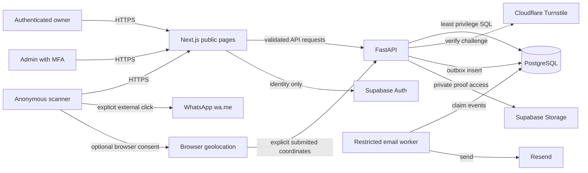

# SafeReturn — Security & Privacy Specification v1.2

> **Owner-delegated contract review, 2026-10-19:** [BTR-20261019](SafeReturn_13_Blocked_Task_Contract_Review_2026-10-19.md) records reviewed/corrected decisions for all thirteen formerly blocked task cards. Its explicit design approvals amend conflicting proposals for those tasks only; runtime roles, live/destructive authorization and existing acceptance evidence are unchanged. Provider/legal/physical/recovery gates remain explicit. Reserved API IDs are contracts, not implemented endpoints.


**Document ID:** SR-SEC-006 | **Document:** 07 in the 11-document SafeReturn series | **Date:** 12 October 2026  
**Status:** proposed implementation contract; founder, technical, finance, privacy and security sign-off outstanding  
**Inputs:** SafeReturn Documents 01–06 v1.2 and Security & Privacy v1.1. **Target:** `docs/07-security-privacy.md`.

> **How to read:** Part A is the governing v1.2 security and privacy amendment. Part B is the complete provided v1.1 specification preserved verbatim as a reference for *unaffected* controls, threat IDs, procedures, and tests. Any v1.1 references to fixed one-size stickers, one pair per order, unconditional CAPTCHA, direct public file access, or screenshot-triggered fulfillment are superseded. Where both parts apply, enforce the stricter compatible rule. Do not treat this design as evidence of controls being deployed or tested. Product rules and approved ADRs prevail; conflicts must be documented, never silently inferred.

# PART A — AUTHORITATIVE v1.2 SECURITY & PRIVACY CONTRACT

## A1. Security objectives, scope and hard invariants

1. **One user, many pairs:** Every `tag_pairs` row has one authoritative owner; no one-pair-per-account uniqueness. Each pair comprises one current `lost` and one current `ice` identity plus one separate activation credential. Historical revoked tokens are retained only in authorized history.
2. **Independent profiles:** Each QR identity maps to its own purpose-specific editable profile; changing School Bag Lost QR must not change House Keys Lost QR, or one ICE profile another. Publicly visible fields must be explicit allowlists.
3. **Copies ≠ identities:** Three Lost and two ICE physical copies may carry only two URLs/QR identities in one pair. Identical physical copies share the same profile and revocation state; customer UI must disclose this before checkout.
4. **Physical products ≠ QR ownership:** Stickers, keychains and badges are catalog items; ownership belongs to `tag_pairs`, not `products`, `order_items` or `print_artifacts`. Future products may use an *existing owned QR* only with authorization, or receive a new complete paired identity. Future-product paths are feature-gated until reviewed.
5. **Public token ≠ activation privilege:** QR scan may initiate a login flow, but no public token, QR image, copied URL, Pair ID or preserved browser state by itself claims a pair. The server must verify an entitled buyer or concealed credential under an approved recovery policy.
6. **Public emergency availability:** Anonymous Lost/ICE scan stays available without sign-in. No full ICE phone in initial HTML, server-rendered payload, hydration state, metadata, logs or public JSON. Protected deliberate reveal and approved risk-adaptive fallback remain required.
7. **Payment ≠ proof upload:** Uploading a screenshot, entering a sender account, submitting a bank reference, receiving a webhook without verification, or updating Google Sheets is not a confirmed settlement. Only approved finance decision or authenticated, validated payment-provider settlement event can advance payment to verified.
8. **Private files stay private:** Supabase **private** Storage holds payment evidence and compact print PDFs; Cloudinary is restricted to **public marketing/product assets**, not QR production files, payment proofs, activation credentials or medical details. Private access must be scoped and short-lived.
9. **No storage as source of truth:** PostgreSQL is authoritative for ownership, orders, settlement, reservation, print/QA, shipping, artifact lifecycle and audits. Google Sheets is a minimized, eventually consistent finance reporting mirror.
10. **No customer/admin side-door writes:** All business mutations pass through FastAPI policy checks and transactions. Supabase Auth verifies identity; API verifies object ownership and staff roles, and restrictive DB privileges/RLS provide defense in depth.
11. **Prints are security objects:** A printable PDF can reveal live tokens and potentially concealed activation credentials. Print generation, downloads, reprints, QA, packing and deletion therefore need stricter authorization, audit and custody controls.
12. **Evidence-based releases:** Critical/High cross-account access, QR claim, payment approval, public-phone disclosure, file-download and role-separation defects are launch blockers even if happy-path tests pass.

### A1.1 Scope boundaries

Launch P0: QR sticker kit, multiple sticker sizes/copies, independent Lost/ICE settings, manual Raast/bank payment review, private proofs, printable order PDFs, admin fulfillment and optional finance Google Sheets sync. Catalog scaffolding for future physical products may ship hidden; badge/keychain purchase or reusing an existing QR on a new product must remain behind explicit server flags, contracts and new-product QA. Future verified payment gateway is an *interface extension*, not automatic approval of unverified data.

### A1.2 Source-to-rule precedence

| Source | Binding security interpretation |
|---|---|
| PRD 01 v1.2 (including FR-201–FR-211 extension) | paired ownership, copy semantics, future-product limits and account UX |
| TDD 02 v1.2 | backend trust boundaries, provider adapters, durable jobs and compact PDF pipeline |
| DB 03 v1.2 | `tag_pairs`, `qr_codes`, separate profiles, snapshot lines, reservations, payment attempts/evidence, print artifacts, RLS and migrations |
| API 04 v1.2 | v1.1 endpoints as amended; additive API-200+ paths, authorization, errors and idempotency |
| Agent 05 v1.2 | review gates, secret hygiene, bounded execution, actual test evidence |
| Plan 06 v1.2 | P0/P1 gates, security sign-off, phase-zero ADRs and acceptance ownership |
| Original security 07 v1.1 | all unchanged ICE, WhatsApp, location, outbox, retention, threat and incident controls |

## A2. Data classification, flows and threat boundaries

| Data / artifact | Sensitivity | Where stored | Allowed access / disclosure |
|---|---|---|---|
| Public catalog names/prices/photos | Public (but integrity-sensitive) | PostgreSQL + Cloudinary public images | Anonymous READ if published; catalog admin WRITE |
| Pair reference / visible QR token | Public but abuse-sensitive | Restricted PostgreSQL; physical labels | Public scan only; avoid full tokens in logs/analytics |
| Activation credential/verifier | Secret | Verifier in restricted DB, concealed production workflow | Authorized activation checks only; never public or logged |
| Customer address, phone, delivery contacts | Personal | Restricted PostgreSQL/encrypted where designed | Owner, limited fulfillment roles; no third-party mirror by default |
| Lost QR profile publication | Selectively public | PostgreSQL | Owner edits; public allowlisted fields only |
| ICE contacts, medical notes | Highly sensitive | Encrypted restricted profile/contact tables | Owner edits; public only explicit published subset; full phone only protected reveal |
| Finder message and optional coordinates | Personal / potentially sensitive | PostgreSQL protected/encrypted | Correct current owner and limited support; consent, expiry apply |
| Sender account, account holder, transaction ID | Financial personal | Restricted payment tables | Payment owner and finance; masked on Sheets/other staff views |
| Payment screenshot/proof | Sensitive financial evidence | Private Supabase Storage | Short-lived approved owner/finance access, never public |
| Print PDF / manifest / cut sheet | Confidential operational object | Private Supabase Storage | Ops/print staff per approved job; never browser-public |
| Concealed activation insert artwork | Secret if render includes raw credential | Isolated restricted print handling | Dedicated privileged one-time print custody; **never** general Ready to Ship PDF |
| Audit/security metadata | Restricted | Append-only/audit DB | Authorized review only; no plaintext secret/payload |
| Finance Google Sheet | Minimized restricted financial metadata | Controlled Google workspace | Finance-only sharing; masked IDs and no attachment URL bypass |

**Threat boundaries:** anonymous browser → public web → FastAPI → database; authenticated customer → API/authorized objects; admin browser → API/MFA/role checks; workers → restricted DB/storage/email/Sheets; Cloudinary public delivery → public product assets only; print shop/carrier → physical labels with no private care information. Treat upstream payment-provider callbacks as **untrusted until authenticated and independently reconciled**.

## A3. Updated threat register and mitigations

The original `TH-001`–`TH-030` register in Part B remains open and applicable. Add the following v1.2 scenarios and link each to a blocking test. Ratings are provisional pending an actual threat workshop.

| Threat ID | Abuse scenario | Severity | Mitigation / test evidence |
|---|---|---|---|
| TH-031 | QR photographed before purchase is claimed by attacker | Critical | Activation verifies order entitlement or concealed secret independently of token; race and hostile-account tests |
| TH-032 | Scan context swapped, tampered, or open-redirected across login | High | Opaque short-lived signed/server-backed intent; server lookup; strict same-origin return allowlist; expiry; one-time consume |
| TH-033 | User modifies a sibling/other owner's Lost or ICE profile | Critical | Join `qr_codes → tag_pairs.owner_user_id` on every mutate/read; negative IDOR tests |
| TH-034 | Copies mistakenly become independently owned QR rows | High | Pair/copy invariants, unique current tags, DB and PDF content assertions |
| TH-035 | New keychain order references another account's existing QR | Critical | Checkout authorization at quote, confirm, final allocation, and print job; TOCTOU tests |
| TH-036 | Anonymous caller enumerates a user's QR identities | High | Authenticated `/me/qr`, pagination and owner scoping; no ownership metadata in public token response |
| TH-037 | Malicious admin changes product pricing/QR usage after purchase | High | Snapshot immutable order lines, versioned prices, audit, independent server totals |
| TH-038 | Concurrent orders double-reserve one pair | Critical | DB row locks/exclusion+unique active allocation; lease/reconcile rules; parallel tests |
| TH-039 | Expired reservation is released despite pending transfer | High | payment-aware hold, reconciliation, explicit timeout policy, conflict tests |
| TH-040 | Forged screenshot triggers paid status | Critical | finance bank reconciliation, role separation, audit; screenshot-only must never advance to verified |
| TH-041 | Forged/replayed webhook approves unpaid order | Critical | signature/timestamp/body checks, provider event uniqueness, account/amount/currency check, idempotency, replay tests |
| TH-042 | Payment adapter silently changes order/fulfillment directly | Critical | normalized settlement domain service; explicit authorized state transition; contract tests |
| TH-043 | Supabase signed URL, print job ID, or storage object key leaks PDF | Critical | randomized keys, private buckets, short-lived scoped grants; auth boundary tests and log scanning |
| TH-044 | Production PDF includes visible activation credential or sensitive ICE | Critical | secrets split into separate controlled activation insert; artwork review, negative content tests |
| TH-045 | Incorrect logo sizing/quiet zone creates unreadable QR | High | ECC validation and printed-size scan QA across real devices/materials |
| TH-046 | Cloudinary upload exposes private payment or print artifact | Critical | provider media-type/path allowlist, asset scanner, outbound data checks |
| TH-047 | Google Sheets contains full bank data, proof or owner medical info | High | field allowlist, mask, access audit, export and sharing review; mirrored-row inspection |
| TH-048 | Delayed Sheets sync overwrites confirmed payment with stale status | Medium | versioned ordering, idempotent upsert; DB always authoritative |
| TH-049 | Admin deletes proof/PDF before required review or reprint | High | policy-based retention guards, holds, two-step authorized deletes and tombstone audit |
| TH-050 | A child badge exposes identifiable child location or guardian contacts | Critical | future feature gate, guardian consent review, minimal public display, protected contact pathways |
| TH-051 | Bulk malicious catalog edit inserts tracking links or external redirects | High | allowed Cloudinary domains/public IDs, output encoding, sanitization and moderation |
| TH-052 | Admin shared login or MFA bypass allows financial/print compromise | Critical | staff provisioning, MFA, least privilege and separate duties; privileged auth tests |

## A4. Identity, authorization and multi-QR isolation

### A4.1 Principal authentication

- Continue **Supabase Auth** for account identities. Verify JWT issuer, audience, signature, expiry and appropriate token type server-side. Do not trust caller-supplied `owner_user_id`, staff role or custom claims alone.
- Account email verification remains required for pair claim and other sensitive changes under the approved UX decision. Sessions use approved CSRF strategy, secure cookies where applicable, short access-token lifetime, and explicit logout/session invalidation strategy.
- Enforce **MFA** for finance approval, activation-credential recovery, privileged print credentials, security administration and destructive retention overrides. Agent access is never equivalent to production admin approval.

### A4.2 Owner checks

For any `/me/qr/{qr_id}`, Lost/ICE edit, existing-QR reuse, purchase entitlement, notification access or pair management, use a shared server-side policy:

```text
principal = require_authenticated_user()
qr = load_current_or_allowed_historical_qr(qr_id)
pair = load_pair(qr.pair_id)
require(pair.owner_user_id == principal.user_id)
require(qr.is_current and pair.lifecycle permits requested action)
require(requested profile kind == qr.tag_type)
require(operation is allowed by account verification, consent and status)
# Authorization must be rechecked in the write transaction.
```

Never authorize by `product_id`, purchased variant, guessable order ID or a publicly scanned URL. An owner may own many pairs but may edit **only the requested QR**. Support profiles through identity keys with purpose-specific publication policies, not shared writable user-level defaults. Do not allow public Lost/ICE profile mutation.

### A4.3 New pair versus reuse of owned QR

- **New pair:** create/allocate one complete eligible pair (current Lost+ICE); owner gains separate editable profiles and two permanent public tokens after authorized activation.
- **Existing QR:** validate present ownership and QR status at quote AND in final order/print transaction; keep same token and current profile for every additional physical copy.
- **Owner transfer/replacement:** revoke/adjust existing authorization as required; pending orders and authorized reprints must recheck current permissions. Preserve non-secret history; never use a cancelled/revoked QR as active artwork.
- Any future permission to order products for another person's QR requires a separate delegated authorization ADR—not an implicit exception based on knowing the URL.

### A4.4 Staff role matrix

| Capability | Catalog admin | Finance/MFA | Inventory ops | Print/fulfillment | Security/superadmin |
|---|---|---|---|---|---|
| Publish products, images and variants | Yes | No | No | No | Break-glass only |
| View private sender bank details | No | Need-to-know | No | No | Audited incident-only |
| Review and verify a payment | No | Yes, verified settlement | No | No | Exception with independent review |
| Generate and QA QR batches | No | No | Scoped | Scoped QA where assigned | Audit-only |
| Grant private print download | No | No | Scoped | Scoped to assigned job | Emergency audited access |
| Reveal private ICE notes | No | No | No | No | Narrow approved break-glass only |
| Place/clear retention hold | No | Limited documented request | No | No | Approved security/privacy role |
| Configure integration secrets/production migrations | No | No | No | No | Change-controlled technical operator |

The same person may wear multiple roles in a pilot, but **record compensating approval/review**; do not falsely claim independent finance verification. Every role is enforced by the API; hiding buttons is not a control.

## A5. Scan-led activation and QR URL security

### A5.1 Scan before activation

`GET /public/qr/{token}` (existing API-010, amended) and proposed API-207 may return generic activation availability and purpose, not full pair ownership, hidden profile contents, credential verifiers or order/customer identity. Avoid distinguishable responses allowing token enumeration. QR URLs stay on the **verified canonical domain**, under HTTPS, with high-entropy unguessable tokens and QR art with a centered brand mark that is **not** a cryptographic authenticity signal.

### A5.2 Preserve intent safely without rescanning

The browser may preserve the public token/opaque intent across sign-in, but the secure activation decision must be made from server-validated data. Suggested implementation: use a random, short-TTL, one-time server-backed `activation_intent_id` tied to token digest and initiation time, rotate session identifiers on login, and bind consumed intent to the authenticated user. Never store a raw concealed activation code in localStorage, URL query string, analytics, crash reports or logs. Redirect only to a fixed internal allowlisted path (e.g. activation confirmation). Expired/stale intent requires an explicit recovery action, never unauthorized auto-claim.

### A5.3 Activation authority

A logged-in buyer can activate if the backend proves completed authorized allocation to that buyer and required account verification; an alternative concealed activation credential may serve approved gift/offline claim cases. A QR token alone does not prove the buyer is the owner. Atomic transaction must verify pair state, both current children, relevant entitlement/credential, replay limits and idempotency, then assign owner and activate **both**. Another person's concurrent attempt must fail without split ownership. Activation responses redact credentials.

### A5.4 Printed QR brand and safety

Use Segno or reviewed QR generator, controlled ECC (original M/Q baseline; stronger setting only if physical tests require), four-module white quiet zone, and logo with limited central occlusion. Indoor minimum 30×30 mm and outdoor 35×35 mm inclusive of quiet zone remain P0 physical acceptance constraints from original documents; selling small sizes below tested minima is blocked, not silently permitted. Printed QR content is a public landing URL only, not medical data or secret. Inspect measured real prints under varying camera/lighting/material conditions.

## A6. Independent Lost/ICE profiles and privacy

### A6.1 Lost QR

Editable Lost profile may include item name, safe public description, owner-approved message channel and optionally WhatsApp **off by default**. Public scan must not reveal owner login email, private postal address, order history, inventory data, raw sender identity or unapproved contact details. Finder messages use Turnstile/abuse protection and durable message+outbox transaction, with one-time optional location consent. Notifications retry without duplicate customer-visible records.

### A6.2 Emergency QR

ICE detail fields are separately editable per QR and may contain personal medical information. The full ICE phone is absent from initial SSR/RSC/hydration/metadata/API JSON and logs. Reveal requires protected explicit action, membership and publication validation, rate limits/challenge or approved risk-adaptive fallback. No service outage should silently result in mass public disclosure. Any change in emergency consent or contact status must invalidate stale caches and grants. Never promise emergency responders that the information has been medically verified.

### A6.3 Child and elderly badge planning

Future products may be marketed to guardians/elderly users but do **not** automatically allow public personal identity, age, school, home address, precise geolocation, guardians' numbers or diagnoses. Guardian authority, explicit consent, protective display limits, response availability, and child-specific legal/privacy review are P1 prerequisites. No new badge route goes live by merely publishing a catalog variant.

## A7. Checkout, product catalog, snapshots and inventory

- Public `GET /public/catalog/...` returns only **published** products/active variants and approved Cloudinary image URLs/public IDs; no cost price, drafts, unpublished future items or storage paths. Admin catalog mutations are authenticated, audited and validated against type/size/material/template allowlists.
- Prices are backend-sourced `numeric(12,2)`/decimal strings with currency, taxes, shipping and promotions calculated server-side. Quote has TTL, owner binding, pricing/version hash and expiration; do not accept client-calculated totals as authoritative. Order line snapshots are immutable after order confirmation and include `product_id`, product name, variant ID, SKU, size/material, unit price, quantity and QR copy selections.
- Print-selection records bind each physical copy count to an eligible QR identity and tag type. **One pair plus five labels** does not allocate five pairs; copy count must not create `qr_codes` rows. Quantity and size limits prevent storage/CPU and print abuse.
- Inventory is allocated only under DB transactions with eligibility checks and pair-level locks; enforce at-most-one active allocation. Prepayment `reserved` is a temporary exclusive hold; suspicious, cancelled and unpaid reservations expire only through approved reconciliation that cannot lose a pending bank transfer. A customer never obtains an unrelated reserved pair's token or credentials during checkout.
- Catalog images must be rendered safely: constrain Cloudinary asset type, avoid user-controlled arbitrary external URLs, strip metadata where appropriate, scan uploaded media and prevent XSS/content injection in descriptions.

## A8. Payment security: manual today, payment gateway later

### A8.1 Provider-independent trust interface

`payment_attempts` is the normalized source of payment state. The manual-bank adapter collects minimum sender details/proof and requires human settlement verification; a future gateway adapter validates provider webhooks and reconciles actual settlement. Neither adapter may directly write `paid`/`ready_to_ship` without calling the same authorized domain settlement transition. Separate `payment_submitted`, `under_review`, `verified`, `rejected`, `refunded` and operational order/fulfillment states according to the exact approved DB/API contract; do not casually reuse one status for both.

### A8.2 Manual bank review

- Collect account-holder name, relevant masked sender account/bank details, payment reference and optional screenshot through validated API fields. Avoid requiring more digits/details than necessary and mask at rest where possible; encrypt sensitive values consistent with DB policy.
- Verify credit **through an independently trusted bank channel**, matching amount, beneficiary, time/currency and unique transaction reference; screenshot alone never proves payment. Record reviewer, rationale, timestamp, bank evidence reference and idempotency key. Re-review or disputed cases cannot silently be approved twice.
- Finance staff only see permitted fields. No sender account or screenshot is included in transactional emails, raw application logs, product analytics, public order pages or Google Sheets beyond approved masked representation.

### A8.3 Gateway rollout controls

Future `POST /payments/webhooks/{provider_key}` (API-214, disabled until approved) must verify raw-body signature/secret, timestamp skew, source/account binding, event ID replay, amount/currency/order correlation, provider environment (test vs live), and settlement status. Do not use browser redirect success, client JavaScript status, provider “payment initiated” or a screenshot as a verified event. Replay and out-of-order notifications must be idempotent, and a refund/chargeback triggers a reviewed downstream entitlement/fulfillment policy rather than retroactively deleting order history. Provider secrets remain server-only, rotational and never embedded in code or Sheets.

### A8.4 Payment ownership and duplicate-charge prevention

Payment attempts belong to the authorized order owner and one order; verify account at attempt creation, evidence upload, read and review. Use idempotency keys for creation/confirmation and durable provider event uniqueness for webhook processing. Refund, manual corrections and negative balances require separate approvals and audit.

## A9. Supabase private Storage and Cloudinary public media

### A9.1 Private buckets and object paths

Use distinct private buckets (illustrative names: `payment-evidence`, `production-print-files`, `activation-inserts` only if specifically approved). Bucket privacy must be validated in staging and production. Keep storage object path randomized and opaque; no email, name, bank details, public token, QR secret or order address in path/filename. DB records map each object to `payment_attempt_id`, `print_job_id`, actor, policy classification, hash, version, expiry, retention hold and deletion status. Browser never receives Supabase service-role keys. All access flows through FastAPI or a scoped short-lived signed grant issued only after authorization.

### A9.2 Upload evidence safely

Allowlist image types and signatures (not filename extension), enforce size/pixel/decompression limits, sanitize/strip unnecessary metadata, apply malware screening supported by deployment, and reject SVG/HTML/active content for evidence. Use expiring one-time upload tokens and server-side confirmation that object owner, attempt, size and hash match; disallow arbitrary path selection and overwrite. Restrict content disposition on retrieval to avoid inline script execution; set `Cache-Control: no-store` for sensitive paths.

### A9.3 Compact print PDFs

Generate small PDF assets using vector QR modules, shared fonts/assets, precise mm sizing, grouped Lost-first then ICE sections, per-size cut gutters and no unnecessary rasterized full-page screenshots. Store only the final approved print artifact or controlled minimal intermediates; apply maximum page/object/file limits. Validate payloads, barcode count and print dimensions before marking a job `ready`. Store a cryptographic hash, QR/tag manifest and generator version for audits; retain non-secret print metadata permanently according to approved record policy after binary deletion.

**Activation credential segregation:** Concealed activation inserts must not be casually merged into the general QR sticker PDF or exposed by general operations. If printing requires plaintext secrets, use a purpose-specific privileged one-time export and secure custody/destruction; ideally keep only a verifier in DB and avoid permanent plaintext storage. Do not include ICE medical fields, owner account emails, sender bank info or public access to invoices inside print PDFs.

### A9.4 Private download and reprint

API-236 generates a short-lived signed download grant only after current role, job assignment, payment/QA state and non-expired retention checks. Reauthorize on each grant (not merely at initial admin login), record actor, order/job/artifact, purpose, time and grant TTL; do not put signed URL in durable logs, referrers or Sheets. Where supported, enforce one-time application-level grants and prevent browser caching. Reprint requires a documented reason, approval per role, new print job version and current QR ownership/state check; do not reuse old artifact if its tokens are revoked or publication policy has changed.

### A9.5 Cloudinary

Cloudinary receives only publishable product imagery, approved marketing graphics and brand assets. Use a scoped server-held upload credential or reviewed signed widget configuration, public-ID allowlists, output encoding, resource-type restrictions and deletion workflows. No medical info, QR production PDF, private evidence, activation secret or bank data can be sent there. Treat publishing/archiving an image as a catalog/audit event.

## A10. Google Sheets finance mirror

- Supabase PostgreSQL remains authoritative for all payment and order states. The Sheet holds an *allowlisted* finance view: order reference, **masked** sender detail as justified, expected/verified amount, currency, normalized status, bank/reference suffix, reconciliation timestamp and admin identifier/role. Do not export raw screenshots, signed proof download links, patient/ICE data, home addresses or secret QR tokens.
- Server-side service account OAuth/scope should use least-privilege access to one controlled workbook; do not make it publicly link-accessible. A separate restricted worksheet or partial masking is not sufficient if editors can export the whole file; review actual share permissions and data minimization.
- A durable job/outbox `finance_sheet_sync` performs idempotent row upsert by stable internal order/attempt key, respects DB version ordering and retries with backoff. Google Sheets edits are **never** imported as payment approvals or order state changes.
- If sync fails, verified payment and fulfillment proceed from DB truth; a restricted admin sync backlog/alert allows reconciliation. Record success/failure without account values in logs.
- When policy requires deletion/correction of sensitive data, propagate corrections to the mirror and investigate offline exports/backups; do not promise instantaneous full deletion of third-party copies.

## A11. Audit logs, incident signals and privacy-preserving observability

Mandatory audited events: pair batch generation/QA/reissue, scan activation intent issuance/consume, pair activation/transfer/replacement, QR profile changes/publication/consent updates, reuse of owned QR at checkout, price/catalog edits, reservation/claim/release, bank verification/rejection/refund, webhook acceptance/rejection, private evidence upload/read/delete, PDF generation/grant/download/reprint/QA, shipment/delivery, retention hold/deletion, Sheets integration configuration/retry and admin role changes. Each event includes actor, authorized role, object ID, timestamp, request/correlation ID, state before/after (non-sensitive), idempotency reference and outcome; avoid raw token, credential, exact phone, bank identifiers, medical notes, finder text and precise location.

Set alerts for unusual activation claims, rapid public token misses, ICE reveal scraping, double-allocation conflicts, payment proof abuse, unauthorized download grant attempts, bulk admin export, new cloud image asset types, repeated webhook signature failure, stuck cleanup jobs and Sheets drift. Provide an operator runbook and independent incident severity assessment. No claim of alerts “implemented” without monitored evidence.

## A12. Retention, deletion, backups and legal holds

The retention schedule is a **proposal** pending privacy/legal/finance/founder review. The v1.1 proposal (e.g. finder message/location cap up to 180 days) is not pre-approved merely because it appears in the archive.

| Asset | Trigger | Proposed retention rule | Required durable record |
|---|---|---|---|
| Payment screenshot | Verified/rejected + dispute window | Keep for a short approved dispute/chargeback window; do **not** delete immediately merely on review | Payment attempt, verification metadata, reviewer and audit; no raw image after purge |
| Generated print PDF | Delivery confirmed + reprint grace | Delete after a proposed 7-day grace unless hold/exception; exact interval to be approved | Order/line/QR copy count, sizes, hash, print QA/version and deletion audit |
| Concealed credential print export | Secure production handoff | Delete immediately after authorized use and receipt confirmation under dual control; no plaintext archive | Non-secret credential issue/version and custody event |
| Finder messages/location | Collection + approved policy | Limit, access controls, erase location promptly; v1.1 proposed <=180 days subject to review | Minimal privacy-safe audit metadata |
| ICE notes / opt-in WhatsApp | Unpublication or account erasure request | Remove from public use immediately; erase retained secrets per lawful policy and backup expiry | Non-sensitive consent/history evidence |
| Orders, payments, allocation, print specifications | Order lifecycle | Preserve minimum lawful commercial/accounting trace; restrict sensitive fields and define deletion exceptions | Snapshot order lines, pair IDs, amount/status, print quantities and audit |
| Sheets finance row | Correction, privacy request, retention expiry | Mirror approved changes/deletion; monitor shared copies | Sync event, action, outcome |
| Backups | Backup rolling retention | Document backup expiry and restore constraints; deletion is not instant from backups | Backup policy and restoration tombstone handling |

### A12.1 Deletion engine and race safety

Use a durable scheduled cleanup job (at an operationally approved cadence) selecting only objects whose retention deadline has passed, whose payment/delivery/QA workflows are complete, and with no legal/dispute/support hold. In a transaction atomically reserve the cleanup task, mark `deleting`, call scoped provider deletion idempotently, verify absent, then mark `deleted` with actor/time/provider response identifier; retry failures and reconcile orphans. **Never delete sole evidence while a payment dispute is pending; never delete a print file before dispatch/authorized reprint window.** Admin deletion buttons request a policy-checked action; they do not bypass holds. Database history persists without reexposing binary secrets. Coordinate backup and Google Sheets retention statements; no guarantee of total erasure before backup TTL.

## A13. Attack-resilient failure behavior

| Failure | Required behavior |
|---|---|
| Supabase Auth outage | Existing public Lost/ICE reads remain available where architecture permits; deny privileged claims/changes safely |
| Supabase Storage outage | Payment proof upload or PDF access reports retryable state; **never** grant public bucket fallback or mark payment verified |
| Cloudinary outage | Public catalog may show trusted fallback image; purchase/ownership not dependent on product photo service |
| Google Sheets outage | Persist DB payment/fulfillment transitions and retry finance sync; show restricted operator backlog |
| Payment provider webhook unavailable | Bank/manual review path remains separated; retry settlement reconciliation, never trust checkout redirect |
| Print worker crashes | Durable job state, deduped retries, temporary file cleanup; no double manufacturing or shipment by duplicate worker completion |
| Expired reservation with unresolved payment | Hold/reconcile under approved policy; do not silently sell the same pair twice |
| Turnstile unavailable during ICE contact reveal | Apply **approved** risk-adaptive protected fallback; no automatic CAPTCHA-free bulk disclose; decision remains pending |
| Deletion API temporarily fails | Retain metadata, retry, alert and show pending deletion; do not claim bytes already deleted |
| Staff compromised account | Revoke sessions, suspend grants, contain storage access, freeze finance/print actions and audit all recent transitions |

## A14. V1.2 API and storage control mapping

| Surface | Principal | Sensitive verification |
|---|---|---|
| API-010, API-207 public QR scan/context | Anonymous | Unpredictable token lookup; minimal fields; rate limits; never confers ownership |
| API-030/031, API-205/206 owner collections | Customer | Pair/QR owner scoping; no cross-account enumeration |
| API-032, API-208 activation | Customer | Email verification, independent entitlement/credential, short-lived intent, atomic pair claim |
| Existing API-040–049 QR profile | Customer | Tag-type and owner match; consent/publication restrictions |
| API-203/204 checkout | Customer | Quote binding/TTL, server pricing, owned QR reuse, inventory transaction |
| API-209–212 payment attempts/evidence | Customer | Correct order owner, MIME/size/metadata verification, private upload grant |
| API-214 gateway webhook | Payment provider callback | Authenticated raw-body verification, settlement state, replay protection; P1 feature gate |
| API-220–229 catalog admin | Catalog staff | MFA where policy requires; publish controls, image validation, audit |
| API-230, API-090 inventory/batches | Ops staff | Restricted pair generation and QA; stock locks/traceability |
| API-232–237 print/ready-to-ship | Print/fulfillment staff | Settled order, authorized current pair, private PDF grant, QA, reprint audit |
| API-238/239 Sheets sync | Finance | Minimized row data, retry audit; no approval from Sheet |
| API-240/241 finance review | Finance + MFA | Independent settlement proof, role restrictions, idempotency |
| API-242–244 artifact/retention | Ops/security | Metadata only by role, deletion holds, no bypass |

The IDs in this table derive from **Document 04 Part A**. Retain the underlying v1.1 endpoint ID mappings and avoid introducing alternate payment/QR generation endpoints. Generated FastAPI OpenAPI must undergo drift checks against the agreed registry before release.

## A15. Security tests and launch-stop criteria

Tests are specifications, **not recorded executions**. Use real PostgreSQL for isolation/concurrency and private bucket rules; stub/mock integrations in CI and conduct staged vendor validation with synthetic data and approved accounts. The original `ST-*` tests in Part B remain required. Add:

| Test ID | Scenario | Expected |
|---|---|---|
| ST-201 | Two customers access different owned pairs | Only own pair/QR profiles accessible; cross-account 403/404 with no leak |
| ST-202 | Same customer edits Lost A, ICE A, Lost B | Only targeted profile updated; no sibling or pair-wide content overwrite |
| ST-203 | Buyer orders three Lost, two ICE copies | One pair allocated; PDF has exactly five correct tags and sizes |
| ST-204 | Unauthorized buyer scans unactivated public URL | Login continuity works; unauthorized activation rejected without leaking owner |
| ST-205 | Tamper activation return path/session/intent | Rejected; no open redirect or hijacked claim; one-time intent consumed |
| ST-206 | Two simultaneous claims for one pair | Exactly one authorized atomic pair owner or safe retry; no split children |
| ST-207 | Existing QR reuse from other owner | Quote and checkout blocked; no print job created |
| ST-208 | Rename product/change catalog price after order | Snapshot history unchanged; subsequent orders use new correct price |
| ST-209 | Concurrent allocation plus pending manual transfer | No double reservation/sale; no automatic premature release |
| ST-210 | Fake evidence screenshot, no bank deposit | Stays unverified; no PDF ready-to-ship transition |
| ST-211 | Forged/replayed/out-of-order gateway webhook | Reject or idempotently ignore; no duplicate payment/fulfillment |
| ST-212 | Customer requests another order's payment proof | Access denied; storage provider URL never leaked |
| ST-213 | Unprivileged role guesses `print_artifact_id` | No signed download grant or object content returned |
| ST-214 | PDF logo, dimensions and ECC physically printed | All supported sizes pass device/material scan QA; invalid sizes blocked |
| ST-215 | PDF contents examined for secret/PII | No plaintext activation credential, ICE notes, bank data or delivery PII outside approved manifest |
| ST-216 | Cloudinary catalog media injection | Private files rejected; safe allowed formats/domains only |
| ST-217 | Sheets export/permission audit | Only authorized masked fields; no evidence URLs or medical data |
| ST-218 | Sheets unavailable after finance verify | DB verified once; retry eventually syncs, no state regression |
| ST-219 | Delete print artifact too early / active hold | Denied; post-grace authorized purge keeps order/QR/copy audit |
| ST-220 | Delete payment proof after approved window | File removed with deletion evidence; record retained without image |
| ST-221 | Future child/elderly badge unpublished | Hidden/unpurchasable until privacy, guardian, manufacturing QA and feature gates approved |
| ST-222 | ICE phone leak audit of SSR, hydration, initial JSON | Full phone absent until protected user-initiated reveal |
| ST-223 | Staff MFA, finance versus fulfillment role split | Privilege escalation attempts rejected and logged |
| ST-224 | Backups/restore after object deletion | Tombstones and retention enforcement re-applied; no unapproved resurfacing |
| ST-225 | Reprint after QR revoke or ownership change | Reauth/revalidation and new print version; old artifact not silently reused |

**Blocking criteria:** any Critical or High vulnerability involving ownership, activation, ICE disclosures, bank approval, webhook validation, storage access, activation insert custody, or PII/mirror leakage blocks launch. CI, staging provider tests and physical test evidence must be stored with build commit, test ID, operator and outcome; no green-check claims without actual executed evidence.

## A16. Operational and developer implementation controls

- Follow existing FastAPI modular monolith, SQLAlchemy/Alembic migration rules and Supabase Postgres RLS/grants. Migrations are reviewed, reversible where feasible, run in staging before production, and never auto-run destructively at app startup.
- Treat JSON models with explicit allowlists and `extra=forbid` for privileged writes; use strict object, size and time limits on API inputs and uploads; use prepared statements/ORM parameter binding, never raw interpolation. Rate limit by IP, account and object according to threat context.
- Maintain standard security headers (CSP, HSTS, no-sniff, secure cookie flags), CORS allowlist, CSRF protections appropriate to session strategy, protection against open redirects, SSRF and untrusted external URL fetches.
- Encrypt sensitive columns and precise location with managed keys, record key version, rotate upon suspected compromise and do not put service keys in frontend, Git, `.env.example` values, LLM prompts, test screenshots or logs.
- Use explicit environment-scope service accounts for Supabase Storage, Cloudinary, Sheets, Resend, and future payment providers; do not let one secret access unrelated buckets or provider resources.
- Enforce audit and reviewer gates for any AI-agent change touching authentication, ownership, payments, private file permissions, print creation or deletion; prohibit autonomous live bank review, production delete, key rotation and deploy.
- Document incident response: freeze compromised staff/payment operations, revoke grants/tokens, collect redacted audit evidence, determine scope, notify accountable parties under reviewed legal policy, remediate, verify and complete a post-incident review.

## A17. Open decisions / ADR register (do not silently settle)

| Decision ID | Required approval | Proposed direction / remaining question |
|---|---|---|
| SEC12-01 | Founder + security | Exact activation intent TTL, session binding and off-device/gift claim policy |
| SEC12-02 | Founder + security | ICE reveal adaptive fallback during Turnstile outage (carry original SP-DEC-01) |
| SEC12-03 | Founder + privacy/legal | Payment evidence dispute window; proof deletion and backup expiry |
| SEC12-04 | Founder + fulfillment | Exact post-delivery PDF grace period (7 days proposed, not approved) |
| SEC12-05 | Finance + founder | Bank proof minimum necessary fields, masked Sheet columns and Sheet access roles |
| SEC12-06 | Technical + security | Print worker and activation-insert separation, one-time credential custody design |
| SEC12-07 | Founder + security | New QR pair eligibility for future products; delegated QR-use policy |
| SEC12-08 | Founder + privacy/legal | Guardian consent, child/elderly emergency badge public data, emergency notice |
| SEC12-09 | Technical + founder | Retention holds, cleanup frequency, immutable audit retention and backup expiry |
| SEC12-10 | Finance + technical | Gateway integration sign-off, accepted settlement events and refund/chargeback policy |
| SEC12-11 | Security + product | Admin MFA coverage, operations staff duty separation and compensating controls |
| SEC12-12 | Technical | Exact DB/API naming reconciliation, migration changes and `openapi.json` contract drift process |

No new service capability, retention law, Cloudinary file limit, Supabase billing limit or bank payment capability is claimed verified. Check real provider settings and legal requirements before release.

## A18. Review and sign-off checklist

- [ ] PRD 01–API 04 concepts agree on pair/copy/profile/product/order models.
- [ ] All owner, staff, storage and public routes have a written authorization policy.
- [ ] Unactivated scan cannot claim ownership without independent entitlement.
- [ ] Payment screenshots and Google Sheets cannot mark orders verified.
- [ ] Print PDFs and activation credentials use separate protected handling.
- [ ] Future catalog products and existing-QR reuse are gated until QA/privacy approval.
- [ ] Manual bank verification works without gateway; gateway cannot bypass ledger controls.
- [ ] Data minimization, localization, privacy notices, consent and retention are approved.
- [ ] Original `TH-001`–`TH-030`, original `ST-*` and new `TH-031`–`TH-052` / `ST-201`–`ST-225` have review owners.
- [ ] Real print-size/logo/camera QA, staging storage and finance-sync failure tests exist.
- [ ] All unresolved `SEC12-*` and inherited `SP-DEC-*` items have documented decision/status.
- [ ] Critical/High issues are closed, justified with actual test evidence, before Lahore pilot go-live.

**Handoff:** Next is Document 08 — Test Plan & Acceptance Test Cases v1.2, which must convert these security expectations into executable and manual verifications. **Do not create Document 08 as part of this deliverable.**

---

# PART B — ARCHIVED ORIGINAL SECURITY & PRIVACY SPECIFICATION v1.1 (UNCHANGED REFERENCE)

> The following is the unedited supplied v1.1 text for traceability. It is not a second competing policy. Where the v1.2 Part A overrides a workflow, product rule or implementation contract, follow Part A and approved ADRs; keep unaffected v1.1 security obligations in force.

# SafeReturn — Security & Privacy Specification

**Document:** 6 of the supporting-document series · **Repository target:** `docs/07-security-privacy.md`  
**Version:** 1.1 (proposed, not yet approved) · **Date:** 11 October 2026  
**System:** SafeReturn, Lahore/Pakistan pilot · **Classification:** Internal engineering/security specification  
**Audience:** Founder, developers, Antigravity Pro, Codex Plus, security reviewer, operations

> This document is an implementation and review specification, **not a certification, completed audit, legal opinion, or evidence that controls are deployed**. PRD v1.1 and approved founder decisions take precedence. If an implementation detail conflicts with the Technical Design, Database Design, API Contract, Agent Instructions, or Implementation Plan, open an ADR and obtain approval rather than silently choosing.

**Source alignment**
- PRD v1.1: paired lost/ICE kit; Urdu/English P0; WhatsApp opt-in; optional geolocation; protected ICE reveal; QR physical requirements.
- Document 1 `02-technical-design.md`: FastAPI modular monolith, Next.js, Supabase, outbox worker, Resend, Turnstile, Vercel/Railway.
- Document 2 `03-database-design.md`: `tag_pairs` authoritative ownership, `qr_codes.pair_id`, historical replacements, sensitive child tables, restrictive grants/RLS.
- Document 3 `04-api-contract.md`: `/api/v1` contract, protected reveal, public messages, idempotency, authorization.
- Document 4 `05-agent-instructions.md`: agent boundaries, secure coding, evidence, no unauthorized production operations.
- Document 5 `06-implementation-plan.md`: phase gates, task IDs, launch stop-ship criteria.

**Scope:** threat model, security architecture, identity and access, QR lifecycle, ICE, WhatsApp, finder messaging/location, payment fraud, encryption, consent, retention, provider security, monitoring, incident response, test cases, and release approval. **Full screen inventory and UI navigation routes are intentionally deferred to the final UI/UX document.**

---

## 1. Security objectives and non-negotiable invariants

1. An anonymous QR scanner may read **only intentionally published** information for the specific tag.
2. The **full ICE phone number must not appear** in the initial HTML, Next.js RSC/SSR payload, hydration data, metadata, initial public API JSON, or analytics.
3. A protected contact reveal must validate tag, active status, publication, contact membership, abuse controls, and an approved emergency-availability policy.
4. A public QR token is **not** an authentication token, activation secret, or permission to access an owner account.
5. One pair has exactly one **current** lost and one **current** ICE tag; ownership and activation are pair-level and atomic.
6. Finder submissions remain durable even when Resend fails: finder message + outbox event in one DB transaction.
7. Location permission is explicit, one-time and optional; denial never blocks a finder message.
8. WhatsApp is opt-in and exposes the owner's selected phone number to anyone able to obtain the link. Do not describe it as anonymous.
9. Manual bank/Raast payment is never approved based solely on a screenshot or an AI judgment.
10. A payment reviewer, inventory allocator, and security administrator receive only the minimum permissions necessary.
11. Service-role credentials, JWT secrets, activation secrets, location, medical notes, payment evidence and full phones never appear in browser bundles or ordinary logs.
12. All sensitive state changes are attributable to an actor or verified system principal and are auditable.
13. Printed QR codes remain resolvable on the verified canonical domain; replacing a tag revokes its old token while preserving history.
14. Security controls must be compatible with real emergency usability and bilingual accessibility.

**Release rule:** A Critical or High violation of these invariants blocks production launch and pilot expansion.


## 2. Security governance and accountability

| Role | Responsibilities | Prohibited without additional approval |
|---|---|---|
| Founder/product owner | Approve privacy notices, consent text, emergency fallback, retention, business risk | Cannot waive critical privacy protections silently |
| Technical owner | Architecture, secure configuration, migration reviews, incident coordination | Cannot treat passing unit tests as a security audit |
| Security reviewer | Threat modeling, penetration-test plan, high-risk code review | Cannot approve own unreviewed sensitive code |
| Privacy/legal reviewer | Local law, sensitive health data, children/minors, notice, deletion | Must not be replaced by an AI-generated legal assertion |
| Finance operator | Independently verify bank transfers, approve/reject payment | Cannot bypass independent bank confirmation |
| Fulfillment operator | Print/QA/pack/dispatch and inventory evidence | Cannot reveal activation secrets or alter payment status |
| Support operator | Limited customer support and ticket escalation | No default access to medical notes or precise location |
| AI coding agents | Bounded implementation/testing in local/staging | No production access, live email, bank approval, or data deletion without explicit approval |

### 2.1 Required decisions before launch

| ID | Decision | Proposed approach | Owner |
|---|---|---|---|
| SP-DEC-01 | Turnstile outage for ICE reveal | Risk-adaptive fallback with strict throttling; **not yet approved** | Founder + security |
| SP-DEC-02 | Finder message/location retention | Proposed max 180 days, subject to legal/product review | Founder + privacy |
| SP-DEC-03 | ICE medical-note retention | Retain only while published/necessary; deletion policy and backup expiry | Privacy |
| SP-DEC-04 | WhatsApp consent text | Clear public-number exposure warning in Urdu and English | Founder + privacy |
| SP-DEC-05 | Account and session strategy | Supabase Auth, secure cookie/session model chosen and documented | Technical owner |
| SP-DEC-06 | Admin MFA and break-glass | Mandatory for sensitive roles, reviewed recovery | Founder + security |
| SP-DEC-07 | Encryption/KMS custody | Managed secret store with separate data-encryption key versions | Technical owner |
| SP-DEC-08 | Data subject requests | Verified deletion/export and exceptions workflow | Privacy |
| SP-DEC-09 | Minor/child ICE profiles | Legal review of guardian consent and data minimization | Founder + privacy |
| SP-DEC-10 | Operational recovery objectives | Set RPO/RTO, backup retention, incident escalation contacts | Technical owner |
| SP-DEC-11 | Payment proof retention | Retain only for verified business/legal need | Founder + privacy |
| SP-DEC-12 | Geographic data processing | Review provider regions and cross-border transfers | Privacy/legal |

No recommendation in this table is an approved business or legal decision until signed off.

### 2.2 Control evidence

Maintain an internal register: control ID, requirement, implementation location, test case, evidence link, owner, last verified date, exception/expiry. Exceptions need written risk acceptance and expiration. Critical privacy leaks are not waivable for launch.


## 3. Assets, data classes and trust boundaries

### 3.1 Data classification

| Class | Examples | Exposure | Storage and access |
|---|---|---|---|
| PUBLIC-PUBLISHED | Owner-approved lost item description; chosen ICE display fields | Accessible to anyone holding valid QR URL | Explicit field allowlist, no private joins |
| PUBLIC-OPAQUE | QR public token, published tag mode | Possession of URL enables scan | High entropy; minimize logging and indexing |
| INTERNAL | Pair ID, serial, inventory status, shipping operations | Authorized employees/services only | RBAC and audit |
| PERSONAL | Customer name, email, account phone, shipping address | Customer and need-to-know staff | Least privilege, retention |
| SENSITIVE-CONTACT | ICE full phone, WhatsApp selected phone, emergency contact relationships | Controlled reveal or explicit owner opt-in | Encrypted, limited endpoint, no-store |
| SENSITIVE-HEALTH | Medical notes, allergies, conditions entered by owner | Only if explicitly published to public ICE; otherwise private | Encryption at rest, consent, no analytics |
| SENSITIVE-LOCATION | Finder latitude/longitude, accuracy, consent record | Only authorized recipient owner/limited admin | App-layer encryption, short retention |
| SENSITIVE-FINANCE | Payment proofs, bank reference, transaction review | Finance/admin only | Private storage, short-lived signed access |
| SECRET | Activation credentials, Supabase service role, API keys, JWT secrets, DB passwords, encryption keys | Never public | Hash/verifier or secret manager; rotation |
| SECURITY-EVIDENCE | Audit events, security alerts, login anomalies | Security/admin only | Tamper-evident access, restricted retention |

**Important distinction:** Once an owner publishes medical information or exposes a phone through WhatsApp, the public recipient may copy or redistribute it. Encryption at rest and frontend anti-scraping cannot prevent copying after authorized disclosure. Explain this honestly in consent text.

### 3.2 Trust-boundary diagram



Trust boundaries:
- Internet → frontend/public API: untrusted.
- Frontend → FastAPI: untrusted even if a page is authenticated.
- FastAPI → DB: privileged; authorization must be applied before access.
- Worker → email provider: at-least-once side effects, secrets and deliverability risk.
- Browser → WhatsApp: leaves SafeReturn; third-party privacy rules apply.
- Browser → geolocation: permission belongs to browser/user, not SafeReturn.
- Staff/admin → finance/medical/location: insider and account takeover risk.
- Physical QR/activation insert → purchaser/finder: copy, tamper, swap and theft risks.

### 3.3 Primary adversaries

1. Opportunistic finder attempting to obtain an owner's contact information.
2. Automated scraper enumerating public QR tokens or ICE contact reveal endpoints.
3. Fraudulent claimant trying to activate a kit or take over ownership.
4. Malicious user spamming finder messages or injecting harmful links.
5. Fraudster uploading fabricated bank transfer proof.
6. Compromised customer account changing ICE details or WhatsApp disclosure.
7. Compromised admin/staff account exfiltrating records or approving payments.
8. Insider with database or print-manifest access.
9. Vendor outage or misconfiguration causing data loss or emergency unavailability.
10. AI-assisted code change introducing auth bypass, secret leakage, or data corruption.


## 4. Threat modeling methodology and register

Use STRIDE for design reviews (spoofing, tampering, repudiation, information disclosure, denial of service, elevation of privilege), and add **physical** and **privacy** harms. Prioritize by exploitability × impact × exposure, with emergency and sensitive health/location harm elevated.

| Threat ID | STRIDE / abuse case | Entry point | Impact | Required controls | Test |
|---|---|---|---|---|---|
| TH-001 | QR token guessing/enumeration | Public QR GET | Owner/profile exposure | ≥128-bit CSPRNG tokens, throttling, generic invalid response | ST-QR-01 |
| TH-002 | Activation brute force | Pair activation | Account takeover of pair | Independent secret, keyed verifier, throttling, lockout, audit | ST-ACT-01 |
| TH-003 | Double activation race | Concurrent requests | Two owners / inconsistent tags | Pair row lock, single transaction, idempotency, DB guard | ST-ACT-02 |
| TH-004 | Cross-tenant IDOR | Owner APIs | Private inbox/medical leak | Server ownership check on every object | ST-AUTH-02 |
| TH-005 | ICE phone in initial SSR | Public page | Bulk phone harvesting | Allowlisted DTO, no SSR phone, DOM/network test | ST-ICE-01 |
| TH-006 | ICE reveal scraping | Reveal API | Bulk phone harvesting | Membership check, risk controls, limits, monitoring | ST-ICE-02 |
| TH-007 | Turnstile outage | Reveal API | Emergency access blocked | Approved fallback and degraded-mode runbook | ST-ICE-04 |
| TH-008 | WhatsApp auto-publication | Owner settings | Unconsented phone disclosure | Default off, explicit versioned consent | ST-WA-01 |
| TH-009 | Location collected silently | Finder page | Precise movement/location leak | Explicit action, no automatic request | ST-GEO-01 |
| TH-010 | Location read across owners | Owner inbox | Physical privacy harm | Recipient snapshot, auth, encryption | ST-GEO-03 |
| TH-011 | Finder message lost on email failure | Submission | Failed recovery contact | DB outbox atomicity and retry | ST-MSG-02 |
| TH-012 | Finder XSS/phishing | Message text | Account/session compromise | Length limits, output encoding, link policy | ST-MSG-03 |
| TH-013 | Payment proof fraud | Payment review | Unpaid kit shipment | Independent bank confirmation and audit | ST-PAY-01 |
| TH-014 | Duplicate inventory allocation | Order fulfillment | Lost/double-sold kit | DB uniqueness, row locks, verified payment | ST-PAY-03 |
| TH-015 | Service-role key exposed | Frontend/build logs | Entire DB compromise | Secret scanning, server-only credentials | ST-SEC-01 |
| TH-016 | SQL injection | Public and admin APIs | Data theft/corruption | Parameterized queries, validation | ST-API-04 |
| TH-017 | CSRF/session fixation | Owner/admin web | Unauthorized mutations | Secure session design, CSRF, session rotation | ST-AUTH-04 |
| TH-018 | Storage object enumeration | Payment proof | Finance privacy leak | Private bucket, authorized signed URLs | ST-PAY-04 |
| TH-019 | Printer/packager swaps QR | Physical kit | Finder redirection, credential theft | Manifest reconciliation, QA, tamper evidence | ST-PHY-01 |
| TH-020 | Old tag still resolves after replacement | Public scan | Wrong owner/unsafe data | Revocation state and no-store cache | ST-QR-04 |
| TH-021 | Insider bulk export | Admin/report | Mass data exfiltration | Scoped RBAC, approval, audit, alert | ST-ADM-03 |
| TH-022 | Key compromise | DB/worker | Mass disclosure | KMS/versioned keys, rotation, incident plan | ST-KEY-02 |
| TH-023 | SSRF via external URL | User content/admin tools | Internal network compromise | No arbitrary URL fetching; allowlist | ST-API-05 |
| TH-024 | Webhook spoofing | Provider callback if added | Fake delivery/payment events | Signed webhook verification/replay defense | ST-INT-01 |
| TH-025 | Account transfer leaks old inbox | Ownership transfer | Historical private data leak | Immutable recipient snapshot, transfer tests | ST-AUTH-05 |
| TH-026 | Medical notes auto-published | Profile update | Sensitive health leak | Per-field publication consent and tests | ST-ICE-05 |
| TH-027 | Logs contain tokens/phones | Observability | Silent data exfiltration | Structured redaction, log sampling tests | ST-LOG-01 |
| TH-028 | Malicious dependency/agent command | CI/developer environment | Supply chain compromise | Lockfiles, reviews, least privilege | ST-SUP-01 |
| TH-029 | Backup inaccessible/corrupt | Incident | Data loss | Restore rehearsal, tested RPO/RTO | ST-OPS-02 |
| TH-030 | Rate limit bypass across instances | Public endpoints | Spam/scraping | Shared counters or gateway policy | ST-ABUSE-03 |

### 4.1 Review cadence

- Before implementation of each sensitive domain.
- On any new provider, external API, admin permission, QR encoding or data publication feature.
- Before pilot, after Critical/High incident, and periodically thereafter.
- Record residual risks and owners; do not label mitigations complete without tests.


## 5. Identity, sessions and authentication

### 5.1 Supabase Auth

- Supabase Auth manages identities (`auth.users`); never mutate provider-owned identity tables manually.
- FastAPI validates JWT **signature** using the issuer's supported signing key/JWKS, plus issuer, audience, expiration, not-before if used, and access-token purpose.
- Reject `alg=none`, malformed JWTs, wrong issuer/audience, expired access tokens, and refresh tokens presented as API bearer credentials.
- JWKS rotation should be handled safely; cache with bounded TTL and retry-on-key-rotation without accepting unknown signatures.
- Email verification must be checked for activation/ownership-sensitive flows as required by the API contract.
- Do not trust `user_id`, `role`, `is_admin`, or `owner_id` supplied in JSON, query strings or client-side state.

### 5.2 Browser session strategy — decision required

Preferred approach: follow a maintained Supabase-compatible Next.js SSR auth integration with **secure, HttpOnly, SameSite cookies where the chosen SDK supports this**, explicit server-side verification, and CSRF protections for cookie-authenticated unsafe requests. If the chosen SDK requires browser-accessible tokens, document that tradeoff, minimize token lifetime, avoid localStorage by default, and mitigate XSS aggressively.

- Enforce HTTPS and Secure cookies in production.
- Use appropriate SameSite policy; do not rely on SameSite alone if cross-site flows exist.
- Rotate/refresh sessions according to supported provider semantics.
- Revoke sessions on suspected compromise and high-risk credential changes where supported.
- Never embed access tokens in URLs, logs, analytics or email.
- Protect logout and password recovery from open redirects.
- Rate-limit authentication attempts at supported provider and application layers.

### 5.3 Admin authentication

- Require MFA for finance, security and superadmin roles.
- Separate staff role assignment from customer self-registration.
- Admin role elevation requires an already-authorized approver and audit record.
- High-risk actions should require recent reauthentication or step-up MFA when feasible.
- No shared admin accounts.
- Emergency break-glass access must be time-limited, monitored, and reviewed after use.


## 6. Authorization model and object ownership

### 6.1 Roles

| Actor | Public scan | Own pairs/inbox | ICE edit | Payment review | Inventory/fulfillment | Security admin |
|---|---|---|---|---|---|---|
| Anonymous finder | Published fields only | No | No | No | No | No |
| Authenticated customer | Published fields | Own only | Own pair only | Submit own proof only | No | No |
| Support | Published fields | Limited ticket-bound view | No default access to sensitive health | No | Limited lookup | No |
| Finance admin | Published fields | Minimal order fields | No | Yes | No allocation unless separately granted | No |
| Fulfillment admin | Published fields | Shipment fields only | No | Read verified status only | Yes | No |
| Security admin | Published fields | Need-to-know audit | Restricted audited emergency access | No default approval | No default allocation | Yes |
| Superadmin | Published fields | Exceptional audited access | Exceptional audited access | Policy-bound | Policy-bound | Exceptional |

### 6.2 Mandatory checks

- All customer pair reads/writes must resolve `tag_pairs.owner_user_id` server-side.
- `qr_codes` are child assets; **do not add independent owner authority** to a tag.
- Public scan must return a **public DTO** not an ORM object.
- ICE reveal must verify the requested contact belongs to the active ICE profile of the exact QR token.
- Finder inbox belongs to `recipient_owner_user_id` captured **when submitted**; pair transfer cannot grant access to past messages.
- Admin access checks require server-issued role/permission, not frontend route protection.
- Prevent privilege stacking by separating finance verification from fulfillment where practical.
- All list endpoints must apply tenant filters **before pagination** and totals.
- Prevent object existence disclosure via differentiated 403/404 responses where appropriate.
- Protect bulk endpoints and exports independently; a secure single-record endpoint does not imply secure bulk export.

### 6.3 RLS, grants and service credentials

Document 2's stance is authoritative:
- Enable RLS on business tables exposed through Supabase/PostgREST.
- Revoke unnecessary direct `anon`/`authenticated` table grants; route business data through FastAPI.
- Prefer least-privilege DB roles for API and worker when feasible.
- `service_role` bypasses RLS: **RLS cannot compensate for missing FastAPI authorization**.
- Test permissions with the **actual roles/credentials** used by staging deployments, not only an administrator connection.
- Deny direct frontend access to private storage and sensitive DB tables.

### 6.4 Example authorization pseudocode

```python
def require_pair_owner(pair, current_user):
    if pair.owner_user_id != current_user.id:
        raise NotFoundError("PAIR_NOT_FOUND")  # avoid enumeration

def require_ice_contact_for_qr(qr, contact):
    if not qr.is_current or qr.tag_type != "ice" or qr.status != "active":
        raise NotFoundError("QR_NOT_FOUND")
    if contact.profile_id != qr.ice_profile_id or not contact.is_published:
        raise NotFoundError("CONTACT_NOT_FOUND")
```

Pseudocode is illustrative; align exact field names with Document 2 before implementation.


## 7. QR token, pair, activation and replacement security

### 7.1 Public QR token

- Generate with a cryptographically secure random generator, **≥128 bits of entropy**.
- Use a URL-safe opaque string; never derive from serial, Pair ID, phone, email, account ID or activation secret.
- Store under unique DB constraint; restrict DB read access.
- Do not use the token as a password or infer owner identity from it.
- Printed URL format follows the verified production canonical domain, e.g. `/q/{token}`; the example domain in Document 3 is not evidence of ownership or deployment.
- Never print unverified domains or third-party shorteners.
- Avoid including token in analytics event properties and third-party error trackers.
- Use `Referrer-Policy: no-referrer` on public QR pages so token-bearing URLs are not sent to external origins; verify links, images, scripts and analytics behavior.
- For revoked/unknown tokens, avoid revealing owner, purchase, activation, or shipment state.

**Reality:** A public QR token printed on a physical item is inherently observable by anyone who sees/scans the item. Entropy prevents guessing other tokens, not sharing or photographing the specific token.

### 7.2 Activation credential

- One independent high-entropy secret per pair, concealed in packaging.
- Store a secure keyed verifier or approved hash; never plaintext.
- Protect verifier key/pepper separately from DB.
- Verify with constant-time comparison where appropriate; rate-limit by pair, user, IP/risk signal.
- Generic error for invalid/used/unknown credentials; avoid oracle differences.
- Activation requires approved entitlement and verified customer state.
- Credential is consumed once, with audit, in the same transaction as both tag activations.
- Do not include credential in public QR URL, finder email, logs, screenshots, analytics, support ticket or API response.

### 7.3 Atomic activation transaction

```text
BEGIN
  Verify authenticated customer + entitlement
  SELECT pair FOR UPDATE
  SELECT credential FOR UPDATE
  SELECT current QR children FOR UPDATE
  Require exactly one current lost and one current ice
  Verify credential and pair state
  Set pair owner + activation state
  Set BOTH child states active
  Consume credential
  Insert audit event
  Insert optional outbox event
COMMIT
```

- All-or-nothing: if any update or audit/outbox insert fails, rollback.
- Use unique current-child index and DB guard from Document 2.
- Use idempotency key and stable conflict response.
- Concurrency test: two users racing for same pair → exactly one wins, no split ownership.
- Do not issue partial activation success to frontend.

### 7.4 Replacement and transfer

- Replacement creates new QR token/serial, sets old `is_current=false`, revokes old URL, and retains history.
- Enforce at most one current child per `(pair_id, tag_type)` via partial unique index.
- Exactly-two current tags for activatable pair must be enforced at transaction boundary.
- Transfer applies to entire pair only, never independent Tag A/B.
- Unpublish prior owner's ICE and WhatsApp fields before new owner becomes effective.
- Revoke old owner dashboard access immediately; historical finder inbox stays with original recipient.
- Audit initiator, reason, prior/new state, and review where required.
- Treat lost activation inserts/print manifests as sensitive physical credentials.

### 7.5 Physical tampering

- Print both QR codes from a reconciled batch manifest.
- QA scans both labels and verifies distinct modes and same Pair ID.
- Inspect concealed credential packaging.
- Maintain batch custody and inventory counts; shred/revoke rejected prints.
- If a QR is overlaid or swapped, report suspected tampering, revoke and replace under audited procedure.


## 8. ICE emergency profile and protected phone reveal

### 8.1 Public publication policy

The owner explicitly selects what is public. Default to the minimum information necessary for emergency usefulness. Keep account profile and ICE publication separate.

- Display name/relationship and owner-published emergency instructions: public if approved.
- Medical notes: publish **only** after clear field-level owner consent and warning; encryption does not make publicly displayed content private.
- Full emergency phone: **not included** in initial public scan response.
- Phone reveal is a separate, explicit interaction and server endpoint.
- Do not publish a contact who has not been appropriately informed/consented where applicable; owner responsibility and legal policy must be defined.
- A child/minor profile needs guardian/age policy before launch.

### 8.2 Initial response allowlist

The public QR API (`GET /api/v1/public/qr/{token}` per Document 3) may return only fields expressly defined in its public ICE DTO.

**Never return:** `phone`, `phone_e164`, `tel_url`, `whatsapp_number`, account phone, encrypted phone, hidden HTML field containing phone, unpublished medical notes, precise location, activation credential, owner email, private record IDs that enable access.

**Test all surfaces:** server-rendered HTML, RSC payload, hydration JSON, `<meta>` tags, DOM, browser network responses, static build artifacts, browser console, error tracking, analytics and cache.

### 8.3 Reveal flow

1. User scans active ICE QR and sees approved public details and contact labels.
2. User explicitly requests one contact's phone.
3. Client calls `POST /api/v1/public/qr/{token}/contact-reveals` with opaque contact ID and challenge token/risk context as defined in Document 3.
4. Server validates active/current ICE QR, published contact membership and status.
5. Apply IP/token/contact/device-risk throttles and anomaly detection.
6. Verify Turnstile server-side when policy requires; do not trust frontend success flags.
7. Return **only** the requested contact's number (and minimal dial action) with `Cache-Control: no-store` and anti-cache headers.
8. Avoid logging the phone or returning other contacts.
9. Record privacy-safe aggregate reveal metrics and abuse events.

### 8.4 Turnstile emergency-availability conflict

**Unresolved founder decision.** PRD v1.1 requires anti-scraping reveal and Turnstile; TDD recommends an adaptive emergency fallback if Turnstile is unavailable. Do not silently remove the challenge or permanently block emergency use.

Proposed risk-adaptive policy:
- Normal risk: low-friction reveal with server-verified challenge if configured.
- Elevated risk: challenge required, tighter limits.
- Provider outage: time-limited fallback with strict per-token/IP quotas, monitoring and incident alert; never expose a bulk endpoint.
- Suspected active scraping: throttle, challenge and temporarily block abusive source, preserving safe access paths where possible.
- Document and test fallback thresholds and expiry; founder approves.

**Limitations:** A bot can still imitate a person and copy a number after reveal. This design raises scraping cost; it does not promise perfect protection.

### 8.5 Emergency content safety

- Clearly state SafeReturn is not an emergency dispatch or medical verification service.
- In a real emergency, advise contacting local emergency services as appropriate; do not rely solely on app availability.
- Avoid medical diagnosis or instructions generated by AI.
- Ensure Urdu/English copy is reviewed by a qualified human.
- Do not gate initial emergency instructions behind a bot challenge, login or paid account.


## 9. WhatsApp consent and external-link security

### 9.1 Owner opt-in

- WhatsApp click-to-chat is **off by default**.
- Separate consent from general account terms and from ICE contact publication.
- Show the exact number that will be exposed; require affirmative action.
- Record consent version, timestamp, user ID, pair ID and chosen number reference.
- Allow immediate disabling/revocation of SafeReturn's link; clarify prior recipients may have saved the number.
- A published `wa.me` URL necessarily reveals the destination number. Hiding it with CSS or an intermediary link is not a reliable privacy guarantee.
- Owner may choose a dedicated number rather than personal phone, if supported by business policy.

### 9.2 Public link issuance

- API must verify current tag state and consent at time of link request.
- `POST /api/v1/public/qr/{token}/whatsapp-link` per Document 3 returns a safe user-initiated link.
- Normalize to E.164 digits without plus sign in `wa.me` path.
- URL-encode prefilled text; keep it generic.
- No activation secret, medical note, precise coordinates, payment data, or owner account email in prefills.
- Do not use untrusted redirect destinations or accept arbitrary URLs from request body.
- Use `rel="noopener noreferrer"` for external links; consider explicit external-app warning.
- Keep SafeReturn's anonymous finder form usable even when WhatsApp is off.

### 9.3 Disclosure example — copy for human review

**English:** “If you enable WhatsApp contact, anyone who scans your tag may see and use this phone number. WhatsApp conversations happen outside SafeReturn and are not saved in your SafeReturn inbox. Turning this off removes the link from SafeReturn but cannot erase numbers already saved by others.”

**Urdu draft (requires native-speaker/legal review):** “اگر آپ واٹس ایپ رابطہ فعال کرتے ہیں تو آپ کا منتخب کردہ فون نمبر ٹیگ اسکین کرنے والے افراد کو نظر آ سکتا ہے۔ واٹس ایپ کی گفتگو SafeReturn کے اندر محفوظ نہیں ہوتی۔ یہ سہولت بند کرنے سے SafeReturn کا لنک ہٹ جائے گا، لیکن دوسروں کے پاس پہلے سے محفوظ نمبر حذف نہیں ہوگا۔”

### 9.4 Testing

- Default off; no `wa.me` link without consent.
- Consent enabled for one pair must not publish another pair's phone automatically.
- Revocation removes new links promptly; cached pages must not preserve stale link.
- No secret/health/location data in prefill.
- External chat not inserted as SafeReturn finder message or email outbox.


## 10. Finder form, messages and anti-abuse

### 10.1 Anonymous submission

- Public finder form must work without an account.
- Validate message length, character encoding, safe contact fields and request size server-side.
- Rate-limit by IP/risk context and QR token, with accessible challenge escalation.
- Avoid returning whether an owner email address exists.
- Normalize and escape text; never render untrusted HTML.
- Do not allow finder to supply `recipient_owner_user_id` or override tag ownership.
- Limit attachments unless explicitly approved (P0 should avoid them).
- Use stable error codes and bilingual user-facing messages.

### 10.2 Durable transaction

```text
BEGIN
  Resolve active/current lost QR and owner
  Validate finder input and optional location consent
  Insert finder message with immutable recipient_owner_user_id
  Insert optional encrypted location child record
  Insert notification_outbox event with stable event key
COMMIT
Return accepted response
```

- The HTTP request must **not** call Resend synchronously as the only delivery path.
- An outbox insert failure must roll back the finder message.
- Provider failure after commit must not lose the message.
- Worker uses bounded retries, leasing and `FOR UPDATE SKIP LOCKED`.
- At-least-once delivery can produce duplicates; never claim exactly-once email delivery.

### 10.3 Spam, phishing and abuse

- Limit repeated messages per tag and source; add abuse reporting.
- Escape and render links safely; avoid auto-linking suspicious URLs in admin email without review.
- No raw finder message in logs.
- Add abuse detection without storing excessive device fingerprints.
- Protect owner from harassment with block/report and throttling controls.
- Do not promise that SafeReturn validates finder identity or message truthfulness.

### 10.4 Message recipient and ownership transfer

Capture recipient owner ID at submission. If a pair transfers later, previous messages remain visible only to original recipient according to retention policy. New owner sees only their own subsequent messages. Test the transition with concurrent submissions.


## 11. Optional finder geolocation and privacy

### 11.1 Consent and collection

- Never call `navigator.geolocation` on page load.
- Show a separate explicit action: “Share my current location (optional)” in English/Urdu.
- Explain purpose: help owner locate item; precise coordinates may reveal where finder is.
- Request browser permission only after the action.
- Collect a single reading per explicit action, not continuous tracking.
- Denied, timed out or unavailable location must leave message submission usable.
- Do not infer location from IP as a silent replacement.
- Do not collect background location, route history or hidden GPS updates.

### 11.2 Validation and encryption

- Validate numeric latitude in [-90,90], longitude in [-180,180], accuracy reasonable/finite, and timestamps.
- Reject NaN/infinity, impossible ranges and oversized payloads.
- Use application-layer authenticated encryption, e.g. AES-256-GCM via a reviewed cryptographic library, with random unique nonce and key version.
- Encrypt precise coordinates **before persistence** in `finder_message_locations`, consistent with Document 2.
- Store consent version and timestamp, optional accuracy and purpose metadata; minimize precision if product can tolerate it.
- Encryption keys are separate from DB backups and not in source code.
- Restrict decrypt operations to authorized recipient owner flows and audited exceptional access.

### 11.3 Display and sharing

- Owner may view validated location and a Google Maps link generated from coordinates.
- A map link exposes coordinates to the map provider and anyone the owner forwards it to; disclose this.
- Never include location in WhatsApp prefilled text.
- Avoid including precise coordinates in Resend email body unless the approved contract and consent notice explicitly permit; safer default is a link to authenticated owner inbox.
- `Cache-Control: no-store` for private location responses.
- Do not expose location through admin list exports, analytics or error logs.

### 11.4 Retention

Document 2 proposes **≤180 days** for finder message/location, subject to founder/legal approval. Prefer earlier deletion of location than message when feasible. Deletion jobs must remove application records and respect backup expiry; do not falsely promise immediate erasure from immutable backups.

### 11.5 Test matrix

| Scenario | Expected result |
|---|---|
| Finder declines location | Message accepted without location |
| Browser denies permission | Message still accepted; bilingual explanation |
| Browser times out | Message still accepted |
| Malicious client submits invalid coordinates | 422/approved validation error; no location stored |
| Finder consents and submits valid coordinates | Encrypted row with consent metadata |
| Other owner requests location | Denied without existence leak |
| Pair transfers | New owner cannot read previous owner's location |
| Email/log inspection | No plaintext precise coordinates |
| Retention expires | Location deleted according to policy and job evidence |


## 12. Data encryption, key management and secret handling

### 12.1 In transit and at rest

- HTTPS/TLS for browser, API, providers and database connections.
- Prefer TLS 1.2+ with current secure settings; enforce redirect to HTTPS.
- Supabase/provider disk encryption is not a substitute for app-layer encryption of precise coordinates, sensitive phone fields and medical notes where specified.
- Use authenticated encryption (AEAD); avoid homemade cryptography.
- Store ciphertext, nonce, key version and authenticated metadata; never reuse a nonce with the same key.
- Avoid deterministic encryption of low-entropy phone numbers unless separately designed and reviewed.
- For lookup, use separate normalized blind index/HMAC if necessary, with leakage assessment.

### 12.2 Key hierarchy

| Key/secret | Storage | Rotation / access |
|---|---|---|
| Supabase service role | Server secret manager only | Rotate on exposure; limit usage |
| DB credentials | Server/worker secret manager | Distinct least-privilege credentials where possible |
| JWT verification keys | JWKS/public verification or secure signing config | Follow Supabase rotation |
| Activation verifier pepper | Server secret manager | Versioned; plan re-verification migration |
| Data encryption key | Managed KMS/secret store | Versioned decrypt; re-encrypt as scheduled |
| Resend API key | Worker secret manager | Sender-scoped where possible |
| Turnstile secret | Backend only | Rotate on exposure |
| Admin recovery codes | Dedicated secure custody | Never in repo or AI prompt |
| Payment/storage signed URL key | Provider managed/server-only | Short TTL and access scope |

### 12.3 Rotation and compromise

1. Identify affected key, services and data.
2. Revoke/rotate secret through provider or secret manager.
3. Redeploy affected services securely.
4. Invalidate sessions/tokens where relevant.
5. Assess whether ciphertext must be re-encrypted.
6. Audit access and provider logs for misuse.
7. Notify affected people/regulators if legally required after review.
8. Document incident, time of exposure and prevention measures.

### 12.4 Logging redaction

**Never log:** bearer tokens, session cookies, activation credentials, full ICE/WhatsApp phones, finder message text, medical notes, precise coordinates, payment proof bytes, encryption keys, database URLs with passwords.

Log safe fields: request ID, route template (not full token-bearing URL), status, duration, error code, environment, event ID, sanitized actor ID when justified.

### 12.5 AI coding agents and secret safety

- Give agents synthetic fixtures and staging-only credentials if needed.
- Do not paste production secrets into chat prompts or code review comments.
- Verify `.env`, build logs, screenshots, test output and Git diffs before sharing.
- Use secret scanning in CI and repository history checks.
- If a real credential is accidentally exposed, **rotate it**; merely deleting the message or commit is not sufficient.


## 13. Payment, order and fulfillment fraud prevention

### 13.1 Manual Raast/bank process

1. Customer creates order; backend calculates totals using `Decimal`.
2. Customer sees official payment instructions; amount and reference derived server-side.
3. Customer uploads optional payment proof to private storage.
4. Order enters `payment_submitted`/equivalent **unverified** state.
5. Finance staff independently checks actual bank/Raast receipt and reference.
6. Staff approves/rejects with reason and audit record.
7. Only approved/verified order may allocate QA-passed paired kits.
8. Fulfillment scans and reconciles both physical QR tags and concealed secret before dispatch.

**A screenshot, email, SMS, user claim, or AI image analysis is not evidence of settlement.**

### 13.2 Threats and controls

| Threat | Control |
|---|---|
| Fake transfer screenshot | Independent bank ledger verification |
| Duplicate proof reused for multiple orders | Unique bank reference reconciliation, duplicate detection |
| Underpayment/overpayment | Match actual settled amount and payer reference; exception workflow |
| Payment review by wrong staff role | Finance permission and MFA |
| Staff approves own fraudulent order | Segregation of duties or second approver for exceptions |
| Proof file malware | Content-type/size/signature validation, private storage, safe rendering |
| Proof URL leaks | Short-lived signed URL after server authorization |
| Double allocation | DB uniqueness, row locks, transaction |
| Kit theft/secret exposure | Controlled print manifest, concealed insert, QA audit |
| Refund after activation | Founder-approved exception/refund and revocation workflow |

### 13.3 Payment proof upload

- Limit accepted MIME types and size; inspect file signature.
- Rename storage object to generated opaque key; never trust filename/path.
- Strip or avoid unnecessary EXIF/metadata if transforming images.
- Scan for malware if supported by deployment plan; avoid unsafe PDF/image processing.
- Use private bucket and short-lived authorized download URLs.
- No public direct links or browser service-role credentials.
- Record uploader, order, upload time, review status and deletion schedule.


## 14. API, web and infrastructure hardening

### 14.1 API baseline

- Explicit request/response Pydantic schemas and strict sensitive write validation.
- Reject unrecognized privilege-related fields.
- Limit request body sizes, upload sizes, pagination and query complexity.
- Use SQLAlchemy parameterized queries, not SQL string concatenation.
- Stable error envelope; no tracebacks or raw SQL errors in public responses.
- Idempotency keys for sensitive retryable mutations, with scoped canonical request hashes.
- Rate limits on public QR lookup, finder submission, ICE reveal, activation and auth-sensitive actions.
- Use appropriate HTTP semantics, no state changes on GET.
- Validate Content-Type and Origin where relevant.
- Deny open redirects and unsafe external URL fetching.

### 14.2 Browser security headers

Recommended production defaults subject to compatibility testing:
- `Strict-Transport-Security` after HTTPS and domain readiness.
- `Content-Security-Policy` with explicit script/connect/image/frame allowlists; account for Turnstile, Supabase and analytics only when used.
- `X-Content-Type-Options: nosniff`.
- `Referrer-Policy: no-referrer` for token-bearing QR pages; conservative global policy elsewhere.
- `Permissions-Policy` restricting geolocation to intended origin.
- `frame-ancestors 'none'` or approved embedding policy.
- `Cache-Control: no-store` for ICE reveal, owner data, activation, payments, and precise location.

Do not deploy a CSP that silently breaks Turnstile or localization; test report-only first when needed.

### 14.3 CORS and CSRF

- Allowlist exact Vercel/frontend production origins in FastAPI CORS; no wildcard with credentials.
- Local/staging origins configured separately.
- CORS is not authentication or CSRF protection.
- For cookie-authenticated mutations, use CSRF tokens or another robust verified pattern, secure cookie attributes, and Origin/Referer checks as appropriate.
- If bearer tokens are used, document token storage and XSS tradeoffs.

### 14.4 Infrastructure

- Separate development, staging and production Supabase projects where feasible.
- Separate environment variables and provider keys.
- Railway API and worker have distinct process roles and minimum privileges.
- Vercel exposes only safe public configuration; `NEXT_PUBLIC_` must never contain server secrets.
- Disable debug endpoints, public API docs in production if policy requires, and unnecessary database network access.
- Run migrations as a controlled deployment step, not every app boot.
- Backups must be encrypted and restore-tested.
- Restrict CI deployment credentials and require human production approval.
- Patch critical dependencies and scan images/packages.
- Validate DNS, HTTPS certificate, canonical QR host and sender-domain records before physical print.

### 14.5 Outbound integrations

- Resend: verified sending domain, least-privilege key, worker-only calls, retry/dead-letter.
- Turnstile: server verification, bounded token lifetime, no trusting client checkbox.
- WhatsApp: safe `wa.me` generation, no Cloud API assumed.
- Google Maps: explicit owner action, disclosure that coordinates leave SafeReturn.
- Supabase Storage: private bucket, short-lived authorized signed links.
- If webhooks are introduced later: verify signature, timestamp, replay nonce and provider IP guidance; do not assume current P0 requires webhooks.


## 15. Security logging, monitoring and abuse response

### 15.1 Events to audit

- Pair generation, activation, replacement, revocation and transfer.
- Owner publication changes (ICE medical fields, contact list, WhatsApp consent).
- Admin role grants/revocations, break-glass access.
- Payment submission, verification/rejection, override, allocation and refund.
- Payment proof access by staff.
- Sensitive export and exceptional medical/location access.
- Repeated activation failures, scraping/rate-limit triggers.
- Encryption key rotation and security configuration changes.
- Deletion/retention job runs.

Audit payload should contain actor, action, object ID, timestamp, reason, request ID and **sanitized** before/after status. Do not include raw secret, phone, coordinates, finder message or medical notes.

### 15.2 Alerts

| Alert | Suggested trigger | Response |
|---|---|---|
| Activation attack | Sudden burst of failures for pair/IP | Throttle, investigate |
| ICE scraping | High reveal volume across tokens | Challenge/block source, preserve emergency fallback |
| Email failure | Outbox dead-letter or growing age | Inspect worker/Resend; replay safely |
| Payment anomaly | Reused proof/reference, abnormal approvals | Freeze allocation; finance review |
| Admin privilege change | Any superadmin/finance role elevation | Notify security owner |
| Sensitive export | Bulk read or unusual admin access | Investigate, suspend if needed |
| QR redirect/tampering | Reports of mismatched URL | Revoke affected batch, investigate |
| Backup failure | Missed backup or failed restore | Stop launch until resolved |
| Key exposure | Secret scan finding or provider alert | Rotate immediately |
| Public data leak | ICE phone in initial payload or wrong-owner data | Incident response, stop release |

### 15.3 Privacy-preserving metrics

Use counts, latency, error codes and aggregate tag-type statistics. Avoid tracking finder identities, full QR tokens, medical text, precise locations or phone numbers for analytics. Define IP log retention and anti-abuse necessity separately; do not retain raw IP indefinitely without justification.


## 16. Retention, deletion, export and consent records

### 16.1 Proposed retention schedule — requires approval

| Data | Proposed policy | Rationale / caveat |
|---|---|---|
| Finder messages | Up to 180 days | Align DB spec proposal; owner utility vs privacy |
| Finder precise location | No longer than message, preferably shorter | High sensitivity |
| ICE medical/contacts | While owner explicitly publishes + defined deletion grace | Avoid unnecessary health retention |
| WhatsApp consent | While enabled + audit retention | Evidence of explicit publication |
| Payment proofs | Business/legal minimum | Finance/fraud and local legal review |
| Orders/payment review | Required accounting/legal period | Do not invent statutory period |
| QR pair history | As needed for fraud/replacement/audit | Minimize personal fields |
| Security audit events | Defined limited retention by risk | Access-controlled, sanitized |
| Provider/email logs | Provider plan and approved retention | Cannot promise instant deletion |
| Backups | Fixed rotating expiry | Document restoration/deletion limits |

### 16.2 Deletion workflow

1. Verify requester identity and authority.
2. Identify personal data across DB, object storage, outbox, logs and providers.
3. Determine mandatory legal/fraud preservation exceptions.
4. Disable public publication immediately when requested/authorized.
5. Delete or anonymize eligible records transactionally, retaining only lawful minimal audit evidence.
6. Schedule provider/object deletion and backup expiry.
7. Record request status and completion evidence.
8. Reply without disclosing another person's data.

**Ownership transfer is not data deletion:** ensure old owner inbox and sensitive profile fields do not carry over to new owner.

### 16.3 Consent ledger

Capture:
- consent purpose and version;
- user/subject and pair;
- affirmative action timestamp;
- selected data category/phone reference;
- locale of disclosure;
- revocation timestamp;
- source of consent and any guardian relationship when required.

Consent should not be bundled invisibly into general terms. Use separate controls for WhatsApp phone publication, medical note publication and finder geolocation.


## 17. Privacy notices, legal and safety review

This is a Pakistan/Lahore pilot. **Do not assert a specific law, registration obligation, breach deadline or cross-border transfer permission without qualified local legal review.** Privacy and health information can create significant risk even where formal statutory requirements are unclear.

### 17.1 Minimum public disclosures

- What SafeReturn is and is not (recovery/emergency-information service, not emergency dispatch).
- What a QR scan displays and what is owner-provided/unverified.
- What happens when a finder submits a message.
- Optional location purpose and who receives it.
- WhatsApp phone exposure and external-app conversation limitation.
- How long messages/location/proofs are kept, after policy approval.
- How owners change publication settings and request deletion.
- Contact method for privacy complaints and urgent safety issues.
- Whether third-party providers process data and in which jurisdictions, after verification.

### 17.2 ICE medical note warning

Owner-published medical details can be seen and copied by anyone with the QR URL. Do not imply SafeReturn medically verifies content. Require an explicit publication warning in Urdu and English; do not auto-populate from private account fields.

### 17.3 Accessibility and language

- Public security/consent copy must be understandable in English and Urdu.
- Urdu layout RTL, while numbers/URLs remain readable.
- Consent must not rely only on color, hover or fine-print links.
- A bot challenge must be accessible, with alternate emergency access policy.
- No dark patterns: no prechecked phone publication or location permission.


## 18. Incident response plan

### 18.1 Severity

| Level | Example | Immediate action |
|---|---|---|
| SEV-1 Critical | Bulk ICE phone leak, service-role key exposure, cross-owner access, fraudulent mass approval | Stop affected flows/release; revoke credentials; incident commander |
| SEV-2 High | Targeted location leak, activation race in production, Resend outage causing backlog, QR batch tampering | Contain affected feature/batch; investigate and communicate |
| SEV-3 Medium | Localized spam, isolated failed notification, noncritical permission issue | Triage with owner and timeline |
| SEV-4 Low | Cosmetic security copy issue without exposure | Backlog and routine fix |

### 18.2 Response phases

**Detect and triage**
1. Receive alert/report and open incident record.
2. Assign incident commander and scribe.
3. Identify affected data, users, QR batches and providers.
4. Preserve privacy-safe logs and evidence.

**Contain**
1. Disable vulnerable endpoint/feature or apply emergency rate limit.
2. Revoke leaked keys/sessions/tokens; rotate credentials.
3. Revoke compromised QR tags/batches if needed.
4. Pause payment approval/allocation or printing if affected.
5. Keep essential emergency instructions accessible where safely possible.

**Investigate and eradicate**
1. Establish timeline and root cause.
2. Determine actual data accessed, not merely potentially exposed.
3. Patch code/configuration and add regression test.
4. Review provider logs and related systems.
5. Confirm fix in staging and controlled production checks.

**Recover**
1. Restore service in stages after review.
2. Replay outbox safely if needed; tolerate duplicate email.
3. Verify DB consistency, activation invariants and backups.
4. Monitor recurrence and update alerts.

**Notify and learn**
1. Consult privacy/legal owner about user/provider/regulator notices and timing.
2. Communicate accurate facts and mitigations, avoiding speculation.
3. Record postmortem, actions, owners and deadlines.
4. Update threat register, SOPs and test suite.

### 18.3 Incident runbooks

**ICE phone leaked in initial page**
- Disable affected public payload or switch to safe minimal emergency page.
- Purge relevant CDN/application caches where supported.
- Patch DTO/SSR/hydration and test all initial surfaces.
- Determine exposed records and access logs; legal/privacy review.

**Activation credential or batch leaked**
- Suspend affected unactivated pairs, rotate/reissue credentials where supported, invalidate print manifests.
- Quarantine physical inventory and notify fulfillment.
- Review activation attempts and compromised ownership.

**Payment fraud**
- Freeze affected allocations and shipments.
- Compare approved records to bank settlement.
- Preserve audit and proof evidence; revoke improper staff access.

**Resend failure**
- Finder submission remains accepted in DB.
- Inspect worker, sender verification and provider response.
- Fix/retry outbox with idempotency controls; communicate delays if needed.

**Precise location leak**
- Revoke access, disable affected endpoint, rotate keys if compromised.
- Determine scope, delete unauthorized copies where feasible and assess notification obligations.


## 19. Backup, disaster recovery and operational resilience

- Maintain provider-appropriate encrypted DB backups with documented retention.
- Test restore to isolated environment on a scheduled basis.
- Define and approve RPO/RTO based on pilot risk; no invented SLA.
- Verify backup includes schema, constraints, migration state and necessary encrypted data keys.
- Store key recovery material separately and securely; an encrypted backup without the key is unusable.
- Reconcile outbox after restore; duplicate email may occur.
- Ensure QR tokens printed in the field remain resolvable after recovery.
- Test domain/DNS/certificate failure scenarios and provider outages.
- Document manual support fallback for lost-item/emergency situations without revealing private information.
- Practice rollback of code independently from irreversible schema migrations; prefer expand/contract migrations.
- Do not run destructive migrations against production as a troubleshooting shortcut.


## 20. Secure development and AI-agent controls

### 20.1 Mandatory review gates

| Change | Minimum review |
|---|---|
| Auth/JWT/session | Independent security review and negative tests |
| ICE public DTO or reveal | DOM/network leak test and abuse review |
| Activation/transfer/replacement | DB transaction/race tests and migration review |
| Encryption/key storage | Technical/security owner approval |
| Finder location | Consent and cross-owner privacy tests |
| WhatsApp opt-in | Consent and link leak review |
| Payment verification | Finance owner and security review |
| Admin roles/export | Least privilege and audit review |
| QR printing/domain | Physical QA and domain control review |
| Production deploy | Human approval, smoke/rollback plan |

### 20.2 Codex and Antigravity constraints

- Read `AGENTS.md` and Documents 1–6 relevant sections.
- One bounded ticket per change; no autonomous "build everything" prompts.
- Never assume undocumented provider APIs or installed plugins.
- Never edit two agents' same working tree concurrently.
- Never copy real PII into prompts, test fixtures or screenshots.
- Do not allow agents to approve live payments, send live emails, deploy, rotate production keys or delete records without explicit human approval.
- Require changed-files summary, commands actually run, test results and unresolved risks.
- Security reviewers should first perform read-only review; fixes in a separate scoped task.
- A green agent summary is not proof of penetration testing or production safety.

### 20.3 CI security gates

- Python and TypeScript lint/type/test.
- Dependency and secret scanning.
- Alembic clean upgrade on disposable PostgreSQL.
- Generated OpenAPI 3.1 validation and contract drift check.
- API authz and tenant-isolation tests.
- Initial ICE phone leak check.
- Translation key parity for public flows.
- Critical Playwright anonymous and owner flows.
- No production credentials in CI pull-request environments.


## 21. Security test catalog and acceptance criteria

The following IDs are **new security-spec test identifiers**, not a claim that they are already implemented. Cross-check with DBT-001–030 in Document 2 and the 46 API acceptance scenarios in Document 3.

| Test ID | Test | Expected result | Priority |
|---|---|---|---|
| ST-QR-01 | Enumerate malformed/random tokens | Generic safe response; no owner metadata | P0 |
| ST-QR-02 | Token entropy and uniqueness | ≥128-bit CSPRNG, collision handling | P0 |
| ST-QR-03 | QR page external referrer | Token not leaked in Referer | P0 |
| ST-QR-04 | Scan revoked/replaced QR | Safe revoked response; no old private data | P0 |
| ST-ACT-01 | Wrong secret brute force | Generic errors, throttling and audit | P0 |
| ST-ACT-02 | Two users activate same pair concurrently | One owner wins, both children consistent | P0 |
| ST-ACT-03 | Simulate failure mid-activation | Full rollback incl. credential/audit/outbox | P0 |
| ST-ACT-04 | Replay same idempotency key | Same semantic result; mismatch 409 | P0 |
| ST-ACT-05 | Pair missing current ICE child | Activation rejected and no partial state | P0 |
| ST-AUTH-01 | Expired/wrong issuer/wrong audience JWT | 401, no DB mutation | P0 |
| ST-AUTH-02 | Owner A requests owner B data | Denied across all endpoints | P0 |
| ST-AUTH-03 | Customer calls admin endpoint | 403/approved denial | P0 |
| ST-AUTH-04 | Cookie session CSRF attempt | Unsafe mutation rejected | P0 |
| ST-AUTH-05 | Transfer pair with existing inbox | New owner cannot read prior messages | P0 |
| ST-AUTH-06 | RLS/grants with real staging roles | No unauthorized direct table access | P0 |
| ST-ICE-01 | Inspect initial SSR/DOM/network | No full phone/tel URL | P0 |
| ST-ICE-02 | Reveal contact ID from another QR | Denied, no phone leak | P0 |
| ST-ICE-03 | Abuse repeated reveals | Rate limit/challenge and alert | P0 |
| ST-ICE-04 | Turnstile unavailable | Approved fallback behavior | P0 |
| ST-ICE-05 | Unpublished medical note | Not present in public response | P0 |
| ST-ICE-06 | Phone reveal response headers | no-store; no logging | P0 |
| ST-WA-01 | Fresh owner WhatsApp disabled | No public link/number | P0 |
| ST-WA-02 | Opt-in consent and revoke | Link appears/disappears promptly | P0 |
| ST-WA-03 | Prefilled message inspection | No secrets/medical/location | P0 |
| ST-WA-04 | WhatsApp-only conversation | Not falsely stored as finder message | P0 |
| ST-GEO-01 | Open finder page | No geolocation request until click | P0 |
| ST-GEO-02 | Deny/timeout geolocation | Finder message still accepted | P0 |
| ST-GEO-03 | Other owner reads location | Denied | P0 |
| ST-GEO-04 | Inspect DB and logs | Coordinates encrypted, no plaintext log | P0 |
| ST-GEO-05 | Retention job | Expired location deleted with evidence | P0 |
| ST-MSG-01 | Anonymous finder submit | Durable message and recipient snapshot | P0 |
| ST-MSG-02 | Outbox insert/provider outage | Atomic rollback or retry, no lost message | P0 |
| ST-MSG-03 | XSS payload in finder text | Escaped safely everywhere | P0 |
| ST-MSG-04 | Message spam flood | Rate limit without leaking owner info | P0 |
| ST-PAY-01 | Upload forged screenshot | Not auto-approved | P0 |
| ST-PAY-02 | Customer calls finance approval | Denied | P0 |
| ST-PAY-03 | Two orders allocate same pair | DB prevents double allocation | P0 |
| ST-PAY-04 | Guess proof object URL | No access without authorization | P0 |
| ST-PAY-05 | Duplicate bank reference | Flag/reject per approved review process | P0 |
| ST-SEC-01 | Inspect frontend bundle and Git | No service role or provider secrets | P0 |
| ST-SEC-02 | SQL injection and malformed inputs | Parameterized/validated, no leakage | P0 |
| ST-KEY-01 | Encrypted field round-trip | Authenticated decrypt and versioning | P0 |
| ST-KEY-02 | Simulated key rotation | Old ciphertext readable under controlled migration | P1 |
| ST-API-04 | SQL injection probes | No SQL execution/data leak | P0 |
| ST-API-05 | SSRF/open redirect probes | External/internal targets blocked | P0 |
| ST-INT-01 | Forged webhook if used | Signature/replay rejected | Conditional |
| ST-LOG-01 | Scan logs and errors | No raw phone, message, secret, coordinates | P0 |
| ST-ADM-03 | Bulk export/privilege escalation | Least privilege, audit, alert | P0 |
| ST-ABUSE-03 | Multi-instance rate-limit bypass | Shared enforcement verified | P0 if scaled |
| ST-PHY-01 | Swap/mismatch physical labels | Batch QA rejects kit | P0 |
| ST-OPS-02 | Restore DB backup in staging | Data/keys/schema/outbox recovered | P0 |
| ST-SUP-01 | Dependency/secret scan | No unresolved Critical/High findings | P0 |

### 21.1 Minimum negative-test patterns

For each protected endpoint test:
- unauthenticated;
- expired/forged JWT;
- wrong role;
- wrong owner;
- object not found;
- malformed input;
- replay/idempotency conflict;
- concurrency where stateful;
- provider outage where external;
- data leakage in error and log paths.

For public endpoints test:
- malformed/random/revoked token;
- excessive requests;
- invalid contact ID;
- Turnstile invalid/expired/replayed token;
- no owner data in response;
- bilingual and slow/offline UX;
- cache/referrer behavior.

### 21.2 Test evidence requirements

Capture command, environment, revision, synthetic fixture, actual result, expected result, pass/fail, reviewer and date. For security defects include reproduction steps without publishing production tokens or PII. Manual physical tests require photo/measurement records and batch serial references with secrets redacted.


## 22. Security controls mapped to implementation backlog

| Workstream | Security requirements | Evidence gate |
|---|---|---|
| Phase 0 repo/staging | Secrets, branch isolation, CI scans, approved decisions | G0 |
| Phase 1 DB/auth | Restrictive RLS/grants, JWT verification, encryption columns | G1 |
| Phase 2 pair production | Token entropy, secret custody, atomic activation, replacement | G2 |
| Phase 3 public QR | Public DTO allowlist, Urdu/English, no phone in initial payload | G3 |
| Phase 4 ICE/finder | Reveal abuse controls, optional location, XSS, outbox | G4/G5 |
| Phase 5 notifications/owner | Worker leases, consent changes, recipient snapshot | G6 |
| Phase 6 commerce | Manual bank verification, private proof, double-allocation prevention | G7 |
| Phase 7 physical QA | QR sizes/ECC/quiet zone, packaging concealment | G8 |
| Phase 7 security/ops | IDOR, restore, incident drill, logging review | G9/G10 |
| Phase 8 Lahore pilot | Consented participants, monitored incident response | G11 |

**Stop-ship:** unresolved Critical/High vulnerabilities; public ICE phone leak; cross-owner access; non-atomic activation; location without consent; automatic payment approval; unusable QR; secret exposure; no tested recovery.

---

## 23. Security review checklists

### 23.1 Pull-request checklist

- [ ] PRD/TDD/DB/API requirements and decision IDs linked.
- [ ] Authentication and ownership checks server-side.
- [ ] Public DTO excludes all nonpublished fields.
- [ ] No raw secrets or PII in logs, tests, URLs or analytics.
- [ ] Idempotency and concurrency considered.
- [ ] Input validation and output escaping.
- [ ] No new direct browser access to private Supabase tables.
- [ ] Private storage and signed URLs authorized.
- [ ] External provider failure path handled.
- [ ] Tests run and evidence recorded.
- [ ] Translation and accessibility for public security copy.
- [ ] Migration/backward compatibility reviewed.
- [ ] Independent review for high-risk code.

### 23.2 Production deployment checklist

- [ ] Domain/DNS/TLS verified and QR printed host matches.
- [ ] Production env secrets isolated from staging.
- [ ] Database backup and restore evidence current.
- [ ] Alembic migration reviewed and rollback/forward-fix plan ready.
- [ ] Admin MFA and permissions verified.
- [ ] Turnstile fallback policy approved and tested.
- [ ] Resend verified domain and worker retries tested.
- [ ] Consent and retention notices approved.
- [ ] Public ICE DOM/network leak test passes.
- [ ] Physical batch scan QA passes.
- [ ] Incident contacts, alerts and feature-disable procedures available.
- [ ] Human approval documented.

### 23.3 Physical kit checklist

- [ ] One Pair ID, one lost QR, one ICE QR, one concealed activation credential.
- [ ] Distinct QR tokens and correct roles.
- [ ] ≥30×30 mm indoor / ≥35×35 mm outdoor, including 4-module white quiet zone.
- [ ] ECC M/Q and representative-device scan test.
- [ ] Correct verified canonical domain.
- [ ] English/Urdu copy legible.
- [ ] Activation secret not visible on tag or in public manifest.
- [ ] Rejected/duplicate prints revoked and accounted for.


## 24. Architecture decision record (ADR) requests

Open ADRs for:
- ADR-SP-01: ICE contact reveal challenge and outage fallback.
- ADR-SP-02: Session cookie/bearer strategy and CSRF protection.
- ADR-SP-03: Encryption keys, key versioning and recovery.
- ADR-SP-04: Finder/location and audit retention.
- ADR-SP-05: Admin MFA, role separation and break-glass.
- ADR-SP-06: Minor/guardian ICE consent.
- ADR-SP-07: Payment proof retention and bank verification SOP.
- ADR-SP-08: QR token handling in logs, referrers and analytics.
- ADR-SP-09: Privacy notice, provider regions and cross-border processing.
- ADR-SP-10: Security incident severity, notification and response ownership.

**ADR format:** context, options, security/privacy consequences, chosen decision, approver/date, implementation tasks, test cases, rollback implications.

---

## 25. Worked attack scenarios

### Scenario A — Scraper wants every ICE phone

1. Attacker guesses QR URLs: high-entropy random tokens make bulk guessing impractical.
2. Attacker obtains some physical QR URLs: these are intentionally public and cannot be treated as secret.
3. Attacker scans initial ICE page: phone absent from HTML/JSON/metadata.
4. Attacker calls reveal API with random contact ID: membership validation rejects.
5. Attacker uses valid contact IDs repeatedly: rate limits and adaptive Turnstile increase cost.
6. Attacker solves challenge manually: can still copy phone. **Residual risk remains**, requiring consent and monitoring.

### Scenario B — Fraudster steals unopened kit

1. Attacker scans visible QR: sees safe unactivated state, not activation secret.
2. Attacker tries guessing secret: throttled, audited, high-entropy verifier.
3. Attacker steals concealed insert too: possible compromise; ownership entitlement and order verification mitigate but cannot eliminate physical theft.
4. Founder/support may quarantine/revoke pair with proof and audit.

### Scenario C — Finder denies location

1. Finder opens lost-tag page: no location prompt.
2. Finder writes message, declines location: API accepts message.
3. Message and outbox persist atomically.
4. Worker eventually attempts Resend; if provider down, owner inbox still retains message.
5. No coordinates stored or inferred.

### Scenario D — Payment screenshot looks genuine

1. Customer uploads image; status remains unverified.
2. Finance operator checks bank/Raast settlement independently.
3. If not found, reject or request investigation; no inventory allocation.
4. If verified, approved audit event and pair allocation transaction.
5. A second order attempting same pair is rejected by DB constraints.

### Scenario E — Owner transfers pair

1. Verify current owner and transfer eligibility.
2. Lock pair and child records; unpublish previous owner's medical and WhatsApp fields.
3. Transfer pair-level ownership atomically; revoke prior owner's dashboard permissions.
4. New owner cannot read old recipient's finder messages/location.
5. Historical QR replacements and audit events remain for operational integrity.

---

## 26. Sign-off and next document

| Approval | Status | Required before |
|---|---|---|
| Founder/product privacy decisions | Pending | Live consent/publication |
| Technical/security architecture | Pending | Production build/deploy |
| Privacy/legal copy | Pending | Real user collection |
| Finance/fulfillment SOP | Pending | Taking live payments |
| Incident/backup runbook | Pending | Pilot launch |
| Independent security review | Pending | Pilot launch |

**Next requested document:** Document 7 — **SafeReturn Test Plan & Acceptance Test Cases** (`docs/08-testing-plan.md`). It should expand test cases, fixtures, automation, staging environments, release gates and evidence templates.

**The UI/UX specification remains the final document** in the sequence and will define every screen, route, navigation transition, component and user journey. No other document is created as part of this deliverable.

**End of Document 6.**


## Task2.3D approved security boundaries (2026-10-20)

Owner-approved A–F authorizes synthetic implementation of case-approved suspension/restoration/recovery-referral commands only (Doc04 API320–322). Explicit security_admin, current verified account/live signed+provider AAL2 and recognized signed AMR within300s; iat alone never suffices. Exact configured same-origin header and closed DTO/idempotency rules apply. A distinct currently eligible security custodian approval binds subject/case/executor/action/reason/revision and expires; self-target and self-approval are denied. No inheritance from superadmin, operations, finance or support. Existing account-directory projections/capabilities and owner roles remain unchanged.

Custody evidence is controlled-provisioned, independently verified and expiring; it is not inferred from a role or fabricated for the owner. Last-custodian checks require active verified/nonanonymous/nondeleted/non-provider-banned/nonsuspended security role and recoverable-custodian evidence. Missing evidence blocks execution. Named independent human, identity/custody evidence and a controlled recovery drill remain execution gates; no live authority provisioning is authorized here.

Both suspension and restoration advance an application invalidation epoch. Old provider sessions remain denied after restoration even with token refresh/new MFA AMR; strictly newer immutable provider session creation is required. Revoked staff roles, old grants/approval/job authority and private history do not revive. Shared per-principal transaction admission locks fence application mutations/workers against exclusive lifecycle changes; PostgreSQL/provider concurrency/metadata guarantees remain unproven by synthetic tests. Disabling commands never disables persisted security enforcement. External Auth bans/deletion stay authoritative.

Recovery is a case-linked recorded referral only: no factor/credential/email reset, identity-document/OTP/password storage, provider contact or notification. Security events/minimal audit and encrypted receipts are atomic and append-only. No case description/notes, contact/medical/location/profile/credential/session/factor data in command DTO/result/errors/logs. Published public QR emergency availability, ownership, paid allocation and immutable finance history remain intact. Worker/business cancellation, erasure/export/provider delivery and role editing are outside this task. Untimestamped privacy authority fails closed after invalidation; no invented reapproval policy. See Doc04 for exact subject-dependent grant inventory and remaining gates.


## Task5.7C staff console boundary (2026-10-20)

Approved A–F adds security_admin-only console/navigation and an explicit API347 account_security opt-in read; no default-field expansion or superadmin/support inheritance. Navigation capability users.manage mirrors existing API roles/AAL and grants no authority. Reuse provider/live-session/current-role/MFA guards and fixed MFA return /admin/users. Relay retains tokens server-side, fixed targets and trusted Origin, private/no-store/nosniff/no-referrer, finite upstream timeout and bounded closed DTO/body/error parsing. No raw provider/private context in UI/errors/logs/storage.

Application state/revision comes only from authoritative ready opt-in read. Provider ban, count and receipt never imply active/suspended/current revision. Missing schema/state dependency is unavailable and disables controls. Commands remain governed by2.3D recent-AMR/independent case/custody/self/last-custodian/idempotency checks; no grant editor, case discovery/notes reader, credential/factor/email reset or real recovery delivery. Approval existence is not asserted by the UI. Receipt is historical operation output, not current truth; success forces reread, refresh resets confirmation/action/reason, uncertain outcomes use only explicit same-key retry from memory after a fresh read. Losing the key requires controlled review.

Clear all privileged component data/action inputs/pending operation on auth denial; abort/generation guard stale reads and visibility/subject/filter changes. No browser storage/analytics, contact/medical/location/private case projection or client-side enumeration. Generic support/audit links retain independent authorization. Actual Next/Auth/SSR/RSC/cookie/cache/native accessibility and prior provider/PG/custody gates remain unverified; no configured feature or real account is activated by these changes.


## Task5.7D console boundary (2026-10-20; owner-approved A–F)

Explicit operations + live signed/provider MFA via existing shared shell/bootstrap; inventory.manage grants navigation only. No security_admin/superadmin inheritance. Existing role/session guards protect canonical endpoints. New same-origin fixed-target server adapter additionally verifies exact Origin, signed provider SDK claims/sub/AAL2 and recognized AMR age<=300s for090/094 writes, plus completion role/MFA/AMR. No iat shortcut or raw token decode. No canonical guard, role, provider, source enrollment or database policy changed. Read/write bodies/responses bounded, redirects denied, private/no-store headers and fixed safe errors. Full generation ciphertext is server-only and stripped before browser delivery; public tokens/secrets/verifiers/customer/private-case/contact/medical/location data absent. No browser persistence/logging/analytics.

Read generations/abort and visibility staleness fence old metadata. Authorization denial clears state/forms/receipt/pending request. Unknown result retains same key/body only in memory, explicit refreshed/confirmed retry; receipt is not state and late adapter denial cannot reverse an upstream committed command. Existing094 round uniqueness/negative-observation limitations are disclosed, not represented as optimistic versioning/quarantine. No034/035/088/089, approval/custody provisioner, credential reveal/reconstruction, role writer, export/download or physical release action. Actual PostgreSQL serialization/managed ACL/RLS/MVCC and real provider/custody/physical acceptance remain gates.


### Task2.3B controlled provisioning documentation boundary (2026-10-20)

**2026-10-24 bounded precedence note:** owner-approved [BTR-01 development Support exception v1.1](BTR_01_DEVELOPMENT_SUPPORT_EXCEPTION_v1.1.md) expressly excepts self-grant/owner-test-subject and independent-human-review requirements only for its exact development project and sole dedicated Support subject, with enforced maximum24-hour lifetime/hard sunset, genuine email/MFA, audit/receipt, replay/concurrency and revocation requirements. Ahmad's approval is not required for that amended workflow. This does not change original BTR-01 history, production/general staff provisioning, lifecycle/manufacturing/financial independence, QR controls or live-operation authorization. Its restricted implementation/runbook must satisfy real acceptance gates; historical missing-contract observations below remain the general baseline, not a claim the new source is installed or accepted.

BTR-01's approved five-role matrix is documented in [ops/STAFF_PROVISIONING.md](../ops/STAFF_PROVISIONING.md). Archived combined security/superadmin shorthand does not create endpoint inheritance. Owner approval and a separately identified custodian's identity/MFA verification use a controlled privileged channel outside the app; multiple roles on one person cannot supply independent approval. Preserve grant rows/revocation and at least one active, non-suspended, independently recoverable authorized custodian; no replacement role, self-grant or owner seeding. The runbook/rehearsal confers no execution authority.

Staff-role revocation does not automatically log out provider sessions, erase roles/history or cancel business jobs. Exact controlled role-change authority/expected-state/idempotency/receipt/audit-reference and role-regrant/grant/job fencing contracts remain missing and require approval before affected implementation. No general Auth SELECT/admin key, runtime staff writer, migration or audit JSON field is introduced. Pending0030's global/principal/custody protocol remains an unapplied dependency, not installed protection. Synthetic Python-lock concurrency and in-memory rollback tests cannot prove PostgreSQL locking/MVCC or live authority. Named independent custody/channel, signed offline recovery evidence and a real authorized human drill remain acceptance gates; no real credentials/role/session changes occurred.
# Task5.1B authority and evidence continuation — 2026-10-21

Owner-approved C1–C5 authorize production capability with **empty** authority registries and synthetic test keys only. Real physical/native/privacy/licensing reviewers, signing-key custodian/witness, independent publisher, human-account mappings and controlled archive/enrollment/rotation procedures remain unappointed/unprovided. No new role, automatic superadmin inheritance, credential/role mutation, public key enrollment writer or physical acceptance is inferred.

Controlled evidence import/revocation requires explicit security_admin plus current registered custody assignment, existing JWT/live session/email/MFA/recent signed authentication, final authorization, encrypted idempotency and atomic audit. Publication/retirement require explicit operations plus publication assignment; publication checks different registered humans across every creator/editor/submitter, signer and publisher, with no account/role alias bypass. Importer cannot be an evidence signer; importer/publisher dual assignment and scope consolidation require explicit trusted policy. Unknown historical contributor provenance fails closed. Keys remain offline with approved custodians; only registered32-byte public keys are stored, never private signing keys. Dual-control enrollment/witness/archive provenance is an unfulfilled owner procedure, not achieved by the empty tables.

Closed bounded domain-separated Ed25519 envelopes bind exact content/assets/revision/production-origin policy, printer/scanner/material/geometry/copy/license/report hashes and independent scoped signatures. Current and issue-time authority/key validity, max24-hour unused approval, expiry and permanent withdrawal are checked. Report/license references are opaque controlled-archive IDs; no external fetching/upload. Evidence and receipts use existing resource-bound server AEAD. Synthetic43-character private bounded previews cannot approve a template. Executable layouts/HTML/CSS/JS/remote resources/unsafe assets remain prohibited.

Append-only security withdrawal holds fence affected unshipped registry render/release/packing/dispatch; no refund/cancellation/QR/owner/history rewrite, automatic hold release or shipped recall. Retirement stops new use while legitimate frozen historical purchases remain readable under existing checks. No renderer/provider work under the common admission gate; final worker/lease/release checks remain required. PostgreSQL ACL/RLS/MVCC/deadlock/revocation/trigger and Linux isolation behavior require actual acceptance beyond synthetic in-memory/SQLite tests. No runtime activation, live Auth/customer/provider operation, migration application or deployment was authorized/performed. See `output/task51b/CONTINUATION_IMPLEMENTATION.md` for exact limits and rollback.
## Task4.4B approved blind abuse intake boundary — 2026-10-21

Owner authorized production backend capability with an empty retention/consent policy registry, fail-closed default-off intake, and intake-only escalation. No retention duration, consent expiry, deletion trigger, legal approval, escalation owner/channel/SLA/resolution authority or monitored-service promise is supplied. Existing policies/consent/holds/audits/data and verified public/emergency services remain intact. Unconfigured/expired/revoked/malformed policy blocks dependent operations503. No policy enrollment HTTP writer, retention/purge job, operational escalation worker or enforcement is activated/delivered by implication.

API014 accepts only the approved bounded closed allegation DTO. It persists blind encrypted unverified QR/message claims without reading any target/finder/owner content or confirming existence. Public receipt is only accepted, never an ID/validity/lookup/response deadline/enforcement signal. No contact/attachment/location, copied private database content, automatic finder flag, notification or account/tag/QR/financial mutation. Scope/body/retry/proof indexes are purpose-separated keyed HMAC; raw IP/token/proof/explanation stays out of telemetry/audit. Existing AEAD binds target context to report UUID and explanation to case UUID. A registered key version/fingerprint prevents silent same-version replacement; real custody/rotation/rollover requires separate approval before activation.

Distinct committed abuse budgets, the existing server challenge verifier and one-use proof stay fail-closed; provider I/O is outside locks. BTR04 direct-peer/forwarding trust and actual live-provider/proxy gates remain unchanged. Anonymous creation cannot fabricate a staff event. Existing explicit support/current session/email/MFA and assigned-case authorization gate triage; no security_admin/superadmin/operations/finance inheritance. Linked cases permanently require escalation and cannot resolve/close or detach through ordinary case powers. Current policy gates reads/replay; ordinary cases retain semantics. No retention period is copied from finder180-day proposals, existing staff retry defaults or template approval windows; new abuse-case receipt expiry uses only its explicit policy rule.

Policies later need actual approval/notice/version/effective/expiry references, explicit duration/start rules for report/case/budget/proof/receipt/audit, hold/backup/disposition procedures and accountable approvers. Technical security-window checks are not legal retention approvals. Read/deadline expiry is not physical erasure; closure-anchored disposition remains unresolved, with no guessed timer or automatic hold release. Actual policy-dependent cleanup, private-target reveal, moderation/resolution and operational escalation require their own authorization. Source/in-memory/SQLite evidence does not verify PostgreSQL ACL/RLS/MVCC/locking/trigger/ownership/timing or live/native/operational acceptance. Exact scope, tests, rollback and remaining gates: output/task44b/IMPLEMENTATION.md; IMPLEMENTED only, no activation/deployment.
