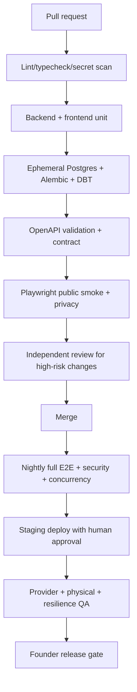

# SafeReturn — Test Plan & Acceptance Test Cases v1.2

> **Owner-delegated contract review, 2026-10-19:** [BTR-20261019](SafeReturn_13_Blocked_Task_Contract_Review_2026-10-19.md) records reviewed/corrected decisions for all thirteen formerly blocked task cards. Its explicit design approvals amend conflicting proposals for those tasks only; runtime roles, live/destructive authorization and existing acceptance evidence are unchanged. Provider/legal/physical/recovery gates remain explicit. Reserved API IDs are contracts, not implemented endpoints.


**Document ID:** SR-TEST-007 · **Repository target:** `docs/08-test-plan-and-acceptance.md`  
**Version:** 1.2 proposed · **Date:** 12 October 2026 · **Market:** Lahore pilot, Pakistan  
**Status:** Design/verification contract **only**; no tests are represented as executed or passed.  
**Authority:** PRD 01 v1.2 → approved ADRs → Technical Design 02 v1.2 → Database 03 v1.2 → API 04 v1.2 → Agent Instructions 05 v1.2 → Implementation Plan 06 v1.2 → Security 07 v1.2 → this plan.  
**Source files reviewed:** Documents 01–07 v1.2 and original 08 v1.1. The full 08 v1.1 is retained in Part B, not treated as superseded wholesale.

> **Precedence and limitation:** Part A below is authoritative for changed v1.2 behavior; Part B remains applicable to unchanged v1.1 behaviors. Where an actual database field, DTO, endpoint, policy value or task differs between the approved sources, record a blocking ADR and update the canonical contract before coding. Illustrative tests and sample values are not an executed audit.

# PART A — CURRENT v1.2 ADDITIONS AND AMENDMENTS


## A1. Scope, release boundary and non-negotiable acceptance invariants

### A1.1 Release boundary

- **P0 / Lahore launch:** one owner account with multiple paired kits; each pair has exactly one current Lost (`lost`) tag and one current ICE (`ice`) tag; editable profiles per tag; many printed copies of the same public QR without extra QR identity; sticker sizes and quantities; scan-led activation without rescanning; secure customer checkout; inventory reservation; manual bank/Raast verification; screenshot evidence where used; compact PDF; Supabase private storage; Cloudinary for public product photos; Google Sheets finance mirror; admin payment/print/ship controls; public bilingual Lost/ICE scans; existing Resend outbox, optional location and opt-in WhatsApp.
- **Schema/contract ready, feature-gated until separately certified:** newly sold keychains, badges and other physical products; mapping an *existing* owned QR to a new physical product; new physical artwork/manufacturing templates; fully automated payment gateway verification. An implemented table or disabled endpoint does **not** mean a future feature is certified for launch.
- **No P0 identity split:** new QR identity means a new *pair*, never an independently owned loose Lost or ICE tag. Extra copies/physical items can reuse a current tag with explicit customer selection and ownership checks.

### A1.2 Hard assertions (run across layers)

| ID | Invariant / falsifiable claim | Required evidence |
|---|---|---|
| V12-INV-01 | Each sellable QR identity pair has exactly one current `lost`, one current `ice`, one owner and one activation authority | Postgres constraint, service and E2E tests |
| V12-INV-02 | An account can own many pairs; each tag has an independent profile | Cross-pair and cross-tag CRUD/DB assertions |
| V12-INV-03 | 3 Lost + 2 ICE copies for one pair result in **two** public tokens, **five** printed instances, never five identities | DB + decoded PDF fixture |
| V12-INV-04 | Printed copies of same tag resolve to the same editable profile | Multi-scan E2E tests |
| V12-INV-05 | Public token or centered logo alone cannot establish ownership | Attempted claim by unauthorized accounts |
| V12-INV-06 | Scan context survives login, but only an entitled owner or holder of approved secret can activate | Auth redirect/session tamper and race tests |
| V12-INV-07 | No pending cart/quote client amount determines payable total | Quote/checkout repricing tests |
| V12-INV-08 | A single eligible inventory pair is never allocated to two concurrent orders | Postgres concurrent transaction tests |
| V12-INV-09 | Reservation expiry does not recycle a pair while submitted funds require reconciliation | Expiry + payment review race tests |
| V12-INV-10 | Neither screenshot, customer reference nor webhook request alone verifies payment | Manual and gateway adapter adversarial tests |
| V12-INV-11 | Paid status and final fulfillment allocation follow only trusted verification | Payment state + print job gating tests |
| V12-INV-12 | Failed Sheets export never rolls back approved payment; duplicate retry never adds duplicate finance rows | Durable job/reconciliation tests |
| V12-INV-13 | Print PDF is private, accurately sized, vector/compact, Lost section first, ICE second | Artifact geometry, ACL and scan tests |
| V12-INV-14 | Supabase private buckets hold evidence and PDFs; Cloudinary holds approved public imagery only | Storage/client permission tests |
| V12-INV-15 | Deleting transient files preserves order lines, QR mappings, audit and required payment decision metadata | Cleanup/backup tests |
| V12-INV-16 | Historical order item name, SKU, variant and price survive catalog edits/archiving | Snapshot tests |
| V12-INV-17 | Phone/medical data is absent from initial ICE HTML/RSC/hydration/API and revealed only as approved | DOM/network privacy tests |
| V12-INV-18 | Public Lost/ICE scans do not require accounts; Urdu/English public UX and print material work | Browser/physical accessibility tests |
| V12-INV-19 | Finder message and outbox event commit atomically; denied location cannot block message | DB transaction/E2E tests |
| V12-INV-20 | All admin finance, inventory, printing, delivery, cleanup mutations are role-checked and audited | Permission matrix and mutation assertions |

**Stop-ship:** Critical/High failures in claims 01–20 block release; future-product and gateway flags must remain off until their gated suites pass. No exception may weaken privacy, ownership, payment settlement or scan safety without signed ADR.


## A2. Verification organization and evidence hygiene

| Level | Implementation/tool | Run frequency | Owner | Evidence |
|---|---|---|---|---|
| Unit | pytest; TypeScript test runner chosen by team | Every relevant PR | Codex/backend, Antigravity/frontend | Test stdout, test IDs, commit SHA |
| PostgreSQL integration | Disposable real Supabase-compatible PostgreSQL; reviewed migrations | DB PR + nightly | Backend | Migration up/down outcome, SQL assertions, race results |
| API contract | FastAPI generated OpenAPI diff + schema-based request tests | API PR + CI | Backend | Generated JSON, approval diff, status/body assertions |
| Component/UI | React tests + accessibility checks | Frontend PR | Frontend | Screenshots with synthetic data, keyboard/RTL evidence |
| E2E | Playwright across Next.js + FastAPI + disposable DB | PR smoke + nightly | Joint | Video/trace (redacted), DB snapshots |
| Integration adapter | Fake/manual payment provider, mocked gateway, fake Cloudinary/Supabase/Sheets; small staging real-provider smoke | CI + staging | Backend/operations | Adapter logs with synthetic IDs |
| Security | IDOR, XSS, token claims, upload and signed-URL leakage, RBAC, deletion | High-risk PR + prelaunch | Independent reviewer | Findings tracker, retest proof |
| Physical | Printed media tested on actual materials, phones, light conditions | Every template/size change and first shipment | Print QA | Dimension/scan record, pass/fail by device |
| Release/operations | Staging deploy, backup restore, worker replay, rollback | Before pilot and material change | Technical owner | Runbook sign-off |

**Execution record for every case:** `case_id`, requirement/ADR, environment, app commit, migration version, scenario fixture IDs, expected output, actual output, pass/fail/blocked/not_run, artifacts, owner, date, defect ticket and independent approval where required. No acceptance counts may be claimed until executed.

**Task6.1A partial backend preparation (2026-10-21):** Owner-approved offline runner selects auth,staff-security,critical-workflow-boundaries,finder-validation,abuse-intake,public-configuration and runner/guard/static-chain tests only. Final local254 PASS/0 failures/errors/skips, source/Git preservation PASS; logs/XML/manifests/strict summary under output/task61a (latest.json). Tests use synthetic keys/transports/records and memory stores, early network/DB/process guards and a memory-only test event loop; no actual DB/Auth/provider/customer access. Current-head PostgreSQL/migration execution/full backend suite/frontend/provider/Linux-deployed acceptance are NOT RUN. Local Windows/Python3.14.8 execution does not prove hosted Linux/Python3.12 CI. Full6.1A acceptance and original6.1 gates remain; no module is upgraded to VERIFIED. Exact command/scope/intermediate failures/limits: output/task61a/IMPLEMENTATION.md and Doc09 §16.1.

**Data:** Use synthetic customers, disposable bank references, phone numbers reserved for test fixtures, mocked payments, and generated QR pairs. Never put live activation secrets, complete payment account identifiers, children's health data, precise coordinates or real personal images into tests or CI artifacts. Strip PII from Playwright traces and log dumps.

**Environment isolation:** developer, CI and staging each have distinct Supabase databases/storage and Cloudinary assets, service accounts and Sheets fixtures. Never run destructive fixtures against production. Validate service-role never reaches frontend; public QR URL stays on intended canonical host.


## A3. Traceability to authoritative source documents

| Source | Requirement sections / reference | Primary v1.2 case families |
|---|---|---|
| PRD 01 v1.2 | A3–A10 and founder-approved multi-product amendment | QR, ACT, CAT, SHOP, PAY, PDF, PRIV |
| TDD 02 v1.2 | §§4–16 and multi-pair/cross-product amendment | QR, ACT, INV, JOB, STO, OPS |
| DB 03 v1.2 | §§4–13 products/orders/QR identity/reservations/payments/print/sync | DB, CAT, SHOP, INV, PAY, PDF |
| API 04 v1.2 | Part A §§A4–A16; legacy API-010/030/040/042/060/063/083/090/095 etc. retained unless amended | API and E2E |
| Agent 05 v1.2 | Code review, testing evidence, bounded agent privileges | DEV, CI |
| Plan 06 v1.2 | SR-00-20–23, SR-01-20–25, SR-02-20–22, SR-06-20–30, SR-07-20–26, SR-08-20–24, SR-09-20–21 | Launch gate mapping |
| Security 07 v1.2 | A4–A16, threats TH-031–052, tests ST-201–225 | SEC, PRIV, PAY, STO |
| Original Test 08 v1.1 | TP-UNIT, TP-DB, API, E2E, physical, security, performance, launch suites | All **unchanged** cases retained in Part B |

**Contract reconciliation:** Do not treat a route label from a plan ticket as an implemented route. Route names/DTOs must match canonical API 04 v1.2; DB checks must match migrations of DB 03 v1.2. V1.2 IDs below are additive and do not rename older tests. Full machine-readable OpenAPI generation remains a separate implementation task.


## A4. Additive acceptance case catalog (v1.2)

**Case ID convention:** `TP-V12-<FAMILY>-NNN`. The catalog is intended for conversion to automation; each case is independently executable. Fixture and expected outcome are normative, while detailed request paths/DB column names must be taken from the final reviewed Documents 03–04 and actual migrations. All cases currently have status **NOT RUN**.


### A4.1 QR inventory/artwork — 6 cases


#### TP-V12-QR-001 — One batch creates exactly N pairs

- **Fixture/precondition:** Admin role, N=7, synthetic batch.
- **Action:** Create QR batch and inspect rows.
- **Expected:** 7 pair IDs, 14 distinct current tokens and 7 credential verifiers; none allocated.
- **Levels:** unit, PostgreSQL integration, API.
- **State:** NOT RUN. **Required evidence:** request/response or observed print, DB mutation and audit assertion where applicable; store synthetic/redacted artifacts only.


#### TP-V12-QR-002 — Logo-centered artwork readability

- **Fixture/precondition:** Approved logo, templates and density levels.
- **Action:** Render QR at each permitted size then scan.
- **Expected:** Encoded official URL matches source exactly; four-module quiet zone and tested ECC maintained.
- **Levels:** unit, PostgreSQL integration, API.
- **State:** NOT RUN. **Required evidence:** request/response or observed print, DB mutation and audit assertion where applicable; store synthetic/redacted artifacts only.


#### TP-V12-QR-003 — High-density and smallest-size reject

- **Fixture/precondition:** Overdense URL/font/branding fixture.
- **Action:** Generate artwork at undersized physical layout.
- **Expected:** Clear QA failure; no inventory approval and no silent shrinking of quiet zone.
- **Levels:** unit, PostgreSQL integration, API.
- **State:** NOT RUN. **Required evidence:** request/response or observed print, DB mutation and audit assertion where applicable; store synthetic/redacted artifacts only.


#### TP-V12-QR-004 — Public token not secret

- **Fixture/precondition:** Known public token only.
- **Action:** Attempt activation as unentitled attacker.
- **Expected:** Activation denied; no credential or PII exposed.
- **Levels:** unit, PostgreSQL integration, API.
- **State:** NOT RUN. **Required evidence:** request/response or observed print, DB mutation and audit assertion where applicable; store synthetic/redacted artifacts only.


#### TP-V12-QR-005 — Printed copies share URL

- **Fixture/precondition:** One pair, 3 lost, 2 ice copies.
- **Action:** Decode each five print instances.
- **Expected:** Exactly two URLs; 3 identical Lost and 2 identical ICE; distinct profiles.
- **Levels:** unit, PostgreSQL integration, API.
- **State:** NOT RUN. **Required evidence:** request/response or observed print, DB mutation and audit assertion where applicable; store synthetic/redacted artifacts only.


#### TP-V12-QR-006 — Archived and replaced QR

- **Fixture/precondition:** Pair with historical revoked token.
- **Action:** Scan both old and current tokens.
- **Expected:** Old token fails according to documented status; current resolves; no accidental ownership transfer.
- **Levels:** unit, PostgreSQL integration, API.
- **State:** NOT RUN. **Required evidence:** request/response or observed print, DB mutation and audit assertion where applicable; store synthetic/redacted artifacts only.


### A4.2 Activation and login continuity — 7 cases


#### TP-V12-ACT-001 — Inactive valid scan CTA

- **Fixture/precondition:** Unactivated, sale-entitled QR.
- **Action:** Anonymous scan valid tag.
- **Expected:** Localized activation CTA rather than generic 404; no private tag details.
- **Levels:** component, E2E, integration/security as applicable.
- **State:** NOT RUN. **Required evidence:** request/response or observed print, DB mutation and audit assertion where applicable; store synthetic/redacted artifacts only.


#### TP-V12-ACT-002 — Scan intent survives auth

- **Fixture/precondition:** Unauthenticated customer with entitled pair.
- **Action:** Open scan, click activate, login, return.
- **Expected:** Correct pending pair/tag shown and confirm button; no rescan.
- **Levels:** component, E2E, integration/security as applicable.
- **State:** NOT RUN. **Required evidence:** request/response or observed print, DB mutation and audit assertion where applicable; store synthetic/redacted artifacts only.


#### TP-V12-ACT-003 — Expired/tampered return context

- **Fixture/precondition:** Signed/opaque pending context fixture.
- **Action:** Tamper pair/token, expire context, alter redirects.
- **Expected:** No unauthorized activation or open redirect; safe restart path.
- **Levels:** component, E2E, integration/security as applicable.
- **State:** NOT RUN. **Required evidence:** request/response or observed print, DB mutation and audit assertion where applicable; store synthetic/redacted artifacts only.


#### TP-V12-ACT-004 — Concurrent activation atomicity

- **Fixture/precondition:** One eligible pair, two simultaneous requests.
- **Action:** Submit both activation confirmations.
- **Expected:** One committed owner; two tags activate atomically; stable idempotent response.
- **Levels:** component, E2E, integration/security as applicable.
- **State:** NOT RUN. **Required evidence:** request/response or observed print, DB mutation and audit assertion where applicable; store synthetic/redacted artifacts only.


#### TP-V12-ACT-005 — Cross-account scan claim

- **Fixture/precondition:** Attacker scans unactivated token of another buyer.
- **Action:** Login as attacker and activate.
- **Expected:** 403/approved denial, zero partial activation.
- **Levels:** component, E2E, integration/security as applicable.
- **State:** NOT RUN. **Required evidence:** request/response or observed print, DB mutation and audit assertion where applicable; store synthetic/redacted artifacts only.


#### TP-V12-ACT-006 — Many-pair activation

- **Fixture/precondition:** One owner has three purchases.
- **Action:** Activate all and list collection.
- **Expected:** Three distinct pairs appear; activation one does not mutate others.
- **Levels:** component, E2E, integration/security as applicable.
- **State:** NOT RUN. **Required evidence:** request/response or observed print, DB mutation and audit assertion where applicable; store synthetic/redacted artifacts only.


#### TP-V12-ACT-007 — Concealed code path

- **Fixture/precondition:** Gift/distribution fixture lacking order entitlement.
- **Action:** Activate without then with valid concealed secret.
- **Expected:** Absent/wrong secret denied; approved proof succeeds exactly once.
- **Levels:** component, E2E, integration/security as applicable.
- **State:** NOT RUN. **Required evidence:** request/response or observed print, DB mutation and audit assertion where applicable; store synthetic/redacted artifacts only.


### A4.3 Independent QR profiles and public experiences — 8 cases


#### TP-V12-PROFILE-001 — Independent tags per pair

- **Fixture/precondition:** One pair, own Lost and ICE tags.
- **Action:** Edit Lost title/contact then load ICE.
- **Expected:** ICE unchanged; Lost scan updated.
- **Levels:** unit, PostgreSQL integration, API.
- **State:** NOT RUN. **Required evidence:** request/response or observed print, DB mutation and audit assertion where applicable; store synthetic/redacted artifacts only.


#### TP-V12-PROFILE-002 — Independent pairs per owner

- **Fixture/precondition:** One owner, pair A and pair B.
- **Action:** Edit emergency info on B.
- **Expected:** Emergency info on A unchanged; both encrypted/private fields protected.
- **Levels:** unit, PostgreSQL integration, API.
- **State:** NOT RUN. **Required evidence:** request/response or observed print, DB mutation and audit assertion where applicable; store synthetic/redacted artifacts only.


#### TP-V12-PROFILE-003 — Cross-owner QR edit denied

- **Fixture/precondition:** Two users each own tags.
- **Action:** User B PUTs user A Lost/ICE IDs.
- **Expected:** 403 or non-enumerating denial and unchanged DB.
- **Levels:** unit, PostgreSQL integration, API.
- **State:** NOT RUN. **Required evidence:** request/response or observed print, DB mutation and audit assertion where applicable; store synthetic/redacted artifacts only.


#### TP-V12-PROFILE-004 — Wrong-type profile update

- **Fixture/precondition:** Lost QR used in ICE endpoint.
- **Action:** Attempt ICE edit through lost token.
- **Expected:** Validation fails; no wrong-type profile created.
- **Levels:** unit, PostgreSQL integration, API.
- **State:** NOT RUN. **Required evidence:** request/response or observed print, DB mutation and audit assertion where applicable; store synthetic/redacted artifacts only.


#### TP-V12-PROFILE-005 — All copied stickers reflect edit

- **Fixture/precondition:** Three printed copies of same Lost QR.
- **Action:** Change Lost description, scan all copies.
- **Expected:** All resolve same updated profile.
- **Levels:** unit, PostgreSQL integration, API.
- **State:** NOT RUN. **Required evidence:** request/response or observed print, DB mutation and audit assertion where applicable; store synthetic/redacted artifacts only.


#### TP-V12-PROFILE-006 — ICE phone reveal privacy

- **Fixture/precondition:** Published ICE record with contact.
- **Action:** Inspect initial HTML, RSC, hydration, metadata, public JSON then reveal.
- **Expected:** No full phone until explicit protected reveal; access and throttling enforced.
- **Levels:** unit, PostgreSQL integration, API.
- **State:** NOT RUN. **Required evidence:** request/response or observed print, DB mutation and audit assertion where applicable; store synthetic/redacted artifacts only.


#### TP-V12-PROFILE-007 — Finder reliability

- **Fixture/precondition:** One Lost QR, Resend fault and location denial.
- **Action:** Submit no-location finder message.
- **Expected:** DB message/outbox committed atomically; worker retries; denial nonblocking.
- **Levels:** unit, PostgreSQL integration, API.
- **State:** NOT RUN. **Required evidence:** request/response or observed print, DB mutation and audit assertion where applicable; store synthetic/redacted artifacts only.


#### TP-V12-PROFILE-008 — WhatsApp consent

- **Fixture/precondition:** WhatsApp preference off by default.
- **Action:** Request link before and after opt-in.
- **Expected:** Absent before opt-in; after explicit consent link warns number disclosed.
- **Levels:** unit, PostgreSQL integration, API.
- **State:** NOT RUN. **Required evidence:** request/response or observed print, DB mutation and audit assertion where applicable; store synthetic/redacted artifacts only.


### A4.4 Catalog and future physical products — 8 cases


#### TP-V12-CAT-001 — Launch catalog only stickers

- **Fixture/precondition:** Feature flags off for later products.
- **Action:** Fetch catalog and homepage featured list.
- **Expected:** Only published launch products appear; inactive future items excluded.
- **Levels:** component, E2E, integration/security as applicable.
- **State:** NOT RUN. **Required evidence:** request/response or observed print, DB mutation and audit assertion where applicable; store synthetic/redacted artifacts only.


#### TP-V12-CAT-002 — Admin product CRUD

- **Fixture/precondition:** Authorized catalog operator.
- **Action:** Create variant/image, publish then archive.
- **Expected:** Public listings reflect states; audit exists; no hard-delete of ordered product.
- **Levels:** component, E2E, integration/security as applicable.
- **State:** NOT RUN. **Required evidence:** request/response or observed print, DB mutation and audit assertion where applicable; store synthetic/redacted artifacts only.


#### TP-V12-CAT-003 — Catalog permissions

- **Fixture/precondition:** Customer/anonymous role.
- **Action:** Invoke admin product mutation.
- **Expected:** Denied; no unpublished SKU leaked through public API.
- **Levels:** component, E2E, integration/security as applicable.
- **State:** NOT RUN. **Required evidence:** request/response or observed print, DB mutation and audit assertion where applicable; store synthetic/redacted artifacts only.


#### TP-V12-CAT-004 — Cloudinary media controls

- **Fixture/precondition:** Admin image references and allowed content types.
- **Action:** Upload asset, list on homepage, attempt unauthorized upload.
- **Expected:** Only approved public imagery; no exposed Cloudinary credentials or unmoderated URL.
- **Levels:** component, E2E, integration/security as applicable.
- **State:** NOT RUN. **Required evidence:** request/response or observed print, DB mutation and audit assertion where applicable; store synthetic/redacted artifacts only.


#### TP-V12-CAT-005 — Order snapshot integrity

- **Fixture/precondition:** Active product then later renamed/repriced.
- **Action:** Purchase then modify catalog.
- **Expected:** Order retains original product name/ID/SKU/variant/price snapshots.
- **Levels:** component, E2E, integration/security as applicable.
- **State:** NOT RUN. **Required evidence:** request/response or observed print, DB mutation and audit assertion where applicable; store synthetic/redacted artifacts only.


#### TP-V12-CAT-006 — Future keychain uses new pair

- **Fixture/precondition:** Feature flag isolated staging.
- **Action:** Buy future keychain with new identity.
- **Expected:** One new paired kit, distinct profiles, artifact with chosen tag only as authorized.
- **Levels:** component, E2E, integration/security as applicable.
- **State:** NOT RUN. **Required evidence:** request/response or observed print, DB mutation and audit assertion where applicable; store synthetic/redacted artifacts only.


#### TP-V12-CAT-007 — Reuse existing QR on future product

- **Fixture/precondition:** Future flag staged; owner owns tag.
- **Action:** Order keychain with existing owned QR.
- **Expected:** No new pair; new physical item mapped to owned tag; profile remains shared.
- **Levels:** component, E2E, integration/security as applicable.
- **State:** NOT RUN. **Required evidence:** request/response or observed print, DB mutation and audit assertion where applicable; store synthetic/redacted artifacts only.


#### TP-V12-CAT-008 — Unauthorized QR reuse

- **Fixture/precondition:** Another owner QR ID supplied at checkout.
- **Action:** Submit reused QR mapping.
- **Expected:** Denied without creating order association or printing token.
- **Levels:** component, E2E, integration/security as applicable.
- **State:** NOT RUN. **Required evidence:** request/response or observed print, DB mutation and audit assertion where applicable; store synthetic/redacted artifacts only.


### A4.5 Checkout, pricing and order snapshots — 7 cases


#### TP-V12-SHOP-001 — 3 Lost and 2 ICE order

- **Fixture/precondition:** One user, one pair offer.
- **Action:** Quote and order 3 Lost + 2 ICE copies.
- **Expected:** One pair entitlement; 5 physical units and correct line sizes, server-calculated total.
- **Levels:** unit, PostgreSQL integration, API.
- **State:** NOT RUN. **Required evidence:** request/response or observed print, DB mutation and audit assertion where applicable; store synthetic/redacted artifacts only.


#### TP-V12-SHOP-002 — Mixed sizes and per-type quantity

- **Fixture/precondition:** Sticker variants at different prices.
- **Action:** Quote small Lost=2, large Lost=1, medium ICE=2.
- **Expected:** Each line records size/type/count and valid pricing; print spec matches.
- **Levels:** unit, PostgreSQL integration, API.
- **State:** NOT RUN. **Required evidence:** request/response or observed print, DB mutation and audit assertion where applicable; store synthetic/redacted artifacts only.


#### TP-V12-SHOP-003 — Forged client price

- **Fixture/precondition:** Quote amount changed in browser.
- **Action:** Submit manipulated total/discount.
- **Expected:** Backend recomputes and rejects mismatch; no undercharged payment request.
- **Levels:** unit, PostgreSQL integration, API.
- **State:** NOT RUN. **Required evidence:** request/response or observed print, DB mutation and audit assertion where applicable; store synthetic/redacted artifacts only.


#### TP-V12-SHOP-004 — Address and contact snapshots

- **Fixture/precondition:** Verified customer with address.
- **Action:** View checkout; later edit saved address.
- **Expected:** Order retains checkout snapshot; changes do not rewrite placed order.
- **Levels:** unit, PostgreSQL integration, API.
- **State:** NOT RUN. **Required evidence:** request/response or observed print, DB mutation and audit assertion where applicable; store synthetic/redacted artifacts only.


#### TP-V12-SHOP-005 — Unknown/out-of-stock SKU

- **Fixture/precondition:** Deleted/archived variant and invalid size.
- **Action:** Submit cart.
- **Expected:** Controlled validation; no invalid stock allocation.
- **Levels:** unit, PostgreSQL integration, API.
- **State:** NOT RUN. **Required evidence:** request/response or observed print, DB mutation and audit assertion where applicable; store synthetic/redacted artifacts only.


#### TP-V12-SHOP-006 — Double-submit and idempotency

- **Fixture/precondition:** Same quote and idempotency key.
- **Action:** POST checkout twice including retry after timeout.
- **Expected:** One order, one reservation; conflicting payload with same key rejected.
- **Levels:** unit, PostgreSQL integration, API.
- **State:** NOT RUN. **Required evidence:** request/response or observed print, DB mutation and audit assertion where applicable; store synthetic/redacted artifacts only.


#### TP-V12-SHOP-007 — Multiple products one order

- **Fixture/precondition:** Future catalog feature staging.
- **Action:** Order sticker and keychain lines.
- **Expected:** Correct ordered line mappings and distinct fulfillment specs; no duplicate pair without request.
- **Levels:** unit, PostgreSQL integration, API.
- **State:** NOT RUN. **Required evidence:** request/response or observed print, DB mutation and audit assertion where applicable; store synthetic/redacted artifacts only.


### A4.6 Inventory reservation and allocation — 7 cases


#### TP-V12-INV-001 — Reservation exclusive under concurrency

- **Fixture/precondition:** Single eligible QA-passed pair, 20 threads.
- **Action:** Create concurrent checkout reservations.
- **Expected:** At most one valid reservation; no oversell.
- **Levels:** unit, PostgreSQL integration, API.
- **State:** NOT RUN. **Required evidence:** request/response or observed print, DB mutation and audit assertion where applicable; store synthetic/redacted artifacts only.


#### TP-V12-INV-002 — Reservation expiry safe release

- **Fixture/precondition:** Unpaid reservation with no evidence.
- **Action:** Advance controlled clock beyond expiry.
- **Expected:** Releases only eligible non-disputed reservation; idempotent release.
- **Levels:** unit, PostgreSQL integration, API.
- **State:** NOT RUN. **Required evidence:** request/response or observed print, DB mutation and audit assertion where applicable; store synthetic/redacted artifacts only.


#### TP-V12-INV-003 — Submitted payment protection

- **Fixture/precondition:** Reservation with pending finance review.
- **Action:** Expire reservation while review remains pending.
- **Expected:** Pair not immediately allocated elsewhere; reconciliation/hold policy enforced.
- **Levels:** unit, PostgreSQL integration, API.
- **State:** NOT RUN. **Required evidence:** request/response or observed print, DB mutation and audit assertion where applicable; store synthetic/redacted artifacts only.


#### TP-V12-INV-004 — Verified payment final allocation

- **Fixture/precondition:** Approved bank settlement fixture.
- **Action:** Admin verifies payment and finalizes.
- **Expected:** One final allocation, order paid once, print eligible.
- **Levels:** unit, PostgreSQL integration, API.
- **State:** NOT RUN. **Required evidence:** request/response or observed print, DB mutation and audit assertion where applicable; store synthetic/redacted artifacts only.


#### TP-V12-INV-005 — Failed payment no premature PDF

- **Fixture/precondition:** Rejected transfer fixture.
- **Action:** Reject payment and poll jobs.
- **Expected:** No paid status, no production print job; inventory reconciled.
- **Levels:** unit, PostgreSQL integration, API.
- **State:** NOT RUN. **Required evidence:** request/response or observed print, DB mutation and audit assertion where applicable; store synthetic/redacted artifacts only.


#### TP-V12-INV-006 — Stock creation and thresholds

- **Fixture/precondition:** Admin authorized, below low-stock threshold.
- **Action:** Generate batch and update QA.
- **Expected:** Stock alert changes from low to healthy only for QA-approved eligible pairs.
- **Levels:** unit, PostgreSQL integration, API.
- **State:** NOT RUN. **Required evidence:** request/response or observed print, DB mutation and audit assertion where applicable; store synthetic/redacted artifacts only.


#### TP-V12-INV-007 — Unapproved or already activated pair

- **Fixture/precondition:** QA-held, sold and activated fixtures.
- **Action:** Force allocation attempts.
- **Expected:** DB/service denies all invalid allocations.
- **Levels:** unit, PostgreSQL integration, API.
- **State:** NOT RUN. **Required evidence:** request/response or observed print, DB mutation and audit assertion where applicable; store synthetic/redacted artifacts only.


### A4.7 Manual and future gateway payment — 9 cases


#### TP-V12-PAY-001 — Manual sender fields validation

- **Fixture/precondition:** Checkout order pending.
- **Action:** Submit sender name, masked/reference account details and transaction reference.
- **Expected:** Fields sanitized, private, attached to owned order; never exposes full account to Sheets.
- **Levels:** unit, PostgreSQL integration, API.
- **State:** NOT RUN. **Required evidence:** request/response or observed print, DB mutation and audit assertion where applicable; store synthetic/redacted artifacts only.


#### TP-V12-PAY-002 — Screenshot is not proof

- **Fixture/precondition:** Payment proof uploaded by customer.
- **Action:** Observe payment state without bank verification.
- **Expected:** Remains under review; no Ready to Ship.
- **Levels:** unit, PostgreSQL integration, API.
- **State:** NOT RUN. **Required evidence:** request/response or observed print, DB mutation and audit assertion where applicable; store synthetic/redacted artifacts only.


#### TP-V12-PAY-003 — Finance role approval gate

- **Fixture/precondition:** Non-finance staff authenticated.
- **Action:** Attempt approve/reject bank payment.
- **Expected:** 403; audit security event; no status change.
- **Levels:** unit, PostgreSQL integration, API.
- **State:** NOT RUN. **Required evidence:** request/response or observed print, DB mutation and audit assertion where applicable; store synthetic/redacted artifacts only.


#### TP-V12-PAY-004 — Trusted bank reconciliation

- **Fixture/precondition:** Finance role, settlement record and proof.
- **Action:** Approve paid transaction.
- **Expected:** Requires independent verified amount, recipient, unique bank reference; audit reviewer/time.
- **Levels:** unit, PostgreSQL integration, API.
- **State:** NOT RUN. **Required evidence:** request/response or observed print, DB mutation and audit assertion where applicable; store synthetic/redacted artifacts only.


#### TP-V12-PAY-005 — Double payment approval and duplicates

- **Fixture/precondition:** Same payment reference for two orders.
- **Action:** Concurrent approve/replay requests.
- **Expected:** No duplicate settled credit; controlled discrepancy workflow.
- **Levels:** unit, PostgreSQL integration, API.
- **State:** NOT RUN. **Required evidence:** request/response or observed print, DB mutation and audit assertion where applicable; store synthetic/redacted artifacts only.


#### TP-V12-PAY-006 — Rejected or partial payment

- **Fixture/precondition:** Mismatched amount or suspicious sender.
- **Action:** Submit bank review.
- **Expected:** Reject/hold; customer gets non-sensitive status and remediation flow.
- **Levels:** unit, PostgreSQL integration, API.
- **State:** NOT RUN. **Required evidence:** request/response or observed print, DB mutation and audit assertion where applicable; store synthetic/redacted artifacts only.


#### TP-V12-PAY-007 — Provider adapter swap

- **Fixture/precondition:** Fake gateway and manual adapter.
- **Action:** Run same state machine contract tests.
- **Expected:** Order/payment semantics unchanged; gateway cannot bypass trusted webhook signature/replay checks.
- **Levels:** unit, PostgreSQL integration, API.
- **State:** NOT RUN. **Required evidence:** request/response or observed print, DB mutation and audit assertion where applicable; store synthetic/redacted artifacts only.


#### TP-V12-PAY-008 — Signed gateway webhook security

- **Fixture/precondition:** Fake gateway signature and duplicate events.
- **Action:** Send unsigned/tampered/replayed valid and invalid callbacks.
- **Expected:** Only independently verified trusted events accepted; event deduped.
- **Levels:** unit, PostgreSQL integration, API.
- **State:** NOT RUN. **Required evidence:** request/response or observed print, DB mutation and audit assertion where applicable; store synthetic/redacted artifacts only.


#### TP-V12-PAY-009 — Refund/chargeback reversal

- **Fixture/precondition:** Previously paid order, fake reversal.
- **Action:** Receive valid adverse settlement event.
- **Expected:** Shipment/fulfillment follows approved exception; audit and reconciled balances retained.
- **Levels:** unit, PostgreSQL integration, API.
- **State:** NOT RUN. **Required evidence:** request/response or observed print, DB mutation and audit assertion where applicable; store synthetic/redacted artifacts only.


### A4.8 Supabase storage and Cloudinary — 7 cases


#### TP-V12-STO-001 — Private screenshot upload

- **Fixture/precondition:** Customer A and customer B.
- **Action:** Issue upload tickets and read each evidence.
- **Expected:** Only owner upload and authorized reviewer read; content-type/size validated.
- **Levels:** component, E2E, integration/security as applicable.
- **State:** NOT RUN. **Required evidence:** request/response or observed print, DB mutation and audit assertion where applicable; store synthetic/redacted artifacts only.


#### TP-V12-STO-002 — Unsafe evidence file

- **Fixture/precondition:** Spoofed image MIME, oversized, malicious payload.
- **Action:** Upload proof.
- **Expected:** Rejected/quarantined without image processing unsafe content.
- **Levels:** component, E2E, integration/security as applicable.
- **State:** NOT RUN. **Required evidence:** request/response or observed print, DB mutation and audit assertion where applicable; store synthetic/redacted artifacts only.


#### TP-V12-STO-003 — Signed PDF URL confidentiality

- **Fixture/precondition:** Print file for order A.
- **Action:** Anonymous/customer B/request with expired URL.
- **Expected:** Denied; no public object listing; short-lived authorized URL only.
- **Levels:** component, E2E, integration/security as applicable.
- **State:** NOT RUN. **Required evidence:** request/response or observed print, DB mutation and audit assertion where applicable; store synthetic/redacted artifacts only.


#### TP-V12-STO-004 — Storage provider boundary

- **Fixture/precondition:** Configured Supabase/Cloudinary clients.
- **Action:** Inspect uploads and built browser bundles.
- **Expected:** Private artifacts only Supabase; public imagery Cloudinary; no provider secret in JS.
- **Levels:** component, E2E, integration/security as applicable.
- **State:** NOT RUN. **Required evidence:** request/response or observed print, DB mutation and audit assertion where applicable; store synthetic/redacted artifacts only.


#### TP-V12-STO-005 — Artifact cleanup with retention

- **Fixture/precondition:** Paid delivered order with expired grace period.
- **Action:** Run cleanup twice.
- **Expected:** Delete authorized transient object idempotently; metadata/audit/order still present.
- **Levels:** component, E2E, integration/security as applicable.
- **State:** NOT RUN. **Required evidence:** request/response or observed print, DB mutation and audit assertion where applicable; store synthetic/redacted artifacts only.


#### TP-V12-STO-006 — Legal hold and open dispute

- **Fixture/precondition:** Disputed payment or open reprint request.
- **Action:** Run cleanup past normal deadline.
- **Expected:** Deletion deferred with explicit reason; no silent data loss.
- **Levels:** component, E2E, integration/security as applicable.
- **State:** NOT RUN. **Required evidence:** request/response or observed print, DB mutation and audit assertion where applicable; store synthetic/redacted artifacts only.


#### TP-V12-STO-007 — Backup deletion expectations

- **Fixture/precondition:** Expired evidence present in backup.
- **Action:** Perform deletion and inspect restored snapshot workflow.
- **Expected:** Policy specifies backup expiry/restore re-deletion; no false immediate-erasure claim.
- **Levels:** component, E2E, integration/security as applicable.
- **State:** NOT RUN. **Required evidence:** request/response or observed print, DB mutation and audit assertion where applicable; store synthetic/redacted artifacts only.


### A4.9 Print job and PDF verification — 9 cases


#### TP-V12-PDF-001 — Exact copies and ordering

- **Fixture/precondition:** Pair with 3 Lost 2 ICE.
- **Action:** Render PDF and programmatically decode tagged regions.
- **Expected:** Five QR images, same Lost URL 3x, same ICE URL 2x, Lost before ICE.
- **Levels:** component, E2E, integration/security as applicable.
- **State:** NOT RUN. **Required evidence:** request/response or observed print, DB mutation and audit assertion where applicable; store synthetic/redacted artifacts only.


#### TP-V12-PDF-002 — Mixed physical sizes

- **Fixture/precondition:** 30/40/60 mm configured sizes.
- **Action:** Render on printable sheet and measure boxes.
- **Expected:** Actual QR box incl quiet zone matches configured mm and tolerance.
- **Levels:** component, E2E, integration/security as applicable.
- **State:** NOT RUN. **Required evidence:** request/response or observed print, DB mutation and audit assertion where applicable; store synthetic/redacted artifacts only.


#### TP-V12-PDF-003 — Vector efficiency

- **Fixture/precondition:** 100+ repeated stickers fixture.
- **Action:** Render PDF and inspect raster/font duplication/bytes.
- **Expected:** Vector QR shapes or deduplicated resources; benchmark meets approved max KB/page target.
- **Levels:** component, E2E, integration/security as applicable.
- **State:** NOT RUN. **Required evidence:** request/response or observed print, DB mutation and audit assertion where applicable; store synthetic/redacted artifacts only.


#### TP-V12-PDF-004 — No public PII in printed tag

- **Fixture/precondition:** ICE and Lost with sensitive data.
- **Action:** Extract text and metadata from PDF.
- **Expected:** No medical/private/bank info printed; activation credential only on restricted concealed insert.
- **Levels:** component, E2E, integration/security as applicable.
- **State:** NOT RUN. **Required evidence:** request/response or observed print, DB mutation and audit assertion where applicable; store synthetic/redacted artifacts only.


#### TP-V12-PDF-005 — Center logo scan reliability

- **Fixture/precondition:** All supported printers/phones/light conditions.
- **Action:** Print samples and scan from multiple devices.
- **Expected:** Passed physical QA thresholds; any size failing disabled.
- **Levels:** component, E2E, integration/security as applicable.
- **State:** NOT RUN. **Required evidence:** request/response or observed print, DB mutation and audit assertion where applicable; store synthetic/redacted artifacts only.


#### TP-V12-PDF-006 — Print job idempotence

- **Fixture/precondition:** Single verified order.
- **Action:** Trigger worker twice and simulate upload timeout.
- **Expected:** One canonical active artifact/job with versioned attempts and no lost order.
- **Levels:** component, E2E, integration/security as applicable.
- **State:** NOT RUN. **Required evidence:** request/response or observed print, DB mutation and audit assertion where applicable; store synthetic/redacted artifacts only.


#### TP-V12-PDF-007 — Ready to Ship gate

- **Fixture/precondition:** Partly generated/QA failed versus QA passed file.
- **Action:** Load admin queue.
- **Expected:** Only eligible paid/QA-passed orders can ship; download logged.
- **Levels:** component, E2E, integration/security as applicable.
- **State:** NOT RUN. **Required evidence:** request/response or observed print, DB mutation and audit assertion where applicable; store synthetic/redacted artifacts only.


#### TP-V12-PDF-008 — Reprint audit

- **Fixture/precondition:** Delivered order, authorized admin.
- **Action:** Request rerender after PDF deletion.
- **Expected:** From retained QR/order spec, same tokens and sizes; new job version and audit.
- **Levels:** component, E2E, integration/security as applicable.
- **State:** NOT RUN. **Required evidence:** request/response or observed print, DB mutation and audit assertion where applicable; store synthetic/redacted artifacts only.


#### TP-V12-PDF-009 — No activation secret leakage

- **Fixture/precondition:** Restricted print manifest present.
- **Action:** Inspect ordinary download roles/logs/cache.
- **Expected:** Concealed insert segregated; no secret in customer-facing public artwork or logs.
- **Levels:** component, E2E, integration/security as applicable.
- **State:** NOT RUN. **Required evidence:** request/response or observed print, DB mutation and audit assertion where applicable; store synthetic/redacted artifacts only.


### A4.10 Google Sheets finance mirror — 5 cases


#### TP-V12-SHEETS-001 — One row per order identity

- **Fixture/precondition:** Payment pending then verified.
- **Action:** Export and update same order.
- **Expected:** One stable keyed row with updated status and masked account information.
- **Levels:** component, E2E, integration/security as applicable.
- **State:** NOT RUN. **Required evidence:** request/response or observed print, DB mutation and audit assertion where applicable; store synthetic/redacted artifacts only.


#### TP-V12-SHEETS-002 — Sheets outage does not reverse payment

- **Fixture/precondition:** Simulated 5xx/timeout.
- **Action:** Approve bank settlement.
- **Expected:** DB paid and audit intact; sync job retries until success.
- **Levels:** component, E2E, integration/security as applicable.
- **State:** NOT RUN. **Required evidence:** request/response or observed print, DB mutation and audit assertion where applicable; store synthetic/redacted artifacts only.


#### TP-V12-SHEETS-003 — Duplicate job replay

- **Fixture/precondition:** Sync event delivered twice.
- **Action:** Replay same event and compare sheet.
- **Expected:** Idempotent upsert, no duplicate rows.
- **Levels:** component, E2E, integration/security as applicable.
- **State:** NOT RUN. **Required evidence:** request/response or observed print, DB mutation and audit assertion where applicable; store synthetic/redacted artifacts only.


#### TP-V12-SHEETS-004 — Restricted screenshot reference

- **Fixture/precondition:** Proof in private Supabase bucket.
- **Action:** Inspect sheet values and hyperlinks.
- **Expected:** No public screenshot URL, complete account or secret; controlled reviewer access.
- **Levels:** component, E2E, integration/security as applicable.
- **State:** NOT RUN. **Required evidence:** request/response or observed print, DB mutation and audit assertion where applicable; store synthetic/redacted artifacts only.


#### TP-V12-SHEETS-005 — Cross-environment isolation

- **Fixture/precondition:** Staging service account.
- **Action:** Emit staging finance events.
- **Expected:** No writes to production spreadsheet.
- **Levels:** component, E2E, integration/security as applicable.
- **State:** NOT RUN. **Required evidence:** request/response or observed print, DB mutation and audit assertion where applicable; store synthetic/redacted artifacts only.


### A4.11 Administration and fulfillment — 6 cases


#### TP-V12-ADMIN-001 — Separated roles

- **Fixture/precondition:** Finance, fulfillment, catalog, support users.
- **Action:** Try prohibited cross-role actions.
- **Expected:** All unauthorized mutations denied and logged.
- **Levels:** component, E2E, integration/security as applicable.
- **State:** NOT RUN. **Required evidence:** request/response or observed print, DB mutation and audit assertion where applicable; store synthetic/redacted artifacts only.


#### TP-V12-ADMIN-002 — New QR batch control

- **Fixture/precondition:** Admin with MFA.
- **Action:** Generate 25 pairs.
- **Expected:** 25 unique paired records; print QA required before allocation.
- **Levels:** component, E2E, integration/security as applicable.
- **State:** NOT RUN. **Required evidence:** request/response or observed print, DB mutation and audit assertion where applicable; store synthetic/redacted artifacts only.


#### TP-V12-ADMIN-003 — Ready to ship dashboard

- **Fixture/precondition:** Paid and unpaid/missing artwork orders.
- **Action:** Fetch queue and click download.
- **Expected:** Only approved eligible orders; signed downloads time-limited.
- **Levels:** component, E2E, integration/security as applicable.
- **State:** NOT RUN. **Required evidence:** request/response or observed print, DB mutation and audit assertion where applicable; store synthetic/redacted artifacts only.


#### TP-V12-ADMIN-004 — Shipment lifecycle and cleanup

- **Fixture/precondition:** QA-approved order shipped then delivered.
- **Action:** Update status using allowed transitions.
- **Expected:** Delivery evidence retained; cleanup scheduled not immediate; no illegal transition.
- **Levels:** component, E2E, integration/security as applicable.
- **State:** NOT RUN. **Required evidence:** request/response or observed print, DB mutation and audit assertion where applicable; store synthetic/redacted artifacts only.


#### TP-V12-ADMIN-005 — Audit append-only

- **Fixture/precondition:** Product, payment, print, profile events.
- **Action:** Edit/delete attempts and normal admin writes.
- **Expected:** Attribution, timestamps, before/after minimum metadata; no sensitive payloads.
- **Levels:** component, E2E, integration/security as applicable.
- **State:** NOT RUN. **Required evidence:** request/response or observed print, DB mutation and audit assertion where applicable; store synthetic/redacted artifacts only.


#### TP-V12-ADMIN-006 — Featured homepage carousel

- **Fixture/precondition:** Admin publishes and toggles featured flag.
- **Action:** Fetch public catalog and render mobile/desktop.
- **Expected:** Only published featured SKUs; accessible keyboard/swipe navigation.
- **Levels:** component, E2E, integration/security as applicable.
- **State:** NOT RUN. **Required evidence:** request/response or observed print, DB mutation and audit assertion where applicable; store synthetic/redacted artifacts only.


### A4.12 Privacy, localization and abuse control — 6 cases


#### TP-V12-PRIV-001 — Anonymous public scans

- **Fixture/precondition:** Public Lost and ICE tokens.
- **Action:** Open without login on slow mobile with Urdu toggle.
- **Expected:** Usable, localized, no private owner data or phone leak.
- **Levels:** component, E2E, integration/security as applicable.
- **State:** NOT RUN. **Required evidence:** request/response or observed print, DB mutation and audit assertion where applicable; store synthetic/redacted artifacts only.


#### TP-V12-PRIV-002 — Location explicit consent

- **Fixture/precondition:** Finder on supported browser.
- **Action:** Do not click share location, then decline browser prompt.
- **Expected:** No location captured or backend persisted; message still submits.
- **Levels:** component, E2E, integration/security as applicable.
- **State:** NOT RUN. **Required evidence:** request/response or observed print, DB mutation and audit assertion where applicable; store synthetic/redacted artifacts only.


#### TP-V12-PRIV-003 — Child badge launch gate

- **Fixture/precondition:** Future badge product configured.
- **Action:** Enable feature without guardian/privacy approval.
- **Expected:** Deployment gate fails; product remains unpublished.
- **Levels:** component, E2E, integration/security as applicable.
- **State:** NOT RUN. **Required evidence:** request/response or observed print, DB mutation and audit assertion where applicable; store synthetic/redacted artifacts only.


#### TP-V12-PRIV-004 — Rate limiting

- **Fixture/precondition:** IP abuse attempts to reveal ICE/contact.
- **Action:** Burst valid and invalid requests.
- **Expected:** Approved throttling without unacceptable emergency access regression.
- **Levels:** component, E2E, integration/security as applicable.
- **State:** NOT RUN. **Required evidence:** request/response or observed print, DB mutation and audit assertion where applicable; store synthetic/redacted artifacts only.


#### TP-V12-PRIV-005 — Logs and analytics redaction

- **Fixture/precondition:** Live-like synthetic secret/health/location fixture.
- **Action:** Inspect traces, logs, errors, events, front-end bundles.
- **Expected:** No raw QR tokens, activation secrets, complete phones, coordinates or screenshots.
- **Levels:** component, E2E, integration/security as applicable.
- **State:** NOT RUN. **Required evidence:** request/response or observed print, DB mutation and audit assertion where applicable; store synthetic/redacted artifacts only.


#### TP-V12-PRIV-006 — Right-to-delete workflow

- **Fixture/precondition:** Verified account deletion request with active legal hold.
- **Action:** Process request.
- **Expected:** Respect approved deletion/export policy, documented hold exceptions and immutable finance facts.
- **Levels:** component, E2E, integration/security as applicable.
- **State:** NOT RUN. **Required evidence:** request/response or observed print, DB mutation and audit assertion where applicable; store synthetic/redacted artifacts only.


### A4.13 Operations, migrations and failure recovery — 6 cases


#### TP-V12-OPS-001 — Migration forward and back

- **Fixture/precondition:** Representative v1.1 schema fixture.
- **Action:** Apply reviewed v1.2 migrations, verify data, rehearse rollback.
- **Expected:** No lost ownership/payment/PII; migration versions repeatable; rollback constraints documented.
- **Levels:** component, E2E, integration/security as applicable.
- **State:** NOT RUN. **Required evidence:** request/response or observed print, DB mutation and audit assertion where applicable; store synthetic/redacted artifacts only.


#### TP-V12-OPS-002 — Outbox/worker crash recovery

- **Fixture/precondition:** Worker crashes after external call before ack.
- **Action:** Restart and retry.
- **Expected:** Duplicate external side effects deduped where feasible; DB remains accurate.
- **Levels:** component, E2E, integration/security as applicable.
- **State:** NOT RUN. **Required evidence:** request/response or observed print, DB mutation and audit assertion where applicable; store synthetic/redacted artifacts only.


#### TP-V12-OPS-003 — Supabase restore rehearsal

- **Fixture/precondition:** Synthetic staged database and storage manifest.
- **Action:** Restore and validate ownership plus file index.
- **Expected:** Consistent recovery window per approved RPO/RTO; stale objects reconciled.
- **Levels:** component, E2E, integration/security as applicable.
- **State:** NOT RUN. **Required evidence:** request/response or observed print, DB mutation and audit assertion where applicable; store synthetic/redacted artifacts only.


#### TP-V12-OPS-004 — Feature flags

- **Fixture/precondition:** P0 sticker enabled, future features disabled.
- **Action:** Promote staging release.
- **Expected:** Keychains/reuse/gateway remain disabled; unexposed API path denied or guarded.
- **Levels:** component, E2E, integration/security as applicable.
- **State:** NOT RUN. **Required evidence:** request/response or observed print, DB mutation and audit assertion where applicable; store synthetic/redacted artifacts only.


#### TP-V12-OPS-005 — Deployment rollback

- **Fixture/precondition:** Staging new migration + app release.
- **Action:** Rollback deploy and replay queue.
- **Expected:** Backward-compatible reads/writes or documented safe stop; no accidental deletions.
- **Levels:** component, E2E, integration/security as applicable.
- **State:** NOT RUN. **Required evidence:** request/response or observed print, DB mutation and audit assertion where applicable; store synthetic/redacted artifacts only.


#### TP-V12-OPS-006 — Cost and PDF performance

- **Fixture/precondition:** Large page/job batch synthetic fixtures.
- **Action:** Benchmark PDF sizes, worker RAM/CPU, storage/list calls.
- **Expected:** Within founder-approved quotas and target limits; document measured baseline.
- **Levels:** component, E2E, integration/security as applicable.
- **State:** NOT RUN. **Required evidence:** request/response or observed print, DB mutation and audit assertion where applicable; store synthetic/redacted artifacts only.


## A5. Additional test matrices requiring parameterization

### A5.1 QR production matrix

Cross **Lost/ICE** × all published product/variant sizes × each approved substrate and print process × Android/iOS mainstream devices × indoor daylight/dim lighting × realistic viewing distances × branded/unbranded test control. Record error-correction setting, URL byte length, logo coverage, module pitch, four-module quiet zone, physical size **including** quiet zone and scan success/failure. Existing physical minimums (30×30 mm indoor; 35×35 mm outdoor) still apply unless new size/material is explicitly approved. A printable size below approved thresholds must not be offered simply because a catalog SKU exists. Brand mark alone proves no authenticity.

### A5.2 API and state transition matrix

Test every added/modified catalog, tag collection, scan intent, quote, cart/order, reservation, payment submission/review, evidence-upload, QR-batch, print-job, file-download/cleanup, fulfillment and finance-sync endpoint with: (a) no auth, customer A, customer B, finance, fulfillment, catalog admin, superadmin; (b) absent/invalid/cross-owner resource; (c) body validation/unknown fields; (d) pagination; (e) idempotent retry and conflicting re-use of key; (f) concurrent calls; (g) wrong state transition; (h) translated safe errors; (i) audit and no sensitive logs. Assert both HTTP and DB state. **API-010/011/012/013; API-030/031/032/035; API-040–049; API-060–070; API-080–103 and new v1.2 API Part A routes** must be reconciled against canonical OpenAPI, not guessed from this test plan.

### A5.3 Payments and delayed events

Cross bank transfer pending/verified/rejected/disputed/refunded with evidence optional/present/invalid, reservation active/expired/reconciled, provider manual/fake gateway, duplicate submission, webhook out-of-order, status query race, storage/Sheets outage and finance reviewer permissions. Customer cannot make the system paid by changing screenshot, account-holder text, transfer reference, `success_url` or browser response. Verified settlement is independently attested through trusted channel. Admin verification must be attributable, traceable and replay-safe. Future real gateway rollout is **separately gated**.

### A5.4 Public languages / accessibility

English and Urdu (correct RTL, Unicode, URL and phone bidirectional display), mobile narrow screens, keyboard-only usage, focus order, announcements/labels, contrast, reduced motion, slow 3G, no JS where reasonable for public scan, unsuccessful geolocation, Turnstile degraded state, screen-reader contact reveal and form validation. Do not require account creation for finder/responder, even when account activation CTA exists for an *inactive* code.


## A6. End-to-end acceptance journeys (mandatory staging release candidates)

1. **SR-JOURNEY-01 — First purchase, customized copies.** Shopper registers; chooses one pair with 3 Lost and 2 ICE stickers across selected sizes; reviews server quote, address and contact; places order; submits bank details/optional screenshot; sees *Under Review*; finance independently verifies bank settlement; inventory allocation finalizes; private vector PDF shows exactly five instances/2 URLs; fulfillment downloads, checks and dispatches; user sees tracking; delivery triggers retention countdown without deleting order or QR records.
2. **SR-JOURNEY-02 — Unactivated scan and seamless login.** Entitled customer scans valid unactivated Lost QR; sees *Activate QR*; logs in; returns to confirmation with correct pending pair; confirms; exactly both child tags activate; dashboards show separate editable Lost/ICE forms. Attacker scanning same QR cannot claim ownership.
3. **SR-JOURNEY-03 — Multiple pairs per account.** Customer activates two purchases; adjusts pair A Lost description and pair B ICE contact separately; scanning each URL yields only that tag's current published information; multiple physical copies of same URL show identical edited profile.
4. **SR-JOURNEY-04 — Anonymous finder and ICE.** Finder without account scans Lost, submits bilingual message, optionally declines location and sees success while Resend is down; owner later receives queued email/inbox. Emergency responder scans ICE with published details, cannot see full phone before protected explicit reveal; anti-abuse does not silently block approved emergency fallback.
5. **SR-JOURNEY-05 — Double-order and finance race.** Two customers race for last eligible pair; only one reservation holds it. Payment evidence arrives as reservation expiry is attempted; hold/reconciliation prevents recycling; a valid finance decision produces one allocation and one print job.
6. **SR-JOURNEY-06 — Storage/sync fault recovery.** Supabase PDF upload times out then succeeds on retry; authorized operator accesses artifact via short-lived URL; Sheets synchronization fails temporarily, then upserts one row without affecting payment status; on delivery plus retention expiry cleanup removes private object but leaves print history and order snapshots; authorized reprint produces same URLs after fresh review.
7. **SR-JOURNEY-07 — Catalog and historic order.** Admin creates/publishes sticker variant with approved public Cloudinary image and homepage featured position; customer purchases; admin later edits name and price; historic order remains unchanged and public catalog reflects new values.
8. **SR-JOURNEY-08 — Future feature gates (staging only).** Customer elects separately managed new QR identity for keychain (creates new *pair*) versus reusing an owned QR profile for badge/keychain (creates no new pair); unauthorized QR reuse denied; feature cannot be enabled in production until child/elderly privacy, manufacturer artwork and launch approvals pass.
9. **SR-JOURNEY-09 — Manual-to-gateway transition (nonproduction).** Run shared payment states through fake gateway, with signed webhook validation, event replay, amount mismatch, settlement delay and refund; unchanged order APIs and finance audit contracts; retain manual rollback path.

All nine journeys require browser trace (redacted), key DB state assertions, worker/adapter status, reviewer sign-off and resolved High/Critical defects. Journeys 08–09 are staging/gated, not Lahore P0 authorization.


## A7. Security regression mapping: Document 07

The v1.1 suite and Document 07's **ST-201 through ST-225** and **TH-031 through TH-052** remain mandatory. Group the newly introduced tests as follows:

| Security property | Required v1.2 cases | Threat/evidence expectations |
|---|---|---|
| QR ownership, reuse, scan intent and activation | ACT-002–007, PROFILE-003–004, CAT-007–008 | IDOR, bearer-token misuse, open redirect, lost context, races |
| Multi-profile privacy / child's future badge | PROFILE-001–008, PRIV-001–006 | Profile isolation, public DTO allowlist, guardian gate |
| Catalog and order pricing | CAT-002–005, SHOP-003–007 | Admin-only mutation, snapshot integrity, forged prices |
| Allocation, checkout and staff roles | INV-001–007, ADMIN-001–005 | Double sell, stale reservation and privilege escalation |
| Manual/gateway finance security | PAY-001–009 | Fraudulent screenshot, unauthorized approval, spoofed callback, replay |
| Private evidence/PDF and erasure | STO-001–007, PDF-004–009 | Signed link leak, bucket ACL, secret/PDF exposure, legal holds |
| Sheets and Cloudinary integrations | SHEETS-001–005, CAT-004 | Spreadsheet PII, URL leaks, provider credential exposure |
| Audit, operations, migrations | OPS-001–006, PRIV-005 | Evidence and rollback without raw secrets |

**Do not mark a security control “implemented” merely because it appears in this document**. A test must demonstrate failure for an intentionally insecure fixture where safe and success for authorized usage.


## A8. Performance, resilience and cost acceptance

Measure and record a baseline in staging for: first paint/public QR resolution on throttled mobile network; ICE contact reveal; finder submission under Resend outage; quote/order response; reservation contention; worker job throughput; QR print PDF generation time and final PDF bytes by page/copy count; storage occupancy/retention; Google Sheets export lag and retry; inventory refill worker; customer dashboard with 1, 10, 100 owned pairs; and admin Ready to Ship with paginated historical orders.

**Do not invent numeric SLOs or absolute PDF KB limits.** The founder/technical owner must approve quantitative thresholds (including API p95, RPO/RTO, storage cost budget, worker memory/CPU, scan success rate, max QR size density and retention/grace days) before signing off. These become machine-checked CI or launch thresholds where feasible. A PDF size optimization is not accepted if scan reliability/print scale degrades.

Faults to inject: service restart between DB commit and storage upload, missing file but existing metadata, Sheets 429/5xx, Resend 500, Cloudinary temporary failure, Supabase signed-URL expiration, interrupted deletion job, duplicate task delivery, printing/QA hold, order cancellation and disputed payment. Verify idempotency and recoverability.


## A9. CI suite organization and example commands (illustrative)

Proposed test tree (adapt to real repository after scaffolding):

```text
backend/tests/
  unit/test_qr_logo.py
  unit/test_quote_money.py
  unit/test_payment_provider_contract.py
  integration/test_multi_pair_profiles.py
  integration/test_inventory_reservation_races.py
  integration/test_payment_review_state.py
  integration/test_print_job_artifacts.py
  integration/test_sheets_outbox.py
  security/test_cross_owner_authorization.py
  security/test_storage_signed_access.py
frontend/tests/
  components/qr-collection.test.tsx
  components/cart-configurator.test.tsx
  e2e/scan-activate-no-rescan.spec.ts
  e2e/payment-manual-flow.spec.ts
  e2e/my-qr-independent-profiles.spec.ts
  e2e/admin-ready-to-ship.spec.ts
physical-qa/
  qa-matrix.csv
  scan-results/
```

```bash
# Examples only; scripts and paths must be reconciled to the checked-in repository.
cd backend && pytest -q tests/unit tests/integration tests/security
cd frontend && npm run test && npx playwright test
# In disposable PostgreSQL environment, use reviewed migration commands from Doc 09.
```

**CI gates:** secret scanning, formatting/static typing, contract OpenAPI drift, SQL migration review, schema check, backend/frontend unit tests, DB integration tests with real PostgreSQL, representative E2E, role/IDOR/privacy regressions and artifact safety tests. Physical scans and real-provider staging checks are evidence attachments required for release but must not be faked by CI mocks.


## A10. Release gate and defect policy

| Gate | Required completion evidence | Blocked by |
|---|---|---|
| G0 — source/ADR approval | Catalog/multi-pair and payment/retention decisions; canonical DB/API crosswalk signed | Conflicting requirements or unresolved critical ADR |
| G1 — identity/database foundation | Reviewed migrations + real PostgreSQL constraints and account/tag isolation | Partial pair activation, insecure auth, regression |
| G2 — QR/public core | Printed QR geometry and real-phone scan, anonymous bilingual pages, ICE non-leak | Scan failure or ICE privacy leak |
| G3 — shopping/inventory | Server pricing, line snapshots, checked concurrency and checkout retry | Oversell or fraud-able price manipulation |
| G4 — finance | Trusted manual verification, screenshot not automatic proof, finance RBAC/audit, provider contract seam | Untrusted payment acceptance or duplicate credit |
| G5 — production files | Compact valid PDFs, private ACL, print QA, short-lived downloads, deletion/reprint | Incorrect QR contents, exposed files or cut errors |
| G6 — integrations | Durable Resend and Sheets jobs, Supabase/Cloudinary boundaries, retries | Lost notification/order or leaked data |
| G7 — full Lahore pilot | All P0 journeys, independent security review, physical print sign-off, restore/rollback and founder sign-off | Any unresolved Critical/High defect |
| G8 — future products | Manufacturer templates, existing-QR reuse, childhood/medical privacy review, catalog QA | Missing separate approval; launch flag must stay off |
| G9 — automatic gateway | Signed events, settlement reconciliation, dispute/chargeback handling, staged shadow/rollback | Callback fraud/replay, manual adapter contract drift |

**Defect categories:** Critical = loss of ownership, identity, payment integrity, emergency phone privacy, print identity or irreversible data; High = functional bypass/role leakage, repeated fulfillment error, reconciliation failure, inaccessible emergency contact; Medium/Low = documented, triaged, approved mitigation. Nothing in this document substitutes for independent review or founder decision.

**Final completion checklist:** [ ] all v1.1 unchanged cases retained and executed; [ ] v1.2 P0 cases executed; [ ] API schema generated and diffed; [ ] migration/rollback verified; [ ] storage deletion/hold checked; [ ] physical tests signed; [ ] finance evidence audited; [ ] no High/Critical open; [ ] remaining ADRs explicitly signed; [ ] launch acceptance recorded by founder. All boxes intentionally unchecked at authoring.


## A11. Pending decisions and test blockers (not assumed approved)

1. Official domain, final supported sticker size/material matrices and centered-logo scan threshold; original minimum dimensions apply meanwhile.
2. Published SKU price, taxes, discounts, COD/shipping support and quote/reservation expiry settings.
3. Whether/when submitted payment proof extends a reservation; reconciliation grace/abandon policy must be explicit before launch.
4. Exact bank/Raast verification evidence, separation of duty, cancellation/refund/dispute windows; no screenshot or AI settlement decision.
5. Screenshot/PDF retention periods, dispute/legal hold, deletion grace, backup expiration and consent copy.
6. Supabase storage bucket names, permissions, Cloudinary transforms/upload restrictions, Google Sheets spreadsheet permissions and sync SLA.
7. Provider-specific authenticated gateway webhook contracts, signing and delayed settlement rules for future payments.
8. Legal/privacy copy for children and elderly; future product manufacturing QA; existing QR reuse release gate.
9. Emergency reveal fallback/Turnstile outage, medical publication consent and finder-location retention.
10. Quantified reliability/scan/PDF-size and service cost targets; sign-off authority for each gate.

**Disposition:** Mark blocked cases `BLOCKED-ADR` with owner and expected decision document, never “PASS by default.”


## A12. Reconciliation with legacy cases and handoff to Document 09

- All existing v1.1 `TP-UNIT-*`, `TP-DB-*`, API, UI, E2E, security, physical, performance and pilot test definitions in Part B remain normative where not overridden by Part A. Preserve the prior case IDs for traceability, even when expanded test input is needed.
- New v1.2 tests must be mapped to Plan 06 tickets and Security 07 risks during implementation. Example: `SR-06-24` → `TP-V12-INV-001–007`; `SR-07-20` → `TP-V12-PDF-001–006`; `SR-07-23` → `TP-V12-SHEETS-001–005`; `SR-02-22` → `TP-V12-ACT-002–007`; `SR-08-22` → privacy/security suite.
- Where the archived v1.1 scenario assumes **quantity = number of distinct pairs** or print manifest generated in advance, use current v1.2 model: one order line may produce multiple physical copies mapped to a single QR pair, with production-ready PDF only after trusted verification and final allocation. Do not silently update older expectation without noting this supersession.
- Document 09 v1.2 should turn CI/security/print/storage/Sheets checks into deployment and operations runbooks, include provider-side audit verification and safe re-run procedures. This task stops with Document 08.

---

# PART B — ORIGINAL TEST PLAN v1.1 (UNCHANGED REFERENCE)

This is the original uploaded SafeReturn Test Plan & Acceptance Test Cases v1.1, retained verbatim below for traceability. It remains binding for unaffected features, subject to v1.2-specific supersession in Part A. The v1.1 wording and test counts below are historical and must not be interpreted as indicating execution.

---

# SafeReturn — Test Plan & Acceptance Test Cases

**Supporting document:** 7 of 10 · **Repository path (proposed):** `docs/08-test-plan-and-acceptance.md`  
**Version:** 1.1 — implementation-ready draft, pending founder/security approval  
**Date:** 11 October 2026 · **Pilot:** Lahore, Pakistan  
**Owners:** Technical lead (test strategy), Codex (API/DB/backend automation), Antigravity (frontend/E2E/accessibility), human founder (physical, bank and launch acceptance)

> **Status note:** This specification describes tests to implement and execute. None is represented as having passed. Any sample IDs, thresholds, data, and commands are illustrative until the repository and release configuration are verified. Do not execute live payment, live emails, production migrations, destructive tests, or production load without explicit human approval.

## 1. Purpose, source-of-truth and precedence

The purpose of this document is to turn the SafeReturn PRD v1.1 and supporting Documents 1–6 into **reproducible acceptance evidence**. It defines what to test, how to test it, when to run it, how to record failures, and which results block a Lahore pilot.

| Source | What this test plan inherits |
|---|---|
| PRD v1.1 | P0 behavior, bilingual English/Urdu, paired kit, finder/ICE, optional WhatsApp/location, physical print requirements |
| Document 1 — Technical Design | Next.js/TypeScript, FastAPI/SQLAlchemy/Alembic, Supabase, Resend worker, Turnstile, Segno, Vercel/Railway; modular monolith boundaries |
| Document 2 — Database Design | Schema constraints, atomic activation, current/historical tags, outbox, encrypted finder location, **DBT-001 through DBT-030** |
| Document 3 — API Contract | `/api/v1` endpoints and API IDs, auth/error/DTO semantics, idempotency, **46 API acceptance scenarios in §24** |
| Document 4 — Agent Instructions | Bounded tickets, branch/worktree isolation, actual command evidence, secret/PII safeguards |
| Document 5 — Implementation Plan | SR task IDs, milestone gates G0–G11, Definition of Ready/Done, Lahore pilot criteria |
| Document 6 — Security & Privacy | TH-001–TH-030 threat register, ST-* security test catalog, consent/retention, incident and stop-ship controls |

**Precedence:** PRD and approved founder decisions govern. Use the exact route names, schema names, statuses and request/response fields from the current approved API and database documents. If documents conflict, open an ADR and block the affected test until resolved; do not make an AI agent invent a new product contract. This document intentionally does **not** define the final UI screen inventory or navigation map: that remains the last supporting document.

### 1.1 Product invariants to prove

1. One Pair ID, two current QR tags (`lost`, `ice`), one independent concealed activation credential.
2. Exactly one current child per tag type; both activate atomically for a verified entitled owner.
3. Public tokens have at least 128 bits of CSPRNG entropy; no public token doubles as an activation secret.
4. Anonymous public QR pages work in English and Urdu, including mobile and slow networks.
5. Full ICE phone absent from initial HTML, RSC/SSR payload, hydration, metadata, initial public API JSON and analytics.
6. ICE contact reveal requires user action, membership validation and approved abuse controls; provider outage behavior must be decided and tested.
7. Finder messages and outbox rows commit/rollback together; email is **at-least-once attempted**, not guaranteed delivered exactly once.
8. WhatsApp is off by default, explicitly consented, discloses the selected number, and WhatsApp-only conversations do not appear in SafeReturn inbox.
9. Finder location is one-time, optional, consented, encrypted and owner-restricted; denial never blocks messaging.
10. Bank/Raast transfers require independent human settlement verification; screenshots do not authorize fulfillment.
11. Inventory counts pairs; a pair cannot be actively allocated twice or shipped for another order.
12. QR artwork measures at least 30×30 mm indoor or 35×35 mm outdoor **including** 4-module quiet zone, ECC M/Q, bilingual labels and concealed credential.
13. Cross-owner, cross-role and anonymous access are enforced on the backend and storage.
14. Sensitive fields, tokens and credentials do not leak through logs, errors, links, CDN caches or AI prompts.

### 1.2 Test principles

- Test **behavior and invariants**, not only happy-path HTTP status codes.
- Prefer deterministic tests and synthetic identities; never copy production PII.
- Validate the database state **and** external side effects (outbox, email adapter, audit) for state-changing flows.
- Use real PostgreSQL for constraints, triggers, locks and RLS; SQLite is not a substitute.
- Use mock adapters for normal CI; stage a small number of provider-integration tests with test accounts.
- Distinguish **CI simulated** results from **staging provider-verified** results and **physical device** results.
- Every failed Critical/High test has an owner, ticket, evidence and explicit release decision.

## 2. Scope, test levels and responsibility

| Level | Focus | Owner | Runs |
|---|---|---|---|
| Unit | Pure validation, state machines, encryption adapter, DTO allowlists, translation helpers | Codex / Antigravity | Every PR |
| DB integration | PostgreSQL constraints, transactions, triggers, migrations, RLS, races | Codex | Every relevant PR + nightly |
| API contract | OpenAPI schema, authz, status/error envelope, idempotency, pagination | Codex | Every API PR |
| Component | Form states, accessible controls, translations, RTL, no accidental location call | Antigravity | Every frontend PR |
| E2E | Browser→frontend→API→test DB flows; network/privacy inspection | Antigravity + Codex | PR smoke + nightly full |
| Security | IDOR, scraping, SSR/phone leakage, secret scanning, upload safety | Independent reviewer | PR high-risk + prelaunch |
| Performance/resilience | Latency, concurrent activations, worker backlog, provider outage, slow network | Codex + human | Staging milestone/prelaunch |
| Localization/accessibility | English/Urdu, RTL, keyboard, screen reader, focus, WCAG-informed review | Antigravity + bilingual human | PR smoke + milestone |
| Physical product | QR artwork/scan, label size, substrate, packaging, batch QA | Human founder/fulfillment | Every print batch |
| UAT and pilot | End-to-end business acceptance and incident drill | Founder | Milestones + pilot |

**Out of P0 test scope unless later approved:** native mobile apps, automated bank API reconciliation, WhatsApp Cloud API/chat ingestion, AI medical diagnosis, microservices, large-scale multi-region traffic, continuous GPS tracking, complex analytics. Do not build these merely to test them.

### 2.1 Independence and sign-off

- Code author runs unit and integration tests.
- Another reviewer checks security-sensitive changes, especially authorization, pair activation, ICE reveal, encryption and payments.
- Human founder verifies real printed QR, bank/Raast procedures, consent copy and pilot experience.
- AI tools may generate test code but may **not** self-certify production readiness.

### 2.2 Environments

| Environment | Data | External services | Allowed actions |
|---|---|---|---|
| Local | Synthetic deterministic fixtures | Mock Resend/Turnstile, local DB | All non-destructive dev tests |
| CI | Ephemeral Postgres and synthetic fixtures | Mocks, test keys | Automated unit/integration/contract/E2E |
| Staging | Synthetic/test-account data only | Staging Supabase, test Resend sender, Turnstile test config | Provider integration, migration rehearsals, load |
| Preproduction restore | Sanitized representative backup | Isolated network/provider mocks | Restore, migration and rollback rehearsals |
| Production | Real customer data | Live providers | Only approved smoke and monitored canary; no destructive/load/security scans |
| Physical QA | Serialized synthetic or controlled pilot kits | Verified canonical domain/staging for sample prints | Print, scan, packaging, reconciliation |

**Important:** Use separate canonical domains or unmistakably labeled non-shippable sample tags for staging. Never ship test tags that point to an expiring staging hostname.

## 3. Test tooling, repository layout and commands

Recommended (not proof of existing installation):

- **Backend:** `pytest`, `pytest-asyncio` where needed, `httpx`/FastAPI test client, `pytest-cov`, `ruff`, `mypy`/`pyright`, `hypothesis` for property-based tests.
- **DB:** disposable PostgreSQL (same major version as target where feasible), Alembic, SQLAlchemy, explicit multi-connection race tests; direct role-based RLS checks.
- **Frontend:** Vitest + Testing Library for components; Playwright for browser E2E; `axe-core`/`@axe-core/playwright` for accessibility signals.
- **API:** FastAPI-generated OpenAPI 3.1, schema validation and drift checks; optionally Schemathesis or a compatible OpenAPI property test runner.
- **Performance:** `k6` or Locust against **staging only**; record concurrency, response distributions, DB saturation and errors.
- **Physical:** Segno export validation, print ruler/caliper, scanner devices, test manifest and photo evidence.
- **Security:** dependency and secret scanning, SAST, manual review, focused DAST against staging with permission.

Proposed tree (adjust to actual repo and Document 4):

```text
apps/web/
  src/__tests__/                # components and translation helpers
  e2e/                          # Playwright public/owner/admin journeys
  playwright.config.ts
services/api/
  tests/unit/
  tests/integration/
  tests/contracts/
  tests/security/
  tests/performance/
  tests/conftest.py
  alembic/
packages/contracts/              # generated typed client / OpenAPI artifact
infra/test/                      # disposable Postgres, provider fakes
qa/
  fixtures/                      # synthetic only
  manifests/                     # physical QA sample records (no secrets)
  reports/                       # redacted evidence and release decisions
```

Illustrative commands (verify repo paths and package scripts first):

```bash
# backend (example only)
cd services/api
python -m pytest tests/unit -q
python -m pytest tests/integration -q
python -m pytest tests/contracts -q
python -m pytest tests/security -q
ruff check .

# frontend (example only)
cd apps/web
npm ci
npm run typecheck
npm run lint
npm run test
npx playwright test

# migrations (disposable PostgreSQL only)
cd services/api
alembic upgrade head
alembic current
```

Do not claim a command passed if it has not been run. Use pinned tool versions and lockfiles; avoid mutable `latest` tags for reproducibility.

## 4. Test data, fixtures and isolation

### 4.1 Synthetic fixture inventory

| Fixture | Data / state | Purpose |
|---|---|---|
| `user_owner_a` | Verified customer A, synthetic `owner-a@example.test` | Own pair A |
| `user_owner_b` | Verified customer B | IDOR/transfer tests |
| `user_unverified` | Customer not email-verified | Activation denial |
| `staff_finance` | MFA-enabled finance role | Bank review only |
| `staff_ops` | MFA-enabled fulfillment role | Batch/allocations only |
| `staff_support` | Limited support role | Need-to-know tests |
| `staff_security` | Restricted security admin | Suspension/audit |
| `pair_unclaimed` | One current lost, one current ICE, concealed secret verifier | Activation |
| `pair_active_a` | Both current tags active, owned by A | Public and owner flows |
| `pair_incomplete` | Missing ICE child (negative DB fixture) | Guard rejection |
| `pair_replaced` | Old revoked child plus new current child | History/revocation |
| `pair_suspended` | Public scans disabled | Safe error states |
| `ice_profile_a` | Two contacts; one published, one unpublished | Reveal privacy |
| `lost_profile_a` | Published lost description | Finder form |
| `finder_message_a` | Recipient A, no location | Inbox privacy |
| `finder_message_with_location` | Encrypted test coords + consent | Location auth/retention |
| `outbox_queued` | Pending email | Worker claim |
| `outbox_lease_expired` | Stale lease | Worker recovery |
| `order_unverified` | Submitted proof but not bank verified | Payment rejection |
| `order_verified` | Approved payment, pair quantity 1 | Allocation |
| `print_batch_bad` | Mismatched or unscannable child | Physical rejection |

### 4.2 Fixture rules

- Seed fixed **synthetic** UUIDs, timestamps and phone numbers reserved for testing (e.g. `+15555550101`, not a real contact).
- Use `example.test` emails; do not send to those addresses with a real provider.
- Sample coordinates are fabricated and labeled test-only; never represent a real finder's precise position.
- Use valid-but-synthetic public tokens generated by a CSPRNG fixture, and deterministic stubbed randomness only in tests where safe.
- Do **not** commit plaintext activation credentials that could be reused outside tests; keep known test credentials scoped to disposable fixtures.
- Freeze clocks for expiry/retention tests; use timezone-aware UTC.
- Keep independent DB transactions per test; explicit commits for multi-connection concurrency.
- Reset email fake, cache/rate-limit store, clock and storage stub between tests.
- Create a fresh pair for each destructive scenario; no shared mutable fixture in parallel suites.

### 4.3 Test data factory examples

```python
# Illustrative fixture factory interface; align fields with actual SQLAlchemy models.
def pair_factory(*, owner=None, status="unclaimed", current_types=("lost", "ice")):
    """Return a persisted synthetic pair with requested children."""
    ...

def finder_factory(*, pair, consent_location=False, recipient_owner=None):
    """Return message + optional encrypted location + outbox row."""
    ...
```

**Never bypass DB integrity guards just to make a passing fixture** unless a negative test explicitly needs a temporarily inconsistent transaction. For tests of deferred constraints, assert the transaction fails at commit.

## 5. Acceptance case specification and traceability

Each case has: **ID**, requirement/contract mapping, preconditions, steps, expected results, evidence and severity. Unless a case says otherwise, use synthetic data, staging/CI, and inspect the resulting database state. The tables below are execution specifications; a test runner must implement them and record pass/fail.

**Result statuses:** `NOT_RUN`, `PASS`, `FAIL`, `BLOCKED`, `SKIPPED_APPROVED`. A blocked case cannot count as passing. A skipped P0 case requires written founder/security waiver and cannot waive a Critical privacy invariant.

**Severity:** `BLOCKER` (stop-ship), `HIGH` (stop-ship), `MEDIUM` (triage before expansion), `LOW` (backlog). Security Document 6 controls the release decision for sensitive issues.

### 5.1 Test case execution template

```markdown
Case ID:
Mapped requirement / API ID / DBT / ST / SR task:
Environment, build SHA, timestamp:
Preconditions and fixture IDs:
Steps (numbered):
Expected HTTP/UI/DB/side effects:
Actual results:
Artifacts (redacted logs, video, screenshot, query result):
Status:
Severity if failed:
Defect ticket / owner:
Tester and independent reviewer:
```

## 6. Unit tests

**Case IDs:** `TP-UNIT-NNN`. Unless stated otherwise, cases are P0; provider and physical cases may require manual evidence. Execute negative variants with separate fixtures.

### TP-UNIT-001 — Pair token entropy

- **Traceability:** PRD paired kit; TH-001; DBT-008.
- **Preconditions:** Disposable/synthetic fixture and correct environment; relevant services configured as mocks unless staging verification is explicitly required.
- **Steps:** Generate 10,000 tokens with production CSPRNG adapter; verify format, unique values and configured entropy >=128 bits.
- **Expected:** No duplicates in sample; independent, opaque, URL-safe token; configured generator uses cryptographic randomness.
- **Evidence:** Automated assertion and redacted HTTP/DB/DOM artifact, or dated human QA sheet for physical/manual cases.
- **Failure priority:** HIGH by default; security reviewer may escalate to BLOCKER based on data exposure.

### TP-UNIT-002 — Pair ID versus QR token

- **Traceability:** TDD §6–7.
- **Preconditions:** Disposable/synthetic fixture and correct environment; relevant services configured as mocks unless staging verification is explicitly required.
- **Steps:** Generate pair and two child tokens; compare identifiers and activation verifier.
- **Expected:** All identifiers distinct; no derivation from user/phone or pair serial.
- **Evidence:** Automated assertion and redacted HTTP/DB/DOM artifact, or dated human QA sheet for physical/manual cases.
- **Failure priority:** HIGH by default; security reviewer may escalate to BLOCKER based on data exposure.

### TP-UNIT-003 — Activation verifier

- **Traceability:** DBT-026; ST-ACT-01.
- **Preconditions:** Disposable/synthetic fixture and correct environment; relevant services configured as mocks unless staging verification is explicitly required.
- **Steps:** Hash/verifier generation and correct/incorrect secret checks.
- **Expected:** No plaintext credential in DB or logs; wrong credential fails uniformly.
- **Evidence:** Automated assertion and redacted HTTP/DB/DOM artifact, or dated human QA sheet for physical/manual cases.
- **Failure priority:** HIGH by default; security reviewer may escalate to BLOCKER based on data exposure.

### TP-UNIT-004 — Pair state machine

- **Traceability:** TDD §4; DBT-004.
- **Preconditions:** Disposable/synthetic fixture and correct environment; relevant services configured as mocks unless staging verification is explicitly required.
- **Steps:** Exercise allowed and forbidden activation/transfer/replacement/revocation transitions.
- **Expected:** Invalid transitions rejected; pair and child state coherent.
- **Evidence:** Automated assertion and redacted HTTP/DB/DOM artifact, or dated human QA sheet for physical/manual cases.
- **Failure priority:** HIGH by default; security reviewer may escalate to BLOCKER based on data exposure.

### TP-UNIT-005 — Money decimal

- **Traceability:** API order contract; ST-PAY-01.
- **Preconditions:** Disposable/synthetic fixture and correct environment; relevant services configured as mocks unless staging verification is explicitly required.
- **Steps:** Calculate order totals, shipping, discount and rounding using Decimal.
- **Expected:** No float rounding errors; tampered client amount ignored.
- **Evidence:** Automated assertion and redacted HTTP/DB/DOM artifact, or dated human QA sheet for physical/manual cases.
- **Failure priority:** HIGH by default; security reviewer may escalate to BLOCKER based on data exposure.

### TP-UNIT-006 — Phone normalization

- **Traceability:** API emergency/WhatsApp.
- **Preconditions:** Disposable/synthetic fixture and correct environment; relevant services configured as mocks unless staging verification is explicitly required.
- **Steps:** Normalize valid Pakistan/E.164 inputs and reject invalid/ambiguous strings.
- **Expected:** Valid normalized output; no silent guessed country code; masked owner DTO.
- **Evidence:** Automated assertion and redacted HTTP/DB/DOM artifact, or dated human QA sheet for physical/manual cases.
- **Failure priority:** HIGH by default; security reviewer may escalate to BLOCKER based on data exposure.

### TP-UNIT-007 — WhatsApp URL encoding

- **Traceability:** ST-WA-03.
- **Preconditions:** Disposable/synthetic fixture and correct environment; relevant services configured as mocks unless staging verification is explicitly required.
- **Steps:** Generate click-to-chat URL from approved number and safe text.
- **Expected:** Correct wa.me format; no private content or open redirect.
- **Evidence:** Automated assertion and redacted HTTP/DB/DOM artifact, or dated human QA sheet for physical/manual cases.
- **Failure priority:** HIGH by default; security reviewer may escalate to BLOCKER based on data exposure.

### TP-UNIT-008 — Coordinate validation

- **Traceability:** DBT-013; ST-GEO-04.
- **Preconditions:** Disposable/synthetic fixture and correct environment; relevant services configured as mocks unless staging verification is explicitly required.
- **Steps:** Test boundaries ±90/±180, accuracy zero, NaN, infinity and huge values.
- **Expected:** Only valid finite values accepted before encryption.
- **Evidence:** Automated assertion and redacted HTTP/DB/DOM artifact, or dated human QA sheet for physical/manual cases.
- **Failure priority:** HIGH by default; security reviewer may escalate to BLOCKER based on data exposure.

### TP-UNIT-009 — Authenticated encryption

- **Traceability:** ST-KEY-01.
- **Preconditions:** Disposable/synthetic fixture and correct environment; relevant services configured as mocks unless staging verification is explicitly required.
- **Steps:** Encrypt/decrypt synthetic coords and phone with unique nonces; tamper ciphertext/tag.
- **Expected:** Round-trip succeeds; tamper fails; key version recorded.
- **Evidence:** Automated assertion and redacted HTTP/DB/DOM artifact, or dated human QA sheet for physical/manual cases.
- **Failure priority:** HIGH by default; security reviewer may escalate to BLOCKER based on data exposure.

### TP-UNIT-010 — Public ICE DTO allowlist

- **Traceability:** DBT-015; ST-ICE-01.
- **Preconditions:** Disposable/synthetic fixture and correct environment; relevant services configured as mocks unless staging verification is explicitly required.
- **Steps:** Serialize rich ICE entity with private fields.
- **Expected:** Only approved fields; no phone, email, encrypted blob, internal identifiers.
- **Evidence:** Automated assertion and redacted HTTP/DB/DOM artifact, or dated human QA sheet for physical/manual cases.
- **Failure priority:** HIGH by default; security reviewer may escalate to BLOCKER based on data exposure.

### TP-UNIT-011 — Finder text sanitization

- **Traceability:** ST-MSG-03.
- **Preconditions:** Disposable/synthetic fixture and correct environment; relevant services configured as mocks unless staging verification is explicitly required.
- **Steps:** Submit HTML/script/Unicode/bidi strings to validation/render helpers.
- **Expected:** Untrusted text escaped; Unicode retained safely; length limits enforced.
- **Evidence:** Automated assertion and redacted HTTP/DB/DOM artifact, or dated human QA sheet for physical/manual cases.
- **Failure priority:** HIGH by default; security reviewer may escalate to BLOCKER based on data exposure.

### TP-UNIT-012 — Outbox retry scheduler

- **Traceability:** DBT-020–021.
- **Preconditions:** Disposable/synthetic fixture and correct environment; relevant services configured as mocks unless staging verification is explicitly required.
- **Steps:** Advance frozen clock through transient errors and maximum attempts.
- **Expected:** Bounded exponential backoff and terminal dead-letter; no busy loop.
- **Evidence:** Automated assertion and redacted HTTP/DB/DOM artifact, or dated human QA sheet for physical/manual cases.
- **Failure priority:** HIGH by default; security reviewer may escalate to BLOCKER based on data exposure.

### TP-UNIT-013 — Idempotency hash

- **Traceability:** DBT-022.
- **Preconditions:** Disposable/synthetic fixture and correct environment; relevant services configured as mocks unless staging verification is explicitly required.
- **Steps:** Canonicalize same and different payloads under same key.
- **Expected:** Same payload matches; altered payload triggers conflict.
- **Evidence:** Automated assertion and redacted HTTP/DB/DOM artifact, or dated human QA sheet for physical/manual cases.
- **Failure priority:** HIGH by default; security reviewer may escalate to BLOCKER based on data exposure.

### TP-UNIT-014 — QR print size math

- **Traceability:** PHY print spec.
- **Preconditions:** Disposable/synthetic fixture and correct environment; relevant services configured as mocks unless staging verification is explicitly required.
- **Steps:** Calculate modules, ECC, quiet zone and target millimeters for test tokens.
- **Expected:** Final output includes four-module quiet zone within size requirement.
- **Evidence:** Automated assertion and redacted HTTP/DB/DOM artifact, or dated human QA sheet for physical/manual cases.
- **Failure priority:** HIGH by default; security reviewer may escalate to BLOCKER based on data exposure.

### TP-UNIT-015 — Translation keys

- **Traceability:** PRD bilingual.
- **Preconditions:** Disposable/synthetic fixture and correct environment; relevant services configured as mocks unless staging verification is explicitly required.
- **Steps:** Compare English and Urdu key sets and interpolate safe parameters.
- **Expected:** Key parity; no missing placeholders or raw HTML injection.
- **Evidence:** Automated assertion and redacted HTTP/DB/DOM artifact, or dated human QA sheet for physical/manual cases.
- **Failure priority:** HIGH by default; security reviewer may escalate to BLOCKER based on data exposure.

### TP-UNIT-016 — Role permission matrix

- **Traceability:** ST-AUTH-03.
- **Preconditions:** Disposable/synthetic fixture and correct environment; relevant services configured as mocks unless staging verification is explicitly required.
- **Steps:** Enumerate permissions for anonymous/customer/support/finance/ops/security.
- **Expected:** Default deny; no role privilege beyond approved matrix.
- **Evidence:** Automated assertion and redacted HTTP/DB/DOM artifact, or dated human QA sheet for physical/manual cases.
- **Failure priority:** HIGH by default; security reviewer may escalate to BLOCKER based on data exposure.

## 7. PostgreSQL integration, migrations and concurrency

**Case IDs:** `TP-DB-NNN`. Unless stated otherwise, cases are P0; provider and physical cases may require manual evidence. Execute negative variants with separate fixtures.

### TP-DB-001 — Exactly two current children

- **Traceability:** DBT-001.
- **Preconditions:** Disposable/synthetic fixture and correct environment; relevant services configured as mocks unless staging verification is explicitly required.
- **Steps:** Create pair with one lost + one ICE and commit.
- **Expected:** Commit succeeds; unique current children by tag type.
- **Evidence:** Automated assertion and redacted HTTP/DB/DOM artifact, or dated human QA sheet for physical/manual cases.
- **Failure priority:** HIGH by default; security reviewer may escalate to BLOCKER based on data exposure.

### TP-DB-002 — Duplicate current lost

- **Traceability:** DBT-002.
- **Preconditions:** Disposable/synthetic fixture and correct environment; relevant services configured as mocks unless staging verification is explicitly required.
- **Steps:** Insert second current lost tag under same pair.
- **Expected:** Partial unique index rejects commit.
- **Evidence:** Automated assertion and redacted HTTP/DB/DOM artifact, or dated human QA sheet for physical/manual cases.
- **Failure priority:** HIGH by default; security reviewer may escalate to BLOCKER based on data exposure.

### TP-DB-003 — Missing ICE activation

- **Traceability:** DBT-003.
- **Preconditions:** Disposable/synthetic fixture and correct environment; relevant services configured as mocks unless staging verification is explicitly required.
- **Steps:** Attempt to activate pair with no current ICE.
- **Expected:** Transaction fails, no owner or child state changes.
- **Evidence:** Automated assertion and redacted HTTP/DB/DOM artifact, or dated human QA sheet for physical/manual cases.
- **Failure priority:** HIGH by default; security reviewer may escalate to BLOCKER based on data exposure.

### TP-DB-004 — Active pair guard

- **Traceability:** DBT-004.
- **Preconditions:** Disposable/synthetic fixture and correct environment; relevant services configured as mocks unless staging verification is explicitly required.
- **Steps:** Commit active pair without owner or two eligible children.
- **Expected:** Deferred integrity check rejects commit.
- **Evidence:** Automated assertion and redacted HTTP/DB/DOM artifact, or dated human QA sheet for physical/manual cases.
- **Failure priority:** HIGH by default; security reviewer may escalate to BLOCKER based on data exposure.

### TP-DB-005 — Concurrent activation

- **Traceability:** DBT-005; ST-ACT-02.
- **Preconditions:** Disposable/synthetic fixture and correct environment; relevant services configured as mocks unless staging verification is explicitly required.
- **Steps:** Use separate DB connections and barrier; two users activate one pair.
- **Expected:** Exactly one wins; both child tags owned/active together.
- **Evidence:** Automated assertion and redacted HTTP/DB/DOM artifact, or dated human QA sheet for physical/manual cases.
- **Failure priority:** HIGH by default; security reviewer may escalate to BLOCKER based on data exposure.

### TP-DB-006 — Credential single-use

- **Traceability:** DBT-006.
- **Preconditions:** Disposable/synthetic fixture and correct environment; relevant services configured as mocks unless staging verification is explicitly required.
- **Steps:** Activate then replay credential in new transaction.
- **Expected:** Second activation denied without mutation.
- **Evidence:** Automated assertion and redacted HTTP/DB/DOM artifact, or dated human QA sheet for physical/manual cases.
- **Failure priority:** HIGH by default; security reviewer may escalate to BLOCKER based on data exposure.

### TP-DB-007 — Historical replacement

- **Traceability:** DBT-007.
- **Preconditions:** Disposable/synthetic fixture and correct environment; relevant services configured as mocks unless staging verification is explicitly required.
- **Steps:** Replace lost child and commit.
- **Expected:** Old child revoked/not-current; new child current; history retained.
- **Evidence:** Automated assertion and redacted HTTP/DB/DOM artifact, or dated human QA sheet for physical/manual cases.
- **Failure priority:** HIGH by default; security reviewer may escalate to BLOCKER based on data exposure.

### TP-DB-008 — Token uniqueness

- **Traceability:** DBT-008.
- **Preconditions:** Disposable/synthetic fixture and correct environment; relevant services configured as mocks unless staging verification is explicitly required.
- **Steps:** Insert duplicate QR public token.
- **Expected:** DB unique constraint rejects second.
- **Evidence:** Automated assertion and redacted HTTP/DB/DOM artifact, or dated human QA sheet for physical/manual cases.
- **Failure priority:** HIGH by default; security reviewer may escalate to BLOCKER based on data exposure.

### TP-DB-009 — Pair allocation uniqueness

- **Traceability:** DBT-009.
- **Preconditions:** Disposable/synthetic fixture and correct environment; relevant services configured as mocks unless staging verification is explicitly required.
- **Steps:** Race two verified orders for one pair.
- **Expected:** At most one active allocation.
- **Evidence:** Automated assertion and redacted HTTP/DB/DOM artifact, or dated human QA sheet for physical/manual cases.
- **Failure priority:** HIGH by default; security reviewer may escalate to BLOCKER based on data exposure.

### TP-DB-010 — Allocation quantity bound

- **Traceability:** DBT-010.
- **Preconditions:** Disposable/synthetic fixture and correct environment; relevant services configured as mocks unless staging verification is explicitly required.
- **Steps:** Allocate more pairs than ordered quantity.
- **Expected:** Rejected at transaction boundary.
- **Evidence:** Automated assertion and redacted HTTP/DB/DOM artifact, or dated human QA sheet for physical/manual cases.
- **Failure priority:** HIGH by default; security reviewer may escalate to BLOCKER based on data exposure.

### TP-DB-011 — Finder/outbox atomicity

- **Traceability:** DBT-011.
- **Preconditions:** Disposable/synthetic fixture and correct environment; relevant services configured as mocks unless staging verification is explicitly required.
- **Steps:** Inject failure on outbox insert and retry.
- **Expected:** Both message and outbox roll back; successful request commits both.
- **Evidence:** Automated assertion and redacted HTTP/DB/DOM artifact, or dated human QA sheet for physical/manual cases.
- **Failure priority:** HIGH by default; security reviewer may escalate to BLOCKER based on data exposure.

### TP-DB-012 — No-consent location

- **Traceability:** DBT-012.
- **Preconditions:** Disposable/synthetic fixture and correct environment; relevant services configured as mocks unless staging verification is explicitly required.
- **Steps:** Submit finder message with no location consent.
- **Expected:** No location child row.
- **Evidence:** Automated assertion and redacted HTTP/DB/DOM artifact, or dated human QA sheet for physical/manual cases.
- **Failure priority:** HIGH by default; security reviewer may escalate to BLOCKER based on data exposure.

### TP-DB-013 — Coordinate rejection

- **Traceability:** DBT-013.
- **Preconditions:** Disposable/synthetic fixture and correct environment; relevant services configured as mocks unless staging verification is explicitly required.
- **Steps:** Submit invalid coordinate values to backend.
- **Expected:** No encrypted row persisted; validation error.
- **Evidence:** Automated assertion and redacted HTTP/DB/DOM artifact, or dated human QA sheet for physical/manual cases.
- **Failure priority:** HIGH by default; security reviewer may escalate to BLOCKER based on data exposure.

### TP-DB-014 — Location cascade

- **Traceability:** DBT-014.
- **Preconditions:** Disposable/synthetic fixture and correct environment; relevant services configured as mocks unless staging verification is explicitly required.
- **Steps:** Delete expired finder message via approved retention job.
- **Expected:** Location child removed, no orphan.
- **Evidence:** Automated assertion and redacted HTTP/DB/DOM artifact, or dated human QA sheet for physical/manual cases.
- **Failure priority:** HIGH by default; security reviewer may escalate to BLOCKER based on data exposure.

### TP-DB-015 — Initial ICE query projection

- **Traceability:** DBT-015.
- **Preconditions:** Disposable/synthetic fixture and correct environment; relevant services configured as mocks unless staging verification is explicitly required.
- **Steps:** Query public ICE view/API with private phone populated.
- **Expected:** No raw or encrypted phone in public projection.
- **Evidence:** Automated assertion and redacted HTTP/DB/DOM artifact, or dated human QA sheet for physical/manual cases.
- **Failure priority:** HIGH by default; security reviewer may escalate to BLOCKER based on data exposure.

### TP-DB-016 — WhatsApp consent guard

- **Traceability:** DBT-016.
- **Preconditions:** Disposable/synthetic fixture and correct environment; relevant services configured as mocks unless staging verification is explicitly required.
- **Steps:** Attempt enabled preference without valid consent/number.
- **Expected:** Constraint/service rejects; no public link.
- **Evidence:** Automated assertion and redacted HTTP/DB/DOM artifact, or dated human QA sheet for physical/manual cases.
- **Failure priority:** HIGH by default; security reviewer may escalate to BLOCKER based on data exposure.

### TP-DB-017 — Cross-owner pair access

- **Traceability:** DBT-017.
- **Preconditions:** Disposable/synthetic fixture and correct environment; relevant services configured as mocks unless staging verification is explicitly required.
- **Steps:** User B fetches/updates A pair.
- **Expected:** Denied; no state mutation.
- **Evidence:** Automated assertion and redacted HTTP/DB/DOM artifact, or dated human QA sheet for physical/manual cases.
- **Failure priority:** HIGH by default; security reviewer may escalate to BLOCKER based on data exposure.

### TP-DB-018 — Inbox recipient snapshot

- **Traceability:** DBT-018.
- **Preconditions:** Disposable/synthetic fixture and correct environment; relevant services configured as mocks unless staging verification is explicitly required.
- **Steps:** Transfer pair A→B after A receives message.
- **Expected:** B cannot read prior message/location.
- **Evidence:** Automated assertion and redacted HTTP/DB/DOM artifact, or dated human QA sheet for physical/manual cases.
- **Failure priority:** HIGH by default; security reviewer may escalate to BLOCKER based on data exposure.

### TP-DB-019 — Anonymous direct DB access

- **Traceability:** DBT-019.
- **Preconditions:** Disposable/synthetic fixture and correct environment; relevant services configured as mocks unless staging verification is explicitly required.
- **Steps:** Use actual anon/authenticated Supabase roles against sensitive tables.
- **Expected:** No private table access.
- **Evidence:** Automated assertion and redacted HTTP/DB/DOM artifact, or dated human QA sheet for physical/manual cases.
- **Failure priority:** HIGH by default; security reviewer may escalate to BLOCKER based on data exposure.

### TP-DB-020 — Worker lease contention

- **Traceability:** DBT-020.
- **Preconditions:** Disposable/synthetic fixture and correct environment; relevant services configured as mocks unless staging verification is explicitly required.
- **Steps:** Two workers claim same queued outbox row.
- **Expected:** Only one active lease/claim.
- **Evidence:** Automated assertion and redacted HTTP/DB/DOM artifact, or dated human QA sheet for physical/manual cases.
- **Failure priority:** HIGH by default; security reviewer may escalate to BLOCKER based on data exposure.

### TP-DB-021 — Expired lease recovery

- **Traceability:** DBT-021.
- **Preconditions:** Disposable/synthetic fixture and correct environment; relevant services configured as mocks unless staging verification is explicitly required.
- **Steps:** Let worker crash and lease expire.
- **Expected:** Next worker reclaims; attempts tracked.
- **Evidence:** Automated assertion and redacted HTTP/DB/DOM artifact, or dated human QA sheet for physical/manual cases.
- **Failure priority:** HIGH by default; security reviewer may escalate to BLOCKER based on data exposure.

### TP-DB-022 — Idempotency conflict

- **Traceability:** DBT-022.
- **Preconditions:** Disposable/synthetic fixture and correct environment; relevant services configured as mocks unless staging verification is explicitly required.
- **Steps:** Reuse key with different request hash.
- **Expected:** Conflict; no duplicate side effect.
- **Evidence:** Automated assertion and redacted HTTP/DB/DOM artifact, or dated human QA sheet for physical/manual cases.
- **Failure priority:** HIGH by default; security reviewer may escalate to BLOCKER based on data exposure.

### TP-DB-023 — Bank verification guard

- **Traceability:** DBT-023.
- **Preconditions:** Disposable/synthetic fixture and correct environment; relevant services configured as mocks unless staging verification is explicitly required.
- **Steps:** Approve payment without confirmed bank verification.
- **Expected:** Rejected and audited.
- **Evidence:** Automated assertion and redacted HTTP/DB/DOM artifact, or dated human QA sheet for physical/manual cases.
- **Failure priority:** HIGH by default; security reviewer may escalate to BLOCKER based on data exposure.

### TP-DB-024 — Cross-order shipment

- **Traceability:** DBT-024.
- **Preconditions:** Disposable/synthetic fixture and correct environment; relevant services configured as mocks unless staging verification is explicitly required.
- **Steps:** Try packing pair allocated to another order.
- **Expected:** Rejected; allocation unchanged.
- **Evidence:** Automated assertion and redacted HTTP/DB/DOM artifact, or dated human QA sheet for physical/manual cases.
- **Failure priority:** HIGH by default; security reviewer may escalate to BLOCKER based on data exposure.

### TP-DB-025 — Revoked QR read

- **Traceability:** DBT-025.
- **Preconditions:** Disposable/synthetic fixture and correct environment; relevant services configured as mocks unless staging verification is explicitly required.
- **Steps:** Resolve old revoked QR after replacement.
- **Expected:** No active public profile.
- **Evidence:** Automated assertion and redacted HTTP/DB/DOM artifact, or dated human QA sheet for physical/manual cases.
- **Failure priority:** HIGH by default; security reviewer may escalate to BLOCKER based on data exposure.

### TP-DB-026 — Credential verifier storage

- **Traceability:** DBT-026.
- **Preconditions:** Disposable/synthetic fixture and correct environment; relevant services configured as mocks unless staging verification is explicitly required.
- **Steps:** Inspect persisted activation credential rows.
- **Expected:** No plaintext activation secret.
- **Evidence:** Automated assertion and redacted HTTP/DB/DOM artifact, or dated human QA sheet for physical/manual cases.
- **Failure priority:** HIGH by default; security reviewer may escalate to BLOCKER based on data exposure.

### TP-DB-027 — Audit append-only

- **Traceability:** DBT-027.
- **Preconditions:** Disposable/synthetic fixture and correct environment; relevant services configured as mocks unless staging verification is explicitly required.
- **Steps:** Normal app role attempts UPDATE/DELETE audit event.
- **Expected:** Denied by grants/policy.
- **Evidence:** Automated assertion and redacted HTTP/DB/DOM artifact, or dated human QA sheet for physical/manual cases.
- **Failure priority:** HIGH by default; security reviewer may escalate to BLOCKER based on data exposure.

### TP-DB-028 — Urdu round-trip

- **Traceability:** DBT-028.
- **Preconditions:** Disposable/synthetic fixture and correct environment; relevant services configured as mocks unless staging verification is explicitly required.
- **Steps:** Persist Urdu names, consent text, emoji and mixed digits.
- **Expected:** Exact UTF-8 round-trip.
- **Evidence:** Automated assertion and redacted HTTP/DB/DOM artifact, or dated human QA sheet for physical/manual cases.
- **Failure priority:** HIGH by default; security reviewer may escalate to BLOCKER based on data exposure.

### TP-DB-029 — Clean migration

- **Traceability:** DBT-029.
- **Preconditions:** Disposable/synthetic fixture and correct environment; relevant services configured as mocks unless staging verification is explicitly required.
- **Steps:** Run Alembic upgrade head on fresh matching PostgreSQL.
- **Expected:** All constraints/indexes/triggers created; current head matches.
- **Evidence:** Automated assertion and redacted HTTP/DB/DOM artifact, or dated human QA sheet for physical/manual cases.
- **Failure priority:** HIGH by default; security reviewer may escalate to BLOCKER based on data exposure.

### TP-DB-030 — Upgrade representative snapshot

- **Traceability:** DBT-030.
- **Preconditions:** Disposable/synthetic fixture and correct environment; relevant services configured as mocks unless staging verification is explicitly required.
- **Steps:** Migrate synthetic prior revision with existing rows.
- **Expected:** No unintended data loss; rollback/forward fix documented.
- **Evidence:** Automated assertion and redacted HTTP/DB/DOM artifact, or dated human QA sheet for physical/manual cases.
- **Failure priority:** HIGH by default; security reviewer may escalate to BLOCKER based on data exposure.

## 8. REST API and contract

**Case IDs:** `TP-API-NNN`. Unless stated otherwise, cases are P0; provider and physical cases may require manual evidence. Execute negative variants with separate fixtures.

### TP-API-001 — Health liveness

- **Traceability:** API-001.
- **Preconditions:** Disposable/synthetic fixture and correct environment; relevant services configured as mocks unless staging verification is explicitly required.
- **Steps:** GET /api/v1/health/live without auth.
- **Expected:** Safe 200, no sensitive dependencies/credentials exposed.
- **Evidence:** Automated assertion and redacted HTTP/DB/DOM artifact, or dated human QA sheet for physical/manual cases.
- **Failure priority:** HIGH by default; security reviewer may escalate to BLOCKER based on data exposure.

### TP-API-002 — Readiness dependency

- **Traceability:** API-002.
- **Preconditions:** Disposable/synthetic fixture and correct environment; relevant services configured as mocks unless staging verification is explicitly required.
- **Steps:** Simulate DB unavailable for readiness endpoint.
- **Expected:** 503/approved failure; liveness semantics remain correct.
- **Evidence:** Automated assertion and redacted HTTP/DB/DOM artifact, or dated human QA sheet for physical/manual cases.
- **Failure priority:** HIGH by default; security reviewer may escalate to BLOCKER based on data exposure.

### TP-API-003 — Public catalog

- **Traceability:** API-003/004.
- **Preconditions:** Disposable/synthetic fixture and correct environment; relevant services configured as mocks unless staging verification is explicitly required.
- **Steps:** GET public products and SKU.
- **Expected:** Only active paired kit details, safe price fields, no inventory secrets.
- **Evidence:** Automated assertion and redacted HTTP/DB/DOM artifact, or dated human QA sheet for physical/manual cases.
- **Failure priority:** HIGH by default; security reviewer may escalate to BLOCKER based on data exposure.

### TP-API-004 — Public config

- **Traceability:** API-005.
- **Preconditions:** Disposable/synthetic fixture and correct environment; relevant services configured as mocks unless staging verification is explicitly required.
- **Steps:** GET public config.
- **Expected:** Safe locale and feature flags only; no provider secret.
- **Evidence:** Automated assertion and redacted HTTP/DB/DOM artifact, or dated human QA sheet for physical/manual cases.
- **Failure priority:** HIGH by default; security reviewer may escalate to BLOCKER based on data exposure.

### TP-API-005 — Lost QR lookup

- **Traceability:** API-010.
- **Preconditions:** Disposable/synthetic fixture and correct environment; relevant services configured as mocks unless staging verification is explicitly required.
- **Steps:** GET /api/v1/public/qr/{token} for active lost tag.
- **Expected:** Approved lost DTO, no owner private data.
- **Evidence:** Automated assertion and redacted HTTP/DB/DOM artifact, or dated human QA sheet for physical/manual cases.
- **Failure priority:** HIGH by default; security reviewer may escalate to BLOCKER based on data exposure.

### TP-API-006 — ICE QR lookup

- **Traceability:** API-010; ST-ICE-01.
- **Preconditions:** Disposable/synthetic fixture and correct environment; relevant services configured as mocks unless staging verification is explicitly required.
- **Steps:** GET /api/v1/public/qr/{token} for active ICE tag.
- **Expected:** Approved ICE DTO without full phone in any field.
- **Evidence:** Automated assertion and redacted HTTP/DB/DOM artifact, or dated human QA sheet for physical/manual cases.
- **Failure priority:** HIGH by default; security reviewer may escalate to BLOCKER based on data exposure.

### TP-API-007 — Invalid/revoked QR

- **Traceability:** API-010; DBT-025.
- **Preconditions:** Disposable/synthetic fixture and correct environment; relevant services configured as mocks unless staging verification is explicitly required.
- **Steps:** GET public QR for unknown, unactivated, suspended, revoked tokens.
- **Expected:** Contract-approved safe status/error, no enumeration.
- **Evidence:** Automated assertion and redacted HTTP/DB/DOM artifact, or dated human QA sheet for physical/manual cases.
- **Failure priority:** HIGH by default; security reviewer may escalate to BLOCKER based on data exposure.

### TP-API-008 — Finder message accepted

- **Traceability:** API-011; DBT-011.
- **Preconditions:** Disposable/synthetic fixture and correct environment; relevant services configured as mocks unless staging verification is explicitly required.
- **Steps:** POST /api/v1/public/qr/{token}/messages with valid form.
- **Expected:** 202 receipt; message and outbox committed; email not falsely claimed delivered.
- **Evidence:** Automated assertion and redacted HTTP/DB/DOM artifact, or dated human QA sheet for physical/manual cases.
- **Failure priority:** HIGH by default; security reviewer may escalate to BLOCKER based on data exposure.

### TP-API-009 — Finder invalid payload

- **Traceability:** API-011.
- **Preconditions:** Disposable/synthetic fixture and correct environment; relevant services configured as mocks unless staging verification is explicitly required.
- **Steps:** POST finder with missing contact, huge text, invalid location.
- **Expected:** Contract error; no message or outbox.
- **Evidence:** Automated assertion and redacted HTTP/DB/DOM artifact, or dated human QA sheet for physical/manual cases.
- **Failure priority:** HIGH by default; security reviewer may escalate to BLOCKER based on data exposure.

### TP-API-010 — ICE contact reveal

- **Traceability:** API-012; ST-ICE-02.
- **Preconditions:** Disposable/synthetic fixture and correct environment; relevant services configured as mocks unless staging verification is explicitly required.
- **Steps:** POST /api/v1/public/qr/{token}/contact-reveals for published contact with valid challenge.
- **Expected:** Only selected phone; no-store; audit-safe abuse telemetry.
- **Evidence:** Automated assertion and redacted HTTP/DB/DOM artifact, or dated human QA sheet for physical/manual cases.
- **Failure priority:** HIGH by default; security reviewer may escalate to BLOCKER based on data exposure.

### TP-API-011 — Reveal contact mismatch

- **Traceability:** API-012.
- **Preconditions:** Disposable/synthetic fixture and correct environment; relevant services configured as mocks unless staging verification is explicitly required.
- **Steps:** Reveal contact from different pair or unpublished contact.
- **Expected:** Denied without contact enumeration or leak.
- **Evidence:** Automated assertion and redacted HTTP/DB/DOM artifact, or dated human QA sheet for physical/manual cases.
- **Failure priority:** HIGH by default; security reviewer may escalate to BLOCKER based on data exposure.

### TP-API-012 — WhatsApp link opt-in

- **Traceability:** API-013.
- **Preconditions:** Disposable/synthetic fixture and correct environment; relevant services configured as mocks unless staging verification is explicitly required.
- **Steps:** POST /api/v1/public/qr/{token}/whatsapp-link after consent.
- **Expected:** Safe wa.me link, no sensitive prefill.
- **Evidence:** Automated assertion and redacted HTTP/DB/DOM artifact, or dated human QA sheet for physical/manual cases.
- **Failure priority:** HIGH by default; security reviewer may escalate to BLOCKER based on data exposure.

### TP-API-013 — WhatsApp link off

- **Traceability:** API-013; ST-WA-01.
- **Preconditions:** Disposable/synthetic fixture and correct environment; relevant services configured as mocks unless staging verification is explicitly required.
- **Steps:** POST same route when consent disabled.
- **Expected:** No phone/link returned.
- **Evidence:** Automated assertion and redacted HTTP/DB/DOM artifact, or dated human QA sheet for physical/manual cases.
- **Failure priority:** HIGH by default; security reviewer may escalate to BLOCKER based on data exposure.

### TP-API-014 — Abuse report

- **Traceability:** API-014.
- **Preconditions:** Disposable/synthetic fixture and correct environment; relevant services configured as mocks unless staging verification is explicitly required.
- **Steps:** POST /api/v1/public/abuse-reports.
- **Expected:** 202 safe receipt; no unauthenticated audit disclosure.
- **Evidence:** Automated assertion and redacted HTTP/DB/DOM artifact, or dated human QA sheet for physical/manual cases.
- **Failure priority:** HIGH by default; security reviewer may escalate to BLOCKER based on data exposure.

### TP-API-015 — Me endpoint auth

- **Traceability:** API-020.
- **Preconditions:** Disposable/synthetic fixture and correct environment; relevant services configured as mocks unless staging verification is explicitly required.
- **Steps:** GET /api/v1/me with valid/invalid JWT.
- **Expected:** Own profile on valid; 401 invalid; no trust in client-supplied ID.
- **Evidence:** Automated assertion and redacted HTTP/DB/DOM artifact, or dated human QA sheet for physical/manual cases.
- **Failure priority:** HIGH by default; security reviewer may escalate to BLOCKER based on data exposure.

### TP-API-016 — Owner profile edit

- **Traceability:** API-021.
- **Preconditions:** Disposable/synthetic fixture and correct environment; relevant services configured as mocks unless staging verification is explicitly required.
- **Steps:** PATCH /api/v1/me with allowed and disallowed fields.
- **Expected:** Allowed fields update; role/owner injection rejected.
- **Evidence:** Automated assertion and redacted HTTP/DB/DOM artifact, or dated human QA sheet for physical/manual cases.
- **Failure priority:** HIGH by default; security reviewer may escalate to BLOCKER based on data exposure.

### TP-API-017 — Consent history

- **Traceability:** API-022.
- **Preconditions:** Disposable/synthetic fixture and correct environment; relevant services configured as mocks unless staging verification is explicitly required.
- **Steps:** GET /api/v1/me/privacy-consents.
- **Expected:** Only own records, correct consent versions.
- **Evidence:** Automated assertion and redacted HTTP/DB/DOM artifact, or dated human QA sheet for physical/manual cases.
- **Failure priority:** HIGH by default; security reviewer may escalate to BLOCKER based on data exposure.

### TP-API-018 — Pair activation API

- **Traceability:** API pair activation family; ST-ACT-02.
- **Preconditions:** Disposable/synthetic fixture and correct environment; relevant services configured as mocks unless staging verification is explicitly required.
- **Steps:** POST approved activation route with entitlement, pair ID and secret.
- **Expected:** Both tags activate; replay semantics per contract.
- **Evidence:** Automated assertion and redacted HTTP/DB/DOM artifact, or dated human QA sheet for physical/manual cases.
- **Failure priority:** HIGH by default; security reviewer may escalate to BLOCKER based on data exposure.

### TP-API-019 — Owner pair list

- **Traceability:** API pair ownership family.
- **Preconditions:** Disposable/synthetic fixture and correct environment; relevant services configured as mocks unless staging verification is explicitly required.
- **Steps:** GET approved owner pair listing with two users.
- **Expected:** Only own pairs; filters applied before pagination.
- **Evidence:** Automated assertion and redacted HTTP/DB/DOM artifact, or dated human QA sheet for physical/manual cases.
- **Failure priority:** HIGH by default; security reviewer may escalate to BLOCKER based on data exposure.

### TP-API-020 — Owner lost/ICE edits

- **Traceability:** API owner profile family.
- **Preconditions:** Disposable/synthetic fixture and correct environment; relevant services configured as mocks unless staging verification is explicitly required.
- **Steps:** PATCH approved owner profile routes with If-Match.
- **Expected:** Correct version succeeds; stale version 412; non-owner denied.
- **Evidence:** Automated assertion and redacted HTTP/DB/DOM artifact, or dated human QA sheet for physical/manual cases.
- **Failure priority:** HIGH by default; security reviewer may escalate to BLOCKER based on data exposure.

### TP-API-021 — Finder inbox

- **Traceability:** API inbox family.
- **Preconditions:** Disposable/synthetic fixture and correct environment; relevant services configured as mocks unless staging verification is explicitly required.
- **Steps:** GET approved owner inbox endpoint with transferred pair.
- **Expected:** Only immutable recipient messages; location separately protected.
- **Evidence:** Automated assertion and redacted HTTP/DB/DOM artifact, or dated human QA sheet for physical/manual cases.
- **Failure priority:** HIGH by default; security reviewer may escalate to BLOCKER based on data exposure.

### TP-API-022 — Order creation

- **Traceability:** API orders family.
- **Preconditions:** Disposable/synthetic fixture and correct environment; relevant services configured as mocks unless staging verification is explicitly required.
- **Steps:** POST approved order endpoint with tampered client total.
- **Expected:** Server-calculated PKR amount and item count; idempotency.
- **Evidence:** Automated assertion and redacted HTTP/DB/DOM artifact, or dated human QA sheet for physical/manual cases.
- **Failure priority:** HIGH by default; security reviewer may escalate to BLOCKER based on data exposure.

### TP-API-023 — Payment proof submission

- **Traceability:** API payment family.
- **Preconditions:** Disposable/synthetic fixture and correct environment; relevant services configured as mocks unless staging verification is explicitly required.
- **Steps:** POST approved payment submission endpoint with private upload.
- **Expected:** Unverified status, no automatic approval.
- **Evidence:** Automated assertion and redacted HTTP/DB/DOM artifact, or dated human QA sheet for physical/manual cases.
- **Failure priority:** HIGH by default; security reviewer may escalate to BLOCKER based on data exposure.

### TP-API-024 — Finance review

- **Traceability:** API admin payment family.
- **Preconditions:** Disposable/synthetic fixture and correct environment; relevant services configured as mocks unless staging verification is explicitly required.
- **Steps:** POST approved finance review route with role and bank evidence.
- **Expected:** Finance-only transition; audit event.
- **Evidence:** Automated assertion and redacted HTTP/DB/DOM artifact, or dated human QA sheet for physical/manual cases.
- **Failure priority:** HIGH by default; security reviewer may escalate to BLOCKER based on data exposure.

### TP-API-025 — Inventory allocation

- **Traceability:** API admin inventory family.
- **Preconditions:** Disposable/synthetic fixture and correct environment; relevant services configured as mocks unless staging verification is explicitly required.
- **Steps:** POST approved allocation route concurrently.
- **Expected:** Only QA-passed pairs, unique allocation, correct order.
- **Evidence:** Automated assertion and redacted HTTP/DB/DOM artifact, or dated human QA sheet for physical/manual cases.
- **Failure priority:** HIGH by default; security reviewer may escalate to BLOCKER based on data exposure.

### TP-API-026 — API errors

- **Traceability:** API §2.
- **Preconditions:** Disposable/synthetic fixture and correct environment; relevant services configured as mocks unless staging verification is explicitly required.
- **Steps:** Trigger 400/401/403/404/409/412/422/429/5xx as applicable.
- **Expected:** Stable envelope, safe error code, no stack traces/SQL/PII.
- **Evidence:** Automated assertion and redacted HTTP/DB/DOM artifact, or dated human QA sheet for physical/manual cases.
- **Failure priority:** HIGH by default; security reviewer may escalate to BLOCKER based on data exposure.

### TP-API-027 — Idempotency replay

- **Traceability:** API §4.
- **Preconditions:** Disposable/synthetic fixture and correct environment; relevant services configured as mocks unless staging verification is explicitly required.
- **Steps:** Replay approved mutating API with same key/same and changed body.
- **Expected:** Same semantic result or 409 conflict; no duplicate effects.
- **Evidence:** Automated assertion and redacted HTTP/DB/DOM artifact, or dated human QA sheet for physical/manual cases.
- **Failure priority:** HIGH by default; security reviewer may escalate to BLOCKER based on data exposure.

### TP-API-028 — OpenAPI drift

- **Traceability:** API §24.
- **Preconditions:** Disposable/synthetic fixture and correct environment; relevant services configured as mocks unless staging verification is explicitly required.
- **Steps:** Compare FastAPI generated schema against reviewed canonical contract.
- **Expected:** All approved routes/methods/schemas represented; no breaking drift.
- **Evidence:** Automated assertion and redacted HTTP/DB/DOM artifact, or dated human QA sheet for physical/manual cases.
- **Failure priority:** HIGH by default; security reviewer may escalate to BLOCKER based on data exposure.

## 9. End-to-end browser and business journeys

**Case IDs:** `TP-E2E-NNN`. Unless stated otherwise, cases are P0; provider and physical cases may require manual evidence. Execute negative variants with separate fixtures.

### TP-E2E-001 — Anonymous lost scan

- **Traceability:** PRD public lost.
- **Preconditions:** Disposable/synthetic fixture and correct environment; relevant services configured as mocks unless staging verification is explicitly required.
- **Steps:** Open printed-style /q/{token} on mobile viewport.
- **Expected:** Correct lost content, English/Urdu switch, anonymous form.
- **Evidence:** Automated assertion and redacted HTTP/DB/DOM artifact, or dated human QA sheet for physical/manual cases.
- **Failure priority:** HIGH by default; security reviewer may escalate to BLOCKER based on data exposure.

### TP-E2E-002 — Anonymous ICE scan

- **Traceability:** PRD ICE.
- **Preconditions:** Disposable/synthetic fixture and correct environment; relevant services configured as mocks unless staging verification is explicitly required.
- **Steps:** Open ICE QR page in fresh unauthenticated browser.
- **Expected:** Emergency content visible without login; no initial phone leak.
- **Evidence:** Automated assertion and redacted HTTP/DB/DOM artifact, or dated human QA sheet for physical/manual cases.
- **Failure priority:** HIGH by default; security reviewer may escalate to BLOCKER based on data exposure.

### TP-E2E-003 — Finder sends message

- **Traceability:** API-011.
- **Preconditions:** Disposable/synthetic fixture and correct environment; relevant services configured as mocks unless staging verification is explicitly required.
- **Steps:** Scan lost QR, enter valid details, submit.
- **Expected:** Accessible success receipt; inbox eventually contains message.
- **Evidence:** Automated assertion and redacted HTTP/DB/DOM artifact, or dated human QA sheet for physical/manual cases.
- **Failure priority:** HIGH by default; security reviewer may escalate to BLOCKER based on data exposure.

### TP-E2E-004 — Finder denies location

- **Traceability:** ST-GEO-02.
- **Preconditions:** Disposable/synthetic fixture and correct environment; relevant services configured as mocks unless staging verification is explicitly required.
- **Steps:** Deny geolocation and submit message.
- **Expected:** Submission succeeds; no location stored.
- **Evidence:** Automated assertion and redacted HTTP/DB/DOM artifact, or dated human QA sheet for physical/manual cases.
- **Failure priority:** HIGH by default; security reviewer may escalate to BLOCKER based on data exposure.

### TP-E2E-005 — Finder opts into location

- **Traceability:** ST-GEO-01/04.
- **Preconditions:** Disposable/synthetic fixture and correct environment; relevant services configured as mocks unless staging verification is explicitly required.
- **Steps:** Click optional share location, grant permission, submit.
- **Expected:** Single browser request; consent; owner-only encrypted location.
- **Evidence:** Automated assertion and redacted HTTP/DB/DOM artifact, or dated human QA sheet for physical/manual cases.
- **Failure priority:** HIGH by default; security reviewer may escalate to BLOCKER based on data exposure.

### TP-E2E-006 — ICE reveal user action

- **Traceability:** ST-ICE-01/02.
- **Preconditions:** Disposable/synthetic fixture and correct environment; relevant services configured as mocks unless staging verification is explicitly required.
- **Steps:** Click one contact reveal, complete challenge.
- **Expected:** Only requested number appears after action.
- **Evidence:** Automated assertion and redacted HTTP/DB/DOM artifact, or dated human QA sheet for physical/manual cases.
- **Failure priority:** HIGH by default; security reviewer may escalate to BLOCKER based on data exposure.

### TP-E2E-007 — ICE reveal provider outage

- **Traceability:** ST-ICE-04.
- **Preconditions:** Disposable/synthetic fixture and correct environment; relevant services configured as mocks unless staging verification is explicitly required.
- **Steps:** Simulate Turnstile unavailable.
- **Expected:** Founder-approved fallback or explicit blocked status with safe emergency content.
- **Evidence:** Automated assertion and redacted HTTP/DB/DOM artifact, or dated human QA sheet for physical/manual cases.
- **Failure priority:** HIGH by default; security reviewer may escalate to BLOCKER based on data exposure.

### TP-E2E-008 — WhatsApp disabled

- **Traceability:** ST-WA-01.
- **Preconditions:** Disposable/synthetic fixture and correct environment; relevant services configured as mocks unless staging verification is explicitly required.
- **Steps:** Scan tag before owner opts in.
- **Expected:** No wa.me link or number.
- **Evidence:** Automated assertion and redacted HTTP/DB/DOM artifact, or dated human QA sheet for physical/manual cases.
- **Failure priority:** HIGH by default; security reviewer may escalate to BLOCKER based on data exposure.

### TP-E2E-009 — WhatsApp enabled

- **Traceability:** ST-WA-02/04.
- **Preconditions:** Disposable/synthetic fixture and correct environment; relevant services configured as mocks unless staging verification is explicitly required.
- **Steps:** Owner accepts disclosure, scanner requests link.
- **Expected:** External app link appears only on click; no inbox entry for external-only chat.
- **Evidence:** Automated assertion and redacted HTTP/DB/DOM artifact, or dated human QA sheet for physical/manual cases.
- **Failure priority:** HIGH by default; security reviewer may escalate to BLOCKER based on data exposure.

### TP-E2E-010 — Owner activates kit

- **Traceability:** DBT-005.
- **Preconditions:** Disposable/synthetic fixture and correct environment; relevant services configured as mocks unless staging verification is explicitly required.
- **Steps:** Verified owner uses paired kit secret and order entitlement.
- **Expected:** Both tags become active together; owner sees pair.
- **Evidence:** Automated assertion and redacted HTTP/DB/DOM artifact, or dated human QA sheet for physical/manual cases.
- **Failure priority:** HIGH by default; security reviewer may escalate to BLOCKER based on data exposure.

### TP-E2E-011 — Wrong owner activation

- **Traceability:** ST-AUTH-02.
- **Preconditions:** Disposable/synthetic fixture and correct environment; relevant services configured as mocks unless staging verification is explicitly required.
- **Steps:** Other user attempts activation of allocated pair.
- **Expected:** No activation, no account data leakage.
- **Evidence:** Automated assertion and redacted HTTP/DB/DOM artifact, or dated human QA sheet for physical/manual cases.
- **Failure priority:** HIGH by default; security reviewer may escalate to BLOCKER based on data exposure.

### TP-E2E-012 — Owner edits ICE publication

- **Traceability:** ST-ICE-05.
- **Preconditions:** Disposable/synthetic fixture and correct environment; relevant services configured as mocks unless staging verification is explicitly required.
- **Steps:** Owner edits contact and medical note publication.
- **Expected:** Published fields update; unpublished remain absent.
- **Evidence:** Automated assertion and redacted HTTP/DB/DOM artifact, or dated human QA sheet for physical/manual cases.
- **Failure priority:** HIGH by default; security reviewer may escalate to BLOCKER based on data exposure.

### TP-E2E-013 — Owner reviews finder inbox

- **Traceability:** ST-GEO-03.
- **Preconditions:** Disposable/synthetic fixture and correct environment; relevant services configured as mocks unless staging verification is explicitly required.
- **Steps:** Owner opens message and optional map link.
- **Expected:** Only own messages; explicit external map action.
- **Evidence:** Automated assertion and redacted HTTP/DB/DOM artifact, or dated human QA sheet for physical/manual cases.
- **Failure priority:** HIGH by default; security reviewer may escalate to BLOCKER based on data exposure.

### TP-E2E-014 — Ownership transfer

- **Traceability:** ST-AUTH-05.
- **Preconditions:** Disposable/synthetic fixture and correct environment; relevant services configured as mocks unless staging verification is explicitly required.
- **Steps:** Transfer pair A→B in controlled fixture.
- **Expected:** A loses pair access, B lacks historical A inbox, old publication cleared.
- **Evidence:** Automated assertion and redacted HTTP/DB/DOM artifact, or dated human QA sheet for physical/manual cases.
- **Failure priority:** HIGH by default; security reviewer may escalate to BLOCKER based on data exposure.

### TP-E2E-015 — Finance to fulfillment

- **Traceability:** ST-PAY-01/03.
- **Preconditions:** Disposable/synthetic fixture and correct environment; relevant services configured as mocks unless staging verification is explicitly required.
- **Steps:** Submit order/proof, human-verified mock approval, allocate and pack.
- **Expected:** No allocation before approval; exact pair quantity and manifest.
- **Evidence:** Automated assertion and redacted HTTP/DB/DOM artifact, or dated human QA sheet for physical/manual cases.
- **Failure priority:** HIGH by default; security reviewer may escalate to BLOCKER based on data exposure.

### TP-E2E-016 — Failed network retry

- **Traceability:** API §4.
- **Preconditions:** Disposable/synthetic fixture and correct environment; relevant services configured as mocks unless staging verification is explicitly required.
- **Steps:** Drop network after finder POST commits, retry with idempotency key.
- **Expected:** No duplicate message/outbox; clear receipt when recovered.
- **Evidence:** Automated assertion and redacted HTTP/DB/DOM artifact, or dated human QA sheet for physical/manual cases.
- **Failure priority:** HIGH by default; security reviewer may escalate to BLOCKER based on data exposure.

### TP-E2E-017 — Revoked or suspended scan

- **Traceability:** DBT-025.
- **Preconditions:** Disposable/synthetic fixture and correct environment; relevant services configured as mocks unless staging verification is explicitly required.
- **Steps:** Open old or disabled QR URL.
- **Expected:** Safe bilingual status, no private details.
- **Evidence:** Automated assertion and redacted HTTP/DB/DOM artifact, or dated human QA sheet for physical/manual cases.
- **Failure priority:** HIGH by default; security reviewer may escalate to BLOCKER based on data exposure.

### TP-E2E-018 — Accessibility keyboard journey

- **Traceability:** PRD bilingual/accessibility.
- **Preconditions:** Disposable/synthetic fixture and correct environment; relevant services configured as mocks unless staging verification is explicitly required.
- **Steps:** Complete public lost and ICE flows with keyboard only.
- **Expected:** Visible focus, no trap, semantic labels, operable controls.
- **Evidence:** Automated assertion and redacted HTTP/DB/DOM artifact, or dated human QA sheet for physical/manual cases.
- **Failure priority:** HIGH by default; security reviewer may escalate to BLOCKER based on data exposure.

## 10. Security and privacy

**Case IDs:** `TP-SEC-NNN`. Unless stated otherwise, cases are P0; provider and physical cases may require manual evidence. Execute negative variants with separate fixtures.

### TP-SEC-001 — JWT attack suite

- **Traceability:** ST-AUTH-01.
- **Preconditions:** Disposable/synthetic fixture and correct environment; relevant services configured as mocks unless staging verification is explicitly required.
- **Steps:** Forge wrong issuer/audience/alg=none/expired tokens.
- **Expected:** 401; no DB state change.
- **Evidence:** Automated assertion and redacted HTTP/DB/DOM artifact, or dated human QA sheet for physical/manual cases.
- **Failure priority:** BLOCKER by default; security reviewer may escalate to BLOCKER based on data exposure.

### TP-SEC-002 — Cross-owner IDOR matrix

- **Traceability:** ST-AUTH-02.
- **Preconditions:** Disposable/synthetic fixture and correct environment; relevant services configured as mocks unless staging verification is explicitly required.
- **Steps:** For every owner endpoint substitute another owner object ID.
- **Expected:** No access; 404/403 per contract; no timing leak claim.
- **Evidence:** Automated assertion and redacted HTTP/DB/DOM artifact, or dated human QA sheet for physical/manual cases.
- **Failure priority:** BLOCKER by default; security reviewer may escalate to BLOCKER based on data exposure.

### TP-SEC-003 — Admin role escalation

- **Traceability:** ST-AUTH-03.
- **Preconditions:** Disposable/synthetic fixture and correct environment; relevant services configured as mocks unless staging verification is explicitly required.
- **Steps:** Call finance/ops/security APIs as customer or wrong staff role.
- **Expected:** Denied; audit when appropriate.
- **Evidence:** Automated assertion and redacted HTTP/DB/DOM artifact, or dated human QA sheet for physical/manual cases.
- **Failure priority:** BLOCKER by default; security reviewer may escalate to BLOCKER based on data exposure.

### TP-SEC-004 — CSRF and session

- **Traceability:** ST-AUTH-04.
- **Preconditions:** Disposable/synthetic fixture and correct environment; relevant services configured as mocks unless staging verification is explicitly required.
- **Steps:** Submit unsafe cookie-authenticated request from untrusted origin.
- **Expected:** Rejected under approved session strategy.
- **Evidence:** Automated assertion and redacted HTTP/DB/DOM artifact, or dated human QA sheet for physical/manual cases.
- **Failure priority:** BLOCKER by default; security reviewer may escalate to BLOCKER based on data exposure.

### TP-SEC-005 — Initial ICE leak

- **Traceability:** ST-ICE-01.
- **Preconditions:** Disposable/synthetic fixture and correct environment; relevant services configured as mocks unless staging verification is explicitly required.
- **Steps:** Inspect HTML, RSC flight, hydration, metadata, browser network and analytics.
- **Expected:** No full ICE phone, tel URL, encrypted phone or raw account phone.
- **Evidence:** Automated assertion and redacted HTTP/DB/DOM artifact, or dated human QA sheet for physical/manual cases.
- **Failure priority:** BLOCKER by default; security reviewer may escalate to BLOCKER based on data exposure.

### TP-SEC-006 — Reveal enumeration

- **Traceability:** ST-ICE-02/03.
- **Preconditions:** Disposable/synthetic fixture and correct environment; relevant services configured as mocks unless staging verification is explicitly required.
- **Steps:** Probe invalid/other-pair contact IDs and repeated reveals.
- **Expected:** No phone leak; rate-limit/challenge, privacy-safe logging.
- **Evidence:** Automated assertion and redacted HTTP/DB/DOM artifact, or dated human QA sheet for physical/manual cases.
- **Failure priority:** BLOCKER by default; security reviewer may escalate to BLOCKER based on data exposure.

### TP-SEC-007 — WhatsApp exposure

- **Traceability:** ST-WA-01/02.
- **Preconditions:** Disposable/synthetic fixture and correct environment; relevant services configured as mocks unless staging verification is explicitly required.
- **Steps:** Toggle consent and inspect link and cached pages.
- **Expected:** Only explicit opt-in publishes number; revocation removes link promptly.
- **Evidence:** Automated assertion and redacted HTTP/DB/DOM artifact, or dated human QA sheet for physical/manual cases.
- **Failure priority:** BLOCKER by default; security reviewer may escalate to BLOCKER based on data exposure.

### TP-SEC-008 — Location cross-owner

- **Traceability:** ST-GEO-03/04.
- **Preconditions:** Disposable/synthetic fixture and correct environment; relevant services configured as mocks unless staging verification is explicitly required.
- **Steps:** Fetch another recipient location and old owner after transfer.
- **Expected:** Denied; no coordinates in logs or email by default.
- **Evidence:** Automated assertion and redacted HTTP/DB/DOM artifact, or dated human QA sheet for physical/manual cases.
- **Failure priority:** BLOCKER by default; security reviewer may escalate to BLOCKER based on data exposure.

### TP-SEC-009 — Finder XSS

- **Traceability:** ST-MSG-03.
- **Preconditions:** Disposable/synthetic fixture and correct environment; relevant services configured as mocks unless staging verification is explicitly required.
- **Steps:** Send HTML/JS, Unicode bidi and suspicious URLs.
- **Expected:** No executable script in UI/email.
- **Evidence:** Automated assertion and redacted HTTP/DB/DOM artifact, or dated human QA sheet for physical/manual cases.
- **Failure priority:** BLOCKER by default; security reviewer may escalate to BLOCKER based on data exposure.

### TP-SEC-010 — SQL injection

- **Traceability:** ST-API-04.
- **Preconditions:** Disposable/synthetic fixture and correct environment; relevant services configured as mocks unless staging verification is explicitly required.
- **Steps:** Fuzz IDs, search terms, sorting and filters.
- **Expected:** Parameterized queries; no SQL error/data leak.
- **Evidence:** Automated assertion and redacted HTTP/DB/DOM artifact, or dated human QA sheet for physical/manual cases.
- **Failure priority:** BLOCKER by default; security reviewer may escalate to BLOCKER based on data exposure.

### TP-SEC-011 — SSRF/open redirect

- **Traceability:** ST-API-05.
- **Preconditions:** Disposable/synthetic fixture and correct environment; relevant services configured as mocks unless staging verification is explicitly required.
- **Steps:** Supply internal URL and attacker redirect where accepted.
- **Expected:** Rejected or allowlisted; no internal fetch.
- **Evidence:** Automated assertion and redacted HTTP/DB/DOM artifact, or dated human QA sheet for physical/manual cases.
- **Failure priority:** BLOCKER by default; security reviewer may escalate to BLOCKER based on data exposure.

### TP-SEC-012 — Proof object access

- **Traceability:** ST-PAY-04.
- **Preconditions:** Disposable/synthetic fixture and correct environment; relevant services configured as mocks unless staging verification is explicitly required.
- **Steps:** Try guess/list/read payment proof as anonymous or other owner.
- **Expected:** Private bucket and authorization enforce denial.
- **Evidence:** Automated assertion and redacted HTTP/DB/DOM artifact, or dated human QA sheet for physical/manual cases.
- **Failure priority:** BLOCKER by default; security reviewer may escalate to BLOCKER based on data exposure.

### TP-SEC-013 — Secret scan

- **Traceability:** ST-SEC-01.
- **Preconditions:** Disposable/synthetic fixture and correct environment; relevant services configured as mocks unless staging verification is explicitly required.
- **Steps:** Inspect frontend bundle, repository history, CI output and environment mapping.
- **Expected:** No live keys, activation credentials, DB URLs or secret values.
- **Evidence:** Automated assertion and redacted HTTP/DB/DOM artifact, or dated human QA sheet for physical/manual cases.
- **Failure priority:** BLOCKER by default; security reviewer may escalate to BLOCKER based on data exposure.

### TP-SEC-014 — Log and referrer scan

- **Traceability:** ST-LOG-01; ST-QR-03.
- **Preconditions:** Disposable/synthetic fixture and correct environment; relevant services configured as mocks unless staging verification is explicitly required.
- **Steps:** Scan token-bearing page with external assets and inspect logs.
- **Expected:** No full token in Referer; no raw phones/location/medical notes.
- **Evidence:** Automated assertion and redacted HTTP/DB/DOM artifact, or dated human QA sheet for physical/manual cases.
- **Failure priority:** BLOCKER by default; security reviewer may escalate to BLOCKER based on data exposure.

### TP-SEC-015 — Multi-instance abuse

- **Traceability:** ST-ABUSE-03.
- **Preconditions:** Disposable/synthetic fixture and correct environment; relevant services configured as mocks unless staging verification is explicitly required.
- **Steps:** Flood finder/reveal through multiple API replicas.
- **Expected:** Shared limits effective or documented blocker before scaling.
- **Evidence:** Automated assertion and redacted HTTP/DB/DOM artifact, or dated human QA sheet for physical/manual cases.
- **Failure priority:** BLOCKER by default; security reviewer may escalate to BLOCKER based on data exposure.

### TP-SEC-016 — Backup restore

- **Traceability:** ST-OPS-02.
- **Preconditions:** Disposable/synthetic fixture and correct environment; relevant services configured as mocks unless staging verification is explicitly required.
- **Steps:** Restore encrypted snapshot with key recovery in isolated environment.
- **Expected:** Schema and data recover; access and outbox consistent.
- **Evidence:** Automated assertion and redacted HTTP/DB/DOM artifact, or dated human QA sheet for physical/manual cases.
- **Failure priority:** BLOCKER by default; security reviewer may escalate to BLOCKER based on data exposure.

## 11. Localization, RTL and accessibility

**Case IDs:** `TP-LOC-NNN`. Unless stated otherwise, cases are P0; provider and physical cases may require manual evidence. Execute negative variants with separate fixtures.

### TP-LOC-001 — English public copy

- **Traceability:** PRD v1.1.
- **Preconditions:** Disposable/synthetic fixture and correct environment; relevant services configured as mocks unless staging verification is explicitly required.
- **Steps:** Review all public error, consent, finder and ICE strings.
- **Expected:** Readable, consistent and legally reviewed where required.
- **Evidence:** Automated assertion and redacted HTTP/DB/DOM artifact, or dated human QA sheet for physical/manual cases.
- **Failure priority:** HIGH by default; security reviewer may escalate to BLOCKER based on data exposure.

### TP-LOC-002 — Urdu public copy

- **Traceability:** PRD v1.1.
- **Preconditions:** Disposable/synthetic fixture and correct environment; relevant services configured as mocks unless staging verification is explicitly required.
- **Steps:** Review same flows with native Urdu reviewer.
- **Expected:** Accurate meaning; not machine-only approved.
- **Evidence:** Automated assertion and redacted HTTP/DB/DOM artifact, or dated human QA sheet for physical/manual cases.
- **Failure priority:** HIGH by default; security reviewer may escalate to BLOCKER based on data exposure.

### TP-LOC-003 — RTL layout

- **Traceability:** PRD v1.1.
- **Preconditions:** Disposable/synthetic fixture and correct environment; relevant services configured as mocks unless staging verification is explicitly required.
- **Steps:** Switch to Urdu on narrow/desktop viewports.
- **Expected:** RTL order, logical spacing, correct focus/tab order.
- **Evidence:** Automated assertion and redacted HTTP/DB/DOM artifact, or dated human QA sheet for physical/manual cases.
- **Failure priority:** HIGH by default; security reviewer may escalate to BLOCKER based on data exposure.

### TP-LOC-004 — Mixed scripts

- **Traceability:** PRD v1.1.
- **Preconditions:** Disposable/synthetic fixture and correct environment; relevant services configured as mocks unless staging verification is explicitly required.
- **Steps:** Render Urdu + phone + URL + numbers and PKR.
- **Expected:** Phone/URL digits not reversed or visually corrupted.
- **Evidence:** Automated assertion and redacted HTTP/DB/DOM artifact, or dated human QA sheet for physical/manual cases.
- **Failure priority:** HIGH by default; security reviewer may escalate to BLOCKER based on data exposure.

### TP-LOC-005 — Translation fallback

- **Traceability:** Translation standards.
- **Preconditions:** Disposable/synthetic fixture and correct environment; relevant services configured as mocks unless staging verification is explicitly required.
- **Steps:** Remove one test translation key.
- **Expected:** Build/test flags missing key; safe fallback, no raw key in prod.
- **Evidence:** Automated assertion and redacted HTTP/DB/DOM artifact, or dated human QA sheet for physical/manual cases.
- **Failure priority:** HIGH by default; security reviewer may escalate to BLOCKER based on data exposure.

### TP-LOC-006 — Form errors and challenge

- **Traceability:** PRD v1.1.
- **Preconditions:** Disposable/synthetic fixture and correct environment; relevant services configured as mocks unless staging verification is explicitly required.
- **Steps:** Trigger validation, location denial, ICE reveal error in Urdu.
- **Expected:** Localized and accessible; no English-only critical action.
- **Evidence:** Automated assertion and redacted HTTP/DB/DOM artifact, or dated human QA sheet for physical/manual cases.
- **Failure priority:** HIGH by default; security reviewer may escalate to BLOCKER based on data exposure.

### TP-LOC-007 — Keyboard focus

- **Traceability:** WCAG-informed.
- **Preconditions:** Disposable/synthetic fixture and correct environment; relevant services configured as mocks unless staging verification is explicitly required.
- **Steps:** Navigate public controls without mouse.
- **Expected:** Visible focus, labels, no keyboard trap.
- **Evidence:** Automated assertion and redacted HTTP/DB/DOM artifact, or dated human QA sheet for physical/manual cases.
- **Failure priority:** HIGH by default; security reviewer may escalate to BLOCKER based on data exposure.

### TP-LOC-008 — Screen reader

- **Traceability:** Accessibility.
- **Preconditions:** Disposable/synthetic fixture and correct environment; relevant services configured as mocks unless staging verification is explicitly required.
- **Steps:** Check labels, announcements and reveal success/error states.
- **Expected:** Meaningful semantic output in both languages.
- **Evidence:** Automated assertion and redacted HTTP/DB/DOM artifact, or dated human QA sheet for physical/manual cases.
- **Failure priority:** HIGH by default; security reviewer may escalate to BLOCKER based on data exposure.

### TP-LOC-009 — Reduced motion/zoom

- **Traceability:** Accessibility.
- **Preconditions:** Disposable/synthetic fixture and correct environment; relevant services configured as mocks unless staging verification is explicitly required.
- **Steps:** Enable reduced motion and 200% zoom.
- **Expected:** No critical information lost or inaccessible controls.
- **Evidence:** Automated assertion and redacted HTTP/DB/DOM artifact, or dated human QA sheet for physical/manual cases.
- **Failure priority:** HIGH by default; security reviewer may escalate to BLOCKER based on data exposure.

## 12. Performance, resilience and failure injection

**Case IDs:** `TP-PERF-NNN`. Unless stated otherwise, cases are P0; provider and physical cases may require manual evidence. Execute negative variants with separate fixtures.

### TP-PERF-001 — QR lookup baseline

- **Traceability:** M6 performance.
- **Preconditions:** Disposable/synthetic fixture and correct environment; relevant services configured as mocks unless staging verification is explicitly required.
- **Steps:** Load active public QR endpoint in staging at controlled low concurrency.
- **Expected:** p95/p99, throughput and error rate recorded; threshold approved before gate.
- **Evidence:** Automated assertion and redacted HTTP/DB/DOM artifact, or dated human QA sheet for physical/manual cases.
- **Failure priority:** HIGH by default; security reviewer may escalate to BLOCKER based on data exposure.

### TP-PERF-002 — Finder submit latency

- **Traceability:** DBT-011.
- **Preconditions:** Disposable/synthetic fixture and correct environment; relevant services configured as mocks unless staging verification is explicitly required.
- **Steps:** Exercise message+outbox writes with mock provider outage.
- **Expected:** No synchronous Resend dependency; accepted under approved latency SLO.
- **Evidence:** Automated assertion and redacted HTTP/DB/DOM artifact, or dated human QA sheet for physical/manual cases.
- **Failure priority:** HIGH by default; security reviewer may escalate to BLOCKER based on data exposure.

### TP-PERF-003 — Concurrent activation

- **Traceability:** DBT-005.
- **Preconditions:** Disposable/synthetic fixture and correct environment; relevant services configured as mocks unless staging verification is explicitly required.
- **Steps:** Race 2–20 attempts for same pair with barriers.
- **Expected:** One winner, no deadlocks or partial state.
- **Evidence:** Automated assertion and redacted HTTP/DB/DOM artifact, or dated human QA sheet for physical/manual cases.
- **Failure priority:** HIGH by default; security reviewer may escalate to BLOCKER based on data exposure.

### TP-PERF-004 — Worker backlog

- **Traceability:** DBT-020/021.
- **Preconditions:** Disposable/synthetic fixture and correct environment; relevant services configured as mocks unless staging verification is explicitly required.
- **Steps:** Queue synthetic 1k outbox events, simulate transient failures.
- **Expected:** Lease, retries, dead-letter and backlog age observable; no loss.
- **Evidence:** Automated assertion and redacted HTTP/DB/DOM artifact, or dated human QA sheet for physical/manual cases.
- **Failure priority:** HIGH by default; security reviewer may escalate to BLOCKER based on data exposure.

### TP-PERF-005 — Public slow 3G

- **Traceability:** G3.
- **Preconditions:** Disposable/synthetic fixture and correct environment; relevant services configured as mocks unless staging verification is explicitly required.
- **Steps:** Throttle browser network and CPU on representative mobile.
- **Expected:** Meaningful content and form remain usable; no infinite spinner.
- **Evidence:** Automated assertion and redacted HTTP/DB/DOM artifact, or dated human QA sheet for physical/manual cases.
- **Failure priority:** HIGH by default; security reviewer may escalate to BLOCKER based on data exposure.

### TP-PERF-006 — Database degradation

- **Traceability:** G10.
- **Preconditions:** Disposable/synthetic fixture and correct environment; relevant services configured as mocks unless staging verification is explicitly required.
- **Steps:** Introduce DB latency/unavailability.
- **Expected:** Readiness reflects fault; safe errors; no partial finder success.
- **Evidence:** Automated assertion and redacted HTTP/DB/DOM artifact, or dated human QA sheet for physical/manual cases.
- **Failure priority:** HIGH by default; security reviewer may escalate to BLOCKER based on data exposure.

### TP-PERF-007 — Turnstile/Resend outage

- **Traceability:** G4/G6.
- **Preconditions:** Disposable/synthetic fixture and correct environment; relevant services configured as mocks unless staging verification is explicitly required.
- **Steps:** Simulate provider timeout and 429/5xx.
- **Expected:** Approved fallback; outbox retries without blocking finder.
- **Evidence:** Automated assertion and redacted HTTP/DB/DOM artifact, or dated human QA sheet for physical/manual cases.
- **Failure priority:** HIGH by default; security reviewer may escalate to BLOCKER based on data exposure.

### TP-PERF-008 — Rate-limit fairness

- **Traceability:** ST-ABUSE-03.
- **Preconditions:** Disposable/synthetic fixture and correct environment; relevant services configured as mocks unless staging verification is explicitly required.
- **Steps:** Run benign bursts plus abusive load against public endpoints.
- **Expected:** Abuse controlled without universally blocking legitimate emergency usage.
- **Evidence:** Automated assertion and redacted HTTP/DB/DOM artifact, or dated human QA sheet for physical/manual cases.
- **Failure priority:** HIGH by default; security reviewer may escalate to BLOCKER based on data exposure.

## 13. Physical QR, print and packaging

**Case IDs:** `TP-PHY-NNN`. Unless stated otherwise, cases are P0; provider and physical cases may require manual evidence. Execute negative variants with separate fixtures.

### TP-PHY-001 — Artwork dimensions indoor

- **Traceability:** PHY P0.
- **Preconditions:** Disposable/synthetic fixture and correct environment; relevant services configured as mocks unless staging verification is explicitly required.
- **Steps:** Measure finished indoor QR including quiet zone.
- **Expected:** At least 30×30 mm, quiet zone >=4 modules, readable.
- **Evidence:** Automated assertion and redacted HTTP/DB/DOM artifact, or dated human QA sheet for physical/manual cases.
- **Failure priority:** BLOCKER by default; security reviewer may escalate to BLOCKER based on data exposure.

### TP-PHY-002 — Artwork dimensions outdoor

- **Traceability:** PHY P0.
- **Preconditions:** Disposable/synthetic fixture and correct environment; relevant services configured as mocks unless staging verification is explicitly required.
- **Steps:** Measure finished outdoor QR including quiet zone.
- **Expected:** At least 35×35 mm, quiet zone >=4 modules, readable.
- **Evidence:** Automated assertion and redacted HTTP/DB/DOM artifact, or dated human QA sheet for physical/manual cases.
- **Failure priority:** BLOCKER by default; security reviewer may escalate to BLOCKER based on data exposure.

### TP-PHY-003 — ECC configuration

- **Traceability:** PHY P0.
- **Preconditions:** Disposable/synthetic fixture and correct environment; relevant services configured as mocks unless staging verification is explicitly required.
- **Steps:** Inspect Segno export parameters and decode representative labels.
- **Expected:** ECC M or Q per approved profile; scanner tests pass.
- **Evidence:** Automated assertion and redacted HTTP/DB/DOM artifact, or dated human QA sheet for physical/manual cases.
- **Failure priority:** BLOCKER by default; security reviewer may escalate to BLOCKER based on data exposure.

### TP-PHY-004 — Distinct tag roles

- **Traceability:** DBT-001.
- **Preconditions:** Disposable/synthetic fixture and correct environment; relevant services configured as mocks unless staging verification is explicitly required.
- **Steps:** Scan Tag A and B from same Pair ID.
- **Expected:** A resolves lost, B resolves ICE, distinct tokens.
- **Evidence:** Automated assertion and redacted HTTP/DB/DOM artifact, or dated human QA sheet for physical/manual cases.
- **Failure priority:** BLOCKER by default; security reviewer may escalate to BLOCKER based on data exposure.

### TP-PHY-005 — Bilingual label

- **Traceability:** PRD v1.1.
- **Preconditions:** Disposable/synthetic fixture and correct environment; relevant services configured as mocks unless staging verification is explicitly required.
- **Steps:** Inspect English/Urdu printed instructions and text spacing.
- **Expected:** Legible; not intruding on QR quiet zone.
- **Evidence:** Automated assertion and redacted HTTP/DB/DOM artifact, or dated human QA sheet for physical/manual cases.
- **Failure priority:** BLOCKER by default; security reviewer may escalate to BLOCKER based on data exposure.

### TP-PHY-006 — Secret concealment

- **Traceability:** ST-PHY-01.
- **Preconditions:** Disposable/synthetic fixture and correct environment; relevant services configured as mocks unless staging verification is explicitly required.
- **Steps:** Inspect sealed/scratch-off package and sticker surfaces.
- **Expected:** One secret per pair, not readable without opening; no secret on QR.
- **Evidence:** Automated assertion and redacted HTTP/DB/DOM artifact, or dated human QA sheet for physical/manual cases.
- **Failure priority:** BLOCKER by default; security reviewer may escalate to BLOCKER based on data exposure.

### TP-PHY-007 — Batch reconciliation

- **Traceability:** ST-PHY-01.
- **Preconditions:** Disposable/synthetic fixture and correct environment; relevant services configured as mocks unless staging verification is explicitly required.
- **Steps:** Compare print manifest, physical stickers, Pair IDs and QA rows.
- **Expected:** No duplicate/missing/mismatched pair; rejected kits quarantined.
- **Evidence:** Automated assertion and redacted HTTP/DB/DOM artifact, or dated human QA sheet for physical/manual cases.
- **Failure priority:** BLOCKER by default; security reviewer may escalate to BLOCKER based on data exposure.

### TP-PHY-008 — Representative phone scan

- **Traceability:** G8.
- **Preconditions:** Disposable/synthetic fixture and correct environment; relevant services configured as mocks unless staging verification is explicitly required.
- **Steps:** Scan on low/mid Android and available iOS, varied lighting/distance.
- **Expected:** Both tags resolve consistently; failures documented by device.
- **Evidence:** Automated assertion and redacted HTTP/DB/DOM artifact, or dated human QA sheet for physical/manual cases.
- **Failure priority:** BLOCKER by default; security reviewer may escalate to BLOCKER based on data exposure.

### TP-PHY-009 — Substrate durability

- **Traceability:** G8.
- **Preconditions:** Disposable/synthetic fixture and correct environment; relevant services configured as mocks unless staging verification is explicitly required.
- **Steps:** Test indoor/outdoor labels on intended surfaces, moisture/wear/curve.
- **Expected:** No premature unreadability under approved pilot conditions.
- **Evidence:** Automated assertion and redacted HTTP/DB/DOM artifact, or dated human QA sheet for physical/manual cases.
- **Failure priority:** BLOCKER by default; security reviewer may escalate to BLOCKER based on data exposure.

### TP-PHY-010 — Wrong domain/overlay

- **Traceability:** ST-PHY-01.
- **Preconditions:** Disposable/synthetic fixture and correct environment; relevant services configured as mocks unless staging verification is explicitly required.
- **Steps:** Test sample with incorrect URL and tampered overlay.
- **Expected:** QA rejects; production domain ownership verified.
- **Evidence:** Automated assertion and redacted HTTP/DB/DOM artifact, or dated human QA sheet for physical/manual cases.
- **Failure priority:** BLOCKER by default; security reviewer may escalate to BLOCKER based on data exposure.

## 14. Operations, CI, backups and launch drills

**Case IDs:** `TP-OPS-NNN`. Unless stated otherwise, cases are P0; provider and physical cases may require manual evidence. Execute negative variants with separate fixtures.

### TP-OPS-001 — CI clean migration

- **Traceability:** G1.
- **Preconditions:** Disposable/synthetic fixture and correct environment; relevant services configured as mocks unless staging verification is explicitly required.
- **Steps:** Run fresh Postgres upgrade and tests from clean checkout.
- **Expected:** Reproducible green or explicit blocker.
- **Evidence:** Automated assertion and redacted HTTP/DB/DOM artifact, or dated human QA sheet for physical/manual cases.
- **Failure priority:** HIGH by default; security reviewer may escalate to BLOCKER based on data exposure.

### TP-OPS-002 — Migration upgrade rehearsal

- **Traceability:** DBT-030.
- **Preconditions:** Disposable/synthetic fixture and correct environment; relevant services configured as mocks unless staging verification is explicitly required.
- **Steps:** Upgrade representative sanitized prior DB revision.
- **Expected:** No data loss; constraints hold; plan documented.
- **Evidence:** Automated assertion and redacted HTTP/DB/DOM artifact, or dated human QA sheet for physical/manual cases.
- **Failure priority:** HIGH by default; security reviewer may escalate to BLOCKER based on data exposure.

### TP-OPS-003 — Backup/restore drill

- **Traceability:** G10.
- **Preconditions:** Disposable/synthetic fixture and correct environment; relevant services configured as mocks unless staging verification is explicitly required.
- **Steps:** Restore staging backup, verify keys and public token resolution.
- **Expected:** Approved RPO/RTO and restoration evidence.
- **Evidence:** Automated assertion and redacted HTTP/DB/DOM artifact, or dated human QA sheet for physical/manual cases.
- **Failure priority:** HIGH by default; security reviewer may escalate to BLOCKER based on data exposure.

### TP-OPS-004 — Resend sender check

- **Traceability:** G6.
- **Preconditions:** Disposable/synthetic fixture and correct environment; relevant services configured as mocks unless staging verification is explicitly required.
- **Steps:** Send one approved test email from verified staging domain.
- **Expected:** Provider accepts and delivery observable; no fake success claim.
- **Evidence:** Automated assertion and redacted HTTP/DB/DOM artifact, or dated human QA sheet for physical/manual cases.
- **Failure priority:** HIGH by default; security reviewer may escalate to BLOCKER based on data exposure.

### TP-OPS-005 — Outbox dead-letter recovery

- **Traceability:** G6.
- **Preconditions:** Disposable/synthetic fixture and correct environment; relevant services configured as mocks unless staging verification is explicitly required.
- **Steps:** Fail worker repeatedly, inspect alert, replay approved event.
- **Expected:** Event recoverable without deleting finder message.
- **Evidence:** Automated assertion and redacted HTTP/DB/DOM artifact, or dated human QA sheet for physical/manual cases.
- **Failure priority:** HIGH by default; security reviewer may escalate to BLOCKER based on data exposure.

### TP-OPS-006 — Incident drill

- **Traceability:** G10.
- **Preconditions:** Disposable/synthetic fixture and correct environment; relevant services configured as mocks unless staging verification is explicitly required.
- **Steps:** Simulate ICE phone leak or activation secret exposure.
- **Expected:** Feature disable, escalation, key rotation and audit process exercised.
- **Evidence:** Automated assertion and redacted HTTP/DB/DOM artifact, or dated human QA sheet for physical/manual cases.
- **Failure priority:** HIGH by default; security reviewer may escalate to BLOCKER based on data exposure.

### TP-OPS-007 — Deploy/rollback

- **Traceability:** G10.
- **Preconditions:** Disposable/synthetic fixture and correct environment; relevant services configured as mocks unless staging verification is explicitly required.
- **Steps:** Deploy canary staging, simulate failure, revert code safely.
- **Expected:** Service restored; migrations not blindly rolled back.
- **Evidence:** Automated assertion and redacted HTTP/DB/DOM artifact, or dated human QA sheet for physical/manual cases.
- **Failure priority:** HIGH by default; security reviewer may escalate to BLOCKER based on data exposure.

### TP-OPS-008 — Consent/retention job

- **Traceability:** SP-DEC-02.
- **Preconditions:** Disposable/synthetic fixture and correct environment; relevant services configured as mocks unless staging verification is explicitly required.
- **Steps:** Expire synthetic messages/locations and inspect provider/backup policy.
- **Expected:** Deletion evidence and documented backup exceptions.
- **Evidence:** Automated assertion and redacted HTTP/DB/DOM artifact, or dated human QA sheet for physical/manual cases.
- **Failure priority:** HIGH by default; security reviewer may escalate to BLOCKER based on data exposure.

## 15. Cross-document test ID reconciliation

### 15.1 Database Design §22 — DBT-001 through DBT-030

The 30 `TP-DB` cases above map one-to-one to DBT-001–DBT-030 in the same numerical order. **Do not replace or rename the source DBT IDs** in implementation. Include both IDs in pytest names or markers and the CI report.

### 15.2 API Contract §24 — 46 scenarios

Document 3's **46 API acceptance scenarios** remain authoritative. The `TP-API` set groups those scenarios by endpoint family and shared behavior; it does not claim to reproduce every scenario verbatim. Before API gate G5, build a **machine-readable traceability sheet** containing one row per original API §24 scenario, mapping it to an automated test function, test result and evidence. Zero missing rows permitted for P0. Verify the exact endpoint route from the current approved API contract, not from this summary.

### 15.3 Security & Privacy Document 6 — ST IDs

Each `TP-SEC` and relevant `TP-DB`, `TP-E2E`, `TP-PHY` case cites its security ID where applicable. Build a matrix of all Document 6 §21 ST-* tests; any unimplemented P0 ST case blocks G9 unless an approved, noncritical exception exists. Include Turnstile outage, initial ICE HTML/network leak, location consent, WhatsApp disclosure, admin finance fraud, secret scans and backup restore.

### 15.4 Implementation Plan — SR tasks and gates

Every SR task is marked `DONE` only with its task-specific acceptance evidence plus the corresponding `TP-*` test and existing DBT/API/ST source IDs. G0–G11 from Document 5 remain the milestone gates; no alternate gate naming supersedes them.

## 16. Automated test implementation patterns

### 16.1 FastAPI integration test (illustrative)

```python
import pytest
from httpx import ASGITransport, AsyncClient

@pytest.mark.asyncio
async def test_public_ice_has_no_phone(app, active_ice_token):
    async with AsyncClient(transport=ASGITransport(app=app), base_url="http://test") as client:
        response = await client.get(f"/api/v1/public/qr/{active_ice_token}")
    assert response.status_code == 200
    body = response.json()
    serialized = str(body).lower()
    assert "phone_e164" not in serialized
    assert "tel:" not in serialized
    assert "+15555550101" not in serialized
```

**Caveat:** String scans alone are insufficient: assert the exact approved DTO allowlist and inspect browser HTML/RSC/hydration in Playwright. Avoid false positives from safe labels like `phone_reveal_available`.

### 16.2 Database race test design

```text
connection A                     connection B
------------                     ------------
BEGIN                            BEGIN
wait at barrier                  wait at barrier
activate pair X                  activate pair X
COMMIT or fail                   COMMIT or fail

ASSERT:
  one successful owner assignment
  exactly two current active children
  one consumed credential
  no duplicate audit/outbox side effects
  second request returns approved conflict/denial
```

Use **real concurrent connections** and synchronize the start. Sequential requests are not a race test. Add timeouts to detect deadlocks, and inspect post-commit database state.

### 16.3 Outbox fault injection

```text
1. Fake Resend returns 503 three times.
2. POST finder message; assert DB message + queued outbox committed.
3. Worker claims row and retries using controlled clock.
4. Kill worker after claim; advance beyond lease TTL.
5. Start second worker; assert row reclaimed, no lost event.
6. Fake Resend accepts; assert terminal sent state and attempt history.
7. Assert possible duplicate provider sends are documented, not falsely guaranteed impossible.
```

### 16.4 Playwright privacy check (illustrative)

```typescript
import { test, expect } from '@playwright/test';

test('ICE number absent before explicit reveal', async ({ page }) => {
  const captured: string[] = [];
  page.on('response', async (response) => {
    if (response.url().includes('/api/v1/public/qr/')) {
      captured.push(await response.text().catch(() => ''));
    }
  });
  await page.goto(`/q/${process.env.TEST_ICE_QR_TOKEN}`);
  await expect(page.locator('a[href^="tel:"]')).toHaveCount(0);
  const html = await page.content();
  expect(html).not.toContain('+15555550101');
  expect(captured.join('
')).not.toContain('+15555550101');
});
```

Use synthetic token from test environment. Add assertions for initial HTML response, RSC flight and metadata; `page.content()` alone does not cover all network surfaces. Do not hardcode real phone numbers.

### 16.5 Browser geolocation test

```text
- Set browser context permissions to deny geolocation.
- Register listener for permission/API calls.
- Navigate lost QR page and wait for initial render: zero geolocation calls.
- Submit finder form: success despite denial.
- In second test, click explicit Share Location action, grant mock position.
- Verify one location request and encrypted backend persistence.
```

### 16.6 Translation parity test

```text
for each public locale dictionary:
  compare key sets to canonical English dictionary
  check ICU placeholders and parameter names
  reject raw unlocalized fallback keys in release build
  snapshot RTL components at representative mobile/desktop widths
```

Machine tests do **not** replace bilingual human copy review.

## 17. Performance and reliability acceptance strategy

### 17.1 Workload profiles

| Profile | Purpose | Safe execution |
|---|---|---|
| Baseline | 1–5 concurrent synthetic users; measure steady latency | Staging |
| Expected pilot | Founder-approved expected scan/form rate | Staging |
| Burst | Short burst of public scans/finders/reveals | Staging with limits |
| Contention | Many attempts against **same** pair/order/outbox row | Disposable DB |
| Soak | Several hours with provider mocks, track memory/leaks | Staging |
| Failure injection | DB delay, Resend 429/5xx, Turnstile timeout, worker crash | Staging/mocks |

**No arbitrary numerical SLO is asserted as approved.** Before M6, founder/technical owner signs targets for p95 public QR lookup, finder submit, ICE reveal, API error rate, worker notification age, successful scan rate, and recovery. Baseline measurements must precede any target adjustment.

### 17.2 Metrics to capture

- HTTP latency p50/p95/p99, success/error rate by route template (never full token URL).
- DB query duration, lock waits/deadlocks, connection pool saturation.
- Outbox queued age, retries, lease recoveries, dead-letter count and Resend response categories.
- Memory/CPU and worker restarts, deployment version, DB migration revision.
- Client LCP/INP/CLS where measured without collecting sensitive payloads.
- Mobile scan-to-usable-content time and browser geolocation prompt timing.
- Rate-limited legitimate emergency reveals and fallback frequency.

### 17.3 Performance pass/fail

Pass only if: signed SLO targets met; no data corruption, privacy leak or unacceptable denial of emergency access; retries/backlogs recover; no uncontrolled cost spike. An unapproved threshold is `BLOCKED`, not an automatic pass.

## 18. Localization and accessibility test protocol

### 18.1 Languages and direction

- English (`en`): LTR.
- Urdu (`ur`): RTL for content/layout; phone numbers, URLs, email and technical codes remain readable LTR segments.
- Switch language on anonymous pages without login, preserve context and form input where safe.
- Check localized validation, consent, network failure, unactivated/suspended tag and emergency reveal states.
- Avoid English-only fallback for legally meaningful disclosure; block launch until human-approved Urdu copy exists.

### 18.2 Browser and device matrix (minimum suggested)

| Target | Device/browser | Coverage |
|---|---|---|
| Android low/mid | Chrome current, smaller viewport, slower CPU | QR scan, finder, ICE, Urdu |
| Android secondary | Another browser or Android WebView where practical | Public fallback |
| iOS | Safari on available iPhone | Camera scan, phone link, permission flow |
| Windows desktop | Chrome/Firefox | Owner/admin, keyboard |
| Desktop Safari | macOS where available | Responsive and auth compatibility |
| Reduced motion / zoom | Any supported browser | Accessibility |

Record exact tested versions and devices; **do not claim iOS compatibility without a physical/simulator test**. Device coverage can be expanded based on pilot demographics.

### 18.3 Accessibility checks

- Semantic headings, landmarks, input labels and associated errors.
- Keyboard tab order, focus indicators, Escape behavior and no traps.
- Screen reader announcements for finder receipt and reveal result.
- Contrast and touch target sizing reviewed against chosen accessibility standard (WCAG 2.2 AA recommended as target, subject to founder approval).
- Zoom to 200%, text resize and small screen reflow.
- Challenge accessibility and approved emergency fallback.
- No automatic location prompt or prechecked sensitive consent.
- Medical warnings readable and comprehensible in both languages.

Automated axe checks are **supplemental**, not a substitute for human keyboard/screen reader tests.

## 19. Physical QR production and acceptance protocol

### 19.1 Preprint checks

1. Confirm SafeReturn owns/controls the final production QR domain, HTTPS and redirect policy.
2. Generate batch of pairs with two independent opaque QR tokens and a separate activation secret.
3. Export Segno QR art at ECC M or Q, approved module count and white quiet zone ≥4 modules.
4. Verify **printed** artwork including quiet zone measures ≥30×30 mm indoor and ≥35×35 mm outdoor.
5. Print bilingual human instructions outside quiet zone; use appropriate durable material.
6. Keep activation secret concealed in approved scratch-off or opaque tamper-evident packaging, never on public label.
7. Reconcile each pair manifest to both QR labels, credential insert and QA record.

### 19.2 Per-kit QA record

```text
Batch ID:                         Date/time:
Pair ID (internal):               QA operator:
Tag A serial / token fingerprint: Tag B serial / token fingerprint:
Printed A size mm:                Printed B size mm:
Quiet zone modules A/B:           ECC A/B:
A scan result / URL host:         B scan result / URL host:
A tag mode: LOST                 B tag mode: ICE
English/Urdu print checked:       Secret concealed: yes/no
Surface / substrate:             Device and OS:
Lighting / distance:             Defect code:
Disposition: PASS / QUARANTINE / REPRINT / REVOKE
Evidence location (redacted):    Reviewer:
```

Store **token fingerprints**, not full public URLs or activation secrets, in shared QA sheets unless access is strictly controlled.

### 19.3 Sampling and rejection

- **Every kit:** scan both QR codes and reconcile Pair ID and concealed credential insert.
- **Every print batch:** measure size/quiet zone and inspect substrate/color/legibility; retain approved sample.
- **Pilot sample:** varied phones, lighting, curved surfaces, moisture/wear appropriate to product claims.
- **Any mismatch/unscannable tag/visible credential:** quarantine entire affected kit; investigate batch scope; do not dispatch.
- Reprints must revoke/reconcile superseded tokens and keep historical child records.

### 19.4 Physical test evidence

Use a dated QA sheet, measurements, device matrix, photos of print dimensions (secret covered), defect count and batch disposition. Founder/fulfillment sign-off is required for every shippable pilot batch.

## 20. CI/CD quality gates and cadence

### 20.1 Proposed pipeline



### 20.2 PR checks — must pass before merge

- Python lint/typing and relevant unit tests.
- TypeScript lint/typecheck and component tests.
- Clean migration upgrade on disposable PostgreSQL for DB changes.
- Contract validation/drift for API changes.
- Secret scan and dependency audit with Critical/High triage.
- Public ICE phone leak test for public-profile/reveal changes.
- Cross-owner authorization negative tests for auth/profile/inbox/admin changes.
- Translation key parity and critical public accessibility smoke for frontend changes.
- No test fixture containing production PII.

### 20.3 Nightly / milestone

- Full DBT-001–030 and API §24 scenario mapping.
- Full Playwright E2E suite on supported browser matrix.
- Concurrency and fault injection.
- Security ST-* coverage and SAST/DAST in authorized staging.
- Dependency updates review, retention and restore drill on planned cadence.
- Performance baselines; provider smoke tests only under controlled test quotas.

### 20.4 Release gates (Document 5)

| Gate | Mandatory pass criteria | Approver |
|---|---|---|
| G0 Governance | Decisions/ADRs, repo/CI/secret inventory approved | Founder |
| G1 Data/auth | DBT migration/constraints, JWT/RLS negative tests | Technical/security |
| G2 Pair activation | Exactly-two, secret, races, rollback, idempotency | Technical/security |
| G3 Public scan | Bilingual public safe DTO, mobile, revoked states | Product + bilingual reviewer |
| G4 ICE reveal | Initial phone absence, challenge and approved outage behavior | Security + founder |
| G5 Finder | Consent denial, encrypted location, atomic outbox | Technical + privacy |
| G6 Notifications | Retry/lease/dead-letter, verified sender, owner inbox | Technical + operations |
| G7 Commerce | Manual bank verification, unique allocation, private proof | Finance + security |
| G8 Physical | Both printed QRs scan, size/ECC/quiet zone, concealed secret | Fulfillment + founder |
| G9 Security | ST-* P0 cases, IDOR, privacy, secret scan, no High/Critical | Independent security reviewer |
| G10 Operations | Restore, alerts, rollback, incident drill | Technical + founder |
| G11 Pilot | Consented users, supervised test, metrics and incident readiness | Founder |

**Blocker policy:** Any unresolved Critical/High security defect, leaked ICE phone, cross-owner access, partial activation, silent geolocation, unverified payment fulfillment, unusable physical QR, missing backup restore evidence, or unapproved emergency fallback blocks launch. A test that has never run is not a pass.

## 21. Entry/exit criteria and defect lifecycle

### 21.1 Test entry criteria

- Relevant SR backlog task and contract approved.
- Dependencies implemented and deployed in correct test environment.
- Synthetic fixture seeded, test account/roles ready.
- Test oracle and expected state agreed.
- Test data and provider quotas within allowed limits.
- No unresolved ADR affecting expected behavior.

### 21.2 Test exit criteria

- All relevant P0 cases executed and passed.
- Zero unresolved Critical/High defects for milestone/release.
- Failures reproduced, linked to ticket and fixed with regression test.
- Coverage/contract/translation gates satisfied.
- Manual and physical evidence attached where automation cannot prove behavior.
- Human review and approval recorded.

### 21.3 Defect report

```markdown
Title: [severity] [environment] short behavior
Reproduction build SHA / migration revision:
Environment and browser/device:
Fixture IDs (synthetic):
Preconditions:
Steps to reproduce:
Expected vs actual:
HTTP / DB / DOM / print evidence (redacted):
Impact: data class, affected roles and user harm:
Frequency and race conditions:
Security/privacy classification:
Owner, status, workaround:
Fix PR, regression test, verification result:
```

Defect lifecycle: `NEW → TRIAGED → ASSIGNED → FIXED → RETEST → VERIFIED → CLOSED`, with `REOPENED` on failed retest. Critical privacy incidents additionally follow Document 6 incident response.

### 21.4 Flaky tests

- Do not simply retry until green and call it passing.
- Record flaky test, investigate timeouts, network mocks and data isolation.
- Quarantine only with owner, ticket, expiry and substitute manual/automated evidence.
- Never quarantine an ICE privacy, ownership isolation, activation atomicity or payment approval blocker to bypass release.

## 22. Coverage, reporting and evidence management

### 22.1 Coverage dimensions

- Requirement coverage: each PRD v1.1 P0 requirement → at least one positive and one relevant negative test.
- API coverage: every Document 3 §24 scenario → test ID and latest run.
- Database coverage: DBT-001–030 → automated integration test, including concurrent transactions.
- Threat coverage: Document 6 TH-001–TH-030 → control, ST case and test result.
- Backlog coverage: each completed SR task → passing tests and reviewer.
- Device/language coverage: each public critical flow in English and Urdu on representative mobile.
- Physical coverage: every shipped pair → both tags scanned and packaging reconciled.

### 22.2 Suggested reporting format

| Field | Meaning |
|---|---|
| Build SHA / environment | Exact tested revision and deployment |
| Test run ID and time | Stable CI or QA reference |
| Executed / passed / failed / blocked | Counts by family and priority |
| PRD/DBT/API/ST coverage | Number mapped and executed; missing list |
| Critical/High defects | Count, owner, remediation date |
| Provider checks | Mocked vs real staging result |
| Physical batch QA | Pair count, rejects, devices |
| Localization | English/Urdu human sign-off |
| Security reviewer | Name/date and outstanding findings |
| Founder decision | Go / No-go / conditional with signed risks |

### 22.3 Data handling

Keep reports in restricted `qa/reports/` or approved storage; sanitize QR tokens, activation secrets, precise coordinates, medical notes, phone numbers and payment proof. Screenshots should use synthetic profiles. Never upload live customer data to public CI artifacts or AI tools.

## 23. User acceptance testing (UAT) scripts

### UAT-01 — New customer purchases and activates paired kit

**Actors:** Synthetic customer, finance operator, fulfillment operator. **Preconditions:** QA-passed physical kit and verified test order.

1. Customer selects paired kit; server returns approved price and quantity.
2. Customer submits payment proof; order stays unverified.
3. Finance operator independently verifies settlement in approved test procedure and approves.
4. Fulfillment allocates exactly one pair and packs Tag A, Tag B, concealed secret.
5. Customer receives kit and activates once with approved entitlement.
6. Scan Tag A and Tag B: both active, correct distinct modes.
7. Attempt second activation or activation as another account: denied.

**Pass:** All steps succeed with audit and no bypass. **No-go:** automatic screenshot approval, mismatched physical tags, partial activation, cross-owner access.

### UAT-02 — Anonymous finder returns lost item

1. Finder scans Tag A without account.
2. Switches between English/Urdu; sees safe lost-item description.
3. Submits message **without** location; receives durable receipt.
4. Owner sees message in inbox; worker eventually attempts notification.
5. Finder repeats with explicit location opt-in; owner sees authorized map action.
6. Deny browser permission and resubmit; message still accepted.
7. Resend mock fails; message remains in inbox/outbox and retries.

**Pass:** Consent and durability invariants; no finder tracking. **No-go:** silent location collection or lost submission.

### UAT-03 — Emergency responder scans ICE

1. Responder scans Tag B without login on low/mid-range phone.
2. Emergency information visible in English/Urdu as approved.
3. Inspect initial HTML/network: full contact phone absent.
4. User requests one contact and passes anti-abuse check.
5. Correct phone appears only after action; call link works.
6. Simulate Turnstile outage; verify **approved** emergency fallback.
7. Scan suspended/revoked tag; no stale private information.

**Pass:** Privacy and emergency usability. **No-go:** initial phone leak, broken approved outage policy, inaccessible reveal.

### UAT-04 — Owner chooses WhatsApp

1. New pair has WhatsApp disabled.
2. Owner reads bilingual disclosure and explicitly opts in.
3. Finder requests WhatsApp link and sees external link only after user action.
4. Owner revokes consent; subsequent link requests denied.
5. Confirm WhatsApp-only chat does not create a SafeReturn finder message.

**Pass:** Consent record, revocation, honest external messaging limitation.

### UAT-05 — Staff processes manual payment and fulfillment

1. Submit fabricated payment proof; ensure order is not approved automatically.
2. Try approval as ops/customer: denied.
3. Finance role approves only after independent bank verification.
4. Attempt double allocation of same pair to two orders: second rejected.
5. QA and dispatch only verified, complete, correctly packed pair.

**Pass:** Role separation, audit and physical reconciliation.

### UAT-06 — Ownership transfer and data isolation

1. Owner A has pair, ICE data, WhatsApp preference and finder inbox.
2. Complete approved transfer to B.
3. A loses access to pair and settings; B can configure own publication.
4. B cannot see A's previous finder messages or precise locations.
5. Public QR shows only B-approved fields, never stale A phone/medical notes.

**Pass:** Pair-level transfer and privacy isolation.

## 24. Pilot readiness, monitoring and final release decision

### 24.1 Pre-pilot go/no-go

- [ ] Founder-approved SP-DEC and product ADRs, especially ICE challenge outage, consent and retention.
- [ ] All P0 SR tasks complete with test evidence.
- [ ] All DBT-001–030 pass on actual PostgreSQL.
- [ ] All 46 API §24 acceptance scenarios mapped and passed.
- [ ] All P0 ST security cases mapped and passed.
- [ ] Public ICE initial HTML/RSC/DOM/network phone-leak checks pass.
- [ ] Finder message/outbox atomicity and Resend failure recovery pass.
- [ ] WhatsApp consent and optional location denial paths pass.
- [ ] Manual bank review and unique pair allocation pass.
- [ ] Bilingual human review and mobile accessibility checks signed.
- [ ] Physical QA for every pilot kit, including size/ECC/quiet zone/secret concealment.
- [ ] Verified production QR domain and Resend sending domain.
- [ ] Staging backup restore, incident drill and deploy rollback rehearsed.
- [ ] No unresolved Critical/High findings; security reviewer approval.
- [ ] Support and escalation contacts ready; founder signs go/no-go.

### 24.2 Controlled Lahore pilot execution

1. Recruit a small consenting pilot group with minimal data collection.
2. Record physical pair serials/batch, not activation secrets in shared sheets.
3. Observe first-time activation, Tag A finder and Tag B ICE scan.
4. Test consent-denied location and WhatsApp-disabled cases.
5. Observe email notification age, failed scans, ICE reveal time and support issues.
6. Monitor outbox backlog, payment anomalies, QR tamper reports and security alerts.
7. Stop new activations on Critical/High incident and follow Document 6 response.
8. Review weekly with founder; update defects and ADRs.
9. Expand only when signed pilot targets are met and no stop-ship issue remains.

### 24.3 Pilot metric definitions (targets pending)

| Metric | Numerator / denominator or measure | Source |
|---|---|---|
| First-scan success | Successful initial scans / attempted scans | Supervised physical QA |
| Pair activation completion | Fully activated pairs / valid attempts | API + DB aggregate |
| Finder submission persistence | Committed message+outbox / valid submissions | DB synthetic/aggregate |
| Notification age | Time from outbox creation to accepted provider send | Worker telemetry |
| ICE reveal success | Successful approved reveals / legitimate reveal attempts | Privacy-safe aggregate |
| Urdu comprehension | Human-reviewed task success and copy feedback | UAT survey |
| Payment review turnaround | Verified decision minus submission time | Admin audit |
| Packing defect rate | Rejected pairs / inspected pairs | QA manifest |
| Critical privacy incidents | Confirmed incidents | Security register |

Set numeric success thresholds **before** pilot evaluation, not after viewing results.

### 24.4 Release sign-off record

```text
Release version / commit SHA:
Database migration revision:
Environment / date:
DBT coverage:              API §24 coverage:          ST coverage:
Unit/integration/E2E results:
Localization and accessibility review:
Physical QA batches and pass rate:
Performance targets and observed values:
Backup restore / incident drill:
Open Critical/High/Medium defects:
Exceptions and expiry:
Technical owner approval:
Security/privacy approval:
Finance/fulfillment approval:
Founder GO / NO-GO:
```

---

## 25. Open decisions and limitations

1. **Turnstile emergency outage:** Founder/security must approve adaptive fallback versus strict challenge before defining exact expected behavior.
2. **Retention:** Document 2/6 propose up to 180 days for finder messages/location; approve legal/product policy before retention test thresholds.
3. **Provider quotas:** Confirm staging Supabase/Resend/Turnstile limits before performance/provider testing.
4. **OpenAPI:** Document 3 is a Markdown contract; generating and validating a complete machine-readable OpenAPI 3.1 artifact is an implementation task, not already completed.
5. **Exact-two guard:** Validate the actual deferred DB trigger and migration design against concurrent activation and replacement; service-only checks are insufficient.
6. **Session strategy:** CSRF and cookie tests depend on approved Supabase SSR/session architecture.
7. **Physical pilot:** QR success targets and representative phone set require founder approval and local device access.
8. **Legal/bilingual:** Native Urdu and local privacy/medical-copy review are human approval gates, not automated test assertions.
9. **Production:** No evidence of actual running SafeReturn infrastructure or tests is claimed by this document.
10. **Final UI/UX:** Screen inventory, navigation map, detailed page states and routes remain deliberately reserved for **Document 10, last in the series**.

## 26. Next document (not created)

**Document 8 — Deployment & Operations Runbook** will cover environment setup, CI/CD, migrations, secrets, provider configuration, monitoring, backups, rollback, and incident procedures. The **UI/UX Design Specification remains last**.

**End of Document 7 — Test Plan & Acceptance Test Cases.**


## Task 2.3C focused acceptance scope (2026-10-20)

Approved A–E directory reads use synthetic identities/metadata only. `backend/tests/test_staff_directory.py` exercises ASGI without a listener, real JWT cryptography with mock JWKS, in-memory transactions and SQLite-adapted production registration predicates. Cover explicit role matrix/no superadmin inheritance/multi-role, missing/expired/revoked sessions, signed/provider AAL mismatch, verified email, final assurance revocation, disabled/missing/failed helper, invalid query/duplicate/filter/cursor limits, tied pagination, exact UUID, ban equality/expiry, unverified/deleted/anonymous/null-anonymous users, absent profile/session independence, count0/999/1000/1001, private DTO/log canaries, query timeout restoration/savepoint and outer rollback, offline helper-only upgrade/downgrade and canonical route IDs. Existing auth/staff bootstrap and bounded API339/dashboard compatibility tests remain scoped regressions.

Store evidence only under output/task23c and tmp/task23c. No full suite, provider/real Auth writes, migration application or exposed service. Passing synthetic tests establishes orchestration/predicate behavior, not real PostgreSQL helper syntax/owners/ACL/RLS/session-revocation races/MVCC/EXPLAIN/timeout/rollback/resource acceptance. Human synthetic fixture-to-SQL count and state interpretation remains required; task stays IMPLEMENTED until acceptance is demonstrated. Exact outcomes/commands are recorded in PHASE_IMPLEMENTATION.md.


## Task2.3D focused evidence and remaining acceptance (2026-10-20)

backend/tests/test_account_lifecycle.py uses synthetic mock JWKS with real JWT crypto, SQLite :memory: adaptations of production session/epoch/manufacturing predicates and in-memory command/receipt/lock orchestration. It does not run PL/pgSQL or actual workers/providers. Cases cover role/no inheritance/multi-role, session ownership/expiry/provider ban/deletion/anonymous/verified/AAL, recognized recent AMR vs iat, exact Origin/schema/idempotency, case-subject/revision/action/reason/independent approval/custody/last-custodian denial, suspend/restore/fresh-session strict cutoff, role revocation during suspension, recovery preserving state/epoch, receipt replay after later state/revocation/tamper, try-lock contention and synthetic in-flight scheduler, permanent old-authority fences, production manufacturing identity/role/job predicate, finance additive predicate compatibility, crypto/SQL/projection/receipt/commit/final-guard rollback and private canaries. Offline upgrade is captured and downgrade refusal asserted.

85 distinct lifecycle cases and150 scoped auth/staff-directory/bootstrap/API339/dashboard/finance/manufacturing guard regressions have passing artifacts (235 distinct overall), deduplicated in output/task23d/evidence.json. First73-case run passed. The79-case run had78 passes and one unbound-bid SQLite adapter failure; correction plus5 new origin cases passed in6-case admission run, and the additional role-revocation-during-suspension case passed separately. Failure artifact retained; no failed case remains unresolved. Five-file Ruff check/format and isolated compilation pass; no configured backend typechecker or frontend work/build/full suite. All caches/evidence use tmp/task23d and output/task23d; ASGI requires no exposed listener.

Remain IMPLEMENTED, not VERIFIED: actual PostgreSQL complete pending-chain/helper syntax/types/owners/ACL/RLS/session metadata/volatility/locking/deadlock/MVCC/statement timeout/rollback/EXPLAIN/resource evidence; real provider immutable new-session semantics; authorized human synthetic fixture-to-SQL/custody/independent approval/lost-factor drill and separately approved runtime/migration activation. The thread scheduler proves orchestration decisions only, not PostgreSQL concurrency. SQLite predicates prove adapted selection behavior only, not PL/pgSQL. No real accounts/actions, provider/storage/worker writes or exports/delivery are acceptance evidence here.


## Task5.7C focused console evidence (2026-10-20)

125 backend cases PASS:97 opt-in/directory/staff-security cases plus28 scoped lifecycle auth/MFA/AMR/Origin/receipt/rollback/role-restoration regressions. New opt-in tests use synthetic ASGI/real JWT crypto/mock JWKS plus SQLite-memory adaptation of0031 projection predicates; no PL/pgSQL or real DB. Verify unchanged default DTO/no helper call, ready active/suspended revision/configuration vs provider ban, schema/projection unavailable, strict queries, no role inheritance, final assurance denial, and offline helper-only upgrade/downgrade.

frontend/scripts/test-users.cjs:24 closed DTO/navigation/return-path checks PASS; fixed relay GET/all3POST/session/role/MFA/final-role/Origin/target/limits/redirect/body/response/receipt/error/canary checks PASS. Server-component unit rendering proves no client component SSR account fetch/token/private body and actual detail page role branch; shared session/MFA shell is simulated, not integrated Next authentication/RSC proof. Actual React component Chromium check PASS with all routes intercepted and no listener: filter/reset/count cap, empty/zero vs unknown, late canceled read, private projection canary, disabled/unavailable state, explicit confirmation, uncertain outcome with same-body/key retry, refreshed action/reason reset, receipt vs current state, auth clearing, Urdu/RTL320px/focus/zero browser storage. Final screenshot inspected; native Urdu/screen reader/contrast/human keyboard acceptance remains.

Initial backend collection error used nonexistent fixture Rows; fixed import to existing Result. Initial browser Action/Reason exact label lookup exposed unclear names; explicit aria-labels added. Expanded browser flow exposed missing empty-results copy; corrected (failure log retained), final flow PASS. Five-file Ruff/format/isolated compile, isolated source TS and final isolated Next16 webpack build PASS; no frontend lint command/config, configured backend typechecker or full suite. All artifacts/caches/build paths output/task57c and tmp/task57c-web; live .next/next-env/configured Auth untouched. Actual PG/helper/chain/ACL/RLS/MVCC/timeout/rollback/plan, integrated Next/Auth/SSR/RSC and case-discovery/provider/custody/manual gates remain; Task5.7C IMPLEMENTED, not VERIFIED.


## Task5.7D synthetic focused evidence (2026-10-20)

115 distinct backend cases PASS:79 scoped cryptographic auth/bootstrap/inventory-secrets cases and36 new production-route/in-memory transaction/SQLite-predicate cases. New tests exercise explicit operations negatives (no inherited security_admin/superadmin), complete pair/two-child generation, canonical same-key replay/no extra identity, each generation insert/audit/outer commit rollback, pair QA false approval/ineligible pair, same-key replay, conflicting round, failure not quarantining prior pass, QA/audit/commit rollback, bound exact search/keyset ordering/limit+1, and exact adapted AVAILABLE predicate including past-reservation timer, allocated unit, locked credential, missing/suspended child, ownership/QA held. Stand-ins snapshot memory and model uniqueness; they do not execute PostgreSQL locks/MVCC/RLS.

frontend/scripts/test-inventory.cjs:45 contract/navigation assertions PASS plus all seven fixed relay targets/entry+completion role/MFA, signed SDK AMR age/method/type/future/signature/subject negatives (fresh iat cannot replace stale AMR), exact Origin/idempotency/body/query/response limits, closed DTO/target/error/canary and ciphertext stripping. Six page-role/Promise-params render cases per five roles PASS with simulated shell; no live Next/Auth/RSC proof. Actual React Chromium flow PASS with every network route intercepted and no listener: exact filters/reset/paging/history, global low-stock unknown, empty vs unavailable, private canary rejection, canceled late read and visibility staleness, six views, explicit generation confirmation/same-key+body retry, QA approval guard/conflict/negative receipt, denial clears data/receipt, Urdu RTL320px/focus/no storage. Screenshot inspected; native Urdu and full human accessibility remain gates.

Initial VM harness parsed generic .ts as JSX; fixed by supplying source filename. Initial generation replay assertion compared JSON key ordering; corrected to parsed equality, not a production change. Expanded canceled-read test found Refresh remained disabled after visibility cancellation; fixed invalidation to clear busy state, final browser PASS. Initial scoped Ruff format/import/lambda findings corrected. Final three-file Ruff/format/isolated Python compile, isolated source TypeScript and isolated Next16 webpack build including original auth proxy recorded under output/task57d; no frontend lint configuration/backend typechecker/full suite. Required actual PG locking/MVCC/constraints/managed ACL/RLS/transaction rollback/plans, provider/session integration, independent security/manufacturing/physical and human native accessibility gates remain; IMPLEMENTED, not VERIFIED.
