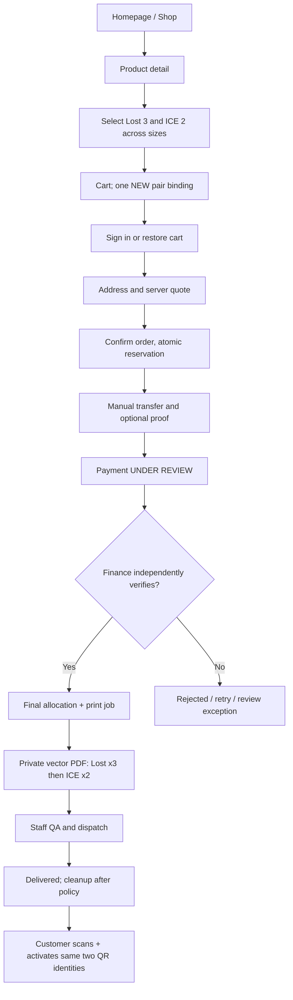
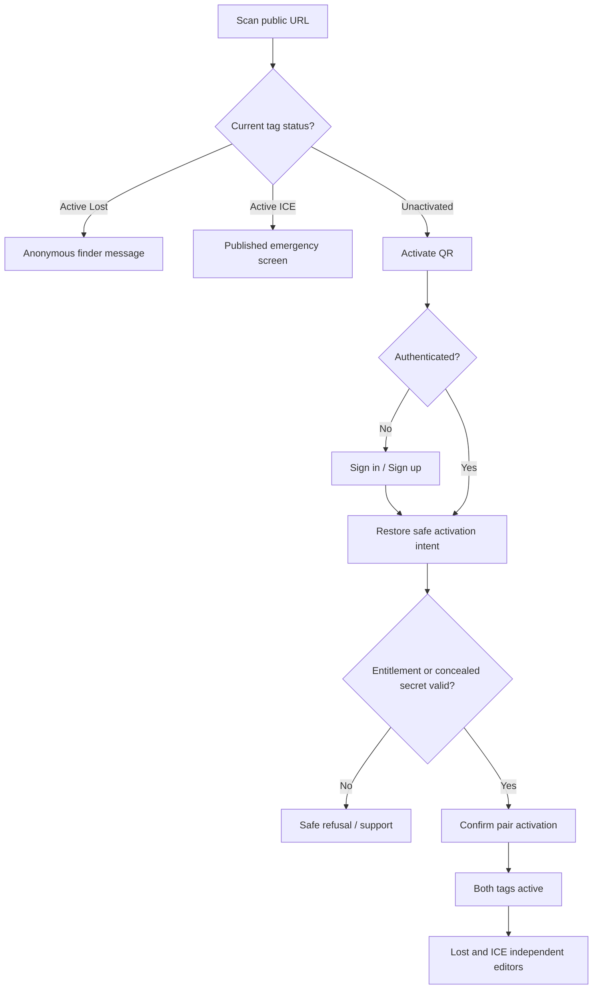
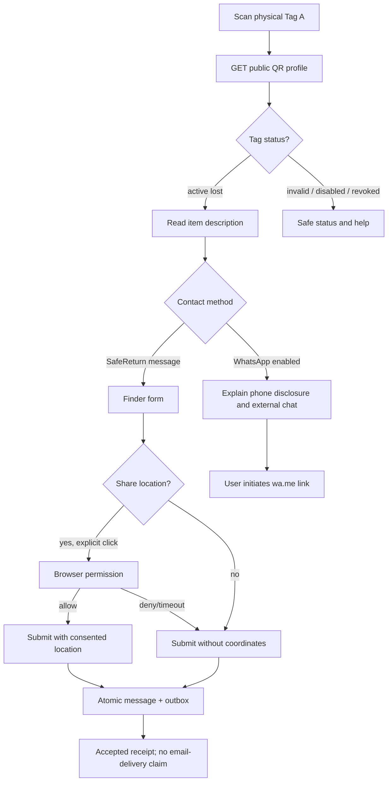
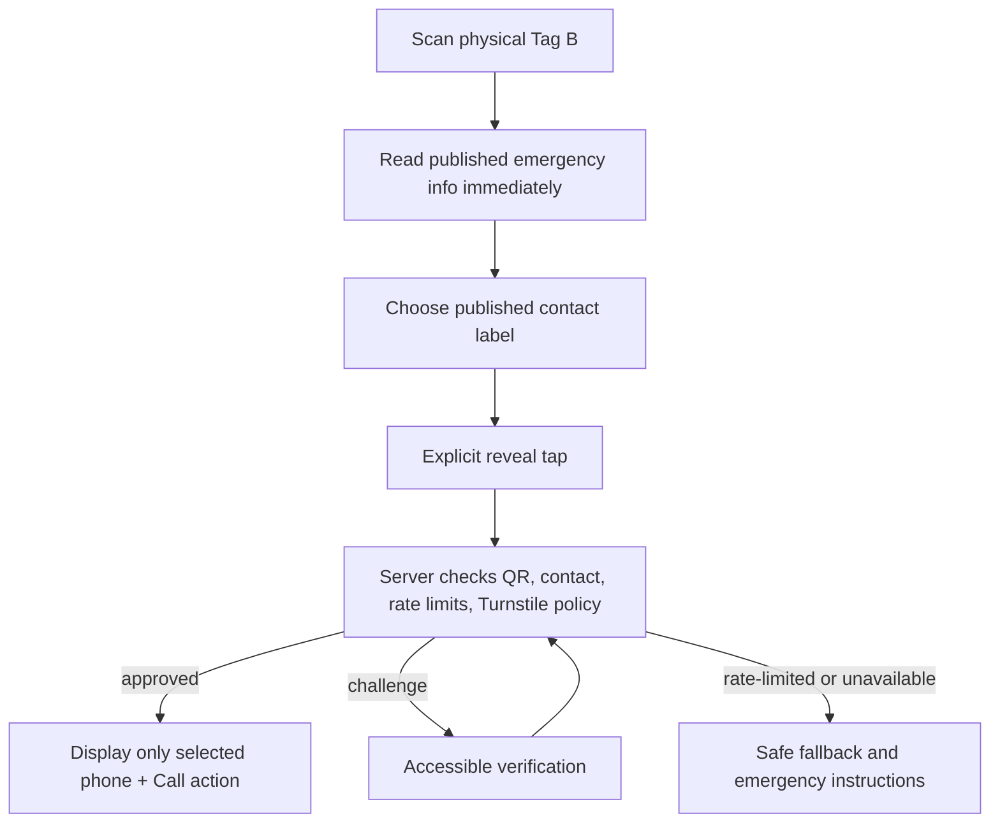
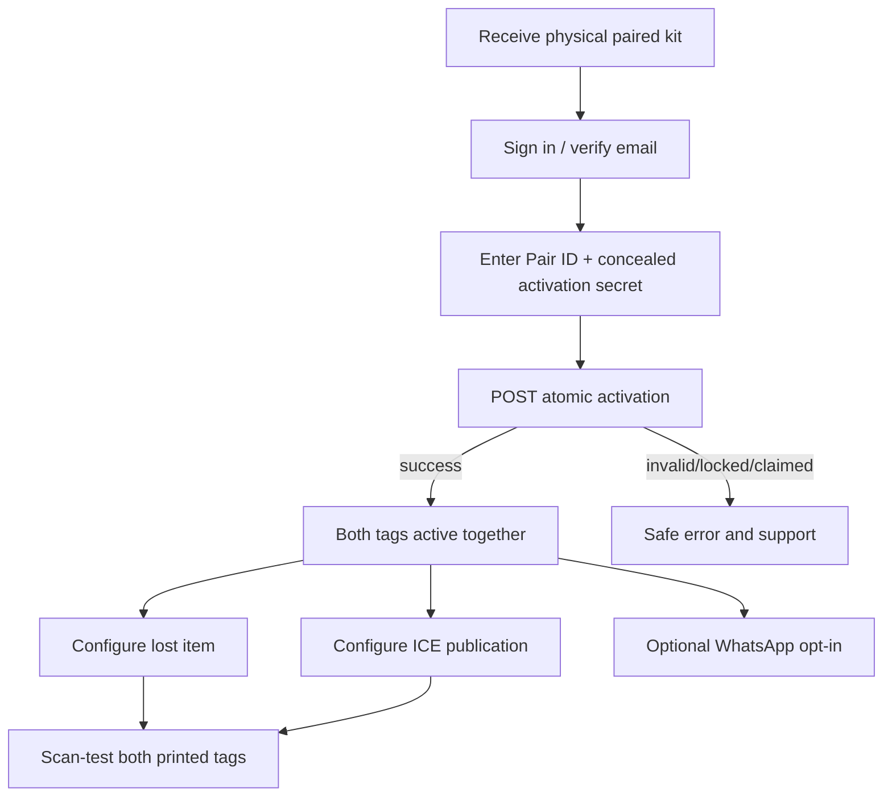
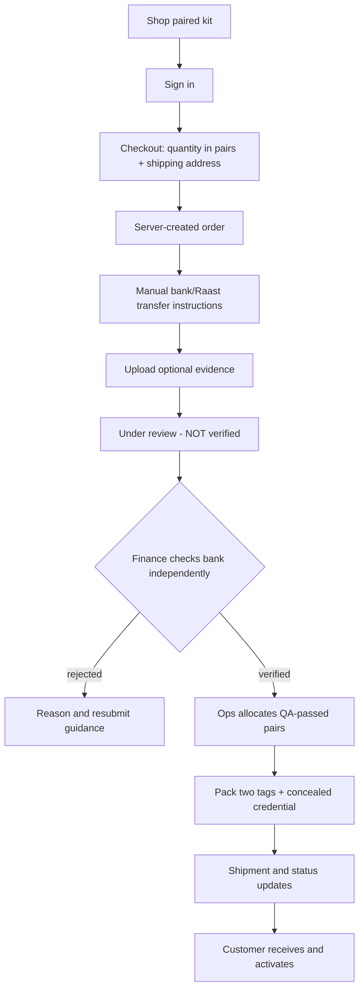

# SafeReturn — Final UI/UX Design Specification v1.2

**Document:** SR-UX-010 (Document 11 of 11) | **Version:** 1.2 proposed | **Date:** 12 October 2026  
**Scope:** Complete public/QR/authentication/customer/staff web UI, routes, components, behavior, responsiveness, copy, accessibility and acceptance | **Lahore pilot**  
**Sources:** SafeReturn Documents 01–10 v1.2; original Final UI/UX Design Specification v1.1; user-provided LifeTag HTML/CSS/Bootstrap reference.  
**Status:** Design specification for review, not built screens or deployed functionality. Values marked *example* are not approved prices, phone numbers, legal advice, or production provider configuration.

> **Precedence:** Approved PRD v1.2 and founder ADRs → Technical/Database/API/Agent/Plan/Security/Test/Operations/Fulfillment v1.2 → this UI/UX document → archived v1.1 UI/UX (Part B). If a route/field/state conflicts with Docs 03–04, stop for contract reconciliation. Do not silently invent API endpoints or weaken privacy controls.

# PART A — CURRENT v1.2 COMPLETE UI/UX DESIGN

## 1. Purpose, boundaries and decisions

SafeReturn is a bilingual (English/Urdu), responsive commerce + paired-QR recovery platform. **P0 sales: QR stickers only.** The database, design components and admin product tooling accommodate future keychains, schoolbag tags, children’s and elderly badges; selling such items and reusing existing QR identities on them is **feature-gated** pending approval, child privacy review, manufacturer templates and QA. The LifeTag sample is a **layout/interaction inspiration only**; its branding, red color, text, contact details, schema JSON-LD, SEO identifiers, URLs, prices, misleading instant-access claims and “cannot edit after activation” statement must never be copied into SafeReturn.

### 1.1 Immutable product/interaction rules

1. One **pair** = one Pair ID + one distinct Lost public QR URL + one distinct ICE public QR URL + one concealed activation credential. Owner/activation are **pair-level** and atomic; Lost and ICE details/publication settings are **separate per QR**.
2. One account may own many pairs, displayed as both pair groups and an independently filterable QR collection. Profile edits only modify the selected tag. Physical copies carrying the same QR token always share the same profile.
3. A cart may request **3 Lost + 2 ICE copies**, possibly in different sizes, while creating only **one new pair**; additional quantities do not mint extra QR identities. Existing-QR reuse in future products is a distinct, owner-authorized choice.
4. QR link opens public resolver `/q/[token]`. Inactive valid QR → visible **Activate QR** CTA → sign-in/register if needed → restore server-bound pending QR context → confirm ownership via verified purchase entitlement or concealed secret → activate whole pair **without rescanning**. A public token alone never grants a claim.
5. Anonymous finder and emergency responder never need an account. ICE initial HTML/RSC/hydration/API must never expose full phone; protected explicit reveal is required. Location is optional, one-time, after user gesture. WhatsApp opt-in and number-disclosing.
6. Prices and availability are **server-calculated**; staff independently verify manual bank/Raast payments. A screenshot does not settle a payment. Payment adapter/UI supports future gateway verification with no order-contract rewrite.
7. Inventory generation and stock reservation use one canonical pair model. Payment review status and reservation expiry require safe reconciliation; no allocation to two customers.
8. After verified payment, render compact **vector-first** PDFs in private Supabase Storage: all Lost copies first, then ICE copies, grouped by print size; central SafeReturn logo, quiet zone, accurate scale, cut guides, separate concealed credential insert. Ready-to-Ship download is staff-gated. Cloudinary is for public catalog/media, not private evidence.
9. Financial Google Sheets mirror is asynchronous and not authoritative; show masked references only. Files expire by approved retention policy, preserving DB history. No public download links.
10. All public QR experiences and physical-facing instructions must support English/Urdu; design real RTL. Security/operations screens are English-first per the outstanding localization decision.

### 1.2 Product switches and approvals

| Flag / decision | P0 default | UI behavior |
|---|---|---|
| `catalog_stickers_enabled` | On | Published sticker variants visible |
| `catalog_future_products_enabled` | Off | No purchasable keychain/badge cards until approval; optional honest “coming later” teaser only |
| `reuse_existing_qr_on_new_product` | Off | Do not show reuse option to purchasers until entitlement/manufacturing tests pass |
| `payment_provider_manual` | On | Bank/Raast instructions, payer details, optional screenshot, pending verification |
| `payment_provider_gateway` | Off | Future redirect/hosted form states behind provider adapter; no false paid-success copy |
| `public_whatsapp` | Off per tag | Disabled until explicit owner consent |
| `emergency_reveal_fallback` | Pending approved security decision | Show safe challenge/unavailable state per approved policy; never promise unapproved bypass |
| `payments_evidence_retention_days`, `print_artifact_retention_days` | Founder/privacy approval | Copy references policy rather than hardcoded guarantees |
| Product price/shipping/dimensions | Server-controlled | Never embed HTML sample prices as business values |

## 2. Visual reference analysis and SafeReturn art direction

**Inspected input:** pasted HTML for an unrelated LifeTag Pakistan homepage. Reusable motifs: fixed sticky navbar with scroll shadow; high-contrast split hero with product carousel; feature pills; generous rounded product cards; short explanatory blocks; activation steps; bilingual explanation; contact/footer; responsive tablet/mobile rules. Problems not to replicate: invalid nested paragraph/header HTML, hardcoded imagery/prices/contacts and tracking keys, carousel dots for commented-out slides, intrusive WhatsApp floating button obstructing mobile controls, fake certainty about healthcare outcomes, non-editable activation warning, and page-long English-plus-Urdu duplication rather than actual language switching.

**Original SafeReturn adaptation:** trustworthy safety-commerce aesthetic, not a clone. Initial **proposed** brand tokens (founder sign-off required): ink `#142232`, primary Deep Teal `#0A756E`, bright accent `#19B8A2`, warm paper `#F7FAF9`, white `#FFFFFF`, mist border `#D7E6E2`, caution amber `#B86A12`, danger `#B63535`; minimum accessible contrast measured for each semantic pair, never inferred. Use toned teal hero gradient with soft geometric QR-dot pattern; red only for urgent warnings. Brand logo belongs in header/QR renderer, not LifeTag assets. Product images from Cloudinary with verified alt text. Typography English `Inter` / system UI; Urdu `Noto Nastaliq Urdu` or well-tested readable fallback; ensure Urdu body line-height and layout do not clip. Font licensing and actual rendering must be checked.

### 2.1 Design tokens, grid and movement

| Category | Specification |
|---|---|
| Container | 1200–1280px max; side gutters 24–40px desktop, 16–20px mobile |
| Breakpoints | compact <640px; tablet 640–1023px; desktop >=1024px, QA at 320/375/390/768/1024/1440px |
| Spacing | 4px baseline, 8/12/16/24/32/48/64/80px rhythm |
| Corners | 8px controls, 12px inputs, 16px cards, 24px hero media |
| Shadows | Soft, low-opacity and sparing; no motion-dependent affordances |
| Type hierarchy | Hero clamp ~34–60px; H2 ~28–40px; H3 ~20–26px; body 15–17px; labels >=13px |
| Forms | Visible label, helper/error text, 44px minimum touch target, explicit required/optional, autofocus only when non-disruptive |
| Motion | Hover transform <=4px, entrance 160–280ms, no automatic content scroll, obey prefers-reduced-motion |
| Feedback | Toast for non-critical confirmations; persistent inline alert for payment/activation/security outcomes |
| Icons | Consistent stroke icon family; icon+text for critical actions; meaningful accessible names |
| Images | LCP-optimized hero, responsive formats, lazy product cards, stable aspect ratio and skeletons |

### 2.2 Three application shells

- **Marketing shell:** announcement strip only when real, sticky desktop header (`Logo | Shop | How it Works | Activate | Help | Language | Sign in / My Account | Cart`), mobile drawer, public footer. No sticky WhatsApp bubble on scan pages.
- **Customer shell:** top header and collapsible side nav (`Overview, My QR Codes, My Kits, Orders, Inbox, Addresses, Account, Privacy, Support`), contextual page breadcrumbs, quick QR status + activation action. On narrow screens use a drawer and optionally 3–4 high-priority bottom shortcuts, never two navigation systems competing.
- **Admin shell:** independent protected layout, compact sidebar (`Overview, Orders, Payments, Ready to Ship, Shipments, Inventory, Batches, Products, Support, Notifications, Finance Sync, Storage, Audit`); permission-gated links and backend authorization, MFA required for finance/security; queue badges represent actual server counts.

## 3. Information architecture and screen inventory

All screen IDs below are stable design IDs. The original v1.1 registry (in Part B) remains a fallback reference for unchanged paths. New routes are **proposals** and require reconciliation with API Doc 04. `(...)` Next.js route groups are not URL segments. All QR images encode `/q/{token}` only.

### Public marketing

| ID | Proposed frontend route | Screen | Access |
|---|---|---|---|
| PUB-01 | `/` | Homepage | Public |
| PUB-02 | `/shop` | All products/catalog | Public |
| PUB-03 | `/shop/[sku]` | Product detail + QR copy configurator | Public |
| PUB-04 | `/how-it-works` | How it works | Public |
| PUB-05 | `/help` | Help/FAQ | Public |
| PUB-06 | `/privacy` | Privacy | Public |
| PUB-07 | `/terms` | Terms | Public |
| PUB-08 | `/contact` | Contact | Public |
| PUB-09 | `/cart` | Cart review — new | Public |
| PUB-10 | `/shop/category/[slug]` | Catalog category — future-ready | Public |

### Public scan

| ID | Proposed frontend route | Screen | Access |
|---|---|---|---|
| QR-01 | `/q/[token]` | Public QR resolver + inactive state | Public |
| QR-02 | `/q/[token]/message` | Finder message form | Public |
| QR-03 | `/q/[token]/message/sent` | Finder success | Public |
| QR-04 | `/q/[token]/contact/[contactId]` | Protected ICE contact reveal | Public |
| QR-05 | `/q/[token]/report` | Report abuse | Public |

### Authentication

| ID | Proposed frontend route | Screen | Access |
|---|---|---|---|
| AUTH-01 | `/auth/sign-in` | Sign in | As applicable |
| AUTH-02 | `/auth/sign-up` | Register | As applicable |
| AUTH-03 | `/auth/verify-email` | Verification | As applicable |
| AUTH-04 | `/auth/forgot-password` | Forgot password | As applicable |
| AUTH-05 | `/auth/reset-password` | Reset password | As applicable |
| AUTH-06 | `/auth/callback` | Auth callback/system | As applicable |
| AUTH-07 | `/auth/sign-out` | Sign out/system | As applicable |

### Customer

| ID | Proposed frontend route | Screen | Access |
|---|---|---|---|
| CUS-01 | `/dashboard` | Overview | Authenticated customer |
| CUS-02 | `/activate` | Claim scanned pair | Authenticated customer |
| CUS-03 | `/activate/success` | Activation success | Authenticated customer |
| CUS-04 | `/kits` | My pairs | Authenticated customer |
| CUS-05 | `/kits/[pairId]` | Pair summary | Authenticated customer |
| CUS-06 | `/kits/[pairId]/lost` | Edit Lost profile | Authenticated customer |
| CUS-07 | `/kits/[pairId]/ice` | Edit ICE profile | Authenticated customer |
| CUS-08 | `/kits/[pairId]/ice/contacts` | ICE contacts | Authenticated customer |
| CUS-09 | `/kits/[pairId]/contact-options` | Contact/WhatsApp settings | Authenticated customer |
| CUS-10 | `/kits/[pairId]/history` | Pair history | Authenticated customer |
| CUS-11 | `/messages` | Finder inbox | Authenticated customer |
| CUS-12 | `/messages/[messageId]` | Finder message detail | Authenticated customer |
| CUS-13 | `/checkout` | Checkout | Authenticated customer |
| CUS-14 | `/orders` | Orders list | Authenticated customer |
| CUS-15 | `/orders/[orderId]` | Order details | Authenticated customer |
| CUS-16 | `/orders/[orderId]/payment` | Payment method/evidence | Authenticated customer |
| CUS-17 | `/orders/[orderId]/shipping` | Shipment | Authenticated customer |
| CUS-18 | `/addresses` | Saved addresses | Authenticated customer |
| CUS-19 | `/account` | Profile | Authenticated customer |
| CUS-20 | `/account/privacy` | Consents/privacy | Authenticated customer |
| CUS-21 | `/support` | Customer support | Authenticated customer |
| CUS-22 | `/my-qr` | QR collection — new | Authenticated customer |
| CUS-23 | `/my-qr/[qrId]` | QR detail — new | Authenticated customer |
| CUS-24 | `/checkout/review` | Checkout review — new optional step | Authenticated customer |

### Admin

| ID | Proposed frontend route | Screen | Access |
|---|---|---|---|
| ADM-01 | `/admin` | Overview | Role-gated staff |
| ADM-02 | `/admin/orders` | Orders | Role-gated staff |
| ADM-03 | `/admin/orders/[orderId]` | Order detail | Role-gated staff |
| ADM-04 | `/admin/payments` | Payment review queue | Role-gated staff |
| ADM-05 | `/admin/payments/[submissionId]` | Payment decision (legacy-compatible) | Role-gated staff |
| ADM-06 | `/admin/inventory` | Inventory | Role-gated staff |
| ADM-07 | `/admin/inventory/[pairId]` | Pair inventory details | Role-gated staff |
| ADM-08 | `/admin/batches` | Batches | Role-gated staff |
| ADM-09 | `/admin/batches/new` | Create batch | Role-gated staff |
| ADM-10 | `/admin/batches/[batchId]` | Batch detail | Role-gated staff |
| ADM-11 | `/admin/qa/[pairId]` | Physical QA | Role-gated staff |
| ADM-12 | `/admin/shipments` | Shipments | Role-gated staff |
| ADM-13 | `/admin/shipments/new` | Create shipment | Role-gated staff |
| ADM-14 | `/admin/shipments/[shipmentId]` | Shipment detail | Role-gated staff |
| ADM-15 | `/admin/support` | Support tickets | Role-gated staff |
| ADM-16 | `/admin/support/new` | New case | Role-gated staff |
| ADM-17 | `/admin/support/[caseId]` | Case detail | Role-gated staff |
| ADM-18 | `/admin/notifications` | Outbox | Role-gated staff |
| ADM-19 | `/admin/audit` | Audit log | Role-gated staff |
| ADM-20 | `/admin/products` | Product management — new | Role-gated staff |
| ADM-21 | `/admin/products/new` | Create product — new | Role-gated staff |
| ADM-22 | `/admin/products/[productId]` | Product editor — new | Role-gated staff |
| ADM-23 | `/admin/products/[productId]/variants` | Variants editor — new | Role-gated staff |
| ADM-24 | `/admin/catalog/categories` | Categories — new | Role-gated staff |
| ADM-25 | `/admin/ready-to-ship` | Ready to Ship — new | Role-gated staff |
| ADM-26 | `/admin/print-jobs/[jobId]` | Print job/QA — new | Role-gated staff |
| ADM-27 | `/admin/finance/sheet-sync` | Google Sheets sync — new | Role-gated staff |
| ADM-28 | `/admin/storage` | Storage/retention — new | Role-gated staff |
| ADM-29 | `/admin/payments/attempts/[attemptId]` | Normalized payment review — new | Role-gated staff |

### System

| ID | Proposed frontend route | Screen | Access |
|---|---|---|---|
| SYS-01 | `/403` | Access denied | As applicable |
| SYS-02 | `/404` | Not found | As applicable |
| SYS-03 | `/offline` | Offline | As applicable |
| SYS-04 | `/error` | Unexpected error | As applicable |
| SYS-05 | `/maintenance` | Temporary outage — new | As applicable |

### 3.1 Global UI behavior

- When a user signs in from a scanned QR, an opaque, short-lived activation intent is stored/validated server-side or in a secure session and restored after callback; token alone never proves entitlement. Do not store medical/contact content or secrets in redirect query strings.
- Route guards are UX only; FastAPI independently checks user, role, resource owner, payment and reservation authority.
- Customer-visible product availability is derived from published catalog variants and feature flags, not a hardcoded frontend array.
- Accessibility: semantic headings/landmarks, real buttons, keyboard trap-free dialogs, visible focus, `aria-live` for asynchronous results, reduced-motion, RTL mirror where sensible. Public finder and ICE pages prioritize emergency readability over marketing.
- A missing/invalid/disabled/claimed QR is not treated as the same state: use distinct approved localized copy; never disclose private owner or inventory information.
- Mobile order forms use summary sticky bar where it does not hide critical fields; customer and staff tables collapse into labeled cards below 768px.

## 4. Full homepage specification — PUB-01

### 4.1 Desktop composition (recommended ordering)

1. **Sticky header (72px):** SafeReturn logo left; Shop, How it Works, Activate, Help links; EN/اردو switch, account avatar/sign-in and accessible cart count right. Scroll changes subtle shadow/surface (not brand identity). On mobile: logo, cart, menu; persistent simple navigation.
2. **Hero split (~55/45):** left “A simple scan can help return what matters” with dual-purpose copy (“Lost belongings. Emergency contact information. Two QR tags, one paired kit.”). Three brief trust chips: “No app needed to scan,” “Manage details anytime,” “English + اردو.” Primary CTA `Shop QR Stickers`; secondary `See How It Works`. Right: rounded white product display carousel with **only published featured products** (Cloudinary hero assets), short captions, accurate backend price/from-price, dot/arrow navigation, accessible keyboard controls and pause; never auto-cycle when reduced motion; limit autoplay or make manual default.
3. **Problem/solution mini-strip:** 2 columns illustrated with Lost tag (“Finders can send a message”) and ICE (“Responders can view only the details you publish”). No medical guarantees.
4. **Featured products horizontal scroll:** dynamically selected admin-featured products, 3–4 visible desktop/1.2 mobile cards, horizontal snap and arrow buttons; skeleton state, empty fallback. Launch only sticker card(s); future badge/keychain cards hidden until feature enabled. Every card contains image, title, variant summary, backend provided price, availability, and View/Customize CTA; no forced old sample pricing.
5. **How it works:** buy custom quantities → receive matched stickers/secret → scan and activate (login return without rescan) → edit Lost/ICE profiles independently → finders scan without accounts. Illustrated 5-step numbered cards, compact on mobile.
6. **Use cases:** bags, keys, luggage, helmets, vehicles (not guaranteed fit; usage matched to substrate). Future products as transparent teaser only when explicitly approved; avoid marketing unlaunched inventory as purchasable.
7. **Feature grid:** unique QR pair; private-by-default profiles; editable settings; bilingual scanning; finder message alerts; optional WhatsApp/location; protected ICE phone reveal. Cards ≤2 sentences, link to detail.
8. **Interactive kit explainer:** graphic showing Pair 001 → Lost token + Emergency token → multiple physical copies. Copy: “Three printed Lost stickers can all use one Lost QR profile.” No leaking any real QR token.
9. **Trust and safety notice:** explain that SafeReturn facilitates contact; it does not guarantee medical care or item recovery. Place support/trust links near CTA.
10. **About section:** localized mission/overview; avoid reproducing LifeTag’s separate two-column translations that double mobile scroll; EN/UR switch updates all relevant content, with bilingual physical-facing labels where required.
11. **FAQs:** accordion on scans, activation, changes to profiles, privacy, payment verification, delivery, sticker durability; reviewed answers and structured data only for visible content.
12. **Contact/support:** approved official SafeReturn channels and service-area facts, with genuine address/map only after verification. No LifeTag number, social accounts, Google tracking IDs or Karachi map.
13. **Footer:** product/help/legal navigation, social channels after verification, language, cookie/privacy link, copyright, accessible back-to-top.

### 4.2 Homepage wireframe (desktop, schematic)

```text
┌──────────────────────────────────────────────────────────────────┐
│ LOGO    Shop   How it works   Activate   Help      EN/اردو ☺ 🛒  │
├──────────────────────────────────────────────────────────────────┤
│ [Safety eyebrow]                       ┌──────────────────────┐ │
│ A simple scan can help                 │   PRODUCT IMAGE      │ │
│ return what matters                    │  ◀  Featured  ▶       │ │
│ Lost + Emergency, together             │  Label / price        │ │
│ [Shop Stickers] [Learn More]            └──────────────────────┘ │
│ ✓ No app   ✓ Editable   ✓ Bilingual                             │
├──────────────────────────────────────────────────────────────────┤
│                    LOST  │  EMERGENCY                             │
├──────────────────────────────────────────────────────────────────┤
│ FEATURED PRODUCTS                     ‹  [card][card][card]  › │
├──────────────────────────────────────────────────────────────────┤
│ HOW IT WORKS      01 → 02 → 03 → 04 → 05                         │
├──────────────────────────────────────────────────────────────────┤
│ FEATURES / PAIR EXPLAINER / FAQ / CONTACT / FOOTER                │
└──────────────────────────────────────────────────────────────────┘
```

### 4.3 Mobile homepage

Above fold: compact header, full-width headline/CTA, visible interactive product image below; 1.1–1.25 carousel cards peek to signal swipe; avoid nested carousels and horizontal page overflow. Keep tap targets ≥44px, hero text not overlaid on QR artwork, images lazy except LCP, first action clear. Sticky purchase CTA only on product detail (not entire homepage). Load only necessary third-party scripts after consent where required. Motion CSS default and reduced-motion variant both tested.

## 5. Public shop, product details, cart and checkout

### PUB-02 `/shop` — All products

**Layout:** banner “Find the right SafeReturn product”; category chips (All / QR Stickers / future categories only when published), sorting and availability; 3-column desktop cards / 2 tablet / 1–2 compact mobile; top search (with no-results), product photo, short type label, price, CTA, feature badges. Category filters are URL-backed for shareability; reset filters. Product count/paging accessible, no infinite load without alternate navigation. Empty catalog → informative safe message and support link.

### PUB-03 `/shop/[sku]` — Detailed configurator

**Desktop:** sticky photo/gallery left, configuration right; mobile gallery → title/price → variant selectors → quantity rows → sticky cart CTA. Gallery: controlled Cloudinary media, alt captions, magnification not interfering with keyboard. Clearly communicate **QR identity vs physical copy**. Product details: name, category, material and dimensions, optional variant availability, scope (Lost/ICE), care/print warranty, delivery estimate only if validated, support terms, FAQs. `size` is physical sticker dimension including quiet zone, not a new QR token.

**Sticker configurator:** two tables/cards with rows per approved size: `Lost QR: [size] [minus quantity plus]` and `Emergency QR: [size] [minus quantity plus]`. Total physical prints = sum of all count fields; unique QR identities = **two per new pair**. P0 minimum new pair: >=1 Lost and >=1 ICE copy; full constraints server-confirmed. Show live *estimate* only; canonical `POST /me/checkout/quotes` supplies final money/tax/shipping, availability and quote expiry. If multiple new pairs needed, provide an explicit “Number of kits / pairs” selection rather than silently creating one pair per sticker.

**Future products:** when feature-enabled, ask `Use existing QR` (opens authorized QR chooser, appropriate tag type) **or** `Create new paired QR identity`. Child badge introduces required guardian/legal check where applicable. Reusing an existing QR on a keychain shows bold warning: “Edits to this QR profile affect every item carrying this QR.” If new pair, show two managed QR identities and any physical kit/secret inclusions explicitly.

**Form states:** invalid size, quantity 0, availability dropped, price changed, pending quote, expired quote, out-of-stock (show explain/retry); no hidden default additional products. Cart summary consistently names the product, SKU, size, tag type, physical copies, and QR identity choice.

### PUB-09 `/cart` — Cart review

One line per product/variant/QR-binding group. Edit/remove, thumbnail, count-by-size/tag, new-pair versus reuse badge, server-derived subtotals, shipping estimate note and empty-cart CTA. Saved cart is never authoritative stock; refresh quote before confirmation. Avoid exposing QR public tokens in analytics. Guest may browse/edit cart; place order after sign-in and verified requirements per backend.

### CUS-13 `/checkout` and optional CUS-24 `/checkout/review`

**Step A — Shipping/contact:** chosen saved address or add address; full name, Pakistani phone with clear normalization guidance, province/city/area/postal details, landmark optional, address validation; selected delivery method where supported. Copy data into immutable order snapshot on confirmation.

**Step B — Review:** product image/name/ID/SKU/size and all Lost/ICE counts; new pair vs existing QR binding (show account-scoped nickname, not raw token), quantity, unit price, service/shipping charges, grand total in PKR from current unexpired quote. Highlight “Printed copies share their QR profile.” Reserve inventory on confirmation, never hold indefinitely; if concurrent stock consumed show clear retry path.

**Step C — Place order/payment:** make order + reservation safely, then display manual bank/Raast recipient details from trusted backend with copy controls, exact amount, order ID and instructions. Payer inputs: sender/account identifier (masked after submission), sender account-holder name, transaction/reference number if available, date/time, optional screenshot upload (allowed file types/limits from backend). Explain “Submitted for review — not yet paid/confirmed.” Allow returning to complete payment without duplicate order. Future gateway path replaces only payment method/verification components, preserving order summary and states.

**Step D — Receipt:** show order ID, separate `Payment under review` and `Order awaiting verification`, expected review time only if policy exists; `View order`, `Pay again/submit details` only when allowed. Never show “Payment successful” after a screenshot alone. Errors support retry/duplicate suppression and idempotency.

### CUS-14/15/16/17 — Orders and tracking

List with order number/date/amount/items and separate chips: **Payment:** awaiting/under review/verified/rejected/refunded (approved vocab); **Fulfillment:** unallocated/processing/ready to print/QA/ready to ship/dispatched/delivered/exception. Detail shows line snapshots, pair ID and QR assignment when permitted, masked payment account/reference, audit-friendly milestone timeline, shipment carrier/tracking when recorded, dispute/help CTA. Screenshot file never becomes a public order URL. Reorders are distinct new orders; reprinting same existing QR requires entitlement.

## 6. Anonymous QR and activation experience

### QR-01 `/q/[token]` resolver

Mobile-first under 400px; no carousel, forced login or marketing modal. SafeReturn logo and optional EN/اردو toggle. Resolution variants:

| QR status/type | Main content | Action |
|---|---|---|
| Valid, unactivated, unclaimed | “This SafeReturn QR isn't active yet.” Non-sensitive tag label; minimal explanation | **Activate QR** → safe claim/login intent |
| Valid, active Lost and published | Item nickname/category if published, “Found this item?” | Message owner; optional opted-in WhatsApp; optional one-time location on finder action |
| Valid, active ICE and published | Published emergency instructions/medical notes only under approved publication; disclose minimal data | Contact list label, explicit protected `Tap to reveal/call` |
| Valid but profile not published | Neutral “No public information available” | Support/report where justified; no private owner info |
| Suspended, revoked, invalid | Distinct localized safe states | Support/report; no owner enumeration |
| Offline/timeout | Offline explanation, safe retry | Retry; no cached sensitive ICE payload |

A finder scans a public URL and cannot use its token to log in as owner. QR scanner page must never expose raw activation secret. Auth redirects use allowlisted callback + short-lived validated claim context.

### QR-02/03 Lost finder form and receipt

Form: short message (<=1000 chars per API), optional contact method per policy, explicit checkbox/action to add **one-time browser location**, geolocation requested only after tap, editable consent before submit; anti-abuse challenge if necessary; submit sends server data and durable outbox event in one transaction. Show “Message received by SafeReturn” rather than “Owner has read it.” On notification provider failure, submission persists. Safe success receipt never repeats sensitive message in shareable URL. WhatsApp CTA only for opted-in number, clearly saying its use exposes phone and opens an external service.

### QR-04 protected ICE reveal

Initial screen shows only contact label/relationship and published notes, **never full phone** in HTML, hydration, metadata, API, logs or preloaded state. Click/tap reveal → authorization/abuse checks and optional approved challenge → individual contact number plus tap-to-call. Rate-limit and localized fallback if challenge provider fails according to approved emergency-access policy. No promise of medical verification or emergency response.

### CUS-02/03 Scan → login → activation (never scan twice)

State sequence:

```text
Physical QR scan → GET public tag status (unactivated) → Activate QR
→ store short-lived server-bound activation context
→ Sign in / Register / Verify email
→ callback to `/activate` with safe validated context
→ summary: detected Lost/ICE tag, Pair ID (safe label), entitlement verification
→ optionally concealed activation code (only when verified order linkage insufficient)
→ Confirm Activation → atomic activation of BOTH pair tags
→ success → two setup links: Edit Lost / Edit Emergency
```

Existing activated owner sees “Already activated in your account” and can manage; another account sees privacy-safe “This QR cannot be activated by this account”, not owner identity. Interrupted session/expired intent offers `Scan or enter Pair ID and secret` **only as authorized fallback**, not a forced second scan. Two concurrent claims cannot succeed. Never activate merely because public QR token was known. Activation success should show that both tags now share owner, but have independent profiles. Include bilingual physical insert guidance.


## 7. Customer account: overview, QR collection and independently editable profiles

### CUS-01 Dashboard overview

**Desktop wireframe:** side nav 240px; heading “Good to see you” + **Add/Activate QR** action; KPI tiles `Active pairs`, `QRs needing setup`, `Unread finder messages`, `Orders in progress` (server counts); next row `My QR cards` (2–3 cards with QR type and pair label) and `Recent finder activity` (private); bottom `My recent orders` with honest payment/fulfillment status and support shortcut. No public display of ICE medical notes, real phone numbers or location in dashboard previews. Cards link to exact QR, not to a generic user-level profile.

**Mobile:** header/overflow nav, one-column metrics, accordion cards and visible `My QR Codes` CTA; order and message summaries remain scannable. Zero-state “You have no activated QR pairs” + scan/activate/shopping guidance; never infer lost QR profile from customer account identity.

### CUS-22 `/my-qr` — Independent QR collection (v1.2)

Header “My QR Codes” and subtitle “Each QR has its own details.” Search by nickname/item label, filter `All / Lost / Emergency / Active / Draft / Suspended`, sort by recent update, group toggle `By pair / Individual QRs`. Each card: friendly alias, QR type icon, pair reference, public publication status, physical product uses count if available, `Manage`, optional `Preview public page` (explicit warning about visibility). A QR reused on keychain and bag remains **one card** with two product uses; 3 physical copies do not make 3 cards. Search must never leak users’ other pairs.

Example collection: Pair A Lost `School Backpack` + ICE `My ICE Profile`; Pair B Lost `House Keys` + ICE `Parent Emergency`, each editable independently. URL `/my-qr/[qrId]` is the canonical tag-level landing for authorized users; existing `/kits/[pairId]/lost` and `/ice` can use shared components preserving deep links.

### CUS-04/05 `/kits`, `/kits/[pairId]` — Paired context

Pairs list grouped by activation date: one Pair ID, two tag columns and owner/activation status. Pair detail displays **Lost card left; ICE card right** with separate `Edit details`, `Public preview`, `Pause/Publish` actions, and only pair-wide security/activation history. Don't allow “Change owner of Lost only” or “Activate ICE only.” For reserved/not-yet-delivered pairs show fulfillment and activation eligibility separately. QR type and read-only pair ID remain in header/breadcrumb.

### CUS-23 `/my-qr/[qrId]` — QR detail

Hero card: nickname, type, pair reference, tagged physical products, high-level state and last updated; tabs `Profile`, `Public preview`, `Settings`, `History`. Exact tag-specific schema, not generic “user profile.” Editing does **not** automatically publish; show explicit draft/published state. Share URL only for intentionally public scans; do not surface concealed credential here. Changing profile updates all physical copies using that same QR link, with contextual banner if reused.

### CUS-06 Lost profile editor

Fields guided by approved API DTO: item nickname/category and safe owner-published description; optional finder instructions, optional public images if approved, message/contact preferences, WhatsApp opt-in after exposure warning, publication toggle. Right-side preview (desktop) or separate tab (mobile) shows what an anonymous finder sees, excluding private owner identifiers. Save draft, publish/unpublish (explicit choice), errors inline, success toast, unsaved-changes warning; optimistic updates only when safe. Optional location is **finder-provided**, not always-on owner tracking.

### CUS-07/08 ICE profile and contacts editor

High-stakes data: opt-in medical/emergency notes and display name or non-identifying alias subject to approved disclosure policy; contacts listed as `Contact 1: Mother`, `Contact 2: Guardian` with protected numbers and explicit publish/reveal permissions. Sensitive fields distinguish `private`, `draft`, `published`. Initial public scan preview masks all full contact numbers; a simulated “Tap to reveal” action is separately labeled and cannot leak real numbers into SSR. Field-level consent explanation, last saved timestamp, delete confirmation, accessibility and locale testing. For minors: guardian-controlled profile; forbid public school/home identifiers by default, gate actual launch pending privacy/legal approval. Editing one ICE QR never writes to other pairs’ ICE profiles.

### CUS-09/10 contact preferences and pair history

Lost QR WhatsApp: off initially; opt in with confirm explaining number exposure through `wa.me`; disabling removes direct link from future public responses (account for caches). History is read-only audited activation/replacement/security events, redacted IP/PII; no secret reveal. Emergency phone disclosure has its own approved security settings, separate from WhatsApp preference.

### CUS-11/12 finder inbox

Unread badge, timestamp, linked **specific Lost QR nickname**, sender message, optional location consent marker, notification delivery status separately from message receipt; detail shows safe text, optional map link only after deliberate owner click, delete/report controls, retry-safe pagination. Never mix inboxes of two customers, and never label an external WhatsApp conversation as a SafeReturn inbox message.

### CUS-18–21 account settings

Addresses have add/edit/delete/default and deletion guards when linked to an active order; account profile shows verified email and sensitive-change re-auth; privacy page has per-feature consent history/export/delete-account request per policy; support shows order-linked help and FAQ without inventing an unsupported chat endpoint.

## 8. Admin experience: complete operations interface

### 8.1 Staff shell, UX constraints and priorities

Sticky top bar: workspace breadcrumb, environment indicator, alert bell, staff role/avatar, sign-out; left sidebar with category groupings; content max-width ~1600px for data tables. Status chips have text and icon, not color alone. Filters persist in query string; all privileged actions require server validation, explicit confirmation and audit record. Sensitive financial details are masked until role-authorized; no bulk screenshot download or public PDF URL. Finance reviewer cannot manufacture new QR stock silently; fulfillment cannot verify bank settlement.

### ADM-01 `/admin` — Overview dashboard

First row cards: `Payment submissions awaiting review`, `Reserved pairs`, `Inventory nearing threshold`, `Print jobs awaiting QA`, `Orders ready to ship`, `Delivery exceptions`. Chart only when real aggregated data; don't fabricate metrics. Second section action queues, each linking to filtered operational page. Third section recent failures (outbox, finance Sheets sync, PDF renderer, storage cleanup) visible by role. Alerts differentiate actionable errors from informational jobs.

### ADM-20–24 Product management (new)

**Products list:** thumbnail, Product ID, name, category, SKU/variants, status (`draft/published/archived`), featured flag, last edited, quick `Edit`/`Preview`; create CTA. Future categories are supported in database but never publicly displayed until product/category is published *and* feature gate enabled.

**Create/Edit wizard:** (1) Basics: unique ID generated server side, name, slug, category, description, intended use and safety notices; (2) Media: Cloudinary signed upload, reorder image gallery, alt text, safe crop, upload state; (3) Variants: SKU, physical size/material/color, stock/availability, price and rules for `Lost/ICE copy type`, QR mode `new pair/reuse eligible pair` when enabled; (4) Production: approved printing/material template and QA requirements; (5) Merchandising: featured, display order, launch visibility and SEO preview; (6) Review & publish: missing-field validation, legal/QA confirmation. Product **archive**, not destructive delete, when order references exist. Edits never change immutable historical order snapshots.

**Layout:** sticky `Save draft`, `Preview`, `Publish` actions; right-hand phone/desktop card preview; variants in editable accessible rows with separate inline error. Media crop should avoid embedding secret/public QR token in marketing photos. Publish action must check product readiness, prices, fulfillment template and feature gate. Catalog API endpoints API-220..229 as mapped in Doc 04.

### ADM-02/03 Admin orders

List filter by separate **payment and fulfillment** states, order date, product, delivery status; search order ID/approved customer fields. Detail: immutable order line snapshots (product ID/name/SKU/variant, sizes, Lost and ICE counts, new/reused QR binding), masked customer contact/shipping, payment attempt timeline, reservation/allocation, print artifacts, shipment events and audit. Disallowed actions hidden and backend-rejected. Never approve payment from an order-level generic green checkbox; use finance review command.

### ADM-04/05/29 Payment review

Queue prioritizes oldest submitted attempts, amount, order ID, method, submitted date, verification pending status. Detail two-pane: left payment information (masked sender account, holder, transfer reference, screenshot only via secure short-lived view if authorized), right independent reconciliation panel (trusted bank ledger/reference, amount, time, uniqueness). Clear **Approve verified** / **Reject with reason** buttons, optional second reviewer policy, irreversible-action confirmation and audit reference. A screenshot itself is **not bank verification**; UI requires acknowledgement of independent bank check. Approving drives canonical backend payment transition, not direct `orders.status` mutation; future gateway webhooks populate verified provider evidence and manual UI remains exception handling.

### ADM-06–11 Inventory / batches / print QA

**Inventory:** KPIs available/held/allocated/QA failed/revoked, low-stock threshold controls only for authorized ops, table pair ID, current Lost/ICE identities (masked tokens), batch, QA, reservation and status. Avoid “unsold” standalone source-of-truth conflicts.

**Create batch:** number of complete pairs input, projected **2 distinct QR tokens per pair**, cost/QA note, operator confirmation; asynchronous progress + success manifest. Do not display plaintext activation secrets in ordinary table/download. `API-090` is the canonical creation command. Batch detail: generation progress, QA passes/fails, secure credential insert handling, print proof controls; operator may label release only after verification.

**Physical QA:** form for image/logo placement, ECC/quiet zone, minimum size, contrast, printed URL scan tests (both tags), concealed credential packaging check, staff/time and fail reasons. QR appearance is not ownership proof. Never change token after print. Retry/rework uses tracked job.

### ADM-25/26 Ready to Ship and print jobs (new)

Dedicated primary nav item and overview CTA. Queue rows: Order ID, customer destination region (least necessary), printed copy counts by type/size, PDF job status, payment status, QR pair count, QA status, age and actions. Only show eligible payment-verified/allocated orders. `Download print PDF` uses API-236 signed download grant **after** role check; file not stored in browser long term. PDF layout preview thumbnail may be server-rendered **redacted**; never expose raw credential insert publicly. Print progress: `queued → rendering → ready → downloaded → QA pass → packed → ready to dispatch`, subject to Doc 03/04 canonical enums. Regenerate/reprint requires reason/authorization, artifact version and audit; do not silently mint new QR IDs. On file deletion after retention, UI shows metadata + `Regenerate if permitted`, not broken link.

### ADM-12–14 Shipments

Create shipment only for QA-passed eligible orders, validate package contents and paired inserts, copy address from order snapshot, carrier and tracking entry, dispatch proof, delivery update, exceptions and replacement initiation. Deliveries based on trusted event/operator action, not automatic PDF deletion on tentative tracking. Customer sees timestamped state, not admin-only notes.

### ADM-15–19, 27–28 Operations

**Support:** case list/detail with linked order/tag, safe permissions, escalation and note redaction. **Notification outbox:** queued/retry/dead-letter; manual retry audited, never duplicate finder message creation. **Audit:** immutable event timelines, role and time filters with redacted payload. **Google Sheets finance mirror:** counts queued/synced/failed, last successful sync, row reference (not financial plaintext), authorized retry API-239; DB/payment source-of-truth never changed by Sheets status. **Storage & retention:** metadata-only list private PDF/evidence artifacts, expiry, legal hold and cleanup state; authorized hold/remove actions with explicit confirmation and restricted roles, no direct public bucket browsing.

### 8.2 Admin text-only wireframe

```text
┌─────────────────┬───────────────────────────────────────────────────────┐
│ SafeReturn Ops  │ Admin > Ready to Ship      🔔   Finance / Ops Avatar │
│ Overview        ├───────────────────────────────────────────────────────┤
│ Orders          │ [Pending 08] [QA required 03] [Ready 05]            │
│ Payments        │ Search Order ID  [Status] [Date]  [Refresh]        │
│ Ready to Ship   │ --------------------------------------------------  │
│ Shipments       │ #SR-10025   Lost:3 ICE:2  Payment:Verified          │
│ Inventory       │ PDF:Ready   QA:Pending   [View] [Download (role)] │
│ Batches         │ #SR-10026   PDF:Rendering  [View]                  │
│ Products        │                                                     │
│ Support         │ Drawer: item snapshots / pair / proof / print QA   │
│ Notifications   │                                                     │
│ Finance Sync    │                                                     │
│ Storage / Audit │                                                     │
└─────────────────┴───────────────────────────────────────────────────────┘
```

## 9. Complete screen specification matrix

Use this matrix with the full route registry; screen requirements in §§4–8 are mandatory. `N/A` means no authenticated edit privilege, not missing implementation. Base state set for every interactive screen: initial/skeleton, empty, populated, optimistic pending when safe, input invalid, network retry, unauthorized/forbidden, success, and conflict.

| Screen family | Core controls | Distinct empty/error behavior | Key quality gate |
|---|---|---|---|
| Marketing home/catalog | carousel, filters, search, product links | catalog disabled/out-of-stock without false sale | no unpublished price/product leak |
| Product configurator | gallery, size/tag copy rows, binding choice if enabled | invalid copy minimum, stale quote, variant unavailable | exact count and new-pair semantics |
| Cart/checkout | edit line, address, quote, confirm | expired quote, stock race, invalid address, duplicate confirm | no incorrect total or double reservation |
| Payment | bank instructions, reference, payer, evidence | upload limit, provider down, duplicate reference, review delay | no screenshot-based approval |
| Public inactive QR | Activate QR, locale | revoked/suspended/unknown differentiated | no unauthorized activation |
| Public Lost | message, optional location, WhatsApp if opted in | offline, Turnstile failure, email pending | no forced auth/geolocation |
| Public ICE | published info, contact reveal | provider challenge outage/fallback | phone absent before reveal |
| Auth/activation | login, sign-up, resume intent, confirm | expired intent, wrong account, lost session | no rescanning in normal path |
| QR collection | search/filter/group/manage | no pairs, no matches, suspended | multiple independent QR identities |
| Lost/ICE editors | draft, publish, preview, consent | validation, save conflict, privilege revoked | edits limited to selected QR |
| Orders/inbox | filters, details, milestones | no orders/messages, pagination errors | strong owner authorization |
| Admin products | create/edit/publish/media | invalid SKU, feature gate off, Cloudinary failure | audit + snapshots retained |
| Admin payments | review, approve/reject | missing independent verification | MFA/role gate |
| Admin inventory | generate pairs, QA, reservations | low stock, double allocation, batch failure | lock/invariant tests |
| Ready to Ship | jobs, PDF download, print QA | artifact deleted, regenerate failure | signed private access |
| Finance sync/outbox | retry, status | provider outages, jobs stuck | durable async recovery |
| Retention/audit | object metadata, holds | blocked by legal hold, permission denied | no unauthorized deletion |

## 10. End-to-end user flows (UI state diagrams)

### 10.1 New order: one pair, five printed copies



### 10.2 Scanner and activation



### 10.3 Existing QR attached to future product (feature-gated)

Customer selects published keychain → `Use existing QR` → chooses eligible authorized QR → sees “all physical copies share one profile” → reviews product material/size and binding → checkout snapshots selected `qr_id` → production prints the same token on approved keychain template → My QR shows linked usages, not duplicated QR cards. In contrast, choosing `New QR` starts a new paired identity with separate profiles, subject to confirmed kit composition and pricing. Never promise available for checkout before launch gates.

### 10.4 Exception flows

- Wrong user tries claiming unactivated tag: ownership withheld; show support and secret/entitlement verification, no private owner data.
- No stock: preserve cart, show explicit restock/availability response, do not accept an impossible order.
- Bank review delayed: order remains under review, separate from fulfillment; surface submitted timestamp and support option.
- PDF renderer/worker down: order/payment remain verified, queue retry with clear staff alert; do not generate duplicate pair.
- Google Sheets down: finance row marked pending sync; approve payment from DB/bank only.
- Delivery exception: hold temporary artifact deletion/reprint status per approved policy.
- Public ICE challenge unavailable: use approved fallback or explicit emergency-access error; do not silently strip required security.

## 11. Shared components and developer implementation contract

| Component | Props/data | Interaction/validation |
|---|---|---|
| `MarketingHeader` | nav configuration, session, locale, cart count | drawer, active route, sticky shadow, keyboard support |
| `ProductHeroCarousel` | published featured items | arrows, pause, accessible captions, stable image dimensions |
| `FeaturedProductsScroller` | published featured product list | snap, arrows, hidden future products, empty fallback |
| `ProductCard` | product ID, name, variant, Cloudinary image, server price | link to sku, no secret binding |
| `CopyQuantityMatrix` | variant sizes, Lost/ICE copy counts, limits | min/new-pair rules, totals are preliminary |
| `QrBindingSelector` | new pair or authorized owned QR | gated reuse, server entitlement, shared-profile warning |
| `CheckoutPriceSummary` | signed/expiring quote | money string, shipping, taxes, stale state |
| `ManualPaymentForm` | bank instructions, payer fields, evidence upload | masked values, explicit under-review result |
| `OrderStatusTimeline` | payment and fulfillment events | separate labels, no inferred confirmations |
| `PairCard` / `QrIdentityCard` | pair and child summaries | navigates exact editable QR profile |
| `LostProfileEditor` / `IceProfileEditor` | authorized per-tag DTOs | separate validation/consent/publish preview |
| `PublicQrResolver` | safe public status | no sensitive SSR or activation privilege |
| `FinderContactForm` | public token and safe presentation | Turnstile, optional one-time location |
| `ProtectedPhoneReveal` | contact id and approved API | explicit click, rate-limits, phone not preloaded |
| `AdminQueueTable` | permissions, filters, cursor | accessible responsive cards and audit actions |
| `CatalogProductEditor` | product/variant/image DTOs | Cloudinary signed upload, feature flags |
| `PrintJobPanel` | job id, status, artifact metadata | privileged short-lived download, QA, regenerate |
| `FinanceSyncPanel` | sync state and retries | never modifies source payment status |

### 11.1 Data contract mapping to Doc 04 API

Marketing uses API-003/004/200–202; QR resolution API-010/207; activation API-032/208; QR collection API-030/031/205/206 and unchanged profile endpoints API-040–049; quote/cart/checkout API-203/204 and modified API-060–062; payment API-209–212 with API-214 future-gated; admin catalog API-220–229; inventory summary API-230 and canonical batch creation API-090; print queue API-232–237; finance Sheets API-238–239; payment reviewer API-240–241; artifact metadata/holds API-242–244. **Do not invent paths** for new screens: map them to these contracts or log an ADR before implementation. Frontend design path identifiers do not imply matching new REST endpoints.

### 11.2 Suggested Next.js component structure

```text
frontend/
  app/
    (marketing)/{page.tsx,shop/,how-it-works/,help/,contact/,privacy/,terms/,cart/}
    q/[token]/{page.tsx,message/,contact/,report/}
    auth/{sign-in/,sign-up/,verify-email/,forgot-password/,reset-password/,callback/}
    (customer)/{dashboard/,my-qr/,kits/,orders/,checkout/,messages/,addresses/,account/,support/,activate/}
    (admin)/admin/{orders/,payments/,ready-to-ship/,print-jobs/,products/,catalog/,inventory/,batches/,qa/,shipments/,support/,notifications/,finance/,storage/,audit/}
  components/
    layout/{MarketingHeader,CustomerShell,AdminShell,Footer}
    catalog/{ProductCard,ProductHeroCarousel,FeaturedProductsScroller,ProductGallery}
    checkout/{CopyQuantityMatrix,QrBindingSelector,OrderReview,PaymentMethodPanel}
    qr/{PublicQrResolver,PairCard,QrIdentityCard,LostProfileEditor,IceProfileEditor}
    operations/{AdminQueueTable,PaymentReview,PrintJobPanel,CatalogProductEditor}
    shared/{StatusChip,EmptyState,ErrorPanel,LanguageSwitcher,Dialog,FormField}
  features/{catalog,cart,checkout,qr,activation,finder,ice,orders,payment,inventory,print,admin}/
  lib/{api,auth,i18n,validation,permissions}/
  messages/{en,ur}.json
  tests/{unit,integration,e2e,accessibility}/
```

Folders/route groups are **suggested**, not proof the repo already has them. Source-code edits follow Doc 05 agent rules and Doc 06 tickets. All domain data passes through approved API, not browser `service_role` access.

## 12. Responsive and accessible interaction standards

| Surface | Desktop >=1024 | Tablet 640–1023 | Mobile <640 |
|---|---|---|---|
| Homepage | 2-column hero, 3–4 product cards peek | balanced hero, 2 cards | 1-column hero, ~1.2 card peek |
| Product detail | two-column gallery/configurator | gallery + side content | single stack, sticky add CTA (safe) |
| Customer dashboard | left sidebar, 2–3 widgets row | narrow sidebar/drawer | drawer, 1-column cards |
| QR collection | 3-card grid, pair toggle | 2 cards | 1 card, type filter chips |
| Profile editors | form + safe live preview | stacked panels | explicit Preview tab, save bar |
| Admin tables | dense sortable tables | horizontal scroll with headers | accessible labeled cards and filters drawer |
| Payment review | evidence and decision split panes | tabs | full-width modal-free sequential sections |
| Public QR | max-width 560px centered | same | single CTA and readable 16px body |

**RTL:** Change `dir="rtl"` for Urdu page groups; mirror directional padding, logical CSS properties, breadcrumb arrows and drawers, but keep QR images, phone numbers, emails, tracking IDs and price amounts in LTR isolates. Set correct language metadata; never rely on machine translating medical labels without review. Screen-reader text needs actual state, not “green status.”

**Accessibility requirements:** keyboard-only completion, visible focus, no color-only indicators, correct heading nesting, descriptive links/buttons, aria-live on quote/payment/status results, dialogs with escape/focus restoration, sensible error summaries, touch targets >=44px, safe viewport handling at 320px width, contrast at least WCAG AA relevant text standards, and test screen-reader announcement of public emergency action. Offer reduced-motion, non-autoplay fallback and non-JS readable content for urgent QR paths where practical.

**Media performance:** image sizes/`srcset`, lazy below fold, CDN caching for catalog images only, cache invalidation on product publish, no store for owner/ICE/private content, avoid third-party trackers on public emergency pages, never expose token in analytics. Lighthouse scores are targets to measure, not claims; adopt budgets at implementation kickoff.

## 13. UI status vocab, microcopy and privacy requirements

| Situation | Recommended visible English | Urdu direction (human review required) |
|---|---|---|
| Inactive scan | “This QR is ready to activate.” / “Activate QR” | “یہ کیو آر فعال ہونے کے لیے تیار ہے۔” / “کیو آر فعال کریں” |
| After login | “We saved the QR you scanned. Confirm ownership to activate your pair.” | Human-reviewed equivalent |
| QR activated | “Both QR tags are activated. You can edit their details separately.” | Human-reviewed equivalent |
| Multiple copies | “These copies share one QR link and one editable profile.” | Human-reviewed equivalent |
| Manual proof submitted | “Payment details submitted. Verification is pending.” | Human-reviewed equivalent |
| Payment verified | “Payment verified. We are preparing your order.” | Human-reviewed equivalent |
| Message submitted | “Your message was received. Delivery notification may take time.” | Human-reviewed equivalent |
| ICE reveal | “Tap to reveal this emergency contact number.” | “نمبر دیکھنے کے لیے ٹیپ کریں” (review) |
| WhatsApp consent | “Enabling WhatsApp makes your selected number available to people who scan this QR.” | Human-reviewed equivalent |
| Finder location | “Share my current location once (optional).” | Human-reviewed equivalent |

Avoid claims like “we guarantee rescue,” “completely anonymous WhatsApp,” “confirmed payment” after proof submission, or “once activated it cannot be edited.” Error codes map from API to reviewed user-facing copy; support request IDs shown without secrets. Data-entry labels must distinguish sender bank account from recipient SafeReturn bank account.

## 14. Design/prototype instructions for screen designers or AI UI agents

1. Design in this order: shared tokens & shells → homepage → product detail/configurator → cart/checkout/payment → public Lost/ICE and inactive scan → auth/activation → customer My QR editors → orders/inbox → admin orders/payment/product/inventory/print/ship → settings/support/system screens.
2. Each mockup needs high fidelity at 1440×900 and 390×844 plus 768px check, English and Urdu for public flows, loading/empty/error/success state designs, and annotation of sensitive/no-store fields.
3. Use source-derived entity labels and exact approved button actions; no generated fake reviews, unsupported certifications, fabricated stock, fake prices or sample Live bank numbers.
4. Make all controls functional in prototypes: carousels arrows; quantity increments update preview; account QR tab changes tag; `Activate QR` proceeds through protected auth; admin review has confirmation and pending outcome. Stubbed behavior must be labeled demonstration and never imply real payment.
5. Each screen handoff includes route/ID, role, API contracts, field validations, responsive behavior, bilingual strings, explicit error states, audit/security requirements and test IDs from Doc 08.
6. Ask product owner approval before changing lifecycle or printing rules. The user-provided LifeTag HTML is only visual reference and must not be incorporated as copied source, brand identity or live customer data.

## 15. Acceptance matrix and release sequencing

| Area | Manual design review | Integration test |
|---|---|---|
| Homepage | branded split hero, featured scroll, truthful inventory, mobile/Urdu | published-only catalog API, flags, accessibility |
| Product sizing | size × type counters and correct copy totals | 3 Lost + 2 ICE → ONE pair, 2 unique URL identities |
| Multi-account QR | many pairs and independent card/edit screens | edit one tag and assert others unchanged |
| Activation | login returns to exact scanned intent, no second scan | wrong account denied; pair atomic activation |
| ICE privacy | contact masked initially, explicit reveal action | inspect SSR/hydration/API/logs for phone leaks |
| Finder | simple form, location optional, bilingual | stored message + outbox atomic on Resend failure |
| Payments | manual under-review vs verified honest UI | screenshot cannot approve; independent finance review |
| Catalog admin | add images/variants, feature flags, archive | history snapshots immutable, gated products hidden |
| PDF | Lost before ICE, accurate sizes/cut marks, centered logo | printed scan tests, vector PDF, storage limited |
| Ready-to-Ship | job queue/download/QA/reprint/delivery | access controls, artifact expiry, audit |
| Sheets | pending/synced/retry status shown | outage never changes verified payment truth |
| Retention | metadata and legal hold clear | files expire per policy, order record preserved |
| Accessibility | 320px to 1440px, keyboard/RTL, reduced motion | Playwright/accessibility and physical device |

**Gate:** No production launch until founder signs off brand, product/size/price list, privacy/legal and ICE fallback policies, payment review SOP, shipping/retention durations, print calibration and multilingual copy. Test plan v1.2 defines evidence; this document is not a test execution report.

## 16. Open design decisions and cross-document reconciliation

| ID | Decision | Recommendation | Affected |
|---|---|---|---|
| UX12-01 | SafeReturn exact logo and primary palette | Agree tokens/mockups before publishing | Homepage, print branding |
| UX12-02 | Public catalog prices and size bands | Backend configured, not sample HTML | Product cards/checkout |
| UX12-03 | Cart guest persistence/login behavior | Signed server quote after login | Catalog, checkout |
| UX12-04 | Productized QR binding reuse launch | Hide until entitlement QA completed | Product detail/QR chooser |
| UX12-05 | Child and elder wearable privacy | Guardian consent/legal approval | Future product profiles |
| UX12-06 | QR activation credential policy | Purchased entitlement or concealed secret, not public token | QR-01/Auth/CUS-02 |
| UX12-07 | Current exact API status enums | Use Doc 03/04 canonical forms; matrix text is presentation copy | Order/print states |
| UX12-08 | Final PNG/PDF size and trim rules | Verify physical lab metrics and logo coverage | Product detail/PDF QA |
| UX12-09 | Screens added to v1.1 inventory | Approve new frontend routes, no new backend invented | App router/Doc 04 |
| UX12-10 | Payment proof and PDF deletion times | Founder/privacy policy incl. dispute/reprint/holds | Customer/admin UI |
| UX12-11 | Exact localization scope | Public English/Urdu P0; portal English-first pending approval | All screens |
| UX12-12 | Future gateway UX | Hosted provider/redirect with signed return/webhook; no success on redirect alone | Checkout/payments |

### 16.1 No silent changes to already completed documents

Any new route in Document 11 is a frontend page proposal and must align with API registry v1.2; when new persisted state is required, create an ADR and updated migration rather than implementing from a mockup. If text in archived Part B differs from v1.2 rules, current Part A and approved higher-authority v1.2 contracts win. Preserve the v1.1 requirements that are not contradicted. Release only the complete current file; don't delete archived historical design without explicit approval.

---

# PART B — ARCHIVED ORIGINAL UI/UX SPECIFICATION v1.1 (REFERENCE ONLY)

> **Archive note:** The complete original UI/UX v1.1 is embedded below unchanged for historical continuity. Route IDs and unaffected public/owner/admin screens remain useful implementation reference. Any conflicting rules, mockups, prices, language assumptions, API semantics or missing v1.2 requirements are superseded by Part A and the approved Documents 01–10 v1.2. Do not implement duplicate routes or conflicting behavior from this archive.

# SafeReturn — Final UI/UX Design Specification

**Document 10 of 10 — FINAL**  
**Version:** 1.1 · **Date:** 11 October 2026 · **Status:** Implementation-ready proposal; founder review required  
**Suggested repository location:** `docs/11-ui-ux-spec.md`  
**Platform:** Responsive Next.js App Router web application, public QR pages and authenticated customer/admin portals  
**Primary market:** Lahore, Pakistan · **Public languages:** English and Urdu (P0)

> This is the **last document** in the ten-document SafeReturn series. It specifies the full frontend information architecture, route inventory, screen requirements, transitions, interaction states, accessibility, bilingual RTL, responsive behavior, frontend/backend contracts, implementation sequence and acceptance criteria. It is not a claim that screens are built or that unapproved founder decisions are resolved. **Only this Markdown document is created.**

## 1. Authority, design principles and unresolved decisions

### 1.1 Source-of-truth hierarchy

1. PRD v1.0 and v1.1 amendment — product and P0 requirements.
2. Approved ADRs/founder decisions — override proposed defaults.
3. Technical Design (Document 1) — architecture and trust boundaries.
4. Database Design (Document 2) — pair ownership, current children, outbox, consent.
5. API Contract (Document 3) — **authoritative backend endpoint names and DTO semantics**; paths listed here without `/api/v1` are relative to that API prefix.
6. Agent Instructions (Document 4) — code and AI work rules.
7. Implementation Plan (Document 5) — task dependencies and phase gates.
8. Security & Privacy (Document 6) — publication, consent, ICE reveal, encryption.
9. Test Plan (Document 7) — verification and release evidence.
10. Deployment & Operations (Document 8) — environment and operational constraints.
11. Physical Product & Fulfillment SOP (Document 9) — label/kit production and QA.

**Important:** All page paths in this document are **proposed frontend routes**. API routes in Document 3 are already defined; do not mistake a Next.js page path for a FastAPI endpoint. If the frontend requires an endpoint not in Document 3, use an existing contract or file a change request. Do not invent backend behavior.

### 1.2 Experience principles

- **Scan-first:** A finder or emergency responder must see the relevant public content without login, account creation, or a purchase prompt.
- **Safety first:** Emergency instructions are immediate; contact phone is revealed only on explicit protected interaction; no hidden phone in SSR or hydration.
- **Two tags, one kit:** The owner activates a **single pair**, never two unrelated QR codes.
- **Trustworthy statuses:** Payment proof submission is not payment verification; email accepted for dispatch is not guaranteed delivered; geolocation is optional.
- **Low-bandwidth and mobile-first:** Fast, legible, keyboard/screen-reader accessible; usable on slower connections.
- **Urdu is a real first-class public experience:** Correct RTL, bidirectional phone/URLs, reviewed wording, persistent language choice.
- **Privacy by default:** WhatsApp off; medical notes unpublished until explicitly enabled; no automatic location permission.
- **Task-focused administration:** Staff can complete payments, inventory, QA, dispatch and support with auditability, without unnecessary sensitive-data exposure.

### 1.3 Design decisions to approve before implementation

| ID | Decision | Proposed default | Consequence |
|---|---|---|---|
| UX-DEC-01 | Canonical public site and QR host | Single verified production domain | Must finalize before printing |
| UX-DEC-02 | ICE Turnstile outage | Risk-adaptive server fallback, founder approval pending | Emergency reveal states |
| UX-DEC-03 | Customer/admin localization | English-first P1; **public QR English/Urdu P0** | Translation scope |
| UX-DEC-04 | Customer purchase before activation | Verified order allocation + authenticated verified user | Activation eligibility |
| UX-DEC-05 | Shipping/payment rates and refund rules | Display server-provided values; no client-calculated final total | Checkout copy |
| UX-DEC-06 | Finder/location retention | Follow approved policy, proposed <=180 days | Privacy notice |
| UX-DEC-07 | Medical and WhatsApp consent copy | Human-reviewed English and Urdu | Publication flows |
| UX-DEC-08 | Pair transfer UI | P1 by default (API-033) | Hide until approved |
| UX-DEC-09 | Admin MFA and roles | Required for finance and sensitive ops | Staff access |
| UX-DEC-10 | Anonymous order checkout | Not assumed; sign-in before `POST /me/orders` | Purchase funnel |
| UX-DEC-11 | Staff self-registration | Not allowed; provisioned by admin | Admin login |
| UX-DEC-12 | Upload proof architecture | Private signed upload flow requires API-contract reconciliation | Payment proof UI |

**No dark patterns:** Never precheck location, WhatsApp, medical publication, or contact disclosure; never mislabel a pending transfer as paid.


## 2. Audiences, jobs and permission model

| Audience | Primary job | Starting point | Authentication |
|---|---|---|---|
| Finder of lost item | Notify owner and optionally share location | Physical Tag A `/q/[token]` | None |
| Emergency responder | Read owner-published ICE instructions and reveal one contact | Physical Tag B `/q/[token]` | None; challenge/rate limits for phone |
| Shopper | Learn kit contents, buy paired kit | `/`, `/shop`, `/shop/[sku]` | Sign-in required to place order (P0 proposal) |
| New customer | Register and activate purchased pair | `/auth/sign-up`, `/activate` | Supabase Auth, verified email |
| Returning owner | Manage lost/ICE publication, inbox, orders | `/dashboard` | Authenticated; pair ownership |
| Finance staff | Verify manual bank payment | `/admin/payments` | Provisioned finance role + MFA |
| Fulfillment staff | Generate, QA, allocate, pack and ship pairs | `/admin/inventory`, `/admin/batches`, `/admin/shipments` | Ops role; elevated approval for sensitive actions |
| Support staff | Handle disputes, damaged tags, delivery exceptions | `/admin/support` | Support role |
| Security admin | Suspend compromised pairs, review audits and outbox metadata | `/admin/audit`, `/admin/notifications` | Security role + MFA |

### 2.1 Navigation model

- **Public header:** SafeReturn logo, Shop, How it works, Help, language selector on public QR pages, Sign in / My account. The **QR scan pages use a reduced emergency/finder header**; avoid distractions and intrusive banners.
- **Customer desktop sidebar:** Overview, My Kits, Activate Kit, Messages, Orders, Addresses, Account, Help; active item marked with `aria-current="page"`.
- **Customer mobile navigation:** Compact header + accessible menu drawer; high-frequency actions shown as prominent buttons on dashboard, not a crowded bottom bar.
- **Admin desktop sidebar:** Overview, Orders, Payments, Inventory, Batches, QA, Shipments, Support, Notifications, Audit (role-filtered).
- **Admin mobile:** Responsive tables become cards and filters move into drawer; sensitive actions remain available with confirmations but admin is optimized for tablet/desktop.
- **Breadcrumbs:** Customer details and admin deep pages; omit on public QR page.
- **Global route guards:** Anonymous accessing protected routes → sign-in with validated safe return path; customer accessing admin → forbidden; wrong staff role → forbidden; suspended account → safe explanatory page.

### 2.2 Navigation priority and interruption

1. Emergency content and contact action.
2. Finder message form and confirmation.
3. Owner activation and tag management.
4. Checkout/payment verification and order tracking.
5. Administrative workflow.

Never redirect a QR scanner to a generic landing page because the tag is disabled; show the specific safe QR status screen.


## 3. Complete frontend route registry

**Notation:** Next.js `app/` page paths; `[param]` is a dynamic segment. All API paths below are relative to `/api/v1`; Supabase Auth is not a SafeReturn FastAPI endpoint. Route slugs are proposals to be approved, not an instruction to change the API contract. **One `/q/[token]` URL resolves both tag modes**; `/q/[token]/message` and `/q/[token]/contact/[contactId]` are interaction routes, not independently encoded physical QR destinations.

| ID | Frontend route | Screen | Access | API/service |
|---|---|---|---|---|


| PUB-01 | `/` | Marketing home | Public | `GET /public/products` |


| PUB-02 | `/shop` | Product catalog | Public | `GET /public/products` |


| PUB-03 | `/shop/[sku]` | Product detail | Public | `GET /public/products/{sku}` |


| PUB-04 | `/how-it-works` | How SafeReturn works | Public | `Static reviewed content` |


| PUB-05 | `/help` | Public help | Public | `Static; optionally support API` |


| PUB-06 | `/privacy` | Privacy notice | Public | `Reviewed static copy` |


| PUB-07 | `/terms` | Terms and emergency disclaimer | Public | `Reviewed static copy` |


| PUB-08 | `/contact` | Contact and support guidance | Public | `POST /public/abuse-reports (QR abuse only)` |


| QR-01 | `/q/[token]` | Public QR resolver | Public | `GET /public/qr/{token}` |


| QR-02 | `/q/[token]/message` | Lost-item finder form | Public | `GET /public/qr/{token}; POST /public/qr/{token}/messages` |


| QR-03 | `/q/[token]/message/sent` | Finder submission receipt | Public | `POST /public/qr/{token}/messages (prior step)` |


| QR-04 | `/q/[token]/contact/[contactId]` | ICE contact reveal | Public | `POST /public/qr/{token}/contact-reveals` |


| QR-05 | `/q/[token]/report` | Report QR abuse | Public | `POST /public/abuse-reports` |


| AUTH-01 | `/auth/sign-in` | Sign in | Anonymous | `Supabase Auth` |


| AUTH-02 | `/auth/sign-up` | Create account | Anonymous | `Supabase Auth` |


| AUTH-03 | `/auth/verify-email` | Email verification status | Anonymous/partial | `Supabase Auth` |


| AUTH-04 | `/auth/forgot-password` | Password reset request | Anonymous | `Supabase Auth` |


| AUTH-05 | `/auth/reset-password` | Set new password | Reset session | `Supabase Auth` |


| AUTH-06 | `/auth/callback` | Auth callback handler | System | `Supabase Auth` |


| AUTH-07 | `/auth/sign-out` | Sign out action | Authenticated | `Supabase Auth` |


| CUS-01 | `/dashboard` | Owner overview | Customer | `GET /me; /me/tag-pairs; /me/finder-messages; /me/orders` |


| CUS-02 | `/activate` | Activate paired kit | Verified customer | `POST /me/tag-pairs/activations` |


| CUS-03 | `/activate/success` | Activation success | Owner | `GET /me/tag-pairs/{pair_id} if known` |


| CUS-04 | `/kits` | My paired kits | Customer | `GET /me/tag-pairs` |


| CUS-05 | `/kits/[pairId]` | Pair detail | Owner | `GET /me/tag-pairs/{pair_id}` |


| CUS-06 | `/kits/[pairId]/lost` | Edit lost-item tag | Owner | `GET/PUT /me/qr/{qr_id}/lost-profile; PATCH /me/qr/{qr_id}/public-status` |


| CUS-07 | `/kits/[pairId]/ice` | Edit ICE tag | Owner | `GET/PUT /me/qr/{qr_id}/ice-profile; PATCH /me/qr/{qr_id}/public-status` |


| CUS-08 | `/kits/[pairId]/ice/contacts` | ICE contacts | Owner | `GET/POST/PATCH/DELETE /me/qr/{qr_id}/ice-contacts` |


| CUS-09 | `/kits/[pairId]/contact-options` | WhatsApp contact settings | Owner | `GET/PUT /me/qr/{qr_id}/contact-preferences` |


| CUS-10 | `/kits/[pairId]/history` | Pair activation history | Owner | `GET /me/tag-pairs/{pair_id}/activation-history` |


| CUS-11 | `/messages` | Finder inbox | Recipient customer | `GET /me/finder-messages` |


| CUS-12 | `/messages/[messageId]` | Finder message detail | Recipient customer | `GET/PATCH/DELETE /me/finder-messages/{message_id}` |


| CUS-13 | `/checkout` | Create paired-kit order | Customer | `GET /public/products; POST /me/orders; addresses APIs` |


| CUS-14 | `/orders` | My orders | Customer | `GET /me/orders` |


| CUS-15 | `/orders/[orderId]` | Order detail | Order owner | `GET /me/orders/{order_id}; /payment-submissions; /shipments` |


| CUS-16 | `/orders/[orderId]/payment` | Submit transfer evidence | Order owner | `POST /me/orders/{order_id}/payment-submissions` |


| CUS-17 | `/orders/[orderId]/shipping` | Shipment tracking | Order owner | `GET /me/orders/{order_id}/shipments` |


| CUS-18 | `/addresses` | Shipping addresses | Customer | `GET/POST/PATCH/DELETE /me/shipping-addresses` |


| CUS-19 | `/account` | Account profile | Customer | `GET/PATCH /me` |


| CUS-20 | `/account/privacy` | Privacy and consents | Customer | `GET /me/privacy-consents; POST /me/account-deletion-requests` |


| CUS-21 | `/support` | Customer support guidance | Customer | `Static/approved support workflow` |


| ADM-01 | `/admin` | Staff overview | Role-gated staff | `Approved admin list endpoints` |


| ADM-02 | `/admin/orders` | Admin orders | Ops/finance | `GET /admin/orders` |


| ADM-03 | `/admin/orders/[orderId]` | Admin order detail | Ops/finance | `GET /admin/orders/{order_id}` |


| ADM-04 | `/admin/payments` | Payment review queue | Finance+MFA | `GET /admin/payment-submissions` |


| ADM-05 | `/admin/payments/[submissionId]` | Payment decision | Finance+MFA | `POST /admin/payment-submissions/{id}/reviews` |


| ADM-06 | `/admin/inventory` | Pair inventory | Ops | `GET /admin/tag-pairs` |


| ADM-07 | `/admin/inventory/[pairId]` | Pair inventory detail | Ops | `GET /admin/tag-pairs/{pair_id}; allocation/release/suspend/replacement endpoints` |


| ADM-08 | `/admin/batches` | Production batches | Ops | `GET /admin/qr-batches` |


| ADM-09 | `/admin/batches/new` | Create batch | Ops | `POST /admin/qr-batches` |


| ADM-10 | `/admin/batches/[batchId]` | Batch detail and print export | Ops, export privileged | `GET /admin/qr-batches/{batch_id}; POST /print-exports` |


| ADM-11 | `/admin/qa/[pairId]` | Record physical print QA | Ops | `POST /admin/tag-pairs/{pair_id}/print-qa` |


| ADM-12 | `/admin/shipments` | Shipment operations | Ops | `POST /admin/shipments; PATCH /admin/shipments/{shipment_id}` |


| ADM-13 | `/admin/shipments/new` | Create shipment | Ops | `POST /admin/shipments; GET /admin/orders; GET /admin/tag-pairs` |


| ADM-14 | `/admin/shipments/[shipmentId]` | Update shipment | Ops | `PATCH /admin/shipments/{shipment_id}` |


| ADM-15 | `/admin/support` | Support cases | Support | `GET /admin/support-cases` |


| ADM-16 | `/admin/support/new` | Create support case | Support | `POST /admin/support-cases` |


| ADM-17 | `/admin/support/[caseId]` | Support case detail | Support | `PATCH /admin/support-cases/{case_id}` |


| ADM-18 | `/admin/notifications` | Notification outbox monitor | Ops/security | `GET /admin/notification-outbox; POST /admin/notification-outbox/{id}/retry` |


| ADM-19 | `/admin/audit` | Audit events | Security admin | `GET /admin/audit-events` |


| SYS-01 | `/403` | Access denied | Any | `No API needed` |


| SYS-02 | `/404` | Not found | Any | `No API needed` |


| SYS-03 | `/offline` | Offline assistance | Any | `Browser network state` |


| SYS-04 | `/error` | Unexpected error | Any | `Safe error mapping` |


### 3.1 Routing implementation rules

- Only `/q/[token]` is printed in physical QR artwork; backend determines `lost` vs `ice` from the token.
- Do **not** include activation secret, phone, medical notes, coordinates, payment proof or JWT in frontend URLs.
- A contact ID in a URL is an opaque identifier, **not** authorization. The protected reveal endpoint performs authorization and abuse checks.
- `/activate/success` and `/q/[token]/message/sent` must not require secrets in query parameters; use safe transient client state or reloadable non-sensitive server status.
- After sign-in, allow return only to internal allowlisted paths; prevent open redirects.
- Admin sidebar entries are permission-filtered, but **server authorization is mandatory** regardless of hidden links.
- For unactivated, disabled, suspended or revoked QR, render a safe state on the QR page; do not redirect to marketing home.
- Do not pre-render public QR pages as permanent static content. Use fresh status lookup and no-store for sensitive reveal responses.
- Do not create undocumented API endpoints for customer support, shipment details or uploads without approved contract amendment.

### 3.2 Route-group file structure (proposed)

```text
frontend/
  app/
    (marketing)/page.tsx
    (marketing)/shop/page.tsx
    (marketing)/shop/[sku]/page.tsx
    (marketing)/how-it-works/page.tsx
    (marketing)/help/page.tsx
    (marketing)/privacy/page.tsx
    (marketing)/terms/page.tsx
    (marketing)/contact/page.tsx
    q/[token]/page.tsx
    q/[token]/message/page.tsx
    q/[token]/message/sent/page.tsx
    q/[token]/contact/[contactId]/page.tsx
    q/[token]/report/page.tsx
    auth/sign-in/page.tsx
    auth/sign-up/page.tsx
    auth/verify-email/page.tsx
    auth/forgot-password/page.tsx
    auth/reset-password/page.tsx
    auth/callback/route.ts
    (customer)/dashboard/page.tsx
    (customer)/activate/page.tsx
    (customer)/kits/page.tsx
    (customer)/kits/[pairId]/page.tsx
    (customer)/kits/[pairId]/lost/page.tsx
    (customer)/kits/[pairId]/ice/page.tsx
    (customer)/kits/[pairId]/ice/contacts/page.tsx
    (customer)/kits/[pairId]/contact-options/page.tsx
    (customer)/messages/page.tsx
    (customer)/messages/[messageId]/page.tsx
    (customer)/checkout/page.tsx
    (customer)/orders/page.tsx
    (customer)/orders/[orderId]/page.tsx
    (customer)/orders/[orderId]/payment/page.tsx
    (customer)/orders/[orderId]/shipping/page.tsx
    (customer)/addresses/page.tsx
    (customer)/account/page.tsx
    (customer)/account/privacy/page.tsx
    (customer)/support/page.tsx
    (admin)/admin/page.tsx
    (admin)/admin/orders/page.tsx
    (admin)/admin/orders/[orderId]/page.tsx
    (admin)/admin/payments/page.tsx
    (admin)/admin/payments/[submissionId]/page.tsx
    (admin)/admin/inventory/page.tsx
    (admin)/admin/inventory/[pairId]/page.tsx
    (admin)/admin/batches/page.tsx
    (admin)/admin/batches/new/page.tsx
    (admin)/admin/batches/[batchId]/page.tsx
    (admin)/admin/qa/[pairId]/page.tsx
    (admin)/admin/shipments/page.tsx
    (admin)/admin/shipments/new/page.tsx
    (admin)/admin/shipments/[shipmentId]/page.tsx
    (admin)/admin/support/page.tsx
    (admin)/admin/support/new/page.tsx
    (admin)/admin/support/[caseId]/page.tsx
    (admin)/admin/notifications/page.tsx
    (admin)/admin/audit/page.tsx
    not-found.tsx
    error.tsx
    loading.tsx
  components/{ui,public,customer,admin,forms}/
  features/{qr,activation,ice,finder,whatsapp,orders,payments,inventory,shipping,support}/
  lib/{api,auth,i18n,validation,security}/
  messages/{en,ur}.json
  tests/{unit,e2e,accessibility}/
```

**File-tree caveat:** Route groups such as `(customer)` do not appear in URLs. Ensure distinct `page.tsx` files do not collide and adapt exact file names to actual Next.js version. Auth callback is a route handler, not a visible screen.


## 4. Information architecture and end-to-end journeys

### 4.1 Journey map — find a lost item



### 4.2 Journey map — ICE emergency



### 4.3 Journey map — owner activation



### 4.4 Journey map — order to shipment



### 4.5 Journey map — staff batch and QA

`Admin batches → Create batch → Generate paired inventory → Controlled print export (MFA) → Print Tag A/Tag B + concealed insert → Scan/measure both → Record QA pass/reject → Verified-order allocation → Pack → Shipment → Delivery → Activation`.

### 4.6 Journey map — support and security

`Report abuse / support case → Triage role-scoped queue → Inspect safe order/pair metadata → Escalate to finance/security if necessary → Suspend/revoke or replace under approval → Audit → Close case`. Customer support is not allowed to read private medical details or precise finder location by default.

### 4.7 Navigation transition matrix

| From | User action | Destination | Guard / state |
|---|---|---|---|
| QR resolver (lost) | Send a message | `/q/[token]/message` | Active lost tag only |
| Finder form | Submit successfully | `/q/[token]/message/sent` | Durable 202 receipt |
| QR resolver (lost) | Contact via WhatsApp | External `wa.me` | Enabled consent; user click; no SafeReturn message record |
| QR resolver (ICE) | Reveal contact | `/q/[token]/contact/[contactId]` | Published contact; server challenge |
| Any QR page | Report misuse | `/q/[token]/report` | Rate limited |
| Marketing product | Buy | `/checkout` | Authenticate first; preserve intended SKU |
| Dashboard | Activate | `/activate` | Verified customer |
| Activate | Success | `/activate/success` | No secret in URL |
| Kits | Open pair | `/kits/[pairId]` | Owner |
| Pair | Edit Tag A | `/kits/[pairId]/lost` | Owner |
| Pair | Edit Tag B | `/kits/[pairId]/ice` | Owner |
| ICE editor | Manage contacts | `/kits/[pairId]/ice/contacts` | Owner |
| Pair | WhatsApp settings | `/kits/[pairId]/contact-options` | Owner |
| Dashboard | Open message | `/messages/[messageId]` | Recipient snapshot |
| Order | Submit proof | `/orders/[orderId]/payment` | Eligible payment state |
| Order | View shipping | `/orders/[orderId]/shipping` | Owner |
| Admin payments | Review | `/admin/payments/[submissionId]` | Finance + MFA |
| Admin inventory | Open pair | `/admin/inventory/[pairId]` | Ops |
| Admin batch | QA | `/admin/qa/[pairId]` | Ops |
| Admin shipment | Update | `/admin/shipments/[shipmentId]` | Ops; API gap approval |
| Admin support | Open case | `/admin/support/[caseId]` | Support; API gap approval |


## 5. Global design system and responsive behavior

### 5.1 Layout grid and breakpoints

| Width | Layout | Guidance |
|---|---|---|
| <360 px | Small mobile | Single column, avoid horizontal overflow, wrap long Urdu strings |
| 360–639 px | Mobile | Public QR hero first, 16 px content gutters, full-width primary actions |
| 640–1023 px | Tablet | Wider reading column, 2-column cards where useful |
| 1024–1439 px | Desktop | Customer/admin sidebar + content; tables with sticky headings |
| ≥1440 px | Wide desktop | Max content width; avoid excessively wide text lines |

**Implementation:** Tailwind responsive utilities (`sm`, `md`, `lg`, `xl`) should be verified against installed configuration. Use CSS logical properties for RTL, not hardcoded left/right. A 44×44 CSS px minimum interactive target is a practical target; WCAG 2.2 AA minimum target-size exceptions and actual context must still be evaluated.

### 5.2 Suggested design tokens (proposals, not approved brand identity)

```css
:root {
  --sr-color-ink: #17202c;
  --sr-color-muted: #526071;
  --sr-color-surface: #ffffff;
  --sr-color-canvas: #f6f8fa;
  --sr-color-primary: #126d6a;
  --sr-color-primary-text: #ffffff;
  --sr-color-border: #d5dce2;
  --sr-color-danger: #b42318;
  --sr-color-warning: #9a6700;
  --sr-color-success: #18794e;
  --sr-radius-sm: .5rem;
  --sr-radius-md: .75rem;
  --sr-radius-lg: 1rem;
  --sr-content-max: 72rem;
}
```

Check text/background contrast against WCAG AA before adoption. Color must never be the sole indication of a status. The final logo, photography, icons, brand colors and typography require founder approval; do not treat these placeholders as official brand assets.

### 5.3 Typography

- English: legible sans-serif; proposed system stack or licensed webfont.
- Urdu: font with complete Urdu glyph shaping and appropriate line height; verify font availability and licensing before use.
- Body 16 px or equivalent; line-height roughly 1.5 English and 1.7–1.9 Urdu after visual testing.
- Avoid uppercase transformations for Urdu and overly tight tracking.
- Use semantic heading hierarchy and do not skip levels for visual size.
- Numbers, Pair IDs, phone numbers and QR token snippets use LTR direction within RTL pages.

### 5.4 Shared visual language

- **Primary CTA:** one dominant action per screen.
- **Secondary CTA:** back, help, save draft, retry, cancel.
- **Status chips:** include text (e.g. “Payment under review”) and optional icon; never rely on green/red alone.
- **Panels:** white/neutral surface, clear boundaries, restrained shadows.
- **Form errors:** inline next to field plus summary for multi-field failures.
- **Confirmation dialogs:** destructive or disclosure actions only, with explicit action verbs.
- **Feedback:** inline notices for persistent outcomes; toast for reversible low-risk changes.
- **Skeletons:** reflect content layout without flashing sensitive data.
- **No distracting upsell** on ICE or finder pages.

### 5.5 Public QR visual priority

1. Tag type and safe status.
2. Purpose-specific information.
3. Primary action (send message or reveal emergency contact).
4. Optional action (WhatsApp, optional location, report).
5. Trust/privacy disclosure and language selector.

### 5.6 Accessibility baseline

Target WCAG 2.2 AA for public flows and accessible customer/admin experiences. Keyboard-only navigation, visible focus, programmatic labels, error announcements, `aria-live` for async feedback, proper dialog focus management, contrast, zoom to 200%/400% as appropriate, screen reader verification, reduced motion, and no time-critical animations blocking emergency use.


## 6. Screen-by-screen implementation specifications

Each entry is an implementation contract: **purpose, structure, actions, backend mapping, states and privacy/accessibility**. Apply the global state matrix in §7 to every screen. Detailed descriptions supplement—not override—the API contract.


### Marketing and public information


#### PUB-01 — Marketing home

- **Path:** `/` · **Audience:** Public.
- **User goal:** Introduce paired kit, benefits and primary Shop CTA.
- **Wireframe, top → bottom:** Public header → heading and explanatory body → relevant CTA → trust/FAQ section → footer.
- **Main actions:** Show the context-specific primary task, accessible Back/Help action, and confirmation for any destructive or disclosure action. See specialized interaction rules in §8.
- **Backend/data:** `GET /public/products`. Use typed DTOs and approved error envelopes; never create undocumented endpoints.
- **Required special states:** SSR/ISR safe catalog; no user data. Also implement loading, empty where applicable, validation, recoverable network error, permission denial and offline handling per §7.
- **Privacy/security:** Static or catalog information must not imply emergency medical verification.
- **Acceptance evidence:** Keyboard and mobile check; route guard; correct API request; success and negative-path test; appropriate English/Urdu coverage for public QR pages.


#### PUB-02 — Product catalog

- **Path:** `/shop` · **Audience:** Public.
- **User goal:** List available paired kits and clear pair quantity.
- **Wireframe, top → bottom:** Public header → heading and explanatory body → relevant CTA → trust/FAQ section → footer.
- **Main actions:** Show the context-specific primary task, accessible Back/Help action, and confirmation for any destructive or disclosure action. See specialized interaction rules in §8.
- **Backend/data:** `GET /public/products`. Use typed DTOs and approved error envelopes; never create undocumented endpoints.
- **Required special states:** Skeleton, empty catalog, offline. Also implement loading, empty where applicable, validation, recoverable network error, permission denial and offline handling per §7.
- **Privacy/security:** Static or catalog information must not imply emergency medical verification.
- **Acceptance evidence:** Keyboard and mobile check; route guard; correct API request; success and negative-path test; appropriate English/Urdu coverage for public QR pages.


#### PUB-03 — Product detail

- **Path:** `/shop/[sku]` · **Audience:** Public.
- **User goal:** Explain Tag A+Tag B, price, shipping, QR features.
- **Wireframe, top → bottom:** Public header → heading and explanatory body → relevant CTA → trust/FAQ section → footer.
- **Main actions:** Show the context-specific primary task, accessible Back/Help action, and confirmation for any destructive or disclosure action. See specialized interaction rules in §8.
- **Backend/data:** `GET /public/products/{sku}`. Use typed DTOs and approved error envelopes; never create undocumented endpoints.
- **Required special states:** Unavailable SKU, stock notice. Also implement loading, empty where applicable, validation, recoverable network error, permission denial and offline handling per §7.
- **Privacy/security:** Static or catalog information must not imply emergency medical verification.
- **Acceptance evidence:** Keyboard and mobile check; route guard; correct API request; success and negative-path test; appropriate English/Urdu coverage for public QR pages.


#### PUB-04 — How SafeReturn works

- **Path:** `/how-it-works` · **Audience:** Public.
- **User goal:** Explain purchase, receive, activate both tags, scan and contact.
- **Wireframe, top → bottom:** Public header → heading and explanatory body → relevant CTA → trust/FAQ section → footer.
- **Main actions:** Show the context-specific primary task, accessible Back/Help action, and confirmation for any destructive or disclosure action. See specialized interaction rules in §8.
- **Backend/data:** `Static reviewed content`. Use typed DTOs and approved error envelopes; never create undocumented endpoints.
- **Required special states:** Static fallback. Also implement loading, empty where applicable, validation, recoverable network error, permission denial and offline handling per §7.
- **Privacy/security:** Static or catalog information must not imply emergency medical verification.
- **Acceptance evidence:** Keyboard and mobile check; route guard; correct API request; success and negative-path test; appropriate English/Urdu coverage for public QR pages.


#### PUB-05 — Public help

- **Path:** `/help` · **Audience:** Public.
- **User goal:** FAQ, emergency disclaimer, support contact.
- **Wireframe, top → bottom:** Public header → heading and explanatory body → relevant CTA → trust/FAQ section → footer.
- **Main actions:** Show the context-specific primary task, accessible Back/Help action, and confirmation for any destructive or disclosure action. See specialized interaction rules in §8.
- **Backend/data:** `Static; optionally support API`. Use typed DTOs and approved error envelopes; never create undocumented endpoints.
- **Required special states:** Offline fallback. Also implement loading, empty where applicable, validation, recoverable network error, permission denial and offline handling per §7.
- **Privacy/security:** Static or catalog information must not imply emergency medical verification.
- **Acceptance evidence:** Keyboard and mobile check; route guard; correct API request; success and negative-path test; appropriate English/Urdu coverage for public QR pages.


#### PUB-06 — Privacy notice

- **Path:** `/privacy` · **Audience:** Public.
- **User goal:** Approved collection, publication, providers, retention.
- **Wireframe, top → bottom:** Public header → heading and explanatory body → relevant CTA → trust/FAQ section → footer.
- **Main actions:** Show the context-specific primary task, accessible Back/Help action, and confirmation for any destructive or disclosure action. See specialized interaction rules in §8.
- **Backend/data:** `Reviewed static copy`. Use typed DTOs and approved error envelopes; never create undocumented endpoints.
- **Required special states:** No misleading draft text. Also implement loading, empty where applicable, validation, recoverable network error, permission denial and offline handling per §7.
- **Privacy/security:** Static or catalog information must not imply emergency medical verification.
- **Acceptance evidence:** Keyboard and mobile check; route guard; correct API request; success and negative-path test; appropriate English/Urdu coverage for public QR pages.


#### PUB-07 — Terms and emergency disclaimer

- **Path:** `/terms` · **Audience:** Public.
- **User goal:** Approved terms and emergency-use limits.
- **Wireframe, top → bottom:** Public header → heading and explanatory body → relevant CTA → trust/FAQ section → footer.
- **Main actions:** Show the context-specific primary task, accessible Back/Help action, and confirmation for any destructive or disclosure action. See specialized interaction rules in §8.
- **Backend/data:** `Reviewed static copy`. Use typed DTOs and approved error envelopes; never create undocumented endpoints.
- **Required special states:** No placeholder in production. Also implement loading, empty where applicable, validation, recoverable network error, permission denial and offline handling per §7.
- **Privacy/security:** Static or catalog information must not imply emergency medical verification.
- **Acceptance evidence:** Keyboard and mobile check; route guard; correct API request; success and negative-path test; appropriate English/Urdu coverage for public QR pages.


#### PUB-08 — Contact and support guidance

- **Path:** `/contact` · **Audience:** Public.
- **User goal:** Provide approved support channels and abuse reporting.
- **Wireframe, top → bottom:** Public header → heading and explanatory body → relevant CTA → trust/FAQ section → footer.
- **Main actions:** Show the context-specific primary task, accessible Back/Help action, and confirmation for any destructive or disclosure action. See specialized interaction rules in §8.
- **Backend/data:** `POST /public/abuse-reports (QR abuse only)`. Use typed DTOs and approved error envelopes; never create undocumented endpoints.
- **Required special states:** Safe form fallback. Also implement loading, empty where applicable, validation, recoverable network error, permission denial and offline handling per §7.
- **Privacy/security:** Static or catalog information must not imply emergency medical verification.
- **Acceptance evidence:** Keyboard and mobile check; route guard; correct API request; success and negative-path test; appropriate English/Urdu coverage for public QR pages.


### Anonymous QR and recovery


#### QR-01 — Public QR resolver

- **Path:** `/q/[token]` · **Audience:** Public.
- **User goal:** Resolve to lost or ICE mode without exposing owner data.
- **Wireframe, top → bottom:** Minimal QR header and language toggle → status/identity heading → task-specific primary content → large action → privacy/help footer.
- **Main actions:** Show the context-specific primary task, accessible Back/Help action, and confirmation for any destructive or disclosure action. See specialized interaction rules in §8.
- **Backend/data:** `GET /public/qr/{token}`. Use typed DTOs and approved error envelopes; never create undocumented endpoints.
- **Required special states:** Loading, lost, ICE, invalid, unactivated, disabled, suspended, revoked. Also implement loading, empty where applicable, validation, recoverable network error, permission denial and offline handling per §7.
- **Privacy/security:** Anonymous by default; no owner account, activation secret, or unpublished ICE phone.
- **Acceptance evidence:** Keyboard and mobile check; route guard; correct API request; success and negative-path test; appropriate English/Urdu coverage for public QR pages.


#### QR-02 — Lost-item finder form

- **Path:** `/q/[token]/message` · **Audience:** Public.
- **User goal:** Message owner with optional geolocation.
- **Wireframe, top → bottom:** Minimal QR header and language toggle → status/identity heading → task-specific primary content → large action → privacy/help footer.
- **Main actions:** Show the context-specific primary task, accessible Back/Help action, and confirmation for any destructive or disclosure action. See specialized interaction rules in §8.
- **Backend/data:** `GET /public/qr/{token}; POST /public/qr/{token}/messages`. Use typed DTOs and approved error envelopes; never create undocumented endpoints.
- **Required special states:** No-location, permission denied, spam, success. Also implement loading, empty where applicable, validation, recoverable network error, permission denial and offline handling per §7.
- **Privacy/security:** Anonymous by default; no owner account, activation secret, or unpublished ICE phone.
- **Acceptance evidence:** Keyboard and mobile check; route guard; correct API request; success and negative-path test; appropriate English/Urdu coverage for public QR pages.


#### QR-03 — Finder submission receipt

- **Path:** `/q/[token]/message/sent` · **Audience:** Public.
- **User goal:** Confirm durable acceptance, not email delivery.
- **Wireframe, top → bottom:** Minimal QR header and language toggle → status/identity heading → task-specific primary content → large action → privacy/help footer.
- **Main actions:** Show the context-specific primary task, accessible Back/Help action, and confirmation for any destructive or disclosure action. See specialized interaction rules in §8.
- **Backend/data:** `POST /public/qr/{token}/messages (prior step)`. Use typed DTOs and approved error envelopes; never create undocumented endpoints.
- **Required special states:** Refresh-safe receipt, no PII in URL. Also implement loading, empty where applicable, validation, recoverable network error, permission denial and offline handling per §7.
- **Privacy/security:** Anonymous by default; no owner account, activation secret, or unpublished ICE phone.
- **Acceptance evidence:** Keyboard and mobile check; route guard; correct API request; success and negative-path test; appropriate English/Urdu coverage for public QR pages.


#### QR-04 — ICE contact reveal

- **Path:** `/q/[token]/contact/[contactId]` · **Audience:** Public.
- **User goal:** Explicit phone reveal for one published contact.
- **Wireframe, top → bottom:** Minimal QR header and language toggle → status/identity heading → task-specific primary content → large action → privacy/help footer.
- **Main actions:** Show the context-specific primary task, accessible Back/Help action, and confirmation for any destructive or disclosure action. See specialized interaction rules in §8.
- **Backend/data:** `POST /public/qr/{token}/contact-reveals`. Use typed DTOs and approved error envelopes; never create undocumented endpoints.
- **Required special states:** Challenge, rate limit, unavailable, revealed. Also implement loading, empty where applicable, validation, recoverable network error, permission denial and offline handling per §7.
- **Privacy/security:** Anonymous by default; no owner account, activation secret, or unpublished ICE phone.
- **Acceptance evidence:** Keyboard and mobile check; route guard; correct API request; success and negative-path test; appropriate English/Urdu coverage for public QR pages.


#### QR-05 — Report QR abuse

- **Path:** `/q/[token]/report` · **Audience:** Public.
- **User goal:** Report tampering, harassment or misuse.
- **Wireframe, top → bottom:** Minimal QR header and language toggle → status/identity heading → task-specific primary content → large action → privacy/help footer.
- **Main actions:** Show the context-specific primary task, accessible Back/Help action, and confirmation for any destructive or disclosure action. See specialized interaction rules in §8.
- **Backend/data:** `POST /public/abuse-reports`. Use typed DTOs and approved error envelopes; never create undocumented endpoints.
- **Required special states:** Confirmation, throttled. Also implement loading, empty where applicable, validation, recoverable network error, permission denial and offline handling per §7.
- **Privacy/security:** Anonymous by default; no owner account, activation secret, or unpublished ICE phone.
- **Acceptance evidence:** Keyboard and mobile check; route guard; correct API request; success and negative-path test; appropriate English/Urdu coverage for public QR pages.


### Authentication


#### AUTH-01 — Sign in

- **Path:** `/auth/sign-in` · **Audience:** Anonymous.
- **User goal:** Authenticate owner/customer.
- **Wireframe, top → bottom:** Centered accessible form → field validation → submit → neutral status and recovery links.
- **Main actions:** Show the context-specific primary task, accessible Back/Help action, and confirmation for any destructive or disclosure action. See specialized interaction rules in §8.
- **Backend/data:** `Supabase Auth`. Use typed DTOs and approved error envelopes; never create undocumented endpoints.
- **Required special states:** Invalid, expired, unverified, throttled. Also implement loading, empty where applicable, validation, recoverable network error, permission denial and offline handling per §7.
- **Privacy/security:** Avoid account enumeration and open redirect; use supported Supabase flows.
- **Acceptance evidence:** Keyboard and mobile check; route guard; correct API request; success and negative-path test; appropriate English/Urdu coverage for public QR pages.


#### AUTH-02 — Create account

- **Path:** `/auth/sign-up` · **Audience:** Anonymous.
- **User goal:** Register customer account.
- **Wireframe, top → bottom:** Centered accessible form → field validation → submit → neutral status and recovery links.
- **Main actions:** Show the context-specific primary task, accessible Back/Help action, and confirmation for any destructive or disclosure action. See specialized interaction rules in §8.
- **Backend/data:** `Supabase Auth`. Use typed DTOs and approved error envelopes; never create undocumented endpoints.
- **Required special states:** Validation, duplicate, confirmation. Also implement loading, empty where applicable, validation, recoverable network error, permission denial and offline handling per §7.
- **Privacy/security:** Avoid account enumeration and open redirect; use supported Supabase flows.
- **Acceptance evidence:** Keyboard and mobile check; route guard; correct API request; success and negative-path test; appropriate English/Urdu coverage for public QR pages.


#### AUTH-03 — Email verification status

- **Path:** `/auth/verify-email` · **Audience:** Anonymous/partial.
- **User goal:** Guide email confirmation and resend.
- **Wireframe, top → bottom:** Centered accessible form → field validation → submit → neutral status and recovery links.
- **Main actions:** Show the context-specific primary task, accessible Back/Help action, and confirmation for any destructive or disclosure action. See specialized interaction rules in §8.
- **Backend/data:** `Supabase Auth`. Use typed DTOs and approved error envelopes; never create undocumented endpoints.
- **Required special states:** Pending, expired, verified. Also implement loading, empty where applicable, validation, recoverable network error, permission denial and offline handling per §7.
- **Privacy/security:** Avoid account enumeration and open redirect; use supported Supabase flows.
- **Acceptance evidence:** Keyboard and mobile check; route guard; correct API request; success and negative-path test; appropriate English/Urdu coverage for public QR pages.


#### AUTH-04 — Password reset request

- **Path:** `/auth/forgot-password` · **Audience:** Anonymous.
- **User goal:** Request reset without account enumeration.
- **Wireframe, top → bottom:** Centered accessible form → field validation → submit → neutral status and recovery links.
- **Main actions:** Show the context-specific primary task, accessible Back/Help action, and confirmation for any destructive or disclosure action. See specialized interaction rules in §8.
- **Backend/data:** `Supabase Auth`. Use typed DTOs and approved error envelopes; never create undocumented endpoints.
- **Required special states:** Neutral success, throttled. Also implement loading, empty where applicable, validation, recoverable network error, permission denial and offline handling per §7.
- **Privacy/security:** Avoid account enumeration and open redirect; use supported Supabase flows.
- **Acceptance evidence:** Keyboard and mobile check; route guard; correct API request; success and negative-path test; appropriate English/Urdu coverage for public QR pages.


#### AUTH-05 — Set new password

- **Path:** `/auth/reset-password` · **Audience:** Reset session.
- **User goal:** Finish secure password recovery.
- **Wireframe, top → bottom:** Centered accessible form → field validation → submit → neutral status and recovery links.
- **Main actions:** Show the context-specific primary task, accessible Back/Help action, and confirmation for any destructive or disclosure action. See specialized interaction rules in §8.
- **Backend/data:** `Supabase Auth`. Use typed DTOs and approved error envelopes; never create undocumented endpoints.
- **Required special states:** Invalid token, success. Also implement loading, empty where applicable, validation, recoverable network error, permission denial and offline handling per §7.
- **Privacy/security:** Avoid account enumeration and open redirect; use supported Supabase flows.
- **Acceptance evidence:** Keyboard and mobile check; route guard; correct API request; success and negative-path test; appropriate English/Urdu coverage for public QR pages.


#### AUTH-06 — Auth callback handler

- **Path:** `/auth/callback` · **Audience:** System.
- **User goal:** Complete supported Supabase auth flow.
- **Wireframe, top → bottom:** Centered accessible form → field validation → submit → neutral status and recovery links.
- **Main actions:** Show the context-specific primary task, accessible Back/Help action, and confirmation for any destructive or disclosure action. See specialized interaction rules in §8.
- **Backend/data:** `Supabase Auth`. Use typed DTOs and approved error envelopes; never create undocumented endpoints.
- **Required special states:** Redirect allowlist, error. Also implement loading, empty where applicable, validation, recoverable network error, permission denial and offline handling per §7.
- **Privacy/security:** Avoid account enumeration and open redirect; use supported Supabase flows.
- **Acceptance evidence:** Keyboard and mobile check; route guard; correct API request; success and negative-path test; appropriate English/Urdu coverage for public QR pages.


#### AUTH-07 — Sign out action

- **Path:** `/auth/sign-out` · **Audience:** Authenticated.
- **User goal:** End session safely.
- **Wireframe, top → bottom:** Centered accessible form → field validation → submit → neutral status and recovery links.
- **Main actions:** Show the context-specific primary task, accessible Back/Help action, and confirmation for any destructive or disclosure action. See specialized interaction rules in §8.
- **Backend/data:** `Supabase Auth`. Use typed DTOs and approved error envelopes; never create undocumented endpoints.
- **Required special states:** Retry, redirect. Also implement loading, empty where applicable, validation, recoverable network error, permission denial and offline handling per §7.
- **Privacy/security:** Avoid account enumeration and open redirect; use supported Supabase flows.
- **Acceptance evidence:** Keyboard and mobile check; route guard; correct API request; success and negative-path test; appropriate English/Urdu coverage for public QR pages.


### Customer portal


#### CUS-01 — Owner overview

- **Path:** `/dashboard` · **Audience:** Customer.
- **User goal:** Summarize kits, inbox, orders, activation CTA.
- **Wireframe, top → bottom:** Customer shell → breadcrumb/title → status summary → task form/list → action footer.
- **Main actions:** Show the context-specific primary task, accessible Back/Help action, and confirmation for any destructive or disclosure action. See specialized interaction rules in §8.
- **Backend/data:** `GET /me; /me/tag-pairs; /me/finder-messages; /me/orders`. Use typed DTOs and approved error envelopes; never create undocumented endpoints.
- **Required special states:** First-time empty, partial failure. Also implement loading, empty where applicable, validation, recoverable network error, permission denial and offline handling per §7.
- **Privacy/security:** Enforce ownership server-side; no raw secret or cross-owner data.
- **Acceptance evidence:** Keyboard and mobile check; route guard; correct API request; success and negative-path test; appropriate English/Urdu coverage for public QR pages.


#### CUS-02 — Activate paired kit

- **Path:** `/activate` · **Audience:** Verified customer.
- **User goal:** Enter Pair ID and concealed secret once.
- **Wireframe, top → bottom:** Customer shell → breadcrumb/title → status summary → task form/list → action footer.
- **Main actions:** Show the context-specific primary task, accessible Back/Help action, and confirmation for any destructive or disclosure action. See specialized interaction rules in §8.
- **Backend/data:** `POST /me/tag-pairs/activations`. Use typed DTOs and approved error envelopes; never create undocumented endpoints.
- **Required special states:** Invalid, locked, already active, success. Also implement loading, empty where applicable, validation, recoverable network error, permission denial and offline handling per §7.
- **Privacy/security:** Enforce ownership server-side; no raw secret or cross-owner data.
- **Acceptance evidence:** Keyboard and mobile check; route guard; correct API request; success and negative-path test; appropriate English/Urdu coverage for public QR pages.


#### CUS-03 — Activation success

- **Path:** `/activate/success` · **Audience:** Owner.
- **User goal:** Show both tag roles and next actions.
- **Wireframe, top → bottom:** Customer shell → breadcrumb/title → status summary → task form/list → action footer.
- **Main actions:** Show the context-specific primary task, accessible Back/Help action, and confirmation for any destructive or disclosure action. See specialized interaction rules in §8.
- **Backend/data:** `GET /me/tag-pairs/{pair_id} if known`. Use typed DTOs and approved error envelopes; never create undocumented endpoints.
- **Required special states:** No secret display. Also implement loading, empty where applicable, validation, recoverable network error, permission denial and offline handling per §7.
- **Privacy/security:** Enforce ownership server-side; no raw secret or cross-owner data.
- **Acceptance evidence:** Keyboard and mobile check; route guard; correct API request; success and negative-path test; appropriate English/Urdu coverage for public QR pages.


#### CUS-04 — My paired kits

- **Path:** `/kits` · **Audience:** Customer.
- **User goal:** List pair cards with two tag statuses.
- **Wireframe, top → bottom:** Customer shell → breadcrumb/title → status summary → task form/list → action footer.
- **Main actions:** Show the context-specific primary task, accessible Back/Help action, and confirmation for any destructive or disclosure action. See specialized interaction rules in §8.
- **Backend/data:** `GET /me/tag-pairs`. Use typed DTOs and approved error envelopes; never create undocumented endpoints.
- **Required special states:** Empty, paginated, error. Also implement loading, empty where applicable, validation, recoverable network error, permission denial and offline handling per §7.
- **Privacy/security:** Enforce ownership server-side; no raw secret or cross-owner data.
- **Acceptance evidence:** Keyboard and mobile check; route guard; correct API request; success and negative-path test; appropriate English/Urdu coverage for public QR pages.


#### CUS-05 — Pair detail

- **Path:** `/kits/[pairId]` · **Audience:** Owner.
- **User goal:** View both tags, activation and status.
- **Wireframe, top → bottom:** Customer shell → breadcrumb/title → status summary → task form/list → action footer.
- **Main actions:** Show the context-specific primary task, accessible Back/Help action, and confirmation for any destructive or disclosure action. See specialized interaction rules in §8.
- **Backend/data:** `GET /me/tag-pairs/{pair_id}`. Use typed DTOs and approved error envelopes; never create undocumented endpoints.
- **Required special states:** Forbidden, suspended, disabled. Also implement loading, empty where applicable, validation, recoverable network error, permission denial and offline handling per §7.
- **Privacy/security:** Enforce ownership server-side; no raw secret or cross-owner data.
- **Acceptance evidence:** Keyboard and mobile check; route guard; correct API request; success and negative-path test; appropriate English/Urdu coverage for public QR pages.


#### CUS-06 — Edit lost-item tag

- **Path:** `/kits/[pairId]/lost` · **Audience:** Owner.
- **User goal:** Manage Tag A label/description and publish state.
- **Wireframe, top → bottom:** Customer shell → breadcrumb/title → status summary → task form/list → action footer.
- **Main actions:** Show the context-specific primary task, accessible Back/Help action, and confirmation for any destructive or disclosure action. See specialized interaction rules in §8.
- **Backend/data:** `GET/PUT /me/qr/{qr_id}/lost-profile; PATCH /me/qr/{qr_id}/public-status`. Use typed DTOs and approved error envelopes; never create undocumented endpoints.
- **Required special states:** Draft, unsaved, save error. Also implement loading, empty where applicable, validation, recoverable network error, permission denial and offline handling per §7.
- **Privacy/security:** Enforce ownership server-side; no raw secret or cross-owner data.
- **Acceptance evidence:** Keyboard and mobile check; route guard; correct API request; success and negative-path test; appropriate English/Urdu coverage for public QR pages.


#### CUS-07 — Edit ICE tag

- **Path:** `/kits/[pairId]/ice` · **Audience:** Owner.
- **User goal:** Manage published ICE details and disclaimer.
- **Wireframe, top → bottom:** Customer shell → breadcrumb/title → status summary → task form/list → action footer.
- **Main actions:** Show the context-specific primary task, accessible Back/Help action, and confirmation for any destructive or disclosure action. See specialized interaction rules in §8.
- **Backend/data:** `GET/PUT /me/qr/{qr_id}/ice-profile; PATCH /me/qr/{qr_id}/public-status`. Use typed DTOs and approved error envelopes; never create undocumented endpoints.
- **Required special states:** Consent, field-level publication. Also implement loading, empty where applicable, validation, recoverable network error, permission denial and offline handling per §7.
- **Privacy/security:** Enforce ownership server-side; no raw secret or cross-owner data.
- **Acceptance evidence:** Keyboard and mobile check; route guard; correct API request; success and negative-path test; appropriate English/Urdu coverage for public QR pages.


#### CUS-08 — ICE contacts

- **Path:** `/kits/[pairId]/ice/contacts` · **Audience:** Owner.
- **User goal:** List, add, edit, remove contacts.
- **Wireframe, top → bottom:** Customer shell → breadcrumb/title → status summary → task form/list → action footer.
- **Main actions:** Show the context-specific primary task, accessible Back/Help action, and confirmation for any destructive or disclosure action. See specialized interaction rules in §8.
- **Backend/data:** `GET/POST/PATCH/DELETE /me/qr/{qr_id}/ice-contacts`. Use typed DTOs and approved error envelopes; never create undocumented endpoints.
- **Required special states:** Empty, limit, conflict, remove confirm. Also implement loading, empty where applicable, validation, recoverable network error, permission denial and offline handling per §7.
- **Privacy/security:** Enforce ownership server-side; no raw secret or cross-owner data.
- **Acceptance evidence:** Keyboard and mobile check; route guard; correct API request; success and negative-path test; appropriate English/Urdu coverage for public QR pages.


#### CUS-09 — WhatsApp contact settings

- **Path:** `/kits/[pairId]/contact-options` · **Audience:** Owner.
- **User goal:** Explicit opt-in selected public phone and disable.
- **Wireframe, top → bottom:** Customer shell → breadcrumb/title → status summary → task form/list → action footer.
- **Main actions:** Show the context-specific primary task, accessible Back/Help action, and confirmation for any destructive or disclosure action. See specialized interaction rules in §8.
- **Backend/data:** `GET/PUT /me/qr/{qr_id}/contact-preferences`. Use typed DTOs and approved error envelopes; never create undocumented endpoints.
- **Required special states:** Default off, warning, revoke. Also implement loading, empty where applicable, validation, recoverable network error, permission denial and offline handling per §7.
- **Privacy/security:** Enforce ownership server-side; no raw secret or cross-owner data.
- **Acceptance evidence:** Keyboard and mobile check; route guard; correct API request; success and negative-path test; appropriate English/Urdu coverage for public QR pages.


#### CUS-10 — Pair activation history

- **Path:** `/kits/[pairId]/history` · **Audience:** Owner.
- **User goal:** Show safe activation/audit summary.
- **Wireframe, top → bottom:** Customer shell → breadcrumb/title → status summary → task form/list → action footer.
- **Main actions:** Show the context-specific primary task, accessible Back/Help action, and confirmation for any destructive or disclosure action. See specialized interaction rules in §8.
- **Backend/data:** `GET /me/tag-pairs/{pair_id}/activation-history`. Use typed DTOs and approved error envelopes; never create undocumented endpoints.
- **Required special states:** No secret. Also implement loading, empty where applicable, validation, recoverable network error, permission denial and offline handling per §7.
- **Privacy/security:** Enforce ownership server-side; no raw secret or cross-owner data.
- **Acceptance evidence:** Keyboard and mobile check; route guard; correct API request; success and negative-path test; appropriate English/Urdu coverage for public QR pages.


#### CUS-11 — Finder inbox

- **Path:** `/messages` · **Audience:** Recipient customer.
- **User goal:** Search/filter received finder messages.
- **Wireframe, top → bottom:** Customer shell → breadcrumb/title → status summary → task form/list → action footer.
- **Main actions:** Show the context-specific primary task, accessible Back/Help action, and confirmation for any destructive or disclosure action. See specialized interaction rules in §8.
- **Backend/data:** `GET /me/finder-messages`. Use typed DTOs and approved error envelopes; never create undocumented endpoints.
- **Required special states:** Empty, new, archived, flagged. Also implement loading, empty where applicable, validation, recoverable network error, permission denial and offline handling per §7.
- **Privacy/security:** Enforce ownership server-side; no raw secret or cross-owner data.
- **Acceptance evidence:** Keyboard and mobile check; route guard; correct API request; success and negative-path test; appropriate English/Urdu coverage for public QR pages.


#### CUS-12 — Finder message detail

- **Path:** `/messages/[messageId]` · **Audience:** Recipient customer.
- **User goal:** Read message, optional consented map link, archive/report.
- **Wireframe, top → bottom:** Customer shell → breadcrumb/title → status summary → task form/list → action footer.
- **Main actions:** Show the context-specific primary task, accessible Back/Help action, and confirmation for any destructive or disclosure action. See specialized interaction rules in §8.
- **Backend/data:** `GET/PATCH/DELETE /me/finder-messages/{message_id}`. Use typed DTOs and approved error envelopes; never create undocumented endpoints.
- **Required special states:** No location, deleted, transfer-safe. Also implement loading, empty where applicable, validation, recoverable network error, permission denial and offline handling per §7.
- **Privacy/security:** Enforce ownership server-side; no raw secret or cross-owner data.
- **Acceptance evidence:** Keyboard and mobile check; route guard; correct API request; success and negative-path test; appropriate English/Urdu coverage for public QR pages.


#### CUS-13 — Create paired-kit order

- **Path:** `/checkout` · **Audience:** Customer.
- **User goal:** Choose quantity pairs, address, confirm server totals.
- **Wireframe, top → bottom:** Customer shell → breadcrumb/title → status summary → task form/list → action footer.
- **Main actions:** Show the context-specific primary task, accessible Back/Help action, and confirmation for any destructive or disclosure action. See specialized interaction rules in §8.
- **Backend/data:** `GET /public/products; POST /me/orders; addresses APIs`. Use typed DTOs and approved error envelopes; never create undocumented endpoints.
- **Required special states:** No address, invalid price, stock. Also implement loading, empty where applicable, validation, recoverable network error, permission denial and offline handling per §7.
- **Privacy/security:** Enforce ownership server-side; no raw secret or cross-owner data.
- **Acceptance evidence:** Keyboard and mobile check; route guard; correct API request; success and negative-path test; appropriate English/Urdu coverage for public QR pages.


#### CUS-14 — My orders

- **Path:** `/orders` · **Audience:** Customer.
- **User goal:** List own orders with truthful payment/fulfillment statuses.
- **Wireframe, top → bottom:** Customer shell → breadcrumb/title → status summary → task form/list → action footer.
- **Main actions:** Show the context-specific primary task, accessible Back/Help action, and confirmation for any destructive or disclosure action. See specialized interaction rules in §8.
- **Backend/data:** `GET /me/orders`. Use typed DTOs and approved error envelopes; never create undocumented endpoints.
- **Required special states:** Empty, filters. Also implement loading, empty where applicable, validation, recoverable network error, permission denial and offline handling per §7.
- **Privacy/security:** Enforce ownership server-side; no raw secret or cross-owner data.
- **Acceptance evidence:** Keyboard and mobile check; route guard; correct API request; success and negative-path test; appropriate English/Urdu coverage for public QR pages.


#### CUS-15 — Order detail

- **Path:** `/orders/[orderId]` · **Audience:** Order owner.
- **User goal:** Totals, bank instructions, proof and shipment status.
- **Wireframe, top → bottom:** Customer shell → breadcrumb/title → status summary → task form/list → action footer.
- **Main actions:** Show the context-specific primary task, accessible Back/Help action, and confirmation for any destructive or disclosure action. See specialized interaction rules in §8.
- **Backend/data:** `GET /me/orders/{order_id}; /payment-submissions; /shipments`. Use typed DTOs and approved error envelopes; never create undocumented endpoints.
- **Required special states:** Pending review, rejected, shipped. Also implement loading, empty where applicable, validation, recoverable network error, permission denial and offline handling per §7.
- **Privacy/security:** Enforce ownership server-side; no raw secret or cross-owner data.
- **Acceptance evidence:** Keyboard and mobile check; route guard; correct API request; success and negative-path test; appropriate English/Urdu coverage for public QR pages.


#### CUS-16 — Submit transfer evidence

- **Path:** `/orders/[orderId]/payment` · **Audience:** Order owner.
- **User goal:** Show manual transfer instructions and upload private proof.
- **Wireframe, top → bottom:** Customer shell → breadcrumb/title → status summary → task form/list → action footer.
- **Main actions:** Show the context-specific primary task, accessible Back/Help action, and confirmation for any destructive or disclosure action. See specialized interaction rules in §8.
- **Backend/data:** `POST /me/orders/{order_id}/payment-submissions`. Use typed DTOs and approved error envelopes; never create undocumented endpoints.
- **Required special states:** Uploading, submitted, review pending, rejected. Also implement loading, empty where applicable, validation, recoverable network error, permission denial and offline handling per §7.
- **Privacy/security:** Enforce ownership server-side; no raw secret or cross-owner data.
- **Acceptance evidence:** Keyboard and mobile check; route guard; correct API request; success and negative-path test; appropriate English/Urdu coverage for public QR pages.


#### CUS-17 — Shipment tracking

- **Path:** `/orders/[orderId]/shipping` · **Audience:** Order owner.
- **User goal:** Timeline for dispatch and delivery.
- **Wireframe, top → bottom:** Customer shell → breadcrumb/title → status summary → task form/list → action footer.
- **Main actions:** Show the context-specific primary task, accessible Back/Help action, and confirmation for any destructive or disclosure action. See specialized interaction rules in §8.
- **Backend/data:** `GET /me/orders/{order_id}/shipments`. Use typed DTOs and approved error envelopes; never create undocumented endpoints.
- **Required special states:** No shipment, exception. Also implement loading, empty where applicable, validation, recoverable network error, permission denial and offline handling per §7.
- **Privacy/security:** Enforce ownership server-side; no raw secret or cross-owner data.
- **Acceptance evidence:** Keyboard and mobile check; route guard; correct API request; success and negative-path test; appropriate English/Urdu coverage for public QR pages.


#### CUS-18 — Shipping addresses

- **Path:** `/addresses` · **Audience:** Customer.
- **User goal:** List and create/edit/delete private addresses.
- **Wireframe, top → bottom:** Customer shell → breadcrumb/title → status summary → task form/list → action footer.
- **Main actions:** Show the context-specific primary task, accessible Back/Help action, and confirmation for any destructive or disclosure action. See specialized interaction rules in §8.
- **Backend/data:** `GET/POST/PATCH/DELETE /me/shipping-addresses`. Use typed DTOs and approved error envelopes; never create undocumented endpoints.
- **Required special states:** Referenced-address conflict. Also implement loading, empty where applicable, validation, recoverable network error, permission denial and offline handling per §7.
- **Privacy/security:** Enforce ownership server-side; no raw secret or cross-owner data.
- **Acceptance evidence:** Keyboard and mobile check; route guard; correct API request; success and negative-path test; appropriate English/Urdu coverage for public QR pages.


#### CUS-19 — Account profile

- **Path:** `/account` · **Audience:** Customer.
- **User goal:** Display name, locale, email status.
- **Wireframe, top → bottom:** Customer shell → breadcrumb/title → status summary → task form/list → action footer.
- **Main actions:** Show the context-specific primary task, accessible Back/Help action, and confirmation for any destructive or disclosure action. See specialized interaction rules in §8.
- **Backend/data:** `GET/PATCH /me`. Use typed DTOs and approved error envelopes; never create undocumented endpoints.
- **Required special states:** Save, reauth. Also implement loading, empty where applicable, validation, recoverable network error, permission denial and offline handling per §7.
- **Privacy/security:** Enforce ownership server-side; no raw secret or cross-owner data.
- **Acceptance evidence:** Keyboard and mobile check; route guard; correct API request; success and negative-path test; appropriate English/Urdu coverage for public QR pages.


#### CUS-20 — Privacy and consents

- **Path:** `/account/privacy` · **Audience:** Customer.
- **User goal:** Review consent, account deletion request.
- **Wireframe, top → bottom:** Customer shell → breadcrumb/title → status summary → task form/list → action footer.
- **Main actions:** Show the context-specific primary task, accessible Back/Help action, and confirmation for any destructive or disclosure action. See specialized interaction rules in §8.
- **Backend/data:** `GET /me/privacy-consents; POST /me/account-deletion-requests`. Use typed DTOs and approved error envelopes; never create undocumented endpoints.
- **Required special states:** Deletion pending, verification. Also implement loading, empty where applicable, validation, recoverable network error, permission denial and offline handling per §7.
- **Privacy/security:** Enforce ownership server-side; no raw secret or cross-owner data.
- **Acceptance evidence:** Keyboard and mobile check; route guard; correct API request; success and negative-path test; appropriate English/Urdu coverage for public QR pages.


#### CUS-21 — Customer support guidance

- **Path:** `/support` · **Audience:** Customer.
- **User goal:** Explain support channels and dispute process.
- **Wireframe, top → bottom:** Customer shell → breadcrumb/title → status summary → task form/list → action footer.
- **Main actions:** Show the context-specific primary task, accessible Back/Help action, and confirmation for any destructive or disclosure action. See specialized interaction rules in §8.
- **Backend/data:** `Static/approved support workflow`. Use typed DTOs and approved error envelopes; never create undocumented endpoints.
- **Required special states:** No undocumented customer support API. Also implement loading, empty where applicable, validation, recoverable network error, permission denial and offline handling per §7.
- **Privacy/security:** Enforce ownership server-side; no raw secret or cross-owner data.
- **Acceptance evidence:** Keyboard and mobile check; route guard; correct API request; success and negative-path test; appropriate English/Urdu coverage for public QR pages.


### Staff administration


#### ADM-01 — Staff overview

- **Path:** `/admin` · **Audience:** Role-gated staff.
- **User goal:** Operational counts and links to assigned queues.
- **Wireframe, top → bottom:** Role-gated admin shell → breadcrumb/title → filters or entity summary → operational action → audit-aware feedback.
- **Main actions:** Show the context-specific primary task, accessible Back/Help action, and confirmation for any destructive or disclosure action. See specialized interaction rules in §8.
- **Backend/data:** `Approved admin list endpoints`. Use typed DTOs and approved error envelopes; never create undocumented endpoints.
- **Required special states:** Role-specific widgets. Also implement loading, empty where applicable, validation, recoverable network error, permission denial and offline handling per §7.
- **Privacy/security:** Role/MFA enforcement server-side; minimize sensitive data.
- **Acceptance evidence:** Keyboard and mobile check; route guard; correct API request; success and negative-path test; appropriate English/Urdu coverage for public QR pages.


#### ADM-02 — Admin orders

- **Path:** `/admin/orders` · **Audience:** Ops/finance.
- **User goal:** Search and inspect order/payment/fulfillment.
- **Wireframe, top → bottom:** Role-gated admin shell → breadcrumb/title → filters or entity summary → operational action → audit-aware feedback.
- **Main actions:** Show the context-specific primary task, accessible Back/Help action, and confirmation for any destructive or disclosure action. See specialized interaction rules in §8.
- **Backend/data:** `GET /admin/orders`. Use typed DTOs and approved error envelopes; never create undocumented endpoints.
- **Required special states:** Pagination, filters. Also implement loading, empty where applicable, validation, recoverable network error, permission denial and offline handling per §7.
- **Privacy/security:** Role/MFA enforcement server-side; minimize sensitive data.
- **Acceptance evidence:** Keyboard and mobile check; route guard; correct API request; success and negative-path test; appropriate English/Urdu coverage for public QR pages.


#### ADM-03 — Admin order detail

- **Path:** `/admin/orders/[orderId]` · **Audience:** Ops/finance.
- **User goal:** Review order and route to payment/allocation/shipping.
- **Wireframe, top → bottom:** Role-gated admin shell → breadcrumb/title → filters or entity summary → operational action → audit-aware feedback.
- **Main actions:** Show the context-specific primary task, accessible Back/Help action, and confirmation for any destructive or disclosure action. See specialized interaction rules in §8.
- **Backend/data:** `GET /admin/orders/{order_id}`. Use typed DTOs and approved error envelopes; never create undocumented endpoints.
- **Required special states:** Role-gated controls. Also implement loading, empty where applicable, validation, recoverable network error, permission denial and offline handling per §7.
- **Privacy/security:** Role/MFA enforcement server-side; minimize sensitive data.
- **Acceptance evidence:** Keyboard and mobile check; route guard; correct API request; success and negative-path test; appropriate English/Urdu coverage for public QR pages.


#### ADM-04 — Payment review queue

- **Path:** `/admin/payments` · **Audience:** Finance+MFA.
- **User goal:** Review submitted transfer proofs.
- **Wireframe, top → bottom:** Role-gated admin shell → breadcrumb/title → filters or entity summary → operational action → audit-aware feedback.
- **Main actions:** Show the context-specific primary task, accessible Back/Help action, and confirmation for any destructive or disclosure action. See specialized interaction rules in §8.
- **Backend/data:** `GET /admin/payment-submissions`. Use typed DTOs and approved error envelopes; never create undocumented endpoints.
- **Required special states:** Empty, pending, flagged. Also implement loading, empty where applicable, validation, recoverable network error, permission denial and offline handling per §7.
- **Privacy/security:** Role/MFA enforcement server-side; minimize sensitive data.
- **Acceptance evidence:** Keyboard and mobile check; route guard; correct API request; success and negative-path test; appropriate English/Urdu coverage for public QR pages.


#### ADM-05 — Payment decision

- **Path:** `/admin/payments/[submissionId]` · **Audience:** Finance+MFA.
- **User goal:** Record independent bank-verified decision.
- **Wireframe, top → bottom:** Role-gated admin shell → breadcrumb/title → filters or entity summary → operational action → audit-aware feedback.
- **Main actions:** Show the context-specific primary task, accessible Back/Help action, and confirmation for any destructive or disclosure action. See specialized interaction rules in §8.
- **Backend/data:** `POST /admin/payment-submissions/{id}/reviews`. Use typed DTOs and approved error envelopes; never create undocumented endpoints.
- **Required special states:** Approval/rejection, conflict, audit. Also implement loading, empty where applicable, validation, recoverable network error, permission denial and offline handling per §7.
- **Privacy/security:** Role/MFA enforcement server-side; minimize sensitive data.
- **Acceptance evidence:** Keyboard and mobile check; route guard; correct API request; success and negative-path test; appropriate English/Urdu coverage for public QR pages.


#### ADM-06 — Pair inventory

- **Path:** `/admin/inventory` · **Audience:** Ops.
- **User goal:** Search paired kits and inventory statuses.
- **Wireframe, top → bottom:** Role-gated admin shell → breadcrumb/title → filters or entity summary → operational action → audit-aware feedback.
- **Main actions:** Show the context-specific primary task, accessible Back/Help action, and confirmation for any destructive or disclosure action. See specialized interaction rules in §8.
- **Backend/data:** `GET /admin/tag-pairs`. Use typed DTOs and approved error envelopes; never create undocumented endpoints.
- **Required special states:** Filters, empty. Also implement loading, empty where applicable, validation, recoverable network error, permission denial and offline handling per §7.
- **Privacy/security:** Role/MFA enforcement server-side; minimize sensitive data.
- **Acceptance evidence:** Keyboard and mobile check; route guard; correct API request; success and negative-path test; appropriate English/Urdu coverage for public QR pages.


#### ADM-07 — Pair inventory detail

- **Path:** `/admin/inventory/[pairId]` · **Audience:** Ops.
- **User goal:** Inspect both child tags and allocation; suspend/replace by permission.
- **Wireframe, top → bottom:** Role-gated admin shell → breadcrumb/title → filters or entity summary → operational action → audit-aware feedback.
- **Main actions:** Show the context-specific primary task, accessible Back/Help action, and confirmation for any destructive or disclosure action. See specialized interaction rules in §8.
- **Backend/data:** `GET /admin/tag-pairs/{pair_id}; allocation/release/suspend/replacement endpoints`. Use typed DTOs and approved error envelopes; never create undocumented endpoints.
- **Required special states:** QA failure, status conflict. Also implement loading, empty where applicable, validation, recoverable network error, permission denial and offline handling per §7.
- **Privacy/security:** Role/MFA enforcement server-side; minimize sensitive data.
- **Acceptance evidence:** Keyboard and mobile check; route guard; correct API request; success and negative-path test; appropriate English/Urdu coverage for public QR pages.


#### ADM-08 — Production batches

- **Path:** `/admin/batches` · **Audience:** Ops.
- **User goal:** List manufacturing batches.
- **Wireframe, top → bottom:** Role-gated admin shell → breadcrumb/title → filters or entity summary → operational action → audit-aware feedback.
- **Main actions:** Show the context-specific primary task, accessible Back/Help action, and confirmation for any destructive or disclosure action. See specialized interaction rules in §8.
- **Backend/data:** `GET /admin/qr-batches`. Use typed DTOs and approved error envelopes; never create undocumented endpoints.
- **Required special states:** Empty, pagination. Also implement loading, empty where applicable, validation, recoverable network error, permission denial and offline handling per §7.
- **Privacy/security:** Role/MFA enforcement server-side; minimize sensitive data.
- **Acceptance evidence:** Keyboard and mobile check; route guard; correct API request; success and negative-path test; appropriate English/Urdu coverage for public QR pages.


#### ADM-09 — Create batch

- **Path:** `/admin/batches/new` · **Audience:** Ops.
- **User goal:** Generate paired inventory with approved parameters.
- **Wireframe, top → bottom:** Role-gated admin shell → breadcrumb/title → filters or entity summary → operational action → audit-aware feedback.
- **Main actions:** Show the context-specific primary task, accessible Back/Help action, and confirmation for any destructive or disclosure action. See specialized interaction rules in §8.
- **Backend/data:** `POST /admin/qr-batches`. Use typed DTOs and approved error envelopes; never create undocumented endpoints.
- **Required special states:** Validation, idempotency. Also implement loading, empty where applicable, validation, recoverable network error, permission denial and offline handling per §7.
- **Privacy/security:** Role/MFA enforcement server-side; minimize sensitive data.
- **Acceptance evidence:** Keyboard and mobile check; route guard; correct API request; success and negative-path test; appropriate English/Urdu coverage for public QR pages.


#### ADM-10 — Batch detail and print export

- **Path:** `/admin/batches/[batchId]` · **Audience:** Ops, export privileged.
- **User goal:** Manifest, controlled export, QA progress.
- **Wireframe, top → bottom:** Role-gated admin shell → breadcrumb/title → filters or entity summary → operational action → audit-aware feedback.
- **Main actions:** Show the context-specific primary task, accessible Back/Help action, and confirmation for any destructive or disclosure action. See specialized interaction rules in §8.
- **Backend/data:** `GET /admin/qr-batches/{batch_id}; POST /print-exports`. Use typed DTOs and approved error envelopes; never create undocumented endpoints.
- **Required special states:** MFA for export, restricted download. Also implement loading, empty where applicable, validation, recoverable network error, permission denial and offline handling per §7.
- **Privacy/security:** Role/MFA enforcement server-side; minimize sensitive data.
- **Acceptance evidence:** Keyboard and mobile check; route guard; correct API request; success and negative-path test; appropriate English/Urdu coverage for public QR pages.


#### ADM-11 — Record physical print QA

- **Path:** `/admin/qa/[pairId]` · **Audience:** Ops.
- **User goal:** Verify Tag A, Tag B, sizes, ECC, quiet zone, secret concealment.
- **Wireframe, top → bottom:** Role-gated admin shell → breadcrumb/title → filters or entity summary → operational action → audit-aware feedback.
- **Main actions:** Show the context-specific primary task, accessible Back/Help action, and confirmation for any destructive or disclosure action. See specialized interaction rules in §8.
- **Backend/data:** `POST /admin/tag-pairs/{pair_id}/print-qa`. Use typed DTOs and approved error envelopes; never create undocumented endpoints.
- **Required special states:** Pass/reject, evidence. Also implement loading, empty where applicable, validation, recoverable network error, permission denial and offline handling per §7.
- **Privacy/security:** Role/MFA enforcement server-side; minimize sensitive data.
- **Acceptance evidence:** Keyboard and mobile check; route guard; correct API request; success and negative-path test; appropriate English/Urdu coverage for public QR pages.


#### ADM-12 — Shipment operations

- **Path:** `/admin/shipments` · **Audience:** Ops.
- **User goal:** Manage shipment queue and status.
- **Wireframe, top → bottom:** Role-gated admin shell → breadcrumb/title → filters or entity summary → operational action → audit-aware feedback.
- **Main actions:** Show the context-specific primary task, accessible Back/Help action, and confirmation for any destructive or disclosure action. See specialized interaction rules in §8.
- **Backend/data:** `POST /admin/shipments; PATCH /admin/shipments/{shipment_id}`. Use typed DTOs and approved error envelopes; never create undocumented endpoints.
- **Required special states:** API has no admin shipment list; derive from approved orders or change request. Also implement loading, empty where applicable, validation, recoverable network error, permission denial and offline handling per §7.
- **Privacy/security:** Role/MFA enforcement server-side; minimize sensitive data.
- **Acceptance evidence:** Keyboard and mobile check; route guard; correct API request; success and negative-path test; appropriate English/Urdu coverage for public QR pages.


#### ADM-13 — Create shipment

- **Path:** `/admin/shipments/new` · **Audience:** Ops.
- **User goal:** Allocate verified pairs and create shipment.
- **Wireframe, top → bottom:** Role-gated admin shell → breadcrumb/title → filters or entity summary → operational action → audit-aware feedback.
- **Main actions:** Show the context-specific primary task, accessible Back/Help action, and confirmation for any destructive or disclosure action. See specialized interaction rules in §8.
- **Backend/data:** `POST /admin/shipments; GET /admin/orders; GET /admin/tag-pairs`. Use typed DTOs and approved error envelopes; never create undocumented endpoints.
- **Required special states:** Eligibility conflict. Also implement loading, empty where applicable, validation, recoverable network error, permission denial and offline handling per §7.
- **Privacy/security:** Role/MFA enforcement server-side; minimize sensitive data.
- **Acceptance evidence:** Keyboard and mobile check; route guard; correct API request; success and negative-path test; appropriate English/Urdu coverage for public QR pages.


#### ADM-14 — Update shipment

- **Path:** `/admin/shipments/[shipmentId]` · **Audience:** Ops.
- **User goal:** Record packing, dispatch, delivery and exceptions.
- **Wireframe, top → bottom:** Role-gated admin shell → breadcrumb/title → filters or entity summary → operational action → audit-aware feedback.
- **Main actions:** Show the context-specific primary task, accessible Back/Help action, and confirmation for any destructive or disclosure action. See specialized interaction rules in §8.
- **Backend/data:** `PATCH /admin/shipments/{shipment_id}`. Use typed DTOs and approved error envelopes; never create undocumented endpoints.
- **Required special states:** No GET detail endpoint defined; see gap register. Also implement loading, empty where applicable, validation, recoverable network error, permission denial and offline handling per §7.
- **Privacy/security:** Role/MFA enforcement server-side; minimize sensitive data.
- **Acceptance evidence:** Keyboard and mobile check; route guard; correct API request; success and negative-path test; appropriate English/Urdu coverage for public QR pages.


#### ADM-15 — Support cases

- **Path:** `/admin/support` · **Audience:** Support.
- **User goal:** Search cases and priority.
- **Wireframe, top → bottom:** Role-gated admin shell → breadcrumb/title → filters or entity summary → operational action → audit-aware feedback.
- **Main actions:** Show the context-specific primary task, accessible Back/Help action, and confirmation for any destructive or disclosure action. See specialized interaction rules in §8.
- **Backend/data:** `GET /admin/support-cases`. Use typed DTOs and approved error envelopes; never create undocumented endpoints.
- **Required special states:** Empty, paginated. Also implement loading, empty where applicable, validation, recoverable network error, permission denial and offline handling per §7.
- **Privacy/security:** Role/MFA enforcement server-side; minimize sensitive data.
- **Acceptance evidence:** Keyboard and mobile check; route guard; correct API request; success and negative-path test; appropriate English/Urdu coverage for public QR pages.


#### ADM-16 — Create support case

- **Path:** `/admin/support/new` · **Audience:** Support.
- **User goal:** Create customer/QR/fulfillment case.
- **Wireframe, top → bottom:** Role-gated admin shell → breadcrumb/title → filters or entity summary → operational action → audit-aware feedback.
- **Main actions:** Show the context-specific primary task, accessible Back/Help action, and confirmation for any destructive or disclosure action. See specialized interaction rules in §8.
- **Backend/data:** `POST /admin/support-cases`. Use typed DTOs and approved error envelopes; never create undocumented endpoints.
- **Required special states:** PII-minimized. Also implement loading, empty where applicable, validation, recoverable network error, permission denial and offline handling per §7.
- **Privacy/security:** Role/MFA enforcement server-side; minimize sensitive data.
- **Acceptance evidence:** Keyboard and mobile check; route guard; correct API request; success and negative-path test; appropriate English/Urdu coverage for public QR pages.


#### ADM-17 — Support case detail

- **Path:** `/admin/support/[caseId]` · **Audience:** Support.
- **User goal:** Update status and notes.
- **Wireframe, top → bottom:** Role-gated admin shell → breadcrumb/title → filters or entity summary → operational action → audit-aware feedback.
- **Main actions:** Show the context-specific primary task, accessible Back/Help action, and confirmation for any destructive or disclosure action. See specialized interaction rules in §8.
- **Backend/data:** `PATCH /admin/support-cases/{case_id}`. Use typed DTOs and approved error envelopes; never create undocumented endpoints.
- **Required special states:** No GET detail endpoint defined; see gap register. Also implement loading, empty where applicable, validation, recoverable network error, permission denial and offline handling per §7.
- **Privacy/security:** Role/MFA enforcement server-side; minimize sensitive data.
- **Acceptance evidence:** Keyboard and mobile check; route guard; correct API request; success and negative-path test; appropriate English/Urdu coverage for public QR pages.


#### ADM-18 — Notification outbox monitor

- **Path:** `/admin/notifications` · **Audience:** Ops/security.
- **User goal:** Monitor pending/retry/dead metadata and audited retry.
- **Wireframe, top → bottom:** Role-gated admin shell → breadcrumb/title → filters or entity summary → operational action → audit-aware feedback.
- **Main actions:** Show the context-specific primary task, accessible Back/Help action, and confirmation for any destructive or disclosure action. See specialized interaction rules in §8.
- **Backend/data:** `GET /admin/notification-outbox; POST /admin/notification-outbox/{id}/retry`. Use typed DTOs and approved error envelopes; never create undocumented endpoints.
- **Required special states:** No message body or recipient PII. Also implement loading, empty where applicable, validation, recoverable network error, permission denial and offline handling per §7.
- **Privacy/security:** Role/MFA enforcement server-side; minimize sensitive data.
- **Acceptance evidence:** Keyboard and mobile check; route guard; correct API request; success and negative-path test; appropriate English/Urdu coverage for public QR pages.


#### ADM-19 — Audit events

- **Path:** `/admin/audit` · **Audience:** Security admin.
- **User goal:** Search security and admin audit records.
- **Wireframe, top → bottom:** Role-gated admin shell → breadcrumb/title → filters or entity summary → operational action → audit-aware feedback.
- **Main actions:** Show the context-specific primary task, accessible Back/Help action, and confirmation for any destructive or disclosure action. See specialized interaction rules in §8.
- **Backend/data:** `GET /admin/audit-events`. Use typed DTOs and approved error envelopes; never create undocumented endpoints.
- **Required special states:** Redacted fields, pagination. Also implement loading, empty where applicable, validation, recoverable network error, permission denial and offline handling per §7.
- **Privacy/security:** Role/MFA enforcement server-side; minimize sensitive data.
- **Acceptance evidence:** Keyboard and mobile check; route guard; correct API request; success and negative-path test; appropriate English/Urdu coverage for public QR pages.


### System/error


#### SYS-01 — Access denied

- **Path:** `/403` · **Audience:** Any.
- **User goal:** Explain role/permission denial without object details.
- **Wireframe, top → bottom:** Minimal header → clear explanation → retry/help navigation.
- **Main actions:** Show the context-specific primary task, accessible Back/Help action, and confirmation for any destructive or disclosure action. See specialized interaction rules in §8.
- **Backend/data:** `No API needed`. Use typed DTOs and approved error envelopes; never create undocumented endpoints.
- **Required special states:** Return safe CTA. Also implement loading, empty where applicable, validation, recoverable network error, permission denial and offline handling per §7.
- **Privacy/security:** Never leak internal stack trace or private identifiers.
- **Acceptance evidence:** Keyboard and mobile check; route guard; correct API request; success and negative-path test; appropriate English/Urdu coverage for public QR pages.


#### SYS-02 — Not found

- **Path:** `/404` · **Audience:** Any.
- **User goal:** Unknown frontend page, not QR status.
- **Wireframe, top → bottom:** Minimal header → clear explanation → retry/help navigation.
- **Main actions:** Show the context-specific primary task, accessible Back/Help action, and confirmation for any destructive or disclosure action. See specialized interaction rules in §8.
- **Backend/data:** `No API needed`. Use typed DTOs and approved error envelopes; never create undocumented endpoints.
- **Required special states:** Safe navigation. Also implement loading, empty where applicable, validation, recoverable network error, permission denial and offline handling per §7.
- **Privacy/security:** Never leak internal stack trace or private identifiers.
- **Acceptance evidence:** Keyboard and mobile check; route guard; correct API request; success and negative-path test; appropriate English/Urdu coverage for public QR pages.


#### SYS-03 — Offline assistance

- **Path:** `/offline` · **Audience:** Any.
- **User goal:** Offer retry and cached static help.
- **Wireframe, top → bottom:** Minimal header → clear explanation → retry/help navigation.
- **Main actions:** Show the context-specific primary task, accessible Back/Help action, and confirmation for any destructive or disclosure action. See specialized interaction rules in §8.
- **Backend/data:** `Browser network state`. Use typed DTOs and approved error envelopes; never create undocumented endpoints.
- **Required special states:** No stale phone/medical data. Also implement loading, empty where applicable, validation, recoverable network error, permission denial and offline handling per §7.
- **Privacy/security:** Never leak internal stack trace or private identifiers.
- **Acceptance evidence:** Keyboard and mobile check; route guard; correct API request; success and negative-path test; appropriate English/Urdu coverage for public QR pages.


#### SYS-04 — Unexpected error

- **Path:** `/error` · **Audience:** Any.
- **User goal:** Generic error with request ID and retry.
- **Wireframe, top → bottom:** Minimal header → clear explanation → retry/help navigation.
- **Main actions:** Show the context-specific primary task, accessible Back/Help action, and confirmation for any destructive or disclosure action. See specialized interaction rules in §8.
- **Backend/data:** `Safe error mapping`. Use typed DTOs and approved error envelopes; never create undocumented endpoints.
- **Required special states:** No stack traces. Also implement loading, empty where applicable, validation, recoverable network error, permission denial and offline handling per §7.
- **Privacy/security:** Never leak internal stack trace or private identifiers.
- **Acceptance evidence:** Keyboard and mobile check; route guard; correct API request; success and negative-path test; appropriate English/Urdu coverage for public QR pages.


## 7. State matrix — every loading, empty, error, success and offline condition

### 7.1 Universal state definitions

| State | Trigger | Required UI | Prohibited behavior |
|---|---|---|---|
| Initial | Before first request | Meaningful title/skeleton; avoid blank white page | Flash private data from previous account |
| Loading | Pending API | Skeleton/spinner with accessible label; keep context | Infinite spinner without timeout |
| Empty | Valid 200 with zero results | Helpful explanation and task CTA | Present empty as server failure |
| Validation | 422 or local constraint | Inline field error, focus first invalid field, preserve input | Delete entered form or show generic 500 |
| Unauthorized | 401 | Reauthenticate and preserve safe return URL | Retry with expired token indefinitely |
| Forbidden | 403 | Access denied, safe exit | Leak whether another owner's record exists |
| Not found | 404 | Context-specific unavailable status | Reveal hidden pair/owner metadata |
| Conflict | 409 | Explain stale/duplicate action; refresh status | Retry non-idempotent mutation blindly |
| Rate limited | 429 | Calm wait/retry message, optional `Retry-After` countdown | Reveal rate-limit keys or bypass challenge |
| Server error | 5xx | Retry, support reference/request ID | Raw traceback or SQL details |
| Network offline | Browser offline/timeout | Show last safe non-sensitive context and retry | Cache ICE phone, coordinates or payment proof |
| Success | Durable committed action | Clear confirmation and next step | Claim email/bank delivery verified without evidence |
| Partial data | Independent widgets fail | Preserve functioning widgets, isolate errors | Entire dashboard unavailable unnecessarily |
| Stale update | `If-Match` conflict | Show refreshed data and allow reapply | Overwrite newer settings silently |
| Session expiry | Token invalid during edit | Preserve non-sensitive draft where safe, prompt sign-in | Store secret in localStorage |

### 7.2 Public QR status matrix

| Tag mode/status | Content | Primary action | Privacy rule |
|---|---|---|---|
| Lost + active | Owner-published item label/description | Send finder message | No owner private contact by default |
| Lost + WhatsApp enabled | As above plus disclosure | Open WhatsApp | Selected number is public by opt-in |
| ICE + active | Published ICE fields and contact labels | Reveal selected contact | No phone initially in any payload |
| Unactivated | Neutral “This tag is not active yet” | Help / owner activation guidance | No owner/order data |
| Owner disabled | “This tag is currently unavailable” | Help | No old published data |
| Admin suspended | “This tag is temporarily unavailable” | Report/help | No internal suspension reason |
| Revoked/replaced | “This QR code is no longer valid” | Help/report | No redirect to new owner token by default |
| Unknown token | “We could not verify this QR code” | Help/report | No enumeration clues |
| Backend unavailable | “Unable to load right now” | Retry and emergency guidance | No stale private ICE data |

### 7.3 ICE contact reveal state machine

```text
idle (phone absent)
  -> request_pending
  -> challenge_required -> challenge_verifying -> request_pending
  -> revealed (phone in client memory only; no-store)
  -> rate_limited / challenge_failed / provider_unavailable / contact_unavailable
```

- Keep public emergency instructions visible in every state.
- On success, show accessible `Call now` (`tel:` created **after** successful reveal) and `Copy number` where appropriate.
- Do not persist revealed number in localStorage, URL, analytics, error tracker or SSR.
- On provider outage, show only the founder-approved fallback behavior; do not improvise a client bypass.
- On repeated challenge failure, preserve user context and provide safe emergency guidance.

### 7.4 Finder geolocation state machine

```text
not_requested -> user_click -> requesting -> granted
                                      |-> denied
                                      |-> timeout
                                      |-> unavailable
any terminal state -> submit message (location optional)
```

- “Share location” must be unchecked/off initially.
- If granted, display an approximate accuracy indicator and a “Remove location” action.
- Allow user to submit without location even after granting permission.
- Only send coordinates if explicit consent remains enabled at submission.
- Do not watch position or request repeated location automatically.

### 7.5 Activation state machine

`idle → editing → submitting → activated_both` or `invalid_secret / locked / already_claimed / entitlement_missing / session_expired / network_unknown`. A timeout after submitting is **ambiguous**, not proof of failure; retry with same idempotency key or refresh server state before suggesting a new activation attempt. Never show the secret in a receipt or success URL.

### 7.6 Payment state machine

`awaiting_transfer → proof_submitted → under_review → verified OR rejected`; independent order fulfillment state continues `unallocated → allocated → packed → dispatched → delivered` or `exception`. Show payment and fulfillment as separate labeled timelines; do not conflate “proof uploaded” with “money received.”

### 7.7 Admin action feedback

- Finance approve: require confirmation “I independently verified this transfer in the bank/Raast account”; record decision and audit.
- Inventory allocation: preview eligible QA-passed pair; conflict must refresh current allocation, not silently select another pair.
- Batch print export: elevated authorization, job accepted vs file ready distinct; never show activation secret in browser preview.
- Suspension/replacement: require reason and irreversible-impact warning; show both-tag consequences.
- Shipment: show explicit carrier, tracking and evidence fields, with state transition guard.


## 8. Detailed interaction and wireframe blueprints for critical flows

### 8.1 Lost-tag landing `/q/[token]` (Tag A)

```text
┌───────────────────────────────────────┐
│ SafeReturn                    EN | اردو│
├───────────────────────────────────────┤
│  [Lost-item tag • Active]             │
│  Found this item?                     │
│  [Published item name]                │
│  [Owner-approved short description]   │
│                                       │
│  [ Send a message to the owner ]      │
│                                       │
│  (Optional, only if enabled)          │
│  WhatsApp may reveal a phone number.  │
│  [ Open WhatsApp ]                    │
│                                       │
│  You do not need an account.          │
│  [Report misuse] [How this works]     │
└───────────────────────────────────────┘
```

**Rules:** CTA must be visible without excessive scrolling on common mobile sizes. No personal phone unless WhatsApp opted in. A Tag A scan does not display Tag B medical data. Link to message form retains token only. If public status changes while form is open, submission endpoint rechecks state.

### 8.2 Finder message `/q/[token]/message`

```text
┌───────────────────────────────────────┐
│ ← Back               English | اردو   │
│ Send a message to the owner           │
│ Your message [textarea, required]     │
│ Your contact details [optional fields]│
│                                       │
│ [ ] Share my location (optional)      │
│     Only after I choose this.         │
│     [Share current location]          │
│     [Remove shared location]          │
│                                       │
│ Privacy: sent to the owner; no login. │
│ [ Send message ]                      │
└───────────────────────────────────────┘
```

**Field behavior:** Required/optional fields and exact validation must match API-011. Never collect extra fields merely because UI can. Use a live counter if text maximum exists. Disable double-submit while pending, but preserve form on timeout. Success copy: **“Your message was saved and will be sent to the owner.”** Avoid “The owner received your email.” Optional location permission may be denied without changing the submit CTA.

### 8.3 ICE landing `/q/[token]` (Tag B)

```text
┌───────────────────────────────────────┐
│ SafeReturn                    EN | اردو│
│ [Emergency information • Active]      │
│ [Owner-published display name]        │
│ [Optional published blood group]      │
│ [Optional published medical notes]    │
│ Owner-provided; not medically verified│
│                                       │
│ Emergency contacts                    │
│ [Father • Emergency Contact]          │
│ [ Reveal phone number ]               │
│ [Sister • Emergency Contact]          │
│ [ Reveal phone number ]               │
│                                       │
│ In immediate danger, contact local    │
│ emergency services.                   │
└───────────────────────────────────────┘
```

**Strict privacy:** The initial response includes only opaque contact IDs, labels and published data. No phone hidden in CSS, DOM, hydration JSON, preloaded API response, metadata or static HTML. Do not prefetch the reveal endpoint. A phone is fetched only after the user clicks the reveal action and passes server-side controls.

### 8.4 Contact reveal `/q/[token]/contact/[contactId]`

```text
┌───────────────────────────────────────┐
│ ← Emergency information               │
│ Contact: Father                       │
│ To show this number, confirm request. │
│ [ Complete verification if required ] │
│ [ Reveal number ]                     │
│                                       │
│ After successful server response:     │
│ +92 ...                               │
│ [ Call now ]   [ Copy number ]        │
└───────────────────────────────────────┘
```

Never show a fake partially masked number implying possession of the full phone in the initial page. Use explicit `aria-live` announcements and `no-store`. Challenge and fallback follow approved server policy.

### 8.5 Paired activation `/activate`

```text
┌──────────────────────────────────────────┐
│ Activate your SafeReturn kit             │
│ Your kit contains two QR tags:           │
│ [Tag A: Lost item] + [Tag B: ICE]         │
│ Both activate together.                  │
│                                          │
│ Pair ID [___________________]            │
│ Secret code [••••••••••••••] [Show]       │
│ Find the code inside the concealed pack. │
│ [ Activate both tags ]                   │
│                                          │
│ [Trouble with code?]                     │
└──────────────────────────────────────────┘
```

- Do not ask the owner to scan each tag for separate activation.
- Do not expose secret in URLs, telemetry or local storage.
- Handle already-claimed, used, invalid, locked, ineligible and network-ambiguous outcomes distinctly but without leaking secret validity to attackers.
- On success show two separate tag cards and configure-next actions; ownership is one pair.

### 8.6 Pair detail `/kits/[pairId]`

```text
[ Pair ID: safe masked display ] [Active]
[Tag A — Lost item] [Edit lost profile] [Public on/off]
[Tag B — ICE]       [Edit ICE info]    [Manage contacts]
[WhatsApp contact preferences]
[Activation history] [Need help?]
```

- Show each child status, but only pair-level ownership and activation.
- Disabling one public tag should show impact and must not imply the other tag is disabled unless backend policy says so.
- Display a “Test scan” helper only if it does not reveal private QR token unnecessarily; no downloadable production QR export for customers in P0.

### 8.7 ICE editor `/kits/[pairId]/ice`

- Separate **private draft values** from **published values** with explicit publication toggles and warnings.
- Medical notes require clear affirmative field-level consent, not one global prechecked switch.
- Preview uses exactly the public DTO allowlist and masks contact phones.
- Show “This information is provided by you and is not medically verified.”
- Prevent accidental publication when saving unrelated fields.
- Show unsaved-changes prompt before leaving.
- Contacts managed in dedicated screen; adding a contact does not automatically make every field public.

### 8.8 WhatsApp settings `/kits/[pairId]/contact-options`

```text
WhatsApp contact [OFF]
Selected phone: [_____________]
[ ] I understand my selected phone number can be seen
    and saved by anyone who scans my tag.
[ ] I understand WhatsApp conversations are not
    stored in my SafeReturn inbox.
[ Enable WhatsApp contact ]
[ Disable WhatsApp contact ]
```

- Consent is separate from general terms and default off.
- The selected number is not necessarily the account phone.
- Display versioned English/Urdu consent text where public-facing disclosure is involved.
- Disable takes effect on the server immediately; warn prior recipients may retain number.

### 8.9 Checkout and manual payment

```text
Checkout
[Paired kit SKU] [Quantity: 1 pair] [Server price]
[Shipping address selector / create]
[Server subtotal] [Shipping] [Total PKR]
[Place order]

After order:
[Awaiting bank transfer]
[Official bank/Raast details, verified configuration]
[Upload payment proof (optional/required per policy)]
[Proof submitted — awaiting human verification]
```

- Quantity label must say **pairs/kits**, not “stickers”.
- Server is source of truth for amount, stock and shipping.
- Do not embed arbitrary bank details in client code; use approved configuration and release process.
- After proof upload, show `Under review` not `Paid`.
- Reject unsupported file types/sizes and display clear upload progress.

### 8.10 Finance review

```text
Payment review
[Order #] [Claimed amount] [Proof preview: authorized]
[Bank reference] [Transfer date]
[Independently checked bank ledger? Required confirmation]
[Verified] [Rejected]
[Reason field] [Submit reviewed decision]
```

- A screenshot is evidence submitted by a customer, **not** proof of settled funds.
- Staff must explicitly attest independent bank verification before approval.
- Prevent self-approval or role conflicts if policy requires segregation.
- Record audit and display immutable decision outcome.

### 8.11 Inventory and print QA

```text
Pair inventory detail
[Pair ID] [Tag A serial/status] [Tag B serial/status]
[Batch] [QA state] [Allocation state]
[Controlled actions: allocate / release / suspend / replace]

Print QA
[Scan Tag A and verify mode]
[Scan Tag B and verify mode]
[Measure QR including quiet zone]
[Confirm ECC M/Q and 4-module white quiet zone]
[Confirm English/Urdu legibility]
[Confirm activation credential concealed]
[Pass QA] [Reject with reason]
```

- Required minimum printed artwork: **30×30 mm indoor** and **35×35 mm outdoor**, inclusive of quiet zone, subject to material/scan QA.
- Print export is privileged, not an unrestricted public download.
- Secret cannot appear on visible labels or browser preview.
- QA rejects mismatched Pair IDs, duplicate tags, wrong URL, unreadable labels or exposed credentials.

### 8.12 Admin shipment and support

- Shipment detail shows only necessary customer shipping fields, carrier, status, packed pair IDs and exception reason; no ICE health data.
- Support case detail shows subject, type, sanitized notes, status, assigned staff and audited changes; escalation for payment/ownership/security requires the proper role.
- No support agent should receive blanket access to finder precise location or private ICE phone.


## 9. Component library and implementation contracts

| Component | Props / data | Variants and behavior | Accessibility / privacy |
|---|---|---|---|
| `PublicQrShell` | `locale`, `tagType`, `status` | Reduced header, safe status banner | No auth or marketing interruption |
| `LanguageSwitcher` | `locale`, `onChange` | EN / اردو | Changes `lang`, `dir`, preserves unsent form |
| `QrStatusBanner` | `status`, `tagType` | Active/unactivated/disabled/revoked | Text + icon, no owner info on errors |
| `LostItemCard` | public lost DTO | Label, description, reward text if approved | Escapes untrusted content |
| `FinderMessageForm` | token, schema, submit | Validate, optional contact, receipt | No account requirement, focus errors |
| `OptionalLocationControl` | consent state, position | Idle/allow/deny/timeout/remove | Only user-initiated geolocation |
| `WhatsAppContactAction` | feature flag, disclosure | Consent-enabled link action | Number disclosure clear; external link |
| `IcePublicProfile` | allowlisted ICE DTO | Published fields, disclaimer | No phone in initial render |
| `EmergencyContactCard` | contact ID, label | Reveal action | No `tel:` before reveal |
| `ContactRevealPanel` | contact ID, challenge state | Challenge/revealed/limited | Server verification, no-store |
| `PairStatusCard` | pair, current tags | Two-tag status | Pair-level ownership |
| `ActivationForm` | pair ID, secret | One atomic submit | Secret not logged or persisted |
| `LostProfileEditor` | owner DTO | Edit/publish | Explicit save, validation |
| `IceProfileEditor` | owner DTO, publication | Private/published distinctions | Per-field medical consent |
| `IceContactManager` | masked contacts | Add/edit/remove | Confirm removal; no public phone leak |
| `WhatsAppConsentForm` | selected phone, consent | Off/on, versioned warning | Unchecked default |
| `FinderInboxList` | paginated messages | New/viewed/archived/flagged | Recipient snapshot access |
| `FinderMessageDetail` | message, optional location | Safe content and map link | No raw HTML; location authorized |
| `ProductCard` | catalog SKU | Pair contents, price | No misleading single-tag price |
| `CheckoutSummary` | server totals | Qty pairs, shipping, total | Server-calculated money |
| `AddressForm` | shipping address DTO | Create/edit | PII not logged |
| `PaymentInstructions` | approved bank config | Transfer reference, amount | Never mark proof as verified |
| `PrivateProofUploader` | signed upload flow | Progress, errors, file limits | Private object; no public URL |
| `OrderStatusTimeline` | payment, fulfillment | Separate timelines | Truthful status labels |
| `AdminDataTable` | paginated typed records | Filters, sort, responsive cards | Server-side permissions |
| `FinanceReviewPanel` | submission, bank check | Verify/reject with reason | MFA, audit, independent bank check |
| `PairInventoryPanel` | pair + children | Allocation/replacement/suspension | No secret exposure |
| `BatchPrintPanel` | batch, export state | MFA-controlled export | Restricted file custody |
| `PrintQaChecklist` | pair, evidence | Scan/measure/pass/reject | Reject mismatch, preserve audit |
| `ShipmentEditor` | shipment, transitions | Dispatch/delivery/exception | Minimal address exposure |
| `SupportCasePanel` | sanitized case | Triage/status/escalate | Least-privilege notes |
| `AuditEventList` | redacted event DTO | Filter/search | No raw secret/PII |
| `OutboxStatusTable` | event metadata | Retry/dead/pending | No recipient/message content |
| `StatusBadge` | semantic status | Text + icon | Not color-only |
| `AsyncState` | status, retry callback | Skeleton/empty/error/offline | Live announcement |
| `ConfirmDialog` | intent, consequence | Destructive/disclosure/finance | Focus trap, escape handling |
| `FormField` | label, error, hint | Text/select/textarea | `aria-describedby`, error focus |
| `AppShell` | actor/permissions | Customer/admin nav | Role-filtered, server-enforced |

### 9.1 Component contracts

- Use strict TypeScript props and typed API responses; no unbounded `any`.
- Keep UI components free of SQL, provider secrets and business authorization logic.
- Forms should use shared schema validation consistent with FastAPI but not substitute for server validation.
- Keep user text escaped; avoid `dangerouslySetInnerHTML` for finder messages and ICE notes.
- Use stable keys and accessible focus restoration after mutations.
- Handle RTL with CSS logical properties (`margin-inline-start`, `padding-inline-end`, etc.).
- A component cannot silently add a backend mutation not documented in API contract.

### 9.2 Example TypeScript types (illustrative, regenerate from canonical OpenAPI)

```ts
type Locale = 'en' | 'ur';
type TagType = 'lost' | 'ice';
type QrPublicStatus = 'active' | 'unactivated' | 'owner_disabled' |
  'admin_suspended' | 'revoked';

type PublicIceContact = {
  contact_id: string;
  relationship_label: string;
  display_name: string;
  reveal_available: boolean;
  // Deliberately NO phone property.
};

type PublicQrProfile =
  | { tag_type: 'lost'; status: QrPublicStatus; lost_item?: {
      label: string; description?: string | null; reward_text?: string | null;
    }; features?: Record<string, boolean> }
  | { tag_type: 'ice'; status: QrPublicStatus; ice?: {
      display_name?: string; blood_group?: string | null;
      medical_notes?: string | null; contacts: PublicIceContact[];
    } };
```

The actual API contract uses more fields and response envelope conventions. **Do not paste these illustrative types into production as canonical types**; generate and verify from approved OpenAPI.


## 10. Localization: English, Urdu and bidirectional content

### 10.1 P0/P1 boundary

**P0 bilingual:** all public QR content, QR errors/status pages, finder form/receipt, ICE contact reveal/challenge, public WhatsApp disclosures, location consent, physical tag labels/packaging and essential public help for scanners. Public shop/marketing bilingual is recommended but its P0/P1 classification requires founder confirmation; do not let that delay safety-critical QR localization.

**P1 by default:** full authenticated customer/admin translations, unless founder changes scope. Even English-first owner forms must render Urdu names/addresses safely and must not strip Unicode.

### 10.2 Translation key structure

```json
{
  "qr": {
    "lost": {
      "heading": "Found this item?",
      "sendMessage": "Send a message to the owner"
    },
    "ice": {
      "heading": "Emergency information",
      "reveal": "Reveal phone number",
      "disclaimer": "Owner-provided information is not medically verified."
    },
    "status": {
      "unactivated": "This tag is not active yet.",
      "revoked": "This QR code is no longer valid."
    }
  },
  "finder": {
    "shareLocation": "Share my current location (optional)",
    "locationDenied": "You can still send your message without a location.",
    "saved": "Your message was saved and will be sent to the owner."
  }
}
```

Illustrative `en.json` excerpt only; **matching reviewed `ur.json` keys are mandatory before P0 release**.

### 10.3 Language persistence

- Public QR language switcher is immediately visible and keyboard accessible.
- Initial locale may follow safe browser preference, then explicit user choice; never infer nationality from phone/IP.
- Persist explicit language choice without storing sensitive QR content; a cookie is sufficient if policy permits.
- Preserve form values when switching language; do not send location permission request again.
- Set `html lang="ur" dir="rtl"` for Urdu view, or scoped equivalent if mixed-locale shell.
- Use `<bdi>`/directional isolation for Pair IDs, phone numbers, `wa.me` links, bank references and URLs.
- Mirror directional navigation icons intentionally; do **not** mirror logos, QR codes, phone numerals or medical symbols indiscriminately.
- Test Urdu glyph joining, wrapping, punctuation, dates, PKR currency and line-height on Android browsers.
- Review safety-critical Urdu by a fluent human; no unreviewed machine translation for medical or consent copy.

### 10.4 Translation parity CI

- Verify same keys in `en.json` and `ur.json` for P0 namespaces.
- Fail build on missing placeholders or malformed interpolation.
- Snapshot test key public states in both locales.
- Verify labels, errors, success messages and challenge states—not only happy-path headings.


## 11. API-to-screen contract and security boundary

### 11.1 Integration rules

- API base prefix `/api/v1`; frontend route paths are separate.
- Customer/admin API requests carry valid Supabase access token/session according to approved auth architecture.
- Anonymous public QR calls require no login; rate limits and challenges apply to sensitive mutations.
- All errors use Document 3's stable error envelope and are mapped to localized user-friendly copy.
- Use `Idempotency-Key` for activation, order creation, payment review and other approved retryable mutations.
- Use `If-Match`/version fields where Document 3 requires optimistic concurrency.
- Sensitive responses (ICE reveal, finder location, owner data, payment proofs) use `Cache-Control: no-store` and must not enter static pre-rendered HTML.
- Do not send bearer tokens or activation secrets in query parameters.
- Payment proof upload **needs contract reconciliation**: Document 3 API-063 describes submission but upload transport/storage must be finalized before implementing signed upload.

### 11.2 Mapping by functional area

| UI area | API IDs | Important UX constraint |
|---|---|---|
| Product catalog | API-003–005 | Only active products, price server-provided |
| Public QR resolver | API-010 | Strict public DTO allowlist |
| Finder message | API-011 | Accepted means durable save, not guaranteed email delivery |
| ICE reveal | API-012 | Phone absent before explicit protected request |
| WhatsApp action | API-013 | Enabled consent; external chat not logged |
| QR abuse report | API-014 | Safe anonymous submission |
| Account/privacy | API-020–023 | No privilege edits from client |
| Pair activation/management | API-030–035 | One atomic pair; two current children |
| Lost and ICE editing | API-040–047 | Per-field publication, owner authorization |
| WhatsApp preferences | API-048–049 | Default off, selected public number warning |
| Finder inbox | API-050–053 | Immutable recipient snapshot |
| Orders/addresses | API-060–070 | Pairs, verified payment, private shipping |
| Admin payments | API-080–083 | MFA and independent bank confirmation |
| Inventory | API-084–089 | No double allocation; controlled replacement |
| Batches and QA | API-090–094 | Controlled print export and per-pair QA |
| Shipments/support | API-095–099 | Missing detail/list APIs require design review |
| Audit/outbox | API-100–102 | Restricted, sanitized metadata |

### 11.3 Known API/UX gaps — do not silently invent endpoints

| Gap | Impacted screen | Safe resolution |
|---|---|---|
| No admin `GET /shipments` or `GET /shipments/{id}` in Document 3 | `/admin/shipments`, `/admin/shipments/[shipmentId]` | Derive list from existing approved order data where sufficient, otherwise approve new endpoints before coding |
| No admin `GET /support-cases/{id}` | `/admin/support/[caseId]` | Use filtered list if contract permits and data complete; otherwise contract change |
| No explicit admin dashboard summary endpoint | `/admin` | Compose from role-authorized list APIs; avoid expensive unbounded client aggregation |
| No explicit product checkout price-quote endpoint | `/checkout` | Rely on server-created order total; show estimated vs confirmed clearly; request contract amendment if required |
| No signed payment-proof upload initiation endpoint specified | `/orders/[orderId]/payment` | Approve private upload transport before implementation; no public bucket workaround |
| No public generic contact/support ticket creation API | `/contact`, `/support` | Provide static approved support channels; do not create unsupported mutation |
| No dedicated admin role-management API | Admin access | Staff provisioned through controlled operations; no invented role UI |
| No self-service pair transfer completion API | Pair transfer P1 | Keep transfer UI hidden until approved full workflow |
| No user-facing email delivery status API | Finder receipt | Say message saved, not email delivered |

### 11.4 Auth and session failure recovery

- Expired owner session during unsaved form: preserve safe draft in memory, redirect to sign-in with internal return path; do not persist activation secret.
- Expired admin MFA during finance approval: do not submit; require step-up then revalidate payment state.
- Concurrent owner updates: show “This was updated elsewhere” and reload, not overwrite.
- Anonymous finder QR token revoked during form: display safe status and do not create message.


## 12. Frontend engineering blueprint for Antigravity Pro and Codex Plus

### 12.1 Responsibility split

**Antigravity Pro:** implement accessible responsive components, public QR flows, language switcher/RTL, visual state coverage, owner/admin UI based on frozen DTOs, Playwright browser checks. **Codex Plus:** generate/validate typed API client and OpenAPI schema, implement backend-dependent adapters, auth guards, secure reveal/location tests, concurrency and contract tests. **Human reviewer:** approve brand, consent wording, sensitive publication, bank operations and real-device QA.

No two agents edit the same branch/worktree concurrently. Each task follows `AGENTS.md` and Documents 4–7.

### 12.2 Recommended feature module boundaries

```text
features/qr/            # safe anonymous QR resolver and status
features/finder/        # anonymous message, optional location, receipt
features/ice/           # published ICE and protected contact reveal
features/activation/    # paired kit activation and error handling
features/kits/          # owner pair and tag profile management
features/whatsapp/      # consent and safe external click-to-chat
features/orders/        # catalog checkout, order statuses, proof UI
features/admin/         # finance, inventory, QA, shipment, support
lib/api/                # generated types, transport, error mapping
lib/auth/               # session and route guard
lib/i18n/               # translation and locale/direction
lib/security/           # no-store helpers, redaction, URL safety
```

### 12.3 Recommended frontend implementation order

1. **Foundation:** Next.js App Router, TypeScript strict, Tailwind, tokens, base shells, error components, i18n.
2. **API types:** Generate from validated OpenAPI; typed transport, error and auth handling.
3. **Public QR status:** Safe resolver with lost/ICE branch, unknown/revoked/disabled states.
4. **Finder flow:** Form, optional location, durable receipt, offline/error states.
5. **ICE flow:** Public profile with zero phone leakage, protected reveal, challenge/fallback states.
6. **Auth:** Sign-up/sign-in/verification/recovery, safe return URL and customer guards.
7. **Activation:** One Pair ID + secret, atomic outcome, two-tag success.
8. **Owner management:** Pair list/detail, lost editor, ICE editor/contacts, WhatsApp consent, inbox.
9. **Commerce:** Shop, checkout, addresses, order/payment/shipping status.
10. **Admin:** Payment verification, inventory, batches/QA, shipment, support, audit/outbox.
11. **Hardening:** Accessibility, Urdu, performance, security DOM checks, real phones, QA.

### 12.4 Suggested Antigravity task prompt

```text
Implement SafeReturn UI task [ticket ID] only.
Read AGENTS.md, docs/05-agent-instructions.md, docs/11-ui-ux-spec.md,
and relevant PRD/API/Security sections first.
Inspect the current repository and git status; propose a short plan.
Use the exact frontend route and API IDs specified in Document 10.
Mobile-first, accessible, strict TypeScript; public QR English/Urdu RTL.
Do not invent API routes, production secrets, or product rules.
Never include ICE phone in initial HTML, RSC, hydration or metadata.
Request finder geolocation only after explicit user click.
Implement loading, empty, validation, error, success and offline states.
Run tests/browser checks and report exact commands and outcomes.
Do not deploy or edit unrelated files.
```

### 12.5 Suggested Codex contract/security task prompt

```text
Implement SafeReturn contract integration for [screen IDs] only.
Read AGENTS.md, Documents 3, 4, 6, 7 and 10.
Verify endpoint IDs and DTOs before editing.
Generate/validate types from canonical OpenAPI 3.1.
Add typed client, auth/error mapping and targeted tests.
Test unauthorized, cross-owner, revoked QR, ICE phone leakage,
location denial and provider failure where relevant.
Do not invent endpoints for known gap-register items.
Use a dedicated branch; report changed files and actual test results.
```

### 12.6 Performance budget and caching rules

- Optimize public QR initial render for mid-range Android and slower connections.
- Avoid unnecessary fonts, large hero images, animation and client-side libraries on QR pages.
- Use server components for safe published content if cache/privacy rules are correct; client components only for interaction (location, reveal, form).
- Do not statically cache owner data, contact reveal, payment proof, precise location or unpublished ICE fields.
- Consider safe short-lived caching only for truly public static marketing content; QR status must reflect revocation promptly.
- Track Core Web Vitals and real-device time-to-action; approve numerical budgets after baseline measurement rather than inventing guaranteed targets.

### 12.7 Security-specific frontend test examples

```ts
// Illustrative Playwright test; adapt route and fixtures.
test('ICE initial page does not expose full contact phone', async ({ page }) => {
  await page.goto('/q/test-active-ice-token');
  const html = await page.content();
  expect(html).not.toContain('923001234567');
  // Also inspect initial network responses, RSC payloads, metadata and logs.
});

test('finder can submit after denying location', async ({ page, context }) => {
  await context.grantPermissions([]);
  await page.goto('/q/test-active-lost-token/message');
  await page.getByLabel(/message/i).fill('I found your item.');
  await page.getByRole('button', { name: /send message/i }).click();
  await expect(page.getByText(/message was saved/i)).toBeVisible();
});
```

Fixtures above are synthetic placeholders; tests require a configured staging API and must not be claimed passing until executed.


## 13. UX acceptance matrix and release gates

| ID | Journey | Acceptance criterion | Verification |
|---|---|---|---|
| UX-AT-001 | Public QR lost | Scan active Tag A without login, see correct published item | Android/iOS E2E |
| UX-AT-002 | Public QR ICE | Scan active Tag B without login, see published ICE | Android/iOS E2E |
| UX-AT-003 | QR privacy | Initial ICE HTML/SSR/RSC/API has no full phone | Network/DOM audit |
| UX-AT-004 | ICE reveal | Explicit tap + server verification reveals only selected contact | E2E + API negative |
| UX-AT-005 | ICE outage | Approved Turnstile outage policy works and emergency instructions remain visible | Fault injection |
| UX-AT-006 | Finder no location | Finder sends message with no location prompt unless requested | Browser permission test |
| UX-AT-007 | Finder denied | Permission denied still allows durable submission | E2E |
| UX-AT-008 | Finder receipt | UI says saved/queued, not email delivered | Copy review |
| UX-AT-009 | Finder cross-owner | Message/location visible only to original recipient | Authz integration |
| UX-AT-010 | WhatsApp off | Fresh pair exposes no WhatsApp number/link | E2E |
| UX-AT-011 | WhatsApp consent | Explicit warning and opt-in; disabling removes link | E2E |
| UX-AT-012 | WhatsApp external | No false SafeReturn inbox record for external chat | API/UI review |
| UX-AT-013 | Activation | One form activates both current tags atomically | DB/API/E2E |
| UX-AT-014 | Activation retry | Timeout/replay does not double-activate | Concurrency test |
| UX-AT-015 | Owner pair | Two tag cards belong to one Pair ID | E2E |
| UX-AT-016 | ICE publication | Medical note stays private until explicit publication | API/DOM |
| UX-AT-017 | Contact editor | Add/edit/remove respects owner authorization | API/E2E |
| UX-AT-018 | Inbox | View/archive/delete with correct recipient snapshot | E2E |
| UX-AT-019 | Shop | Price and quantity label reflect paired kits | UI review |
| UX-AT-020 | Checkout | Server total shown and address protected | API/E2E |
| UX-AT-021 | Payment proof | Upload confirmation does not say paid | E2E/copy |
| UX-AT-022 | Finance | Independent bank verification required before approval | Role/E2E |
| UX-AT-023 | Inventory | Cannot allocate one pair twice | DB/concurrency |
| UX-AT-024 | Batch print | Controlled export and correct two-tag pairing | Admin + physical QA |
| UX-AT-025 | Physical QA | Size/ECC/quiet zone/credential concealment verified | Measured scan test |
| UX-AT-026 | Shipment | Correct status, no medical data shown to ops | Role/E2E |
| UX-AT-027 | Support | Case updates audited and scoped | Role/E2E |
| UX-AT-028 | Admin | Role-filtered nav plus backend authorization | Negative tests |
| UX-AT-029 | Urdu | All P0 QR states translated and RTL correctly rendered | Human review |
| UX-AT-030 | Language switch | Preserves unsent finder form and location consent choice | E2E |
| UX-AT-031 | Accessibility | Keyboard, focus, labels, contrast and screen reader flows | axe + manual |
| UX-AT-032 | Small mobile | No horizontal overflow at 320–360 px | Responsive test |
| UX-AT-033 | Slow/offline | Useful retry states, no stale private data | Network throttle |
| UX-AT-034 | QR invalid/revoked | Safe status with no owner identity leakage | E2E |
| UX-AT-035 | API drift | Frontend typed client matches approved OpenAPI | CI contract test |
| UX-AT-036 | Privacy deletion | Consent and deletion request workflow truthful | API/E2E |
| UX-AT-037 | Route guards | Unauthorized customer/admin cannot view protected data | Authz E2E |
| UX-AT-038 | Browser privacy | No token/phone/coordinates in analytics/referrers/logs | Security audit |
| UX-AT-039 | Real device | Tag A/Tag B scan and action completion on representative phones | Physical pilot |
| UX-AT-040 | Payment/shipping | Status labels never conflate review and fulfillment | UX review |

### 13.1 Viewport and environment test matrix

| Environment | Minimum checks |
|---|---|
| Android Chrome, small screen | QR scan, Urdu text, location denied, ICE reveal, tap targets |
| Android Chrome, mid-range | Slow network, long Urdu text, finder submit |
| iOS Safari where available | QR deep link, location permission, `tel:` reveal, RTL |
| Desktop Chrome/Firefox | Keyboard-only, responsive layouts, admin tables |
| Screen reader | Heading hierarchy, status announcements, reveal and form errors |
| 200% zoom | No clipped controls or horizontal content loss |
| Reduced motion | No essential animations |
| Offline and 3G simulation | Useful error/retry, no private cached phone |

### 13.2 Release-blocking UX defects

- ICE phone in initial HTML/JSON/hydration/metadata.
- Finder message cannot be sent without location.
- Public QR pages inaccessible without login.
- Wrong QR tag mode, wrong pair, or stale revoked QR showing old data.
- Payment proof shown as verified without bank review.
- WhatsApp number public without explicit opt-in.
- Public Urdu critical content missing or misleading.
- Keyboard/screen-reader cannot access primary emergency action.
- Activation UI falsely claims one tag can activate independently.
- Unauthenticated/cross-owner access to messages, medical or payment data.
- Physical QR fails scan/quiet-zone requirements.
- UI depends on an unapproved invented API endpoint.

### 13.3 Definition of done per screen

- [ ] Approved route, title, audience and purpose.
- [ ] Correct auth and role guard.
- [ ] Typed API contract and error mapping.
- [ ] Loading, empty, validation, error, success, conflict and offline as applicable.
- [ ] Mobile responsive and desktop/tablet check.
- [ ] Accessible keyboard/focus/labels/announcements.
- [ ] Public English/Urdu RTL where P0.
- [ ] No private data in HTML, logs, analytics or caches.
- [ ] Relevant unit, integration, Playwright and negative tests executed.
- [ ] Screenshot/recording with synthetic data and human review.
- [ ] No undocumented API behavior or hidden product decision.


## 14. Final design review and sign-off

### 14.1 Founder approval checklist

- [ ] Complete proposed route inventory reviewed.
- [ ] QR-first lost and ICE journeys approved.
- [ ] WhatsApp phone disclosure text approved.
- [ ] ICE challenge fallback and emergency disclaimer approved.
- [ ] Medical publication warning and guardian policy approved.
- [ ] Payment/checkout, shipping, refund copy and price presentation approved.
- [ ] Admin permissions and MFA experience approved.
- [ ] Urdu public copy reviewed by fluent human.
- [ ] Brand tokens, typography and component styling approved.
- [ ] Known API gaps resolved by approved amendments or adjusted screens.
- [ ] Physical tag/packaging QR design matches production SOP.
- [ ] Security and UAT evidence meets Documents 6–9.

### 14.2 Sign-off table

| Role | Status | Date | Notes |
|---|---|---|---|
| Founder/product owner | Pending | — | Route map and user journeys |
| Technical lead | Pending | — | API/schema integration and scope |
| Security/privacy reviewer | Pending | — | ICE, WhatsApp, location and auth |
| Urdu language reviewer | Pending | — | Public P0 translations |
| Accessibility reviewer | Pending | — | WCAG 2.2 AA assessment |
| Fulfillment owner | Pending | — | QR label/packing and QA alignment |

### 14.3 Final deliverable summary

This final document defines:
- a proposed full public, QR, authentication, customer, staff and system **frontend route inventory**;
- per-screen purpose, structure, backend integration, interaction states and acceptance evidence;
- complete primary user and staff navigation journeys;
- detailed wireframe descriptions for safety-critical and business-critical flows;
- responsive design system, reusable component catalog, localization/RTL and accessibility;
- known API gaps requiring explicit contract approval;
- AI-agent implementation guidance and UX test/release gates.

**Document status:** Proposed specification only. Implementation, actual branding, full machine-readable OpenAPI validation, production deployment, local legal review, and physical QA remain separate work requiring evidence and approvals.

**END — Document 10 of 10 (FINAL).**

